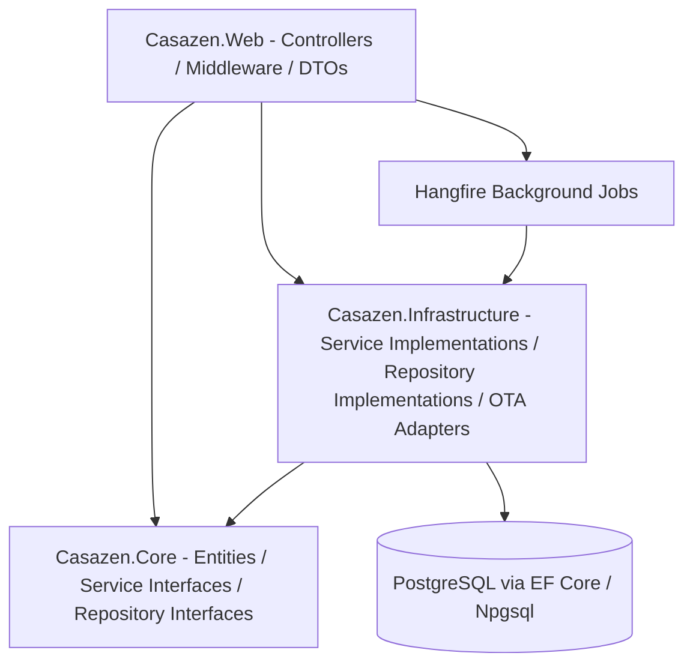
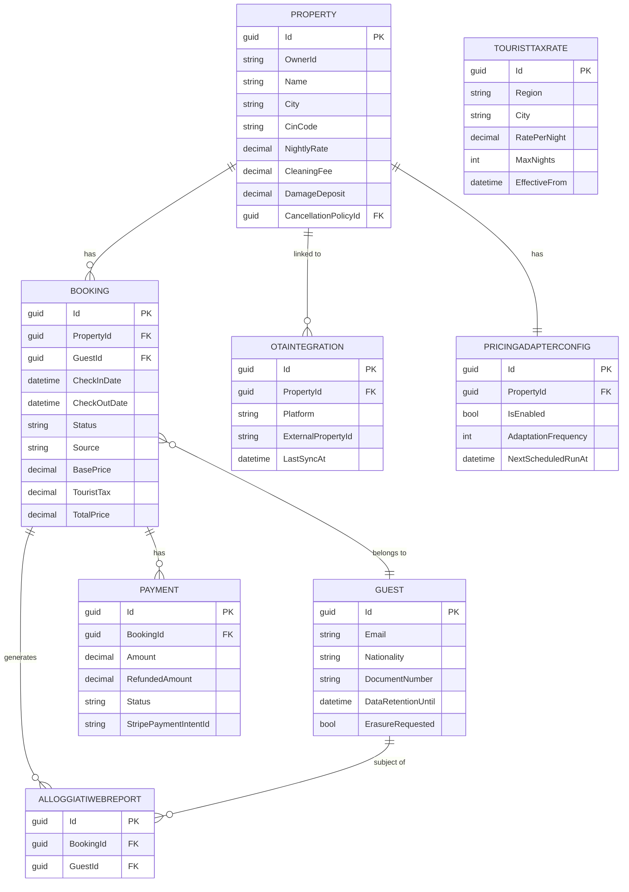

# CasaZen — Technical Documentation

> ASP.NET Core 10 REST API following a layered architecture (Presentation → Business Logic → Data Access), with PostgreSQL (Npgsql / Supabase) via EF Core, Auth0 JWT authentication, and Hangfire background jobs.

---

## Architecture

### Layer diagram



### Layer responsibilities

| Layer | Directory | Responsibility |
|---|---|---|
| Presentation | `Casazen.Web/` | HTTP controllers, DTOs, middleware, Swagger config, auth wiring, background job registration |
| Business Logic | `Casazen.Core/` | Domain entities, service interfaces, repository interfaces, enums, validators, utilities |
| Data Access | `Casazen.Infrastructure/` | EF Core DbContext, repository implementations, service implementations, OTA adapters, Stripe/email clients |
| Tests | `Casazen.Tests/` | Unit and integration tests |

### Dependency rule
`Casazen.Core` has no external project dependencies — it defines only interfaces and entities. `Casazen.Infrastructure` depends on `Casazen.Core` (implements its interfaces). `Casazen.Web` depends on both `Casazen.Core` (for interface injection) and `Casazen.Infrastructure` (registered in DI). This ensures the domain is framework-agnostic.

---

## Tech Stack

| Component | Technology | Version | Notes |
|---|---|---|---|
| Language | C# | 13 | Nullable reference types enabled |
| Framework | ASP.NET Core | 10.0 | Minimal hosting model in `Program.cs` |
| Database | PostgreSQL (Supabase) | — | Npgsql EF Core; integration tests run on real PostgreSQL (see Testing) |
| ORM | Entity Framework Core | 10.x | Code-first, migrations in `Casazen.Infrastructure/Migrations/` |
| Authentication | Auth0 + JWT Bearer | — | `sub` claim used as user ID |
| Background jobs | Hangfire | 1.8.x | PostgreSQL storage; dashboard at `/hangfire` |
| Payment processing | Stripe .NET SDK | — | Webhook signature verification required |
| Email | Resend SDK (`ResendEmailService`) | — | Only provider; emails queued on Hangfire, templates IT/EN (`docs/runbooks/email.md`) |
| OTA resilience | Polly | — | Retry, circuit breaker, timeout, rate limiting per platform |
| Test framework | xUnit | — | `Casazen.Tests/` |
| API docs | Swashbuckle / Swagger | — | Swagger UI at `/swagger` (dev only) |

---

## API Reference

### Base URL
`/api`

### Authentication
All endpoints require a `Bearer` JWT token in the `Authorization` header (issued by Auth0), except anonymous routes noted below (public booking, legal, health, webhooks, guest check-in tokens, supplier register, plan catalogue, SEO sitemap).

Anonymous / public (non-exhaustive highlights):
- `GET /api/health`, `GET /api/health/live`, `GET /api/health/ready`, `GET /api/properties/search`
- `GET /api/orgs/plans`
- All `/api/public/*` (including the SEO sitemap `/api/public/sitemap.xml` and the guest check-in portal `/api/public/checkin/*`), `/api/legal/*`
- `POST /api/suppliers/register`, webhook receivers under `/webhooks/*`

### Authorization (TN-3)

Every action is either `[AllowAnonymous]` or protected by a policy from `Casazen.Web/Authorization/CasazenPolicies.cs`
(the complete set registered at startup; `EndpointAuthorizationArchitectureTests` fails for a policy used but not
registered, registered but unused, or an action with neither).

| Policy (constant) | Who passes |
|---|---|
| `Authenticated` | any signed-in user, suppliers included: only user-scoped endpoints, each listed with its reason in the test allow-list |
| `AdminOnly` | JWT role `Admin` |
| `Supplier` (`RequireSupplier`) | JWT role `Supplier` (backfilled from the DB supplier link) |
| `OrgBillingAdmin` (`RequireOrgBillingAdmin`) | org administrator in either rental context (PL-16): owner `PropertyOwner` or `LongTermLandlord` (JWT role, or DB membership with the owner's role key: `property_owner` of short-rent, `long_term_landlord` of long-rent, `OrgOwnerRoles`), platform `Admin`, or (AM-01) an `account` membership holding `org.billing.manage` (`org_owner`, `org_admin`); never `Staff`/`Guest`, never a `PropertyManager` (D12) nor any other member role. Plan, entitlement, billing, Stripe Connect account, branding, domain, site documents and (AM-03b) the export of the org's fiscal data and team |
| `SharedPropertyRead` / `SharedPropertyWrite` | `property.*` in short-rent **or** long-rent: only the property core a long-term landlord needs (list, record, create/update, documents/APE) — A7-06 |
| `PropertyRead` / `PropertyWrite` | short-rent `property.*`: the short-stay side of a property (photos, CIN, iCal, activation, detail with bookings/OTA, pricing, fiscal, service requests) |
| `BookingRead/Write`, `PaymentRead/Write`, `GuestRead/Write`, `OtaRead/Write` | short-rent context permission |
| `ServiceRequestWrite`, `GuestManage`, `AlloggiatiSubmit` | AM-03: short-rent permissions carved out of `property.write` (interventions), `guest.write` (erase, anonymize, consents of a guest) and `booking.write` (register the guests of a stay, declare the Alloggiati communication sent); the owner and the property manager hold them, the collaborator only the first (`docs/runbooks/org-team.md` § 21) |
| `LeaseRead/Create/Sign/Register` | long-rent context permission |
| `OrgMembersManage` (`RequireContext:account:org.members.manage`) | AM-02: the owner and the administrators of the org (permission of the `account` context); the invitations and the members endpoints |
| `OrgActivityRead` (`RequireContext:account:org.activity.read`) | AM-02b: the owner and the administrators; the list and the CSV of the activity log |

Context permissions come from the DB memberships (`UserContextMemberships` → `Roles` → `RolePermissions`) with the JWT
roles as fallback (`ContextAuthorizationService`). A permission counts only in the context that grants it: the long-rent
`property.*` never satisfies a short-rent policy (`RequireContext:short-rent|long-rent:…` lists both contexts where an
endpoint serves both). The class carries the read permission, writing actions add the write one.

**Org membership (AM-01, `docs/runbooks/org-team.md`).** `OrgMember` (table `OrgMembers`, one org per user, role Owner / Admin /
PropertyManager / Collaborator / Accountant) is the source of truth of who belongs to which org; the `UserContextMemberships` rows
are the projection of its role into permissions, written in the same transaction by `IOrgMembershipService` only. The roles
`org_owner`, `org_admin`, `org_accountant` live in the new context `account` ("Amministrazione" of the customer, permissions
`org.members.manage`, `org.billing.manage/read`, `org.settings.manage`, `org.suppliers.manage`, `org.activity.read`; the staff
console stays `admin`); `GET /api/me/contexts` lists `account` first (clients leave it out of the areas they switch between). For a user with an org member row
and a rental membership the host contexts come from the DB only (a token never adds one: veto of PR #455 limited to org
members); a deactivated member gets 403 `member_inactive` from the next request.

**Org invitations, members and seats (AM-02, `docs/runbooks/org-team.md`).** The owner and the
administrators (permission `org.members.manage` of the `account` context) invite a person with a role and the areas it works
in. The invitation (`OrgInvitation`, table `OrgInvitations`) holds a seat for seven days; its link carries a 256-bit secret of
which only the SHA-256 is stored, a new link replaces the old one, and the token only travels in the body of the two public
calls. The invited account accepts (verified email equal to the invited one, never a platform admin, the four consents again
for the new org) and becomes a member; a person whose own org is still empty and unbilled leaves it, anyone else with an org
is refused (409 `invitation_user_has_organization`). Seats per plan (Starter 2, Pro 10, Scale unlimited) count active members
plus pending invitations and are decided under one advisory lock per org. Only the owner creates or touches an
administrator; the owner is never touched. The hourly job `org-invitation-maintenance` reminds on the third day, expires
and deletes the closed invitations 30 days after they closed.

**Activity log and requests for access (AM-02b, `docs/runbooks/org-team.md` part 4).** The owner and
the administrators (permission `org.activity.read`) read who did what in the org: a short list with ids and codes and no personal
data (`OrgActivityEntry`, table `OrgActivityEntries`, events fixed in `OrgActivityCatalog`: the people, the properties given to
a member, the plan, the name and the slug of the org). A service writes the line with `IActivityLog.Record` **inside the unit of
work of the change it records** (the same `SaveChanges`, the same transaction: a rollback takes both away). The list is paged and filtered (`from`, `to`, `type`, `area`, `actor`) and the CSV has a fixed header and no
personal data; the lines are deleted after 12 months by the nightly job `org-activity-retention`. A member who cannot do
something asks the administrators for access (`POST /api/orgs/me/access-requests`): an area or a page of a closed list and a
note of up to 200 characters, an email in Italian or English to the owner and the administrators, a line in the log, nothing else
stored; three requests a day for each person.

**Completions of the team backend (AM-02c, `docs/runbooks/org-team.md` part 6).** The screens of the
account area read the matrix of the roles from one place (`OrgCapabilityCatalog`: twelve capabilities whose level comes from the
permissions of the seeded roles, never a second table, with real actions run against the levels that have an enforcing action today; a
test fails on a permission with no capability; `billing`, `suppliers` and `settings` report their permission rows before their endpoints
ask for them, AM-02c-FU4), change the areas of a member (`IOrgMembershipService.SetAreasAsync`, same lock as the change of role; a
«Solo alcuni» collaborator that works in one area reaches only the given properties of that mode, in the lists, the single resources, the
notification audience and the people count), give a «Solo alcuni» collaborator its
properties in the invitation (`OrgInvitationProperties`, turned into grants in the transaction of the acceptance), and show a home
that is one request (`GET /api/orgs/me/overview`, a fixed number of SQL statements). The emails of the invitations are capped
(`OrgTeam__InvitationDailyLimit`, `OrgTeam__ResendMinutes`). The property manager has the restricted membership `account/org_manager`
(the trusted suppliers only) and the activity log learns the change of mode of a property.

The policy says what kind of operation a user may do; the row itself is checked with
`IAuthorizationService.AuthorizeAsync(User, HostResource, operation)` (`PropertyOperations`, `SharedPropertyOperations`,
`BookingOperations`, `GuestOperations`, `PaymentOperations`, `OtaOperations`, `LeaseOperations`): `HostResourceAuthorizationHandler` grants it only when the row
is in the caller's org, the caller holds the permission and, for property-bound rows, **reaches the property** (AM-03): every
property for an owner, administrator, manager or accountant member and a collaborator with every property, only the ones in
`PropertyMemberAccesses` for a collaborator "Solo alcuni", the ones it created for an account in no org team. The reach is read
from the database (`IHostScopeResolver`, the authorization snapshot cached 60 s), never from the token roles. Lists use
`await User.ResolveHostScopeAsync(resolver, orgId)` → `HostScope` and narrow with `query.InScope(scope)` (an `EXISTS` in the same SQL
statement). Services never check roles: they receive the org / scope decided by the web layer. A row that is not in
the caller's org answers 404; a visible row the caller may not use answers 403.

There are **48** controller source files under `Casazen.Web/Controllers/`. The supplier jobs with QR check-in (`SupplierJobController`, `PublicCheckInController`) were removed by SU-11 (decision D12): supplier work is a `ServiceRequest` only.

### Endpoints

#### Auth / identity / devices

| Method | Path | Auth | Description |
|---|---|---|---|
| `GET` | `/api/auth/profile` | JWT | Current auth profile |
| `POST` | `/api/auth/logout` | JWT | Logout / invalidate session side-effects |
| `GET` | `/api/users` | Admin | Paginated user list |
| `GET` | `/api/users/{id}` | Admin | User detail |
| `GET` | `/api/users/me` | JWT | Current user profile |
| `PUT` | `/api/users/me` | JWT | Update current user profile |
| `POST` | `/api/users/onboarding` | JWT | Submit user onboarding payload |
| `PUT` | `/api/users/onboarding` | JWT | Update user onboarding payload |
| `PUT` | `/api/users/{id}/role` | Admin | Change user role |
| `DELETE` | `/api/users/{id}` | Admin | Delete user |
| `POST` | `/api/devices` | JWT | Register iOS/Android push device |
| `DELETE` | `/api/devices/{deviceId}` | JWT | Unregister device |
| `GET` | `/api/me/notifications?unread=&page=&pageSize=` | JWT | UI-12a: the caller's in-app notifications (the bell), newest first, paged (`pageSize` 1–50, default 20): `{ items: [{ id, type, entityId, createdAt, readAt }], totalCount, page, pageSize }`. No text: the client writes it from `type` |
| `GET` | `/api/me/notifications/unread-count` | same | `{ count }` |
| `POST` | `/api/me/notifications/{id}/read` | same | 204, idempotent; 404 for a notification that is not the caller's (another user's, another org's, deleted, unknown), never 403 |
| `POST` | `/api/me/notifications/read-all` | same | 204 |

#### Multi-tenancy (orgs & workspace)

| Method | Path | Auth | Description |
|---|---|---|---|
| `GET` | `/api/me/contexts` | JWT | Workspace contexts (host / supplier / …); merges JWT roles with `UserContextMemberships`; the `account` context (AM-01) is listed first for a member of an org, and clients leave it out of the areas they switch between |
| `PUT` | `/api/me/last-context` | JWT | UI-13a: remember the area the caller entered last (`{ "contextKey" }`, one of the contexts `GET /api/me/contexts` lists for the caller; anything else: 422 `context_not_accessible`); `GET /api/me/contexts` gives it back as `lastUsedContextKey` while the caller can still enter it |
| `GET` | `/api/orgs/plans` | Anonymous | Plan catalogue and property limits |
| `GET` | `/api/orgs/me/entitlement` | OrgBillingAdmin (org policy, any rental context, PL-16) | Org plan tier (the effective one), limits, usage, `canAddProperty`, `canUseCustomDomain`; BL-01: `openAccess` (`true` when the tier shown is raised by `Entitlement:OpenAccess`, [`open-access.md`](runbooks/open-access.md)); AM-02: `limits.maxSeats`, `usage.seats`, `canInviteMember` |
| `PUT` | `/api/orgs/me/plan` | Org billing admin | Downgrade / back to Starter only; upgrade without an active subscription → 403 `subscription_required`, Stripe-managed plan → 409 `managed_by_stripe` (#274) |
| `POST` | `/api/orgs/me/invitations` | Policy `RequireContext:account:org.members.manage` | AM-02: invite a person (email, name, role, areas): 201 `{ invitation, emailQueued }`; 403 `org_owner_required`, 409 `org_seat_limit_reached`, `org_invitation_already_pending`, `org_member_already_member`, 422 `org_owner_not_assignable`, `org_member_area_required`; AM-02c: a «Solo alcuni» collaborator carries `propertyIds` (at most 500, live properties of the org: 422 `org_member_property_unknown`, 422 `org_member_scope_not_supported` for another role or scope) and the org is capped to `OrgTeam:InvitationDailyLimit` emails in 24 hours: 429 `invitation_daily_limit_reached` |
| `GET` | `/api/orgs/me/invitations` | same | Invitations open or expired, never the token; AM-02c: each with `propertyIds` and `lastSentAt` |
| `POST` | `/api/orgs/me/invitations/{id}/resend`, `/revoke`, `/link` | same | Send again with a new link (7 more days) / withdraw (204, idempotent) / a fresh link to hand out (`no-store`); AM-02c: «reinvia» once every `OrgTeam:ResendMinutes` for each invitation (429 `invitation_resend_too_soon`) and counted in the daily cap |
| `GET` | `/api/orgs/me/members` | same | `{ items, seats }`: the people, owner first, and the seats of the plan |
| `PUT` | `/api/orgs/me/members/{id}` | same | Change the role (never to Owner; Admin only by the owner) |
| `PUT` | `/api/orgs/me/members/{id}/areas` | same | AM-02c: `{ areas: ["short-rent","long-rent"] }`, at least one; role and properties stay (a collaborator «Solo alcuni» keeps its grants and reaches the given properties of the modes it works in); 403 `org_owner_required`, 409 `org_last_owner`, 422 `org_member_area_required`; a line `MemberAreasChanged` in the log |
| `GET` | `/api/orgs/me/roles` | JWT (any active member) | AM-02c: the matrix of the five org roles: `permissionsByContext`, twelve `capabilities` (`Yes` · `Read` · `No`, read from the permissions of the seeded roles), `assignable` (relative to the caller) and `scopeSupported` (the collaborator only) |
| `GET` | `/api/orgs/me/overview` | Policy `RequireContext:account:org.members.manage` | AM-02c: the figures of the home in one answer: `standing`, `openAccess`, `seats`, `properties`, `invitations`, `accessRequests`, `suppliers`, `alloggiati`, `recentActivity`; a section whose own permission the caller lacks is left out |
| `POST` | `/api/orgs/me/members/{id}/deactivate`, `/reactivate` | same | Switch the access off / on (reactivating takes a seat); 409 `org_last_owner` for the owner |
| `DELETE` | `/api/orgs/me/members/{id}` | same | The person leaves the org; its account stays |
| `GET` | `/api/orgs/me/members/{id}/properties` | same | AM-03: the active properties of the org with whether this member reaches each (`granted`) and how many people do (`peopleWithAccess`); `scopeSupported` false for a member who is not a collaborator |
| `PUT` | `/api/orgs/me/members/{id}/properties` | same | AM-03: `{ propertyScope, propertyIds }` with `propertyScope` `All` or `Selected` ("Solo alcuni" is the collaborator only); 403 `org_owner_required`, 422 `org_member_scope_not_supported`, `org_member_property_unknown` |
| `GET` | `/api/orgs/me/activity` | Policy `RequireContext:account:org.activity.read` | AM-02b: the activity log, newest first, paged (`page`, `pageSize` 50/100) and filtered (`from`, `to`, `type` one or several, `area`, `actor` or `system`): `{ items, totalCount, page, pageSize }`, each item with ids and codes only; 400 for an unknown event or area or `from` after `to` |
| `GET` | `/api/orgs/me/activity.csv` | same | AM-02b: the whole matching log as a CSV (fixed header `id,when,actor,area,type,subjectType,subjectId,details`, no personal data, never cached) |
| `POST` | `/api/orgs/me/access-requests` | JWT (any active member), rate limited per person (`OrgAccessRequest`) | AM-02b: `{ area, note }`, 202 `{ notified }`: an email to the owner and the administrators and a line in the log; 409 `access_request_limit_reached` (three a day), 422 `access_request_area_unknown`, 429 |
| `POST` | `/api/org-invitations/lookup` | Anonymous, rate limited (`PublicInvitationLookup`) | What a link is for; every link that does not work answers the same 410 `invitation_invalid` |
| `POST` | `/api/org-invitations/accept` | JWT (any signed-in account) | Accept with the four consents: 200 `{ orgId, orgName, role, areas, leftEmptyOrg }`; 403 `invitation_email_mismatch`, `invitation_email_not_verified`, `invitation_platform_admin`; 409 `invitation_user_has_organization`; 410 `invitation_expired`, `invitation_used`, `invitation_revoked`, `invitation_invalid` |
| `GET` | `/api/orgs/{orgId}/domain` | JWT | Custom domain config for org |
| `POST` | `/api/orgs/{orgId}/domain` | JWT | Set custom domain |
| `POST` | `/api/orgs/{orgId}/domain/verify` | JWT | Verify DNS / domain ownership |

#### Global search (UI-13a)

| Method | Path | Auth | Description |
|---|---|---|---|
| `GET` | `/api/search?q=&limit=` | JWT, rate limited per user (`GlobalSearch`, 60 / min) | Groups of results by kind (`property`, `booking`, `guest`, `lease`, `service-request`, `supplier`, `supplier-request`), each only when the caller holds the permission of that group in its context, bound in SQL to its org and to the properties it reaches (AM-03). `q` 2 to 64 characters (400 `search_query_too_short` / `search_query_too_long`), `limit` per group (default 5, at most 20). A result is `{ type, id, title, subtitle, destination }` with a destination **key** (`short-rent.property`, `long-rent.lease`, …), guest e-mail masked, never phone or document. `Cache-Control: private, no-store`. Full-text search on generated `SearchKey` columns and their GIN indexes, no extension: [`runbooks/global-search.md`](runbooks/global-search.md) |

#### Onboarding

| Method | Path | Auth | Description |
|---|---|---|---|
| `GET` | `/api/onboarding/status` | JWT | Host / org onboarding wizard status |

#### Properties

| Method | Path | Description |
|---|---|---|
| `GET` | `/api/properties` | Properties of the caller org the caller reaches (AM-03: read from the org membership in the database; the whole org for an owner, administrator, manager, accountant or a collaborator with every property; only the ones given to a collaborator "Solo alcuni"; the ones created for an account in no team). Short-rent or long-rent Each row carries `rentalMode` (`Short`/`Long`, PM-01); `?mode=short\|long` narrows the list (400 `validation_error` for another value), without it every property is listed |
| `GET` | `/api/properties/{id}` | The property record (`PropertyResponse`): no bookings, check-in tokens, OTA integrations or documents (PC-02, A2-32; bookings come from the booking endpoints). Short-rent or long-rent |
| `GET` | `/api/properties/cancellation-policies` | Cancellation policies a property can reference (global catalog). Short-rent only |
| `POST` | `/api/properties` | Create a new property. Short-rent or long-rent; `nightlyRate`/`maxGuests` may be `0` (long-term only property, blocks short-stay activation); `bedrooms` may be `0` (studio). Optional `rentalMode` (`Short`/`Long`, PM-01): without it, no guests **and** no rate create a `Long` property, anything else a `Short` one ([`property-rental-mode.md`](runbooks/property-rental-mode.md)) |
| `PUT` | `/api/properties/{id}` | Update a property (owner or org-wide role) with **PATCH semantics** (PC-02, A2-04): a field left out of the body (or `null`) keeps its stored value; `cinCode`, `slug` and `cancellationPolicyId` sent as `null` are cleared. 400 `validation_error` for an invalid field, 422 `cancellation_policy_not_found`, 422 `property_rental_mode_change_not_allowed` for a `rentalMode` that is not the stored one (the mode is never changed by this save). Short-rent or long-rent |
| `PUT` | `/api/properties/{id}/responsible` | AM-03: the member in charge of the property, `{ userId }` or `null`: 204; 422 `property_responsible_invalid` (not an active member who reaches the property). Short-rent or long-rent, same check as the update |
| `GET` | `/api/properties/{id}/mode` | PM-02. The mode of the property, the change waiting for its day and the last one that is over. Short-rent or long-rent ([`property-rental-mode.md` §8](runbooks/property-rental-mode.md#8-the-scheduled-change-of-mode-pm-02-decision-d16)) |
| `GET` | `/api/properties/{id}/mode/preview?to=short\|long&date=` | PM-02. What a change to `to` on `date` (default: the first possible day) meets: stays, imported calendar blocks or leases in the way, the first free day, the `issues` the creation would answer. Ids and dates only |
| `POST` | `/api/properties/{id}/mode/change` | PM-02. Programs the change (`{ to, effectiveDate }`, tomorrow at the earliest). 201, 404 `property_not_found`, 409 `property_mode_change_exists` / `property_mode_blocked_by_bookings` / `property_mode_blocked_by_lease` / `property_mode_blocked_by_draft_lease`, 422 `property_mode_unchanged` / `property_mode_date_too_early` / `property_mode_date_too_far`. To long-term the calendar closes from the night before the day |
| `DELETE` | `/api/properties/{id}/mode/change/{changeId}` | PM-02. Withdraws a change that is still waiting: 204, 404 `property_mode_change_not_found`, 409 `property_mode_change_not_scheduled` |
| `GET`/`POST` | `/api/properties/{id}/documents` | List (with `documentType`) / upload documents such as the APE. Short-rent or long-rent |
| `DELETE` | `/api/properties/{id}/documents/{docId}` | Delete a document. Short-rent or long-rent |
| `GET` | `/api/properties/{id}/documents/{docId}/download` | Authenticated download from the private bucket (FD-07). Short-rent or long-rent |
| `DELETE` | `/api/properties/{id}` | Delete a property (owner only). Short-rent only |
| `GET` | `/api/properties/search` | Search properties by city, bedrooms, max price (anonymous) |
| `GET` | `/api/public/amenities` | DB-11a. The amenity catalog of the booking site: the five groups and, for every `PropertyAmenity`, its name, icon, group and label in Italian and English (anonymous, cacheable one hour) |
| `GET` | `/api/properties/{id}/images` | The photo gallery (PC-04): `photoUrls` in display order (absolute public URLs, the first is the cover) plus the upload rules (`maxPhotos`, `maxFilesPerRequest`, `maxFileSizeBytes`, `allowedContentTypes`). Short-rent only |
| `POST` | `/api/properties/{id}/images` | Upload photos (multipart field `images`; at most 10 files per request, 10 MB each, 20 per property; JPEG/PNG/WebP checked on their content). All or none. 422 `property_photo_none`/`_too_many_files`/`_invalid_type`/`_invalid_size`/`_limit_reached`. Answers with the gallery |
| `DELETE` | `/api/properties/{id}/images?url=...` | Delete a photo **by URL** (not by position) from the gallery and its object from the storage. 404 `property_photo_not_found`. Answers with the gallery |
| `PUT` | `/api/properties/{id}/images/order` | Set the order: body = every photo URL of the gallery, each once. 409 `property_photos_changed` when the list is not the current gallery. Answers with the gallery |
| `PUT` | `/api/properties/{id}/images/cover` | Make a photo the cover (body `{ "url": ... }`): it moves first. Answers with the gallery |
| `GET` | `/api/properties/{id}/site-profile` | DB-11a. The optional facts and texts of the property page of the booking site (floor, renovation, energy class and index, kind of place, children, latest arrival, video and tour, zone, what is near, notes, highlights, safety notes, labels) plus `derivedTags` (the labels the data of the house give it). Short-rent only; `null`/empty = the host never said ([`direct-booking.md` §14](runbooks/direct-booking.md#14-the-site-profile-of-a-property-db-11a)) |
| `PUT` | `/api/properties/{id}/site-profile` | DB-11a. Replaces the whole profile (what the body leaves out is cleared); texts in Italian (always) and English (optional), fixed lists for labels and highlight icons, a YouTube/Vimeo video and a Matterport tour stored as canonical embeds. 422 `property_site_profile_*` with the `field`, 422 `property_not_bookable_in_long_mode`. Answers with what is stored |

Property record choices (PC-02):
- **Update = PUT with PATCH semantics**, not a full PUT: a client that does not know or show a field (the long-term
  form, the pause toggle of the list, an older app build) can never reset the cleaning fee, deposit, house rules,
  timezone or cancellation policy. The web forms still send every field they show (`toPropertyPayload`), never the
  photos (managed by the image endpoints; a `photoUrls` sent to create or update is ignored, PC-04).
- **Bathrooms stay a whole number** (`int` in the model and the database, 1-50): the form accepts whole numbers only,
  no migration. **Bedrooms 0-100**, `0` = studio (monolocale); the activation wizard no longer requires a bedroom.
- **No country nor currency** on the property: amounts are in euros and the form has no such fields.

#### Bookings

| Method | Path | Description |
|---|---|---|
| `GET` | `/api/bookings` | List bookings a page at a time (PC-14: `?propertyId&guestId&page&pageSize`, `Bookings:DefaultPageSize` = 10 when `pageSize` is missing, at most 100), answered as `{ items, totalCount, page, pageSize }`; since SR-03b the search below without a filter but these two, rows included |
| `GET` | `/api/bookings/search` | The same list with days, status and text (SR-03, below): `?from&to&status&q&propertyId&guestId&page&pageSize`, same order, same answer, same default page size. SR-03b adds `&arrivalFrom&arrivalTo&view&channel&checkInStatus&sort` and, on each row, `channel`, `paymentState`, `paidAmount`, `alloggiatiStatus`, `respondBy` |
| `GET` | `/api/bookings/counts` | SR-03b: how many bookings are in each chip of the list (`{ all, toConfirm, upcoming, inProgress, completed, cancelled }`), for the filters of the search but the chip, the page and the order |
| `GET` | `/api/bookings/{id}` | Get a single booking; SR-05a adds `paymentState`, `paidAmount` and `guestDataComplete` (below) |
| `GET` | `/api/bookings/{id}/timeline` | SR-05a: the history of the booking, derived from its timestamps and the rows tied to it (below); `booking.read` on its property, 404 outside the caller's scope |
| `POST` | `/api/bookings` | Create a booking (availability check + tourist tax calculation) |
| `PUT` | `/api/bookings/{id}` | Update a booking |
| `DELETE` | `/api/bookings/{id}` | Cancel a booking |
| `GET` | `/api/bookings/calendar` | Calendar view of one property (`?propertyId&startDate&endDate&timezone`); unchanged |
| `GET` | `/api/calendar` | SR-02a: the calendar of all the host's properties in one read (below): `?from&to&propertyIds&timezone` |
| `POST` | `/api/bookings/{id}/check-in` | Perform check-in: records `ArrivedAt`, schedules the Alloggiati Web job (idempotent) |
| `POST` | `/api/bookings/{id}/check-out` | Perform check-out |
| `GET` | `/api/bookings/{id}/alloggiati-status` | Alloggiati Web status (same as `/api/alloggiati/{id}/status`) |

**Booking code and the searchable list (SR-03).** Every booking answer carries `bookingCode`, the code the guest knows,
as `XXXXX-XXXXX` (`BookingCodes.Format`; stored without the dash, unique per org). `GET /api/bookings/search` is the list
the screens of the Prenotazioni area read (`IBookingSearchService`); `GET /api/bookings` (PC-14) is unchanged and keeps the
order and the answer the search has (latest check-in first, then the id). It is filtered in SQL by the caller's `HostScope`
like the plain list (`propertyId` of another org: 404, without `booking.read` on it: 403), and by:
- `from`, `to` (`yyyy-MM-dd`, both optional, both included): the stays that have a day in the range, from the arrival day to
  the departure day, compared as stay dates (midnight UTC of the day, never moved to a time zone: `HostCalendarRange`). A
  `from` after `to` is 400 `booking_list_invalid_range`.
- `status`: one or more of `Pending`, `Confirmed`, `CheckedIn`, `CheckedOut`, `Cancelled`, repeated or separated by commas,
  by name and any case (400 `booking_list_invalid_status` for anything else, numbers included); none = every status.
- `q`: any case, in the name of the guest (first and last, in either order), the email of the guest, the name of the
  property and, when what was typed can be a piece of a code (`BookingSearchRules.CodeFragment`: no dashes or spaces, `O`
  read as `0`, `I` and `L` as `1`, at least 3 characters), the booking code. `%` and `_` are ordinary characters. At most
  100 characters are read.
- `page` (from 1) and `pageSize` (`Bookings:DefaultPageSize` of the plain list when missing, at most 100; out of range is
  brought within it). The order is the latest check-in first and the booking id as the tie-break, a total order: the same
  booking is never on two pages nor on none. One query for the page, and a second for `totalCount` only when the page is full
  or past the end.

**The booking list, completed (SR-03b).** `GET /api/bookings` and `GET /api/bookings/search` now read the same service
(`IBookingSearchService`): the plain list is the search with `propertyId` and `guestId` only, so the order, the scope and the
rows are the same (the paged members `GetPagedByScopeAsync` and `GetPagedBookingsAsync` of the booking service and repository
are gone). Everything below is optional and additive; nothing of the SR-03 answer changed shape.
- `arrivalFrom`, `arrivalTo` (`yyyy-MM-dd`, both included): the stays that **arrive** in the range (the check-in date), where
  `from` and `to` keep the stays that have a day in it. `arrivalFrom` after `arrivalTo` is 400 `booking_list_invalid_range`.
- `view`, the chip: `all` (default); `toConfirm`, a "pay at the property" request waiting for the host; `upcoming`, Confirmed,
  or Pending and waiting for its payment (not an expired hold), with check-in after today; `inProgress`, CheckedIn, or Confirmed
  with check-in today; `completed`, CheckedOut; `cancelled`, Cancelled (`BookingListRules.InView`, days are Europe/Rome). A
  booking is in one chip at most; a Confirmed stay of the past that nobody registered is in none yet (it is in `all`). 400
  `booking_list_invalid_view`.
- `channel`, repeated or separated by commas: `Direct` (the booking site), `Manual` (entered by the host), `Airbnb`,
  `BookingCom`, `Other` (every other source); 400 `booking_list_invalid_channel`.
- `checkInStatus`, repeated or separated by commas: the state of the online check-in link as `GET /api/dashboard/today`
  reads it (`NotSent`, `Sent`, `InProgress`, `Completed`, `Expired`), from the link alone, not from whether the guests' data are
  complete; filtered in SQL. 400 `booking_list_invalid_check_in_status`.
- `sort`: `checkIn`, `createdAt`, `total`, `status` or `guest` (last then first name), then `:asc` (the default) or `:desc`;
  without `sort` the latest check-in comes first, as it always did. The booking id always closes the order. 400
  `booking_list_invalid_sort`.

Each row (`BookingListItemDto`: the booking as everywhere, plus) carries `channel`; `paymentState` (`None`, `Partial`, `Paid`
or `Refunded`: how much of `totalPrice` came in, a failed or open payment being nothing); `paidAmount` (euros: the payments
collected minus what was refunded, before any OTA withholding; `null` for a caller without `payment.read`, who still gets the
state: SR-D7); `alloggiatiStatus` (where the Alloggiati communication stands, as the Alloggiati page reads it, for a Confirmed,
CheckedIn or CheckedOut stay, else `null`); `respondBy` (until when a request waiting for the host may be answered, else
`null`). A page costs one query for the bookings, one for the total only when it is full or past the end, and one each for the
payments and the reports of its bookings: none per row.

`GET /api/bookings/counts` answers `{ all, toConfirm, upcoming, inProgress, completed, cancelled }` for the bookings that
satisfy the filters of the search but the chip, the page and the order (`status`, `q`, `from`, `to`, `arrivalFrom`, `arrivalTo`,
`channel`, `checkInStatus`, `propertyId`, `guestId`), in one aggregate query: a `COUNT(*) FILTER` per chip built from the very
predicates of the lists, so a counter is the total of its chip. Same scope, same 400s, same 404 and 403 as the search.

**The calendar of all the properties (`GET /api/calendar`, SR-02a; `IHostCalendarService`).** Policy `short-rent booking.read`,
limited to the caller's `HostScope` in SQL like every host list (the properties of another org, or a collaborator's «Solo alcuni»
that are not its own, are not there, and asking for one by id gives nothing, as if it did not exist). `from` and `to`
(`yyyy-MM-dd`, both included; today and the 29 days after it when missing; at most 92 days, 422 `calendar_window_too_large`; `to`
before `from` is 400 `booking_calendar_range_invalid`; years 2000 to 2100), `propertyIds` (repeated or separated by commas, at
most 50, 422 `calendar_too_many_properties`; without it the first 50 by name, `propertiesTotal` says how many there are) and
`timezone` (IANA id, Europe/Rome by default; it only sets `utcOffsetMinutes`, every date is a calendar date). The answer is
`{ timezone, utcOffsetMinutes, today, from, to, propertiesTotal, properties, items }`:
- `properties`: the short-rent properties (`IsActive`, not in long-term mode), by name, each `{ id, name, city, rentalMode,
  status (Active | Paused), minNights, baseRateCents, weekendSurchargePercent, cleaningFeeCents }`.
- `items`: everything that has a day in the range, from its arrival day to its departure day (the rule of `HostCalendarRange`),
  by first day. `from` and `to` of an item are the first night and the departure day (a stay that leaves on the 12th and one that
  arrives on the 12th do not overlap); an intervention has the day of the work and the day after. Told apart by `type`, with the
  fields of that type only (the others are absent):
  `Booking` (`status`, `guestName`, `numberOfGuests`, `channel` as in the booking list, `paymentOption`, `onSiteRequestState` and
  `requestExpiresAt` of a «pay at the property» request still open, `paymentState`, `totalCents`, `icalFeedId`, `channelLabel` and
  `otaReviewReason` of a stay made from a portal's block); `Ical` (a portal's reservation as a block: `channel`, `feedLabel`,
  `convertible`, `bookingId` of the stay made from it when that stay does not stand for it, `note`); `Block` (`reason`, `note`);
  `Service` (`serviceKind` Cleaning | Maintenance | Other, `category`, `serviceName`, `serviceStatus`, `supplierOrgId`,
  `supplierName`, `bookingId`, `startAt` and `endAt`, absent for a request with no time, which sits on the day its stay leaves).
  Which bookings are there is `CheckoutHolds.OccupiesDates` (no cancelled, no expired hold, a «pay at the property» request yes);
  a block that became a stay standing for it (`PropertyOccupancy.IsRepresentedByStay`) is the stay only; the interventions are the
  short-rent ones that nobody refused or cancelled. No money for an intervention; `totalCents` of a stay is visible to who may read
  bookings (SR-D7), what came in only as `paymentState`.

One read for the properties and one each for the bookings, their payments, the blocks and the interventions: none per property.
`GET /api/bookings/calendar` is not touched. The Home puts the nights taken twice among its things to do (`ResolveCalendarConflict`,
below), from `CalendarAlertRules`, the calculation the future alerts of the calendar will share.

**The state and the history of one booking (SR-05a, SR-D17).** `Booking` keeps three more times, all nullable and never backfilled:
`ConfirmedAt` (a payment that settled, the host's confirmation or acceptance, or a booking confirmed from the start: entered by the
host, an OTA stay), `CancelledAt` (host, guest or system) and `CheckedOutAt`, next to the existing `ArrivedAt`. Every service that
changes the status writes its time in the same save (`HostBookingService`, `OnSiteBookingRequestService`, `BookingCancellationService`,
`CheckoutPaymentSettlementService`, `CheckoutHoldExpiryService`, `DeferredChargeService`, `StripeWebhookHandler`, `StayLifecycleService`,
`BookingService.CreateManualBookingAsync`, `OtaStayService`); a stay confirmed again after an expired hold clears `CancelledAt`. A
booking that went through those states before the migration keeps them null: its history shows the step without a time, never an
invented one. Every booking answer now carries `confirmedAt`, `cancelledAt`, `arrivedAt`, `checkedOutAt` and `canEdit`
(`{ allowed, reason }`: `reason` is `Cancelled`, `Started` or `SourceLocked`, the first that holds; `BookingEditRules`, the very rule of
`PUT /api/bookings/{id}`, which `HostBookingService` reads: only a booking entered by the host, not started, not cancelled can have its
dates and guests changed, SR-D5). `GET /api/bookings/{id}` adds `paymentState` (as the list), `paidAmount` (euros, `null` without
`payment.read`) and `guestDataComplete` (`null` for a request, a hold or a cancelled booking).

`GET /api/bookings/{id}/timeline` answers `{ bookingId, events: [{ kind, at, state, data }] }`, in order, by time. There is no event
log: the entries are derived (`BookingTimeline`, pure) from the booking and from its payments, refunds, check-in links and Alloggiati
report, in at most five queries (`BookingTimelineService`). `kind` is the title (the words are the client's): `Created` or
`RequestReceived` (`data.source`), `GuestEmailPending` and `ApprovalPending` (`data.expiresAt`), `PaymentPending`,
`HostConfirmationPending`, `PaymentReceived` and `Refund` (`data.amount`, only for a caller with `payment.read`: without it the entry is
there and the figure is not; `data.method`, `data.refundStatus`), `Confirmed`, `CheckInLinkSent` (`data.linkState`),
`GuestDocumentsReceived`, `Arrived`, `Alloggiati` (from the arrival day: `data.alloggiatiStatus` as the Alloggiati page reads it, never
"sent" without a receipt or the host's declaration; `data.deadlineAt` while it is not sent), `CheckedOut` and `Cancelled`
(`data.reason` for a system cancellation or a declined request; `data.note`, the host's own words, never sent to the guest). `state` is
`Done` or `Current` (something waits for the host, the guest or the bank). `at` is `null` for a step from before the times were kept.
The steps still to come are not entries. No name and no email of the guest appears anywhere.

#### Host dashboard (PC-16)

| Method | Path | Auth | Description |
|---|---|---|---|
| `GET` | `/api/dashboard/kpis?period=Month&month=yyyy-MM` \| `?period=Last30Days` \| `?period=Next30Days` | short-rent booking.read | KPIs of the period computed on the server (default: current Europe/Rome month); 400 `dashboard_invalid_period`. SR-03, all optional: `&propertyId=` (one property of the caller's reach, else 404), `&compare=true` (adds `previous`) |
| `GET` | `/api/dashboard/overview?period=Month&month=yyyy-MM` \| `?period=Last30Days` \| `?period=Next30Days` \| `?period=Custom&from=yyyy-MM-dd&to=yyyy-MM-dd` | short-rent booking.read | SR-03b: the numbers of the Home in one read (below): the figures of `kpis` compared with the period before, the next arrivals and the revenue by week or month; money only with `payment.read`; 400 `dashboard_invalid_period`; `&propertyId=` as in `kpis` |
| `GET` | `/api/dashboard/today` | short-rent booking.read | SR-03: the host's day in one read (below): arrivals and departures of today with their online check-in, the check-ins to come, the requests waiting, the things to do in order of priority. SR-03b adds the interventions of the day, the Alloggiati status of each arrival, the cleaning of each departure and the things to do about an intervention |
| `GET` | `/api/dashboard/ical-feeds` | short-rent booking.read + property.read | iCal import feeds of the caller's properties: last sync, status, error code and localized message, feeds with an error first; never the URL |
| `GET` | `/api/properties/calendar-overview` | short-rent property.read | SR-10b: the calendars of the caller's active short-rent properties in one read, `{ syncEveryMinutes, staleAfterMinutes, properties[] }`, a property `{ propertyId, propertyName, exportUrl, feeds[] }` (no feed: `feeds: []`) and a feed `{ feedId, channel, label, lastImportAt, lastImportStatus, lastErrorCode, lastError, syncing }`: the state of `ical-feeds` (same code), never the URL. `exportUrl` is the link the host pastes on the portals, a secret in practice (whoever has it sees the dates taken): `private, no-store`, never logged, `null` until it is first asked for (`GET /api/properties/{id}/ical/export-url` creates it, this read creates nothing). Three queries whatever the number of properties; see `docs/runbooks/ical.md` |

All are limited to the caller's `HostScope` (org, and the properties the caller reaches unless the role is org-wide: AM-03),
in SQL.
Definitions (`IHostDashboardService`, `StayKpiRules`; days are Europe/Rome calendar dates, `RomeCalendar`):
- **Period**: a calendar month, the 30 nights ending with tonight (`Last30Days`) or the 30 nights starting tonight
  (`Next30Days`, SR-03). A night belongs to the date it starts on.
- **Occupancy** = occupied property-nights / available property-nights, over the active properties of the scope (the ones
  in long-term mode are not counted: SR-03). A
  night is occupied as in `PropertyOccupancy` (the nights the booking site shows as taken): a booking that occupies
  its dates (`CheckoutHolds.OccupiesDates`: not cancelled, not an expired checkout hold; a valid hold or a pending "pay
  at the property" request counts) or a block imported by an iCal feed. A night closed only by a manual block (owner
  stay, maintenance) is neither occupied nor available. Available = nights of the period × properties − closed nights.
  `rate` is `null` when nothing is available.
- **Revenue** of the period: confirmed stays (Confirmed, CheckedIn, CheckedOut) **pro rata per night**: `BasePrice`
  (lodging + cleaning, tourist tax excluded) × nights of the stay in the period / nights of the stay, rounded to the
  cent on the total. A stay across two months counts in each for its nights there. Pending requests, cancelled
  bookings and what a cancellation retains are not counted. Amounts are in euros.
- **Arrivals / departures today**: confirmed stays whose check-in / check-out date is today in Europe/Rome (between
  22:00/23:00 UTC and midnight UTC this is already the next day). A stay date stored with a time (e.g. `23:30Z`) counts
  on its Rome date.
- **Upcoming check-ins**: `Confirmed` bookings from today on (today's arrivals until the host registers them), soonest
  first; never a cancelled booking. **Recent bookings**: the last five created, any status.
- **Collected** (`collected`, SR-03): the money that came in during the period, by cash, next to the revenue of the stays,
  which is by accrual (`PaymentCashRules`). A payment counts when it is `Completed` or `PartiallyRefunded` (not a failed,
  canceled, open or fully refunded one) on the Europe/Rome day of `ProcessedAt` (else of `CreatedAt`, as the fiscal
  reports do); the amount is the payment minus what was refunded, before any OTA withholding. Payment data: `null` for a
  caller without `payment.read` (the collaborator), and then in `previous` too. Euros in `amount`, cents in `amountCents`
  (also on `revenue`).
- **Direct share** (`directShare`, SR-03): of the confirmed stays of the revenue, how many have source `Direct` (the public
  checkout of the booking site; a stay the host entered is `Manual`): `{ directStays, stays, rate }`, `rate` `null` without
  stays.
- **Previous period** (`previous`, with `compare=true`, SR-03): occupancy, revenue, collected and direct share of the period
  with **the same number of nights that ends where this one starts** (`HostDashboardPeriod.Previous`), whatever the kind: the
  30 days before `Last30Days` or `Next30Days`, and for a month the days just before it, not the previous calendar month,
  which may be a day shorter or longer. The dates are in `previous.period`.

**The overview of the Home (`GET /api/dashboard/overview`, SR-03b; `IHostDashboardService.GetOverviewAsync`).** The numbers of
the Home in one read: the figures of `kpis` (the same code, run for the period and for the one before, so the two never differ in
a rule) and what the Home draws on top of them. `period` is `Month` (default, with an optional `month=yyyy-MM`), `Last30Days`,
`Next30Days` or `Custom` with `from` and `to` (`yyyy-MM-dd`, both included, at most 366 days, years 2000 to 2100); anything else
(`from`/`to` without `Custom`, `month` with another period, a number) is 400 `dashboard_invalid_period`. `kpis` does not know
`Custom`. `propertyId` narrows everything to one property of the caller's reach (404 for any other).
`{ period, today, propertyCount, occupancy, revenue, collected, directShare, upcoming, nextArrivals, previous, series }`:
- `occupancy`: as in `kpis`, plus `deltaPoints`, the rate minus the one of the period before in percentage points to one
  decimal (`null` when either period has nothing available).
- `revenue { amount, amountCents, currency, stayCount, basis, deltaPercent }`: the revenue defined above (`basis` is
  `accrual`), with `deltaPercent` the change from the period before in percent to one decimal (`null` when that had none).
  `collected { amount, amountCents, currency, paymentCount, basis }` is the cash (`basis` is `cash`), gross (SR-D44): it is not the
  same number as the revenue and each says which one it is. Both are worked out on the server; a client never subtracts rounded
  numbers.
- `upcoming { count, previousCount, pendingApproval }`: the stays that arrive in the period (confirmed, a stay already
  registered included) plus the "pay at the property" requests the host has still to answer; `previousCount` the same over the
  period before; `pendingApproval` how many of `count` are such requests.
- `nextArrivals`: the next three arrivals from today whatever the period, soonest first (Confirmed, or a request waiting for the
  host), `{ bookingId, bookingCode, propertyId, propertyName, guestName, numberOfGuests, checkInDate, checkOutDate, status, source,
  awaitingApproval }`. No money.
- `previous { period, occupancy, revenue, collected, directShare }`: the period with the same number of nights that ends where
  this one starts (SR-D43); nothing is compared again there (`deltaPercent` and `deltaPoints` are `null`).
- `series { unit, buckets }`: the revenue by ISO week (from Monday) for a period of up to 62 nights, by calendar month beyond.
  Each bucket is `{ label, from, to, amount, amountCents, previousAmount, previousAmountCents, isFuture }`: `label` is a stable
  key (`2026-W42`, `2026-10`), never text to show; `from` and `to` the first and last night of the bar (the first and the last
  bar are cut at the edges of the period); `previousAmount` the same bar moved back by the length of the period; `isFuture` when
  the bar starts after today (a forecast of the stays already confirmed). The bars add up to `revenue.amount` to the cent, and
  the previous ones to `previous.revenue.amount`: the rounding is carried from bar to bar and the last takes the total.
- **Money is payment data (SR-D7).** For a caller without `payment.read` (the collaborator) `revenue`, `collected` and `series`
  are not in the answer at all (not `null`), nor are `revenue` and `collected` inside `previous`. Occupancy, `upcoming`,
  `nextArrivals` and `directShare` are.
Reads in a fixed number of steps whatever the number of properties: the properties in scope, the figures of the period and of
the previous one, the stays that arrive in both, the next three arrivals; the chart is made of the stays the revenue already read.

**The host's day (`GET /api/dashboard/today`, SR-03; `IHostTodayService`).** One read, no rule of its own: the lists of
the day come from `IHostDashboardService.GetTodayStaysAsync` (`StayKpiRules`), the requests from
`IOnSiteBookingRequestService.GetAwaitingHostApprovalAsync`, the duties from the compliance cockpit described by
`IComplianceMissingService`.
`{ today, arrivals, departures, upcoming, approvals, todo, services }`, each list `{ count, items }` (the count covers all
of them; `items` carries the first 10, 10, 5, 10, 20 and 20). `arrivals` and `upcoming` rows carry `checkIn { state, dataComplete }`:
`state` is `NotSent` (no usable link, or its email failed), `Sent`, `InProgress`, `Completed` or `Expired`; `dataComplete`
says every guest has every field of the Alloggiati record, whoever entered them. No money in the rows. `approvals` are the
"pay at the property" requests waiting for the host with `respondBy` (UTC): then they are cancelled.

SR-03b adds fields to this answer and changes none of the rest. `services { count, items }` lists the interventions (service
requests) of today in Europe/Rome, by time, the first 20: the ones scheduled for today and, for those with no time, the ones of
a stay that leaves today (the day such a request has always had); never the refused or the cancelled. Each is `{ id, category,
serviceName, scheduledStart, scheduledEnd, status, supplierOrgId, supplierName, propertyId, propertyName, bookingId }` (UTC
instants; `scheduledStart` is `null` for a request with no time). Every `arrivals` and `upcoming` row also carries
`alloggiati { status, deadlineAt }`: where the communication stands as the Alloggiati page reads it (`DaInviare` before the
arrival day, `DaInviareManualmente` from then on, `Inviato`, `InviatoManualmente`, `Errore`, `Rifiutato`:
`AlloggiatiStatusRules`) and, until it is sent, its legal term in UTC (`AlloggiatiTerms`). Every `departures` row carries
`cleaning { serviceRequestId, status }`, the latest cleaning request tied to the stay whoever made it (`null` when there is none).
`checkIn`, `alloggiati` and `cleaning` are `null` where they make no sense: a departure has no check-in nor Alloggiati, an arrival
no cleaning. Three reads more, whatever the number of rows: the links, the reports and the guests of all the arrivals listed
together, the cleaning of all the departures listed together, and one page for the interventions.

`todo` is in order of priority (`HostTodoPriority`; inside the same priority the nearest `dueAt` first, then the label):

| `priority` | `action` | What | `dueAt` |
|---|---|---|---|
| 1 | `RespondToRequest` | a request to accept or decline | `respondBy` |
| 1 | `RespondToServiceRequest` | SR-03b: a new intervention on which the supplier proposed another time, to accept or decline | the time asked for, if it has one |
| 2 | `ResolveAlloggiatiFailure` | communication in error or rejected | 24 h (6 h for a stay of one night or less) from the arrival |
| 2 | `ResolveCalendarConflict` | SR-02a: two stays or blocks of a property take the same night, today or in the next 29 days; the label is the property, the target the property and the first of the two that is a stay | start of the first night they share |
| 3 | `SendAlloggiati` | communication to send on the portal | same |
| 4 | `CompleteGuestCheckIn` | data of the guests incomplete (cockpit: arrivals up to tomorrow) | start of the arrival day |
| 5 | `ReviewFailedPayment` | confirmed stay whose payment failed and nothing else paid it; only for a caller with `payment.read` | — |
| 5 | `ConfirmFinalAmount` | SR-03b: a finished intervention whose final amount is above the quote by more than the tolerance, for the host to confirm | — |
| 6 | `CheckOut` | departure to close | start of the departure day |
| 6 | `PayServiceRequest` | SR-03b: a finished intervention with nothing left to confirm, waiting to be paid | — |
| 7 | `ConfirmPropertyReady` | property not declared ready after the check-out | — |
| 8 | `ActivateProperty` | property to activate | — |

Each item is `{ action, priority, dueAt, label, propertyId, propertyName, bookingId, paymentId, serviceRequestId, missing }`: `action` is the
destination as a key (the first six repeat `ComplianceCockpitAction` by name; never a path: each client builds the route from
its own table, as for the cockpit links below) with the ids of its target, `missing` what it still lacks. The three about an
intervention (SR-03b) have the supplier as `label` and its `serviceRequestId` as target; they take the priority of what they are
like (answer 1, amount 5, payment 6), so no priority of SR-03 moved and the range stays 1 to 8. They are those of the
properties the caller reaches, in SQL, and at most 10 of them are listed (answers first, then amounts, then payments; the count
covers all of them): a backlog of finished jobs nobody marked paid never pushes the other things to do out of the 20. The nights
taken twice (SR-02a, `ResolveCalendarConflict`, priority 2: the label and `propertyName` are the property, `bookingId` the first of the
two that is a stay) are those of today and the 29 days after it, of the properties the caller reaches, from `CalendarAlertRules`;
at most 10 are listed, the count covers all of them. A client that does not know an action leaves it out of the list.

**What an item lacks (`missing`, SR-03).** Every item of the cockpit (`GET /api/compliance/summary`) and of `todo` carries
`missing`, a list of `{ code, field, count }` with stable snake_case codes the client translates (`IComplianceMissingService`;
never empty). For a property to activate, the blockers of its activation wizard (`activation_cin_missing`,
`activation_documents_missing`, `safety_*`, ...) with the step as `field` (`base-data`, `cin`, `documents`, `safety`), worked out for
the first 10 properties of the cockpit (the others: `activation_incomplete`) and `activation_not_confirmed` when only the
confirmation is left; for the guests of a stay, one `guest_field_missing` per field of the Alloggiati record the guests lack
(`field` camelCase as `AlloggiatiRecordRules` names it, `count` the guests that lack it) and `guest_composition_invalid` when
the order of the guests is not accepted; for the others, the single thing left (`checkout_not_closed`, `alloggiati_not_sent`,
`alloggiati_failed`, `property_ready_not_confirmed`, `approval_not_answered`, `payment_failed`, and, about an intervention
(SR-03b), `proposal_not_answered` (`field` `response`), `final_amount_not_confirmed` (`amount`) and `service_not_paid` (`payment`),
and a night taken twice (SR-02a), `calendar_conflict` (`dates`)).

The bookings summary of `GET /api/properties/{id}/detail` (A2-36) uses the same rules: `totalBookings` = confirmed
stays, `upcomingBookings` = upcoming check-ins, `activeBookings` = stays in progress today (checked in, or confirmed
with the check-in day passed), `nextCheckIn` / `nextCheckOut` as Rome dates. The detail answers 404 only when the
property is not found; any other failure is a 500.

#### Reports (SR-10)

| Method | Path | Auth | Description |
|---|---|---|---|
| `GET` | `/api/reports/revenue-by-property` | short-rent payment.read | Revenue of the Home, by accrual (`competenza`), per property: `{ title, basis, currency, period, rows, total }`, a row `{ propertyId, propertyName, amount, amountCents, stayCount, nights }` |
| `GET` | `/api/reports/occupancy-by-property` | short-rent payment.read | Occupancy of the Home per active short-rent property: a row `{ propertyId, propertyName, occupancy { occupiedNights, availableNights, closedNights, rate } }`, `total` the same shape |
| `GET` | `/api/reports/bookings-by-channel` | short-rent payment.read | Confirmed stays of the Home per `Booking.Source`: a row `{ source, bookingCount, nights, amount, amountCents, share }`, `total { bookingCount, nights, amount, amountCents }` |

All three take `from` and `to` (`yyyy-MM-dd`, Europe/Rome days, both included; years 2000 to 2100), an optional `propertyId` and `format`
(`json`, the default, or `csv`). Errors: 400 `report_invalid_period` (a day missing, `to` before `from`, a year out of range), 400
`report_invalid_format`, **422 `report_period_too_long` beyond 24 calendar months** (1 January 2025 to 31 December 2026 is the longest
that starts there), 404 for a `propertyId` the caller does not reach, 403 without an org. Limited to the caller's `HostScope`, in SQL.
They need `payment.read` (SR-D7): the collaborator never receives an aggregated amount, whatever the page does. No PDF, no comparison
with the period before, nothing about a guest.
- **One rule, the Home's.** The reads are `IHostDashboardService.GetRevenueByPropertyAsync`, `GetOccupancyByPropertyAsync` and
  `GetBookingsByChannelAsync`: the stays are the very rows of the revenue of the Home (`RevenueStays`: confirmed, with a night in the
  period) priced by `StayKpiRules`, and the nights are the ones the Home sums (`GetNightsByPropertyAsync`). So `total` is the figure
  `/api/dashboard/kpis` gives for the same days and a row the one it gives with `propertyId`. `total` is worked out over all the stays at
  once, as the Home does, so it can differ by a cent from the sum of the rounded rows.
- **Basis in the title.** `basis` is `accrual` for the revenue and the channels (the nights of the confirmed stays pro rata, tourist tax
  excluded: not the cash of Payments, not the `BasePrice` of the fiscal reports) and `nights` for the occupancy; `title` names the
  report with its base. The CSV carries the same title on its first row, then the header, the rows and a `Totale` row, and the base is
  in the file name (`casazen-ricavo-per-immobile-competenza-20261001-20261031.csv`).
- **Rows.** Revenue: the active short-rent properties of the scope (a quiet one shows its zero) and any other one with revenue in the
  period (a paused property still has its money), by name. Occupancy: the active short-rent properties, as the Home counts them.
  Channels: the sources with at least one stay, most stays first; the label is the source (the free text `ChannelLabel` of a calendar
  feed would split one channel into many rows).
- **The CSV** is written by `CsvWriter` (`Casazen.Core.Utilities`): UTF-8 with BOM, `;`, a decimal comma, `CRLF`, at most 10,000 rows
  (422 `csv_too_many_rows`), and a text that a spreadsheet would run as a formula (`= + - @`, a tab or a CR first) gets a leading
  apostrophe. A number is written by the writer, never as text. The fiscal reports write through it too, without a limit, unchanged.

#### Guests & digital check-in

| Method | Path | Auth | Description |
|---|---|---|---|
| `GET` | `/api/guests` | JWT | List guests |
| `GET` | `/api/guests/{id}` | JWT | Get a single guest |
| `POST` | `/api/guests` | JWT | Create a guest record |
| `PUT` | `/api/guests/{id}` | JWT | Update guest details |
| `DELETE` | `/api/guests/{id}` | guest.manage (AM-03; was guest.write) | Delete a guest |

#### Leases (long-term)

| Method | Path | Auth | Description |
|---|---|---|---|
| `GET` | `/api/leases` | lease.read | List leases (the properties the caller reaches, AM-03; whole org for org-wide roles), newest first. LR-01: `?view=All\|Active\|InPreparation\|Expiring\|Ended` (derived from status and the end of the period the lease is in, `currentTermEndDate`, LR-14; 400 `validation_error` otherwise), `?q=` (property or tenant name), `?propertyId=`; each row carries the first tenant by name only (null once anonymized), `nextRentDueDate`, `overdueRentCount`, `overdueRentAmount`, `overdueDays` from the rent ledger, all in one SQL statement; since LR-01b each row also carries `stage` (the eight stages of the path) and `nextStep` (the one step the lease waits for: `code`, `actor`, `priority`, `dueOn`, `params`), decided on the server (§ 11 of the runbook); since LR-02b also `progress` (`kind`, `unit`, `done`, `total`, `percent`: the steps of the path done out of eight before the lease runs, the year or month of its period afterwards, § 11.6). The legacy `status` parameter is still ignored ([`long-rent-aggregates.md`](runbooks/long-rent-aggregates.md)) |
| `GET` | `/api/leases/{id}` | lease.read | Get lease (property owner or org-wide role of its org) |
| `POST` | `/api/leases` | lease.create | Create lease (property owner or org-wide role of its org, e.g. PropertyManager) |
| `GET` | `/api/leases/{id}/contract.pdf` | lease.sign | Final contract to sign offline (approved template only, LT-02/LT-03) |
| `GET` | `/api/leases/{id}/contract/preview` | lease.sign | Contract preview marked BOZZA / ANTEPRIMA (never valid for signature) |
| `POST` | `/api/leases/{id}/signed-document` | lease.sign | Offline signature: signed PDF + stipula date; lease Signed (LT-02) LR-OVERLAP: 409 `lease_period_overlaps` (members `conflictingLeaseId`, `conflictingFrom`, `conflictingTo`) when another lease of the property covers some of the same days; see the draft runbook § 18. |
| `POST` | `/api/leases/{id}/import` | lease.create + lease.sign | LR-13. Brings in a contract already signed elsewhere, without a template of ours: only a draft created with `origin: Imported` and nothing blocking in its review; signed PDF + stipula date (multipart); lease Signed, the PDF also a `Contract` document. 409 `lease_not_draft`, `lease_draft_conflict`; 422 `lease_import_not_imported_origin`, `lease_review_blocked`. [`long-rent-lease-import.md`](runbooks/long-rent-lease-import.md) LR-OVERLAP: 409 `lease_period_overlaps` (members `conflictingLeaseId`, `conflictingFrom`, `conflictingTo`) when another lease of the property covers some of the same days; see the draft runbook § 18. |
| `GET` | `/api/leases/{id}/draft/reading` | lease.create | NL-DOCS. How far the reading of the contract documents of an imported draft has got: `state` None · Reading · Done · Failed, the documents with their status, the values read and their fate (never a value), the day of the signature, the contract document the import can use. [`lease-document-extraction.md`](runbooks/lease-document-extraction.md) |
| `GET` | `/api/leases/{id}/signed-document` | lease.read | Signed contract (private bucket) |
| `POST` | `/api/leases/{id}/stipula` | lease.sign | Declare the stipula date of a lease signed before LT-02 (once) |
| `GET` | `/api/leases/{id}/signers` | lease.read | Signature panel: persisted signers, provider availability, contract availability |
| `POST` | `/api/leases/{id}/signing` | lease.sign | E-sign provider path, behind `Features:ESignProvider` (off, 404) and a configured provider |
| `POST` | `/api/leases/{id}/registration` | lease.register | Submit lease registration |
| `GET` | `/api/leases/{id}/registration` | lease.read | Registration status |
| `GET` | `/api/leases/{id}/registration/receipt` | lease.read | Registration receipt |
| `PUT` | `/api/leases/{id}/rli/questura/delivery-date` | lease.register | Delivery date of the property (48 hours of the Questura communication count from it; null = start date, LT-07) |
| `POST` | `/api/leases/{id}/rli/questura/mark-done` | lease.register | Landlord declares the Questura communication for an extra-EU tenant: date + optional receipt PDF (LT-07) |
| `GET` | `/api/leases/{id}/rli/questura/receipt` | lease.read | Receipt of the Questura communication (private bucket) |
| `GET` | `/api/long-rent/rents?month=&status=&page=&pageSize=` | lease.read | LR-01. Rent register of the area: the installments due in `month` (`yyyy-MM`, default the current one in Rome) of the leases the caller reaches, `status` `All\|Paid\|Pending\|Overdue`, ordered by due date then id; `counters` = expected, collected, pending and overdue of the whole month. 400 `rent_register_month_invalid` / `rent_register_status_unknown` |
| `POST` | `/api/long-rent/rents/{id}/reminder` | lease.create | LR-01. Email reminder of an unpaid installment with an optional note (300 characters), with the payment link when the org has Stripe Connect. One per installment every `RentBilling__ReminderIntervalHours` (default 24): 422 `rent_reminder_too_soon`; 422 `rent_no_tenant_email`, `rent_reminder_not_sent`; 409 `rent_installment_not_payable`, `rent_installment_in_flight` |
| `POST` | `/api/long-rent/rents/reminders` | lease.create | LR-01. The reminder of 1 to 50 installments with one note: 200 with `sent` and `skipped` (each with its error code); 400 `rent_reminder_batch_invalid` |
| `GET` | `/api/long-rent/deadlines?from=&to=&type=&leaseId=` | lease.read | LR-01; `leaseId` (LR-03c) keeps one lease's dates (the sheet of a contract), an empty list for a lease outside the scope. Agenda in date order: RLI registration, Questura, end of the lease, last day of notice (end − 6 months, 4+4 and 3+2 only) and unpaid installments; what is past and still open comes first when the window contains today. Default today + 90 days, at most 366 days; 400 `long_rent_deadlines_range_invalid` / `long_rent_deadlines_type_unknown` |
| `GET` | `/api/long-rent/overview` | lease.read | LR-01. Numbers of the area (leases by view, rent of the current month), checklist (overdue rent, leases to register, Questura, leases to sign), the next deadline and, since LR-01b, `now` (the most urgent step of the landlord, the same one the lease has in the list; `null` when none) |
| `GET` | `/api/long-rent/fiscal?year=` | lease.read | LR-11b. The fiscal report of the area, an **estimate** for the accountant, one row per lease signed by every party that is in force in some month of `year` (default the current year in Rome, 2000 to the current year: 400 `long_rent_fiscal_year_invalid`), judged on the end of the period it is in now: `accrualEur` (whole months of the year × the monthly rent, by accrual), `collectedEur` (rent paid in the year according to the rent register, by cash; `null` when the register holds nothing of the lease; `trackedFrom` and `collectedIsPartial` say where the register starts), the regime and, for the cedolare secca, `tax` = the rate of the lease's tax advisory (LT-08) × the accrual; an ordinary-regime lease has no tax figure (it depends on the landlord's total income). Totals included; the tenant by name only (D29); `Cache-Control: private, no-store`. [`long-rent-aggregates.md`](runbooks/long-rent-aggregates.md) § 12 |
| `GET` | `/api/long-rent/fiscal/export?year=&format=csv` | lease.read | LR-11b. The same report as a CSV (`;`, decimal comma, BOM, formulas neutralized: `CsvWriter`) named `casazen-stima-fiscale-affitti-lunghi-<year>.csv`, with «Stima da validare con il commercialista» on its first row and the day it was made; 400 `long_rent_fiscal_format_invalid` for a format that is not `csv` |
| `GET` | `/api/long-rent/properties?view=All\|Rented\|Free&q=` | property.read | LR-07a. The active properties in long-term mode of the caller's reach with what the plain lists do not say: `ape` (`Missing`\|`ToConfirm`\|`Identified`), `apeValid`, `apeClass`, `cadastralComplete`, `status` (`Free`\|`Rented`\|`InPreparation`), `currentLease` (`leaseId`, `stage`, `currentTermEndDate`, `noticeOn`, `freeFrom`: the first free day only when the lease does not go on), `preparingLease`, `scheduledModeChange`. The lease parts are `null` for a caller without `lease.read`. No tenant name or amount. [`long-rent-aggregates.md`](runbooks/long-rent-aggregates.md) § 14 |
| `GET` | `/api/long-rent/tenants?view=All\|Current\|Former&q=&page=&pageSize=` | lease.read | LR-09. The people who live in the caller's properties, read from the parties of the leases (one person = one normalized fiscal code, so one row for a person on several leases), ordered by last name: opaque `id` (never the fiscal code), first and last name, `citizenship` (`Eu`\|`NonEu`), e-mail masked, `isFormer` (every lease `Concluded`), the leases with `stage`, rent and the end of the period, `punctuality` (`onTime` of `total` installments due, within `LongRentTenants:OnTimeDays`, default 5), `counts` per view. 400 `validation_error` for an unknown view; `Cache-Control: private, no-store`. [`long-rent-aggregates.md`](runbooks/long-rent-aggregates.md) § 13 |
| `GET` | `/api/long-rent/tenants/{id}` | lease.read | LR-09. The sheet of a person: their row, the six latest installments due, what is overdue (`overdue`: count, amount, the oldest installment) and `onTimeDays`. 404 `tenant_not_found` for a person out of the caller's reach or anonymized. § 13 |
| `GET` | `/api/long-rent/tenants/{id}/export` | lease.read + lease.create | LR-09. The copy of the person's personal data (art. 15 and 20 GDPR) as `dati-personali.json`, in clear: per lease the person's own party data, the terms, the property, the installments and the type and day of the events; never the other parties' data. Needs `lease.create` on each lease it covers (403 when none); rate limited per person (`TenantPrivacy`); never cached; the log carries counts only. § 13 |
| `POST` | `/api/long-rent/tenants/{id}/erasure-request` | lease.read + lease.create | LR-09. The erasure request of a person, lease by lease with the rules of `POST /api/leases/{id}/erasure-request`: a lease that has ended is anonymized now (`Anonymized`, or `PartiallyAnonymized` when the person is also on a lease that has not ended), one that has not ended is only set for the day after it ends (`Scheduled`, `anonymizationFrom`). Idempotent; rate limited per person. § 13 |
| `POST` | `/api/leases/drafts` | lease.create | LR-12. A lease draft with only the property: 201 `{ id, version, flow }`; 404 `property_not_found`, 403 for a property the caller may not handle. [`long-rent-lease-draft.md`](runbooks/long-rent-lease-draft.md) |
| `GET` \| `PATCH` | `/api/leases/{id}/draft` | lease.create | LR-12. The draft not masked with its `version` and the `flow` (what each of the eight steps still needs); `PATCH { version, step, values }` saves one step whatever the values (a wrong value is reported in `flow`, never a 4xx): 409 `lease_draft_conflict` (older `version`, nothing written), 409/404 `lease_not_draft`, 400 `validation_error` (not the shape of the step), 422 `lease_parties_too_many`. `Cache-Control: no-store` |
| `GET` | `/api/leases/{id}/review` | lease.create | LR-12. The checks of the review (`Block`, `Warn`, `Info`, `Ok`) with their counts |
| `POST` \| `DELETE` | `/api/leases/{id}/review/confirm` | lease.create | LR-12. Confirms / withdraws the review (fingerprint of the values; a later change withdraws it): 422 `lease_review_blocked`, `lease_review_not_applicable`; 409 `lease_period_overlaps` (members `conflictingLeaseId`, `conflictingFrom`, `conflictingTo`) when another lease of the property covers some of the same days (LR-OVERLAP, draft runbook § 18) |
| `POST` \| `DELETE` | `/api/leases/{id}/sent` | lease.create | LR-12. Marks / takes back "downloaded for signature", through the same gate as `contract.pdf`: 422 `lease_review_not_confirmed`, `contract_template_not_approved`, `contract_data_missing`, `lease_sent_not_applicable`; 409 `lease_period_overlaps` (as for the review). The lease stays a draft |
| `DELETE` | `/api/leases/{id}` | lease.create | LR-12. Deletes a draft with its parties, signers, events and files: 204; 409 `lease_not_deletable` (not a draft, a signed copy or a rent plan). Closes BE-PM02-1 |
| `GET` | `/api/long-rent/landlord-defaults` | lease.create | LR-12. The landlord data the wizard fills in (not masked, `no-store`): the landlord of the last lease the caller reaches, else the fiscal data of the org and the name of the caller; every field may be `null` |
| `GET` | `/api/long-rent/rules` | lease.read | LR-12. The figures of the area served by the backend (terms, renewals, notice, registration days, deposit limit, available types), so none is written in the interface (LR-D29) |
| `POST` \| `DELETE` | `/api/leases/{id}/notice` | lease.create | LR-14. Records / takes back the notice of non-renewal `{ from: Landlord\|Tenant, on }` of a lease in force (the lease then ends with its current period instead of renewing by itself, D5): 200 with the detail (`currentTermEndDate`, `noticeOn`, `noticeFrom`, `noticeWarning` = `notice_possibly_late`); 422 `lease_type_has_no_renewal`, `lease_notice_date_invalid`; 409 `lease_not_in_force`, `lease_notice_already_recorded`, `lease_already_terminated`, `lease_term_already_ended` (taking it back after the period ended), `lease_busy`. [`long-rent-aggregates.md`](runbooks/long-rent-aggregates.md) § 10 |
| `POST` | `/api/leases/{id}/terminate` | lease.create | LR-14, LR-TERM. Ends a lease in force on `{ on }`, its last day: after its start and no later than the end of the current period (`start < on <= end`), and only once the lease has begun (`start <= today`); the end of the period moves there, the renewal stops for good, the unpaid installments of the rent plan that start after it are cancelled (a payment made or in flight never). Irreversible: 200 with the detail; 422 `lease_termination_date_invalid` (members `min`, `max`: the first and last day that would do; another text for a lease that has not begun); 409 `lease_not_in_force`, `lease_already_terminated`, `lease_busy` |
| `POST` | `/api/leases/{id}/withdrawal` | lease.create | LR-OPS-1. Records the withdrawal (recesso) the tenant sent `{ receivedOn, reason: GraveMotivi\|ContractualFaculty, noticeMonths? }` and ends the lease on the day the notice runs out (`receivedOn` + the months of the rules, or the contract's `noticeMonths` 1-12 for the contractual faculty): the early termination of `terminate` with the same rules and effects, irreversible. 200 with the detail; 422 `lease_withdrawal_date_invalid`, `lease_withdrawal_notice_invalid`, `lease_termination_date_invalid`; 409 `lease_not_in_force`, `lease_already_terminated`, `lease_busy`. [`lease-operations.md`](runbooks/lease-operations.md) |
| `POST` | `/api/leases/{id}/istat/calculate` | lease.create | LR-OPS-1c. Works out the ISTAT update of the rent from the variation of the FOI index and the share the landlord types: applied percent, increase and new rent to the cent. No write, no external call. 409 `lease_not_in_force`, `lease_already_terminated`; 422 `lease_istat_waived` (cedolare secca), `lease_istat_no_rent`, `lease_istat_percent_invalid`, `lease_istat_no_increase`. [`lease-operations.md`](runbooks/lease-operations.md) § 2.5 |
| `POST` | `/api/leases/{id}/letters/aggiornamento-istat` | lease.create | LR-OPS-1c. PDF of the draft request to update the rent (same numbers as the calculation, from `effectiveFrom`: not in the past, not after the period). 422 `lease_letter_effect_date_invalid` |
| `POST` | `/api/leases/{id}/deposit/calculate` | lease.create | LR-OPS-1c. Statement of the return of the security deposit: legal interest year by year with the rates the landlord types (not in the project), interest already paid, deductions with reasons, amount to return; every sum to the cent. No write. 422 `lease_deposit_none`, `lease_letter_not_applicable`, `lease_deposit_dates_invalid`, `lease_deposit_rate_invalid`, `lease_deposit_rate_missing`, `lease_deposit_interest_paid_invalid`, `lease_deposit_deduction_invalid`, `lease_deposit_deductions_exceed`. § 2.8 |
| `POST` | `/api/leases/{id}/letters/restituzione-cauzione` | lease.create | LR-OPS-1c. PDF of the draft statement of the return of the deposit, same numbers as the calculation |
| `POST` | `/api/leases/{id}/deposit/return` | lease.create | LR-OPS-1c. Records that the landlord returned the deposit: an event `DepositReturnRecorded` with the sums and nothing else (no reasons, no money moved, the lease does not change). 422 `lease_deposit_return_date_invalid` |
| `POST` | `/api/leases/{id}/letters/riconsegna` | lease.create | LR-OPS-1c. PDF of the draft minutes of the handover of the property at the end of the lease (state, meters, keys: lines the parties fill in by hand), dated `handoverOn` when given. 422 `lease_letter_not_applicable` (the lease is not ending), `lease_letter_effect_date_invalid`. § 2.7 |
| `POST` | `/api/leases/{id}/letters/opzione-cedolare` | lease.create | LR-OPS-1c. PDF of the draft communication of the cedolare secca to the tenant, with the renunciation of the updates. 422 `lease_letter_not_applicable` (not under the cedolare secca). § 2.6 |
| `POST` | `/api/leases/{id}/renewal` | lease.create | LR-OPS-1b. Records the renewal of a lease before the end of its period `{ newEnd? }`: the standard one of the type (`LongRentRules`) or an extension to the day agreed on; the new period is checked against the other leases of the property (409 `lease_period_overlaps`), `CurrentTermEndDate` moves forward, an active rent plan is extended, event `RenewalRecorded`. Only from the last day to give notice (the last stretch before the end; earlier 422 `lease_renewal_not_yet`), so it cannot be recorded twice in a row. 200 with the detail; 422 `lease_type_has_no_renewal`, `lease_renewal_not_yet`, `lease_renewal_end_invalid`; 409 `lease_not_in_force`, `lease_already_terminated`, `lease_renewal_blocked_by_notice`, `lease_renewal_period_over`, `lease_busy`. [`lease-operations.md`](runbooks/lease-operations.md) § 2.3 |
| `GET` | `/api/leases/{id}/operations` | lease.create | LR-OPS-1. What the landlord can do about the end of the lease, computed on the server: the notice of non-renewal (available, first period and its closed list of reasons, last day to be on time, late), the withdrawal of the tenant (available, days it can have been received on, the one recorded) and the state of each letter (approved or draft, last time marked as sent). No data of a person. [`lease-operations.md`](runbooks/lease-operations.md) |
| `POST` | `/api/leases/{id}/letters/disdetta` \| `…/letters/presa-atto-recesso` \| `…/letters/rinnovo` \| `…/letters/conferma-esigenza` | lease.create | LR-OPS-1. The draft of the landlord's notice of non-renewal `{ reason? }` (required at the first expiry) / of the acknowledgement of the tenant's withdrawal `{ receivedOn, reason, noticeMonths? }`, as a PDF with the residences of the parties (`Cache-Control: private, no-store`), watermarked «BOZZA — testo non ancora approvato» until the product owner approves the text on the host (`LeaseLetters__Variants__…`). Nothing is sent to the tenant. 422 `lease_disdetta_reason_required`, `lease_type_has_no_renewal`, `lease_letter_unavailable`; 409 `lease_not_in_force`, `lease_already_terminated` |
| `POST` | `/api/leases/{id}/letters/{kind}/sent` | lease.create | LR-OPS-1. «Segna come inviata»: `{ sentOn, means: RegisteredMail\|Pec\|ByHand\|Other }` writes the event `LetterSent` and nothing else. 200 with the operations; 404 for an unknown letter; 422 `lease_letter_date_invalid`; 409 `lease_not_in_force` |

#### Payments & Stripe Connect

| Method | Path | Auth | Description |
|---|---|---|---|
| `GET` | `/api/payments` | short-rent payment.read | List the payments of the caller's scope, newest first, as list rows (SR-03, below): `?propertyId&bookingId&from&to`; SR-03b: with `&page` or `&pageSize` a page, `{ items, totalCount, page, pageSize }`, instead of the array |
| `GET` | `/api/payments/{id}` | JWT | Get a single payment |
| `POST` | `/api/payments` | JWT | Create a payment record |
| `POST` | `/api/payments/{id}/process` | JWT | Charge the guest via Stripe |
| `POST` | `/api/payments/{id}/refund` | JWT | Refund (full or `?amount=` partial) |
| `GET` | `/api/payments/revenue` | JWT | Revenue report (`?propertyId&startDate&endDate`) |
| `POST` | `/api/connect/account` | short-rent property.write | Ensure Stripe Express connected account |
| `POST` | `/api/connect/onboarding-link` | short-rent property.write | Create Connect onboarding link |
| `POST` | `/api/connect/dashboard-link` | OrgBillingAdmin | Single-use login link to the Express Dashboard of the linked account (422 `stripe_connect_dashboard_not_ready` without one) |
| `GET` | `/api/connect/status` | short-rent property.write | Connect account status |

**The payment list (`GET /api/payments`, SR-03; `IPaymentListService`).** The answer is an array of rows, no longer the
`Payment` entity (which came with its whole booking, the Stripe account of the host and the org): `{ id, bookingId,
bookingCode, propertyId, propertyName, guestName, amount, amountCents, refundedAmount, refundedAmountCents, currency,
status, method, transactionId, description, stripePaymentIntentId, processedAt, otaWithholdingTax, otaWithholdingTaxCents,
withholdingTaxApplied, withholdingSource, netAmountAfterWithholding, netAmountAfterWithholdingCents, createdAt, updatedAt }`.
The fields the web app read before keep their names, types and euros (`amount`, `refundedAmount`, `status` and `method` by
name, ...): the `*Cents` fields (exact integers) and the names of the guest and of the property are the additions of the new
screens. Newest first (by creation, the id as the tie-break). `bookingId` and `propertyId` narrow it (404 when the booking or
the property is not one the caller may read payments of, like a missing one); `from` and `to` (`yyyy-MM-dd`, Europe/Rome days,
both included, 400 `payment_list_invalid_range` when `from` is after `to`) keep the payments settled in the period: the day of
`ProcessedAt`, else of `CreatedAt`. The list is limited to the caller's `HostScope` in SQL whatever the criteria say, and the
payments of a property deleted since are still listed (the fiscal reports' rule). `GET /api/payments/{id}` still answers the
entity.

**Pages of payments (SR-03b).** Without `page` and `pageSize` the answer is the array above, all the payments, as it always was.
With either of them it is one page of the same list in the same order, `{ items, totalCount, page, pageSize }` like the bookings:
`page` from 1 (1 when missing), `pageSize` 20 when missing and at most 100 (out of range is brought within it), and a second
query for `totalCount` only when the page is full or past the end. The scope, the criteria and the 404s are the list's; the
collaborator, who has no `payment.read`, is still refused.

#### SaaS billing

| Method | Path | Auth | Description |
|---|---|---|---|
| `GET` | `/api/billing/plans` | JWT | Stripe plan catalogue |
| `POST` | `/api/billing/checkout-session` | OrgBillingAdmin | Create Stripe Checkout session; one per org at a time, same open session reused, 409 `already_subscribed` when a subscription exists (A1-10). Optional `returnPath`: plan/billing page of the caller's shell (allow-list, PL-16), otherwise 400 (`docs/runbooks/stripe.md`) |
| `POST` | `/api/billing/portal-session` | OrgBillingAdmin | Create Stripe Customer Portal session; optional body `{ returnPath }`, same allow-list (PL-16) |
| `GET` | `/api/billing/subscription` | OrgBillingAdmin | Current org subscription; `status`: `none`, `trialing`, `active`, `past_due`, `unpaid`, `incomplete`, `canceled` |
| `PUT` | `/api/billing/profile` | OrgBillingAdmin | Update billing profile |

#### Seasonal suggestions ("Suggerimenti stagionali", PC-15; `docs/runbooks/seasonal-suggestions.md`)

| Method | Path | Description |
|---|---|---|
| `POST` | `/api/pricing-adapter/config/{propertyId}` | Enable / update frequency and rules (computes the suggestions when enabled) |
| `GET` | `/api/pricing-adapter/config/{propertyId}` | Current config (example rule when never saved) |
| `DELETE` | `/api/pricing-adapter/config/{propertyId}` | Disable and delete the suggestions |
| `GET` | `/api/pricing-adapter/suggestions/{propertyId}` | Suggestions by date (real nightly rate x rule), read-only |
| `POST` | `/api/pricing-adapter/recalculate/{propertyId}` | Recompute now (same logic as the nightly job) |

#### OTA Channel Management

| Method | Path | Description |
|---|---|---|
| `POST` | `/api/ota/sync` | Sync all OTA platforms |
| `GET` | `/api/ota/status` | Get OTA sync status |
| `PUT` | `/api/ota/pricing` | Push pricing update to OTAs |
| `GET` | `/api/ota/bookings` | Fetch bookings from a specific OTA platform |
| `PUT` | `/api/ota/availability` | Push availability update to OTAs |
| `POST` | `/api/ota/validate` | Validate OTA API credentials |
| `GET` | `/api/properties/{propertyId}/ota-integrations` | List OTA integrations for a property |
| `GET` | `/api/properties/{propertyId}/ota-integrations/{id}` | Get one integration |
| `POST` | `/api/properties/{propertyId}/ota-integrations` | Create integration |
| `PUT` | `/api/properties/{propertyId}/ota-integrations/{id}` | Update integration |
| `DELETE` | `/api/properties/{propertyId}/ota-integrations/{id}` | Delete integration |

#### Compliance / legal

| Method | Path | Auth | Description |
|---|---|---|---|
| `GET` | `/api/compliance/summary` | short-rent booking.read | Compliance cockpit summary (pending properties, check-ins, checkouts, Alloggiati errors, Alloggiati to send manually); items carry an action and its target, never a path (see below), and `missing`, what they still lack (SR-03, above) |
| `GET` | `/api/alloggiati/summary` | booking.read | Alloggiati queue / summary |
| `GET` | `/api/alloggiati/{bookingId}/status` | booking.read | Submission status for a booking |
| `GET` | `/api/alloggiati/{bookingId}/guest-summary` | booking.read | Per-guest data to copy on the Questura portal, in record order |
| `GET` | `/api/alloggiati/{bookingId}/record-file` | booking.read + guest.read | The record file to upload on the portal (CO-13): one 168-character line per guest, UTF-8, CR+LF; built on request, never stored, `private, no-store`; `422 alloggiati_file_not_ready` / `alloggiati_file_stay_days_invalid` / `alloggiati_file_name_not_representable`. Downloading changes no status (`docs/runbooks/alloggiati.md`) |
| `POST` | `/api/alloggiati/{bookingId}/mark-sent-manually` | alloggiati.submit (AM-03; was booking.write) | Host declares the schedina sent on the portal (`{ sentOn }`) → `InviatoManualmente` |
| `POST` | `/api/alloggiati/{bookingId}/send` | alloggiati.submit (AM-03; was booking.write) | Always `422 alloggiati_transmission_unavailable`: CasaZen has no web service client |
| `GET` | `/api/legal/subprocessors` | Anonymous | Sub-processors actually used by the configuration (GDPR art. 28, `docs/runbooks/legal-documents.md`) |
| `GET` | `/api/legal/dpa` | Anonymous | Data Processing Agreement |
| `GET` | `/api/legal/tos` | Anonymous | Terms of Service |
| `GET` | `/api/legal/privacy` | Anonymous | Privacy policy |
| `GET` | `/api/gdpr/guests/{id}/export` | JWT | Export guest personal data |
| `GET` | `/api/gdpr/org/export` | OrgBillingAdmin (AM-03b; was property.read) | Fiscal data of the org (Partita IVA, codice fiscale, fiscal years and taxpayers of the properties) and the people with access (ids, role, status, scope): the owner and the administrators only; the property sections hold only the properties the caller's scope reaches (`docs/runbooks/org-team.md` § 40) |
| `DELETE` | `/api/gdpr/guests/{id}` | guest.manage (AM-03; was guest.write) | Erasure request (Art. 17) |
| `POST` | `/api/gdpr/guests/{id}/anonymize` | guest.manage (AM-03; was guest.write) | Anonymize guest record |
| `PUT` | `/api/gdpr/guests/{id}/consent` | guest.manage (AM-03; was guest.write) | Update GDPR consent |
| `GET` | `/api/tourist-tax-rates` | JWT | List tourist tax rates |
| `GET` | `/api/tourist-tax-rates/{id}` | JWT | Get rate by id |
| `GET` | `/api/tourist-tax-rates/city/{city}` | JWT | Rates for a city |
| `POST` | `/api/tourist-tax-rates/calculate` | JWT | Calculate tax for a stay |
| `POST` | `/api/tourist-tax-rates` | Admin | Create rate |
| `PUT` | `/api/tourist-tax-rates/{id}` | Admin | Update rate |
| `DELETE` | `/api/tourist-tax-rates/{id}` | Admin | Delete rate |
| `GET` | `/api/public/sitemap.xml` | Anonymous | Compliance SEO sitemap, URLs on `App:PublicSiteBaseUrl`; served on the web app domain as `/sitemap.xml` (runbook `seo-domain.md`) |

**Cockpit links (CO-04, A5-09).** Each item of `GET /api/compliance/summary` is
`{ id, label, action, propertyId, bookingId }`: `action` is the enum `ComplianceCockpitAction` by name and `id` its
target, repeated in `propertyId` (`ActivateProperty`) or `bookingId` (every other action; the other field is `null`).
The API sends no front-end path: the paths it used to invent (`/bookings/{id}/check-in`, ...) were no page of the web
app, whose router sent every row to the dashboard. Each client builds the route from its own routing table; the web app
from the `ROUTE_MANIFEST` in `src/lib/compliance-routes.ts`, whose vitest checks that every action opens a route of the
manifest, short-rent context.

| `action` | Section | Web screen |
|---|---|---|
| `ActivateProperty` | `propertiesPending` (pending or suspended) | `/app/short-rent/properties/{id}/activation`, first blocking step still open (CO-05); property detail without `property.write` |
| `CompleteGuestCheckIn` | `guestCheckInsIncomplete` | `/app/short-rent/bookings/{id}?tab=alloggiati`: missing data guest by guest and the host form (CO-09, CO-12), same tab as the other "complete the guest data" links; the check-in link to send or copy is on the "Ospite" tab |
| `CheckOut` | `checkoutsDue` | `/app/short-rent/bookings/{id}/checkout`; booking detail without `booking.write` |
| `SendAlloggiati` | `alloggiatiManualRequired` | `/app/short-rent/bookings/{id}?tab=alloggiati` (CO-11) |
| `ResolveAlloggiatiFailure` | `alloggiatiFailures` | `/app/short-rent/bookings/{id}?tab=alloggiati` |

A new action is added to the enum and to the clients together: until then the web app shows the item without a link,
never a link to the dashboard.

#### Supplier marketplace

| Method | Path | Auth | Description |
|---|---|---|---|
| `POST` | `/api/admin/suppliers/invite` | Admin | Invite supplier (email queued on Hangfire, Resend); 409 pending invite |
| `POST` | `/api/suppliers/register` | Anonymous (rate limited) | Self-serve registration for a pilot comune, or invite acceptance by the signed-in invited account (SU-01) |
| `POST` | `/api/suppliers/claim` | JWT (own account) | Links the caller to a profile registered anonymously: claim token of that registration, or verified email without token; assigns the `Supplier` role (SU-02) |
| `POST` | `/api/suppliers/invites/lookup` | Anonymous (rate limited) | Invite of a link token (email, comune, expiry) for the web registration page |
| `GET` | `/api/suppliers/registration-options` | Anonymous (rate limited) | Self-serve on/off and pilot comuni (`Suppliers:PilotComuni`) |
| `GET` | `/api/suppliers?comune=&category=&q=&sort=` | JWT | List **Active** suppliers for host picker, with services, "from" price, measured response time and the `verified` badge; `q` also finds service names and the Italian/English name of a category, without accents (SR-09a, MKT, runbook suppliers.md § 7.5) |
| `GET` | `/api/suppliers/{orgId}?propertyId=` | JWT | One **Active** supplier of the property's area, the same fields with every published service: the page of a supplier in the marketplace (MKT, runbook suppliers.md § 7.5) |
| `GET` | `/api/suppliers/{supplierOrgId}/services?propertyId=&category=` | property.read | The published services of a supplier that covers the property, with the price a request starts with (SR-08a, runbook suppliers.md § 35) |
| `GET` | `/api/suppliers/{supplierOrgId}/services/{serviceId}/slots?propertyId=&date=` | property.read (rate limited per person) | The free slots of a service, the ones the creation of a request accepts, 14 days at most (SR-08a, runbook suppliers.md § 35) |
| `GET` | `/api/supplier/profile` | Supplier | Supplier profile for current org |
| `PUT` | `/api/supplier/profile` | Supplier | Update profile fields |
| `POST` | `/api/supplier/profile/photos` | Supplier | Upload profile photos (max 10, 5 MB) |
| `GET` | `/api/supplier/profile/activation` | Supplier | Activation wizard step statuses |
| `POST` | `/api/supplier/profile/activation/complete` | Supplier | Complete activation (ToS + blockers) |
| `GET` | `/api/supplier/inbox` | Supplier | Service-request inbox; filters `tab` (`nuove`, `da-rispondere`, `in-attesa`, `programmate`, `da-incassare`, `archivio`), `service`, `comune`, `when`, `clientId`, `source`, `q`, `status`, `from`, `to` (SP-04, SP-04e); every item has `phase` and, for a completed job, `payment`; until the take no property name and no notes (D9) |
| `GET` | `/api/supplier/inbox/counts` | Supplier | The counters of the tabs and the late payments, one place for the chips and the menu (SP-04e) |
| `GET` | `/api/supplier/availability` | Supplier | Availability for date range |
| `PUT` | `/api/supplier/availability` | Supplier | Upsert availability by date |
| `GET` | `/api/supplier/dashboard` | Supplier | Profile completion, activation, availability and calendar sync |
| `GET` | `/api/supplier/dashboard/kpis?period=` | Supplier | Service-request KPIs of the caller's supplier org (Europe/Rome period, SU-11; `Last3Months` since SP-04e) |
| `GET` | `/api/supplier/dashboard/overview?period=` | Supplier | The three numbers of the console home (acceptance rate, mean time to answer, what came in) for `current-month`, `last-30-days` or `last-3-months` and for the same number of days just before; money only with the flag `SupplierOnlinePayments` on and a payment (SP-04e) |
| `GET` | `/api/supplier/clients?filter=&page=&pageSize=` | Supplier | The page "Clienti": the hosts and the private customers of the showcase, aggregated from the requests that are open or taken (`filter` = `tutti`, `host`, `privati`, `abituali` = three jobs taken, `nuovi`; `pageSize` up to 200); "Nome C." for a private customer and no contact until a job of theirs is taken; no export (SP-16a) |
| `GET` | `/api/supplier/clients/{id}` | Supplier | One customer (the `clientId` of the inbox) with its latest six requests; 404 `supplier_client_not_found` for one that is not the caller's (SP-16a) |
| `GET` | `/api/supplier/calendar/status` | Supplier | Calendar sync status |
| `PUT` | `/api/supplier/calendar/ical` | Supplier | Set iCal feed URL and sync |
| `GET` | `/api/supplier/services` | Supplier | The supplier's catalog of services with prices (SP-02): the services that are not deleted, with the limit (30) |
| `POST` | `/api/supplier/services` | Supplier | Create a service as a draft (name and category are enough); 201 |
| `GET` | `/api/supplier/services/{id}` | Supplier | One service of the caller's catalog (another supplier's, or a deleted one: 404) |
| `PUT` | `/api/supplier/services/{id}` | Supplier | Replace the content; carries the `version` (`xmin`) the client read, a stale one is 409 |
| `DELETE` | `/api/supplier/services/{id}` | Supplier | Soft delete (204) |
| `POST` | `/api/supplier/services/{id}/publish` | Supplier | Draft or paused → active; 422 with `fields` while name, category, duration or price (or quote) is missing |
| `POST` | `/api/supplier/services/{id}/pause` | Supplier | Active → paused |
| `POST` | `/api/supplier/services/{id}/duplicate` | Supplier | A draft copy with a new slug; 201 |
| `POST` | `/api/supplier/services/{id}/photos` | Supplier | Upload photos of a service (up to 6 files of 10 MB, JPEG/PNG/WebP, 6 per service, all or none) |
| `GET` | `/api/supplier/availability/hours` | Supplier | The weekly working hours (SP-03): seven days, Monday first, each with its bands (minutes after midnight, Rome wall clock) |
| `PUT` | `/api/supplier/availability/hours` | Supplier | Replace the week (up to 3 bands a day, no overlap); 422 `supplier_hours_invalid` with `fields` |
| `GET` | `/api/supplier/availability/time-off` | Supplier | Time off that has not ended (limit 100) |
| `POST` | `/api/supplier/availability/time-off` | Supplier | Add a time off `{ fromDate, toDate, reason?, label? }`; 201 |
| `DELETE` | `/api/supplier/availability/time-off/{id}` | Supplier | Delete a time off (204; another supplier's: 404) |
| `GET` | `/api/supplier/availability/blocks` | Supplier | Blocks and extra openings set by hand that have not ended (limit 200) |
| `POST` | `/api/supplier/availability/blocks` | Supplier | Block hours or add an extra opening `{ kind, startUtc, endUtc, label? }`; 201 |
| `DELETE` | `/api/supplier/availability/blocks/{id}` | Supplier | Delete a manual block (204; one of the calendar feed or another supplier's: 404) |
| `GET` | `/api/supplier/availability/rules` | Supplier | Buffer, jobs a day, notice, horizon and slot step (the defaults while none was saved) |
| `PUT` | `/api/supplier/availability/rules` | Supplier | Replace the five rules (all required) |
| `GET` | `/api/supplier/availability/urgent` | Supplier | Urgent requests (SP-04c): `enabled`, the window `fromMinute`/`toMinute` (Rome clock, 07:00-22:00 by default) and the default `surchargeCents` (off, no surcharge while none was saved) |
| `PUT` | `/api/supplier/availability/urgent` | Supplier | Replace the four urgent settings (all required); 422 `supplier_urgent_invalid` with `fields` |
| `GET` | `/api/supplier/calendar?from&to` | Supplier | Hours, closed days, time off, blocks and the requests that have a day (with their hours and, SP-03b, `serviceName`, `clientLabel`, `comune`, `source`, `phase`), for at most 62 days (SP-03) |
| `GET` | `/api/supplier/calendar/conflicts?from&to` | Supplier | The jobs to come with something wrong, by stable code (`time_off`, `overlap`, `external`, `block`, `day_off`, `outside_hours`, `day_full`, `buffer`), with the other request or window and, for a request still `Richiesto`, the first free slot; at most 62 days, 300 jobs; no text (SP-03b, [`suppliers.md`](runbooks/suppliers.md) section 27) |
| `GET` | `/api/supplier/preview/slots?service&from&days&comune&urgent` | Supplier | The slots of one of the supplier's services as customers see them: the public page's planner and shape, no cache, draft or paused services too, no public flag; `Cache-Control: private, no-store`; `coverage` inside/outside for a comune (SP-03b); with `urgent=true` the urgent slots (SP-04c) |
| `DELETE` | `/api/supplier/calendar/ical` | Supplier | Unlink the iCal calendar: clears the URL and the state, frees the days and hours the feed closed, deletes the "Available" events and their answers; 204, idempotent (SP-03b, [`ical.md`](runbooks/ical.md#unlinking-the-calendar-sp-03b)) |
| `GET` | `/api/supplier/payments/account?refresh=` | Supplier + flag `SupplierOnlinePayments` | State of the supplier's Stripe Connect account (SP-14): charges, payouts, requirements, `verified`; from the database, Stripe only with `refresh=true`; no bank data |
| `POST` | `/api/supplier/payments/account` | Supplier + flag `SupplierOnlinePayments` | Creates the supplier's Express account when missing (one per org, advisory lock + idempotency key) and returns the state |
| `POST` | `/api/supplier/payments/onboarding-link` | Supplier + flag `SupplierOnlinePayments` | Stripe Account Link (single use) with server-built return pages `/app/supplier/settings?stripe_return=1` / `?stripe_refresh=1`; creates the account when missing |
| `POST` | `/api/supplier/payments/dashboard-link` | Supplier + flag `SupplierOnlinePayments` | Single-use login link to the supplier's Express Dashboard; 422 `supplier_payments_not_ready` without an account |
| `POST` | `/api/service-requests/match-supplier` | servicerequest.write (AM-03; was property.write) | Match suppliers for a request |
| `POST` | `/api/service-requests` | servicerequest.write (AM-03; was property.write) | Create service request; `Richiesto`, or already `PresoInCarico` with `autoAccepted: true` for a regular host of a supplier that turned on the automatic acceptance (SP-04d); `bookingId` is optional (a request for the house alone, SR-08a) |
| `GET` | `/api/service-requests` | JWT | List service requests; the host's list takes `view` (chip), `supplierOrgId`, `category`, `from`/`to`, `q`, `sort` and says per request `propertyCity`, `stay`, `supplierContact` (from the take) and `hostAction` / `availableActions` (SR-08a, runbook suppliers.md §34) |
| `GET` | `/api/service-requests/counts` | property.read | Counters of the chips of the host's list: `{ all, pending, active, toPay, done, needsAction }` (SR-08a) |
| `GET` | `/api/service-requests/suppliers` | property.read | The suppliers the host's org already asked for a job (short-rent, in its scope): `supplierOrgId`, `supplierName`, `requestsCount`, `openCount`, `lastRequestAt`, `lastCategory`; no contact (MKT, runbook suppliers.md § 7.6) |
| `GET` | `/api/service-requests/{id}` | JWT | Get service request |
| `POST` | `/api/service-requests/{id}/take` | Supplier | Take / claim request; optional body `{ scheduledStartUtc, scheduledEndUtc, quotedAmountCents }` (SP-04) |
| `POST` | `/api/service-requests/{id}/start` | Supplier | Start the work: `PresoInCarico → InCorso` (SP-04) |
| `POST` | `/api/service-requests/{id}/complete` | Supplier | Complete request; optional body `{ notes, finalAmountCents, extras[] }`; the notes no longer replace the host's (SP-04) |
| `POST` | `/api/service-requests/{id}/photos` | Supplier | Photos of the work (multipart `photos`, max 6, private bucket) (SP-04) |
| `GET` | `/api/service-requests/{id}/photos/{photoId}` | Supplier / JWT | One photo of the work, for the supplier it was sent to and for the host (SP-04) |
| `POST` | `/api/service-requests/{id}/reject` | Supplier | Reject request |
| `POST` | `/api/service-requests/{id}/cancel` | Supplier / JWT | Cancel with a reason: the host up to the work in progress, the supplier before it starts (SP-04) |
| `POST` | `/api/service-requests/{id}/propose-time` | Supplier | Propose another time on a new request (SP-04) |
| `POST` | `/api/service-requests/{id}/proposal/accept` | JWT | The host accepts the proposed time: the request is taken at that time (SP-04) |
| `POST` | `/api/service-requests/{id}/proposal/reject` | JWT | The host turns the proposed time down (SP-04) |
| `POST` | `/api/service-requests/{id}/quote` | Supplier | The supplier answers a new request with a quote (SP-04b): `{ lines[1..20] {label, amountCents}, note?, scheduledStartUtc?, scheduledEndUtc? }`; it sends or replaces the quote, takes the place of a proposed time, holds no slot; the answer carries `quote` |
| `POST` | `/api/service-requests/{id}/quote/withdraw` | Supplier | The supplier takes its quote back: the request is "to answer" again; 422 `service_request_no_quote` (SP-04b) |
| `POST` | `/api/service-requests/{id}/quote/accept` \| `quote/reject` | property.write | The host accepts the quote (the request is taken at the time of the quote, with its total as the price agreed and its lines as the price lines) or turns it down; body `{ quoteSentAt }` as read, 409 `service_request_quote_changed` if the supplier replaced it, 409 `supplier_slot_unavailable` (the quote stays); 422 `service_request_no_quote` (SP-04b) |
| `POST` | `/api/service-requests/{id}/remind` | JWT | The host reminds the supplier, at most once every 6 hours (SP-04) |
| `POST` | `/api/service-requests/{id}/mark-paid` | servicerequest.write (AM-03; was property.write) | Mark request paid; 422 `service_request_online_payment` for a request paid inside CasaZen (SP-15a) |
| `POST` | `/api/service-requests/{id}/final-amount/confirm` | JWT | The host confirms a final amount above the quote by more than the tolerance (D7): the payment of an online request is created and the link sent (SP-15a) |
| `POST` | `/api/service-requests/{id}/payment-session` | JWT | The PaymentIntent the signed-in host confirms with Stripe.js to pay a request paid inside CasaZen (SP-15a) |
| `POST` | `/api/long-rent/service-requests/{id}/cancel` \| `remind` \| `proposal/accept` \| `proposal/reject` | JWT (long-rent) | The same host actions for a long-rent request (SP-04) |
| `POST` | `/api/long-rent/service-requests/{id}/quote/accept` \| `quote/reject` | JWT (long-rent) | The same answers to the supplier's quote for a long-rent request (SP-04b) |
| `GET` | `/api/long-rent/service-requests` \| `/api/long-rent/service-requests/{id}` | JWT (long-rent) | The long-rent requests in the caller's scope (`propertyId`, `status`, `view=open` for the ones still to follow, `view=closed` for the ones that are over) and one of them in the same shape; 404 `service_request_not_found` for another org, a property outside the scope or a short-rent request (LR-08a) |
| `GET` | `/api/long-rent/service-requests/{id}/photos/{photoId}` | JWT (long-rent) | A photo of the work of a long-rent request (SP-04) |
| `POST` | `/api/long-rent/service-requests/{id}/final-amount/confirm` | `payment-session` | JWT (long-rent) | The same two host actions for a long-rent request (SP-15a) |
| `POST` | `/api/supplier/inbox/accept` | Supplier | Accept up to 20 new requests at once, one result per row (SP-04) |
| `GET` | `/api/supplier/today?days=` | Supplier | The jobs of the day (and of the next `days` − 1, 1 to 7; at most 50, `jobsTotal` says how many there are), the new requests by deadline, the month's earnings (estimate) and the average time to answer (SP-04, SP-04e) |
| `GET` | `/api/supplier/checklist` | Supplier | The supplier's first steps: profile, services, hours, showcase, first request; `verification { verified, missing[] }` (the "Verificato" badge, whatever the flag says) and `paymentsActive` (`true`/`false` with `SupplierOnlinePayments` on, `null` with it off) (SP-04, SP-16a) |
| `GET` | `/api/supplier/settings` | Supplier | The supplier's own settings: the notification switches, automatic acceptance of regular hosts, the time to answer a showcase booking, and, read-only, `onlineBookingEnabled` (SP-16a) |
| `PUT` | `/api/supplier/settings` | Supplier | Replace the five settings (all required, 422 `supplier_settings_invalid` with `fields`); never changes `onlineBookingEnabled`, which only the showcase editor writes (SP-16a) |
| `GET` | `/api/supplier/showcase/content` | Supplier | The content of the supplier's showcase: `draft`, `published`, `state` (`Draft`, `Online`, `ChangesReady`, `Paused`), `changes[]`, `version` (`xmin`, `0` before the first save), the public address (SP-13a) |
| `PATCH` | `/api/supplier/showcase/content` | Supplier | The editor's autosave: `{ version, ...members }` as a JSON merge patch; 409 `showcase_version_conflict` for a stale version, 422 `showcase_content_invalid` with `fields` (and `suggestedColor`); rate limit `SupplierShowcaseSave` per person (SP-13a) |
| `POST` | `/api/supplier/showcase/discard` | Supplier | Throws the changes of the draft away (SP-13a) |
| `POST` | `/api/supplier/showcase/publish` | Supplier | Publishes the draft: readiness judged again on the server (422 `showcase_not_publishable` with `fields`, `showcase_supplier_not_active`), the published version and the one before it kept for `publish/undo` (`undoUntil`, 5 minutes); opens the bookings only if the payments are on and the Stripe account is ready, otherwise the showcase is online read-only and `bookings.blockedBy` says why (SP-13a) |
| `POST` | `/api/supplier/showcase/publish/undo` | Supplier | "Annulla": the previous version is published again; 409 `showcase_undo_unavailable` after the time or after another change (SP-13a) |
| `POST` | `/api/supplier/showcase/pause` | Supplier | Pauses the published showcase (idempotent) and closes the bookings; 422 `showcase_not_published` (SP-13a) |
| `POST` | `/api/supplier/showcase/resume` | Supplier | "Riattiva": reopens a paused showcase and judges the bookings again (SP-13a) |
| `GET` | `/api/supplier/showcase/status` | Supplier | The short status for the home and the checklist: `published`, `hasDraft`, `paused`, `url`, `requests30d`, `pending30d`, `changes[]`, `publishedAt`, `savedAt`, `completeness` (SP-13a) |
| `GET` | `/api/supplier/showcase/stats` | Supplier | The requests that came from the showcase in the last 30 days and how many still wait for an answer; no visits, no conversion (SP-13a, VT-D15) |
| `POST` | `/api/supplier/requests/{id}/payment-request` | Supplier + flag `SupplierOnlinePayments` | Asks the payer for the payment of a completed request paid inside CasaZen, or reminds it with a new link (at most once a day); answers the split gross / commission / net (SP-15a) |
| `POST` | `/api/supplier/requests/{id}/payment/offline` | Supplier | Records a payment received outside CasaZen `{ reason? }` (mandatory for an online request): the request is `Pagato`, a payment without commission is kept (SP-15a) |
| `GET` | `/api/supplier/earnings?tab=&from=&to=&clientId=&page=&pageSize=` | Supplier | The page "Incassi": the completed and paid jobs with gross, commission, net and `state` (an open set), and the summary (to collect, paid this month, commission, late, eight months of net paid, the commission that applies now); not behind the flag (SP-16a) |
| `GET` | `/api/supplier/earnings/export?tab=&from=&to=&clientId=` | Supplier | The same rows as a CSV (BOM, formula-safe, no contacts, no VAT); 422 `supplier_earnings_export_too_large` above 20000 rows (SP-16a) |

**Invite email:** `SupplierService.CreateInviteAsync` stores the invite with the SHA-256 of a random token, then queues the email (`EmailTemplates.SupplierInvite`, Hangfire). Signup URL: `{App:PublicSiteBaseUrl}/register?inviteToken={token}` (web app page; the backend no longer serves a `/register` page). Runbook: `docs/runbooks/suppliers.md`.

**Supplier link (SU-02):** an account reaches a supplier org only through its own link (`User.SupplierOrgId`), set by an accepted invite, a signed-in registration or `POST /api/suppliers/claim`; never by matching the email. `GET /api/users/me` returns `supplierOrgId`. Runbook: `docs/runbooks/suppliers.md` §2.

**Supplier service catalog (SP-02):** `SupplierServiceListings` is keyed by the supplier org (not `ITenantOwned`: a supplier-only account has no `User.OrgId`), every statement carries an explicit `OrgId` predicate, the changes of one supplier's catalog run under a PostgreSQL advisory lock and the row carries `xmin` as its concurrency token. Not behind a feature flag. Runbook: `docs/runbooks/suppliers.md` §19.

**Supplier agenda (SP-03):** `SupplierWorkingHours`, `SupplierTimeOff`, `SupplierBusyWindows` and `SupplierSettings` are keyed by the supplier org (not `ITenantOwned`, same reason as the catalog), every statement carries an explicit `OrgId` predicate, and every write runs under the PostgreSQL advisory lock `SupplierCalendarSync` of the supplier (the lock of the iCal sync). `SupplierSlotPlanner` (`Casazen.Core/Suppliers`) is a pure function that turns them, and whatever else takes the supplier's time (`SupplierOccupancy`), into free slots; `RomeCalendar.ToUtc` converts the wall-clock hours of Rome with a rule for the daylight saving change. No public endpoint and no feature flag yet (slots are SP-09). Runbook: `docs/runbooks/suppliers.md` §20.

**Supplier iCal by the hour (SP-05):** the supplier's calendar feed (`ical-supplier-sync`, every 15 minutes) closes days only for all-day events; a timed event becomes a `SupplierBusyWindow` (`Kind = External`, `Source = ICalFeed`, `ExternalUid`, unique with the start per supplier) written in the same transaction and under the same `SupplierCalendarSync` lock as the days, so a 10:00-11:00 event occupies that hour for the slot planner and nothing else. Instants follow RFC 5545 (`Z`, `TZID`, floating and unknown zones = Europe/Rome; the two daylight saving days as `RomeCalendar.ToUtc`); series that repeat more than once a day are not expanded. The sync never touches the supplier's own blocks. Runbook: `docs/runbooks/ical.md` (Events by the hour) and `docs/runbooks/suppliers.md` §12.

**Service requests with a time and a price (SP-04):** `ServiceRequest` carries the service, the time (`ScheduledStartUtc/EndUtc`, checked with the planner of SP-03 under the supplier's `SupplierCalendarSync` lock), the price (estimate, quote, final amount with extras, the 20 % flag of decision D7), the deadline `ResponseDueAt`, the cancellation (`Annullato = 6`, `CancelledBy`), the supplier's closing notes in their own field and the photos of the work (private bucket). Every transition is saved under the `xmin` check. The job `service-request-auto-cancel` (every 10 minutes) is behind the flag `SupplierRequestAutoCancel`, off by default. Emails and pushes of the lifecycle name the comune, never the property, to the supplier. Runbook: `docs/runbooks/suppliers.md` §21.

**Automatic acceptance of a regular host's request (SP-04d):** a supplier that turned on `SupplierSettings.AutoAcceptRegulars` (off by default, written by `PUT api/supplier/settings` of SP-16a, no feature flag) has the requests of its regular hosts saved already `PresoInCarico` with `ServiceRequest.AutoAccepted = true`, no `TakenByUserId`, in the transaction of `ServiceRequestService.CreateAsync` that checked the slot under the supplier's `SupplierCalendarSync` lock. Regular = the host's org has at least `Suppliers:ServiceRequests:RegularHostMinJobs` (3) other requests to the supplier in `PresoInCarico`, `InCorso`, `Completato` or `Pagato` (`ServiceRequestAutoAccept`); only for a priced catalog service whose time the planner verified (not a typed duration) and never for the showcase's private customers. The host gets the usual "taken" message, the supplier `service-request-auto-accepted` instead of the "new request" one; the history shows the take with the actor `System`; the request is left out of the supplier's response time. Migration `AddServiceRequestAutoAccepted` (one boolean, default false, no backfill). Runbook: `docs/runbooks/suppliers.md` §21.14.

**Urgent requests with a surcharge (SP-04c):** a supplier that turns on `SupplierSettings.UrgentEnabled` (off by default, `PUT api/supplier/availability/urgent`, no new feature flag) and a service with `SupplierServiceListing.UrgentEnabled` offer urgent slots to the customers of the public showcase: **today and tomorrow only (Europe/Rome), 30 minutes of notice, inside the supplier's urgent window (07:00-22:00 by default, outside its working hours too)**. It is the same planner (`SupplierSlotQuery.Urgent`, `SupplierPlanningInput.Urgent`): holidays and days closed by hand, blocks, calendar engagements, requests and holds, the pause, `MaxJobsPerDay`, the weekdays of the service, the slot step and daylight saving time apply as they do to a normal slot; a supplier that does not accept urgent requests has no urgent slot (`UrgentNotOffered`). The estimate (`POST …/quote` with `urgent: true`) and the booking (`POST …/bookings` with `urgent: true`) add **one** line, the surcharge of the service (its own, else the supplier's default; `SupplierQuoteLineKind.Urgent`), inside the total, priced by the same function; the booking is judged against the urgent plan under the `SupplierCalendarSync` lock that every normal booking takes too (so an urgent and a normal booking of one hour cannot both pass, 409 `supplier_slot_unavailable`), its hold and its link never outlive the start of the work, and the request is born `Urgency = High` with the surcharge among its options (`ServiceRequestOptionCodes.Urgent`) and a `ResponseDueAt` no later than its start. The public slots cache has its own entry for the urgent plan (`…|urgent`). A client that does not send `urgent` gets what it always got. Migration `AddSupplierUrgentSlots` (2 columns on `SupplierServiceListings`, 4 on `SupplierSettings`, 3 checks). Runbook: `docs/runbooks/suppliers.md` §32.

**Notices of the supplier and their switches (SP-16d):** the three switches of the card «Notifiche» (`SupplierSettings.NotifyNewRequests`, `NotifyDayBeforeReminder`, `NotifyPaymentMarked`, written by `PUT api/supplier/settings`) govern the informative notices only — a new request (host, automatic acceptance, showcase), the reminder of the day before and the payment received — and **every path that queues one asks `SupplierNotificationPreferences.AllowsAsync` in the same method** (a supplier with no settings row gets the defaults, all on); `SupplierNotifyingPathsArchitectureTests` fails on a path that does not. The operational notices (a cancellation, the answers to a proposal or a quote, an expiry, a refund, the reminder of the host) are never hidden. The job `service-request-reminders` has a second pass, `SupplierDayBeforeReminders`, that reminds the **supplier** of every request it took, in any context, at 18:00 Europe/Rome of the day before, once (`ServiceRequest.SupplierReminderSentAt`, set with the `xmin` check before the notice is queued, also when the reminder is skipped on purpose): e-mail `service-request-day-before` and push of the same type, with the service, the time and the comune, never the address or the contact. A payment made through CasaZen that becomes `Paid` also sends the supplier a push `service-payment-received` with the net (the receipt e-mail was there since SP-15b). Migration `AddServiceRequestSupplierReminder`. No flag. Runbook `docs/runbooks/suppliers.md` section 35.

**Content of the supplier's showcase (SP-13a: draft, publication, pause, the bookings switch, the public page, the status and the checklist):** `SupplierShowcaseContents` holds, for each supplier (primary key = the supplier org, not `ITenantOwned`, every statement with an explicit `OrgId` predicate), the **draft** the editor autosaves and, for the next parts, the published version and the one before it, as JSON documents of `schemaVersion` 1 (`ShowcaseContentDocument`: style, font, a button color that white text must read at 4.5:1, logo and cover as references to the supplier's own storage, tagline, introduction, "chi siamo", team, values, guarantee, certifications, FAQ, gallery, "prima che arriviamo", the sections shown and the order of the active services; plain text, no HTML, **no contact data**). A save is a JSON merge patch with the `version` (`xmin`) the editor read, validated as a whole by `ShowcaseContentRules` (a draft may be incomplete), under the advisory lock `SupplierShowcaseContent`; a stale version is a 409. Publishing judges the readiness again on the server (an active service, a comune, a readable color), keeps the previous version for 5 minutes of "Annulla", and writes **`SupplierSettings.OnlineBookingEnabled`, whose only writer is now the content service** (`ISupplierAgendaService.SetOnlineBookingEnabledAsync`): on only when the showcase is published, not paused, `SupplierOnlinePayments` is on and the supplier's Stripe account can take charges and payouts; `account.updated` closes and reopens it with the account (`StripeWebhookHandler` → `ReconcileBookingsAsync`). The public page `GET /api/public/suppliers/{slug}` reads the **published** version only and gains additive members (`content`, `paused`, `bookingsOpen`, `trust`, `respondWithinMinutes`, `acceptsOnlinePayments`, `privacyNoticeVersion`, and `services[].nextSlotUtc` while the bookings are open), all left out for a supplier that published nothing; the slots and the estimate of a paused showcase answer 422 `supplier_booking_offline`. `SupplierChecklistDto.ShowcasePublished` reads the real publication. No feature flag: nothing a supplier saves is public until it is published. Migration `AddSupplierShowcaseContent`. Runbook: `docs/runbooks/suppliers.md` §33.

**Quote with the customer's approval (SP-04b):** the supplier answers a new request (`Richiesto`) with a quote — from 1 to 20 lines (description and amount), a note, optionally another time — that the customer accepts or turns down: the host (short-rent and long-rent, `property.write`) or the private customer of a showcase request (code and e-mail in the body). Like the proposed time it is an offer on a new request, **not an eighth status** (`ServiceRequestStatus` is unchanged for the mobile app): columns `Quote*` on `ServiceRequests` (`QuoteSentAt` is also the version the answer repeats, `QuoteEventsJson` the trace), checks `CK_ServiceRequests_Quote` / `CK_ServiceRequests_QuoteOffer` (a quote only on a new request, never together with a proposed time), migration `AddServiceRequestQuote`. Accepting is a take made on the supplier's behalf under the `SupplierCalendarSync` lock: the total is `QuotedAmountCents` (the reference of decision D7), the lines are the price lines (kind `quote`), the other time of the quote is checked again (409 and the quote stays if it is gone). A showcase customer has `Suppliers:Showcase:ProposalResponseMinutes` to answer, then `service-request-expiry` cancels the request with the reason `QuoteNotAnswered`; a host has no deadline and the quote keeps its request out of `service-request-auto-cancel`. No new flag, no new setting; four new push types (`service-request-quote-sent|accepted|rejected|expired`) and the field `quote` in the DTOs are for the mobile app to know. Runbook: `docs/runbooks/suppliers.md` §33.

**Booking from the supplier showcase (SP-10):** a customer without an account books a service and a free slot of a supplier: `ShowcaseBookingHold` (30 minutes, the data typed encrypted in one payload) → e-mail check → `ServiceRequest` with `RentalContext = Showcase`, `Source = Showcase`, `PropertyId` null, a `ServiceCustomer` (per supplier; name, e-mail, phone encrypted, found by an HMAC of the address) and a public code. Every hold and every check takes the supplier's `SupplierCalendarSync` lock and judges the slot with the planner without cache, so one slot is never booked twice; the hold counts in the planner like a request with hours. `CK_ServiceRequests_Context` keeps host and showcase requests apart in the database; every host read filters on the rental context as well as on the org. The jobs `service-request-expiry` (`*/5`) and `service-request-reminders` (hourly) are always registered; the retention of the customers is part of `gdpr-data-retention` (`Gdpr:Retention:SupplierCustomers`, off until configured). Migration `AddShowcaseBooking`. Runbook: `docs/runbooks/suppliers.md` §23.

**Customer's own area of a showcase booking (SP-11):** the customer who booked with no account finds the booking again with the supplier's slug, the code and the e-mail address (all in the body, never in a URL), cancels it, moves it while the supplier has not answered, and accepts or turns down a time the supplier proposed (`api/public/supplier-bookings/*`, same flag as the booking). One 404 for everything that does not identify a booking (the address is compared after the decryption, in constant time, and the same statements run for every attempt); two limits answer one 429 (per IP `PublicGuestBookingLookup`, per address and supplier `SupplierBookingManagePerEmail`, `Retry-After` always the whole window). The actions are the supplier's own (state machine, `xmin`, `SupplierCalendarSync` lock, slot planner) with the party `Customer`: the customer's cancellation is free until `Suppliers:Showcase:FreeCancellationHours` before the work (24) and allowed after it at no cost (D6); a proposal the customer lets lapse cancels the request with the reason `ProposalNotAnswered`. No migration. Runbook: `docs/runbooks/suppliers.md` §24.

**Supplier Stripe Connect account (SP-14):** the supplier's account for receiving payments is the Express account of its supplier org, through the same `ConnectOnboardingService` as the host's (lock `OrgConnectAccount`, key `connect-account:{orgId}`); `SupplierPaymentsAccountService` adds the supplier's rules and the "Verificato" state (`SupplierVerification`, decision D11). Behind `Features:SupplierOnlinePayments` (404 while off, before authentication); the payments themselves are SP-15a (next paragraph). Runbooks: `docs/runbooks/stripe.md` § "Connect onboarding of the suppliers (SP-14)", `docs/runbooks/suppliers.md` §25.

**Request on measure from the supplier showcase (SP-10b, part a):** for what the price list does not say, a customer without an account describes what it needs (`POST /api/public/suppliers/{slug}/inquiries`, 10 to 1000 characters): `ShowcaseInquiry` (30 minutes, everything typed encrypted in one payload) → e-mail check, the token in the fragment of the link → a `ServiceRequest` with `Kind = Custom` (new column; `CK_ServiceRequests_Kind` allows it only in the Showcase context), `Richiesto`, **no time and no price**, the comune only, answer due in `Suppliers:Showcase:InquiryResponseMinutes` (60), and its first `ServiceRequestMessage` (the customer's words, encrypted with a purpose of their own). The supplier reads and writes the thread from the console (`GET api/supplier/requests/{id}/thread`, `POST …/messages`; its first message stops the clock of the hour; the customer is told by e-mail, with a link and never the words); the request is not taken like a booking (422 `supplier_inquiry_needs_offer`) but refused or answered. The customer reads the thread in its own area (`kind`, `thread`, `negotiation` in the lookup, only for such a request), writes with `POST /api/public/supplier-bookings/messages` (the supplier is told with the comune and "Nome C.", never the words) and closes the request with the usual cancel (free, no receipt); the nightly retention deletes the messages of a request that is over. Same customer, same checks, same codes and same limits as the booking, under the same supplier lock; nothing reaches the supplier before the check, and the supplier's mail and push carry the comune and "Nome C." and **never a word of the message**. No feature flag: the endpoints ride on `SupplierShowcaseBooking`. Migration `AddShowcaseInquiries`. Runbook: `docs/runbooks/suppliers.md` §34.

**Supplier service payments (SP-15a):** a service request taken by a supplier whose Stripe account can take charges and payouts is paid inside CasaZen (`ServiceRequest.PaymentMode = Online`, decision D2): `ServiceRequestPayments` (not `ITenantOwned`: supplier, host and an anonymous payer; one live row per request by a unique partial index; every statement with an explicit predicate) holds the amount, the commission snapshot (`SupplierPayments:CommissionPercent`, never in code, or the supplier's `CommissionPercentOverride`) and the PaymentIntent. The payer pays with a personal link (SHA-256 of a 256-bit token, 404 `service_payment_link_invalid` for anything wrong); the PaymentIntent is a **direct charge** on the supplier's connected account with `application_fee_amount` set only in `StripeSupplierPaymentGateway` (`ApplicationFeeArchitectureTests`; guest bookings and rent never carry a fee). Creating, reusing or dropping a PaymentIntent and recording an offline payment run under the advisory lock `ServiceRequestPayment` (key: the request id) with Stripe idempotency keys `service-charge:{paymentId}:{n}`. A request from the supplier's public showcase (SP-10) is never paid inside CasaZen yet: it is taken as `Manual` (no host, a private customer), and the payment the supplier records as received outside CasaZen has a private payer. The flag stops only the creation of payments and what the daily job sends. Runbooks: `docs/runbooks/stripe.md` § "Services of the suppliers (SP-15)", `docs/runbooks/suppliers.md` §26.

**Supplier service payments: webhook, jobs, refunds (SP-15b):** `StripeWebhookHandler` routes `payment_intent.*` events with `metadata.kind = service-charge` to `SupplierPaymentService` **before** the generic `payment_intent.succeeded` case (a source-order test guards it), in the event transaction (claim in `ProcessedStripeEvents`, emails after the commit). `succeeded` makes the payment `Paid` and the request `Pagato` only if account, PaymentIntent, amount received, currency and `application_fee_amount` equal the snapshot (`ServiceChargeVerification`), else `NeedsReview` (`review:<what>`), an error log and an email to the admins; `processing`, `payment_failed` (a new link by email if it was in flight) and `canceled` follow the rent; the state is derived from what the event says and from what the payment already is, so the order of the events does not matter. `charge.dispute.created` is an error log and an email to the admins. Everything runs under the advisory lock `ServiceRequestPayment` (key: the request id). Jobs (always registered, `[DisableConcurrentExecution]`): `service-payment-sync` (`*/15`: payments `Processing`, refunds not completed), `service-payment-reminders` (07:30 UTC: late flag; with the flag on the pending requests and the reminders at +2 and +7 days, three emails at most), `SendPendingPaymentRequestsJob(orgId)` (queued from `account.updated` when a supplier becomes ready). Refunds (`ServiceRequestPaymentRefunds`, not `ITenantOwned`, reached only through the payments service and the admin service): reserved `Pending` before the Stripe call (so two admins can never refund more than was paid), created on the supplier's account with `refund_application_fee=true` (set only in `StripeSupplierPaymentGateway`) and the key `service-charge-refund:{paymentId}:{n}`, completed by the answer, the refund events or the sync job; the commission share of each refund is proportional to the total refunded. Admin tools: list, detail, refund, the commission of a supplier (override and free period, audited) and the monthly commission CSV (VAT rate in configuration only, empty; no DAC7 submission). Runbooks: `docs/runbooks/stripe.md` § "Services of the suppliers (SP-15)", `docs/runbooks/hangfire.md` §14, `docs/runbooks/suppliers.md` §26.7.

**Supplier console read models (SP-04e):** the screens "Oggi" and "Richieste" read the supplier's own requests and payments, nothing else is stored (no flag, no migration). `phase` is derived once from the status and the proposed time (`SupplierRequestPhases`, an open set, `unknown` for a status the code does not know); `payment` is the summary of a completed job (the split of the record, `late`, and `canRequest`/`canRecordOffline`, which are the rules of `payment-request` and `payment/offline` in `ServicePaymentActions`, checked against the real services); `inbox/counts` and the tabs use the same statuses and the same "has a proposal" test (written twice, in the filter and in the counters; a test checks that each chip equals its list); `overview` compares a period with the same number of days just before it (money from the `Paid` payments by payment date, 0 unless the flag is on and the supplier has a payment). `ServiceRequestPayments` is read in one file (`SupplierPaymentReadModels`, allow-listed in `ServiceRequestPaymentTenancyTests`), every statement with the caller's `SupplierOrgId`. The search `q` never looks at the customer, the property or the notes, and matches a booking code only as a whole. Runbook: `docs/runbooks/suppliers.md` §27.

**Supplier earnings (SP-16a, no flag, no migration):** the page "Incassi" reads the supplier's jobs `Completato`/`Pagato` left-joined with their live payment (`SupplierPaymentReadModels.EarningsOf`: the supplier org is a predicate on both tables, the customer's encrypted name is read only for the returned page). `state` is derived once (`SupplierEarningStates.Of`: the payment record says where the money is, the job only when there is none; an open set) and the tabs are the same rule written in SQL; the money of a row is the snapshot of its payment (a refund never rewrites it), a job paid by hand has gross = the declared total and no commission. The summary adds up the `Paid` payments by payment date from one read (the figure of the month is the last month of the series, and the same as the home) and the commission is the one the payments use (`SupplierPayments:CommissionPercent`, or the supplier's override). The CSV export reuses the formula-safe escaping of the staff commission export and holds no contact. Runbook: `docs/runbooks/suppliers.md` §30, definition of "incassato" in `docs/runbooks/stripe.md`.

**Supplier agenda reads (SP-03b):** no flag, no migration, no new table. `GET /api/supplier/calendar` adds `serviceName`, `clientLabel` (decision D9: "Nome C." until the take), `comune`, `source` and `phase` (the same `SupplierRequestPhases` as the inbox) through `SupplierServiceRequestReader.ListForCalendarAsync`; the slot planner keeps the lighter `ListForAgendaAsync`. `GET /api/supplier/calendar/conflicts` is `SupplierConflictDetector`, a pure function that asks the planner's own `PlanningContext` the planner's questions (the planner stays the only source of truth: a property test walks every half hour of many agendas) and answers stable codes with the ids of the other request or window and, for a request still `Richiesto`, a `suggestedSlot` computed like `PlanAsync(exceptRequestId)`; `GET /api/supplier/preview/slots` is the same planner and the same window as the public page for the supplier alone (no cache, no flag, draft and paused services too); `DELETE /api/supplier/calendar/ical` unlinks the iCal calendar under the advisory lock `SupplierCalendarSync` (one set-based delete per table: the days, the windows and the "Available" events of the feed). One rule for the range of days of these reads (`SupplierAgendaRange`: a date at an end of the calendar is a 400, never an overflow). Runbook: `docs/runbooks/suppliers.md` §28 and `docs/runbooks/ical.md` "Unlinking the calendar".

**Workspace context:** `GET /api/me/contexts` includes a `supplier` context when the JWT has role `Supplier` (added from the DB supplier link at token validation). Default route: `/supplier/inbox`.

#### Public-facing

| Method | Path | Auth | Description |
|---|---|---|---|
| `GET` | `/api/public/resolve-host` | Anonymous | Resolve host / org from Host header or query |
| `GET` | `/api/public/content` | Anonymous | SEO hub: the published pages (same as the sitemap) and the hub canonical URL |
| `GET` | `/api/public/content/affitti-brevi/{regionSlug}/{comuneSlug}` | Anonymous | SEO content page (short-term rentals) |
| `GET` | `/api/public/content/tassa-soggiorno/{comuneSlug}` | Anonymous | SEO content page (tourist tax) |
| `POST` | `/api/public/tourist-tax/calculate` | Anonymous | Public tourist-tax calculator |
| `POST` | `/api/public/orgs/{slug}/contact` | Anonymous | «Scrivi a {host}»: a visitor's message as one email to the host with the visitor as `Reply-To`; always `202` (never says whether the org publishes or has a contact email), honeypot, 5 / 10 min per IP and 3 / day per address and org (DB-03b, [direct-booking.md](runbooks/direct-booking.md) § 11.10) |
| `GET` | `/api/public/orgs/{slug}` | Anonymous | Public org landing by slug; `operator { legalName, vatNumber, registeredOffice }` (or `null`) for the footer, written by `PUT /api/orgs/me/settings` (DB-03b-a, [direct-booking.md](runbooks/direct-booking.md) § 12) |
| `GET` | `/api/public/orgs/{slug}/properties` | Anonymous | Public property list for org |
| `GET` | `/api/public/orgs/{slug}/stays` | Anonymous | The search of the site in one call (DB-07a): every published house with `availability` (or why not, the first free day) and the `price` of the stay as the quote adds it up; nearby `alternatives` when nothing is free; filters, sorts, paging ([direct-booking.md](runbooks/direct-booking.md) § 11.4a) |
| `GET` | `/api/public/orgs/{slug}/calendar` | Anonymous | The days of the whole site for the «Quando» field: `anyAvailable`, `fromPriceCents`, `minNights` (DB-07a) |
| `GET` | `/api/public/orgs/{slug}/destinations` | Anonymous | The comuni of the published houses `{ id, label, comune, count }` (DB-07a) |
| `GET` | `/api/public/orgs/{slug}/properties/{propertySlugOrId}/similar` | Anonymous | Houses of the site that look like another (DB-07a) |
| `GET` | `/api/public/orgs/{slug}/properties/{propertySlugOrId}` | Anonymous | Public property detail |
| `GET` | `/api/public/properties/{propertyId}/calendar` | Anonymous | The night that starts on each day with `available`, `nightlyPriceCents` (the quote's own number) and `minNights`; `from`/`to`, 13 months at most (DB-03b, [direct-booking.md](runbooks/direct-booking.md) § 11.9) |
| `GET` | `/api/public/orgs/{slug}/properties/{propertySlugOrId}/calendar` | Anonymous | The same calendar, for a property of a site (DB-03b) |
| `GET` | `/api/public/suppliers/{slug}` | Anonymous | Public supplier profile (with the published services and the measured response time when `SupplierShowcaseBooking` is on) |
| `GET` | `/api/public/suppliers/{slug}/services` | Anonymous | Published services of a supplier (flag `SupplierShowcaseBooking`) |
| `GET` | `/api/public/suppliers/{slug}/services/{serviceSlug}` | Anonymous | One published service with its supplements (flag `SupplierShowcaseBooking`) |
| `GET` | `/api/public/suppliers/{slug}/slots` | Anonymous | Free slots of a service, from the supplier's planner (flag `SupplierShowcaseBooking`, rate-limited); with `urgent=true` the urgent slots of today and tomorrow (SP-04c) |
| `POST` | `/api/public/suppliers/{slug}/quote` | Anonymous | Price estimate of a service (flag `SupplierShowcaseBooking`, rate-limited); `urgent: true` adds the urgent surcharge line (SP-04c) |
| `POST` | `/api/public/suppliers/{slug}/bookings` | Anonymous | A customer holds a free slot for 30 minutes and receives the e-mail that checks its address; the supplier hears nothing yet (SP-10, flag `SupplierShowcaseBooking`, 5 per 10 minutes per IP, 3 per hour per address and supplier) |
| `POST` | `/api/public/suppliers/{slug}/bookings/{id}/confirm-email` | Anonymous | The token of the e-mail link, in the body: only now the request (`Richiesto`, context `Showcase`) exists and reaches the supplier; a second click answers the same (SP-10, flag `SupplierShowcaseBooking`) |
| `POST` | `/api/public/suppliers/{slug}/inquiries` | Anonymous | A customer describes what it needs (a request on measure) and receives the e-mail that checks its address; the supplier hears nothing yet (SP-10b, flag `SupplierShowcaseBooking`, the booking's limits per IP and per address) |
| `POST` | `/api/public/suppliers/{slug}/inquiries/{id}/confirm-email` | Anonymous | The token of the e-mail link, in the body: only now the request (`Kind = Custom`, `Richiesto`, no time) exists and reaches the supplier, with the customer's words as its first message; a second click answers the same (SP-10b) |
| `GET` | `/api/supplier/requests/{id}/thread` | Supplier | The conversation of a request on measure: the messages in order, whether the supplier can write, the time to answer by; marks the customer's messages as read (SP-10b) |
| `POST` | `/api/supplier/requests/{id}/messages` | Supplier | The supplier writes in the thread (1 to 1000 characters, 200 messages at most); the first one stops the clock of the hour; the customer is told by e-mail (SP-10b) |
| `POST` | `/api/public/supplier-bookings/lookup` | Anonymous | The customer's booking, found with `{ slug, code, email }`: status, time, price, place, proposal and what it can do; one 404 for everything else (SP-11, flag `SupplierShowcaseBooking`, 10 per 5 minutes per IP, 10 per 15 minutes per address and supplier) |
| `POST` | `/api/public/supplier-bookings/cancel` | Anonymous | The customer cancels its booking (free until 24 h before the work, allowed after it; optional `reason`); the supplier is told (SP-11) |
| `POST` | `/api/public/supplier-bookings/messages` | Anonymous | The customer writes in the conversation of its request on measure, with `{ slug, code, email, body }`; answers the request with its thread (SP-10b, flag `SupplierShowcaseBooking`, the limits of that area) |
| `POST` | `/api/public/supplier-bookings/reschedule` | Anonymous | The customer moves a new request to another free slot (`startUtc`); 409 `supplier_slot_unavailable` if it is not free (SP-11) |
| `POST` | `/api/public/supplier-bookings/proposal/accept` | Anonymous | The customer accepts the time the supplier proposed: the request is taken on the supplier's behalf, the slot checked again (SP-11) |
| `POST` | `/api/public/supplier-bookings/proposal/reject` | Anonymous | The customer turns the proposed time down: the request stays new at its time (SP-11) |
| `POST` | `/api/public/supplier-bookings/quote/accept` \| `quote/reject` | Anonymous | The customer accepts the quote the supplier sent (the request is taken on the supplier's behalf at the total of the quote) or turns it down; `{ slug, code, email, quoteSentAt }` in the body; 409 `service_request_quote_changed`, 422 `supplier_booking_no_quote` / `supplier_booking_quote_expired` (SP-04b, flag `SupplierShowcaseBooking`) |
| `GET` | `/api/public/bookings/property/{propertyId}/availability` | Anonymous | Booked dates for public calendar, and the `minNights` of the property (DB-03) |
| `GET` | `/api/public/bookings/{bookingId}/status` | Anonymous | Booking status (payment option) |
| `POST` | `/api/public/bookings/quote` | Anonymous | Price of a stay with its breakdown in cents (`lines`: nights, weekend nights, cleaning, tourist tax, total); 422 `direct_booking_min_nights_not_met` below the minimum stay (DB-03, [direct-booking.md](runbooks/direct-booking.md) § 11) |
| `POST` | `/api/public/bookings/lookup` | Anonymous | Guest booking lookup by id + email (rate-limited) |
| `POST` | `/api/public/guest/session` | Anonymous | The guest's session with no account (DB-06a): `{ orgSlug, bookingCode, email }` → `{ accessToken, expiresAt, bookingCode }`; a signed stateless token (Data Protection, 2 h by default, 24 h at most); one 404 `guest_booking_not_found` for everything that does not match; limits per IP, per email (shared with the lookup) and per code ([direct-booking.md](runbooks/direct-booking.md) § 8.4) |
| `GET` / `POST` | `/api/public/guest/bookings/{code}/messages` | Guest session | The thread of the guest's booking and the guest's message to the host (DB-14a): `POST { text }` with `Idempotency-Key`, 409 `thread_closed` after the 7th day past the check-out, card numbers and IBANs replaced by «[rimosso]», an email to the host without the text; limits per IP and per session ([guest-messages.md](runbooks/guest-messages.md)) |
| `GET` / `POST` | `/api/bookings/{id}/messages`, `POST …/messages/read`, `GET /api/messages?needsReply=`, `GET /api/messages/unread` (counters per booking) | `booking.read` / `booking.write` + host scope | The host's side of the thread: read it (`unreadCount`, `needsReply`), answer (`Idempotency-Key`), mark it read, and the list of threads with «da rispondere» (DB-14a, [guest-messages.md](runbooks/guest-messages.md)); every guest message also pushes the hosts and updates the bell in real time through the SignalR hub `/hubs/notifications`, event `notificationsChanged` ([in-app-notifications.md](runbooks/in-app-notifications.md) §§ 9-10) |
| `GET` | `/api/public/guest/bookings/{code}` | Policy `GuestSession` (`Authorization: Bearer gs1.…`) | The guest's booking as the lookup shows it; 401 without a valid token, the same 404 for a booking that is not the guest's |
| `GET` / `POST` | `/api/public/guest/bookings/{code}/cancellation`, `…/cancel` | Policy `GuestSession` | The guest cancels from the guest area (DB-08a): `GET` the preview (what they would get back: the policy's percent of the stay plus the whole tourist tax; `cancellable`, `reason`, `kind`, `refundAmount`, `retainedAmount`, the days the windows end on, the policy); `POST { confirm, expectedRefundAmount }` with `Idempotency-Key` cancels for the amount shown, 409 `refund_changed` (+ `preview`) when it is no longer that, 200 `{ status, refundAmount, refundStatus }` (the refund is `pending` until Stripe confirms it); the same 404 for a booking that is not the guest's; limits per IP and per booking ([direct-booking.md](runbooks/direct-booking.md) § 8.5) |
| `GET` / `POST` | `/api/public/bookings/{id}/cancellation?token=`, `…/cancel?token=` | Anonymous (the link token is the secret) | The page of the cancel link the host sends (DB-08h, DB-08a): `GET` the same preview without spending the link; `POST` cancels (optional body `{ expectedRefundAmount }`) |
| `POST` | `/api/public/bookings` | Anonymous | Create direct booking (rate-limited); optional `marketingConsent` (DB-03) |
| `POST` | `/api/public/service-payments/{id}` | Anonymous (link token in the body) | The payment page of a service a supplier completed: who asks, the lines, the state; 404 `service_payment_link_invalid` for anything wrong; no commission shown (SP-15a, rate-limited) |
| `POST` | `/api/public/service-payments/{id}/payment-session` | Anonymous (link token in the body) | The PaymentIntent on the supplier's connected account to confirm with Stripe.js (SP-15a, rate-limited) |
| `GET` | `/api/public/ical/{exportToken}` | Anonymous | Property iCal export feed |
| `GET` | `/api/public/checkin/{token}` | Anonymous | Public guest check-in session |
| `POST` | `/api/public/checkin/{token}` | Anonymous | Submit public guest check-in; optional marketing consent, legacy `marketingConsent` or per channel (`marketingConsentEmail`, `marketingConsentWhatsApp`, `marketingEmail`, NF-05; `docs/runbooks/gdpr.md`) |

#### Admin

| Method | Path | Auth | Description |
|---|---|---|---|
| `GET` | `/api/admin/stats` | Admin | Platform KPI dashboard stats |
| `GET` | `/api/admin/cin-compliance` | Admin | Paginated CIN compliance report |
| `GET` | `/api/admin/jobs` | Admin | Hangfire recurring job statuses |
| `GET` | `/api/admin/supplier-payments` | Admin | The payments of the suppliers' services, newest first, paginated in SQL (`pageSize` ≤ 100): `status`, `supplierOrgId`, `late`, `from`, `to`; gross, commission, net, refunded; the work queue is `status=NeedsReview` (SP-15b) |
| `GET` | `/api/admin/service-payments/{id}` | Admin | One payment with its refunds; 404 `service_payment_not_found` (SP-15b) |
| `POST` | `/api/admin/service-payments/{id}/refund` | Admin | Refunds a payment paid online, in full or in part `{ amountCents?, reason? }`: created on the supplier's account with `refund_application_fee=true`; 422 `service_payment_not_refundable` / `service_payment_refund_offline` / `service_payment_nothing_to_refund` / `service_payment_refund_amount_exceeds` (SP-15b) |
| `GET`, `PUT` | `/api/admin/suppliers/{orgId}/commission` | Admin | The commission applied to a supplier / sets its own (`{ percent?, until?, reason }`, 0 to 50, 0 = free period; audited); 422 `supplier_commission_invalid` / `supplier_commission_until_invalid` (SP-15b) |
| `GET` | `/api/admin/supplier-payments/export?month=yyyy-MM` | Admin | The monthly commission export, CSV with a byte order mark (`commissioni-yyyy-MM.csv`); 422 `service_payment_export_month_invalid` (SP-15b) |
| `PATCH` | `/api/admin/orgs/{orgId}/plan` | Admin | Change org plan tier: 409 `managed_by_stripe` with an active subscription, 409 `subscription_required` for an upgrade without one |
| `GET` | `/api/admin/seo/pages` | Admin | SEO pages list / filter, server-side paging (`page` ≥ 1, `pageSize` 1-100, else 400) |
| `GET` | `/api/admin/seo/pages/{id}` | Admin | Review screen: published and pending revision (sanitized), review audit |
| `POST` | `/api/admin/seo/pages/{id}/approve` | Admin | Publish the revision read (`revisionId`, `counselApproved`, `note`): 409 newer revision / already published, 422 not publishable / legal review not confirmed (SE-01) |
| `POST` | `/api/admin/seo/pages/{id}/withdraw` | Admin | Withdraw the published text (back to draft, off the public site and the sitemap), audited |
| `GET` | `/api/admin/seo/comuni` | Admin | Comuni catalogue for SEO |
| `POST` | `/api/admin/seo/generate` | Admin | Generate SEO content as drafts (never approved automatically) |
| `GET` | `/api/admin/seo/budget` | Admin | SEO generation budget |
| `POST` | `/api/admin/suppliers/invite` | Admin | See Supplier marketplace |
| `POST` | `/api/admin/org-members/reconcile` | Admin | AM-01: gives an Owner `OrgMember` to the host orgs that have none and re-aligns the memberships with the org roles; `dryRun` defaults to `true`; reports ids and codes only, never guesses an ambiguous org (`docs/runbooks/org-team.md` § 6) |

#### Webhooks & health

| Method | Path | Auth | Description |
|---|---|---|---|
| `POST` | `/webhooks/stripe` | Anonymous (signature) | Stripe platform webhook; processed once per event id (`docs/runbooks/stripe.md`) |
| `POST` | `/webhooks/stripe/connect` | Anonymous (signature) | Stripe Connect webhook; processed once per event id |
| `POST` | `/webhooks/ota/{platform}` | Anonymous | OTA inbound webhook |
| `POST` | `/webhooks/esign` | Anonymous | E-sign provider webhook |
| `GET` | `/api/health/live` | Anonymous | Liveness: the process answers (always 200) |
| `GET` | `/api/health/ready` | Anonymous | Readiness: database, Hangfire, email, storage, Stripe, Auth0; 200 healthy/degraded, 503 unhealthy; `commit` of the build (`docs/runbooks/health-checks.md`) |
| `GET` | `/api/health` | Anonymous | Same as `/api/health/ready` |

---

## Data Model

### Entity-Relationship diagram



### Key entities

#### `Property`

| Field | Type | Constraints | Description |
|---|---|---|---|
| `Id` | `Guid` | PK | Auto-generated primary key |
| `OwnerId` | `string` | Required, max 255 | Auth0 `sub` claim of the owner |
| `Name` | `string` | Required, max 100 | Display name |
| `CinCode` | `string?` | Max 25, `[CinCode]` validated, stored normalized | Italian national ID code, e.g. `IT058091C27G5FFZDZ` (`CinFormat`) |
| `NightlyRate` | `decimal` | Range €0.01–€100,000 | Base nightly rate |
| `Timezone` | `string` | Default `Europe/Rome` | IANA timezone for date handling |

#### `Booking`

| Field | Type | Constraints | Description |
|---|---|---|---|
| `Id` | `Guid` | PK | Auto-generated |
| `PropertyId` | `Guid` | FK | Owning property |
| `GuestId` | `Guid` | FK | Lead guest |
| `Status` | `BookingStatus` | Required | Pending / Confirmed / CheckedIn / CheckedOut / Cancelled |
| `Source` | `BookingSource` | Required | Direct / Airbnb / BookingCom / Expedia / … |
| `TouristTax` | `decimal(18,2)` | — | Calculated at creation from `TouristTaxRate` |
| `TotalPrice` | `decimal(18,2)` | — | BasePrice + TouristTax |

#### `Guest`

| Field | Type | Constraints | Description |
|---|---|---|---|
| `Id` | `Guid` | PK | Auto-generated |
| `Email` | `string` | Required, EmailAddress | Unique contact address |
| `DocumentType` | `DocumentType?` | — | Passport / IdentityCard / DriversLicense / Other |
| `DataRetentionUntil` | `datetime` | Default UtcNow+7yr | GDPR retention deadline |
| `ErasureRequested` | `bool` | Default false | GDPR Article 17 erasure flag |

#### `Payment`

| Field | Type | Constraints | Description |
|---|---|---|---|
| `Id` | `Guid` | PK | Auto-generated |
| `BookingId` | `Guid` | FK | Associated booking |
| `Amount` | `decimal(18,2)` | — | Charged amount |
| `RefundedAmount` | `decimal(18,2)` | Default 0 | Cumulative refunded total |
| `Status` | `PaymentStatus` | Required | Pending / Processing / Completed / Failed / Refunded / PartiallyRefunded |
| `StripePaymentIntentId` | `string?` | Max 255 | Stripe reference |

#### `OrgMember` (AM-01)

| Field | Type | Constraints | Description |
|---|---|---|---|
| `Id` | `Guid` | PK | Auto-generated |
| `OrgId` | `Guid` | FK `Orgs` (RESTRICT), tenant key (`ITenantOwned`) | The org the person belongs to |
| `UserId` | `string` | FK `Users` (CASCADE), **unique** | One org per user |
| `Role` | `OrgRole` | Required | Owner 1 / Admin 2 / PropertyManager 3 / Collaborator 4 / Accountant 5 |
| `Status` | `OrgMemberStatus` | Default Active | Active 1 / Deactivated 2 (403 `member_inactive` from the next request) |
| `PropertyScope` | `PropertyScope` | Default All | All 1 / Selected 2 ("Solo alcuni": the properties of `PropertyMemberAccesses`; the collaborator only, AM-03) |
| `CreatedAt`, `CreatedByUserId`, `DeactivatedAt` | `DateTime`, `string?`, `DateTime?` | — | Audit of the membership |

#### `OrgInvitation` (AM-02)

| Field | Type | Constraints | Description |
|---|---|---|---|
| `Id` | `Guid` | PK | Auto-generated |
| `OrgId` | `Guid` | FK `Orgs` (CASCADE), tenant key (`ITenantOwned`) | The org that invites |
| `Email` | `string` | Max 255, trimmed, lowercase | The address the invitation is for (personal data, deleted with the row) |
| `Name` | `string` | Max 200 | The invitee's name as the inviter wrote it (personal data) |
| `Role` | `OrgRole` | Never Owner | The role the person gets |
| `Areas` | `List<string>` | `text[]` | `short-rent`, `long-rent` |
| `PropertyScope` | `PropertyScope` | Default All | As `OrgMember` |
| `TokenHash` | `string` | 64 hex characters, **unique** (`UIX_OrgInvitations_TokenHash`) | SHA-256 of the secret of the link; the token is never stored |
| `Status` | `OrgInvitationStatus` | Pending 1 / Accepted 2 / Revoked 3 / Expired 4 | One Pending per `(OrgId, Email)`: partial unique index `UIX_OrgInvitations_OrgId_Email_Pending` (`"Status" = 1`) |
| `ExpiresAt`, `ReminderSentAt` | `DateTime`, `DateTime?` | — | Seven days from sending; the reminder of the third day |
| `InvitedByUserId`, `Language` | `string`, `string` | Language `it` / `en` | Who invited; language of the emails |
| `AcceptedAt`, `AcceptedByUserId`, `ClosedAt` | `DateTime?`, `string?`, `DateTime?` | — | How it ended; the purge counts 30 days from `ClosedAt` |
| `CreatedAt`, `UpdatedAt` | `DateTime` | — | Audit |

#### `PropertyMemberAccess` (AM-03)

| Field | Type | Constraints | Description |
|---|---|---|---|
| `Id` | `Guid` | PK | Auto-generated |
| `OrgId` | `Guid` | FK `Orgs` (RESTRICT), tenant key (`ITenantOwned`) | The org of the property |
| `UserId` | `string` | FK `Users` (CASCADE) | The member the property is given to (a collaborator "Solo alcuni") |
| `PropertyId` | `Guid` | FK `Properties` (CASCADE) | The property given |
| | | **unique** `(UserId, PropertyId)` (`UIX_PropertyMemberAccesses_UserId_PropertyId`), indexes on `PropertyId` and `(OrgId, UserId)` | One grant per pair |
| `CreatedAt`, `CreatedByUserId` | `DateTime`, `string?` | — | When and by whom it was given |

`Property.ResponsibleUserId` (`string?`, max 255, FK `Users` SET NULL, indexed): the member in charge of the property, told about it with the
administrators (`docs/runbooks/org-team.md` § 24).

#### `InAppNotification` (UI-12a)

| Field | Type | Constraints | Description |
|---|---|---|---|
| `Id` | `Guid` | PK | Auto-generated |
| `OrgId` | `Guid` | FK `Orgs` (CASCADE), tenant key (`ITenantOwned`) | The org the event belongs to: the host org, or the supplier org for the supplier's inbox |
| `UserId` | `string` (255) | FK `Users` (CASCADE) | The user who is told |
| `Type` | `string` (64) | — | A value of `PushTypes`; the client writes the text from it. No guest or property name, no free text |
| `EntityId` | `Guid?` | not a key | The service request (`service-request-*` types) or the booking the event is about |
| `DeliveryKey` | `string` (200) | — | The key of the push of the same event |
| | | **unique** `(DeliveryKey, UserId)` (`UIX_InAppNotifications_DeliveryKey_UserId`), indexes on `(UserId, ReadAt, CreatedAt)`, `CreatedAt`, `OrgId` | Once per event and user |
| `CreatedAt`, `ReadAt` | `DateTime`, `DateTime?` | — | The instant of the event (UTC, microseconds); `null` while unread. Deleted 90 days after `CreatedAt` (`docs/runbooks/in-app-notifications.md`) |

---

## Design Patterns

| Pattern | Where used | Purpose |
|---|---|---|
| Repository | `Casazen.Infrastructure/Repositories/`, `Casazen.Core/Repositories/` (interfaces) | Abstracts EF Core data access; enables unit testing with mocks |
| Service layer | `Casazen.Core/Services/` (interfaces), `Casazen.Infrastructure/Services/` (implementations) | Encapsulates business logic away from controllers |
| Background jobs (Queue) | `Casazen.Web/BackgroundJobs/` via Hangfire | Decouples long-running work (OTA sync, police reporting, pricing, email) from HTTP request cycle |
| Circuit breaker + Retry (Polly) | `Casazen.Infrastructure/OTA/Resilience/` | Production-grade fault tolerance for all OTA HTTP calls |
| Adapter | `Casazen.Infrastructure/OTA/` — implements `IChannelAdapter` | Uniform interface across 6 OTA platforms; swap implementations without changing business logic |
| Middleware pipeline | `Casazen.Web/Middleware/` | Global error handling, authentication, CORS applied as middleware |
| Webhook handler | `Casazen.Infrastructure/External/StripeWebhookHandler.cs` | Isolated, signature-verified handler for Stripe events |

---

## Infrastructure

### Database
- **Type**: PostgreSQL via Supabase / Npgsql (the app falls back to EF InMemory only when no connection string is set)
- **Connection**: Connection string key `DefaultConnection` in `appsettings.json`
- **Migrations**: EF Core code-first migrations in `Casazen.Infrastructure/Migrations/`; apply with `dotnet ef database update`

### Configuration

- **Config files**: `Casazen.Web/appsettings.json` (committed defaults), `appsettings.Development.json` (local secrets — **never commit**)
- **Key sections**: `Auth0`, `Stripe`, `Email` (Resend), `OTA` (per-platform credentials and resilience settings)

### Background jobs

| Job | Schedule | Purpose |
|---|---|---|
| `OtaSyncJob` | Hourly | Full OTA availability and booking sync |
| `BookingPullJob` | Every 15 minutes | Pull new bookings from all OTA platforms |
| `DynamicPricingJob` | Daily at 02:00 UTC | Recomputes the seasonal suggestions due by Rome date (daily/weekly), upsert per date |
| `AlloggiatiWebReportJob` | Scheduled at 00:00 Europe/Rome of the arrival day | Marks the communication "to send manually" (CasaZen does not transmit: no web service client) |
| `GdprDataRetentionJob` | Scheduled | Anonymise guest data past retention expiry |
| `EmailDeliveryJob` | On email queued (`IEmailQueue`) | Hands one queued email to Resend; retried on transient errors (`docs/runbooks/email.md`) |
| `OrgInvitationMaintenanceJob` | Hourly at :10 UTC | AM-02: reminder of the third day, expiry and deletion of closed org invitations after 30 days (`docs/runbooks/org-team.md` § 15) |
| `InAppNotificationJob` | On push queued (`IPushNotificationService`) | UI-12a: writes one in-app notification per user of the push's audience, once per event and user (`docs/runbooks/in-app-notifications.md`) |
| `InAppNotificationRetentionJob` | Daily at 03:45 UTC | UI-12a: deletes the in-app notifications older than 90 days |
| `StripeWebhookJob` | On Stripe event (enqueued) | Process Stripe webhook events asynchronously |

### Deployment
- **Containerisation**: `Dockerfile` at repo root. Local API uses PostgreSQL/Supabase per `docs/INFRA.md`. Hosting in revisione: Railway è stato cancellato dal PO (2026-10-02), vedi `docs/runbooks/free-hosting-analysis.md` (task HOSTING).
- **CI/CD**: GitHub Actions — build + test on push (`.github/workflows/ci-cd.yml`); deploys are not run by Actions and tags `v*` do not deploy (see `docs/INFRA.md`, deploy model in revision)
- **Environments**: Development (local), staging, production

### External service integrations

| Service | SDK / Client | Config location | Purpose |
|---|---|---|---|
| Auth0 | Microsoft JWT Bearer middleware | `appsettings.json → Auth0` | JWT validation on all `/api` endpoints |
| Stripe | Stripe .NET SDK | `appsettings.json → Stripe` | Payment processing and refunds |
| Resend | `Resend` SDK (`ResendEmailService`, the only `IEmailService`) | `Email` section (`Email__Provider`, `Email__ApiKey`, `Email__FromAddress`, `Email__FromName`); see `docs/runbooks/email.md` | Transactional emails (queued on Hangfire) |
| Alloggiati Web | None yet (manual submission, CO-13 adds the SOAP client) | `AlloggiatiWebService.cs`, `docs/runbooks/alloggiati.md` | Italian police guest registration |
| OTA platforms (6) | `IChannelAdapter` implementations | `appsettings.json → OTA` | Booking sync and pricing push |

---

## Testing

| Type | Framework | Location | Coverage target |
|---|---|---|---|
| Unit tests | xUnit | `Casazen.Tests/Unit/` | 80% for services, 100% for critical paths |
| Integration tests | xUnit | `Casazen.Tests/Integration/` | Critical API paths |

### Integration test database

Integration tests run on **real PostgreSQL**, so FKs, unique indexes, `timestamptz` and transactions behave as in production.

- `CasazenWebApplicationFactory` (and derived factories such as `LeaseFlowWebApplicationFactory`) creates a dedicated database `it_<guid>` per factory instance, applies **all** EF migrations with `Database.Migrate()` and drops it on dispose. Test classes sharing a class fixture share that database: seed data idempotently or with unique keys.
- Server resolution (`Casazen.Tests/Integration/Postgres/PostgresTestServer.cs`):
  1. `TEST_POSTGRES_CONNECTION` (e.g. `Host=localhost;Port=5432;Username=postgres;Password=<local password>`), used by CI with a `postgres:16` service;
  2. otherwise a Testcontainers `postgres:16-alpine` container, when Docker is reachable;
  3. otherwise, on a local run only, EF InMemory with a warning on stderr, and tests marked `[PostgresFact]` (migrations, backfill, RLI reservation) are skipped with the reason. On CI (`CI`/`GITHUB_ACTIONS` set) a missing PostgreSQL fails the run.
- `PostgresMigrationTests` applies every migration to an empty database and asserts `HasPendingModelChanges() == false`: add a migration whenever the model changes.
- A test that migrates to an older point (`await _database.MigrateEmptyToAsync(<the migration before the one under test>)`, a copy of a template migrated once per run: runbook `ci-backend.md` §7) and seeds rows there must **not** save entities through the model: the model writes the columns of the latest schema, so every column added later broke it (`42703: column "RentalMode" of relation "Properties" does not exist`, after PC-03, PC-05, SU-04 and PC-06 had broken the same tests). Write the rows by SQL naming only the columns that exist at that point: `Casazen.Tests/Integration/Postgres/Legacy{Org,Property,Guest,Lease,Booking}Rows` (or an `INSERT` of your own, as most of the `*MigrationPostgresTests` do), and read through the model only after the last `MigrateAsync()`. `LegacyRowsSchemaTests` (no database) replays the migrations and checks that each helper fits the schema at every point where a test uses it: add the new use to its `Uses` list.
- A test that fails because of a known product bug owned by another task is marked `Skip = "<task id>: <reason>"`.

### Dates, "today" and the clock (FD-06, QA-CLOCK)

The calendar "today" of hosts, guests and properties is the date in **Europe/Rome**. Every night between 22:00 and 24:00 UTC (23:00 and 24:00 in winter) the UTC date is still yesterday in Rome, so code or tests that take "today" from the UTC clock are wrong in that window only.

- **Application code:** "today" comes only from `RomeCalendar` on the injected `TimeProvider`: `timeProvider.TodayInRome()` / `TodayInRomeAsDateOnly()`, `RomeCalendar.DateInRome(instant)` for the Rome date of a stored instant, `RomeCalendar.StartOfDayUtc(date)` for the instant a Rome day starts. Date-only values (check-in, check-out, contract and deadline dates) are compared with that date, never with `DateTime.UtcNow` or `GetUtcNow()`. Instants (`CreatedAt`, token expiries, job windows) keep using the UTC clock.
- **Tests:** a unit test that depends on "today" injects a `FixedTimeProvider` or `FakeTimeProvider` (`Casazen.Tests/Unit`). When the result depends on the hour, it covers both noon UTC and 23:30 UTC (for example with an `[InlineData]` for each). An integration test against the host's real clock takes "today" from `TimeProvider.System.TodayInRome()`, the same clock the app uses. Never `Skip` or wait for midnight: a test that fails between 22:00 and 24:00 UTC is a bug in the test or in the code.
- **Guard:** `CalendarTodayArchitectureTests` fails on `DateTime.Today`, `DateTime.Now`/`DateTimeOffset.Now`, `GetLocalNow()` (application code only), `UtcNow.Date`, `GetUtcNow().Date`, `UtcDateTime.Date`, `now.Date` and `DateOnly.FromDateTime(DateTime.UtcNow)`. It checks the application projects, where `RomeCalendar.cs` is the only exception, and the test project. It cannot see a UTC date built in any other way (for example `new DateTime(utcNow.Year, utcNow.Month, utcNow.Day)`): the rule above still applies.

### Running tests

```bash
# Run all tests (integration tests on a local PostgreSQL)
export TEST_POSTGRES_CONNECTION="Host=localhost;Port=5432;Username=postgres;Password=<local password>"
dotnet test

# Run specific test class
dotnet test --filter "PropertyServiceTests"

# With coverage
dotnet test /p:CollectCoverage=true

# Check formatting
dotnet format --verify-no-changes
```

---

## Development Setup

```bash
# Clone and restore
git clone https://github.com/casazen/casazen-backend.git
cd casazen-backend
dotnet restore

# Configure
cp Casazen.Web/appsettings.json Casazen.Web/appsettings.Development.json
# Edit connection string and secrets in appsettings.Development.json

# Apply database migrations
dotnet ef database update --project Casazen.Infrastructure

# Run
dotnet run --project Casazen.Web

# Swagger UI (dev mode only)
# https://localhost:5001/swagger

# Run tests
dotnet test

# Check formatting before committing
dotnet format --verify-no-changes
```
