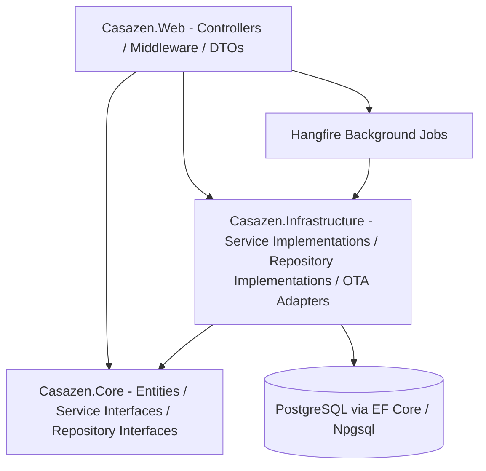
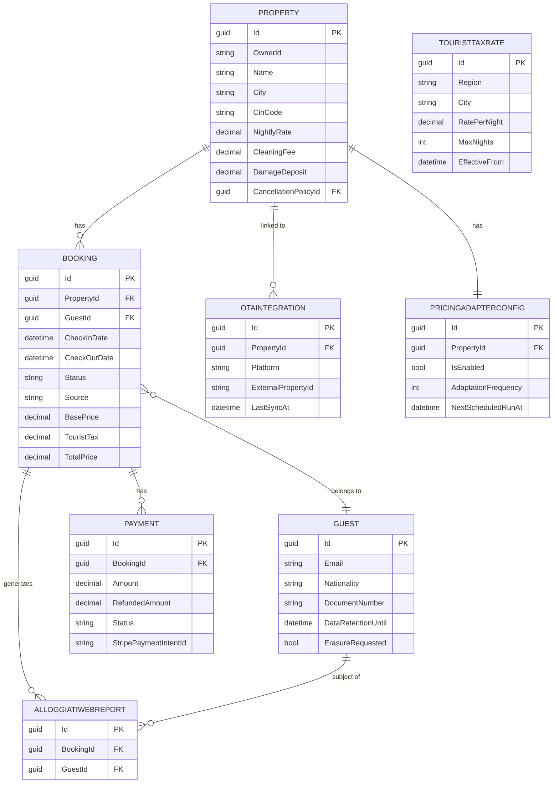

# CasaZen — Technical Documentation

> ASP.NET Core 10 REST API following a layered architecture (Presentation → Business Logic → Data Access), with PostgreSQL (Npgsql / Supabase) via EF Core, Auth0 JWT authentication, and Hangfire background jobs.

---

## Architecture

### Layer diagram



### Layer responsibilities

| Layer | Directory | Responsibility |
|---|---|---|
| Presentation | `Casazen.Web/` | HTTP controllers, DTOs, middleware, Swagger config, auth wiring, background job registration |
| Business Logic | `Casazen.Core/` | Domain entities, service interfaces, repository interfaces, enums, validators, utilities |
| Data Access | `Casazen.Infrastructure/` | EF Core DbContext, repository implementations, service implementations, OTA adapters, Stripe/email clients |
| Tests | `Casazen.Tests/` | Unit and integration tests |

### Dependency rule
`Casazen.Core` has no external project dependencies — it defines only interfaces and entities. `Casazen.Infrastructure` depends on `Casazen.Core` (implements its interfaces). `Casazen.Web` depends on both `Casazen.Core` (for interface injection) and `Casazen.Infrastructure` (registered in DI). This ensures the domain is framework-agnostic.

---

## Tech Stack

| Component | Technology | Version | Notes |
|---|---|---|---|
| Language | C# | 13 | Nullable reference types enabled |
| Framework | ASP.NET Core | 10.0 | Minimal hosting model in `Program.cs` |
| Database | PostgreSQL (Supabase) | — | Npgsql EF Core; integration tests run on real PostgreSQL (see Testing) |
| ORM | Entity Framework Core | 10.x | Code-first, migrations in `Casazen.Infrastructure/Migrations/` |
| Authentication | Auth0 + JWT Bearer | — | `sub` claim used as user ID |
| Background jobs | Hangfire | 1.8.x | PostgreSQL storage; dashboard at `/hangfire` |
| Payment processing | Stripe .NET SDK | — | Webhook signature verification required |
| Email | Resend SDK (`ResendEmailService`) | — | Only provider; emails queued on Hangfire, templates IT/EN (`docs/runbooks/email.md`) |
| OTA resilience | Polly | — | Retry, circuit breaker, timeout, rate limiting per platform |
| Test framework | xUnit | — | `Casazen.Tests/` |
| API docs | Swashbuckle / Swagger | — | Swagger UI at `/swagger` (dev only) |

---

## API Reference

### Base URL
`/api`

### Authentication
All endpoints require a `Bearer` JWT token in the `Authorization` header (issued by Auth0), except anonymous routes noted below (public booking, legal, health, webhooks, guest check-in tokens, supplier register, plan catalogue, SEO sitemap).

Anonymous / public (non-exhaustive highlights):
- `GET /api/health`, `GET /api/health/live`, `GET /api/health/ready`, `GET /api/properties/search`
- `GET /api/orgs/plans`
- All `/api/public/*` (including the SEO sitemap `/api/public/sitemap.xml` and the guest check-in portal `/api/public/checkin/*`), `/api/legal/*`
- `POST /api/suppliers/register`, webhook receivers under `/webhooks/*`

### Authorization (TN-3)

Every action is either `[AllowAnonymous]` or protected by a policy from `Casazen.Web/Authorization/CasazenPolicies.cs`
(the complete set registered at startup; `EndpointAuthorizationArchitectureTests` fails for a policy used but not
registered, registered but unused, or an action with neither).

| Policy (constant) | Who passes |
|---|---|
| `Authenticated` | any signed-in user, suppliers included: only user-scoped endpoints, each listed with its reason in the test allow-list |
| `AdminOnly` | JWT role `Admin` |
| `Supplier` (`RequireSupplier`) | JWT role `Supplier` (backfilled from the DB supplier link) |
| `OrgBillingAdmin` (`RequireOrgBillingAdmin`) | org administrator in either rental context (PL-16): owner `PropertyOwner` or `LongTermLandlord` (JWT role, or DB membership with the owner's role key: `property_owner` of short-rent, `long_term_landlord` of long-rent, `OrgOwnerRoles`), platform `Admin`, or (AM-01) an `account` membership holding `org.billing.manage` (`org_owner`, `org_admin`); never `Staff`/`Guest`, never a `PropertyManager` (D12) nor any other member role. Plan, entitlement, billing, Stripe Connect account, branding, domain, site documents and (AM-03b) the export of the org's fiscal data and team |
| `SharedPropertyRead` / `SharedPropertyWrite` | `property.*` in short-rent **or** long-rent: only the property core a long-term landlord needs (list, record, create/update, documents/APE) — A7-06 |
| `PropertyRead` / `PropertyWrite` | short-rent `property.*`: the short-stay side of a property (photos, CIN, iCal, activation, detail with bookings/OTA, pricing, fiscal, service requests) |
| `BookingRead/Write`, `PaymentRead/Write`, `GuestRead/Write`, `OtaRead/Write` | short-rent context permission |
| `ServiceRequestWrite`, `GuestManage`, `AlloggiatiSubmit` | AM-03: short-rent permissions carved out of `property.write` (interventions), `guest.write` (erase, anonymize, consents of a guest) and `booking.write` (register the guests of a stay, declare the Alloggiati communication sent); the owner and the property manager hold them, the collaborator only the first (`docs/runbooks/org-team.md` § 21) |
| `LeaseRead/Create/Sign/Register` | long-rent context permission |
| `OrgMembersManage` (`RequireContext:account:org.members.manage`) | AM-02: the owner and the administrators of the org (permission of the `account` context); the invitations and the members endpoints |
| `OrgActivityRead` (`RequireContext:account:org.activity.read`) | AM-02b: the owner and the administrators; the list and the CSV of the activity log |

Context permissions come from the DB memberships (`UserContextMemberships` → `Roles` → `RolePermissions`) with the JWT
roles as fallback (`ContextAuthorizationService`). A permission counts only in the context that grants it: the long-rent
`property.*` never satisfies a short-rent policy (`RequireContext:short-rent|long-rent:…` lists both contexts where an
endpoint serves both). The class carries the read permission, writing actions add the write one.

**Org membership (AM-01, `docs/runbooks/org-team.md`).** `OrgMember` (table `OrgMembers`, one org per user, role Owner / Admin /
PropertyManager / Collaborator / Accountant) is the source of truth of who belongs to which org; the `UserContextMemberships` rows
are the projection of its role into permissions, written in the same transaction by `IOrgMembershipService` only. The roles
`org_owner`, `org_admin`, `org_accountant` live in the new context `account` ("Amministrazione" of the customer, permissions
`org.members.manage`, `org.billing.manage/read`, `org.settings.manage`, `org.suppliers.manage`, `org.activity.read`; the staff
console stays `admin`); `GET /api/me/contexts` lists `account` first (clients leave it out of the areas they switch between). For a user with an org member row
and a rental membership the host contexts come from the DB only (a token never adds one: veto of PR #455 limited to org
members); a deactivated member gets 403 `member_inactive` from the next request.

**Org invitations, members and seats (AM-02, `docs/runbooks/org-team.md`).** The owner and the
administrators (permission `org.members.manage` of the `account` context) invite a person with a role and the areas it works
in. The invitation (`OrgInvitation`, table `OrgInvitations`) holds a seat for seven days; its link carries a 256-bit secret of
which only the SHA-256 is stored, a new link replaces the old one, and the token only travels in the body of the two public
calls. The invited account accepts (verified email equal to the invited one, never a platform admin, the four consents again
for the new org) and becomes a member; a person whose own org is still empty and unbilled leaves it, anyone else with an org
is refused (409 `invitation_user_has_organization`). Seats per plan (Starter 2, Pro 10, Scale unlimited) count active members
plus pending invitations and are decided under one advisory lock per org. Only the owner creates or touches an
administrator; the owner is never touched. The hourly job `org-invitation-maintenance` reminds on the third day, expires
and deletes the closed invitations 30 days after they closed.

**Activity log and requests for access (AM-02b, `docs/runbooks/org-team.md` part 4).** The owner and
the administrators (permission `org.activity.read`) read who did what in the org: a short list with ids and codes and no personal
data (`OrgActivityEntry`, table `OrgActivityEntries`, events fixed in `OrgActivityCatalog`: the people, the properties given to
a member, the plan, the name and the slug of the org). A service writes the line with `IActivityLog.Record` **inside the unit of
work of the change it records** (the same `SaveChanges`, the same transaction: a rollback takes both away). The list is paged and filtered (`from`, `to`, `type`, `area`, `actor`) and the CSV has a fixed header and no
personal data; the lines are deleted after 12 months by the nightly job `org-activity-retention`. A member who cannot do
something asks the administrators for access (`POST /api/orgs/me/access-requests`): an area or a page of a closed list and a
note of up to 200 characters, an email in Italian or English to the owner and the administrators, a line in the log, nothing else
stored; three requests a day for each person.

**Completions of the team backend (AM-02c, `docs/runbooks/org-team.md` part 6).** The screens of the
account area read the matrix of the roles from one place (`OrgCapabilityCatalog`: twelve capabilities whose level comes from the
permissions of the seeded roles, never a second table, with real actions run against the levels that have an enforcing action today; a
test fails on a permission with no capability; `billing`, `suppliers` and `settings` report their permission rows before their endpoints
ask for them, AM-02c-FU4), change the areas of a member (`IOrgMembershipService.SetAreasAsync`, same lock as the change of role; a
«Solo alcuni» collaborator that works in one area reaches only the given properties of that mode, in the lists, the single resources, the
notification audience and the people count), give a «Solo alcuni» collaborator its
properties in the invitation (`OrgInvitationProperties`, turned into grants in the transaction of the acceptance), and show a home
that is one request (`GET /api/orgs/me/overview`, a fixed number of SQL statements). The emails of the invitations are capped
(`OrgTeam__InvitationDailyLimit`, `OrgTeam__ResendMinutes`). The property manager has the restricted membership `account/org_manager`
(the trusted suppliers only) and the activity log learns the change of mode of a property.

The policy says what kind of operation a user may do; the row itself is checked with
`IAuthorizationService.AuthorizeAsync(User, HostResource, operation)` (`PropertyOperations`, `SharedPropertyOperations`,
`BookingOperations`, `GuestOperations`, `PaymentOperations`, `OtaOperations`, `LeaseOperations`): `HostResourceAuthorizationHandler` grants it only when the row
is in the caller's org, the caller holds the permission and, for property-bound rows, **reaches the property** (AM-03): every
property for an owner, administrator, manager or accountant member and a collaborator with every property, only the ones in
`PropertyMemberAccesses` for a collaborator "Solo alcuni", the ones it created for an account in no org team. The reach is read
from the database (`IHostScopeResolver`, the authorization snapshot cached 60 s), never from the token roles. Lists use
`await User.ResolveHostScopeAsync(resolver, orgId)` → `HostScope` and narrow with `query.InScope(scope)` (an `EXISTS` in the same SQL
statement). Services never check roles: they receive the org / scope decided by the web layer. A row that is not in
the caller's org answers 404; a visible row the caller may not use answers 403.

There are **48** controller source files under `Casazen.Web/Controllers/`. The supplier jobs with QR check-in (`SupplierJobController`, `PublicCheckInController`) were removed by SU-11 (decision D12): supplier work is a `ServiceRequest` only.

### Endpoints

#### Auth / identity / devices

| Method | Path | Auth | Description |
|---|---|---|---|
| `GET` | `/api/auth/profile` | JWT | Current auth profile |
| `POST` | `/api/auth/logout` | JWT | Logout / invalidate session side-effects |
| `GET` | `/api/users` | Admin | Paginated user list |
| `GET` | `/api/users/{id}` | Admin | User detail |
| `GET` | `/api/users/me` | JWT | Current user profile; `emailVerified` (bool) says Auth0 verified the account's email (the Action claim `https://casazen.app/email_verified`, else the Management API), also in the answer of `PUT` |
| `PUT` | `/api/users/me` | JWT | Update current user profile |
| `GET` | `/api/guest/bookings?scope=upcoming\|past&page=1&pageSize=20` | Policy `GuestAccount` (any signed-in account) | The mobile app's «Le mie prenotazioni»: the direct bookings, of any booking site, whose guest has the account's **verified** email; `{ items, total, page, pageSize }`, `pageSize` up to 50; upcoming = check-out today or later in Europe/Rome by check-in ascending, past by check-in descending; the lapsed holds (`Expired`, `DatesUnavailable`) are not listed; 400 `validation_error` for another `scope`, **403 `guest_email_not_verified`**, 429 (`GuestAccountRead`, per person) ([direct-booking.md](runbooks/direct-booking.md) § 8.6) |
| `GET` | `/api/guest/bookings/{id}` | same | One booking of the account: the body of `GET /api/public/guest/bookings/{code}` plus `id` and `orgSlug`; **404 `guest_booking_not_found`** for a booking that is not the account's, an unknown id or a string that is not an id |
| `POST` | `/api/guest/bookings/{id}/session` | same; `GuestAccountSession` | Opens the guest-area session of the booking's site for the account's email: `{ accessToken, expiresAt, bookingCode, orgSlug }` (the `gs1.` token of `POST /api/public/guest/session`, same length), to reuse the cancellation and the messages of `api/public/guest/*` without asking the guest for the code |
| `DELETE` | `/api/guest/account` | Policy `GuestAccount`; `GuestAccountDelete`; needs no verified email | The guest deletes their own account (store rule «delete account in the app»): Auth0 first, then the CasaZen row; 204; **409 `guest_account_is_professional`** (host org, supplier link or administrator role: support removes those); 502 with an `auth0_*` code and nothing removed; a second call answers 401. Bookings and guest records of the hosts stay ([gdpr.md](runbooks/gdpr.md) § 11) |
| `POST` | `/api/users/onboarding` | JWT | Submit user onboarding payload |
| `PUT` | `/api/users/onboarding` | JWT | Update user onboarding payload |
| `PUT` | `/api/users/{id}/role` | Admin | Change user role |
| `DELETE` | `/api/users/{id}` | Admin | Delete user |
| `POST` | `/api/devices` | JWT | Register iOS/Android push device |
| `DELETE` | `/api/devices/{deviceId}` | JWT | Unregister device |
| `GET` | `/api/me/notifications?unread=&page=&pageSize=` | JWT | UI-12a: the caller's in-app notifications (the bell), newest first, paged (`pageSize` 1–50, default 20): `{ items: [{ id, type, entityId, createdAt, readAt }], totalCount, page, pageSize }`. No text: the client writes it from `type` |
| `GET` | `/api/me/notifications/unread-count` | same | `{ count }` |
| `POST` | `/api/me/notifications/{id}/read` | same | 204, idempotent; 404 for a notification that is not the caller's (another user's, another org's, deleted, unknown), never 403 |
| `POST` | `/api/me/notifications/read-all` | same | 204 |
| `GET` | `/api/me/activities` | JWT (`Authenticated`; the caller's `HostScope`) | ADR-026, NF-07: the caller's «To do» list, the open items of its org (`InternalActivities` rows with an `action`, `CompletedAt` null) its scope reaches: a collaborator «Solo alcuni» only the items of the properties it was given, never an organization-level item (no property); sorted by the server, urgency `High` first, then `dueAt` (none last), then creation; at most 50: `[{ id, activityType, action, entityType, entityId, propertyId, dueAt, urgency, reason, createdAt }]`. No personal or staff data (no person, rate, note): the client reads the detail from the entity's API and maps `action` to its route (`ACTION_ROUTE_MAP`). `private, no-store`; empty for a caller with no org or scope |
| `GET` | `/api/me/activities/count` | same | `{ count }`: the open `High` items of the list (the nav badge) |
| `POST` | `/api/me/activities/{id}/close` | short-rent `property.write` (`PropertyWrite`, on top of `Authenticated`; the caller's `HostScope`) | Closes an item by hand (`Status` `Completed`, `CompletedAt`, `ClosedBy` = the caller); 204, idempotent; 403 for a caller without `property.write` in the short-rent context (a role that only reads, the accountant or a collaborator with no write permission: it reads the list and the count but closes nothing), before anything is looked up; 404 for an item the caller's scope does not reach (a property not given, another org, unknown). The items are raised and closed by the system through `IInternalActivityService.CreateAsync` / `CloseAsync` (idempotent per type and entity while open) and `ActivityAutoCloseHandler` (`CheckInCompleted` closes `CheckInPending` and `BookingSpecialRequest`, `CheckOutCompleted` closes `CheckOutPending`, `BookingCancelled` closes `BookingSpecialRequest`, `PropertyReadyDeclared` closes `CleaningDue`, `AlloggiatiReceiptArrived` closes `AlloggiatiDeadline` and `ReceiptToRetrieve`, for the event's booking). The booking events (ADR-022, E08/F06) are recorded in the outbox by the services that change a booking, in the same save as the change (`BookingEvents`): `BookingCreated`, `BookingConfirmed`, `BookingModified`, `BookingCancelled`, `CheckInCompleted`, `CheckOutCompleted`, `PropertyReadyDeclared`, with a payload of ids, enums and dates only (`BookingEventPayload`: booking, property, source, origin Host, Guest, System or Octorate, status, check-in, check-out) and the dedup keys `booking-created:{id}`, `booking-confirmed:{id}`, `booking-cancelled:{id}`, `booking-modified:{id}:{UpdatedAt}`, `checkin:{id}`, `checkout:{id}`, `property-ready:{id}`; their consumers raise «Check-out completato senza una pulizia richiesta» (`CleaningDue`, action `CompleteCheckOut`, due at the next arrival, `High` within 48 hours), «Nuova prenotazione con una richiesta speciale» (`BookingSpecialRequest`, action `ReviewBooking`) and, for a booking whose origin is Octorate, the new-booking push to the hosts and, when it arrives on nights that are already taken, the urgent «To do» `BookingOverlap` with its alert (`BookingOverlapHandler`, § CasaZen's bookings on the connector); a closed row is kept for the audit |
| `GET` | `/api/me/notification-preferences` | JWT (`Authenticated`; the token's `sub`, never a parameter) | E05/F03, NF-65: how the caller wants to be alerted. `{ quietHours: { start, end, legalAlertsOverride }, events: [{ eventType, channels: [..], isDefault }], availableChannels: [{ channel, available, reason }] }`, enums by name, times as `HH:mm:ss` on the clock of Rome. `events` has one entry for each of the eight kinds (`NewGuestMessage`, `UrgentGuestMessage`, `AiDraftToApprove`, `NewBooking`, `BookingCancelled`, `LegalDeadline`, `SyncError`, `ScheduledMessageIssue`), with what the caller chose or the PO-10 default (`isDefault`: no row; the defaults are computed in code, a user who never saved costs no rows). `channels` are `MobilePush`, `BrowserPush`, `Email`, `CounterOnly` (the counter of the bell); `[]` is nothing at all. `BrowserPush` is reported `available: false, reason: web_push_not_available` (no web-push infrastructure yet). Quiet hours 22:00-08:00 on the clock of Rome by default. `private, no-store`; a caller with no host org gets the defaults |
| `PUT` | `/api/me/notification-preferences` | same | Body `{ quietHours?: { start, end }, events?: [{ eventType, channels: [..] }] }`: saves the quiet hours and the kinds of event listed (the others stay as they are) and answers with the settings after the save. Everything is checked before anything is written. **422 `notification_legal_channel_required`** when `LegalDeadline` would be left with no channel (legal alerts never go fully off); **422 `notification_channel_unavailable`** for `BrowserPush`; 422 `notification_preferences_empty` (nothing to save) and `notification_event_duplicated`; 400 for a body that does not validate (a kind of event without `channels`, which is never taken for «nothing», or null); 404 for a caller with no host org. Who is told, and how, is decided by `INotificationPreferenceService` (the audience of `HostNotificationAudience`, the permission, the choices, the quiet hours that defer the push and the email but never the counter, a legal deadline excepted), guarded by `HostNotifyingPathsArchitectureTests` |
| `GET` | `/api/me/alerts/pending` | JWT (`Authenticated`; the caller's `HostScope`) | ADR-025, NF-08: the caller's popup alerts that are pending (`PopupAlerts` rows of the caller, in its org, `DismissedAt` null and `RemindAt` null or already passed), narrowed to its scope: an owner, an administrator, a manager or a collaborator with every property sees them all; a collaborator «Solo alcuni» only the ones about a `Booking` or a `Property` it was given, never an org-level one (ADR-025-R4). Sorted by the server, urgency `High` first, then the oldest: `[{ alertId, alertType, entityType, entityId, urgency }]`, the two enums by name. **No personal data and no text** (ADR-025-R5): the client reads the detail from the API of the entity. `private, no-store`; empty for a caller with no org or scope. The alerts are written by `IAlertRouter` (quiet hours 22:00-08:00 on the clock of Rome, legal alerts excepted) and pushed on the SignalR hub `/hubs/notifications`, client method `alertReceived`, with the same five fields |
| `POST` | `/api/me/alerts/{id}/dismiss` | same | Dismisses one alert of the caller (`DismissedAt`); 204, idempotent (the first instant is kept); no body needed. 404 for an alert that is not the caller's (another user's, another org's, unknown), never 403 |
| `PATCH` | `/api/me/alerts/{id}/remind` | same | «Remind me later»: body `{ "remindAt": "<ISO 8601 with offset>" }`; sets `RemindAt` and clears `DeliveredAt`, so the job `popup-alert-due` pushes the alert again when the snooze ends; 204. **400 `cannot_snooze_past_deadline`** when the alert has a legal `Deadline` and `remindAt` is after it (ADR-025-R10); 400 `validation_error` without `remindAt`; an alert already dismissed stays dismissed (204); 404 as for dismiss |

#### Multi-tenancy (orgs & workspace)

| Method | Path | Auth | Description |
|---|---|---|---|
| `GET` | `/api/me/contexts` | JWT | Workspace contexts (host / supplier / …); merges JWT roles with `UserContextMemberships`; the `account` context (AM-01) is listed first for a member of an org, and clients leave it out of the areas they switch between |
| `PUT` | `/api/me/last-context` | JWT | UI-13a: remember the area the caller entered last (`{ "contextKey" }`, one of the contexts `GET /api/me/contexts` lists for the caller; anything else: 422 `context_not_accessible`); `GET /api/me/contexts` gives it back as `lastUsedContextKey` while the caller can still enter it |
| `GET` | `/api/orgs/plans` | Anonymous | Plan catalogue and property limits |
| `GET` | `/api/orgs/me/entitlement` | OrgBillingAdmin (org policy, any rental context, PL-16) | Org plan tier (the effective one), limits, usage, `canAddProperty`, `canUseCustomDomain`; BL-01: `openAccess` (`true` when the tier shown is raised by `Entitlement:OpenAccess`, [`open-access.md`](runbooks/open-access.md)); AM-02: `limits.maxSeats`, `usage.seats`, `canInviteMember` |
| `PUT` | `/api/orgs/me/plan` | Org billing admin | Downgrade / back to Starter only; upgrade without an active subscription → 403 `subscription_required`, Stripe-managed plan → 409 `managed_by_stripe` (#274) |
| `POST` | `/api/orgs/me/invitations` | Policy `RequireContext:account:org.members.manage` | AM-02: invite a person (email, name, role, areas): 201 `{ invitation, emailQueued }`; 403 `org_owner_required`, 409 `org_seat_limit_reached`, `org_invitation_already_pending`, `org_member_already_member`, 422 `org_owner_not_assignable`, `org_member_area_required`; AM-02c: a «Solo alcuni» collaborator carries `propertyIds` (at most 500, live properties of the org: 422 `org_member_property_unknown`, 422 `org_member_scope_not_supported` for another role or scope) and the org is capped to `OrgTeam:InvitationDailyLimit` emails in 24 hours: 429 `invitation_daily_limit_reached` |
| `GET` | `/api/orgs/me/invitations` | same | Invitations open or expired, never the token; AM-02c: each with `propertyIds` and `lastSentAt` |
| `POST` | `/api/orgs/me/invitations/{id}/resend`, `/revoke`, `/link` | same | Send again with a new link (7 more days) / withdraw (204, idempotent) / a fresh link to hand out (`no-store`); AM-02c: «reinvia» once every `OrgTeam:ResendMinutes` for each invitation (429 `invitation_resend_too_soon`) and counted in the daily cap |
| `GET` | `/api/orgs/me/members` | same | `{ items, seats }`: the people, owner first, and the seats of the plan |
| `PUT` | `/api/orgs/me/members/{id}` | same | Change the role (never to Owner; Admin only by the owner) |
| `PUT` | `/api/orgs/me/members/{id}/areas` | same | AM-02c: `{ areas: ["short-rent","long-rent"] }`, at least one; role and properties stay (a collaborator «Solo alcuni» keeps its grants and reaches the given properties of the modes it works in); 403 `org_owner_required`, 409 `org_last_owner`, 422 `org_member_area_required`; a line `MemberAreasChanged` in the log |
| `GET` | `/api/orgs/me/roles` | JWT (any active member) | AM-02c: the matrix of the five org roles: `permissionsByContext`, twelve `capabilities` (`Yes` · `Read` · `No`, read from the permissions of the seeded roles), `assignable` (relative to the caller) and `scopeSupported` (the collaborator only) |
| `GET` | `/api/orgs/me/overview` | Policy `RequireContext:account:org.members.manage` | AM-02c: the figures of the home in one answer: `standing`, `openAccess`, `seats`, `properties`, `invitations`, `accessRequests`, `suppliers`, `alloggiati`, `recentActivity`; a section whose own permission the caller lacks is left out |
| `POST` | `/api/orgs/me/members/{id}/deactivate`, `/reactivate` | same | Switch the access off / on (reactivating takes a seat); 409 `org_last_owner` for the owner |
| `DELETE` | `/api/orgs/me/members/{id}` | same | The person leaves the org; its account stays |
| `GET` | `/api/orgs/me/members/{id}/properties` | same | AM-03: the active properties of the org with whether this member reaches each (`granted`) and how many people do (`peopleWithAccess`); `scopeSupported` false for a member who is not a collaborator |
| `PUT` | `/api/orgs/me/members/{id}/properties` | same | AM-03: `{ propertyScope, propertyIds }` with `propertyScope` `All` or `Selected` ("Solo alcuni" is the collaborator only); 403 `org_owner_required`, 422 `org_member_scope_not_supported`, `org_member_property_unknown` |
| `GET` | `/api/orgs/me/activity` | Policy `RequireContext:account:org.activity.read` | AM-02b: the activity log, newest first, paged (`page`, `pageSize` 50/100) and filtered (`from`, `to`, `type` one or several, `area`, `actor` or `system`): `{ items, totalCount, page, pageSize }`, each item with ids and codes only; 400 for an unknown event or area or `from` after `to` |
| `GET` | `/api/orgs/me/activity.csv` | same | AM-02b: the whole matching log as a CSV (fixed header `id,when,actor,area,type,subjectType,subjectId,details`, no personal data, never cached) |
| `POST` | `/api/orgs/me/access-requests` | JWT (any active member), rate limited per person (`OrgAccessRequest`) | AM-02b: `{ area, note }`, 202 `{ notified }`: an email to the owner and the administrators and a line in the log; 409 `access_request_limit_reached` (three a day), 422 `access_request_area_unknown`, 429 |
| `POST` | `/api/org-invitations/lookup` | Anonymous, rate limited (`PublicInvitationLookup`) | What a link is for; every link that does not work answers the same 410 `invitation_invalid` |
| `POST` | `/api/org-invitations/accept` | JWT (any signed-in account) | Accept with the four consents: 200 `{ orgId, orgName, role, areas, leftEmptyOrg }`; 403 `invitation_email_mismatch`, `invitation_email_not_verified`, `invitation_platform_admin`; 409 `invitation_user_has_organization`; 410 `invitation_expired`, `invitation_used`, `invitation_revoked`, `invitation_invalid` |
| `GET` | `/api/orgs/{orgId}/domain` | JWT | Custom domain config for org |
| `POST` | `/api/orgs/{orgId}/domain` | JWT | Set custom domain |
| `POST` | `/api/orgs/{orgId}/domain/verify` | JWT | Verify DNS / domain ownership |

#### Global search (UI-13a)

| Method | Path | Auth | Description |
|---|---|---|---|
| `GET` | `/api/search?q=&limit=` | JWT, rate limited per user (`GlobalSearch`, 60 / min) | Groups of results by kind (`property`, `booking`, `guest`, `lease`, `service-request`, `supplier`, `supplier-request`), each only when the caller holds the permission of that group in its context, bound in SQL to its org and to the properties it reaches (AM-03). `q` 2 to 64 characters (400 `search_query_too_short` / `search_query_too_long`), `limit` per group (default 5, at most 20). A result is `{ type, id, title, subtitle, destination }` with a destination **key** (`short-rent.property`, `long-rent.lease`, …), guest e-mail masked, never phone or document. `Cache-Control: private, no-store`. Full-text search on generated `SearchKey` columns and their GIN indexes, no extension: [`runbooks/global-search.md`](runbooks/global-search.md) |

#### Onboarding

| Method | Path | Auth | Description |
|---|---|---|---|
| `GET` | `/api/onboarding/status` | JWT (`Authenticated`: needed before any context exists) | Host / org onboarding wizard status: the seven `steps` of the activation checklist (PL-15) and the milestones. **`flows`** (E10/F01/US01/T02, NF-106): with `Features:OctorateOnboarding` on **and** a caller who passes the short-rent `property.read` (`PropertyRead`), the summary of the six flows over the properties the caller reaches, `[{ flow, active, toComplete, notAvailable, total }]` in the order `Listings`, `Bookings`, `CheckInCompliance`, `Messages`, `Documents`, `Reports`; otherwise `[]`, and with the flag off the endpoint answers exactly as before. Never behind the flag |
| `GET` | `/api/onboarding/flows/{flow}/properties?state=&search=&page=&pageSize=` | short-rent `property.read` (`PropertyRead`) + `HostScope`, behind `Features:OctorateOnboarding` (404 before authentication while off) | E10/F01/US01/T02, NF-106: the properties of the caller with the status of one flow, by name (the id as the tie-break), `{ items, totalCount, page, pageSize }` (`page` from 1, `pageSize` 50 when missing, at most 100). `{flow}` is a member name of `OnboardingFlow` (400 `onboarding_flow_unknown`); `state` keeps one of `active`, `toComplete`, `notAvailable` (400 `onboarding_flow_state_unknown`); `search` finds a text in the name or the city. An item is `{ propertyId, name, city, flow, state, reason, action, prerequisites: [{ key, met, reason }] }`: codes only, the client translates them. `reason` and `action` are stable codes (`connection_missing`, `connection_lost`, `mapping_unconfirmed`, `mapping_unavailable`, `sender_missing`, `channel_content_to_fix`, `cin_missing_or_invalid`, `tax_rate_missing`, `message_sync_not_ready`, `issuer_missing`, `no_bookings_yet`, `flow_not_activated`, `property_long_rent`, `property_inactive`, `content_managed_on_channel`, `chat_not_licensed`, `accountant_handles`, `not_provided`; `connect`, `reconnect`, `confirmMapping`, `chooseSender`, `fixListing`, `enterCin`, `enterTaxRate`, `chooseIssuer`, `activate`); prerequisite keys are `connection`, `mapping`, `singleSender`, `content`, `cin`, `taxRate`, `messageSync`, `issuer`, `bookings`. The messages, documents and reports flows are read from the facts of their epics (E10/F01/US04/T01, no flag says «ready»; `not_provided` is no longer answered for them): **messages** needs the connection, the confirmed mapping and a message sync of the listing that worked (a pass read it and its last pass did not fail: `message_sync_not_ready` otherwise, no action), and is «not available» with `chat_not_licensed` when the listing's last sync error is that code (never an empty inbox); **documents** needs the organization's issuer choice (`OrgFiscalIssuerProfile`: none is `issuer_missing` with the action `chooseIssuer`; «none, my accountant issues» is «not available» with `accountant_handles`; CasaZen issues the direct bookings and needs nothing else, but only while `Features:FiscalDocumentIssuance` is on (with it off the saved choice reads as no choice, `issuer_missing`, as the issuer service says nobody issues); Octorate issues and needs the connection and the mapping too); **reports** needs the connection, the mapping and an active booking imported from a channel through Octorate (a booking of a channel, `HostCollectionsRules.ChannelSources`, with `OctorateReservationId` set: the bookings CasaZen made itself and mirrored on Octorate carry an id too and are not imports; status confirmed, checked in or checked out, no no-show: `no_bookings_yet` otherwise, no action). Bound in SQL to the caller's org and to what it reaches (AM-03); `Cache-Control: no-store`; 403 for a caller with no org. Nothing is written: the state is derived on every read |
| `GET` | `/api/onboarding/plan` | `property.read` in either rental context (`SharedPropertyRead`) + `HostScope`, behind `Features:OctorateOnboarding` | E10/F01/US01/T03, NF-104, ONB-01: the plan of the eleven parts of the activation (`OnboardingPartCatalog`, code-defined), `{ parts, needs, path, activated }`. A part is `{ code, order, state, reason, done, total, requires, deferrable, needs, remindAt, assist, launchTarget }`: `code` `octorateConnection`, `properties`, `channels`, `listings`, `pricesRules`, `compliance`, `identification`, `messagesAi`, `fiscalDocuments`, `partners`, `activation`; `state` derived on every read from the stored facts, in this precedence: `notAvailable`, `done`, `deferred` (the stored intent), `blocked` (a required part is not done, reason `required_part_not_done`), `open`; `reason` codes `inventory_scenario_missing`, `existing_ota_import_incomplete`, `connection_missing`, `connection_lost`, `mapping_unavailable`, `mapping_unconfirmed`, `channels_missing`, `channel_content_to_fix`, `price_missing`, `sender_missing`, `cin_missing_or_invalid`, `tax_rate_missing`, `identification_off`, `access_code_missing`, `flows_incomplete`, `no_property`, `notification_preferences_missing`, `assistant_situation_missing`, `issuer_missing`, `partner_integration_missing`, `connector_off`, `not_provided` (the parts `messagesAi`, `fiscalDocuments` and `partners` are read from the facts of E05, E06 and E09, E10/F01/US04/T01: `messagesAi` counts the notification preferences saved by an administrator of the org and, only while `Features:MessageAssistant` is on, one assistant situation, so `total` is 1 or 2; `fiscalDocuments` is done when the issuer profile exists, «none, my accountant issues» included (CasaZen as the issuer only while `Features:FiscalDocumentIssuance` is on); `partners` is `notAvailable` with `connector_off` while `Features:OctorateConnector` is off, otherwise done when one integration of the Active tab of the marketplace is active or declared for the caller's reach, and no part requires it, so it never blocks the activation); `deferrable` is false for a part another part requires; `needs` and the plan's `needs` are codes of «What you need» (`alloggiatiCredentials`, `istatCredentials`, `fiscalData`, `otaAccess`, `lockCode`); `assist` is the open «Do it for me» request `{ id, status, context, requestedAt }`; `launchTarget` the code of the wizard (`connect`, `mapping`, `channels`, `listings`, `prices`, `compliance`, `identification`, `messages`, `fiscal`, `marketplace`, `summary`). The parts count the short-rent, active properties the caller reaches (AM-03); `activated` is the part `activation` done. `Cache-Control: no-store`; 403 for a caller with no org. The plan page keeps its answers in the server draft of `OnboardingActivation` (`POST /api/wizards/OnboardingActivation/draft`) |
| `GET` | `/api/onboarding/path` | `SharedPropertyRead` + `HostScope`, behind `Features:OctorateOnboarding` | E10/F01/US01/T03, NF-10, UX-10: the connected path `start-with-casazen`, `{ code, steps: [{ code, order, parts, state, visible }], next }`: `connectChannels` (parts `octorateConnection`, `properties`, `channels`), `checkListings`, `pricesCalendar`, `checkInCompliance`, `messagesAi`, `fiscalDocuments`; a step is `done` when all its parts are, `notAvailable` when all its parts are, `visible` only while there is something to do in it, `next` the first visible step the host did not put off (a step set aside with «Later» stays visible, with `state` `deferred`, but is not proposed again at once; `null` when there is none). «Later» at the end of a step's wizard is a `defer` or an `exit` of that step's part |
| `POST` | `/api/onboarding/parts/{key}/defer` | org administrator (`OrgBillingAdmin`), behind `Features:OctorateOnboarding` | E10/F01/US01/T03, ONB-01: «Do it later». Body `{ remindAt? }` (UTC; default tomorrow 09:00 Europe/Rome; in the future and within 365 days, otherwise 422 `onboarding_remind_at_invalid`). Stores the part `Deferred` and raises one "To do" (`WizardResume`, action `ResumeWizard`, entity `OnboardingPart` = the `OnboardingPartStates` row, no property, deadline the reminder, reason `onboarding_part_deferred`: codes and ids only, ADR-026-R3). 422 `onboarding_part_prerequisite` for a part another part requires; 422 `onboarding_part_not_open` for a part that is done or not available (over the whole org: nothing to put off, so no "To do" is raised); 404 `onboarding_part_unknown`. Answers `{ code, state, remindAt, todoId }` |
| `POST` | `/api/onboarding/parts/{key}/exit` | `OrgBillingAdmin`, behind `Features:OctorateOnboarding` | E10/F01/US01/T03, UX-06 «Save and exit»: the part stays open and the same "To do" is raised (reason `onboarding_part_exit`, due tomorrow 09:00 Europe/Rome), so what remains never disappears silently; 422 `onboarding_part_not_open` for a part that is done or not available (nothing remains); 404 `onboarding_part_unknown` |
| `POST` | `/api/onboarding/parts/{key}/resume` | `OrgBillingAdmin`, behind `Features:OctorateOnboarding` | E10/F01/US01/T03: clears the deferral of the part and closes its "To do"; harmless on a part never deferred; 404 `onboarding_part_unknown` |
| `GET` | `/api/onboarding/integration` | `OrgBillingAdmin` + `HostScope`, behind `Features:OctorateOnboarding` | E10/F01/US02/T01, NF-108, ONB-05: the integration settings of the caller's org, `{ connection, parts, senders, channels }`. `connection` is `{ status, environment, lastSyncedAt, reconnectRequired }`, read from the org's `OctorateConnection` of this environment through a projection of the status and the last sync (the OAuth tokens and their ciphertext are never selected, ADR-023-R2 and R13): `status` is `Connected`, `Disconnected`, `Error`, or `null` when the org never connected here; `reconnectRequired` is true for `Disconnected` and `Error` only (a connection never made is a connect, not a reconnect), and then the part `octorateConnection` of the plan carries the reason `connection_lost` (the hourly sync of E10/F01/US01/T04 raises the `ReconnectChannelManager` "To do"). `parts` are the eleven parts as `GET /api/onboarding/plan` gives them over what the caller reaches, plus `reopenable` (false only for a part that is `notAvailable`). `senders` is `{ channelManager, casaZen, manual, notSet }`: the short-rent, active properties the caller reaches for each stored sender of the Alloggiati and ISTAT communications (E03); `notSet` is a property with no stored choice (its default is not a choice); a property outside Italy has no sender to choose and is in no count. `channels` lists every `ChannelPublishStatus` (`Draft`, `Sending`, `Accepted`, `Published`, `ToFix`, `ManagedOnChannel`) with the `count` of the `ListingChannelStates` rows of those properties (zero when none). Only the caller's org; `Cache-Control: no-store`; 403 for a caller with no org |
| `POST` | `/api/onboarding/parts/{key}/reopen` | `OrgBillingAdmin`, behind `Features:OctorateOnboarding` | E10/F01/US02/T01, NF-108, ONB-05: reopens a part from the integration settings. It clears the deferral of the part and closes its "To do" through the plan (as `resume`; harmless on a part never put off) and answers `{ code, launchTarget, focus }`, where to continue: `launchTarget` is the wizard of the part (`compliance` to change the sender, `channels` to add a channel, `mapping` to add properties, `connect` to reconnect, the others as in the plan) and `focus` is `sender` for the compliance wizard, `null` for the others. **It changes no data**: the wizard does, and a sender change goes through the sender switch of E03 with its confirmation and guards, so two automatic senders for one property stay impossible. 404 `onboarding_part_unknown`; 422 `onboarding_part_not_reopenable` for a part that is `notAvailable` (judged over the whole org) |
| `POST` | `/api/onboarding/flows/{flow}/activate` | `OrgBillingAdmin` + `HostScope`, behind `Features:OctorateOnboarding` | E10/F01/US01/T04, NF-104, NF-106, NF-108: body `{ propertyIds }` (1 to `Onboarding:MaxPropertiesPerCall`, 500, distinct; empty 422 `onboarding_property_ids_empty`, never «all»; more 422 `onboarding_property_ids_too_many`); `{flow}` a member name of `OnboardingFlow` (400 `onboarding_flow_unknown`). The prerequisites of each property are verified again on the server (the flow status of T02): answers `{ flow, outcomes: [{ propertyId, outcome, unmetPrerequisites, reason }] }` with `activated`, `alreadyActive`, `prerequisitesNotMet` (the keys that do not hold), `notAvailable` (the reason) or `notFound` (another org, deleted, outside the reach). Only `activated` writes: the `PropertyFlowActivations` row (a reactivation reuses it and clears `DeactivatedAt`) and the outbox event `OnboardingFlowActivated` in the same transaction. A flow activated stops counting as active while a prerequisite does not hold; its row stays (`IFlowActivationReader` for the consumers) |
| `POST` | `/api/onboarding/flows/{flow}/deactivate` | `OrgBillingAdmin` + `HostScope`, behind `Features:OctorateOnboarding` | E10/F01/US01/T04: same body and limits; `deactivated` (sets `DeactivatedAt` and who, records `OnboardingFlowDeactivated`), `alreadyInactive` or `notFound` |
| `POST` | `/api/onboarding/test-run` | `OrgBillingAdmin` + `HostScope`, behind `Features:OctorateOnboarding` | E10/F01/US01/T04, ONB-05 «Prova»: body `{ propertyId, bookingId? }`; the booking (or the most recent booking of the property with an Octorate reservation) passes through every flow **without any effect**: no row added, changed or deleted, no outbox event, no call to Octorate (`AsNoTracking`, no save, an `InvalidOperationException` if the unit of work holds new changes at the end). Answers `{ propertyId, bookingId, checks: [{ flow, outcome, reasons }] }`, `outcome` `pass`, `fail` or `skipped`: Listings (channel states exist, none `ToFix`; `channel_states_missing`, `channel_content_to_fix`, skipped `content_managed_on_channel`), Bookings (the state maps both ways through `BookingStateMapper`, an OTA booking carries the commission or the paid amount; `booking_status_unmapped`, `ota_amounts_missing`), CheckInCompliance (the check-in wizard state read only: `sender_missing`, `guest_data_missing` as information, skipped `booking_not_active` or `not_applicable`), the others skipped `not_provided`. 404 `onboarding_property_not_found`, `test_booking_not_found`. Hangfire `onboarding-flow-todo-sync` (hourly at minute 20 UTC, only with the flag on) keeps ONE "To do" per flow with properties to complete (`WizardResume`, entity `OnboardingFlow`, reason `flow_incomplete`) and ONE high-urgency `ReconnectChannelManager` while the connection is disconnected or in error, closing them when the condition clears, and closes the "To do" of a part put off or left half way (entity `OnboardingPart`) once the part is done for the whole org or nobody provides it any more, clearing the deferral as a resume does |
| `POST` | `/api/onboarding/panel-steps` | `OrgBillingAdmin` + `HostScope`, behind `Features:OctorateOnboarding` | E10/F01/US03/T01, NF-107, ONB-04: starts (or starts again) a step Octorate lets the host do only from its panel. Body `{ kind, propertyId?, channelCode?, resumeWizardType?, resumeDraftEntityId?, resumeStepCode? }`: `kind` `policeConnection`, `istatConnection` or `channelAccess` (a channel access needs `channelCode`, the others refuse it); no `propertyId` is a step of the whole org and needs a scope over the whole org (403 `onboarding_needs_whole_org`); a property outside the reach is 404 `onboarding_property_not_found`. Idempotent: one `OnboardingPanelSteps` row for each org, property, kind and channel. It stores `Started`, the SHA-256 of a random 256-bit nonce with its expiry (30 minutes), the mode and the point to resume (the wizard, the entity of its draft and the step: a reference, never a copy) **before** it returns the address, then raises ONE "To do" (`WizardResume`, action `ResumeWizard`, entity `OnboardingPanelStep`, reason `onboarding_panel_step_pending`, due tomorrow 09:00 Europe/Rome, the property of the step if any). Answers `{ id, kind, status, handoffMode, propertyId, channelCode, instructionsKey, activityId, nextCheckAt, lastVerificationOutcome, canConfirm, resume, startedAt, completedAt, panelUrl, callbackUrl? }`: `panelUrl` is `Octorate:FrontendBaseUrl` as configured, absolute https with no query, or, for a `channelAccess` whose `channelCode` is a number, the page of that portal's connection on the panel (`{base}/user/channelmanager/edit.xhtml?portal={code}`, verified for Booking.com only on 14/11/2026) (no org, property or person; 409 `octorate_panel_url_missing` when it is not); `instructionsKey` is `panelPolice`, `panelIstat` or `panelChannelAccess`; `activityId` is the "To do" of the step while it is open and `null` once the step is verified or confirmed; `handoffMode` is `managedWindow` (no panel of Octorate sends the person back today) or `redirectCallback` (the verifier of the kind says `SupportsCallback` and `Octorate:RedirectUri` is set: `callbackUrl` is that page with `?step={id}&state={state}`, the only place the nonce leaves, never stored or logged). A step already `verified`, `confirmed` or `assistRequested` is answered as it is; one `started` or `notValid` gets a new nonce and a fresh window of checks, unless a check already ran in its window: then the attempts, the wait and the status go on as they were (starting again never gives back the first check at once). 422 `panel_step_kind_invalid`, `panel_step_channel_invalid`, `panel_step_resume_invalid` |
| `GET` | `/api/onboarding/panel-steps` | `OrgBillingAdmin` + `HostScope`, behind `Features:OctorateOnboarding` | E10/F01/US03/T01: the same durable state of every step of the org the caller reaches (a step of the whole org only for a scope over the whole org), the most recently started first, at most 200 |
| `GET` | `/api/onboarding/panel-steps/{id}/status` | `OrgBillingAdmin` + `HostScope`, behind `Features:OctorateOnboarding` | E10/F01/US03/T01, AC-NF107-3: the stored state plus `nextCheckAt`, calculated by the server. A check runs only when it is due (the first 30 seconds after the start, the wait doubling up to 600 seconds), under a session lock of the step (`PostgresAdvisoryLocks.Scope.OnboardingPanelAssist`; a request that finds it taken answers the stored state), so a page that polls never burns the quota of Octorate. The attempt is claimed and the schedule moved BEFORE the call; a verifier that fails (Octorate down, quota) is logged by code, counts as an attempt and stores no outcome, so it never unlocks the confirmation. `Verified` completes the step and closes its "To do"; `NotValid` keeps the checks going; `Unverifiable` stores «could not tell» (`canConfirm`). The verifier with the highest `Order` of the kind runs (`IPanelStepVerifier`): police = `policeAccount.valid` of the accommodation the property is confirmed to (`IPropertyMappingReader`, `IOctorateApiClient.GetPoliceAccountStatusAsync`: valid true `Verified`, false `NotValid`, absent, refused or no mapping `Unverifiable`), ISTAT and channel access = `Unverifiable` until another epic registers a verifier with a higher order. 404 `panel_step_not_found` (also a step outside the reach) |
| `POST` | `/api/onboarding/panel-steps/{id}/verify` | `OrgBillingAdmin` + `HostScope`, behind `Features:OctorateOnboarding` | E10/F01/US03/T01: the explicit trigger (the panel window was closed, the tab got the focus again): runs the check if it is due, or if the previous one is at least 10 seconds old; otherwise answers the stored state. 404 `panel_step_not_found` |
| `POST` | `/api/onboarding/panel-steps/{id}/confirm` | `OrgBillingAdmin` + `HostScope`, behind `Features:OctorateOnboarding` | E10/F01/US03/T01, AC-NF107-3: the host says the step is done. Allowed ONLY after a real check stored `unverifiable`: 409 `panel_step_verification_required` before any check, 409 `panel_step_not_valid` after a `notValid`, 409 `panel_step_assist_open` while support has the step. Sets `Confirmed`, `CompletedByUserId` = the host, and closes the "To do". Confirming a step already done answers it again |
| `GET` / `POST` | `/api/onboarding/panel-steps/{id}/callback` | `OrgBillingAdmin` + `HostScope`, behind `Features:OctorateOnboarding` | E10/F01/US03/T01: for a step in `redirectCallback` only (409 `panel_step_callback_unsupported` otherwise). The `state` (query for GET, body `{ state }` for POST) is compared with the stored hash in constant time, must be before its expiry and is consumed by the statement that claims it (`CallbackConsumedAt`): used once; an unknown, used, expired or foreign state is always the same 422 `panel_step_state_invalid`. Then the step is verified at once |
| `POST` | `/api/onboarding/assist-requests` | `OrgBillingAdmin` + `HostScope`, behind `Features:OctorateOnboarding` | E10/F01/US03/T01, UX-15, NF-15 «Do it for me»: body `{ part, context, propertyId?, channelCode? }` (`part` a code of the plan, `context` `panelPolice` and `panelIstat` for the part `compliance`, `panelChannelAccess` (with `channelCode`) for `channels`, or `part` for any part; otherwise 422 `assist_context_invalid`, `onboarding_part_unknown`, `panel_step_channel_invalid`). Stores the request with a REFERENCE to the draft of the host's wizard (`OnboardingActivation` and what it edits, only when the host has one: never a copy), marks the panel step of a panel context `AssistRequested` (making it if it was never started; 409 `assist_step_already_done` when it is done), writes `OnboardingAssistRequested` (part, context, status) in the same save, tells the platform staff live (best effort: type `assist-requested`, `PushAudience.PlatformStaff(requestId)`, the bell of each administrator under its own org and `notificationsChanged`, no push on a phone, nothing but the request id; `docs/runbooks/in-app-notifications.md` § 10), then raises the host's "To do" (`WizardResume`, entity `OnboardingAssistRequest`, reason `onboarding_assist_requested`). 409 `assist_request_already_open` when a request of the same part, property and channel is open (partial unique index, also under a race; a request that a failed call left without its "To do" gets it on that answer): each portal of a `panelChannelAccess` has its own request, stored with its `channelCode`, and `done` on it settles the step of that portal only. A property outside the reach is 404; a request of the whole org needs a scope over the whole org (403) |
| `GET` | `/api/onboarding/assist-requests` | `OrgBillingAdmin` + `HostScope`, behind `Features:OctorateOnboarding` | E10/F01/US03/T01: the requests of the org the caller reaches, the most recent first (at most 100), with `status` (`Requested`, `InProgress`, `Done`, `Cancelled`), `channelCode` (the portal of a `panelChannelAccess`, `null` otherwise) and the note of support: how the host reads the status behind its "To do" |
| `GET` | `/api/admin/onboarding/assist-requests?status=&page=&pageSize=` | `AdminOnly`, behind `Features:OctorateOnboarding` | E10/F01/US03/T01, AC-NF15-2: the staff queue across every org, paged in SQL (`page` from 1, `pageSize` at most 100, 25 by default), the open requests first and the oldest first; `status` narrows to one (422 `assist_status_invalid`). Answers `{ items, totalCount, page, pageSize }`; an item is `{ id, orgId, part, propertyId, propertyName, comune, context, channelCode, status, requestedAt, updatedAt, completedAt, assignedToUserId, staffNote, draftWizardType, draftEntityId }`: ids, context codes (with the portal of a channel access), the property and its comune. NEVER the draft, a credential (the Questura credentials stay write-only: what staff cannot see is asked of the host through its "To do") or the person who asked |
| `PUT` | `/api/admin/onboarding/assist-requests/{id}` | `AdminOnly`, behind `Features:OctorateOnboarding` | E10/F01/US03/T01, AC-NF15-2, AC-NF15-3: body `{ status, note? }` with `status` `inProgress`, `done` or `cancelled` (422 `assist_status_invalid`); `note` at most 500 characters and no e-mail address (422 `assist_note_invalid`; sent blank it clears the note, left out it keeps it). Runs under a transaction lock of the request and names the org OF THE REQUEST in every statement. `done` on a panel context sets the matching step (the ones the request marked `AssistRequested`) `Confirmed` with the staff user as `CompletedByUserId` and closes its "To do"; `cancelled` gives the step back to the host with a fresh window of checks; both close the host's "To do" of the request (`ClosedBy` = the staff user). Every update writes `OnboardingAssistUpdated` (part, context, status; never the note) in the log of the org of the request with the staff user as the actor. 404 `assist_request_not_found`, 409 `assist_request_closed` |
| `POST` | `/api/onboarding/bulk/preview` | `OrgBillingAdmin` + `HostScope`, behind `Features:OctorateOnboarding` | E10/F02/US01/T01, NF-105, ONB-02: how many properties a selection holds. Body `{ kind, propertyIds?, filter? }`: `kind` is `all`, `ids` (`propertyIds`, 1 to `Onboarding:MaxPropertiesPerCall`, distinct; empty 422 `onboarding_property_ids_empty`, more 422 `onboarding_property_ids_too_many`) or `filter` (`{ comuneIstatCodes?, regionCodes?, channelCodes?, missingFlow?, flowState?: { flow, state } }`: every criterion given must hold, any value of a list; at least one criterion, and a list that is given is never empty, otherwise 422 `onboarding_selection_invalid` because that would be «all»; `channelCodes` keeps the properties that have a channel state for the channel, `missingFlow` the ones where the flow is available and not active, `flowState` the ones where it is in that `active`, `toComplete` or `notAvailable` state). What the kind does not use must be left out (a filter with `all` is 422, never read as «all»). Only the org's active short-rent properties the caller reaches (`InScope`): another org's, deleted, out of reach, long-term or switched-off properties are the same answer as an id that does not exist. Answers `{ total, sample: [{ propertyId, name, city }] (20, by name), notFound, exceedsLimit, maxPropertiesPerCall }`; a selection above the cap is answered with its true total and `exceedsLimit` true (apply refuses it). Writes nothing; `Cache-Control: no-store` |
| `POST` | `/api/onboarding/bulk/apply` | `OrgBillingAdmin` + `HostScope`, behind `Features:OctorateOnboarding` | E10/F02/US01/T01, AC-NF105-1: body `{ selection, choice: { complianceSender }, dryRun, confirmed }`, the one choice being the sender of the Alloggiati Web and ISTAT communications (`ChannelManager`, `CasaZen`, `Manual`; 422 `onboarding_choice_invalid` otherwise); a selection above `Onboarding:MaxPropertiesPerCall` is 422 `onboarding_selection_too_large`. **Nothing is written unless `dryRun` is false AND `confirmed` is true** (both default to false): then each property is judged by `IPropertySenderService.CheckSwitchAsync` (the checks of the switch with the confirmation taken as given, no write at all, not even the row of a property that only has the default sender, and no call to Octorate) and is `wouldChange`, `unchanged` or `refused`. Confirmed, each property goes through the sender switch of E03 (`IPropertySenderService.SwitchWithoutViewAsync`: the switch of `SwitchAsync` without its view, so with no read of the police account on Octorate, which would cost up to 8 seconds for each property in one request), never by writing the sender: the switch's confirmation, the other sender going off, the audit line and every refusal apply per property, and the result is `applied`, `unchanged` or `refused`. A `refused` item carries the code of the rule (`sender_casazen_not_available`, `sender_channel_manager_not_available`, `sender_not_applicable`, `alloggiati_delegation_required`, `sender_changed_concurrently`, `property_not_found`); **the consent to the delegation is never given in bulk**, so an org that has not accepted the current text gets `alloggiati_delegation_required` for an automatic sender until it accepts through the sender of one property. Answers `{ dryRun (true = nothing written), complianceSender, summary: { applied, unchanged, refused, wouldChange }, items: [{ propertyId, name, city, outcome, reason }] }`, an id that is not a property of the selection last, with `name` and `city` null. Anything unexpected (a database error) is not caught: the properties done keep their change and a repeat answers them `unchanged` |
| `GET` | `/api/onboarding/bulk/progress` | `OrgBillingAdmin` + `HostScope`, behind `Features:OctorateOnboarding` | E10/F02/US01/T01, AC-NF105-3: «142 of 250 ready». Over the active short-rent properties the caller reaches: `{ total, ready, notReady, flows: [{ flow, active, ready, toComplete, notAvailable }], pilot }`. A property is ready when at least one flow is available for it and every flow available is active or has every prerequisite met (the flow status of E10/F01/US01/T02: `toComplete` for the sole reason `flow_not_activated`); per flow `active` runs, `ready` waits only for the activation, `toComplete` still lacks a prerequisite, `notAvailable` does not apply, and the four add up to `total`. `pilot` is the pilot group as `GET …/pilot` answers it. Nothing is written; `Cache-Control: no-store` |
| `GET` | `/api/onboarding/bulk/pilot` | `OrgBillingAdmin` + `HostScope`, behind `Features:OctorateOnboarding` | E10/F02/US01/T01, AC-NF105-4, H10: the pilot group the caller reaches, `{ members: [{ propertyId, name, city, addedAt }], size, recommendedMin (5), maxSize (`Onboarding:PilotGroupMaxSize`, 10), belowRecommended, flows: [{ flow, available, active, isActive }] }`. For each flow `available` is the members it applies to, `active` the ones where it runs, and `isActive` is true with at least one member available and every available one active (what `rest` waits for) |
| `PUT` | `/api/onboarding/bulk/pilot` | `OrgBillingAdmin` + `HostScope`, behind `Features:OctorateOnboarding` | E10/F02/US01/T01, AC-NF105-4: body `{ propertyIds }` replaces the pilot group (`OnboardingPilotMembers`): 1 to `Onboarding:PilotGroupMaxSize` distinct properties; empty 422 `onboarding_property_ids_empty` (never «no pilot group»), more 422 `pilot_group_too_large`, fewer than 5 accepted and answered `belowRecommended` true. Every id has to be an active short-rent property of the caller's org within its reach, otherwise 404 `onboarding_property_not_found` for the whole call and nothing is written. One save; the unique index on the property keeps it in the group once (a parallel call that puts the same property in first makes this one decide again once). A caller who reaches only some of the properties replaces the members it reaches and leaves the others as they are. Answers the pilot group as the `GET` does |
| `POST` | `/api/onboarding/bulk/activate` | `OrgBillingAdmin` + `HostScope`, behind `Features:OctorateOnboarding` | E10/F02/US01/T01, AC-NF105-4, AC-NF105-5: body `{ cohort, flows }`, `cohort` `pilot` or `rest` (422 `onboarding_cohort_invalid`), `flows` member names of `OnboardingFlow` (400 `onboarding_flow_unknown`; an empty list 422 `onboarding_flows_empty`, never «all the flows»). Every activation goes through `IOnboardingFlowActivationService` (the prerequisites verified again, the row and the outbox event in one save): `pilot` activates the pilot members (422 `onboarding_pilot_group_empty` when none is set), `rest` every other property of the caller (in chunks of at most `Onboarding:MaxPropertiesPerCall`) and reports the ones whose prerequisites are not met as `prerequisitesNotMet` with the keys that do not hold, writing nothing for them. When the caller has more properties than `Onboarding:PilotGroupMaxSize`, `rest` is refused with 409 `pilot_group_not_active` unless the pilot group is set and active in every flow asked (nothing is written). Answers `{ cohort, flows: [{ flow, outcomes: [{ propertyId, outcome, unmetPrerequisites, reason }] }] }` with the outcomes of `POST …/flows/{flow}/activate` |
| `POST` | `/api/onboarding/bulk/import?dryRun=true\|false` | `OrgBillingAdmin` + `HostScope`, behind `Features:OctorateOnboarding` | E10/F02/US01/T02, NF-105, AC-NF105-2: multipart field `file`, a `.csv` (UTF-8, `,` or `;` found on the header) or an `.xlsx` of at most 2 MB and 1,000 rows of data; `.xls`, `.xlsm`, another type or content that is not what its name says is 415 `import_file_type_unsupported`, a larger file 413 `import_file_too_large`, more rows 422 `import_too_many_rows`, an unreadable file 422 `import_file_unreadable`, no rows 422 `import_file_empty`, a header with no property column or no data column 422 `import_columns_unrecognized`, no file 400 `import_file_missing`. The first row is the header; columns by name, case-insensitive, Italian or English (`propertyId` or `cinCode` to name the property, then `comuneIstatCode`, `regionCode`, `alloggiatiRoomNumbers` (codes separated by `;`, at most 20, 1 to 20 letters, digits or hyphens each) and `lockCode` (3 to 20 characters)); unknown columns are listed once in `unknownColumns`. **Stateless, in two calls**: `dryRun=true` (the default) validates and answers each row `{ rowNumber (the sheet's: header 1), propertyRef, propertyId, status, errors: [{ column, code }], lockCodeProvided, applied }` with a `summary` and writes nothing; `dryRun=false` validates again and writes ONLY the valid rows, each in one unit of work (the property's comune and region, its `PropertyOnboardingData` room numbers, its encrypted `PropertyAccessCode`), so an invalid row never blocks a valid one. A valid row writes only what differs from the stored value: one that repeats what the property holds already (the room numbers are compared as values, not as text, because PostgreSQL gives a `jsonb` array back with different spaces), or that has only its key, writes nothing and answers `applied: false`, so a second import of the same file applies no row, and `summary.applied` counts only the rows that changed something. `status` is `ok` or the first error: `property_not_found` (also another org's property, one outside the reach, a row with no key: nothing reveals it exists), `property_ambiguous` (two properties of the org with that CIN, normalized through `CinFormat`), `comune_unknown` (not an active comune of the list the property wizard uses; 422 `comuni_dataset_unavailable` for the whole file when the list is not imported), `region_mismatch` (not a region code, or not the region of the row's comune, or of the property's own comune when the row has none; a region with no comune anywhere is refused), `room_numbers_invalid` (more than 20, empty, repeated, or a bad code), `lock_code_invalid`, `duplicate_row` (the same property on an earlier row: only the first is judged and written). The comune writes `Property.ComuneIstatCode` and the region that follows it (`Property.RegionCode`), as the wizard does; the city is untouched. An Excel file is read with the framework only (`ZipArchive` and `XmlReader`, no package): the first sheet found through `xl/workbook.xml` and its relationships, shared strings, inline strings and numbers; DTDs are prohibited, a formula is never evaluated (its cached value is read), a file with more than 200 entries or that unzips to more than 20 MB (declared, and counted again on the bytes read) is refused. The file is read from memory and never stored. **The lock code is never logged and never in any answer** (a row says only `lockCodeProvided`); the logs hold counts. Rate limited per signed-in person (`OnboardingBulkImport`, 30 calls per 10 minutes, `RateLimiting__OnboardingBulkImport__*`). `Cache-Control: no-store` |
| `POST` | `/api/onboarding/owners/import?dryRun=true\|false` | `agency.owner.manage` (owner and administrators of an org on the agency plan) + `HostScope`, behind `Features:OctorateOnboarding`, rate limited per person (`OnboardingBulkImport`) | E10/F02/US02/T01, NF-109, AC-NF109-1/2: the import of the owner portfolio of an agency, **separate from the import of the per-property data and it never sends an invitation**. Multipart field `file`, `.csv` or `.xlsx`, at most 2 MB and 1,000 rows, read with the same safe readers (415 `import_file_type_unsupported`, 413 `import_file_too_large`, 422 `import_too_many_rows`, `import_file_unreadable`, `import_file_empty`, `import_columns_unrecognized`: no column that identifies the owner). Columns, in Italian or English: `propertyId` or `cinCode`, `ownerId`, `ownerKey`, `legalName`, `email`, `entityKind` (`person`/`company`), `taxResidence`, `fiscalCode`, `vatNumber`, `billingStreet`, `billingCivic`, `billingPostalCode`, `billingCity`, `billingProvince`, `billingCountry` (the structured address of the owner; the import template names them `indirizzo_via`, `indirizzo_civico`, `cap`, `localita`, `provincia`, `paese`, E13/F01/US01/T01, and they are stored encrypted), `sharePercent`, `ownershipStart`, `ownershipEnd`, `settlementCurrency`, `iban`, `bic`. A row says an owner, and with a property a share of it from a day (the ownership period is the mandate period of the agency, ADR-011); a row with no property only completes the registry. Answer `{ dryRun, fingerprint, summary, unknownColumns, rows, propertyIssues }`, a row `{ rowNumber, propertyRef, propertyId, ownerKey, ownerId, matchedBy, status, errors: [{ column, code }], ownerAction, ownershipAction, candidates, applied }`; `fingerprint` hashes the org and the normalized content of the file (the dry run and the apply of the same file carry the same). **The owner of a row** is found by, in this order, `ownerId` (the manual choice), `ownerKey` (unique in the org: filtered unique index `UIX_PropertyOwners_OrgId_ExternalKey`), the normalized fiscal code or VAT number; **never by e-mail** (`owner_identity_missing` for a row with neither a key nor a fiscal identifier; two owners may share an address). More owners with the same fiscal identifier: `owner_ambiguous` with `candidates` (id, key, name). An existing value is never overwritten, only an empty one is filled: a different one is `owner_field_conflict` (`owner_identity_conflict` for the key and the identifiers, also when the fiscal code or the VAT number of the row is held by another owner, one outside the reach included, or was given to another owner by an earlier row of the file: one identifier, one owner). **Periods are preserved**: one that ended is history and a different row is `ownership_period_conflict`; one in force can only be closed (its end moved to today or later), its share never changes; one that has not started can change (`update_future_period`); a stored mandate must stay inside the period (`mandate_outside_ownership`). **The shares of a property after the file** (what is stored plus the valid rows) must be exactly 100.00 on every day from the first the file touches (`OwnerOwnershipTimeline`): otherwise `ownership_shares_invalid` on every row of the property and none is written, with `propertyIssues` giving the days (`gap`, `shortfall`, `excess`); the same owner twice on the same days is `ownership_overlap`. Other statuses: `property_not_found` (another org's, outside the reach, or missing: one answer), `property_ambiguous`, `duplicate_row`, `legal_name_required` (a new owner), `owner_shared_outside_reach` (a caller with a partial reach may add a period of an owner that also holds properties outside it, never give that owner a value it lacks; a row with no property is `property_not_found` for such a caller), `share_invalid`, `date_invalid`, `period_invalid`, `ownership_start_required`, `fiscal_code_invalid`, `vat_number_invalid`, `iban_invalid`, `bic_invalid`, `currency_invalid`, `tax_residence_invalid`, `entity_kind_invalid`, `email_invalid`, `billing_address_invalid`. Without `dryRun` the valid rows are written in one unit of work under the advisory lock `OwnerOnboarding` of the org, and a repeat finds everything done (`applied` 0, no line in the log). The fiscal code, the VAT number, the IBAN and the BIC are stored encrypted (`Casazen.PropertyOwner.Financial`, ADR-012) and appear in no answer and no log; the activity log gets `OwnerImportApplied` (counts and the first 32 characters of the fingerprint) only when something changed |
| `GET` | `/api/onboarding/owners/readiness` | `agency.owner.view` + `HostScope`, behind `Features:OctorateOnboarding` | E10/F02/US02/T01, AC-NF109-3/6: for every owner and property the caller reaches, what is missing for `registry` (legal name, kind), `ownership` (the shares of each property add up to exactly 100% on every day), `mandate` (a signed mandate in force inside the ownership period), `fiscalProfile` (tax residence, the fiscal code or VAT number the kind needs, the structured billing address), `payment` (IBAN with checksum, BIC outside the SEPA area, currency) and `portal` (a name, a ready ownership, a valid e-mail). Answer `{ asOf, summary, owners, properties, truncated }`: an owner `{ ownerId, externalKey, displayName, entityKind, ready: { registry, ownership, mandate, fiscalProfile, payment, portal }, accountingReady, portalState, reasons: [{ dimension, code, field, propertyId }] }`, `portalState` one of `notReady`, `ready`, `invited`, `accepted`, `expired`, `revoked`; a property that is not ready `{ propertyId, name, reasons, issues }`. `summary.financialReady` is false until there is an owner, every owner is ready for the accounting (an owner whose every period is over is history: not listed, not counted) and every property has its shares right; it is separate from the readiness of the OTA channels, which it never reads and never blocks. Reasons carry codes and the names of the fields, **never a value** (no fiscal code, IBAN or e-mail). A collaborator limited to some properties sees only those and the owners that hold a period on them |
| `GET` | `/api/onboarding/owners/invitations` | `agency.owner.manage` + `HostScope`, behind `Features:OctorateOnboarding` | E10/F02/US02/T02, NF-109, AC-NF109-4: every owner the caller reaches with the state of its invitation, `[{ ownerId, displayName, state, invitationId, sentAt, expiresAt, acceptedAt, closedAt }]`; `state` is `notReady`, `ready` (nothing sent, the portal facts are complete), `invited` (a link in force), `accepted`, `expired` (the link lapsed: worked out on every read, no job) or `revoked`. The dates are those of the accepted invitation, else of the latest one |
| `POST` | `/api/onboarding/owners/invitations/preview` | same | E10/F02/US02/T02, AC-NF109-4: body `{ ownerIds? }` (absent = every owner inside the reach; **an empty list is 422 `owner_invitation_selection_empty`**, never «all»). **Sends nothing.** Answer `{ fingerprint, recipients: [{ ownerId, displayName, email, portalState }], exclusions: [{ ownerId, displayName, reasons }], quota: { limit: 100, used, remaining } }`. A recipient is an owner whose portal facts are ready (a name, an ownership whose shares are exactly 100% on every day, a valid e-mail) and whose state is `ready`, `expired` or `revoked`; an exclusion lists the codes (`registry_not_ready`, `ownership_not_ready`, `email_missing`, `email_invalid`, `already_invited`, `already_accepted`, `owner_not_found`: another org's owner, one outside the reach and an unknown id are one answer with no name; `owner_shared_outside_reach`: for a caller with a partial reach, an owner who also holds periods on properties it does not reach, because the link opens them all). The `fingerprint` hashes the org, the selection, each recipient with its address and state and each exclusion with its reasons |
| `POST` | `/api/onboarding/owners/invitations/confirm` | same | E10/F02/US02/T02: body `{ ownerIds?, fingerprint }`. Judges the batch again under the advisory lock `OwnerOnboarding` of the org and sends it only if it is the one the fingerprint names: 422 `owner_invitation_preview_required` (no fingerprint), 409 `owner_invitation_preview_stale` (anything changed since the preview, a second confirmation of the same preview included), 422 `owner_invitation_nothing_to_send`, **429 `owner_invitation_daily_limit_reached` for a batch that does not fit the 100 a day of the org (none is sent)**. Answer `{ sent, invitations: [{ invitationId, ownerId, expiresAt }], failed: [{ ownerId, code }] }`: an owner whose e-mail could not be queued (`owner_invitation_email_not_queued`) has its invitation withdrawn at once and does not count for the day. One line `OwnerInvitationChanged` (`sent`) for each invitation |
| `POST` | `/api/onboarding/owners/invitations/{invitationId}/resend` | same | E10/F02/US02/T02: a new link for the owner of the invitation; **the link in force is withdrawn** (`revoked`, its token stops working: at most one live link for an owner). 404 `owner_invitation_not_found` (another org's, outside the reach or unknown: one answer), 409 `owner_invitation_used` when the owner has accepted, 422 `owner_invitation_email_not_queued`, 429 at the limit of the day. Lines `revoked` (the old one) and `resent` (the new one) |
| `POST` | `/api/onboarding/owners/invitations/{invitationId}/revoke` | same | E10/F02/US02/T02: withdraws a link in force; a second call answers the same and writes nothing. 409 `owner_invitation_used` (accepted) or `owner_invitation_not_live` (lapsed), 404 as above. Line `revoked` |
| `POST` | `/api/owners/{propertyOwnerId}/invite` | `agency.owner.manage` | ADR-011-R4 (older, one owner): now also withdraws the link in force, takes the lock of the org, builds the address of the link from `App:PublicSiteBaseUrl` (no domain in the code) and answers 422 `owner_invitation_email_not_queued` when the e-mail could not be queued (the invitation is withdrawn). The batch above is the path of the onboarding; this one stays for a single owner (a caller with a partial reach gets 422 `owner_shared_outside_reach` for an owner who also holds periods on properties it does not reach, and so does the resend) |

#### Wizard drafts (ADR-024, E01/F02)

`{type}` is the name of a `WizardType` (`ListingCreate`, `ListingEdit`, `BookingCreate`, `BookingEdit`, `CheckIn`, `CheckOut`, `ComplianceSender`, `TouristTax`, `OnboardingActivation`, `OnboardingBulk`; a number, or a name that is not one: 400 `wizard_type_unknown`). `entityId` tells what the wizard edits (the query of `GET` and `DELETE`, a member of the body of `POST`); none means the draft of a new entity. The person is always the token's `sub` and the org the caller's own; the answers are `private, no-store`. A caller with no host org gets 404 `not_found`.

| Method | Path | Auth | Description |
|---|---|---|---|
| `GET` | `/api/wizards/{type}/draft?entityId=` | JWT (`Authenticated`: the caller's own draft) | `{ type, entityId, version, data, lastSavedAt }`: `data` is what the person typed, the plain half put together with the decrypted personal fields; **404 `wizard_draft_not_found`** when there is none, it expired (30 days from the last save) or it is another person's or another org's (never 403) |
| `POST` | `/api/wizards/{type}/draft` | same | Body `{ entityId?, clientVersion, data }` (`clientVersion` = the `version` the client last saw, 0 at the first save; `data` a JSON object, at most 256 KB; a `type` in the body, if there, must be the one of the address: 400 `wizard_type_mismatch`). 200 with the draft as saved (`lastSavedAt` is the "saved at" of the screen). **409 `draft_conflict`** when the client is behind the server, or lost a parallel save (`xmin`; the loser of two first saves is refused by the unique index): nothing is written and the problem carries `serverDraft` and `serverVersion` for "keep mine / take theirs". 400 `wizard_draft_data_invalid`, 413 `wizard_draft_too_large`. The personal fields (`guestName`, `guestEmail`, `guestPhone`, `guestFiscalCode`, `documentNumber`, `documentType`, `birthDate`, `birthPlace`, `citizenship`, `address`, `emergencyContact`, any case, at any depth) are stored encrypted (`Casazen.WizardDraft.PII`), the rest in clear |
| `DELETE` | `/api/wizards/{type}/draft?entityId=` | same | 204, idempotent: the draft of the caller loses its data and its person (the row stays for the audit trail, as after the retention); never another person's |

#### Properties

| Method | Path | Description |
|---|---|---|
| `GET` | `/api/properties` | Properties of the caller org the caller reaches (AM-03: read from the org membership in the database; the whole org for an owner, administrator, manager, accountant or a collaborator with every property; only the ones given to a collaborator "Solo alcuni"; the ones created for an account in no team). Short-rent or long-rent Each row carries `rentalMode` (`Short`/`Long`, PM-01); `?mode=short\|long` narrows the list (400 `validation_error` for another value), without it every property is listed |
| `GET` | `/api/properties/{id}` | The property record (`PropertyResponse`): no bookings, check-in tokens, OTA integrations or documents (PC-02, A2-32; bookings come from the booking endpoints). Short-rent or long-rent |
| `GET` | `/api/properties/cancellation-policies` | Cancellation policies a property can reference (global catalog). Short-rent only |
| `GET` | `/api/properties/access-codes?page=&pageSize=` | NF-50. Which of the properties the caller reaches have a lock code: `{ items: [{ propertyId, name, city, accessCodeSet, updatedAt }], totalCount, page, pageSize }`, by name; `page` from 1, `pageSize` 50 when missing and brought within 1 and 100. Bound in SQL to the caller's org and to what it reaches (`HostScope`, AM-03): a collaborator "Solo alcuni" sees only the properties it was given and nobody sees another org's. The answer never carries the code or anything derived from it, and the query does not select or decrypt the encrypted column (ADR-013): the code is set by `POST /api/properties/{id}/access-code` (`property.write`) and released only to a verified guest. `Cache-Control: no-store`. 403 `forbidden` when the caller has no org or no scope. Short-rent only |
| `POST` | `/api/properties` | Create a new property. Short-rent or long-rent; `nightlyRate`/`maxGuests` may be `0` (long-term only property, blocks short-stay activation); `bedrooms` may be `0` (studio). Optional `rentalMode` (`Short`/`Long`, PM-01): without it, no guests **and** no rate create a `Long` property, anything else a `Short` one ([`property-rental-mode.md`](runbooks/property-rental-mode.md)) |
| `PUT` | `/api/properties/{id}` | Update a property (owner or org-wide role) with **PATCH semantics** (PC-02, A2-04): a field left out of the body (or `null`) keeps its stored value; `cinCode`, `slug` and `cancellationPolicyId` sent as `null` are cleared. 400 `validation_error` for an invalid field, 422 `cancellation_policy_not_found`, 422 `property_rental_mode_change_not_allowed` for a `rentalMode` that is not the stored one (the mode is never changed by this save). Short-rent or long-rent |
| `PUT` | `/api/properties/{id}/responsible` | AM-03: the member in charge of the property, `{ userId }` or `null`: 204; 422 `property_responsible_invalid` (not an active member who reaches the property). Short-rent or long-rent, same check as the update |
| `GET` | `/api/properties/{id}/mode` | PM-02. The mode of the property, the change waiting for its day and the last one that is over. Short-rent or long-rent ([`property-rental-mode.md` §8](runbooks/property-rental-mode.md#8-the-scheduled-change-of-mode-pm-02-decision-d16)) |
| `GET` | `/api/properties/{id}/mode/preview?to=short\|long&date=` | PM-02. What a change to `to` on `date` (default: the first possible day) meets: stays, imported calendar blocks or leases in the way, the first free day, the `issues` the creation would answer. Ids and dates only |
| `POST` | `/api/properties/{id}/mode/change` | PM-02. Programs the change (`{ to, effectiveDate }`, tomorrow at the earliest). 201, 404 `property_not_found`, 409 `property_mode_change_exists` / `property_mode_blocked_by_bookings` / `property_mode_blocked_by_lease` / `property_mode_blocked_by_draft_lease`, 422 `property_mode_unchanged` / `property_mode_date_too_early` / `property_mode_date_too_far`. To long-term the calendar closes from the night before the day |
| `DELETE` | `/api/properties/{id}/mode/change/{changeId}` | PM-02. Withdraws a change that is still waiting: 204, 404 `property_mode_change_not_found`, 409 `property_mode_change_not_scheduled` |
| `GET`/`POST` | `/api/properties/{id}/documents` | List (with `documentType`) / upload documents such as the APE. Short-rent or long-rent |
| `DELETE` | `/api/properties/{id}/documents/{docId}` | Delete a document. Short-rent or long-rent |
| `GET` | `/api/properties/{id}/documents/{docId}/download` | Authenticated download from the private bucket (FD-07). Short-rent or long-rent |
| `DELETE` | `/api/properties/{id}` | Delete a property (owner only). Short-rent only |
| `GET` | `/api/properties/search` | Search properties by city, bedrooms, max price (anonymous) |
| `GET` | `/api/public/amenities` | DB-11a. The amenity catalog of the booking site: the five groups and, for every `PropertyAmenity`, its name, icon, group and label in Italian and English (anonymous, cacheable one hour) |
| `GET` | `/api/properties/{id}/images` | The photo gallery (PC-04): `photoUrls` in display order (absolute public URLs, the first is the cover) plus the upload rules (`maxPhotos`, `maxFilesPerRequest`, `maxFileSizeBytes`, `allowedContentTypes`). Short-rent only |
| `POST` | `/api/properties/{id}/images` | Upload photos (multipart field `images`; at most 10 files per request, 10 MB each, 20 per property; JPEG/PNG/WebP checked on their content). All or none. 422 `property_photo_none`/`_too_many_files`/`_invalid_type`/`_invalid_size`/`_limit_reached`. Answers with the gallery |
| `DELETE` | `/api/properties/{id}/images?url=...` | Delete a photo **by URL** (not by position) from the gallery and its object from the storage. 404 `property_photo_not_found`. Answers with the gallery |
| `PUT` | `/api/properties/{id}/images/order` | Set the order: body = every photo URL of the gallery, each once. 409 `property_photos_changed` when the list is not the current gallery. Answers with the gallery |
| `PUT` | `/api/properties/{id}/images/cover` | Make a photo the cover (body `{ "url": ... }`): it moves first. Answers with the gallery |
| `GET` | `/api/properties/{id}/site-profile` | DB-11a. The optional facts and texts of the property page of the booking site (floor, renovation, energy class and index, kind of place, children, latest arrival, video and tour, zone, what is near, notes, highlights, safety notes, labels) plus `derivedTags` (the labels the data of the house give it). Short-rent only; `null`/empty = the host never said ([`direct-booking.md` §14](runbooks/direct-booking.md#14-the-site-profile-of-a-property-db-11a)) |
| `PUT` | `/api/properties/{id}/site-profile` | DB-11a. Replaces the whole profile (what the body leaves out is cleared); texts in Italian (always) and English (optional), fixed lists for labels and highlight icons, a YouTube/Vimeo video and a Matterport tour stored as canonical embeds. 422 `property_site_profile_*` with the `field`, 422 `property_not_bookable_in_long_mode`. Answers with what is stored. **NF-31, multilingual texts**: the body also carries `translations` (language code of `ListingLanguages` to `{ title, description, spaces, access, neighborhood, transport, rules }`, the headline up to 60 characters, the description up to 2000, the others up to 1000; Italian keeps only `transport`, its other texts are `Property.ListingTitle`, `Description`, `HouseRules` and the `it` parts of the profile texts) and, in the six profile texts (`zone`, `near`, `floorNote`, `outdoorNote`, `checkInMethod`, `rulesNote`), `others` (the same text in the other languages). Left out, the stored ones are kept; an empty object clears them. There is no second store, no table and no migration: everything is in `Properties.SiteProfileJson`. The answer carries `translations` and `origins` (`"fr.title"` to `UserWritten`, `AutoTranslated` or `ModifiedAfterTranslation`): a person's save is `UserWritten`, or `ModifiedAfterTranslation` when it changes a machine translation; `AutoTranslated` can only come from `IPropertySiteProfileService.SaveAutoTranslationsAsync` (the call machine translation will use, AI-02, not built), which never overwrites a person's text. 422 `property_site_profile_language_unknown`. The public booking page keeps reading Italian and English only (`SitePropertyProfileDocument.ForPublicPage`). `ListingTextResolver` is the one reader of a text by language and field (Italian from the columns and the `It` parts; any other language from the document); `LanguageMapper.ValidateForPublish` lists the missing Italian and English headline and description (`en.title`...); `AmenityCatalogMapper` maps every `PropertyAmenity` to the amenity of the channel manager and to the Airbnb and Booking.com codes (published codes, not yet read again on the sandbox) |
| `GET` | `/api/properties/{id}/rooms` | NF-34. The rooms of the unit in order: `id`, `position`, `type` (`Bedroom`, `LivingRoom`, `Studio`, `Other`) and `beds` (`[{ type, count }]`, `type` one of `Single`, `Double`, `Queen`, `King`, `SofaBed`, `Bunk`, `Crib`); an empty list when the host listed none. `property.read` and the row check (`PropertyOperations`): a property of another org is 404 |
| `PUT` | `/api/properties/{id}/rooms` | NF-34. Body `{ rooms: [{ id?, type, beds }] }` replaces the whole list: a room sent with the `id` of a stored one is updated (its photos keep their room), a stored room not sent is removed and its photos lose the assignment. At most 20 rooms, 1 to 10 beds of a kind in a room, at least one bed in all and no more than the beds of a property (1 to 100): 422 `property_rooms_invalid` (the message says which rule), 422 `property_not_bookable_in_long_mode`, 404 `property_room_not_found` for an `id` that is not one of the property's. The same save sets `bedrooms` to the number of `Bedroom` rooms and `beds` to the number of beds; `maxGuests`, `bathrooms` and the area are not derived. `property.write` and the row check |
| `GET` | `/api/properties/{id}/stay-discounts` | NF-35. The length-of-stay discounts in order of nights (`[{ minNights, percentOff }]`); an empty list when none |
| `PUT` | `/api/properties/{id}/stay-discounts` | NF-35. Body `{ discounts: [{ minNights, percentOff }] }` replaces the whole list (an empty one removes them all). At most 5 tiers, each with its own `minNights` from 2 to 365 and a `percentOff` above 0 and at most 100 (two decimals): 422 `property_stay_discounts_invalid`, 422 `property_not_bookable_in_long_mode`. A stay gets the tier with the most nights it reaches, off the lodging only, rounded to the cent half away from zero (`StayPricing.DiscountFor`); never off the cleaning fee or the tourist tax. `property.write` and the row check |
| `PUT` | `/api/properties/{id}/site-profile/photos` | NF-32. Besides the caption (`alt`) a photo can name the room it shows (`roomId`, an id of `GET .../rooms`): 404 `property_room_not_found` for a room of another property; the gallery answers with `roomId`; removing a room from the rooms clears it from the photos |

Property record choices (PC-02):
- **Update = PUT with PATCH semantics**, not a full PUT: a client that does not know or show a field (the long-term
  form, the pause toggle of the list, an older app build) can never reset the cleaning fee, deposit, house rules,
  timezone or cancellation policy. The web forms still send every field they show (`toPropertyPayload`), never the
  photos (managed by the image endpoints; a `photoUrls` sent to create or update is ignored, PC-04).
- **Bathrooms stay a whole number** (`int` in the model and the database, 1-50): the form accepts whole numbers only,
  no migration. **Bedrooms 0-100**, `0` = studio (monolocale); the activation wizard no longer requires a bedroom.
- **No country nor currency** on the property: amounts are in euros and the form has no such fields.
- **Children rule** (NF-37): `childrenPolicy` (`No`, `OnRequest`, `Yes`; `null` = never said) is stored next to `petsPolicy`, `smokingPolicy`,
  `partiesPolicy` and the quiet hours, sent and answered by the property API with the same PATCH semantics (left out keeps it, `null` clears
  it). Unlike pets and smoking it decides no amenity; the public page keeps reading `childrenWelcome` of the site profile.

#### Bookings

| Method | Path | Description |
|---|---|---|
| `GET` | `/api/bookings` | List bookings a page at a time (PC-14: `?propertyId&guestId&page&pageSize`, `Bookings:DefaultPageSize` = 10 when `pageSize` is missing, at most 100), answered as `{ items, totalCount, page, pageSize }`; since SR-03b the search below without a filter but these two, rows included |
| `GET` | `/api/bookings/search` | The same list with days, status and text (SR-03, below): `?from&to&status&q&propertyId&guestId&page&pageSize`, same order, same answer, same default page size. SR-03b adds `&arrivalFrom&arrivalTo&view&channel&checkInStatus&sort` and, on each row, `channel`, `paymentState`, `paidAmount`, `alloggiatiStatus`, `respondBy` |
| `GET` | `/api/bookings/counts` | SR-03b: how many bookings are in each chip of the list (`{ all, toConfirm, upcoming, inProgress, completed, cancelled }`), for the filters of the search but the chip, the page and the order |
| `GET` | `/api/bookings/{id}` | Get a single booking; SR-05a adds `paymentState`, `paidAmount` and `guestDataComplete` (below); E08/F03/US03/T02 adds `otaAmounts`, `collection`, `amountSources` (money: not for a caller without `payment.read`) and `octorateSync` (see *The booking answer* in the section on the bookings of the connector). Every booking answer, the lists too, has `otaSource` and `changeOptions` |
| `GET` | `/api/bookings/{id}/timeline` | SR-05a: the history of the booking, derived from its timestamps and the rows tied to it (below); `booking.read` on its property, 404 outside the caller's scope |
| `POST` | `/api/bookings` | Create a booking (availability check + tourist tax calculation) |
| `PUT` | `/api/bookings/{id}` | Update a booking: a booking entered by the host, or a confirmed one of the booking site, not started. Answers the booking and a `settlement` block `{ action, state, amount, offlineRefundDue, currency }` (E08/F02/US01/T01, below). 422 `booking_settlement_failed` when Stripe refuses the refund or the charge (nothing is saved), 409 `booking_edit_payment_in_progress`, 403 `booking_edit_payment_permission_required` when the edit moves money and the caller has no `payment.write` (the edits that move none need `booking.write` only), 422 `booking_tourist_tax_unavailable`, 422 `ota_booking_change_not_allowed` for a booking that came from a channel whose channel is closed (every channel unless `Octorate:ChannelActions` opens it; nothing is changed, E08/F02/US02), 422 `ota_amounts_readonly` for a changed amount of the channel (below) |
| `POST` | `/api/bookings/{id}/edit-quote` | `BookingWrite` on the property of the booking (404 outside the caller's scope) and `payment.read` (403 `booking_edit_payment_permission_required`: it shows what the guest paid), as the quote of the cancellation. Same body as the `PUT`; answers what the `PUT` would do with the money, and does nothing: `{ currency, previousTotal, newTotal, paidSoFar, difference, action (refund, chargeSavedCard, paymentLink, none), amount, offlineRefundDue }`. The same checks and errors as the edit (E08/F02/US01/T01, below) |
| `DELETE` | `/api/bookings/{id}` | Cancel a booking |
| `GET` | `/api/bookings/{id}/cancellation` | What cancelling now would do (paid and refundable amounts, the minimum refund, `cancellable`); `booking.read` and `payment.read`. For a booking of a channel `cancellable` also follows the rule of its channel |
| `POST` | `/api/bookings/{id}/cancel` | `BookingWrite`. A direct or manual booking: Stripe intents cancelled and the refund as always, then Octorate follows (below). A booking that came from a channel: Octorate first, 200 only after it confirmed, no refund; 422 `ota_booking_cancel_not_allowed` (closed channel), 422 `octorate_cancel_failed` (Octorate refuses or cannot be asked), 503 `octorate_unavailable` (no answer); the booking is unchanged in the three (E08/F02/US02, below) |
| `GET` | `/api/bookings/calendar` | Calendar view of one property (`?propertyId&startDate&endDate&timezone`); unchanged |
| `GET` | `/api/calendar` | SR-02a: the calendar of all the host's properties in one read (below): `?from&to&propertyIds&timezone` |
| `GET` | `/api/calendar/days` | short-rent property.read | E08/F05/US01/T02 (NF-36, NF-78): the price and the rules of every night of the properties the caller reaches (below): `?from&to&propertyIds`; `{ today, properties: [{ propertyId, timezone, currency, mirrored, days: [{ date, priceCents, priceSource, minNights, maxNights, closedToArrival, closedToDeparture, minAdvanceDays, maxAdvanceDays, hasRule, taken }] }] }` |
| `GET` | `/api/calendar/changes` | short-rent property.read | E08/F05/US02/T02 (NF-36, NF-78): the changes of the calendar sent to the channel manager that the caller reaches (below): `?state&limit`, newest first, at most 50 (a caller limited to some properties reads the 500 newest changes of the org: when that did not fill its list the answer carries the header `X-Calendar-Changes-Truncated: true`, exposed by the CORS policy; an older change of its own is read by its id, and `state` narrows the read); `[{ id, kind, state, requestedAt, startedAt, finishedAt, propertyCount, dayCount, quotaUnitsEstimated, from, to, errorCode, errorMessage, nextAttemptAt, properties: [{ propertyId, state, errorCode, errorMessage, chunkCount, from, to }] }]` |
| `GET` | `/api/calendar/changes/{id}` | short-rent property.read | One change, the same shape; 404 `calendar_change_not_found` for another org's, or one that touches a property the caller does not reach |
| `POST` | `/api/calendar/changes/{id}/retry` | short-rent property.write | Sends again a change that failed or was partly sent (its failed chunks go back to pending, the change to `Queued`, a run is enqueued): 202 with the change; `property.write` on every property of the change (403), 404 as above, 409 `calendar_change_not_retryable` for any other state |
| `POST` | `/api/calendar/changes/preview` | short-rent property.write | E08/F05/US02/T03 (NF-36, NF-78): what a change would do, and nothing else (below): `{ propertyIds, from, to, daysOfWeek, price, minNights, maxNights, closedToArrival, closedToDeparture, minAdvanceDays, maxAdvanceDays }`, each value `{ action: Keep \| Set \| Clear, value }`; answers per property `{ propertyId, name, mirrored, days, changedDays, unchangedDays, takenDays, skippedPastDays, samples, estimatedQuotaUnits }`, the totals and `warnings` |
| `POST` | `/api/calendar/changes` | short-rent property.write | Applies the same body to every property, all or nothing: 201 with the change (`GET /api/calendar/changes/{id}`) and its `Location`; 403 for the whole request when one property cannot be written, 404 `property_not_found`, 422 `calendar_day_rule_nothing_to_change`, `calendar_day_rule_in_past` and the codes of the rules |
| `POST` | `/api/bookings/{id}/check-in` | Perform check-in: records `ArrivedAt`, schedules the Alloggiati Web job (idempotent) |
| `POST` | `/api/bookings/{id}/check-out` | Perform check-out |
| `GET` | `/api/bookings/{id}/alloggiati-status` | Alloggiati Web status (same as `/api/alloggiati/{id}/status`) |
| `POST` | `/api/bookings/manual` | SR-06a, the booking the host enters by hand (`booking.write`); since E08/F01/US01/T05 (NF-74) it takes `paymentArrangement` (`none` default, `paymentLink`, `onSite`, `bankTransfer`), stored on the booking (`HostPaymentArrangement`). `onSite` and `bankTransfer` only record the arrangement: the balance stays to collect with "Registra incasso" and nothing is sent. `paymentLink` also needs `payment.write` on the property (403 otherwise) and a Stripe account ready (422 `payment_link_unavailable`, checked before the booking is written; also for a block or a total of zero): the answer carries `paymentLinkUrl` once (the guest is e-mailed it), or `paymentLinkError` when the booking was written but the link could not be made (the host sends it again with the endpoint below) |
| `GET` | `/api/properties/{id}/availability` | SR-06a, E08/F01/US02/T01 (NF-74, NF-80): whether a stay is free, before the host enters a booking (`?from&to[&channel]`, `booking.write` on the property; 404 for a property the caller does not reach, 400 without valid dates, 422 `property_not_bookable_in_long_mode`). `state` is `ok`, `belowMinimum`, `occupied` (with `conflicts` and the `nearestFreeWindow`), `linkableBlock` or `invalid`. `conflicts[].type` is `booking`, `ical`, `block` or, since E08/F01/US02/T01, `channelManager` (Octorate's `availabilityCheck` says the nights cannot be booked: empty `id`, the dates asked for). `channelManagerChecked` is `null` for a property that is not mirrored on Octorate (nothing to ask), `true` when Octorate answered and `false` when it could not be asked (timeout, 429, 5xx, a room not chosen): advice only, it never blocks the host. The answer of Octorate is remembered 60 seconds for the property, its room and the dates, and the public calendar and availability never ask it ([manual-booking.md](runbooks/manual-booking.md) § 1) |
| `POST` | `/api/bookings/{id}/payment-link` | E08/F01/US01/T05 (NF-74): a new payment link of the balance of a booking the host entered, e-mailed to the guest (`BookingWrite` and `PaymentWrite`, the booking authorized on its property; 404 for another org's booking). The PaymentIntent of the balance on the host's connected account (no application fee; the open one of the previous link is kept when it still pays the balance, cancelled otherwise), a new 256-bit token whose SHA-256 replaces `CheckoutTokenHash` (the previous link stops working), `PaymentLinkSentAt`. 200 `{ bookingId, paymentLinkUrl, amount, currency, sentAt, emailSent }`, the link given once; 422 `payment_link_unavailable` (not a host booking, cancelled, nothing to pay, a payment in progress, Stripe account not ready); 503 `payment_provider_error`. The guest pays on the checkout page of the booking site (`POST /api/public/bookings/{id}/outcome` and `.../payment-session`, which answer for such a booking with no expiry and the PaymentIntent of the balance; 409 `checkout_payment_not_resumable` when nothing is left to pay or the booking is cancelled); the payment webhook records the payment as completed without confirming or announcing the booking again |

**Booking code and the searchable list (SR-03).** Every booking answer carries `bookingCode`, the code the guest knows,
as `XXXXX-XXXXX` (`BookingCodes.Format`; stored without the dash, unique per org). `GET /api/bookings/search` is the list
the screens of the Prenotazioni area read (`IBookingSearchService`); `GET /api/bookings` (PC-14) is unchanged and keeps the
order and the answer the search has (latest check-in first, then the id). It is filtered in SQL by the caller's `HostScope`
like the plain list (`propertyId` of another org: 404, without `booking.read` on it: 403), and by:
- `from`, `to` (`yyyy-MM-dd`, both optional, both included): the stays that have a day in the range, from the arrival day to
  the departure day, compared as stay dates (midnight UTC of the day, never moved to a time zone: `HostCalendarRange`). A
  `from` after `to` is 400 `booking_list_invalid_range`.
- `status`: one or more of `Pending`, `Confirmed`, `CheckedIn`, `CheckedOut`, `Cancelled`, repeated or separated by commas,
  by name and any case (400 `booking_list_invalid_status` for anything else, numbers included); none = every status.
- `q`: any case, in the name of the guest (first and last, in either order), the email of the guest, the name of the
  property and, when what was typed can be a piece of a code (`BookingSearchRules.CodeFragment`: no dashes or spaces, `O`
  read as `0`, `I` and `L` as `1`, at least 3 characters), the booking code. `%` and `_` are ordinary characters. At most
  100 characters are read.
- `page` (from 1) and `pageSize` (`Bookings:DefaultPageSize` of the plain list when missing, at most 100; out of range is
  brought within it). The order is the latest check-in first and the booking id as the tie-break, a total order: the same
  booking is never on two pages nor on none. One query for the page, and a second for `totalCount` only when the page is full
  or past the end.

**The booking list, completed (SR-03b).** `GET /api/bookings` and `GET /api/bookings/search` now read the same service
(`IBookingSearchService`): the plain list is the search with `propertyId` and `guestId` only, so the order, the scope and the
rows are the same (the paged members `GetPagedByScopeAsync` and `GetPagedBookingsAsync` of the booking service and repository
are gone). Everything below is optional and additive; nothing of the SR-03 answer changed shape.
- `arrivalFrom`, `arrivalTo` (`yyyy-MM-dd`, both included): the stays that **arrive** in the range (the check-in date), where
  `from` and `to` keep the stays that have a day in it. `arrivalFrom` after `arrivalTo` is 400 `booking_list_invalid_range`.
- `view`, the chip: `all` (default); `toConfirm`, a "pay at the property" request waiting for the host; `upcoming`, Confirmed,
  or Pending and waiting for its payment (not an expired hold), with check-in after today; `inProgress`, CheckedIn, or Confirmed
  with check-in today; `completed`, CheckedOut; `cancelled`, Cancelled (`BookingListRules.InView`, days are Europe/Rome). A
  booking is in one chip at most; a Confirmed stay of the past that nobody registered is in none yet (it is in `all`). 400
  `booking_list_invalid_view`.
- `channel`, repeated or separated by commas: `Direct` (the booking site), `Manual` (entered by the host), `Airbnb`,
  `BookingCom`, `Expedia`, `Vrbo`, `TripAdvisor`, `Agoda`, `Other` (every other source: a local one, or a portal of the channel
  manager that has no source of its own); 400 `booking_list_invalid_channel`. **Change of E08/F05/US01/T02 (NF-78):** the four
  portals have a channel of their own (`BookingListRules.ChannelOf`), so `channel=Other` no longer returns the bookings of
  Expedia, Vrbo, TripAdvisor and Agoda: ask for them by name (`channel=Other&channel=Expedia`). The `channel` of every booking
  of the list, of the search and of the calendar (`GET /api/calendar`) tells them apart.
- `checkInStatus`, repeated or separated by commas: the state of the online check-in link as `GET /api/dashboard/today`
  reads it (`NotSent`, `Sent`, `InProgress`, `Completed`, `Expired`), from the link alone, not from whether the guests' data are
  complete; filtered in SQL. 400 `booking_list_invalid_check_in_status`.
- `sort`: `checkIn`, `createdAt`, `total`, `status` or `guest` (last then first name), then `:asc` (the default) or `:desc`;
  without `sort` the latest check-in comes first, as it always did. The booking id always closes the order. 400
  `booking_list_invalid_sort`.

Each row (`BookingListItemDto`: the booking as everywhere, plus) carries `channel`; `paymentState` (`None`, `Partial`, `Paid`
or `Refunded`: how much of `totalPrice` came in, a failed or open payment being nothing); `paidAmount` (euros: the payments
collected minus what was refunded, before any OTA withholding; `null` for a caller without `payment.read`, who still gets the
state: SR-D7); `alloggiatiStatus` (where the Alloggiati communication stands, as the Alloggiati page reads it, for a Confirmed,
CheckedIn or CheckedOut stay, else `null`); `respondBy` (until when a request waiting for the host may be answered, else
`null`). A page costs one query for the bookings, one for the total only when it is full or past the end, and one each for the
payments and the reports of its bookings: none per row.

`GET /api/bookings/counts` answers `{ all, toConfirm, upcoming, inProgress, completed, cancelled }` for the bookings that
satisfy the filters of the search but the chip, the page and the order (`status`, `q`, `from`, `to`, `arrivalFrom`, `arrivalTo`,
`channel`, `checkInStatus`, `propertyId`, `guestId`), in one aggregate query: a `COUNT(*) FILTER` per chip built from the very
predicates of the lists, so a counter is the total of its chip. Same scope, same 400s, same 404 and 403 as the search.

**The calendar of all the properties (`GET /api/calendar`, SR-02a; `IHostCalendarService`).** Policy `short-rent booking.read`,
limited to the caller's `HostScope` in SQL like every host list (the properties of another org, or a collaborator's «Solo alcuni»
that are not its own, are not there, and asking for one by id gives nothing, as if it did not exist). `from` and `to`
(`yyyy-MM-dd`, both included; today and the 29 days after it when missing; at most 92 days, 422 `calendar_window_too_large`; `to`
before `from` is 400 `booking_calendar_range_invalid`; years 2000 to 2100), `propertyIds` (repeated or separated by commas, at
most 50, 422 `calendar_too_many_properties`; without it the first 50 by name, `propertiesTotal` says how many there are) and
`timezone` (IANA id, Europe/Rome by default; it only sets `utcOffsetMinutes`, every date is a calendar date). The answer is
`{ timezone, utcOffsetMinutes, today, from, to, propertiesTotal, properties, items }`:
- `properties`: the short-rent properties (`IsActive`, not in long-term mode), by name, each `{ id, name, city, rentalMode,
  status (Active | Paused), minNights, baseRateCents, weekendSurchargePercent, cleaningFeeCents }`.
- `items`: everything that has a day in the range, from its arrival day to its departure day (the rule of `HostCalendarRange`),
  by first day. `from` and `to` of an item are the first night and the departure day (a stay that leaves on the 12th and one that
  arrives on the 12th do not overlap); an intervention has the day of the work and the day after. Told apart by `type`, with the
  fields of that type only (the others are absent):
  `Booking` (`status`, `guestName`, `numberOfGuests`, `channel` as in the booking list, `paymentOption`, `onSiteRequestState` and
  `requestExpiresAt` of a «pay at the property» request still open, `paymentState`, `totalCents`, `icalFeedId`, `channelLabel` and
  `otaReviewReason` of a stay made from a portal's block); `Ical` (a portal's reservation as a block: `channel`, `feedLabel`,
  `convertible`, `bookingId` of the stay made from it when that stay does not stand for it, `note`); `Block` (`reason`, `note`);
  `Service` (`serviceKind` Cleaning | Maintenance | Other, `category`, `serviceName`, `serviceStatus`, `supplierOrgId`,
  `supplierName`, `bookingId`, `startAt` and `endAt`, absent for a request with no time, which sits on the day its stay leaves).
  Which bookings are there is `CheckoutHolds.OccupiesDates` (no cancelled, no expired hold, a «pay at the property» request yes);
  a block that became a stay standing for it (`PropertyOccupancy.IsRepresentedByStay`) is the stay only; the interventions are the
  short-rent ones that nobody refused or cancelled. No money for an intervention; `totalCents` of a stay is visible to who may read
  bookings (SR-D7), what came in only as `paymentState`.

One read for the properties and one each for the bookings, their payments, the blocks and the interventions: none per property.
`GET /api/bookings/calendar` is not touched. The Home puts the nights taken twice among its things to do (`ResolveCalendarConflict`,
below), from `CalendarAlertRules`, the calculation the future alerts of the calendar will share.

**The price and the rules of the nights (E08/F05/US01, NF-36, NF-78; `IPropertyDayRuleService`, tables `PropertyDayRules`, `CalendarChangeProcesses` and `CalendarChangeChunks`, migration `AddPropertyDayRulesAndCalendarChanges`, no flag: nothing writes a rule until the changes API of E08/F05/US02 ships).** CasaZen had one
minimum stay per property (`Property.MinNights`) and a price for a date only through the seasonal proposals the host confirmed; a
night can now have its own price, a minimum and a maximum stay, an arrival or a departure closed, and a minimum and a maximum advance.
One row per property and stay date (unique `(PropertyId, StayDate)`), written only while a value is set (a row left with no value is
deleted); `StayDate` is the calendar date of the property the night starts on (a `date`, never converted: only «today», which decides
whether a night is over, is read on the time zone of the property, `DayRuleRules.TodayOf`). The check constraint
`CK_PropertyDayRules_Values` refuses a price outside 0.01 to 100000, a stay outside 1 to 365 nights, an advance outside 0 to 730 days
and a maximum below its minimum; the service refuses the same before it stages anything (422 `calendar_day_rule_invalid_price`,
`calendar_day_rule_invalid_stay`, `calendar_day_rule_invalid_advance`, `calendar_day_rule_range_invalid`,
`calendar_day_rule_range_too_long` (more than 366 days), `calendar_day_rule_in_past` when every night the change touches is already over on the clock of the property, `calendar_day_rule_nothing_to_change`); the price
is rounded to the cent, half away from zero, as `StayPricing` rounds. No endpoint writes the rules here: the changes API
(E08/F05/US02/T03) calls `IPropertyDayRuleService.ApplyAsync` with the `HostScope` of the caller (reading the rules of a property, `GetRulesAsync`, takes it too: a property outside the reach of the caller, another org's or one a collaborator limited to some properties was not given, is NotFound), which stages the rows (skipping and counting the nights before today of
the property, and refusing the change with `calendar_day_rule_in_past` when every night it touches is already over) and never saves: the caller owns the transaction and, on a unique violation of the night
(`IsDateConflict`), calls `DiscardStaged` and stages once more. The changes sent to the channel manager are `CalendarChangeProcesses`
and `CalendarChangeChunks` (no personal data; the state of the process is derived from its chunks; accepted by the channel manager is
not published on the portals).

`GET /api/calendar/days` (policy `short-rent property.read`, the caller's `HostScope` in SQL like the calendar above): `from` and `to`
(`yyyy-MM-dd`, both included; today and the 29 days after it when missing; at most 92 days, 422 `calendar_window_too_large`; `to` before
`from` is 400 `booking_calendar_range_invalid`; years 2000 to 2100) and `propertyIds` (repeated or separated by commas, at most 50, 422
`calendar_too_many_properties`; one the caller does not reach is left out as if it did not exist; without it the first 50 by name). The
answer is `{ today, properties: [{ propertyId, timezone, currency, mirrored, days }] }`, `today` being Europe/Rome and `timezone` the
IANA zone of the property. Each day: `date`; `priceCents` (the number of the quote of a one-night stay: `StayPricing.NightPrice` with
the prices the host set, `DayRulePricing.HostPrices`); `priceSource` (`DayRule`, `Seasonal`, `Weekend` or `Base`); `minNights` (the rule,
else `Property.MinNights`, else 1); `maxNights`, `minAdvanceDays`, `maxAdvanceDays` (absent when not set); `closedToArrival`,
`closedToDeparture`; `hasRule`; `taken` (the nights `PublicOccupancyReader` says are taken, the definition of the public calendar).
`mirrored` is true when `IOctorateBookingTargets.LookupAsync` finds a target (advice only: with the connector off, or when the channel
manager cannot be asked or takes too long, it is false and the days are answered all the same; one read waits 3 seconds at most for all the properties, what the channel
manager said about a property, a failure or a timeout included, is remembered for 60 seconds, and a property a spent wait left out is asked at the next read). One query per kind of data for all the
properties: the properties, the rules, the confirmed seasonal prices and the taken nights.

**Calendar changes (E08/F05/US02, NF-36, NF-78).** What the host changes in the calendar reaches the channel manager as a *change*: a `CalendarChangeProcess`
(kind `DayRules`, `Block`, `Bulk` or `Publication`) and its `CalendarChangeChunk` rows, one per range of at most `Octorate:Calendar:MaxDaysPerCall` days of a
property. `ICalendarChangeRecorder` adds them to the unit of work of whoever changes the calendar (the manual blocks, the block of a change of rental mode
(`PropertyModeService`: programming, cancelling, applying and failing a change to long-term, and the return to short stays, so a property that goes long-term does not stay
sellable on the channels), `CalendarChangeService`, the handler of the first publication) and never saves: a block and its change exist together or not at all. A property that books into the channel manager
(`IOctorateBookingTargets.LookupAsync`) gets chunks; one that is not connected, whose mapping is not confirmed, or with `Features:OctorateConnector` off gets none and
its change stays in CasaZen (`Applied`); a confirmed mapping without a room chosen gets `Failed` chunks `octorate_room_not_chosen`. The days before today of the property
are never sent. After the commit a `Queued` process is enqueued once (`CalendarChangeProcessJob.RunAsync`); the recurring job `calendar-change-process` (every minute, only
with the connector on) runs the due ones and follows what the channel manager accepted.

*What is sent* (`OctorateCalendarEntries`, pure): for each night the price `StayPricing.NightPrice` with the prices the host set (to the cent the guest is quoted; a night
with no price at all, a property with no base price («0 = none», as the listings imported from the channel manager are) and no price set for the night, sends no `price` and the
channel manager keeps its own: 0 is never written), the
minimum stay (the rule, else the property's, else 1), the maximum stay (the rule; with none `Octorate:Calendar:NoMaxStay` when configured, else left out), `closeToArrival`,
`closeToDeparture` and `cutOffDays` (the minimum advance of the rule, 0 when none); the maximum advance has no field and is never sent. The nights a manual block (a mode
change block included) closes carry `stopSells` true, or `availability` 0 with `CloseNightsWith = Availability`; any other night `stopSells` false (or `availability` 1); a night
a booking, a hold or a block of a channel holds is left alone. Adjacent nights with equal values are one interval; each chunk is one `POST /rest/v1/calendar/bulk`.

*What an answer means* (`CalendarPushService`): a process id is `Accepted`; success **without** a process id wrote nothing (a room with no license) and the chunk is `Failed`
`octorate_room_not_licensed`, never accepted; process ids together with a non-empty `warnings` are a refusal as well (`octorate_request_rejected`: any warning is a chunk not
taken whole, octorate-integration-facts.md); a rate limit, a 5xx or a timeout keeps the chunk `Pending` with a back-off of 1, 2, 4 and 8 minutes and fails it
`octorate_unavailable` after the fifth attempt; a refusal of the access is `octorate_not_authorized`, another refusal `octorate_request_rejected`; the quota that Octorate says is used up (its 403 `ApiQuotaException`, OCT-13: a 403 that is not a refusal) is a wait, on the write, on the read of the quota and on the follow-up alike: the chunk stays `Pending` with no attempt used and the change waits five minutes with `octorate_quota_low`, never a failure and never `octorate_not_authorized`. The quota is read once for a
run (`GetConfigurationAsync`); a chunk whose estimate (`ceil(room-days / RoomDaysPerQuotaUnit)`) would take `QuotaStatus` past `QuotaLimit - QuotaReserve` waits five minutes
with `octorate_quota_low` on the change, never a failure. The state of the change is derived from its chunks (`CalendarPushRules.Derive`): `Applied`, `Queued`, `Sending`, `Sent`
(every chunk accepted by the channel manager), `Confirmed`, `PartiallySent`, `Failed`; it never says published. A chunk is `Confirmed` only when
`GET /rest/v1/calendar/process/{id}` (documented only in Postman, D7, with no status of success) shows, for the process and for every date, a status listed in
`Octorate:Calendar:ProcessSuccessStatuses` (empty until the sandbox shows them: nothing is confirmed; an unknown, absent or interim status such as `PROCESSING` confirms
nothing); `NEW` and `NOT_PROCESSED` leave it accepted, `ERROR` fails it `octorate_channel_error`, and where the endpoint is not available it stays accepted and nothing is
claimed. A change that is wholly `Confirmed` is asked once more ten minutes later, so an `ERROR` the endpoint shows afterwards fails the chunk and is not left out of sight.
A chunk is followed for 30 minutes after its own last call (not after the first call of the change: a chunk sent late, or sent again by a retry, has its own window); past it the
chunk stays accepted and is not asked again. The follow-up reads at most 25 processes of the channel manager for an org in one pass (one unit of quota each, the quota read once) and never past `QuotaLimit - QuotaReserve`, as
the push: what is not read stays accepted and is asked again five minutes later.

*Reading* (`ICalendarChangeQueries`): a change is shown only to a caller that reaches **every** property it touches (`InScope`, in SQL; the property ids are in its summary and
its chunks); a change whose properties cannot be told is shown to an org-wide scope only. The state of a property is derived from its chunks (a property with none is `Skipped`:
the change stays in CasaZen). *Writing* (`ICalendarChangeService`): `preview` stages and saves nothing; `apply` stages the process and its chunks, then the rules of every
property, and saves them with one `SaveChangesAsync`, so a property that fails validation fails the whole request. Taken nights are counted, not skipped. The estimate of the quota
is an estimate (decision D7: 15 room-days a unit). Whether a property is on the channel manager is asked outside any lock: the manual block and the change of rental mode ask (`ICalendarChangeRecorder.ResolveAsync`)
before their transaction and the lock of the dates and hand the answer to the recorder, and the preview asks within the budget of the calendar (3 seconds for all its properties, then
the rest are read as on the channel manager, as a lookup that fails is).

**The state and the history of one booking (SR-05a, SR-D17).** `Booking` keeps three more times, all nullable and never backfilled:
`ConfirmedAt` (a payment that settled, the host's confirmation or acceptance, or a booking confirmed from the start: entered by the
host, an OTA stay), `CancelledAt` (host, guest or system) and `CheckedOutAt`, next to the existing `ArrivedAt`. Every service that
changes the status writes its time in the same save (`HostBookingService`, `OnSiteBookingRequestService`, `BookingCancellationService`,
`CheckoutPaymentSettlementService`, `CheckoutHoldExpiryService`, `DeferredChargeService`, `StripeWebhookHandler`, `StayLifecycleService`,
`BookingService.CreateManualBookingAsync`, `OtaStayService`); a stay confirmed again after an expired hold clears `CancelledAt`. A
booking that went through those states before the migration keeps them null: its history shows the step without a time, never an
invented one. Every booking answer now carries `confirmedAt`, `cancelledAt`, `arrivedAt`, `checkedOutAt` and `canEdit`
(`{ allowed, reason }`: `reason` is `Cancelled`, `Started` or `SourceLocked`, the first that holds; `BookingEditRules`, the very rule of
`PUT /api/bookings/{id}`, which `HostBookingService` reads: only a booking entered by the host or a confirmed one of the booking site, not started,
not cancelled can have its dates and guests changed; SR-D5 no longer holds for a confirmed booking of the booking site, E08/F02/US01/T01).
`GET /api/bookings/{id}` adds `paymentState` (as the list), `paidAmount` (euros, `null` without
`payment.read`) and `guestDataComplete` (`null` for a request, a hold or a cancelled booking). Since E08/F03/US03/T02 every booking answer also carries
`otaSource` and `changeOptions` (`BookingEditRules.ChangeOptionsOf`: what the host may do, below), and the detail the amounts of the channel, who
collects, where each figure comes from and the mirror on Octorate.

`GET /api/bookings/{id}/timeline` answers `{ bookingId, events: [{ kind, at, state, data }] }`, in order, by time. There is no event
log: the entries are derived (`BookingTimeline`, pure) from the booking and from its payments, refunds, check-in links and Alloggiati
report, in at most five queries (`BookingTimelineService`). `kind` is the title (the words are the client's): `Created` or
`RequestReceived` (`data.source`), `GuestEmailPending` and `ApprovalPending` (`data.expiresAt`), `PaymentPending`,
`HostConfirmationPending`, `PaymentReceived` and `Refund` (`data.amount`, only for a caller with `payment.read`: without it the entry is
there and the figure is not; `data.method`, `data.refundStatus`), `Confirmed`, `CheckInLinkSent` (`data.linkState`),
`GuestDocumentsReceived`, `Arrived`, `Alloggiati` (from the arrival day: `data.alloggiatiStatus` as the Alloggiati page reads it, never
"sent" without a receipt or the host's declaration; `data.deadlineAt` while it is not sent), `CheckedOut` and `Cancelled`
(`data.reason` for a system cancellation or a declined request; `data.note`, the host's own words, never sent to the guest). `state` is
`Done` or `Current` (something waits for the host, the guest or the bank). `at` is `null` for a step from before the times were kept.
The steps still to come are not entries. No name and no email of the guest appears anywhere.

#### Host dashboard (PC-16)

| Method | Path | Auth | Description |
|---|---|---|---|
| `GET` | `/api/dashboard/kpis?period=Month&month=yyyy-MM` \| `?period=Last30Days` \| `?period=Next30Days` | short-rent booking.read | KPIs of the period computed on the server (default: current Europe/Rome month); 400 `dashboard_invalid_period`. SR-03, all optional: `&propertyId=` (one property of the caller's reach, else 404), `&compare=true` (adds `previous`) |
| `GET` | `/api/dashboard/overview?period=Month&month=yyyy-MM` \| `?period=Last30Days` \| `?period=Next30Days` \| `?period=Custom&from=yyyy-MM-dd&to=yyyy-MM-dd` | short-rent booking.read | SR-03b: the numbers of the Home in one read (below): the figures of `kpis` compared with the period before, the next arrivals and the revenue by week or month; money only with `payment.read`; 400 `dashboard_invalid_period`; `&propertyId=` as in `kpis` |
| `GET` | `/api/dashboard/today` | short-rent booking.read | SR-03: the host's day in one read (below): arrivals and departures of today with their online check-in, the check-ins to come, the requests waiting, the things to do in order of priority. SR-03b adds the interventions of the day, the Alloggiati status of each arrival, the cleaning of each departure and the things to do about an intervention |
| `GET` | `/api/dashboard/ical-feeds` | short-rent booking.read + property.read | iCal import feeds of the caller's properties: last sync, status, error code and localized message, feeds with an error first; never the URL |
| `GET` | `/api/properties/calendar-overview` | short-rent property.read | SR-10b: the calendars of the caller's active short-rent properties in one read, `{ syncEveryMinutes, staleAfterMinutes, properties[] }`, a property `{ propertyId, propertyName, exportUrl, feeds[] }` (no feed: `feeds: []`) and a feed `{ feedId, channel, label, lastImportAt, lastImportStatus, lastErrorCode, lastError, syncing }`: the state of `ical-feeds` (same code), never the URL. `exportUrl` is the link the host pastes on the portals, a secret in practice (whoever has it sees the dates taken): `private, no-store`, never logged, `null` until it is first asked for (`GET /api/properties/{id}/ical/export-url` creates it, this read creates nothing). Three queries whatever the number of properties; see `docs/runbooks/ical.md` |

All are limited to the caller's `HostScope` (org, and the properties the caller reaches unless the role is org-wide: AM-03),
in SQL.
Definitions (`IHostDashboardService`, `StayKpiRules`; days are Europe/Rome calendar dates, `RomeCalendar`):
- **Period**: a calendar month, the 30 nights ending with tonight (`Last30Days`) or the 30 nights starting tonight
  (`Next30Days`, SR-03). A night belongs to the date it starts on.
- **Occupancy** = occupied property-nights / available property-nights, over the active properties of the scope (the ones
  in long-term mode are not counted: SR-03). A
  night is occupied as in `PropertyOccupancy` (the nights the booking site shows as taken): a booking that occupies
  its dates (`CheckoutHolds.OccupiesDates`: not cancelled, not an expired checkout hold; a valid hold or a pending "pay
  at the property" request counts) or a block imported by an iCal feed. A night closed only by a manual block (owner
  stay, maintenance) is neither occupied nor available. Available = nights of the period × properties − closed nights.
  `rate` is `null` when nothing is available.
- **Revenue** of the period: confirmed stays (Confirmed, CheckedIn, CheckedOut) **pro rata per night**: `BasePrice`
  (lodging + cleaning, tourist tax excluded) × nights of the stay in the period / nights of the stay, rounded to the
  cent on the total. A stay across two months counts in each for its nights there. Pending requests, cancelled
  bookings and what a cancellation retains are not counted. Amounts are in euros.
- **Arrivals / departures today**: confirmed stays whose check-in / check-out date is today in Europe/Rome (between
  22:00/23:00 UTC and midnight UTC this is already the next day). A stay date stored with a time (e.g. `23:30Z`) counts
  on its Rome date.
- **Upcoming check-ins**: `Confirmed` bookings from today on (today's arrivals until the host registers them), soonest
  first; never a cancelled booking. **Recent bookings**: the last five created, any status.
- **Collected** (`collected`, SR-03): the money that came in during the period, by cash, next to the revenue of the stays,
  which is by accrual (`PaymentCashRules`). A payment counts when it is `Completed` or `PartiallyRefunded` (not a failed,
  canceled, open or fully refunded one) on the Europe/Rome day of `ProcessedAt` (else of `CreatedAt`, as the fiscal
  reports do); the amount is the payment minus what was refunded, before any OTA withholding. Payment data: `null` for a
  caller without `payment.read` (the collaborator), and then in `previous` too. Euros in `amount`, cents in `amountCents`
  (also on `revenue`).
- **Direct share** (`directShare`, SR-03): of the confirmed stays of the revenue, how many have source `Direct` (the public
  checkout of the booking site; a stay the host entered is `Manual`): `{ directStays, stays, rate }`, `rate` `null` without
  stays.
- **Previous period** (`previous`, with `compare=true`, SR-03): occupancy, revenue, collected and direct share of the period
  with **the same number of nights that ends where this one starts** (`HostDashboardPeriod.Previous`), whatever the kind: the
  30 days before `Last30Days` or `Next30Days`, and for a month the days just before it, not the previous calendar month,
  which may be a day shorter or longer. The dates are in `previous.period`.

**The overview of the Home (`GET /api/dashboard/overview`, SR-03b; `IHostDashboardService.GetOverviewAsync`).** The numbers of
the Home in one read: the figures of `kpis` (the same code, run for the period and for the one before, so the two never differ in
a rule) and what the Home draws on top of them. `period` is `Month` (default, with an optional `month=yyyy-MM`), `Last30Days`,
`Next30Days` or `Custom` with `from` and `to` (`yyyy-MM-dd`, both included, at most 366 days, years 2000 to 2100); anything else
(`from`/`to` without `Custom`, `month` with another period, a number) is 400 `dashboard_invalid_period`. `kpis` does not know
`Custom`. `propertyId` narrows everything to one property of the caller's reach (404 for any other).
`{ period, today, propertyCount, occupancy, revenue, collected, directShare, upcoming, nextArrivals, previous, series }`:
- `occupancy`: as in `kpis`, plus `deltaPoints`, the rate minus the one of the period before in percentage points to one
  decimal (`null` when either period has nothing available).
- `revenue { amount, amountCents, currency, stayCount, basis, deltaPercent }`: the revenue defined above (`basis` is
  `accrual`), with `deltaPercent` the change from the period before in percent to one decimal (`null` when that had none).
  `collected { amount, amountCents, currency, paymentCount, basis }` is the cash (`basis` is `cash`), gross (SR-D44): it is not the
  same number as the revenue and each says which one it is. Both are worked out on the server; a client never subtracts rounded
  numbers.
- `upcoming { count, previousCount, pendingApproval }`: the stays that arrive in the period (confirmed, a stay already
  registered included) plus the "pay at the property" requests the host has still to answer; `previousCount` the same over the
  period before; `pendingApproval` how many of `count` are such requests.
- `nextArrivals`: the next three arrivals from today whatever the period, soonest first (Confirmed, or a request waiting for the
  host), `{ bookingId, bookingCode, propertyId, propertyName, guestName, numberOfGuests, checkInDate, checkOutDate, status, source,
  awaitingApproval }`. No money.
- `previous { period, occupancy, revenue, collected, directShare }`: the period with the same number of nights that ends where
  this one starts (SR-D43); nothing is compared again there (`deltaPercent` and `deltaPoints` are `null`).
- `series { unit, buckets }`: the revenue by ISO week (from Monday) for a period of up to 62 nights, by calendar month beyond.
  Each bucket is `{ label, from, to, amount, amountCents, previousAmount, previousAmountCents, isFuture }`: `label` is a stable
  key (`2026-W42`, `2026-10`), never text to show; `from` and `to` the first and last night of the bar (the first and the last
  bar are cut at the edges of the period); `previousAmount` the same bar moved back by the length of the period; `isFuture` when
  the bar starts after today (a forecast of the stays already confirmed). The bars add up to `revenue.amount` to the cent, and
  the previous ones to `previous.revenue.amount`: the rounding is carried from bar to bar and the last takes the total.
- **Money is payment data (SR-D7).** For a caller without `payment.read` (the collaborator) `revenue`, `collected` and `series`
  are not in the answer at all (not `null`), nor are `revenue` and `collected` inside `previous`. Occupancy, `upcoming`,
  `nextArrivals` and `directShare` are.
Reads in a fixed number of steps whatever the number of properties: the properties in scope, the figures of the period and of
the previous one, the stays that arrive in both, the next three arrivals; the chart is made of the stays the revenue already read.

**The host's day (`GET /api/dashboard/today`, SR-03; `IHostTodayService`).** One read, no rule of its own: the lists of
the day come from `IHostDashboardService.GetTodayStaysAsync` (`StayKpiRules`), the requests from
`IOnSiteBookingRequestService.GetAwaitingHostApprovalAsync`, the duties from the compliance cockpit described by
`IComplianceMissingService`.
`{ today, arrivals, departures, upcoming, approvals, todo, services }`, each list `{ count, items }` (the count covers all
of them; `items` carries the first 10, 10, 5, 10, 20 and 20). `arrivals` and `upcoming` rows carry `checkIn { state, dataComplete }`:
`state` is `NotSent` (no usable link, or its email failed), `Sent`, `InProgress`, `Completed` or `Expired`; `dataComplete`
says every guest has every field of the Alloggiati record, whoever entered them. No money in the rows. `approvals` are the
"pay at the property" requests waiting for the host with `respondBy` (UTC): then they are cancelled.

SR-03b adds fields to this answer and changes none of the rest. `services { count, items }` lists the interventions (service
requests) of today in Europe/Rome, by time, the first 20: the ones scheduled for today and, for those with no time, the ones of
a stay that leaves today (the day such a request has always had); never the refused or the cancelled. Each is `{ id, category,
serviceName, scheduledStart, scheduledEnd, status, supplierOrgId, supplierName, propertyId, propertyName, bookingId }` (UTC
instants; `scheduledStart` is `null` for a request with no time). Every `arrivals` and `upcoming` row also carries
`alloggiati { status, deadlineAt }`: where the communication stands as the Alloggiati page reads it (`DaInviare` before the
arrival day, `DaInviareManualmente` from then on, `Inviato`, `InviatoManualmente`, `Errore`, `Rifiutato`:
`AlloggiatiStatusRules`) and, until it is sent, its legal term in UTC (`AlloggiatiTerms`). Every `departures` row carries
`cleaning { serviceRequestId, status }`, the latest cleaning request tied to the stay whoever made it (`null` when there is none).
`checkIn`, `alloggiati` and `cleaning` are `null` where they make no sense: a departure has no check-in nor Alloggiati, an arrival
no cleaning, and a no-show (NF-45) no Alloggiati. Three reads more, whatever the number of rows: the links, the reports and the guests of all the arrivals listed
together, the cleaning of all the departures listed together, and one page for the interventions.

`todo` is in order of priority (`HostTodoPriority`; inside the same priority the nearest `dueAt` first, then the label):

| `priority` | `action` | What | `dueAt` |
|---|---|---|---|
| 1 | `RespondToRequest` | a request to accept or decline | `respondBy` |
| 1 | `RespondToServiceRequest` | SR-03b: a new intervention on which the supplier proposed another time, to accept or decline | the time asked for, if it has one |
| 2 | `ResolveAlloggiatiFailure` | communication in error or rejected | 24 h (6 h for a stay of one night or less) from the arrival |
| 2 | `ResolveCalendarConflict` | SR-02a: two stays or blocks of a property take the same night, today or in the next 29 days; the label is the property, the target the property and the first of the two that is a stay | start of the first night they share |
| 3 | `SendAlloggiati` | communication to send on the portal | same |
| 4 | `CompleteGuestCheckIn` | data of the guests incomplete (cockpit: arrivals up to tomorrow) | start of the arrival day |
| 5 | `ReviewFailedPayment` | confirmed stay whose payment failed and nothing else paid it; only for a caller with `payment.read` | — |
| 5 | `ConfirmFinalAmount` | SR-03b: a finished intervention whose final amount is above the quote by more than the tolerance, for the host to confirm | — |
| 6 | `CheckOut` | departure to close | start of the departure day |
| 6 | `PayServiceRequest` | SR-03b: a finished intervention with nothing left to confirm, waiting to be paid | — |
| 7 | `ConfirmPropertyReady` | property not declared ready after the check-out | — |
| 8 | `ActivateProperty` | property to activate | — |

Each item is `{ action, priority, dueAt, label, propertyId, propertyName, bookingId, paymentId, serviceRequestId, missing }`: `action` is the
destination as a key (the first six repeat `ComplianceCockpitAction` by name; never a path: each client builds the route from
its own table, as for the cockpit links below) with the ids of its target, `missing` what it still lacks. The three about an
intervention (SR-03b) have the supplier as `label` and its `serviceRequestId` as target; they take the priority of what they are
like (answer 1, amount 5, payment 6), so no priority of SR-03 moved and the range stays 1 to 8. They are those of the
properties the caller reaches, in SQL, and at most 10 of them are listed (answers first, then amounts, then payments; the count
covers all of them): a backlog of finished jobs nobody marked paid never pushes the other things to do out of the 20. The nights
taken twice (SR-02a, `ResolveCalendarConflict`, priority 2: the label and `propertyName` are the property, `bookingId` the first of the
two that is a stay) are those of today and the 29 days after it, of the properties the caller reaches, from `CalendarAlertRules`;
at most 10 are listed, the count covers all of them. A client that does not know an action leaves it out of the list.

**What an item lacks (`missing`, SR-03).** Every item of the cockpit (`GET /api/compliance/summary`) and of `todo` carries
`missing`, a list of `{ code, field, count }` with stable snake_case codes the client translates (`IComplianceMissingService`;
never empty). For a property to activate, the blockers of its activation wizard (`activation_cin_missing`,
`activation_documents_missing`, `safety_*`, ...) with the step as `field` (`base-data`, `cin`, `documents`, `safety`), worked out for
the first 10 properties of the cockpit (the others: `activation_incomplete`) and `activation_not_confirmed` when only the
confirmation is left; for the guests of a stay, one `guest_field_missing` per field of the Alloggiati record the guests lack
(`field` camelCase as `AlloggiatiRecordRules` names it, `count` the guests that lack it) and `guest_composition_invalid` when
the order of the guests is not accepted; for the others, the single thing left (`checkout_not_closed`, `alloggiati_not_sent`,
`alloggiati_failed`, `property_ready_not_confirmed`, `approval_not_answered`, `payment_failed`, and, about an intervention
(SR-03b), `proposal_not_answered` (`field` `response`), `final_amount_not_confirmed` (`amount`) and `service_not_paid` (`payment`),
and a night taken twice (SR-02a), `calendar_conflict` (`dates`)).

The bookings summary of `GET /api/properties/{id}/detail` (A2-36) uses the same rules: `totalBookings` = confirmed
stays, `upcomingBookings` = upcoming check-ins, `activeBookings` = stays in progress today (checked in, or confirmed
with the check-in day passed), `nextCheckIn` / `nextCheckOut` as Rome dates. The detail answers 404 only when the
property is not found; any other failure is a 500.

#### Reports (SR-10)

| Method | Path | Auth | Description |
|---|---|---|---|
| `GET` | `/api/reports/revenue-by-property` | short-rent payment.read | Revenue of the Home, by accrual (`competenza`), per property: `{ title, basis, currency, period, rows, total }`, a row `{ propertyId, propertyName, amount, amountCents, stayCount, nights }` |
| `GET` | `/api/reports/occupancy-by-property` | short-rent payment.read | Occupancy of the Home per active short-rent property: a row `{ propertyId, propertyName, occupancy { occupiedNights, availableNights, closedNights, rate } }`, `total` the same shape |
| `GET` | `/api/reports/bookings-by-channel` | short-rent payment.read | Confirmed stays of the Home per `Booking.Source`: a row `{ source, bookingCount, nights, amount, amountCents, share }`, `total { bookingCount, nights, amount, amountCents }` |
| `GET` | `/api/reports/performance` | short-rent payment.read | NF-96. Occupancy, revenue, **ADR and RevPAR** of the Home for the whole scope, per property or per channel, and next to the same calendar days one year earlier: `{ title, basis, currency, groupBy, period, comparePeriod, rows, total }`, a row `{ key, propertyId, label, figures, previousYear, revenueDeltaPercent, occupancyDeltaPoints, adrDeltaPercent, revParDeltaPercent, revenueShare }`, `figures { occupiedNights, availableNights, closedNights, occupancyRate, revenue, revenueCents, stayCount, revenueNights, adr, adrCents, revPar, revParCents }`. Extra query: `groupBy` `none` (default, the total only), `property`, `channel`; `compare` `none` (default) or `previousYear` |
| `GET` | `/api/reports/trend` | short-rent payment.read | NF-96. The same figures for each week or month: `{ title, basis, currency, groupBy, unit, period, comparePeriod, buckets, series }`, a bucket `{ label, from, to, previousYearFrom, previousYearTo }`, a line `{ key, propertyId, label, points, previousYear }` (`points` and `previousYear` have one entry for each bucket, the second `null` where there was nothing to compare with). Extra query: the two above and `bucket` `auto` (default), `week`, `month` |
| `GET` | `/api/reports/by-owner` | `agency.statement.view` + short-rent payment.read | NF-96. The performance of an agency's properties cut by property owner: `{ title, basis, currency, period, rows, unassigned, total }`, a row `{ ownerId, displayName, propertyCount, figures, revenueShare }` (the anonymized label for an anonymized owner), `figures` and `total` the weighted `{ revenue, revenueCents, occupiedNights, availableNights, closedNights, occupancyRate, stayCount, revenueNights, adr, adrCents, revPar, revParCents }`. Only `from`, `to` and `format` (`json`, `csv` or `xlsx`) |
| `GET` | `/api/reports/collections` | short-rent payment.read | NF-97. The money collected by cash, by date, payment method and channel, with the credits: see "Money reports" below |
| `GET` | `/api/reports/balances-to-collect` | short-rent payment.read | NF-97. The stays that still have something to collect, with no guest data: see "Money reports" below |
| `GET` | `/api/reports/channel-costs` | short-rent payment.read | NF-98. Gross, commission and net of each channel, the processing fees of the direct stays and how each channel settles its commission: see "Money reports" below |

All of them take `from` and `to` (`yyyy-MM-dd`, Europe/Rome days, both included; years 2000 to 2100) and `format` (`json`, the default, `csv` or
`xlsx`, NF-101); all but `by-owner` also an optional `propertyId`. Errors: 400 `report_invalid_period` (a day missing, `to` before `from`, a year out of range), 400
`report_invalid_format`, 400 `report_invalid_group_by`, `report_invalid_compare` and `report_invalid_bucket` (performance and trend),
**422 `report_period_too_long` beyond 24 calendar months** (1 January 2025 to 31 December 2026 is the longest that starts there), 404 for
a `propertyId` the caller does not reach, 403 without an org. Limited to the caller's `HostScope`, in SQL. They need `payment.read`
(SR-D7): the collaborator never receives an aggregated amount, whatever the page does. No PDF, nothing about a guest; only `performance`
and `trend` compare, and only with the same days one year earlier.
- **One rule, the Home's.** The reads are `IHostDashboardService.GetRevenueByPropertyAsync`, `GetOccupancyByPropertyAsync` and
  `GetBookingsByChannelAsync`: the stays are the very rows of the revenue of the Home (`RevenueStays`: confirmed, with a night in the
  period) priced by `StayKpiRules`, and the nights are the ones the Home sums (`GetNightsByPropertyAsync`). So `total` is the figure
  `/api/dashboard/kpis` gives for the same days and a row the one it gives with `propertyId`. `total` is worked out over all the stays at
  once, as the Home does, so it can differ by a cent from the sum of the rounded rows.
- **Basis in the title.** `basis` is `accrual` for the revenue and the channels (the nights of the confirmed stays pro rata, tourist tax
  excluded: not the cash of Payments, not the `BasePrice` of the fiscal reports) and `nights` for the occupancy; `title` names the
  report with its base. The CSV carries the same title on its first row, then the header, the rows and a `Totale` row, and the base is
  in the file name (`casazen-ricavo-per-immobile-competenza-20261001-20261031.csv`).
- **Rows.** Revenue: the active short-rent properties of the scope (a quiet one shows its zero) and any other one with revenue in the
  period (a paused property still has its money), by name. Occupancy: the active short-rent properties, as the Home counts them.
  Channels: the sources with at least one stay, most stays first; the label is the source (the free text `ChannelLabel` of a calendar
  feed would split one channel into many rows).
- **The CSV** is written by `CsvWriter` (`Casazen.Core.Utilities`): UTF-8 with BOM, `;`, a decimal comma, `CRLF`, at most 10,000 rows
  (422 `csv_too_many_rows`), and a text that a spreadsheet would run as a formula (`= + - @`, a tab or a CR first) gets a leading
  apostrophe. A number is written by the writer, never as text. The fiscal reports write through it too, without a limit, unchanged.
- **The Excel file (`format=xlsx`, NF-101, REP-06).** Every report above, `GET /api/reports/*` and `GET /api/tourist-tax/summary`, answers `format=xlsx` next to `json` and
  `csv` (400 `report_invalid_format` for any other word, the message lists the three). A report is built once as a `ReportTable` (`Casazen.Core.Utilities`: the title row,
  the header and rows of typed `ReportCell`s: text, integer, money to two places, a number to two places, a percentage held as a fraction, a day) by its document class
  (`HostReportDocuments`, `HostCollectionsReportDocuments`, `ChannelCostsReportDocuments`, `OwnerReportDocuments`, `TouristTaxSummaryDocuments`: `Table`/`Tables`), and written
  by both writers, so the two files have the same title row, columns and numbers; the CSV is byte for byte what it was. `CsvWriter.Write(tables)` writes the tables one under the
  other with an empty row between them; `XlsxWriter.Write(sheets)` (the one-sheet `Write` of the fiscal list is unchanged) writes a workbook with nothing but
  `System.IO.Compression` and `XmlWriter` (no package): a sheet for each table (the collections report has three, the tourist tax summary two, the others one), the
  title row and the header bold and kept on top, an amount a number cell with `#,##0.00`, a percentage the fraction with `0.00%` (the CSV shows the percentage), a day a date
  cell (`dd/mm/yyyy`, text before 1 March 1900), a count a plain number, every text an inline string that is never a formula (the quote prefix on one that starts with
  `= + - @`, a tab or a CR, the title and the header included), numbers written as the exact decimal text of the value (never through a floating point), the width of
  each column fitted to its header and its longest text, sheet names cleaned (31 characters, none of `[ ] : * ? / \`, two the same told apart with `(2)`). A sheet has at
  most 10,000 rows, the title and the header included (422 `xlsx_too_many_rows`, as the CSV). The content type is
  `application/vnd.openxmlformats-officedocument.spreadsheetml.sheet`, the file name that of the CSV with `.xlsx` (`casazen-ricavo-per-immobile-competenza-20261001-20261031.xlsx`),
  and every file answer (CSV or Excel) carries `Cache-Control: no-store`. Nothing changes for permissions and scope: the Excel file is the same action behind the same
  policies (`payment.read`; the owner report also `agency.statement.view`) and is read with the scope of the caller, so a caller who reaches only some of the properties
  gets only those, and the tourist tax summary has no payments for them.
- **ADR and RevPAR (NF-96).** Both are on the Home's revenue: the confirmed stays pro rata per night, lodging plus cleaning, tourist
  tax excluded. **ADR** = that revenue over the nights of the confirmed stays that fall in the period (`revenueNights`); **RevPAR** = the
  same revenue over the available nights (the Home's: nights of the period of the active short-rent properties minus the ones the host
  closed by hand). Each is to the cent and is **null, never 0, when its denominator is 0**. `total` is the figure the Home gives for the
  same days (`GetPerformanceAsync` reads the Home's stays and nights, `GetNightSetsByPropertyAsync`, and rounds the revenue once, on
  all the stays); a property row has all the figures; a **channel row has no nights** (they belong to a property), so its night
  figures, occupancy and RevPAR are null and it carries stays, revenue nights, revenue, ADR and `revenueShare`. `groupBy=none` has no
  rows, the total only. A paused property that has revenue is a row with its money and no nights.
- **The year before.** `compare=previousYear` works out the same calendar days one year earlier (`HostReportRules.PreviousYear`):
  1 to 31 October 2026 against 1 to 31 October 2025. **29 February becomes 28 February**, so the year before is one day shorter when the
  days span a leap day (1 to 29 February 2028 are 29 days, 1 to 28 February 2027 are 28). Every row and the total carry `previousYear`
  and the differences worked out by the server (`HostPerformanceRules`): `revenueDeltaPercent`, `adrDeltaPercent` and
  `revParDeltaPercent` in percent to one decimal, `occupancyDeltaPoints` in percentage points to one decimal. A percentage is null when
  the year before is null or zero (never a division by zero); points are null when either has no rate. **`previousYear` is null, never
  zeros, when there was nothing to compare with**: a property that did not exist yet (created after the last day of that period, in
  Europe/Rome) and had no stay then, a channel without a stay, a scope with nothing available and no stay. The total keeps the Home's
  numbers for those days, availability of every active property included.
- **Trend.** One bucket for each ISO week (from Monday) up to 92 days and for each calendar month beyond (`bucket=auto`; the Home's chart
  cuts by the same code with a limit of 62 days), cut at the edges of the period. The figures of a bucket are those of a report for its
  days: the nights are counted again for them (the sets of nights of the Home) and a stay across two buckets counts in each for its
  nights there; the revenue is handed out so that the buckets of a line add up to the revenue of the period to the cent. Each bucket
  has the same days one year earlier; the buckets of the year before cover its period exactly, none of its days twice, so with a leap
  day one of them can be empty. `groupBy=property` or `channel` gives a line for each, **at most 25, the ones with most revenue first:
  when there are more, the 24 with most revenue and a 25th line `other` that is the sum of the rest** (their stays and nights taken
  together), never dropped.
- **By owner (`GET /api/reports/by-owner`, NF-96).** `OwnerReportsController` carries **both** `agency.statement.view` (the owner and the
  administrators of an org on the agency plan; the property manager holds only `agency.owner.view`, so it is refused, and an org that
  is not on the agency plan answers 403 `feature_requires_agency_tier`, like the other agency endpoints) and `payment.read` (aggregated
  money, SR-D7). `IOwnerReportService.GetByOwnerAsync` reads the performance of **every property of the caller's scope once**
  (`GetPerformanceAsync` by property: the Home's numbers, no second rule) and splits it by owner in memory. **What an owner holds of a
  property** is the share of each `PropertyOwnership` whose period overlaps the days of the report (`OwnershipStart` to `OwnershipEnd`,
  Rome days, both included), times the part of those days the ownership was in force: a house owned 50/50 all the period is half of
  each owner's figures, one that changed hands on 15 October is counted for each owner for its own days; the weights of a property never
  exceed 1 (scaled down otherwise) and what no owner holds goes to the `unassigned` row, so **the owners and `unassigned` add up to the
  Home's total, a co-owned house once**. `total` is the Home's figure for the same days (all the stays at once), so it can differ by a
  cent from the sum of the rounded rows. The figures are decimals (a half stay, a half night); ADR, RevPAR and the occupancy are worked
  out from the weighted values. An owner appears if it holds a part of a property of the report in the period; its row has
  `propertyCount`. **Privacy:** only the id and the name are read (`FirstName`, `LastName`, `AnonymizedAt`): never the fiscal code, the
  IBAN, the e-mail or the phone, which are not even selected, so they are neither in the JSON nor in the CSV; an owner with
  `AnonymizedAt` set shows `OwnerAnonymizedLabel` (the CSV: `Proprietario anonimizzato`). The CSV carries the title
  `Prestazioni per proprietario, per competenza`, with the days, on the first row; the file is
  `casazen-prestazioni-per-proprietario-competenza-20261001-20261031.csv`.
- **Fixed number of queries** whatever the number of properties: the active properties, the stays, the bookings and the blocks that make
  the nights, and (only if a paused property has revenue) their names; once more for the year before.
- **Narrowing.** `HostPerformanceQuery.PropertyIds` / `HostTrendQuery.PropertyIds` narrow the properties to those ids **inside** the
  caller's scope, never wider (null = no extra narrowing, an empty set = nothing); the agency report by owner and the owner portal use
  it. A `propertyId` outside the scope, or outside the narrowing, is the same 404. `HostTrendQuery.MaxSeries` (25 unless asked) lets a
  caller that weights each property by itself, the owner portal, ask for every line.
- **The CSV** of both reports carries the Italian title with its base on the first row (`Prestazioni per immobile, per competenza, dal
  01/10/2026 al 31/10/2026`, `Prestazioni per canale, ...`, `Prestazioni complessive, ...`, `Andamento ...`), then the header, the rows
  and a `Totale` row (the trend: a row for each bucket of each line). The columns of the year before and of the differences are there
  only when the report compared. File names: `casazen-prestazioni-per-immobile-competenza-20261001-20261031.csv`,
  `casazen-andamento-competenza-...`.

#### Money reports: collections, balances and channel costs (NF-97, NF-98, E07/F03/US02)

| Method | Path | Auth | Description |
|---|---|---|---|
| `GET` | `/api/reports/collections` | short-rent payment.read | The money that came in between `from` and `to`, by cash: `{ title, basis, period, total, byDate, byMethod, byChannel, credits }`. `total { amount, amountCents, paymentCount }` is the Home's "incassato" for the same days; `byDate` a bucket `{ unit, label, from, to, amount, amountCents, paymentCount }` for every day (period of up to 92 days) or month (longer), the days without payments at zero; `byMethod` a row `{ method, amount, amountCents, paymentCount, share }`; `byChannel` a row `{ source, amount, amountCents, paymentCount, share }`; `credits { stripe { available, payouts, cardPaymentCount, paymentsWithoutFigures }, channels { available, reportedBy, rows, staysWithoutNet } }`. Query: `from`, `to`, `propertyId`, `format` (`json`, `csv`) |
| `GET` | `/api/reports/balances-to-collect` | short-rent payment.read | The stays that still have something to collect, as of today, for the stays that ended in the last 24 months or are still to come: `{ title, basis, asOf, since, rows, totals }`, a row `{ bookingId, bookingCode, propertyId, propertyName, source, checkIn, checkOut, currency, total, totalCents, collected, collectedCents, toCollect, toCollectCents, overdue, basis }`, a total `{ currency, amount, amountCents, stayCount }` for each currency. Query: `propertyId`, `format` (`json`, `csv`). No guest name or contact anywhere |
| `GET` | `/api/reports/channel-costs` | short-rent payment.read | NF-98. What each channel costs, by accrual: `{ title, basis, period, rows, total }`, a row `{ source, kind, stayCount, gross, grossCents, commission, commissionCents, net, netCents, costRate, commissionMode, staysWithoutCommission, mostExpensive }` ordered by `costRate`, the highest first; `total` the same shape with a null `source`, `kind` and `commissionMode`. `commission`, `net` and `costRate` are **null (not available), never 0**, when no stay reported a cost. Query: `from`, `to`, `propertyId`, `format` (`json`, `csv`) |

`CollectionsReportsController` (`api/reports`, class policy `payment.read`, `HostScope` in SQL) over `IHostCollectionsReportService`
(`HostCollectionsReportService`, three queries for the collections and two for the balances whatever the number of payments or stays; the payments of the period are read one
at a time and added up as they come (`HostCollectionsSums`), never all held in memory). The words of the
request are checked as in the other reports (`report_invalid_period`, `report_period_too_long`, `report_invalid_format`, 404 for a `propertyId` the caller does
not reach, 403 without an org); `balances-to-collect` takes no period.

- **Collected is the Home's "incassato".** A payment counts when `PaymentCashRules.CollectedBetween` says so (completed or partly refunded, on the Europe/Rome day
  of `ProcessedAt ?? CreatedAt`), for what it brings (`PaymentCashRules.Collected`: the amount minus what was refunded); a failed, canceled, open or fully refunded
  payment never counts. `total` is the sum rounded once, with the count of the payments, exactly as `GET /api/dashboard/kpis` gives it for the same days, and every
  cut adds up to it. The report reads the payments of the scope the Home reads; a stay across the period boundary does not matter, the day the money came in does.
  `basis` is `cash`, the CSV carries the same words in its title rows.
- **Three cuts.** `byDate`: one bucket for each day up to 92 days (the limit of the trends) and for each calendar month beyond, the first and the last cut at the
  edges of the period; `byMethod`: `Payment.Method`; `byChannel`: `Booking.Source` of the payment's booking. Each row has the amount, the payment count and its
  `share` of the total (0 to 1, four decimals; null, never 0, when the total is 0). Rows by amount, the largest first. Amounts are euros as the Home counts them
  (no conversion between currencies, like the Home); a CHF house is added as it is.
- **Credits are what was stored, nothing else.** `credits.stripe` reads the fee, net and credit day the capture of the provider figures stored on the card
  payments (`Payment.Provider*`, E06/F04/US01/T02) and captures nothing: a payout row `{ arrivalDate, currency, amount, amountCents, paymentCount, status }` groups
  the payments that share the day the provider reported (`ProviderAvailableOn`, a UTC date) and the currency; `amount` is the net the provider credited, `status`
  `Credited` when the day has come and `Expected` after. **The provider's own payout id is not stored**, so a row is the day's credits, not a bank payout, and a
  refund is not netted (the capture reads the charge only). `available` is false when no payment has stored figures to show: the page says "not available", never
  zero; `cardPaymentCount` and `paymentsWithoutFigures` count the card payments collected in the period and those whose figures were not stored (yet), so a total
  that is partly unknown is never presented as complete. `credits.channels` is the `OtaNetAmount` of the confirmed stays arriving in the period whose channel
  collected the money (`OtaCompanyCollect` true), per channel and currency, **reported by the channel manager** (`reportedBy`), with no date (the import carries
  none) and never a bank credit; stays with no reported net are counted in `staysWithoutNet`; `available` false until Octorate documents a net field.
- **Balances.** A stay counts when it is not cancelled and does not hold its dates through an expired checkout hold (`CheckoutHolds.OccupiesDates`), has not ended before the
  horizon of the report (`since`: 24 months before today, `HostCollectionsRules.BalancesSince`; its check-out day is `since` or later, so the list does not grow with the whole
  history of the host and a stay nobody marked as paid is not overdue for ever) and its amount
  due is above what was collected. Whose money it is decides how: a stay whose money is CasaZen's (`HostCollectionsRules.HoldsCasaZenMoney`: not a channel, and not a
  reservation of the channel manager) owes `Booking.TotalPrice` minus the payments collected for it (`PaymentCashRules.IsCollected`, `CollectedAmount`; `basis`
  `Payments`); a stay whose money is the channel manager's (`HoldsChannelManagerMoney`, the one definition of `BookingAmountSourceRules`: a booking of a channel with
  its reservation on Octorate, or a reservation of the booking engine of the agency that the import made) owes the stored `OtaBalanceAmount` (`basis`
  `ChannelManager`), and **only when the host collects it (`OtaCompanyCollect` false): nothing when the channel collects it (true), when Octorate does not say who
  collects (null: the reading of the payment ledger, `BookingPaymentLedgerService`) or when no balance was reported**: a balance is never worked out from the
  price (ADR-033-R2). A stay of a channel without a reservation (an iCal stay) is the channel's own record and is never a row; a Direct booking CasaZen sent to
  Octorate (it has a row of the mirror) is CasaZen's. A row's `total` and `collected` are null for a channel reservation that gave no price or no paid amount (not
  available). `overdue` is a check-out day before today in Europe/Rome; rows by check-in, then code. `totals` has one entry for each currency of the rows
  (the amounts of two currencies are never added). **No guest data**: the queries do not read the guest, a test proves it from the SQL and from the shape of a row.
- **The CSV** is written by `CsvWriter`. The collections file has the three cuts one under the other, each under its own title row with the days
  (`Incassato per data, per cassa, dal 01/10/2026 al 31/10/2026`...), its header and a `Totale` row, and an empty row between them; the balances file the title with
  the day (`Saldi da incassare, al 09/10/2026`), a row for each stay and a total for each currency; a figure not available is an empty cell. File names:
  `casazen-incassato-per-cassa-20261001-20261031.csv`, `casazen-saldi-da-incassare-20261009.csv`. The credits are not in the file. With `format=xlsx` the three cuts
  are three sheets (`Incassato per data`, `Incassato per metodo`, `Incassato per canale`) and the balances one (`Saldi da incassare`), the same names with `.xlsx`; the
  currency of a row is its own column and the total of each currency its own row, in the Excel file as in the CSV.
- **Channel costs (`GET /api/reports/channel-costs`, NF-98).** `ChannelCostsReportsController` (`api/reports/channel-costs`, class policy `payment.read`,
  `HostScope` in SQL, the period checks and codes of the other reports) over `IChannelCostsReportService` (`ChannelCostsReportService`: the stays, the card
  payments of the direct stays and the portal settings, a few statements whatever the number of stays). **By accrual** (`basis` `accrual`): the stays are exactly the
  ones of `bookings-by-channel` (confirmed, with a night in the period: `StayKpiRules.IsConfirmedStay`, `PropertyOccupancy.BookingTakesNightIn`), so the `gross` of a
  row is that report's revenue for the channel and `total.gross` the Home's revenue of the same days. One row for each channel with a stay, ordered by `costRate`
  (highest first, the rows without a rate last, then the larger gross); `mostExpensive` marks the first one and never a rate of zero. "How much each channel costs"
  is written by the client from `costRate` and `commission`.
- **What a stay costs, as reported** (`ChannelCostRules`, pure). `Cost` of a stay: for a stay whose money is the channel manager's (`HoldsChannelManagerMoney`: a
  booking of a channel with its reservation, or a reservation of the booking engine of the agency) the `Booking.OtaCommission` the import stored, null when Octorate
  gave none (the sandbox and the OpenAPI show the commission only as an optional `COMMISSION` line of the price breakdown: until a real channel fills it, most stays
  have none); for a stay of a channel without a reservation (an iCal stay) null (none was ever reported); for a direct stay the sum of the `ProviderFeeAmount` of its
  settled card payments (`PaymentProviderFeeService.SettledStatuses`, with a Stripe PaymentIntent), **null as soon as one of them has no stored fee, or one in another
  currency than the stay's, while a card payment is still on its way (Pending, Processing), while the card saved for a deferred charge was not charged yet, and when
  nothing was collected at all (not paid yet, or a failed attempt only), and 0 only when what it collected came without a card** (cash and bank transfer have no fee,
  but only money that came in says so: a stay nobody paid is not a free stay and is counted apart, and the rate of the row does not count it); for a stay the host entered or a local one 0 (nobody charges the
  host). Nothing is derived from another figure. `kind` says which it is: `ChannelCommission`, `PaymentFee` (the Stripe fees of the direct stays, a line of their own
  that says "not available" when `commission` is null) or `NoCost`.
- **The figures of a row.** Each stay's share is pro rata per night in the period, as the revenue is (`StayKpiRules.RevenueInPeriod`), summed unrounded and rounded to the
  cent on the total. `commission` = the sum of the costs of the stays that report one, null when none does; `net` = for the stays whose cost is known or whose net the
  channel reported, the reported `OtaNetAmount` (it wins) or else gross minus cost, null when there is none; `costRate` = `commission` over the gross of the stays that
  report it (not over the whole channel: a stay without a commission is **not taken as free**, it would understate the rate), to four decimals, null without one;
  `staysWithoutCommission` counts the stays whose cost was not reported, apart. So `gross - commission` equals `net` only when every stay reported a cost. `total`
  is worked out over all the stays at once (the gross is the Home's, which can differ by a cent from the sum of the rounded rows).
- **How the commission is settled (`commissionMode`).** `ChannelCommissionSettingsProvider` (`Casazen.Infrastructure/Octorate`) reads the cached portals of the
  marketplace (`MarketplacePortals`, E09/F01/US01/T02: CasaZen's own database, nothing is asked of Octorate) and maps a portal to a channel with the very mapping
  the booking import uses (`BookingStateMapper.ToSource`: the portal code is the channel id, then its name). `commissionIncludedInPayments` true (and the invoiced flag
  not true) is `DeductedFromPayout` (the channel pays the host net), `commissionsInvoiced` true (and not included) is `InvoicedSeparately` (the host pays the channel
  afterwards); a flag that is false or absent claims nothing, two that disagree are `Unknown`, and so is a channel without a portal in the cache, a portal that maps to
  no channel of its own (`OtherChannel`), one the catalog no longer lists, and every channel of an org that is not connected to Octorate in this environment (the report
  still works from the stored amounts). `commissionMode` is null for a row that is not a channel.
- **The CSV** (`ChannelCostsReportDocuments`): the title `Costi dei canali, per competenza, dal 01/10/2026 al 31/10/2026`, the header, a row for each channel and a
  `Totale` row; the cost, the net and the rate are empty cells where nobody reported a cost. File name `casazen-costi-dei-canali-competenza-20261001-20261031.csv`.
- **Demo.** Scenario `report-collections`: Villa del Lago's stays gain cash, bank transfer and card payments (a card payment partly refunded on a cancelled stay, one
  that failed), a direct stay paid in part and a stay of a channel with an overdue balance; the payments are rows marked as showcase data (`TestDataEntities.Payment`)
  with TEST ids, nothing is sent to Stripe. The demo stays that have no payment of their own (the future ones and the old ones) are balances to collect, as the
  data says. Scenario `report-channel-costs`: finished stays of Airbnb (12 %, deducted from the payout) and Booking.com (15 %, invoiced apart) with the commission and net
  the channel manager reports, and a direct stay paid by card with its stored fee; the Booking.com stay of the collections scenario has no commission reported, so the
  report counts it apart.

#### Tourist tax per guest (NF-46, ADR-037, E03/F01/US07)

`IStayTouristTaxService` serves the tax of a stay guest by guest on the engine `TouristTaxCalculator.CalculatePerGuest` (the same loop as the stay
total) and the reference data `TouristTaxExemptionReasons` (seeded, Octorate code null until an admin sets it) and `TouristTaxChannelRules` (no seed,
an official source required). A comune with no official rate is calculated only from the rate the org declared (`OrgTouristTaxRates`, private to the
org); an official rate in force always wins. No answer carries a name, an age or a document: positions only. Another org's booking or property is
404, and so is one the caller may not use on its property (the pattern of `BookingLifecycleController`).

| Method | Path | Auth | Description |
|---|---|---|---|
| `GET` | `/api/bookings/{bookingId}/tourist-tax` | short-rent booking.read + row check | The tax of the stay now: `{ bookingId, status, rateSource (Official\|HostDeclared\|None), missingRate, nights, taxableNights, ageRulesApply, categories, total, amountDue, collector (Channel\|Host\|null), collectorSource (ChannelRule\|HostDeclared\|Default), collectorNeeded, guests [{ position, nights, taxableNights, amount, exemptionKind (None\|Age\|Host), exemptionCode }], reasons [{ code, labelKey }], confirmedAt, stale }`. `exemptionCode` (the reason of the exemption, which can reveal a health condition) is `null` for a caller without `guest.read`, on every answer of these endpoints and of the wizard; the kind and the amounts stay. With no rate known `missingRate` is true and the amounts are `null`, never 0; `amountDue` is 0 when the channel collects (the amounts per guest are kept) |
| `PUT` | `/api/bookings/{bookingId}/tourist-tax/exemptions` | short-rent booking.write + row check | `{ exemptions: [{ position, code }] }` (a null code clears it) writes the host's exemption on the registered guests; 422 `tax_exemption_unknown` (unknown, inactive or automatic reason: `minor_age` is never chosen), `tax_guest_unknown` (a position with no registered guest). A confirmed tax becomes `stale` |
| `PUT` | `/api/bookings/{bookingId}/tourist-tax/collector` | short-rent booking.write + row check | `{ collector: Channel\|Host\|null }`: who collected the tax of a channel stay whose comune has no channel rule; 422 `tax_collector_not_applicable` for any other stay |
| `POST` | `/api/bookings/{bookingId}/tourist-tax/confirm` | short-rent booking.write + row check | Confirms the tax (the record `StayTouristTaxes` with a line per guest, kept until the check-out plus 10 years, ADR-037-R4); idempotent; 422 `tax_not_calculable` while the rate, an age, the category or the night price is missing; 409 `tax_confirm_conflict` for two first confirmations at once |
| `GET` | `/api/properties/{propertyId}/tourist-tax-rate` | short-rent property.read + row check | `{ propertyId, istatCode, city, officialRateInForce, rate }`: the rate the org declared for the comune of the property (`rate` null when none) |
| `PUT` | `/api/properties/{propertyId}/tourist-tax-rate` | short-rent property.write + row check | `{ ratePerPersonPerNight, maxNights, minimumAge, seasonStart, seasonEnd, effectiveFrom, sourceNote }` declares the org's rate: 409 `tax_rate_official_exists` when an official rate is in force today, 422 `tax_rate_source_required`, 422 `tax_rate_invalid` (amount outside 0.01-50 or with more than two decimals, cap under 1, age outside 0-18, one season bound, no comune) |
| `PUT` | `/api/admin/tourist-tax/channel-rules` | Admin | `{ channel, istatCode, collector, sourceUrl, isActive, verifiedAt, notes }` adds or changes the rule of a channel in a comune; the source must be an absolute https address (422 `tax_rule_source_invalid`); stamps the time and the admin |
| `PUT` | `/api/admin/tourist-tax/exemption-reasons/{code}` | Admin | `{ octorateExemptionCode, isActive }` sets the Octorate code of a reason (null: no known match); 404 `tax_exemption_reason_not_found` |

#### Guest check-in wizard and no-show (NF-40, NF-45, E03/F01/US01/T04)

`ICheckInWizardService` composes the host wizard "Guest check-in" (guests, documents, checks, tax, send, result) from the services that own each
rule: the guests and the record rules (`IStayGuestService`, `AlloggiatiRecordRules` through `CheckInReadinessRules`), the tax
(`IStayTouristTaxService`), the sender (`IPropertySenderStore`) and the check-in on Octorate (`ICheckInOctorateSyncService`). It records no
`CheckInCompleted`/`CheckOutCompleted`, changes no booking status and sends nothing to the police (the arrival and the check-out keep their
endpoints; CasaZen as sender and the regional ISTAT fields are deferred, so `requiredGuestFields` is empty). Another org's booking, and one the caller
may not act on, is 404. The document photo is read in memory only (`IDocumentReadingService`: MRZ, then OCR; ADR-013-R6) and never stored or logged.
A no-show sets `Bookings.NoShowAt` (the status stays `Confirmed`), sends `NO_SHOW` to Octorate for a mirrored booking (the job reads the stay again
before the call: a retry after a late arrival is dropped and its row closed) and is cleared by a late arrival. The arrival and the departure reach
Octorate only through the booking-state push of E02 (`CHECKIN_END`, `CHECKOUT_END`), never a second time from the check-in sync. The guests never came, so the stay owes no police communication anywhere: it leaves the Alloggiati list and job, the hourly stay alerts (no
Alloggiati alert, no check-out reminder), the cockpit and the Home (`alloggiati` is `null` on its row), the booking list (`alloggiatiStatus`
`null`) and the booking timeline; `GET /api/bookings/{id}/alloggiati-status` and the Alloggiati guest summary read `NotDue` (derived by
`AlloggiatiStatusRules.Effective`, never stored, not overdue), unless the communication was sent or declared sent anyway; and the wizard says
`NotApplicable` for the police step. The check-in of a stay that does not owe the communication (a no-show, a request still waiting, a cancelled
booking) is not sent to Octorate either (`booking_not_active`).

| Method | Path | Auth | Description |
|---|---|---|---|
| `GET` | `/api/bookings/{bookingId}/checkin-wizard` | short-rent booking.read + row check | `{ booking { bookingId, propertyId, propertyName, checkIn, checkOut, nights, source, declaredGuests, status, noShowAt }, attendance (Expected\|Arrived\|Departed\|NoShow\|Inactive), guests [the host summary: names, birth, citizenship, residence, document type, `documentNumberMasked`, issue and expiry dates, statistical fields, `taxExemptionCode` (`null` without `guest.read`, like `tax.guests[].exemptionCode`), `saved`, `dataSource`], requiredGuestFields, issues [{ position, code, field, blocking }], tax (as `GET …/tourist-tax`, null when not available), sender { alloggiatiSender, source, applies }, octorate { mirrored, guests, states }, alloggiati { status, dataComplete, deadlineAt, isOverdue, reportedAt }, capabilities { documentReading, canRegisterArrival, canMarkNoShow, octorateTaxValues }, suggestedStep (guests\|documents\|checks\|tax\|send\|result) }`. Issue codes: `guest_field_missing`, `octorate_field_missing`, `guest_field_required` (blocking), `guest_code_missing`, `document_expired`, `guests_count_mismatch` (warnings). Full document numbers stay on `GET /api/alloggiati/{bookingId}/stay-guests/document-numbers` |
| `PUT` | `/api/bookings/{bookingId}/checkin-wizard/guests` | short-rent alloggiati.submit + row check | `{ guests: [...] }` as `PUT /api/alloggiati/{bookingId}/stay-guests` (the exemption code of the tourist tax with each guest): the host is the author; 400 keyed `Guests[i].Field`; answers the new state. Complete data schedules the Alloggiati communication like the host entry |
| `POST` | `/api/bookings/{bookingId}/checkin-wizard/document-reading` | short-rent alloggiati.submit + row check, `Features:CheckInIdentityVerification` (404 while off) | Multipart `document` (JPEG or PNG, at most 10 MB): `{ method (Mrz\|Ocr\|None), confidence, checkDigitsValid, requiresManualReview, fields }`; 400 `document_required`, `document_type_unsupported` |
| `POST` | `/api/bookings/{bookingId}/checkin-wizard/confirm` | short-rent alloggiati.submit + row check | 422 `checkin_not_ready` with the blocking issues (`issues`); otherwise `{ tax { saved, reason }, octorate { state, reason, draft, correctionAfterSend, guests }, alloggiati { step (ChannelManagerSends\|Manual\|AlreadySent\|NotApplicable), sender }, state }`. The tax is confirmed only when calculable (never blocking: `tax_not_calculable`); the guests go to Octorate by the rules of the sender |
| `POST` | `/api/bookings/{bookingId}/no-show` | short-rent booking.write + row check | `{ bookingId, status, noShowAt }`; idempotent; 409 `booking_not_confirmed`, 422 `no_show_too_early` (before the check-in day in Rome), 409 `no_show_alloggiati_sent` (an attempt sending or accepted, or a report sent or declared sent) |

#### Tourist tax summary (NF-100, REP-05)

| Method | Path | Auth | Description |
|---|---|---|---|
| `GET` | `/api/tourist-tax/summary` | short-rent payment.read | The tourist tax per comune for `from`..`to` (`yyyy-MM-dd`, Europe/Rome days, both included): `{ title, basis, currency, paymentsHidden, period, comuni, total }`. A comune is `{ comune, stays, nights, guests, owed, owedCents, staysWithoutAmount, paid, paidCents, balance, balanceCents, status, remittances }` with `status` `NothingOwed`\|`ToPay`\|`Paid`\|`Overpaid`, a payment `{ id, comune, periodFrom, periodTo, amount, amountCents, paidOn, reference, notes, hasReceipt }`, and `total` `{ stays, nights, guests, owed, owedCents, staysWithoutAmount, paid, paidCents, balance, balanceCents }`. A caller who reaches only some of the properties of the org gets `paymentsHidden: true` and only what is owed on those properties: `paid`, `paidCents`, `balance`, `balanceCents`, `status` and `remittances` are `null` (in the total too: `paid`, `paidCents`, `balance`, `balanceCents`) and `title` says that the payments are not shown, because the payments belong to the org and to no property. Only the properties in Italy count (a house abroad is neither summed nor payable). Extra query `format` `json` (default), `csv` or `xlsx` (400 `report_invalid_format`). 400 `fiscal_report_period_invalid` when a day is missing, `to` is before `from`, the period is longer than 366 days (as `GET /api/fiscal/reports/tourist-tax`) or a year is outside 2000-2100; 403 without an org |
| `POST` | `/api/tourist-tax/remittances` | short-rent payment.write | Records a payment (`multipart/form-data`): `comune`, `periodFrom`, `periodTo` and `paidOn` (`yyyy-MM-dd`), `paidAmount` (text with a dot and at most two decimals: `12.50`), `reference` (200), `notes` (500) and an optional file `receipt`. 201 with the payment. 422 `tourist_tax_comune_unknown` (not a comune of the org's properties in Italy), `tourist_tax_amount_invalid` (not above zero, more than two decimals, above 1,000,000,000), `tourist_tax_date_in_future` (`paidOn` after today in Rome), `tourist_tax_period_invalid` (backwards, longer than 366 days), `tourist_tax_receipt_invalid` (not a PDF, JPEG or PNG by its content, empty, over 10 MB), `tourist_tax_text_too_long`; 400 `validation_error` for a missing or malformed date; 403 `tourist_tax_payments_need_whole_org` for a caller who reaches only some of the properties |
| `GET` | `/api/tourist-tax/remittances/{id}/receipt` | short-rent payment.read | The receipt from the private bucket, `Cache-Control: private, no-store`, downloaded under the name the host sent with the extension of what the file really is. 404 `tourist_tax_remittance_not_found` (also another org's), `tourist_tax_receipt_not_found` (no receipt, or the file is gone); 403 `tourist_tax_payments_need_whole_org` for a caller who reaches only some of the properties |
| `DELETE` | `/api/tourist-tax/remittances/{id}` | short-rent payment.write | Deletes a wrong entry: the row and its receipt. 204; 404 `tourist_tax_remittance_not_found` (also another org's); 403 `tourist_tax_payments_need_whole_org` for a caller who reaches only some of the properties |

`TouristTaxSummaryController` carries `payment.read` on the class and `payment.write` on the two writes, so the accountant reads and cannot
record or delete, and the collaborator has neither. It works in the org and the `HostScope` of the caller, as `FiscalController` does.
- **A scope limited to some properties sees what is owed and no payment.** A payment belongs to the org and to no property (the comune it
  pays is the comune of several properties, and a payment for a quarter covers stays of all of them). For a caller whose `HostScope` is not
  org-wide (`IsOrgWide` false: the legacy account that created its properties, the collaborator «Solo alcuni») the summary is the owed side
  of the properties it reaches and nothing else (`paymentsHidden: true`; paid, balance, status and payments `null`), because a balance of the
  payments of the whole org against the tax of some of its properties is false, and the amounts would cover properties it does not reach.
  Recording a payment, deleting one and opening a receipt need a scope that reaches the whole org: 403
  `tourist_tax_payments_need_whole_org`, answered by the service (`DomainForbiddenException`) before anything is read, stored or deleted.
- **Owed is the report, not a new calculation.** `ITouristTaxSummaryService.GetSummaryAsync` adds up the stay lines of
  `IFiscalReportingService.GetTouristTaxReportAsync` per comune, the amounts as they are: the ones the engine recorded on the confirmed
  stays with check-in in the period (BK-03). A stay with no recorded amount (rate not available, exempt guests, a booking from a channel) is counted in
  `staysWithoutAmount` and never taken as zero: when it is above zero `owed` may be incomplete, and `NothingOwed` only means that nothing
  is recorded. Every label made from it says so: the CSV writes `Nessun importo registrato` for `NothingOwed` (never «niente da versare»)
  and `Importo incompleto` next to every row and total with `staysWithoutAmount` above zero; the page has to do the same, with the same two
  texts, and to show the note next to `owed` and `status` whenever `staysWithoutAmount` is above zero, also for `Paid`.
- **Paid is the payments inside the period.** A payment counts for a summary when its own period (`periodFrom`..`periodTo`) lies inside the
  period asked, whatever the day it was made, so the figures of a period do not change with the day they are read. Several payments of the
  same comune and period (instalments) are all counted. A comune with payments and no stays in the period is a row of its own.
- **Cents.** Owed and every payment are turned into whole cents once and the balance is worked out on the cents (`owed - paid`, negative when
  overpaid), so it is exactly the difference of the two. `status`: more paid than owed is `Overpaid` (also with nothing owed); nothing owed
  and nothing paid is `NothingOwed`; the same amount is `Paid`; the rest is `ToPay`. `total.balance` is the difference of the two totals: an
  overpayment to one comune offsets what is owed to another in that one figure, the rows say what is due to each.
- **The comune.** The payment is stored with the comune as typed and with its key (`TouristTaxComune.NormalizeName`: case, accents and
  punctuation do not count), the same key the tourist tax report groups the stays by, so "forli" meets "Forlì". It has to be a comune of a
  property of the org in Italy (the deleted ones too, as the report); only a caller who reaches the whole org records, opens or deletes a
  payment.
- **Only the properties in Italy.** The rates are those of the Italian comuni and every amount is in euros, so a property whose `Country`
  is not Italy (`TouristTaxComune.IsItalianCountry`: no country, or `IT` in any case, the rule of `TouristTaxComune.ForProperty`) is left out
  of the summary and its comune cannot be paid (422 `tourist_tax_comune_unknown`). The tourist tax report of the fiscal area groups the stays
  by the name of the comune alone and does not look at the country: without this a house in Switzerland (CHF-MONEY) would fall in the row of an
  Italian comune of the same name, or in a row of its own with an owed amount of zero, and euros could be paid for it. The summary therefore
  groups the stay lines of the report itself (the same sums) and skips those of the properties abroad.
- **The receipt** is read to the end and judged on its first bytes (`%PDF-`, a JPEG or a PNG; not on the name and not on the type the client
  declared), at most 10 MB, and stored in the private bucket under `tourist-tax/{orgId}/{remittanceId}/{guid}.{pdf|jpg|png}`
  (`StorageKeys.TouristTaxReceipt`). The file is stored first and removed if the save fails; deleting a payment removes the row first and
  then the file.
- **The CSV** is written by `CsvWriter`: the title with its base and the days on the first row
  (`Tassa di soggiorno per comune: dovuta sui soggiorni con check-in nel periodo, versata con periodo compreso nel periodo, dal 01/01/2026 al
  31/12/2026`), the header, a row for each comune (owed, stays without an amount, paid, balance, status in words, note) and a `Totale` row;
  then, after an empty row, the payments (comune, period, amount, day, reference, note, whether it has a receipt). The last column, `Nota`,
  says `Importo incompleto` on every row (and on the `Totale` row) that counts stays with no amount recorded, and the status of a comune
  with nothing recorded and nothing paid is `Nessun importo registrato`. The two texts are in `SharedResources`
  (`TouristTaxStatusNothingRecorded`, `TouristTaxOwedIncomplete`, Italian and English) and are read in Italian whatever the language of the
  caller, because the rest of the file is Italian. For a caller who reaches only some of the properties (`paymentsHidden`) the file has the
  owed side only: a title that says the payments are not shown, no paid, balance and status columns and no list of payments. The file is
  `casazen-tassa-soggiorno-riepilogo-20260101-20261231.csv`. With `format=xlsx` the comuni are the sheet `Per comune` and the payments the sheet `Versamenti registrati`
  (none for a caller who reaches only some of the properties), in Italian like the CSV, named `casazen-tassa-soggiorno-riepilogo-20260101-20261231.xlsx`.

#### Document archive (NF-99, REP-04, E07/F03/US03)

| Method | Path | Auth | Description |
|---|---|---|---|
| `GET` | `/api/documents` | `property.read` in either rental context (the door), then the permission of each type | A page of the documents the caller may read: `{ items, totalCount, page, pageSize }`, an item `{ type, id, title, date, propertyId, propertyName, bookingId, bookingCode, contentType, sizeBytes }` (`type` is a key, never a text: `propertyDocument`, `contract`, `touristTax`, `invoice`, `receipt`, `creditNote`, `alloggiatiReceipt`, `istatProof`; `date` is the Europe/Rome day; `sizeBytes` is `null` when the source stores none). Newest day first, then by id. Query: `type` (repeatable), `from` and `to` (`yyyy-MM-dd`, both included, each optional), `propertyId`, `bookingId`, `q` (title, property name or booking code, at most 100 characters, case-insensitive), `page` (from 1) and `pageSize` (1 to 100, default 25). 400 `archive_invalid_type` (a word that is not a key), `archive_invalid_period` (`to` before `from`, or a year outside 2000-2100), `archive_invalid_page`; 403 without an org |
| `GET` | `/api/documents/types` | same | `{ types: [{ type, count }] }`: every type the caller may read, with how many documents match the other filters of the request (`from`, `to`, `propertyId`, `bookingId`, `q`; the type is the one thing left out), zero included. A type the caller may not read is not there |
| `GET` | `/api/documents/{type}/{id}/download` | same | The original file from the private bucket under its own name and content type, `Cache-Control: private, no-store`, `X-Content-Type-Options: nosniff`. 400 `archive_invalid_type`; 403 `archive_type_forbidden` (a type the caller may not read, or that has no source yet); 404 `archive_document_not_found` (missing, of another org, or of a property outside the scope: the same 404) and `archive_document_has_no_file` (no file, or the file is gone from the storage) |
| `GET` | `/api/documents/export` | same | A ZIP of the documents of a period, `application/zip`, `casazen-documenti-{yyyyMMdd}-{yyyyMMdd}.zip`, streamed from the storage. `from` and `to` are required and cover at most 24 months (400 `report_invalid_period`, 422 `report_period_too_long`, as the reports); optional `type` (repeatable) and `propertyId`. Beyond `DocumentArchive:MaxExportFiles` (300) documents or `DocumentArchive:MaxExportBytes` (200 MB; a document that stores no size, every property document, counts as 10 MB) it answers 422 `archive_export_too_large` with the number found (`fileCount`, `maxFiles`, `maxBytes`) before the first byte |

`DocumentArchiveController` carries the read of the property core on the class (`SharedPropertyRead`: `property.read` in the short-rent **or** the
long-rent context, so a landlord with only the long-term area passes the door too) and each type is then opened by the permission of the area its
documents belong to, asked for the caller as the context policies do (`IContextAuthorizationService.HasPermissionAsync`, through
`DocumentArchiveAccessResolver`, which fails closed). It works in the org and the `HostScope` of the caller.
- **The sources.** The archive is a read model: it owns no table and copies no file. A source (`IDocumentArchiveSource`) knows one table, the
  context and the permission that read it, its rows as `ArchiveRow` (`Query(scope)`) and how to open a file (`OpenAsync`). Registered by
  `AddDocumentArchive`: `PropertyDocumentArchiveSource` (type `propertyDocument`, `property.read` in `short-rent|long-rent`, the file name as
  title, the day of the upload), `LeaseDocumentArchiveSource` (`contract`, `lease.read` in `long-rent`, every file attached to a lease) and
  `TouristTaxRemittanceArchiveSource` (`touristTax`, `payment.read` in `short-rent`, the comune as title, the day of the payment, only the
  payments recorded with a receipt). The Alloggiati receipts and the ISTAT proofs (`guest.read`) join with their tasks; the invoices, receipts and
  credit notes with the fiscal epic, each by registering its own source. **The guest identity documents and the selfies are never a source.**
- **One statement for the list.** The sources of the allowed types, each already narrowed to the org and to the reach of the caller and filtered by
  the request, are concatenated (`UNION ALL`, the same member initialiser for all) and counted, ordered and paged by the database: two commands
  (count and page) whatever the number of sources, and one more for `types`. A source that is not allowed, or not asked for, is not in the
  statement. An empty `Types` list selects nothing, never everything. The day of an upload is worked out by PostgreSQL in Europe/Rome
  (`AT TIME ZONE`), so the filter by days and the order are made in SQL on the day the host sees.
- **Reach.** Every query names the org of the scope on the row and on each joined property; a row with a property is returned only if the
  property is in the scope (`InScope`, an `EXISTS` in the same statement); a row with no property (a tourist tax receipt) only to a scope that
  reaches the whole org, as the tourist tax summary does. The download looks the row up with the query of the list, and the export lists its
  documents with it: what is not in the list for a caller cannot be downloaded or exported by it.
- **The export.** A folder for each type (`fatture`, `ricevute`, `note-di-credito`, `ricevute-alloggiati`, `prove-istat`, `imposta-di-soggiorno`,
  `contratti`, `documenti-immobile`), the files named `{yyyy-MM-dd}-{title}{extension}` (the title cut to 100 characters and made safe, `-2`, `-3` for
  a name already taken) and `indice.csv` at the root (`CsvWriter`: `;`, UTF-8 with BOM; columns `Tipo`, `Data`, `Immobile`, `Codice prenotazione`,
  `Titolo`, `File`, `Dimensione (byte)`, `SHA-256`), written last because the hash is known once a file was copied. A document with no file (or
  whose file is gone) is in the index with an empty `File`. Each file is copied in chunks from the storage into its entry, so the archive is never held in memory and the files go one at a time (in production S3 copies the single object: 20 MB at most for a contract, 10 MB for a property document; the disk is never used),
  and the destination needs no seek and no synchronous write (the response of Kestrel has neither; the ZIP writer finishes each
  entry with a synchronous call, which is kept and sent with the next asynchronous one). The caps count the sizes the documents declare; a document that stores no size (every property
  document) counts as 10 MB, the largest file an upload allows, never as zero: with the default 200 MB an export of property documents holds at most
  20 files, and the 21st is refused with the 422 whatever the cap of files. The headers of the ZIP are set
  when the first byte goes out and only for a 200, so the 422 is a plain problem.
- **The log.** Each export writes one line with the org, the user and the counts (`Documents`, `Files`, `Bytes`), each download of a compliance
  proof one line with the org, the user and the type: never a title, a file name, a property or a search text.

#### Invoice data of a booking (FIS-01, NF-81, E06/F02/US01)

| Method | Path | Auth | Description |
|---|---|---|---|
| `GET` | `/api/bookings/{bookingId}/invoice-data` | short-rent `payment.read` + `booking.read` on the booking | Who an invoice of the booking is made out to: `{ bookingId, invoiceRequested, invoiceRequestedAt, recipientKind, name, fiscalCode, vatNumber, addressStreet, addressCivic, postalCode, city, province, countryCode, sdiRecipientCode, pec, source, updatedAt }`, with `recipientKind` `Guest`\|`Company` and `source` `Octorate`\|`CheckIn`\|`Host`. A booking with no data answers the empty object (`bookingId` and `invoiceRequested: false`). 404 `booking_not_found` for a booking of another org, 403 for one the caller sees and may not read (a collaborator «Solo alcuni» on a property it was not given) |
| `PUT` | `/api/bookings/{bookingId}/invoice-data` | short-rent `payment.write` + `booking.write` on the booking | Saves who the invoice is for with the source `Host`, and answers the data as saved. A member that is left out keeps its value, one sent empty clears it. 422 with the `code` and the `field` of the first failure and every failure in `errors` (`[{ field, code }]`): `invoice_data_fiscal_code_invalid`, `invoice_data_vat_number_invalid`, `invoice_data_recipient_code_invalid`, `invoice_data_pec_invalid`, `invoice_data_recipient_required` (a company needs a VAT number or a fiscal code, a private person in Italy a fiscal code, a recipient outside Italy neither), `invoice_data_field_invalid` (too long, or a province, a country, an Italian postal code or a kind of recipient that is not one). 404 and 403 as above |

`InvoiceDataController` authorizes the booking as a `HostResource` of its property (`BookingOperations`): another org's booking is invisible (404), one the
caller sees and may not use is 403. The accountant reads and cannot write; the collaborator has neither right.

- **Precedence by source, decided on the row.** `BookingInvoiceData.Source` is the highest source that ever wrote the row: Host over CheckIn
  over Octorate (`InvoiceDataPrecedence`). When it outranks the incoming source, the incoming data fills only the fields that are empty (it
  never overwrites and never clears a stored value) and the row keeps its source; otherwise it overwrites the fields it sends and the row takes
  the incoming source. The kind of recipient and the country have a default, so a lower source sets them only while the row holds no data of the
  recipient, or no address. A save that fills nothing writes nothing and records no event.
- **The whole result is checked.** The command is merged with the stored data into a copy and the copy is validated by `InvoiceDataFormats`
  (the fiscal code through `ItalianFiscalCode`, the VAT number with its check digit when Italian, the recipient code, the PEC, lengths and shapes),
  so a 422 saves nothing. The text is normalized first: fiscal code upper case without spaces, VAT number with its country prefix, recipient code
  upper case, PEC lower case. The identification of the recipient is required of what a person typed (Host, CheckIn), not of the partial data of
  an import.
- **Event.** A save that wrote something records `InvoiceDataSaved` (the booking and the source, no personal data) in the same unit of work
  (ADR-022-R1). Two writers of the same row: `xmin` is its concurrency token and `BookingId` is unique, so the loser reads the row the other one
  saved and applies the precedence to it.
- **No document, no Alloggiati data.** Nothing is read or copied from the identity documents or the guests of the stay.
- **Sync with Octorate (E06/F02/US01/T04)**, behind `Features:OctorateConnector` **and** `Features:OctorateBillingSync` (off). Two handlers of the outbox, so
  neither can fail an import or a host's save. `InvoiceDataFromOctorateHandler` (`BookingCreated` of origin Octorate, a stay not yet over, a mirrored property)
  reads the customer record the reservation names (`IOctorateApiClient.GetBookerBillingDataAsync`: `GetReservationAsync` gives its `invoiceHolderId`, which most
  reservations do not carry, then `GET /rest/v1/guests/{acc}/{guestId}`, the `GuestDTO` of the OpenAPI), leaves out the fields that fail the checks of the invoice
  data and saves the rest with the source Octorate (fill-only, so never over a host's or a guest's word). It makes two calls and runs only while the bucket of
  the org (`OctorateRateLimiter`, 100 calls a minute, shared with the push of the bookings, the payments and the calendar) keeps half of it after them
  (`OctorateBillingSyncRules.PrefillQuotaReserve`); with less, an import of many bookings pre-fills the first ones and the others are left for the host to
  fill in, with an information line and no error (nothing triggers a later pre-fill).
  `OctorateBillingWriteBackHandler` (`InvoiceDataSaved` whose source is not Octorate): where `IDocumentIssuerService.ResolveIssuerAsync` says Octorate and the
  booking has a reservation there that names a customer record, it writes the billing members to that record (`PUT /rest/v1/guests/{acc}/{guestId}`: `fiscalCode`,
  `vatCode`, `address` on one line, `zip`, `city`, `country` and `legalMail`, the PEC; nothing else, nothing cleared, no record made for a reservation that names
  none) once for each change: the hash of the body written is kept on the row (`OctorateBillingHash`, encrypted at rest, with `OctorateBillingSentAt`), and
  only after Octorate answered 2xx to a `PUT` that was sent. **No failure is swallowed.** The write-back keeps the code of every failure on the row
  (`OctorateBillingError` and `OctorateBillingErrorAt`, a code and a time, never a value; cleared by the next successful write, or when the data is again what
  Octorate holds), logs it with ids and the code, and, for a failing or refused call (no answer, a 5xx, the rate limit, a refusal of the credentials or of the
  guests' sensitive data, which needs CasaZen's outbound IPs whitelisted, D24), also rethrows it, so the outbox delivers the event again and, after five
  deliveries, keeps it dead-lettered with the code. A record or a reservation Octorate does not know, a request it rejects, a conflict, the wrong environment,
  no connection, and a reservation that names no customer record (`octorate_no_customer_record`: nothing was sent) are kept on the row and left, not retried:
  the same answer five times would help nobody, and the data is written at the next save. The pre-fill has no row of its own to keep a code on (a booking may
  have no data at all), so it rethrows every failure of the call and lets the outbox keep it. A booking whose reservation is being created, or whose
  confirmation is still in the outbox, makes the event be delivered again (`OctorateBillingPendingException`) instead of dropping the data.
  **Names from the OpenAPI, wire shape not proven:** the routes and the members are those of the OpenAPI (`GuestDTO`, `invoiceHolderId`); the operations of the
  address book declare no body and no answer, and no call could be made to the sandbox. The denomination of a company, the code of the recipient on the SDI and
  the province are not written (the OpenAPI makes the first two read-only and has no province), and the PEC is never read (write-only). Check all this on the
  sandbox before the flag is turned on (`docs/runbooks/feature-flags.md`).

#### Issuer of the fiscal documents (FIS-02, NF-82, PO-05, E06/F02/US02)

> **Superseded on 2026-11-14 (E11/F01/US01).** CasaZen is the only issuer: every active booking of every source is CasaZen's, the modes Octorate and
> accountant are retired (422 `issuer_mode_retired`), an imported Octorate document never locks a booking nor raises `two_issuers_detected`, and the rules
> are the effective-dated catalog `FiscalDocuments:TaxRules`. The rules of this section and of the next one that say otherwise are replaced by
> [`runbooks/fiscal-documents.md`](runbooks/fiscal-documents.md) (§ Boundary, § Issuer, § Tax rules).

| Method | Path | Auth | Description |
|---|---|---|---|
| `GET` | `/api/fiscal/documents/settings` | short-rent `property.read` + `payment.read` | How the documents of the organization are issued: `{ mode, regime, issuer, confirmedAt, casazenIssuanceEnabled, octorateIssuesAllBookings, octorateConnected, sdi, missingFields, rule }`. `mode` (`Octorate`\|`CasaZenDirectOnly`\|`Accountant`) and `regime` (`PrivatePerson`\|`VatOrdinary`\|`VatFlatRate`) are absent until the organization says them. `issuer` is `{ legalName, addressStreet, addressCivic, postalCode, city, province, countryCode, fatturaPaRegimeCode, effectiveRegimeCode, issuerSdiRecipientCode, issuerPec, defaultSeries, vatNumber, fiscalCode }`; the last two are read from the organization (its tax profile), never copied. `casazenIssuanceEnabled` is the flag `Features:FiscalDocumentIssuance`, `octorateIssuesAllBookings` the answer to D34, `sdi` is `{ providerConfigured, providerName }` of `ISdiEInvoiceProvider`, `missingFields` what the mode CasaZen would still need (empty when the profile is complete) and `rule` the configured rule of the regime (`documentKind`, `configured`, the codes) |
| `PUT` | `/api/fiscal/documents/settings` | the above + short-rent `property.write`, and a scope over the whole org | Saves the answers of the wizard «Come emetti i documenti?» as a whole (`{ mode, regime, issuer: {…}, confirmed }`: an issuer text left out is cleared, `confirmed` sets `confirmedAt`) and answers the setting as saved. 422 `issuer_field_invalid` (with the `field` and the list of `errors`), `document_issuance_not_available` (the mode CasaZen while the flag is off), `issuer_profile_incomplete` (with the `fields` that are missing) and `octorate_not_connected` (the mode Octorate without an active connection); 403 `fiscal_settings_need_whole_org` for a caller who reaches only some of the properties. A refused save changes nothing |
| `GET` | `/api/fiscal/documents/issuer-preview?bookingId=` | the above + `booking.read` on the booking | Who would issue the documents of the booking and why: `{ bookingId, issuer, reason }` with `issuer` `None`\|`Octorate`\|`CasaZen` and `reason` a stable code: `issuer_octorate`, `issuer_casazen`, `issuer_nobody`, `booking_not_direct`, `issuer_locked_octorate`, `issuance_off`. It changes nothing. 404 `booking_not_found` for another org's booking, 403 for one the caller may not read |
| `GET` | `/api/billing-setup` | short-rent `payment.read`; `Features:FiscalDocumentIssuance` (404 while off) | The whole invoicing setup, the wizard «Fatturazione» of the onboarding guide (E11/F01/US01/T04): `{ complete, sections: [{ section, applies, complete, values, missing }] }`, the eight sections in the order of the wizard: `issuer`, `vat`, `numbering`, `touristTax`, `channels`, `mandates`, `automation`, `italy`. `values` is what is saved, by field name (a value that is not saved is left out; the IBAN and the QR-IBAN are in no section; the Italian VAT number and fiscal code of the organization come as `vatNumber` and `fiscalCode` of `issuer`, read from its tax profile, never copied). `applies` is false when the section has nothing to do for the organization (`touristTax` of an Italian issuer, `italy` of a Swiss one, a section no epic provides yet): it has no item and the guide does not count it. `missing` is the list of the items still to do, `{ key, section, reason, count? }`, with `reason` `required`, `unconfirmed` or `unavailable` (constants `BillingSetupItemKeys`): `issuer` `country_missing`, `legal_name_missing`, `address_missing`, `vat_number_missing`, `fiscal_code_missing`, `swiss_uid_missing`; `vat` `regime_missing`, `regime_code_missing`, `tax_rule_missing`; `numbering` `guest_series_unconfirmed`, `owner_series_unconfirmed`; `touristTax` `tourist_tax_channels_unconfirmed`; `automation` `auto_issue_unconfirmed`; `italy` `conservation_agreement_unconfirmed`, `stamp_duty_unconfirmed`. The epics that own `channels`, `mandates` and the Italian owner issuers add their own items through `IBillingSetupContributor` (`channel_commissions_unconfirmed`, `owners_without_mandate`, `owner_issuer_missing`). A caller who reaches only some of the properties may read it |
| `PUT` | `/api/billing-setup/{section}` | the above + short-rent `property.write`, and a scope over the whole org | Saves the fields of one section (`issuer`, `vat`, `numbering`, `touristTax`, `automation`, `italy`) and answers the section as saved. The body carries only the fields of the step: `issuer` `countryCode`, `legalName`, `addressStreet`, `addressCivic`, `postalCode`, `city`, `province`, `swissVatNumber`; `vat` `regime`, `vatRegistered`, `swissVatNumber`, `fatturaPaRegimeCode`, `stayVatTreatment`, `cleaningFeeTreatment`; `numbering` `guestDocumentSeries`, `ownerInvoiceSeries`; `touristTax` `platformCollectedTouristTaxChannels` (an empty list confirms that no portal collects the tax); `automation` `autoIssueGuestDocuments`, `emailGuestDocuments`; `italy` `stampDutyReference`, `conservationAgreementConfirmed`, `virtualStampConfirmed`. A partial body is a draft: a field that is absent or `null` keeps its value, a text sent empty clears it, saving the same answers again changes nothing, and a body with no field saves nothing. 404 `billing_setup_section_unknown`; 422 `billing_setup_section_not_writable` (`channels` and `mandates` have their own endpoints), `billing_setup_field_not_in_section`, `issuer_field_invalid` (with the `field` and the list of `errors`), `issuer_regime_country_mismatch`; 403 `fiscal_settings_need_whole_org` for a caller who reaches only some of the properties. A refused save changes nothing. Both endpoints are 404 while `Features:FiscalDocumentIssuance` is off |

- **One issuer for a booking, never two.** `IDocumentIssuerService.LockIssuerAsync` writes the row of `BookingDocumentIssuer`: idempotent for the same
  kind, 409 `document_issuer_conflict` for the other one, and the unique index on the booking makes the database refuse a second row. CasaZen is never
  locked as the issuer of an OTA booking (422 `document_booking_not_direct`, in every mode: `FiscalDocumentRules.IsDirectBooking` is true for `Direct`
  and `Manual` only, never for an OTA source), nor while the flag is off (422 `document_issuance_not_available`), nor when the organization chose
  another issuer (409). Octorate can always be locked: it issued, even by hand in its panel, and CasaZen reads. The bookings of the Octorate booking engine
  count as direct only once the import maps them to a source that is not an OTA's (D34); until then they are OTA.
- **The mode is accepted only when it can work.** CasaZen: the flag on and the profile complete (`FiscalDocumentRules.MissingIssuerFields`: legal name,
  street, postal code, city, province in Italy and the regime; for a regime with VAT the regime code and the VAT number of the organization, for a private
  person the fiscal code); Octorate: an active connection of the org in this environment; the accountant: nothing.
- **The rules are configuration.** `FiscalDocuments` (`FiscalDocumentRulesOptions`): for each regime the kind of document, the VAT rate, the nature codes,
  `TD01`, `TD04`, `RF01`/`RF19` and the series pattern `{year}`; the stamp duty (`77.47`, `2.00`) and `OctorateIssuesAllBookings`. `appsettings.json` ships
  the structure and **no live VAT fallback**: the kind, the rate and the nature codes are empty until the accountant approves them, and
  `IDocumentIssuerService.RequireRuleAsync` answers 422 `document_rule_not_configured` for a rule that is not complete.

#### Fiscal documents of the bookings (FIS-03, FIS-04, NF-83, NF-84, E06/F01/US01, E06/F01/US02, E06/F03/US02)

| Method | Path | Auth | Description |
|---|---|---|---|
| `GET` | `/api/fiscal/documents?bookingId=&propertyId=&from=&to=&kind=&status=&source=&page=&pageSize=` | short-rent `payment.read`; `bookingId`/`propertyId` authorized like their payments (404 otherwise) | One page of the documents of the organization (CasaZen and Octorate), newest first, `{ items, totalCount, page, pageSize }` (at most 100), narrowed **in SQL** to the caller's scope: a caller who reaches some properties gets only the documents of their bookings, never one without a booking. Every item carries stable codes (`source`, `kind`, `status`, `paymentState`, `sdiStatus`), the stored amounts in `currency`, the recipient snapshot and the lines |
| `GET` | `/api/fiscal/documents/{id}` | `payment.read`; the booking of the document authorized like its payments, a document without a booking only for the whole org | One document with its lines; 404 `fiscal_document_not_found` for another org's document or one the caller cannot reach |
| `POST` | `/api/fiscal/documents` | `payment.write` + `Features:FiscalDocumentIssuance` (404 while off) | `{ bookingId }`: the draft of a direct booking (or the one it has, made again) from its stored price: lodging (`BasePrice - CleaningFee`), cleaning, the tourist tax without VAT (nature of the rule), VAT separated by `FiscalDocumentTotals`, currency of the property, no number. 422 `document_booking_not_direct`, `document_invoice_data_missing` (with `fields`), `document_rule_not_configured`, `issuer_profile_incomplete`, `document_issuance_not_available`; 409 `document_issuer_conflict`, `document_already_issued` |
| `POST` | `/api/fiscal/documents/{id}/refresh` | the above | The draft made again from the current data. 422 `document_not_draft`, `document_read_only` |
| `POST` | `/api/fiscal/documents/{id}/issue` | the above | `{ confirm: true }` (else 422 `document_confirmation_required`): in one READ COMMITTED transaction the gap-free number (`{series}/{n}`), the FatturaPA XML validated against the official schema (invoices; 422 `fatturapa_xml_invalid`, `fatturapa_schema_unavailable`), the lock of the booking to CasaZen, `sdiStatus` `to_send` (`not_applicable` for a receipt), the issue date (Rome) and the event `FiscalDocumentIssued` in the same unit of work. An issued document never changes |
| `POST` | `/api/fiscal/documents/{id}/credit-note` | the above | `{ amount?, reason, confirm }`: a credit note issued at once in the same series, the whole document by default, never above what is left to credit (422 `credit_amount_exceeds`), `document_not_creditable`, `document_read_only`; event `FiscalDocumentCreditNoteIssued`. 422 `document_owner_invoice` for an owner invoice (its credit note is `POST /api/owner-invoices/{id}/credit-note`) |
| `DELETE` | `/api/fiscal/documents/{id}` | the above | The draft discarded (no number consumed). 422 `document_not_draft`, `document_read_only`, `document_owner_invoice` (the draft of an owner invoice is discarded by `DELETE /api/owner-invoices/{id}`) |
| `GET` | `/api/fiscal/documents/{id}/xml` | `payment.read` as for the detail | The FatturaPA XML of an issued CasaZen invoice or credit note; 404 `fiscal_document_xml_unavailable` otherwise |
| `GET` | `/api/fiscal/documents/{id}/pdf` | `payment.read` as for the detail | The PDF of a CasaZen document (`FiscalDocumentPdfs`) in the language of the request; 422 `document_read_only` for a document of Octorate (its PDF is `octorate-pdf`) |
| `GET` | `/api/fiscal/documents/{id}/octorate-pdf` | short-rent `payment.read`; the booking of the document authorized like its payments, a document without a booking only for a scope over the whole org; behind `Features:OctorateConnector` **and** `Features:OctorateDocumentImport` (404 while either is off) | The PDF of a document Octorate issued, proxied through CasaZen (never an Octorate address). 404 `fiscal_document_not_found` for another org's document, one not imported from Octorate or one the caller cannot reach; 404 `octorate_pdf_unavailable` when Octorate holds no PDF of it or cannot be read for it (logged with ids only) |
| `GET` | `/api/fiscal/documents/export?format=csv\|xlsx&from=&to=&kind=&source=&bookingId=&propertyId=` | short-rent `payment.read`; `bookingId`/`propertyId` authorized like their payments (404 otherwise) | The list of the documents as a file (FIS-07, NF-87, E06/F03/US03/T01). `format` is `csv` or `xlsx` (400 `fiscal_export_invalid_format` for anything else, or none); `from`/`to` are Europe/Rome days of the issue, both included (400 `fiscal_export_invalid_range`: backwards, or outside 2000-2100); `kind`, `source`, `bookingId` and `propertyId` narrow as on the list. Only the documents that were **issued** (a draft has no number and no day), the ones CasaZen issued and the ones imported, newest first, narrowed **in SQL** to the caller's scope (a caller who reaches some properties never gets a document of another one, nor one without a booking); at most 9,999 documents (422 `csv_too_many_rows` or `xlsx_too_many_rows`: narrow the period). The same fourteen columns in both files: kind, number, issue date, booking code, property, recipient (the name only), taxable base, VAT, stamp duty, total, currency, payment state (the current one), SDI state, source. Named `documenti-yyyy-MM` after the month of `from` (else of `to`, else the current Rome month), `.csv` or `.xlsx`; `Cache-Control: no-store`; the CORS policy exposes `Content-Disposition`, so a page on another origin reads the name of the file from the answer |

- **Import of the documents Octorate issued (E06/F03/US02/T01).** `IOctorateDocumentImportService` reads, every 30 minutes (job
  `octorate-document-import`), the documents of the mapped accommodations of every org whose issuer is Octorate with a connected connection
  (`GET /rest/v2/invoice/{codice}`, documented in the OpenAPI, **never seen with content**: the sandbox has no invoice module), upserts them by (org,
  Octorate id) as `Source = Octorate`, `Status = Issued` (read-only in CasaZen), links the booking of the same org by `OctorateReservationId` and maps
  `fiscalInvoiceGroup` to the SDI state (`unknown` when Octorate gives none). It locks the booking to Octorate as its issuer; when CasaZen issued for it
  the imported document is stored anyway with an urgent "To do" `two_issuers_detected`. A rejected SDI state (`sdi_rejected_octorate`) and an amount to
  collect (`to_collect`) are "To do" items (action `ReviewFiscalDocument`) that close by themselves when a later import shows the state changed. A
  refused or failing call is logged with ids only and read again at the next run.

- **Export of the list (E06/F03/US03/T01).** `FiscalDocumentExports` (Infrastructure) builds the fourteen columns once as typed cells (text, a day, four amounts) and
  writes them with `CsvWriter` (UTF-8 with BOM, `;`, decimal comma, a day as `yyyy-MM-dd`) and with `XlsxWriter` (`Casazen.Core.Utilities`, the mirror of
  `XlsxTableReader`, nothing but `System.IO.Compression` and `XmlWriter`, no package): one sheet, a bold header kept on top, an amount is a number cell with the
  format `0.00` (the same cents as the CSV), a day is a date cell (`dd/mm/yyyy`), every text is an inline string cell and there is no formula element at all, so a text
  that starts with `= + - @` (a property or a recipient is typed by people; the rule is `CsvWriter.StartsLikeAFormula`) is never run: the CSV gives it a leading
  apostrophe, the Excel file the quote prefix of its style. The words (headers, kind, payment state, SDI state, source) are in the language of the request, from
  `SharedResources` (`FiscalExport*`); the documents of the channel manager say «Emesso dal tuo channel manager» (English: «Issued by your channel manager»), never its name. `IFiscalDocumentService.ListForExportAsync` reads the
  rows through the same query as the list (`Matching`: the scope in SQL, then the criteria), projects only the columns of the file (the XML of an invoice is never read)
  and takes the payment state of a document CasaZen issued from its payments, as the list does. The amounts are the stored ones: a credit note carries positive amounts and
  its kind. More sheets are written by `XlsxWriter.Write(IReadOnlyList<ReportSheet>)` with `ReportTable` (NF-101, see «The Excel file» under the reports above); this one-sheet
  `Write` is unchanged.

#### Payment ledger (FIS-05, NF-85, ADR-033-R2, E06/F04/US01/T03)

| Method | Path | Auth | Description |
|---|---|---|---|
| `GET` | `/api/payment-ledger/bookings/{bookingId}` | short-rent `payment.read`; the booking authorized like `GET /api/payments?bookingId=` (404 otherwise) | `{ bookingId, bookingCode, channel, currency, lines, degraded }`: the card, manual and channel lines of the booking. A booking with an Octorate reservation reads its individual collections from Octorate (`payments` of the single read, behind `Features:OctorateConnector`); when the read fails the stored OTA amounts are answered with `degraded: true`, never an error. A payment CasaZen recorded on the reservation comes back in the reservation's collections with its `transaction` (the one stored on the payment): it is the line of the payment, never a second one (matched by transaction, not by amount: Octorate holds it net of the tourist tax) |
| `GET` | `/api/payment-ledger?propertyId=&bookingId=&from=&to=&page=&pageSize=` | the above; `propertyId`/`bookingId` authorized like their payments | One page of the lines of a period (newest first, at most 100 a page; at most 5,000 rows of each source per period), narrowed **in SQL** to the caller's scope. 400 `payment_ledger_invalid_range` |

- **A line** is `{ kind (Card|BankTransfer|Cash|Ota|Other), bookingId, bookingCode, paymentId?, date, gross, providerFee?, net?, providerCurrency?,
  creditDate?, currency, state (Paid|ToCollect|Refunded|PartiallyRefunded|Failed|Canceled), collectedBy (Host|Channel|Platform|Unknown), document? }`:
  a card line carries the fee, the net and the credit date captured by `payment-provider-fees` (none until captured, never a guess); a channel line comes
  from the stored OTA amounts (`OtaPaidAmount` paid, a positive `OtaBalanceAmount` to collect, commission and net only when stored) and a booking with
  none of them gets no channel line; `document` is the fiscal document of the booking (id, number, kind, status, payment state). Amounts in the currency
  of the property.

#### Owner statements and withholding exports (agency, ADR-017, ADR-018, NF-25, E06/F01/US01/T02)

| Method | Path | Auth | Description |
|---|---|---|---|
| `GET` | `/api/statements/{id}/pdf` | `agency.statement.view` | The statement as a PDF (`IStatementExportService`, `StatementDocuments`): the label «Rendiconto gestionale - non è una fattura», owner, property, period, version, status, share, the lines (type, booking code or label, gross, commission, expenses, withholding), the totals, the **ledger totals of the current version** (opening and closing balance, the totals by type and the SHA-256 of its lines, in the currency of the ledger), the payouts and the stored withholding evidence with its rule version, every amount of the statement in `OwnerStatement.Currency`. Only an `Approved` or `Published` statement (422 `statement_not_exportable`); another org's statement is 404 `statement_not_found`. Nothing is calculated or saved |
| `GET` | `/api/statements/{id}/csv` | `agency.statement.view` | The same content as a CSV for a spreadsheet set to Italian (`CsvWriter`: UTF-8 with BOM, `;`, decimal comma): the header lines, one row per line with its description and cash year, then the totals, the payouts and the withholding evidence |
| `GET` | `/api/withholding/f24/pdf?month=&year=` | `agency.withholding.manage` | The stored F24 data of the month as a PDF (`F24Documents`): tax code, period, amount, due date and payment as the record holds them, with the label that it is not the filed form. It never generates the record: 404 `f24_not_found` for a month without one (`GET /api/withholding/f24` generates it) |

- **Exports never create withholding.** Generating, recalculating, approving and exporting a statement never calls `CalculateWithholdingAsync`: the
  files print the withholding stored for an authorized payout with its rule version (E06/F05/US02/T03), or say that there is none.
- **Labels from the resource files.** `IDocumentTexts` (`ResxDocumentTexts` over `SharedResources`) gives the labels in the language of the request
  (`it` or `en`); the export code never writes a currency or a euro sign.
- **The owner invoice is named.** Once the owner invoice of the owner and month is issued (E14/F01/US01/T01), the commission of the ledger totals reads
  «Commissioni … - Fattura n. PM2026/1» in the PDF and the CSV.

#### Owner invoices and the portal accounts (E14/F01/US01/T01, NF-114, D9)

The owner invoices and the portal accounts are behind `Features:OwnerInvoicing` (404 while off, before authentication); the portal accounts, a part of the billing setup, are behind
its `Features:FiscalDocumentIssuance` too. All of them need the whole org (403 for a caller restricted to some properties). Runbook:
[`owner-accounting.md`](runbooks/owner-accounting.md) § Owner invoices.

| Method | Path | Auth | Description |
|---|---|---|---|
| `GET` | `/api/owner-invoices?period=yyyy-MM&ownerId=` | `agency.statement.view` | The owner invoices of the org (drafts and issued, not the discarded ones nor the credit notes), the newest period first, at most 1000: `[{ id, ownerId, ownerName, periodYear, periodMonth, statementVersionId, number, issueDate, status, kind, taxableBase, vatAmount, stampDuty, total, currency, creditedInFull, payment }]`, `payment` `{ state: offset\|to_pay\|credited, amountDue }` once issued (`OwnerInvoiceSettlements`, read from the owner ledger now). 422 `owner_period_invalid` |
| `POST` | `/api/owner-invoices/drafts` | `agency.statement.manage` | `{ versionId }`: the draft (`FiscalDocument`, `Purpose = OwnerInvoice`) of a statement version, or the live draft of the owner and month made again from it: one `Commission` line per property, one `Recharge` per flat fee, charge, card fees of a property and portal the agency holds the account of (⚖ I10, I11), one `AdvancedExpense` per expense (outside the VAT), the VAT of the catalog on the last day of the month, «+ IVA» or «IVA inclusa» as the mandate says (⚖ R4). 201 with `{ id, ownerId, ownerName, statementVersionId, periodYear, periodMonth, kind, status, series, number, issueDate, currency, ruleVersion, taxableBase, vatAmount, stampDuty, total, hasXml, creditedInFull, lines: [{ lineNumber, type, description, quantity, unitPrice, totalPrice, vatRatePercent, vatNatureCode, vatAmount }] }`. 404 `owner_statement_version_not_found`; 409 `owner_invoice_version_superseded`, `document_already_issued`; 422 `owner_invoice_nothing_to_invoice`, `document_rule_not_configured`, `issuer_profile_incomplete`, `document_invoice_data_missing` |
| `POST` | `/api/owner-invoices/{id}/issue` | `agency.statement.manage` | `{ confirm }`: the issue of the fiscal documents in the series `OwnerInvoiceSeries` (default `PM{year}`), and the VAT added on top posted once to the owner ledger (`AgencyVat`) in the same transaction; the draft or flagged version of the month generated again. 404 for another org's invoice; 409 `document_draft_outdated`; 422 `document_confirmation_required`, `document_not_draft`, `fatturapa_schema_unavailable` (Italy, until the schema is in the build) |
| `POST` | `/api/owner-invoices/{id}/credit-note` | `agency.statement.manage` | `{ amount?, reason, confirm }`: a credit note of an issued owner invoice, issued at once in the series of the invoice (the whole invoice by default, never above what is left to credit), and the VAT the invoice posted given back to the owner ledger in the same transaction (the reversal of the line for the whole invoice, else the VAT of the note, the rest of it with the note that completes the credit); the draft or flagged version of the month generated again. 201 with the note as the invoices are answered. 404 for another org's invoice or a document that is not an owner invoice; 422 `document_confirmation_required`, `document_not_creditable`, `credit_amount_exceeds` |
| `DELETE` | `/api/owner-invoices/{id}` | `agency.statement.manage` | The draft of an owner invoice discarded (no number consumed): its owner and month are free for a new draft. 204; 404 for another org's invoice or a document that is not an owner invoice; 422 `document_not_draft` |
| `POST` | `/api/agency-invoices/generate` | `agency.invoice.manage` | `{ year, month }`: the drafts of every owner with a statement version of the month (made or made again), `{ year, month, owners, created, updated, alreadyIssued, nothingToInvoice, failed: [{ ownerId, code }] }`. It answered 410 before E14 |
| `PUT` | `/api/billing-setup/channels` | `payment.read` + `property.write`, the whole org; `Features:FiscalDocumentIssuance` and `Features:OwnerInvoicing` | The endpoint of the section `channels` of the billing setup (the one `PUT /api/billing-setup/{section}` refuses with `billing_setup_section_not_writable`): `{ portalAccountHolder?: Owner\|Agency, rechargePortalCommissions? }`, a member left out keeps its value; answers the section as `GET /api/billing-setup` gives it, whose `values` carry `portalAccountHolder` and `rechargePortalCommissions` (none while `OwnerInvoicing` is off). 422 `billing_channels_invalid` |
| `GET`/`PUT` | `/api/billing-setup/channel-account-holders` | `payment.read` (`PUT`: + `property.write`), the whole org; `Features:FiscalDocumentIssuance` and `Features:OwnerInvoicing` | The holder of the portal account of a listing where it differs from the default: `[{ propertyId, propertyName, channel, holder, updatedAt }]`; the `PUT` writes in bulk `[{ propertyId, channel, holder }]` (`holder: null` back to the default, the listings not named keep theirs) and answers the whole list. 422 `channel_account_holders_invalid` (with `index`, `field`: an empty list, a property of another org, a channel that is not a portal, a listing named twice); 409 `channel_account_holders_conflict` |

- The PDF and the XML of an owner invoice are those of every fiscal document (`/api/fiscal/documents/{id}/pdf|xml`, read with `payment.read`); the endpoints of
  the guest documents, open to whoever holds `payment.write` (the property manager, who holds no agency permission), refuse to make an owner invoice again, to
  issue it, to credit it or to discard it (422 `document_owner_invoice`): its credit note writes to the owner ledger, so it is made on `api/owner-invoices` with
  `agency.statement.manage` and behind `Features:OwnerInvoicing`.
- `IPortalAccountHolderResolver` is the one reader of the holder (override of the listing and portal, else the default of the organization).

#### Owner portal (ADR-011, NF-96)

Policy `OwnerPortal` on the class (JWT claim `context=owner_portal` and a valid `owner_id`; never a host role); 401 without a valid owner
claim. The owner sees only its own ownerships (`PropertyOwnership.OwnerUserId`): the ones in force today (`OwnershipStart` up to now,
`OwnershipEnd` null or not before now), and for a report also those that had started by its last day and had not ended before its first.
A property of another owner, an ended ownership or a missing property is one and the same 404. No guest name, e-mail or phone and nothing
of any other owner in any field (ADR-011-R3).

| Method | Path | Auth | Description |
|---|---|---|---|
| `POST` | `/api/owner-invitations/accept` | JWT (`Authenticated`: the owner has no role or portal claim yet; allow-listed in `EndpointAuthorizationArchitectureTests`), behind `Features:AgencyTier` | E10/F02/US02/T02, NF-109, AC-NF109-5, ADR-011-R6/R10: the endpoint behind the page `/portale-proprietari/invito`, which keeps the token through the Auth0 sign-in and calls this once. Body `{ token }` (**never in a URL**). The e-mail comes from the access token or from Auth0, never from the body, and has to be **verified** (403 `owner_invitation_email_not_verified`) and **equal to the invited address** (403 `owner_invitation_email_mismatch`). 410 `owner_invitation_invalid` (unknown or malformed: one answer), `owner_invitation_expired`, `owner_invitation_revoked`, `owner_invitation_used` (another account holds it). One-time and idempotent: under the advisory lock `OwnerOnboarding` of the org of the invitation and then of the account (an owner who accepts the invitations of two orgs at once gets one identity: `OwnerUsers` has no unique key of its own), the first call consumes the token, links or creates the cross-agency `OwnerUser` and gives it **only the ownerships of the invitation that are in force now** (started and not over, as the owner portal reads them; the repeat of the acceptance by the same account links the ones that have started since), of the org that invited, of that registry owner, on a property of that org (`PropertyOwnership.OwnerUserId`); a repeat by the same account answers the same (`alreadyAccepted` true) and writes nothing. Answer `{ ownerUserId, agencyIds, ownedPropertyIds, alreadyAccepted, claimsRefresh }`: the three claims of ADR-011-R7 for every ownership of the account that is in force now, and whether they were written to `app_metadata.owner_portal` of the Auth0 account (`published`, `not_configured`, `failed`; the Action of `docs/runbooks/auth0.md` § 6 copies them into the next token, so the client asks for a new one with `cacheMode: 'off'`). The hand-over is repeated by every call, so accepting again cures a `failed`. Line `OwnerInvitationChanged` (`accepted`, actor the owner's Auth0 id, in the org that invited) |
| `GET` | `/api/owner-portal/properties` | OwnerPortal | The owner's properties: `occupancyRate` is now the Home's occupancy of the last 30 days (`IHostDashboardService.GetLast30DaysOccupancyAsync`), a percentage from 0 to 100 to one decimal; it used to be a placeholder of 0. `totalRevenue` (all non-cancelled bookings of all time) and the recent bookings are unchanged |
| `GET` | `/api/owner-portal/overview` | OwnerPortal | NF-96. Occupancy, revenue, ADR and RevPAR of the owner's properties for `from`..`to`, and with `compare=previousYear` the same calendar days one year earlier and the differences: `{ title, basis, currency, groupBy, period, comparePeriod, rows, total }`, a row `{ key, propertyId, label, figures, previousYear, revenueDeltaPercent, occupancyDeltaPoints, adrDeltaPercent, revParDeltaPercent, revenueShare }` with the weighted `figures` of `GET /api/reports/by-owner` |
| `GET` | `/api/owner-portal/trend` | OwnerPortal | NF-96. The same figures week by week or month by month: `{ title, basis, currency, groupBy, unit, period, comparePeriod, buckets, series }` as the host's trend, with the weighted figures |

Query of both: `from`, `to` (`yyyy-MM-dd`, Rome days, both included, at most 24 months), optional `propertyId` (404 when it is not one of the
owner's), `groupBy` `none` (default, the total only) or `property` (no channel cut: 400 `report_invalid_group_by`), `compare` `none` or
`previousYear` (400 `report_invalid_compare`). Errors as the host's reports: 400 `report_invalid_period`, 422 `report_period_too_long`.

- **The Home's numbers, weighted.** `OwnerPortalService.GetOwnerOverviewAsync` / `GetOwnerTrendAsync` call
  `IHostDashboardService.GetPerformanceAsync` / `GetTrendAsync` once for each org the owner has properties in (`new HostScope(orgId)`,
  narrowed to the owner's properties with `PropertyIds`: they never widen the scope), so revenue, nights, ADR and RevPAR are worked out
  by the Home's rules, and multiply the figures of each property by the owner's share (`SharePercent / 100`, several rows of one property
  added and capped at the whole). The total is the sum of the weighted rows (the orgs added up), ADR, RevPAR and the occupancy are worked
  out from the weighted values, and a property that did not exist a year ago contributes nothing to the year before. The owners of a
  co-owned property together are the Home's figure for it. Weighted nights and stays can be fractions.
- **Trend.** The buckets are the host's (`HostReportRules.TrendBucketsOf`: weeks up to 92 days, months beyond); every property line is
  the host's line for it multiplied by the share; all together is the sum of the lines; with `groupBy=property` at most 25 lines, the
  rest summed in `other`.
- **Wiring.** `IOwnerPortalService` was not registered in the dependency injection (the controller could not be built); it is now. Its
  new constructor parameter, `IHostDashboardService`, is optional so that code that builds the service for the older reads compiles.

#### Owner portal operations: calendar and owner stays (E07/F07/US01/T01, NF-111, ADR-011)

Behind `Features:AgencyTier` (404 while off); registered in `AddCasazenOwnerPortalOperations`. What the caller of the portal reaches is
`IOwnerPortalAccessResolver.ResolveAsync`, **resolved again at every request**: its ownerships in force (`PropertyOwnership.OwnerUserId`, started
and not ended, on a property of the same org that is not deleted, of an owner profile that is not anonymized) with every permission, plus (T02) the
delegations an owner gave it. The caller has no org, so every read of the portal ignores the tenant filter of the request (fail-closed for an
authenticated caller without org) and names the org, the owner profile and the property explicitly. 404 for a property of another owner, an
ended ownership or a missing one; 403 `owner_portal_permission_missing` for a permission the caller holds nowhere.

| Method | Path | Auth | Description |
|---|---|---|---|
| `GET` | `/api/owner-portal/calendar?propertyId=&from=&to=` | OwnerPortal, `calendar.read` | Runs `{ start, end (excluded), kind, stayId?, stayState? }` of `available`, `occupied` (a guest: nothing else is said), `blocked` (a block or a co-owner's stay) and `ownerStay` (the caller's, with its id and state). Nights `from`..`to` (default today + 90, at most 366: 422 `owner_calendar_range_invalid`), cut to the ownerships of the caller. Bookings by the one rule of the nights taken (`PropertyOccupancy`, `CheckoutHolds.OccupiesDates`), reading their dates only |
| `GET` | `/api/owner-portal/stays` | OwnerPortal, `calendar.read` or `stays.request` | The stays of the owner profiles the caller holds on that property now, newest first: `{ id, propertyName, startDate, endDate, nights, status, state, syncState, releaseSyncState, syncErrorCode, ... }` |
| `GET` | `/api/owner-portal/stays/rule?propertyId=` | OwnerPortal, `stays.request` | The rule the owner follows (its own, else the property's, else the default: approval, no limit) and the nights held this year |
| `POST` | `/api/owner-portal/stays` | OwnerPortal, `stays.request` | `{ propertyId, startDate, endDate }` → 201 `requested`. 422 `owner_stay_invalid_range`, `_in_past`, `_too_short`, `_too_long`, `_notice_too_short`, `_beyond_window`, `_blackout`, `_outside_period` (also outside the ownership), `_allowance_exceeded`; 409 `owner_stay_dates_unavailable` (a guest, a block, another owner stay of the property, a co-owner's included: one code, nothing said of whose) |
| `POST` | `/api/owner-portal/stays/{id}/cancel` | OwnerPortal, `stays.request` | Withdraws a stay that has not ended (409 `owner_stay_not_cancellable`); an approved one gives its block back in the background. Idempotent |
| `GET` | `/api/owner-stays?status=&propertyId=` | `agency.owner.view`, whole org | The stays of the org with the owner's display name (never a fiscal or bank value) |
| `POST` | `/api/owner-stays/{id}/approve` · `/reject` · `/cancel` · `/retry-sync` | `agency.owner.manage`, whole org | 409 `owner_stay_not_pending`, `owner_stay_dates_unavailable`, `owner_stay_not_cancellable`; 404 `owner_stay_not_found` (another org's, missing), `owner_stay_owner_not_found` (the ownership ended). Idempotent: a second approval finds the block, a retry with nothing failed sends nothing |
| `GET` / `PUT` / `DELETE` | `/api/owner-stays/rules[?propertyId=]` · `/api/owner-stays/rules/{id}` | view / manage, whole org | The rules: `{ propertyId, propertyOwnerId? (null: every owner), yearlyNightAllowance?, minAdvanceDays, maxAdvanceDays?, minNights, maxNights?, approvalRequired, activeFrom?, activeUntil?, blackouts: [{ from, to }] }`; one row per property and one per owner (a second save replaces it). 422 `owner_stay_rule_invalid` with the field; 404 `owner_stay_property_not_found`, `owner_stay_owner_not_found`, `owner_stay_rule_not_found` |

- **A request blocks nothing.** It is stored `Requested` after the rule (`OwnerStayRules.EnsureObeys`: notice, window, shortest and longest stay,
  active period, blocked dates; the nights of the owner profile on the property in each calendar year against `yearlyNightAllowance`, requested and
  approved stays counted) and the free dates. The approval creates **one** manual block, reason `Owner`, **with the id of the stay**
  (`ICalendarBlockService.CreateTrackedAsync`, the path of every block towards the channel manager: the calendar change of NF-78 is recorded with
  it), in the transaction of the approval; a second approval finds it. A rule with `approvalRequired: false` is approved by the background work
  (`OwnerPortalOperationsJob.ProcessStayAsync`, enqueued after the save; the recurring `owner-portal-operations` every 5 minutes is the safety net),
  never in the owner's request: the calendar services read the property through the tenant filter, which the owner has not. Dates taken meanwhile
  leave the request to a person (its «To do»). An owner stay is never a booking: no guest, no price, no message, no invoice, no tourist tax.
- **Confirmed only when acknowledged.** `state` is `confirmed` only when the change of the block is `Applied` (the property is not on the channel
  manager), `Sent` or `Confirmed`; `approved_syncing` while it is `Queued`/`Sending`; `sync_failed` when `Failed`/`PartiallySent` (a «To do»
  `OwnerStaySyncFailed` of the agency, urgent, created once for each failure (the stay records when it failed, and a run that finds a refused block with no
  «To do» since then creates it, so one whose creation failed is not lost; one a person closed by hand is not created again), closed when acknowledged). The read derives it from the change itself; the job records each change
  of state with its line of the activity log.
- **Only its own block.** A withdrawal (the owner, then the background work) or a cancellation (the agency, at once) removes the block whose id is
  the stay's, with the change that opens the nights (`ReleaseOwnerStayBlockAsync`); the block of an owner stay cannot be deleted by hand
  (422 `calendar_block_held_by_owner_stay` on `DELETE /api/properties/{id}/blocks/{blockId}`).
- **One lock per property** (`PostgresAdvisoryLocks.Scope.OwnerStays` = 21071): requests, decisions, withdrawals and the background work of a
  property are taken one at a time, so two co-owners never get the same nights and the allowance is never counted twice; the dates lock of the
  property is taken inside it, by the block.
- **Audit.** One event of the activity log, `OwnerPortalChanged` (subject `OwnerPortalItem`, details `part` = `stay` / `stayRule` and `status`).
  «To do»: `OwnerStayToReview` (a request a person decides, raised once) and `OwnerStaySyncFailed`, action `ReviewOwnerStay`, entity `OwnerStay`.
- **Agency scope.** A whole-org function, as the owner accounting: a collaborator «Solo alcuni» is refused (403) even with the permission.

#### Owner portal operations: documents, delegated contacts, inbox (E07/F07/US01/T02, NF-111, ADR-011, ADR-012)

Same flag, registration, access resolution and agency scope as the owner stays above. Permissions of the portal (AC-NF111-4): `calendar.read`,
`stays.request`, `accounting.read`, `documents.read`, `inbox.use`; the owner holds all of them on its own ownerships, a **delegated contact** only the
ones the owner gave it, each independent, on the ownerships in force of that owner profile.

| Method | Path | Auth | Description |
|---|---|---|---|
| `GET` | `/api/owner-portal/documents` | OwnerPortal, `documents.read` and/or `accounting.read` | `{ documents, statements }`: the shared documents the caller may read (a `Statement` or `Invoice` also needs `accounting.read`; a document of a property needs a grant on it), each `{ id, type, title, propertyId?, expiryState (none, valid, expiring within 30 days, expired), expiresOn, versions: [{ id, versionNumber, fileName, contentType, sizeBytes, sha256, effectiveFrom, expiresOn, state (upcoming, current, superseded, expired), uploadedAt }] }`; and the **published statement versions of the owner accounting (E06), referenced where they are, never copied** (`accounting.read`) |
| `GET` | `/api/owner-portal/documents/{id}/file?versionId=` | same | The file (the version in force by default). The download is written (`OwnerDocumentDownloads`, append-only) **before** the file is handed out; `Content-Disposition: attachment`, `nosniff`, `no-store` |
| `GET` / `POST` | `/api/owner-portal/contacts` | OwnerPortal, **the owner only** (403 `owner_contact_owner_only` for a delegated contact) | List; invite `{ agencyId?, email, firstName, lastName, permissions: [...] }` → 201 `invited`, e-mail with a one-time link (7 days, SHA-256 of the token stored). 422 `owner_portal_permissions_empty` (an empty list is never «all»), `owner_portal_permission_unknown`, `owner_contact_invalid`, `owner_contact_agency_required` (several agencies), `owner_contact_limit_reached` (10), `owner_contact_email_not_queued` (the invitation is withdrawn); 409 `owner_contact_exists` |
| `PUT` · `POST` | `/api/owner-portal/contacts/{id}/permissions` · `/revoke` | same | Change the permissions (at least one; 409 `owner_contact_revoked`), withdraw: **effective at the next request** of the contact (the access is resolved at every request) |
| `POST` | `/api/owner-contacts/accept` | JWT (`Authenticated`, allow-listed like the owner invitation) | `{ token }` in the body. The e-mail of the account (token or Auth0) must be verified (403 `owner_contact_email_not_verified`) and the invited one (403 `owner_contact_email_mismatch`); 410 `owner_contact_invitation_invalid`, `_expired`, `_used`, `_revoked`. The account becomes an `OwnerUser` **of its own** (never the owner's login); the claims of the portal (own ownerships and delegations) are handed to Auth0 (`claimsRefresh`). A repeat answers the same |
| `GET` / `POST` | `/api/owner-portal/conversations` | OwnerPortal, `inbox.use` | The conversations the caller may read; open one `{ agencyId?, topic: general / property / ownerStay / document / statementVersion, propertyId? \| ownerStayId? \| documentId? \| statementVersionId?, subject, body }` (exactly the reference the topic names, reached by the caller: 404 `owner_conversation_reference_not_found`) |
| `GET` / `POST` | `/api/owner-portal/conversations/{id}/messages` | same | Messages oldest first; write one (multipart `body`, optional `file`). A conversation about a property or a stay needs `inbox.use` on that property, about a document the document readable, about a statement `accounting.read` |
| `GET` | `/api/owner-portal/conversations/{id}/messages/{messageId}/attachment` | same | The file of a message |
| `GET` / `PUT` | `/api/owner-portal/inbox/preferences` | OwnerPortal | `{ emailNotifications }` (`OwnerUsers.InboxEmailOptOut`) |
| `GET` / `POST` | `/api/owner-collaboration/documents[?ownerId=]` | `agency.owner.view` / `agency.owner.manage`, whole org | List (with downloads); share (multipart `ownerId`, `propertyId`?, `type`, `title`, `effectiveFrom`?, `expiresOn`?, `file`). 404 `owner_document_owner_not_found`; 422 `owner_document_invalid` |
| `POST` | `/api/owner-collaboration/documents/{id}/versions` · `/revoke` · `/restore` | `agency.owner.manage` | A new version (the earlier ones are immutable: `OwnerDocumentVersions` is append-only); withdraw (hidden from the next request) or share again |
| `GET` | `/api/owner-collaboration/documents/{id}/downloads` · `/versions/{versionId}/file` | `agency.owner.view` | The download audit (version, when, who); the file (the agency's download is written too) |
| `GET` · `POST` | `/api/owner-collaboration/contacts[?ownerId=]` · `/contacts/{id}/revoke` | view · manage | The contacts of the owners; the agency withdraws one |
| `GET` / `POST` | `/api/owner-collaboration/conversations[?ownerId=]` · `/conversations/{id}/messages[/{messageId}/attachment]` | view · manage | The inbox of the agency: open `{ ownerId, topic, ... }` (the reference of that owner and org), read, write |

- **Files.** At most 10 MB (413 `owner_file_too_large`), recognised from their bytes: PDF, JPEG, PNG only (422 `owner_file_type_not_allowed`);
  a PDF with active content (`/JavaScript`, `/JS`, `/Launch`, `/GoToR`, `/GoToE`, embedded files, rich media, XFA, submit/import forms; names read
  with their `#xx` escapes, also inside the streams written with `FlateDecode` (zlib), at most 50 MB inflated) is refused (422 `owner_file_active_content`).
  **What the scan cannot read it refuses, with the same code**: an encrypted PDF (`/Encrypt`) and a stream written with `ASCIIHexDecode`, `ASCII85Decode`,
  `LZWDecode`, `RunLengthDecode` or `Crypt` (also by their short names) would hide the names above; the filters of images (`DCTDecode`, `CCITTFaxDecode`,
  `JBIG2Decode`, `JPXDecode`) pass. A stream is inflated from where it starts (no search for `endstream`, at most 5,000 streams). It is a strict content check,
  not an antivirus: it also refuses, rarely, a legitimate PDF whose binary data happens to hold one of these names.
  `OwnerFileContentScanner` (engine `casazen-content-rules-1`, recorded on every stored file) is the scan: **there is no antivirus engine in the
  stack**; an engine is another `IOwnerFileScanner`. Only clean files are stored, in the private bucket, under `owner-documents/{org}/{document}/{version}.ext`
  and `owner-messages/{org}/{conversation}/{message}.ext`; a save that fails removes the file again.
  **The name of a download** is the name sent made safe, with the extension the scan recognised and no other: only the last part of a path, the extension sent
  and every other dot dropped («fattura.pdf.exe» is offered as «fattura_pdf.pdf»), control and direction characters dropped, anything that is not a letter, a
  digit, a space or `- _ ( ) ,` becomes `_`; the controller makes the stored name safe again at the download (`Content-Disposition: attachment`, `nosniff`).
- **Personal data at rest.** The words of the inbox (`OwnerMessages.Body` and `AttachmentFileName`, `OwnerConversations.Subject`) and the address and name of a
  delegated contact (`OwnerPortalContacts.Email`, `FirstName`, `LastName`) are Data Protection payloads (`EncryptedColumns`, purposes
  `Casazen.OwnerPortal.Message` and `Casazen.OwnerPortal.Contact`, columns without length), never searched and never logged. A contact is found, and kept
  unique for its owner profile, by `OwnerPortalContacts.EmailHash`, an HMAC-SHA256 of the lowercase address keyed by `OwnerPortal__ContactIndexKey`
  (`IOwnerContactIndex`; required at startup outside Development/Testing with `Features__AgencyTier` on; it must never change once contacts exist).
- **Rate limits** (per signed-in person, `docs/runbooks/proxy-ip.md`): `OwnerPortalRead` 120/min on every endpoint of the five controllers, tighter
  `OwnerPortalInvite` (10 per 10 minutes), `OwnerPortalWrite` (30 per 10 minutes: conversations, messages, the documents the agency shares) and
  `OwnerPortalDownload` (60 per 10 minutes). An owner makes at most 20 invitations a day, the withdrawn ones counted (429 `owner_contact_daily_limit_reached`).
- **Expiry alerts.** The recurring `owner-portal-operations` raises a «To do» `OwnerDocumentExpiring` (action `RenewOwnerDocument`, entity
  `OwnerDocumentVersion`) once per version in force that lapses within 30 days (urgent when lapsed), and closes it when a new version is in force
  beyond the window, the document is withdrawn or its property is deleted. It reads the versions in force that lapse, soonest first, 200 at a time (every
  one, however many); a document whose property is deleted is skipped; a document that fails is logged and the run goes on and ends in error. The run
  does the alerts and the owner stays whatever the other did (a failure of one never holds the other), and ends in error afterwards if either failed.
- **Notifications** (AC-NF111-5). The agency writes: an e-mail (`owner-inbox-message`) to the owners of the owner profile and its active contacts
  with `inbox.use`, unless they opted out; an owner writes: one e-mail (`owner-inbox-message-to-agency`) to the contact address of the org. Both say
  only that there is a message and link to the conversation (`/portale-proprietari/messaggi/{id}`, `/app/owners/messages/{id}`): **never its words,
  an amount or a guest**. Messages and files are kept as written (`OwnerMessages` append-only).
- **Audit.** `OwnerPortalChanged` with `part` `document` (`shared`, `versioned`, `revoked`, `restored`), `contact` (`invited`, `accepted`,
  `permissionsChanged`, `revoked`) and `conversation` (`opened`); downloads in `OwnerDocumentDownloads`. Agency removal or an ownership that ends
  closes the access of the owner and of its contacts at the next request, without deleting any of it.

#### Guests & digital check-in

| Method | Path | Auth | Description |
|---|---|---|---|
| `GET` | `/api/guests` | JWT | List guests |
| `GET` | `/api/guests/{id}` | JWT | Get a single guest |
| `POST` | `/api/guests` | JWT | Create a guest record |
| `PUT` | `/api/guests/{id}` | JWT | Update guest details |
| `DELETE` | `/api/guests/{id}` | guest.manage (AM-03; was guest.write) | Delete a guest |
| `GET` | `/api/verification/pending` | `verification.decision` (owner, administrators, property managers), the caller's scope | The identity verifications waiting for an operator (E03/F04/US02/T03): a request of the guest, a refused consent, a review of the agent, the attempts used; never one an operator decided or the agent accepted. Since T03 add-only `reasons` (`[{ check, result, value?, threshold? }]`, the checks of the last automatic outcome: codes and numbers only) and `provisional` (its thresholds were not calibrated) |
| `POST` | `/api/verification/{bookingId}/verify` | same | `{ outcome, note? }` (a note is required to reject): the decision is logged (`BiometricVerificationLog`, method `Operator`, the caller, the note, the reasons of the automatic outcome); an approval releases the lock code (channel `operator`) and e-mails it to the guest (`GuestAccessCode`), a rejection releases and sends nothing; the "To do" of the booking is closed. 404 `no_pending_verification` outside the scope or with nothing pending |
| `POST` | `/api/verification/{bookingId}/reject` | same | `{ reason }`: rejects and expires the session; logged like a decision; no code |
| `GET` | `/api/verification/metrics?from=&to=` | same | The figures of the period (days in Europe/Rome, both included, default the last 30, at most 366: 400 `verification_metrics_period_invalid`) for the bookings the caller reaches: `{ from, to, ok, review, notOk, operatorApproved, operatorRejected, operatorDecisions, operatorShare }`, `operatorShare` = operator decisions / (automatic ok + operator decisions) |
| `POST` | `/api/crm/contacts/{id}/send-confirmation` | `guest.write`, flag `CrmMarketing` (404 while off) | The host asks for the double opt-in e-mail of a contact (a consent never confirmed): `202 { sent }` (`sent: false` when the last one went out less than ten minutes ago); 404 `crm_contact_not_found` (another org's contact or out of the reach of a collaborator limited to some properties), 422 `crm_confirmation_not_required` (not an e-mail with a consent, or already confirmed), 409 `crm_confirmation_limit_reached` / `crm_contact_suppressed`, 503 `marketing_confirmation_unavailable` (E07/F04/US01/T01, NF-90; [crm-consent.md](runbooks/crm-consent.md)) |

#### CRM profiles (epic E07, NF-88; `docs/runbooks/crm-profiles.md`)

`CrmController` is behind `Features:CrmMarketing`: every route answers 404 `not_found` while the flag is off, before authentication. `guest.read` is on the class, `guest.write` on the writes. A thin controller over `ICrmProfileReadService` (`CrmProfileReadService`), which decides the scope for everything that reads profiles.

| Method | Path | Auth | Description |
|---|---|---|---|
| `GET` | `/api/crm/guests` | short-rent guest.read | The profiles of the caller's org that have a booking at a property the caller reaches. Query: `search` (the words of a name, each in the first or the last name of a guest, or an exact e-mail address or phone number, found by the keyed hash of the normalized value because the values are encrypted), `country`, `language`, `channel` (the name of a booking source: `Direct`, `Airbnb`, `BookingCom`...), `tag`, `minStays`, `reachableByEmail` (`true`: with an e-mail contact that may receive marketing; `false`: without), `sort` (`lastStay` by default, `spend`, `stays`, `name`), `page` (from 1) and `pageSize` (20 by default, at most 100). `{ items, totalCount, page, pageSize }`; an item is `{ id, displayName, country, language, totalStays, totalSpend, firstStayAt, lastStayAt, channels, tags, emailMasked, emailBasis, emailReachable, whatsappBasis, hasMergeProposal }` (enumerations by name; `emailBasis` and `whatsappBasis` are `None`, `ServiceOnly`, `SoftOptIn` or `Consent`; the dates are `null` without a stay). 403 for a caller with no org or no reach on it |
| `GET` | `/api/crm/guests/{id}` | short-rent guest.read | `{ id, displayName, primaryGuestId, country, language, firstStayAt, lastStayAt, tags, stays, staysTruncated, totals, reviews, contacts, mergeProposalCount }`. `stays`: the bookings the caller reaches, the latest arrival first, at most 200 (`staysTruncated` says there are more), each `{ bookingId, propertyId, propertyName, checkInDate, checkOutDate, nights, channel, channelLabel, status, total, adults, children, advanceDays }`. `totals` (over the stays that happened): `{ stays, spend, averageSpend, averageAdvanceDays, byChannel: [{ channel, stays, spend }], byProperty: [{ propertyId, propertyName, stays }], averageAdults, averageChildren, typicalGroup }` with `typicalGroup` `Single`\|`Couple`\|`Family`\|`Group`. `reviews`: `{ count, averageRating, latest: [{ rating, publishedAt }] }` (the last five; not the ones the staff took down). `contacts`: `{ id, channel, origin, confirmation, legalBasis, basisVersion, basisRecordedAt, isSuppressed, isOtaForward, value, marketable, reachabilityReason }`, the last two from `CrmContactRules`. 404 `crm_profile_not_found` (also another org's profile, one the caller does not reach, one merged into another) |
| `PUT` | `/api/crm/guests/{id}/tags` | short-rent guest.write | Replaces the tags: `{ "tags": ["vip", "famiglia"] }` (an empty list clears them). At most 50 tags of 1 to 40 characters with no two alike (the case does not count) and no more than 2,000 characters all together (the column `TagsJson` holds 2,000). 204; 404 `crm_profile_not_found`; 422 `crm_tags_invalid` (also a missing `tags`) |
| `GET` | `/api/crm/merge-candidates` | short-rent guest.read | The merge proposals the caller can decide (both profiles reached in full, see «Who decides a proposal»), the surest first. Query `page` (from 1) and `pageSize` (20 by default, at most 100). `{ items, totalCount, page, pageSize }`; an item is `{ id, score, reasons, createdAt, profileA, profileB }` with `reasons` the codes (`same_email`, `same_name_birth`, `same_phone`, `same_name_same_property`: never what matched) and each profile `{ id, displayName, country, stays, lastStayAt, propertyNames, contacts: [{ channel, origin, valueMasked }] }`, the stays, the last stay and the properties over what the caller reaches and the values masked (`m***@example.it`, `*********567`). 403 for a caller with no org or no reach on it |
| `POST` | `/api/crm/merge-candidates/{id}/dismiss` | short-rent guest.write | The two profiles are two people: the proposal becomes `Dismissed` with the time and the user (`DecidedAt`, `DecidedByUserId`) and the pair is never proposed again. 204; 404 `crm_merge_candidate_not_found` (also another org's proposal, or a pair with a profile the caller does not reach in full); 409 `crm_merge_not_proposed` (already merged or dismissed: nothing changes) |
| `POST` | `/api/crm/merge-candidates/{id}/merge` | short-rent guest.write | `{ "survivorProfileId": "…" }`, one of the two profiles of the proposal. Moves the guests and the contacts of the other profile to the survivor, joins the tags (up to 50), computes the aggregates again, leaves the other profile as a tombstone, marks the proposal `Merged` with the time and the user, and moves the other proposals of the profile that goes to the survivor (dropping those that would pair it with itself or repeat a pair). 200 with the survivor as the list shows it (`CrmProfileListItem`); 404 `crm_merge_candidate_not_found`; 409 `crm_merge_not_proposed` (a second merge of the same pair, or of a pair no longer `Proposed`: nothing changes); 422 `crm_merge_survivor_invalid` |

- **The scope is in the statement (AC-NF88-5).** A caller who reaches the whole org sees every living profile of the org, a lead from the welcome page included. A caller limited to some properties sees a profile when one of its guests has a booking at one of them (`InScope(scope, bookings)` for `GuestCrmProfile`, one `EXISTS` on the same statement, whatever the status of the booking, as for the guests); a lead has no guest and is never in a limited scope; a caller with no property gets an empty page and is never widened to the org. The merged profiles (`MergedIntoProfileId`) are tombstones and are skipped by every read.
- **Figures are computed over what the caller reaches.** For a limited caller the stays (`GuestMatchRules.IsStay`, in SQL `GuestMatchRules.StayOf`), the spend, the first and the last arrival, the channels, the sort by `spend`, `stays` and `lastStay`, the filter `minStays`, the stays and the totals of the detail, the reviews and the name shown (the primary guest if the caller reaches that record, else the oldest record it reaches, so `primaryGuestId` always opens a guest it can open) all come from the bookings and the guests at its properties, never from the totals stored on the profile, which are the whole org's. A caller who reaches the whole org reads the stored totals in the list. The contacts and the tags are the person's and are shown as they are; the contacts given by a guest that is erased are not shown (the erasure does not reach the CRM yet).
- **Search.** The names are in clear and are searched in the guests the caller reaches. An e-mail address or a phone number is never searched in the values (they are encrypted): the text is normalized (`CrmNormalizer`) and hashed with the keyed index, and the profiles with a contact of that hash (or that phone key) are added; a contact given by an erased guest is not one of them (the same contacts the screen shows, `CrmProfileContactReader.Visible`, which the filter `reachableByEmail` counts too). Without `Crm:ContactIndexKey` outside Development and Testing only the names are searched.
- **Privacy (AC-NF88-6).** No DTO of the CRM has a document, a birth date, a place of birth, a citizenship, a `StayGuest` or an Alloggiati field, and the services do not read them (the guest columns read are the id, the name and the dates of creation and erasure). The e-mail of the list is masked (`m***@example.it`); the detail shows the contact values to the people who may read the guests of the org. Proof: `CrmProfileApiProofTests`.
- **Who decides a proposal (fail closed).** A proposal is the caller's to decide when both of its profiles are reached **in full** (`ICrmProfileReadService.ProfilesWhollyInScope`): the profile is in the caller's scope and no guest of it, and no guest who gave one of its contacts, is without a booking at a property the caller reaches. A merge moves every guest and every contact of the profile that goes, so a collaborator limited to some properties does not decide a person who also stayed at a property it does not reach: the proposal is not listed, it is not counted in `hasMergeProposal` and `mergeProposalCount`, and the merge and the dismissal answer 404 `crm_merge_candidate_not_found`, the same as for a profile out of scope (nothing is revealed). A caller who reaches the whole org decides every proposal of the org. A profile merged into another is followed to the profile that took its place, as the matching does, so a second click on a proposal already decided is 409 `crm_merge_not_proposed` for whoever reaches the survivor, and a proposal with a profile the caller does not reach is 404 whatever its state. A survivor that is not one of the two profiles is 422 before anything is read or written.
- **A decision is one change under one lock (`ICrmProfileMergeService`).** The dismissal and the merge take the advisory lock of the org (`PostgresAdvisoryLocks.Scope.CrmProfileMerge`, which the tags take too), read the proposal as the previous holder left it, save everything they change in a single `SaveChanges` and, for a merge, compute the aggregates of the survivor again (`IGuestMatchingService.UpdateProfileAggregatesAsync`, the earlier first stay is kept) in the same transaction. A double click, or two people on the same pair, decides once.
- **A merge never edits a contact (AC-NF88-3).** The guests (`Guest.GuestCrmProfileId`) and the contacts (`GuestContact.GuestCrmProfileId`) of the profile that goes are re-pointed with stub rows that carry only the key and the link: basis, confirmation, suppression, the version and the times of a contact move exactly as they are, no contact is copied (the unique index of the keyed value would not allow two rows for one address), nothing is decrypted or written, and the consent flags of the profile are not raised by the other's. So a merge can neither grant a consent nor lift a suppression. Proof: `CrmMergeProofTests`.
- **The tombstone and the other proposals.** The profile that goes keeps its row with `MergedIntoProfileId` set: the lists, the segments and the scope skip it and the matching follows it to the survivor. The survivor takes the tags up to the cap of 50, the country, the language, the keys and the primary guest it did not have. The other open proposals of the profile that goes are moved to the survivor (the pair stored with the smaller id first) or dropped when they would pair it with itself or repeat a pair it already has in any state; proposals already decided stay as they were. The erasure of a guest and its export follow the tombstones (chains included, `CrmProfileFamily`): they are deleted with the survivor, or emptied down to the pointer when other guests keep it (`docs/runbooks/gdpr.md` § 14).

#### Leases (long-term)

| Method | Path | Auth | Description |
|---|---|---|---|
| `GET` | `/api/leases` | lease.read | List leases (the properties the caller reaches, AM-03; whole org for org-wide roles), newest first. LR-01: `?view=All\|Active\|InPreparation\|Expiring\|Ended` (derived from status and the end of the period the lease is in, `currentTermEndDate`, LR-14; 400 `validation_error` otherwise), `?q=` (property or tenant name), `?propertyId=`; each row carries the first tenant by name only (null once anonymized), `nextRentDueDate`, `overdueRentCount`, `overdueRentAmount`, `overdueDays` from the rent ledger, all in one SQL statement; since LR-01b each row also carries `stage` (the eight stages of the path) and `nextStep` (the one step the lease waits for: `code`, `actor`, `priority`, `dueOn`, `params`), decided on the server (§ 11 of the runbook); since LR-02b also `progress` (`kind`, `unit`, `done`, `total`, `percent`: the steps of the path done out of eight before the lease runs, the year or month of its period afterwards, § 11.6). The legacy `status` parameter is still ignored ([`long-rent-aggregates.md`](runbooks/long-rent-aggregates.md)) |
| `GET` | `/api/leases/{id}` | lease.read | Get lease (property owner or org-wide role of its org) |
| `POST` | `/api/leases` | lease.create | Create lease (property owner or org-wide role of its org, e.g. PropertyManager) |
| `GET` | `/api/leases/{id}/contract.pdf` | lease.sign | Final contract to sign offline (approved template only, LT-02/LT-03) |
| `GET` | `/api/leases/{id}/contract/preview` | lease.sign | Contract preview marked BOZZA / ANTEPRIMA (never valid for signature) |
| `POST` | `/api/leases/{id}/signed-document` | lease.sign | Offline signature: signed PDF + stipula date; lease Signed (LT-02) LR-OVERLAP: 409 `lease_period_overlaps` (members `conflictingLeaseId`, `conflictingFrom`, `conflictingTo`) when another lease of the property covers some of the same days; see the draft runbook § 18. |
| `POST` | `/api/leases/{id}/import` | lease.create + lease.sign | LR-13. Brings in a contract already signed elsewhere, without a template of ours: only a draft created with `origin: Imported` and nothing blocking in its review; signed PDF + stipula date (multipart); lease Signed, the PDF also a `Contract` document. 409 `lease_not_draft`, `lease_draft_conflict`; 422 `lease_import_not_imported_origin`, `lease_review_blocked`. [`long-rent-lease-import.md`](runbooks/long-rent-lease-import.md) LR-OVERLAP: 409 `lease_period_overlaps` (members `conflictingLeaseId`, `conflictingFrom`, `conflictingTo`) when another lease of the property covers some of the same days; see the draft runbook § 18. |
| `GET` | `/api/leases/{id}/draft/reading` | lease.create | NL-DOCS. How far the reading of the contract documents of an imported draft has got: `state` None · Reading · Done · Failed, the documents with their status, the values read and their fate (never a value), the day of the signature, the contract document the import can use. [`lease-document-extraction.md`](runbooks/lease-document-extraction.md) |
| `GET` | `/api/leases/{id}/signed-document` | lease.read | Signed contract (private bucket) |
| `POST` | `/api/leases/{id}/stipula` | lease.sign | Declare the stipula date of a lease signed before LT-02 (once) |
| `GET` | `/api/leases/{id}/signers` | lease.read | Signature panel: persisted signers, provider availability, contract availability |
| `POST` | `/api/leases/{id}/signing` | lease.sign | E-sign provider path, behind `Features:ESignProvider` (off, 404) and a configured provider |
| `POST` | `/api/leases/{id}/registration` | lease.register | Submit lease registration |
| `GET` | `/api/leases/{id}/registration` | lease.read | Registration status |
| `GET` | `/api/leases/{id}/registration/receipt` | lease.read | Registration receipt |
| `PUT` | `/api/leases/{id}/rli/questura/delivery-date` | lease.register | Delivery date of the property (48 hours of the Questura communication count from it; null = start date, LT-07) |
| `POST` | `/api/leases/{id}/rli/questura/mark-done` | lease.register | Landlord declares the Questura communication for an extra-EU tenant: date + optional receipt PDF (LT-07) |
| `GET` | `/api/leases/{id}/rli/questura/receipt` | lease.read | Receipt of the Questura communication (private bucket) |
| `GET` | `/api/long-rent/rents?month=&status=&page=&pageSize=` | lease.read | LR-01. Rent register of the area: the installments due in `month` (`yyyy-MM`, default the current one in Rome) of the leases the caller reaches, `status` `All\|Paid\|Pending\|Overdue`, ordered by due date then id; `counters` = expected, collected, pending and overdue of the whole month. 400 `rent_register_month_invalid` / `rent_register_status_unknown` |
| `POST` | `/api/long-rent/rents/{id}/reminder` | lease.create | LR-01. Email reminder of an unpaid installment with an optional note (300 characters), with the payment link when the org has Stripe Connect. One per installment every `RentBilling__ReminderIntervalHours` (default 24): 422 `rent_reminder_too_soon`; 422 `rent_no_tenant_email`, `rent_reminder_not_sent`; 409 `rent_installment_not_payable`, `rent_installment_in_flight` |
| `POST` | `/api/long-rent/rents/reminders` | lease.create | LR-01. The reminder of 1 to 50 installments with one note: 200 with `sent` and `skipped` (each with its error code); 400 `rent_reminder_batch_invalid` |
| `POST` | `/api/long-rent/rents/bank-import/preview` | lease.create | RENT-IMPORT. Multipart `file` (CSV, Excel, CAMT.053 or MT940, up to 8 MB; the file is not kept) and optional `mapping`: the credits of the bank statement matched to the installments still to collect that the caller reaches (same amount to the cent; surname, payer seen before, property and month decide the confidence `High`/`Medium`/`Low`). Writes nothing. 400 `bank_statement_file_missing`; 413 `bank_statement_too_large`; 415 `bank_statement_format_unsupported`; 422 `bank_statement_unreadable`, `_empty`, `_too_many_rows`, `_mapping_invalid`, `bank_statement_columns_unrecognized` (with the first rows). Rate limited per person (`RentBankImport`) |
| `POST` | `/api/long-rent/rents/bank-import/confirm` | lease.create | RENT-IMPORT. The same file again with `selections` (1 to 500 `{fingerprint, installmentId}`): each installment is declared paid through the offline path of the ledger (value date of the credit, note «Da estratto conto»); a choice that cannot be applied is skipped with its code (`bank_movement_already_imported`, `bank_movement_not_found`, `bank_movement_amount_mismatch`, `rent_installment_*`) and never stops the others. 400 `bank_import_selections_invalid` |
| `GET` | `/api/long-rent/deadlines?from=&to=&type=&leaseId=` | lease.read | LR-01; `leaseId` (LR-03c) keeps one lease's dates (the sheet of a contract), an empty list for a lease outside the scope. Agenda in date order: RLI registration, Questura, end of the lease, last day of notice (end − 6 months, 4+4 and 3+2 only) and unpaid installments; what is past and still open comes first when the window contains today. Default today + 90 days, at most 366 days; 400 `long_rent_deadlines_range_invalid` / `long_rent_deadlines_type_unknown` |
| `GET` | `/api/long-rent/overview` | lease.read | LR-01. Numbers of the area (leases by view, rent of the current month), checklist (overdue rent, leases to register, Questura, leases to sign), the next deadline and, since LR-01b, `now` (the most urgent step of the landlord, the same one the lease has in the list; `null` when none) |
| `GET` | `/api/long-rent/fiscal?year=` | lease.read | LR-11b. The fiscal report of the area, an **estimate** for the accountant, one row per lease signed by every party that is in force in some month of `year` (default the current year in Rome, 2000 to the current year: 400 `long_rent_fiscal_year_invalid`), judged on the end of the period it is in now: `accrualEur` (whole months of the year × the monthly rent, by accrual), `collectedEur` (rent paid in the year according to the rent register, by cash; `null` when the register holds nothing of the lease; `trackedFrom` and `collectedIsPartial` say where the register starts), the regime and, for the cedolare secca, `tax` = the rate of the lease's tax advisory (LT-08) × the accrual; an ordinary-regime lease has no tax figure (it depends on the landlord's total income). Totals included; the tenant by name only (D29); `Cache-Control: private, no-store`. [`long-rent-aggregates.md`](runbooks/long-rent-aggregates.md) § 12 |
| `GET` | `/api/long-rent/fiscal/export?year=&format=csv` | lease.read | LR-11b. The same report as a CSV (`;`, decimal comma, BOM, formulas neutralized: `CsvWriter`) named `casazen-stima-fiscale-affitti-lunghi-<year>.csv`, with «Stima da validare con il commercialista» on its first row and the day it was made; 400 `long_rent_fiscal_format_invalid` for a format that is not `csv` |
| `GET` | `/api/long-rent/properties?view=All\|Rented\|Free&q=` | property.read | LR-07a. The active properties in long-term mode of the caller's reach with what the plain lists do not say: `ape` (`Missing`\|`ToConfirm`\|`Identified`), `apeValid`, `apeClass`, `cadastralComplete`, `status` (`Free`\|`Rented`\|`InPreparation`), `currentLease` (`leaseId`, `stage`, `currentTermEndDate`, `noticeOn`, `freeFrom`: the first free day only when the lease does not go on), `preparingLease`, `scheduledModeChange`. The lease parts are `null` for a caller without `lease.read`. No tenant name or amount. [`long-rent-aggregates.md`](runbooks/long-rent-aggregates.md) § 14 |
| `GET` | `/api/long-rent/tenants?view=All\|Current\|Former&q=&page=&pageSize=` | lease.read | LR-09. The people who live in the caller's properties, read from the parties of the leases (one person = one normalized fiscal code, so one row for a person on several leases), ordered by last name: opaque `id` (never the fiscal code), first and last name, `citizenship` (`Eu`\|`NonEu`), e-mail masked, `isFormer` (every lease `Concluded`), the leases with `stage`, rent and the end of the period, `punctuality` (`onTime` of `total` installments due, within `LongRentTenants:OnTimeDays`, default 5), `counts` per view. 400 `validation_error` for an unknown view; `Cache-Control: private, no-store`. [`long-rent-aggregates.md`](runbooks/long-rent-aggregates.md) § 13 |
| `GET` | `/api/long-rent/tenants/{id}` | lease.read | LR-09. The sheet of a person: their row, the six latest installments due, what is overdue (`overdue`: count, amount, the oldest installment) and `onTimeDays`. 404 `tenant_not_found` for a person out of the caller's reach or anonymized. § 13 |
| `GET` | `/api/long-rent/tenants/{id}/export` | lease.read + lease.create | LR-09. The copy of the person's personal data (art. 15 and 20 GDPR) as `dati-personali.json`, in clear: per lease the person's own party data, the terms, the property, the installments and the type and day of the events; never the other parties' data. Needs `lease.create` on each lease it covers (403 when none); rate limited per person (`TenantPrivacy`); never cached; the log carries counts only. § 13 |
| `POST` | `/api/long-rent/tenants/{id}/erasure-request` | lease.read + lease.create | LR-09. The erasure request of a person, lease by lease with the rules of `POST /api/leases/{id}/erasure-request`: a lease that has ended is anonymized now (`Anonymized`, or `PartiallyAnonymized` when the person is also on a lease that has not ended), one that has not ended is only set for the day after it ends (`Scheduled`, `anonymizationFrom`). Idempotent; rate limited per person. § 13 |
| `POST` | `/api/leases/drafts` | lease.create | LR-12. A lease draft with only the property: 201 `{ id, version, flow }`; 404 `property_not_found`, 403 for a property the caller may not handle. [`long-rent-lease-draft.md`](runbooks/long-rent-lease-draft.md) |
| `GET` \| `PATCH` | `/api/leases/{id}/draft` | lease.create | LR-12. The draft not masked with its `version` and the `flow` (what each of the eight steps still needs); `PATCH { version, step, values }` saves one step whatever the values (a wrong value is reported in `flow`, never a 4xx): 409 `lease_draft_conflict` (older `version`, nothing written), 409/404 `lease_not_draft`, 400 `validation_error` (not the shape of the step), 422 `lease_parties_too_many`. `Cache-Control: no-store` |
| `GET` | `/api/leases/{id}/review` | lease.create | LR-12. The checks of the review (`Block`, `Warn`, `Info`, `Ok`) with their counts |
| `POST` \| `DELETE` | `/api/leases/{id}/review/confirm` | lease.create | LR-12. Confirms / withdraws the review (fingerprint of the values; a later change withdraws it): 422 `lease_review_blocked`, `lease_review_not_applicable`; 409 `lease_period_overlaps` (members `conflictingLeaseId`, `conflictingFrom`, `conflictingTo`) when another lease of the property covers some of the same days (LR-OVERLAP, draft runbook § 18) |
| `POST` \| `DELETE` | `/api/leases/{id}/sent` | lease.create | LR-12. Marks / takes back "downloaded for signature", through the same gate as `contract.pdf`: 422 `lease_review_not_confirmed`, `contract_template_not_approved`, `contract_data_missing`, `lease_sent_not_applicable`; 409 `lease_period_overlaps` (as for the review). The lease stays a draft |
| `DELETE` | `/api/leases/{id}` | lease.create | LR-12. Deletes a draft with its parties, signers, events and files: 204; 409 `lease_not_deletable` (not a draft, a signed copy or a rent plan). Closes BE-PM02-1 |
| `GET` | `/api/long-rent/landlord-defaults` | lease.create | LR-12. The landlord data the wizard fills in (not masked, `no-store`): the landlord of the last lease the caller reaches, else the fiscal data of the org and the name of the caller; every field may be `null` |
| `GET` | `/api/long-rent/rules` | lease.read | LR-12. The figures of the area served by the backend (terms, renewals, notice, registration days, deposit limit, available types), so none is written in the interface (LR-D29) |
| `POST` \| `DELETE` | `/api/leases/{id}/notice` | lease.create | LR-14. Records / takes back the notice of non-renewal `{ from: Landlord\|Tenant, on }` of a lease in force (the lease then ends with its current period instead of renewing by itself, D5): 200 with the detail (`currentTermEndDate`, `noticeOn`, `noticeFrom`, `noticeWarning` = `notice_possibly_late`); 422 `lease_type_has_no_renewal`, `lease_notice_date_invalid`; 409 `lease_not_in_force`, `lease_notice_already_recorded`, `lease_already_terminated`, `lease_term_already_ended` (taking it back after the period ended), `lease_busy`. [`long-rent-aggregates.md`](runbooks/long-rent-aggregates.md) § 10 |
| `POST` | `/api/leases/{id}/terminate` | lease.create | LR-14, LR-TERM. Ends a lease in force on `{ on }`, its last day: after its start and no later than the end of the current period (`start < on <= end`), and only once the lease has begun (`start <= today`); the end of the period moves there, the renewal stops for good, the unpaid installments of the rent plan that start after it are cancelled (a payment made or in flight never). Irreversible: 200 with the detail; 422 `lease_termination_date_invalid` (members `min`, `max`: the first and last day that would do; another text for a lease that has not begun); 409 `lease_not_in_force`, `lease_already_terminated`, `lease_busy` |
| `POST` | `/api/leases/{id}/withdrawal` | lease.create | LR-OPS-1. Records the withdrawal (recesso) the tenant sent `{ receivedOn, reason: GraveMotivi\|ContractualFaculty, noticeMonths? }` and ends the lease on the day the notice runs out (`receivedOn` + the months of the rules, or the contract's `noticeMonths` 1-12 for the contractual faculty): the early termination of `terminate` with the same rules and effects, irreversible. 200 with the detail; 422 `lease_withdrawal_date_invalid`, `lease_withdrawal_notice_invalid`, `lease_termination_date_invalid`; 409 `lease_not_in_force`, `lease_already_terminated`, `lease_busy`. [`lease-operations.md`](runbooks/lease-operations.md) |
| `POST` | `/api/leases/{id}/istat/calculate` | lease.create | LR-OPS-1c. Works out the ISTAT update of the rent from the variation of the FOI index and the share the landlord types: applied percent, increase and new rent to the cent. No write, no external call. 409 `lease_not_in_force`, `lease_already_terminated`; 422 `lease_istat_waived` (cedolare secca), `lease_istat_no_rent`, `lease_istat_percent_invalid`, `lease_istat_no_increase`. [`lease-operations.md`](runbooks/lease-operations.md) § 2.5 |
| `POST` | `/api/leases/{id}/letters/aggiornamento-istat` | lease.create | LR-OPS-1c. PDF of the draft request to update the rent (same numbers as the calculation, from `effectiveFrom`: not in the past, not after the period). 422 `lease_letter_effect_date_invalid` |
| `POST` | `/api/leases/{id}/deposit/calculate` | lease.create | LR-OPS-1c. Statement of the return of the security deposit: legal interest year by year with the rates the landlord types (not in the project), interest already paid, deductions with reasons, amount to return; every sum to the cent. No write. 422 `lease_deposit_none`, `lease_letter_not_applicable`, `lease_deposit_dates_invalid`, `lease_deposit_rate_invalid`, `lease_deposit_rate_missing`, `lease_deposit_interest_paid_invalid`, `lease_deposit_deduction_invalid`, `lease_deposit_deductions_exceed`. § 2.8 |
| `POST` | `/api/leases/{id}/letters/restituzione-cauzione` | lease.create | LR-OPS-1c. PDF of the draft statement of the return of the deposit, same numbers as the calculation |
| `POST` | `/api/leases/{id}/deposit/return` | lease.create | LR-OPS-1c. Records that the landlord returned the deposit: an event `DepositReturnRecorded` with the sums and nothing else (no reasons, no money moved, the lease does not change). 422 `lease_deposit_return_date_invalid` |
| `POST` | `/api/leases/{id}/letters/riconsegna` | lease.create | LR-OPS-1c. PDF of the draft minutes of the handover of the property at the end of the lease (state, meters, keys: lines the parties fill in by hand), dated `handoverOn` when given. 422 `lease_letter_not_applicable` (the lease is not ending), `lease_letter_effect_date_invalid`. § 2.7 |
| `POST` | `/api/leases/{id}/letters/opzione-cedolare` | lease.create | LR-OPS-1c. PDF of the draft communication of the cedolare secca to the tenant, with the renunciation of the updates. 422 `lease_letter_not_applicable` (not under the cedolare secca). § 2.6 |
| `POST` | `/api/leases/{id}/renewal` | lease.create | LR-OPS-1b. Records the renewal of a lease before the end of its period `{ newEnd? }`: the standard one of the type (`LongRentRules`) or an extension to the day agreed on; the new period is checked against the other leases of the property (409 `lease_period_overlaps`), `CurrentTermEndDate` moves forward, an active rent plan is extended, event `RenewalRecorded`. Only from the last day to give notice (the last stretch before the end; earlier 422 `lease_renewal_not_yet`), so it cannot be recorded twice in a row. 200 with the detail; 422 `lease_type_has_no_renewal`, `lease_renewal_not_yet`, `lease_renewal_end_invalid`; 409 `lease_not_in_force`, `lease_already_terminated`, `lease_renewal_blocked_by_notice`, `lease_renewal_period_over`, `lease_busy`. [`lease-operations.md`](runbooks/lease-operations.md) § 2.3 |
| `GET` | `/api/leases/{id}/operations` | lease.create | LR-OPS-1. What the landlord can do about the end of the lease, computed on the server: the notice of non-renewal (available, first period and its closed list of reasons, last day to be on time, late), the withdrawal of the tenant (available, days it can have been received on, the one recorded) and the state of each letter (approved or draft, last time marked as sent). No data of a person. [`lease-operations.md`](runbooks/lease-operations.md) |
| `POST` | `/api/leases/{id}/letters/disdetta` \| `…/letters/presa-atto-recesso` \| `…/letters/rinnovo` \| `…/letters/conferma-esigenza` | lease.create | LR-OPS-1. The draft of the landlord's notice of non-renewal `{ reason? }` (required at the first expiry) / of the acknowledgement of the tenant's withdrawal `{ receivedOn, reason, noticeMonths? }`, as a PDF with the residences of the parties (`Cache-Control: private, no-store`), watermarked «BOZZA — testo non ancora approvato» until the product owner approves the text on the host (`LeaseLetters__Variants__…`). Nothing is sent to the tenant. 422 `lease_disdetta_reason_required`, `lease_type_has_no_renewal`, `lease_letter_unavailable`; 409 `lease_not_in_force`, `lease_already_terminated` |
| `POST` | `/api/leases/{id}/letters/{kind}/sent` | lease.create | LR-OPS-1. «Segna come inviata»: `{ sentOn, means: RegisteredMail\|Pec\|ByHand\|Other }` writes the event `LetterSent` and nothing else. 200 with the operations; 404 for an unknown letter; 422 `lease_letter_date_invalid`; 409 `lease_not_in_force` |

#### Payments & Stripe Connect

| Method | Path | Auth | Description |
|---|---|---|---|
| `GET` | `/api/payments` | short-rent payment.read | List the payments of the caller's scope, newest first, as list rows (SR-03, below): `?propertyId&bookingId&from&to`; SR-03b: with `&page` or `&pageSize` a page, `{ items, totalCount, page, pageSize }`, instead of the array |
| `GET` | `/api/payments/{id}` | JWT | Get a single payment |
| `POST` | `/api/payments` | JWT | Create a payment record |
| `POST` | `/api/payments/{id}/process` | JWT | Charge the guest via Stripe |
| `POST` | `/api/payments/{id}/refund` | JWT | Refund (full or `?amount=` partial) |
| `GET` | `/api/payments/revenue` | JWT | Revenue report (`?propertyId&startDate&endDate`) |
| `POST` | `/api/connect/account` | short-rent property.write | Ensure Stripe Express connected account |
| `POST` | `/api/connect/onboarding-link` | short-rent property.write | Create Connect onboarding link |
| `POST` | `/api/connect/dashboard-link` | OrgBillingAdmin | Single-use login link to the Express Dashboard of the linked account (422 `stripe_connect_dashboard_not_ready` without one) |
| `GET` | `/api/connect/status` | short-rent property.write | Connect account status |

**The payment list (`GET /api/payments`, SR-03; `IPaymentListService`).** The answer is an array of rows, no longer the
`Payment` entity (which came with its whole booking, the Stripe account of the host and the org): `{ id, bookingId,
bookingCode, propertyId, propertyName, guestName, amount, amountCents, refundedAmount, refundedAmountCents, currency,
status, method, transactionId, description, stripePaymentIntentId, processedAt, otaWithholdingTax, otaWithholdingTaxCents,
withholdingTaxApplied, withholdingSource, netAmountAfterWithholding, netAmountAfterWithholdingCents, createdAt, updatedAt,
bookingCheckIn, bookingCheckOut }`.
The fields the web app read before keep their names, types and euros (`amount`, `refundedAmount`, `status` and `method` by
name, ...): the `*Cents` fields (exact integers) and the names of the guest and of the property are the additions of the new
screens. Newest first (by creation, the id as the tie-break). `bookingId` and `propertyId` narrow it (404 when the booking or
the property is not one the caller may read payments of, like a missing one); `from` and `to` (`yyyy-MM-dd`, Europe/Rome days,
both included, 400 `payment_list_invalid_range` when `from` is after `to`) keep the payments settled in the period: the day of
`ProcessedAt`, else of `CreatedAt`. The list is limited to the caller's `HostScope` in SQL whatever the criteria say, and the
payments of a property deleted since are still listed (the fiscal reports' rule). `bookingCheckIn` and `bookingCheckOut`
(`yyyy-MM-dd`, calendar days, null when not read) are the stay of the booking: a payment has no due date, so they are what tells
the payments of a coming or current stay from the ones of a past stay (the «In arrivo» view of the web app).
`GET /api/payments/{id}` still answers the entity.

**Pages of payments (SR-03b).** Without `page` and `pageSize` the answer is the array above, all the payments, as it always was.
With either of them it is one page of the same list in the same order, `{ items, totalCount, page, pageSize }` like the bookings:
`page` from 1 (1 when missing), `pageSize` 20 when missing and at most 100 (out of range is brought within it), and a second
query for `totalCount` only when the page is full or past the end. The scope, the criteria and the 404s are the list's; the
collaborator, who has no `payment.read`, is still refused.

#### SaaS billing

| Method | Path | Auth | Description |
|---|---|---|---|
| `GET` | `/api/billing/plans` | JWT | Stripe plan catalogue |
| `POST` | `/api/billing/checkout-session` | OrgBillingAdmin | Create Stripe Checkout session; one per org at a time, same open session reused, 409 `already_subscribed` when a subscription exists (A1-10). Optional `returnPath`: plan/billing page of the caller's shell (allow-list, PL-16), otherwise 400 (`docs/runbooks/stripe.md`) |
| `POST` | `/api/billing/portal-session` | OrgBillingAdmin | Create Stripe Customer Portal session; optional body `{ returnPath }`, same allow-list (PL-16) |
| `GET` | `/api/billing/subscription` | OrgBillingAdmin | Current org subscription; `status`: `none`, `trialing`, `active`, `past_due`, `unpaid`, `incomplete`, `canceled` |
| `PUT` | `/api/billing/profile` | OrgBillingAdmin | Update billing profile |

#### Seasonal suggestions ("Suggerimenti stagionali", PC-15; `docs/runbooks/seasonal-suggestions.md`)

| Method | Path | Description |
|---|---|---|
| `POST` | `/api/pricing-adapter/config/{propertyId}` | Enable / update frequency and rules (computes the suggestions when enabled) |
| `GET` | `/api/pricing-adapter/config/{propertyId}` | Current config (example rule when never saved) |
| `DELETE` | `/api/pricing-adapter/config/{propertyId}` | Disable and delete the suggestions |
| `GET` | `/api/pricing-adapter/suggestions/{propertyId}` | Suggestions by date (real nightly rate x rule), read-only |
| `POST` | `/api/pricing-adapter/recalculate/{propertyId}` | Recompute now (same logic as the nightly job) |

#### AI nightly price of the property wizard («Calcola con l'AI», WIZ-AI-PRICE; `docs/runbooks/ai.md`)

| Method | Path | Auth | Description |
|---|---|---|---|
| `GET` | `/api/properties/{propertyId}/price-suggestion` | `property.read` (short-rent) | `{ available }`: whether an AI provider is in effect (not the stub, with a key); the step of the wizard offers the question only then. No call to a provider |
| `POST` | `/api/properties/{propertyId}/price-suggestion` | `property.write` (short-rent), AI rate limit | Body `{ positioning: Lower \| Market \| Higher }` (optional). The AI proposes the nightly rate, a range, the cleaning fee, the weekend surcharge and the minimum stay from the saved data of the property, its comune and the summed-up rates of the other published homes of the comune (at least 3). `200` also when the AI cannot be used: `aiUsed` false, a `reason` (`ai_not_configured`, `ai_budget_exhausted`, `ai_unavailable`, `ai_invalid_answer`) and, with enough similar homes, the price of the figures alone. Nothing is written to the property |

#### OTA Channel Management

| Method | Path | Description |
|---|---|---|
| `POST` | `/api/ota/sync` | Sync all OTA platforms |
| `GET` | `/api/ota/status` | Get OTA sync status |
| `PUT` | `/api/ota/pricing` | Push pricing update to OTAs |
| `GET` | `/api/ota/bookings` | Fetch bookings from a specific OTA platform |
| `PUT` | `/api/ota/availability` | Push availability update to OTAs |
| `POST` | `/api/ota/validate` | Validate OTA API credentials |
| `GET` | `/api/properties/{propertyId}/ota-integrations` | List OTA integrations for a property |
| `GET` | `/api/properties/{propertyId}/ota-integrations/{id}` | Get one integration |
| `POST` | `/api/properties/{propertyId}/ota-integrations` | Create integration |
| `PUT` | `/api/properties/{propertyId}/ota-integrations/{id}` | Update integration |
| `DELETE` | `/api/properties/{propertyId}/ota-integrations/{id}` | Delete integration |

#### Octorate connector (epic E02, ADR-023)

Every endpoint is behind `Features:OctorateConnector` (404 while off, before authentication). Policies: ADR-023-R10 names a
`ManageIntegrations` policy that does not exist; the connector uses the short-rent context policies `CasazenPolicies.OtaRead`
(`ota.read`) to read and `CasazenPolicies.OtaWrite` (`ota.write`) to change, and no second policy is added. Errors of Octorate are
answered with their own code (`octorate_not_connected` 409, `octorate_auth_failed` 502, `octorate_unavailable` 502,
`octorate_wrong_environment` 409, `octorate_rate_limited` 429, ...). No token, code or state is ever returned or logged.

| Method | Path | Policy | Description |
|---|---|---|---|
| `GET` | `/api/octorate/connection` | `OtaRead` | Where the org's connection stands: `status` (Connected, Disconnected, Error), `environment` (Test = sandbox, Production), `accountId`, `lastSyncedAt`, and while connected the quota Octorate reports (`quotaLimit`, `quotaRemaining` = the limit less the units `quotaStatus` counts as **used** (never below zero), `quotaWarning` when a tenth of the limit or less is left) |
| `POST` | `/api/octorate/connect/start` | `OtaWrite`, whole-org scope | The Octorate consent address with `client_id`, `redirect_uri` (`Octorate:RedirectUri`) and a new single-use `state` bound to org, user and callback, valid `Octorate:StateLifetimeMinutes` (10); only its SHA-256 is stored. 403 `octorate_connection_needs_whole_org` for a collaborator limited to some properties |
| `POST` | `/api/octorate/connect/complete` | `OtaWrite`, whole-org scope | Body `{ code, state }` of the callback: consumes the state (400 `octorate_state_invalid`, the same answer for a reused, expired or foreign state), exchanges the code server to server (502 `octorate_exchange_failed`), stores the tokens encrypted, checks the environment of the credentials (409 `octorate_wrong_environment`, the connection stays disconnected) and answers `{ status, environment, propertyCount }` |
| `DELETE` | `/api/octorate/connection` | `OtaWrite`, whole-org scope | Disconnects the org (204): no call is made for it until it connects again; the access token is forgotten, the refresh token (given by Octorate only once) stays encrypted and unused for the reconnection; mappings and imported data are kept |
| `GET` | `/api/octorate/properties` | `OtaRead` | The listings found on the channel manager with their mapping (E02/F01/US02/T04): accommodation id, name, address, city, guests, `status` (Proposed, Confirmed, Ambiguous, Rejected), `score`, `proposedProperty`, `candidates`, `channels` (channel code, id of the listing on it, state), `rooms`, `octorateProductId`, `offeredForImport`. Limited to the org and the caller's reach: a collaborator «Solo alcuni» sees only the listings of the properties it reaches |
| `POST` | `/api/octorate/properties/refresh` | `OtaWrite` | Reads the listings on Octorate again and proposes a property for each (matcher on address, coordinates, name, postal code, city, guests; thresholds `Octorate:Mapping`); confirmed and rejected rows are not touched; an ambiguous row raises a "To do". 409 `octorate_not_connected` when the org is not connected |
| `PUT` | `/api/octorate/mapping/{octorateAccommodationId}` | `OtaWrite` + row check `PropertyOperations.Write` (of the new property and of the listing's own; whole-org scope for a listing with no property) | Body `{ propertyId, octorateProductId? }`: confirms the listing to a property of the org the caller reaches (404 `octorate_property_not_found` otherwise, also for another org's; 404 `octorate_mapping_not_found` when the caller does not reach the property the listing is proposed or confirmed to), not confirmed to another listing (409 `octorate_mapping_property_taken`); a listing already confirmed to another property is not moved, reject it first (409 `octorate_mapping_linked_to_other_property`); reads the channel identifiers and the rooms (the only room is set, 422 `octorate_room_invalid` for a room of another listing). Nothing is written to Octorate for a property until it is confirmed |
| `PUT` | `/api/octorate/mapping/{octorateAccommodationId}/room` | `OtaWrite` + row check | Body `{ octorateProductId }`: the Octorate room of a confirmed listing with several rooms (422 `octorate_room_invalid`, `octorate_mapping_not_confirmed`) |
| `DELETE` | `/api/octorate/mapping/{octorateAccommodationId}` | `OtaWrite` + row check (whole-org scope for a listing with no property) | Rejects the mapping (204): the listing is not one of the org's properties; refreshes leave it alone |
| `POST` | `/api/octorate/mapping/{octorateAccommodationId}/import` | `OtaWrite` + `PropertyWrite` | Creates the CasaZen property of the listing through the property create path (409 `plan_limit_reached` at the plan limit), inactive and with a "check the imported listing" To do, and confirms the mapping (201 `{ propertyId }`). Only reads from Octorate: nothing is created there |
| `POST` | `/api/octorate/existing-inventory/batches` | `OtaWrite` + reach of the scope | E02/F01/US03: starts the import of listings that already exist on OTAs (scenario `onOtas`). Body `{ channels: [portal codes], propertyIds?, group? }`: no `propertyIds` and no `group` is the whole inventory (the caller must reach the whole org, 403 `existing_inventory_needs_whole_org`); `propertyIds` are properties of the org within the caller's reach (404 `octorate_property_not_found` otherwise, the same for another org's); `group` is a named group of the mixed portfolio; both is 422 `existing_inventory_scope_invalid`, and so is an empty `propertyIds` (a selection of nothing is never the whole inventory: leave the list out for that). A channel must be a listed, enabled OTA of the portal catalog (422 `existing_inventory_channel_not_supported`). The properties named are declared `onOtas`. 201 with the batch; nothing is called on Octorate |
| `GET` | `/api/octorate/existing-inventory/batches/{id}` | `OtaWrite` + reach | The batch: `status`, `errorCode` and, for each channel, `status`, `errorCode`, `accessState`, the `counts` of its listings (found, rooms imported, confirmed, pending, left for later, rejected, outOfScope, reservations, calendar, connected, failed), the `capabilities` verified for it and the `items` (Octorate accommodation id, connection id, mapping status and the flags of each step). Reads the result of the channel access when its backoff is due. A caller who does not reach the whole org sees only the listings of the properties it reaches, as the mapping list does (the counts and the items leave the others out). Never a credential, a name, an address or a payload |
| `POST` | `/api/octorate/existing-inventory/batches/{id}/channels/{code}/access/start` | `OtaWrite` + reach | Starts or reuses the `channelAccess` handoff: the panel step, its single hand-over and the resume point (batch and channel) are saved BEFORE the answer `{ channelCode, alreadyComplete, handoffMode: managedWindow \| redirectCallback, panelUrl }`; `panelUrl` is the page of the portal's connection on the panel (`{Octorate:FrontendBaseUrl}/user/channelmanager/edit.xhtml?portal={code}`, verified for Booking.com only) when the code is a number, otherwise the configured panel address (https, no query); it carries no organization, property or person data (the portal code at most) and is returned nowhere else. The access is given in the Octorate panel: no endpoint takes a username, a password, a cookie or an OTA token |
| `POST` | `/api/octorate/existing-inventory/batches/{id}/channels/{code}/access/confirm` | `OtaWrite` + reach | The person says the access was given. 409 `panel_step_verification_required` unless a check stored «could not tell» (the normal path is the verified result, which moves the channel on by itself), 409 `panel_step_not_valid` after a check that found the access not valid |
| `POST` | `/api/octorate/existing-inventory/batches/{id}/channels/{code}/connect` | `OtaWrite` + reach | «Collega da CasaZen» (14/11/2026), only for a portal with `connectByPropertyId` in the catalog (`MarketplaceCardRules.ConnectsByPropertyId`: an OTA creatable through the API that `requiresHotelId` and needs no password and no token authentication). Body `{ accommodations: [ { accommodationId, hotelId } ] }`: under the advisory lock `OctorateInventoryConnect` (org + channel) CasaZen reads the org's connections once and creates the connection of the channel (`hotelId`, pulls off, no content) on each accommodation that has none, never a second one; it records the accommodations connected or found in `connectedAccommodationIds` of the channel (saved after each create), then starts the step as `access/start` does. 200 with the batch; a channel whose access is already given is returned as it is. 422 `existing_inventory_connect_not_supported`, `existing_inventory_connect_empty` (1 to 50), `existing_inventory_hotel_id_invalid` (1 to 64 of `[A-Za-z0-9._-]`, each accommodation once), `existing_inventory_accommodation_unknown` (the last two with `accommodations`); a refusal of Octorate keeps its own code |
| `POST` | `/api/octorate/existing-inventory/batches/{id}/run` | `OtaWrite` + reach | Imports the rooms of every channel whose access is given (`IMPORT_ROOMS` on each connection of the channel that Octorate shows as authorized), reads the listings again (`IChannelMappingService.RefreshAsync`) and stops at `AwaitingMapping` as soon as the rooms of one connection are in: a connection that fails keeps its code (it is in `counts.failed`) and does not hold the others back, and a later `run` asks it again. 409 `existing_inventory_access_pending` while no channel has its access. Optional body `{ retryUnknown?: [accommodation ids] }`: the listings whose last operation has an unknown result (`d6_result_unknown`) that a person checked in the panel and wants asked again; nothing else asks them again. Idempotent |
| `POST` | `/api/octorate/existing-inventory/batches/{id}/continue` | `OtaWrite` + reach | Body `{ leaveForLater?: [accommodation ids], retryUnknown?: [accommodation ids] }` (`retryUnknown`: as for `run`). For the listings a person confirmed (or imported as a CasaZen property): `IMPORT_RESERVATIONS` and the import into CasaZen, `IMPORT_CALENDAR`, `MARK_CONNECTED`. 409 `existing_inventory_mapping_pending` unless every listing is confirmed, rejected or left for later (the ones named in `leaveForLater` stay write-blocked and are not marked connected, the others go on); 409 `existing_inventory_not_ready` before any channel has its rooms. A caller who does not reach the whole org goes on only for the listings it sees: the others are not decided, not left for later, not declared and not touched. Idempotent |
| `GET` | `/api/octorate/inventory-intents` | `OtaWrite` | The scenario declared for each property or group the caller reaches |
| `PUT` | `/api/octorate/inventory-intents` | `OtaWrite` + reach | Body `{ assignments: [{ propertyId?, scenario: onOctorate \| onOtas \| newInventory, group? }] }`: a property has one current intent. 409 `inventory_intent_change_refused` for `newInventory` while an import batch or a mapping exists for the property; 422 `inventory_scenario_invalid`, `inventory_group_required`, `inventory_intent_duplicate`; 404 for a property of another org or out of reach |
| `POST` | `/api/properties/{id}/publish` | `PropertyWrite` + row check `PropertyOperations.Write` | E02/F03/US01/T02: body `{ channels: [portal codes], overwrite? }` (at least one channel, never «all»). Queues the publication (job `ListingPublishJob`, one run for each property) and answers 202 with the channel rows now `Sending`. 404 for a property of another org or out of the caller's reach; 409 `octorate_mapping_unconfirmed` (the property sits in a proposed or ambiguous mapping), 409 `octorate_existing_inventory_must_import` (no mapping and not declared `newInventory`), 409 `listing_modified_outside` (a channel of the property, requested or not, was changed on Octorate and the content is shared by the channels: the channels flagged are listed; choose first or send `overwrite`); 422 `listing_content_incomplete` (the missing Italian or English texts are listed), `listing_channels_required`, `listing_channel_unknown`. A property with no confirmed mapping and declared `newInventory` is created on Octorate first (`IOctoratePropertyCreator`, E02/F03/US01/T06). |
| `GET` | `/api/properties/{id}/channel-status` | `PropertyRead` + row check `PropertyOperations.Read` | E02/F03/US01/T07: for each channel row the `status` (`draft`, `sending`, `accepted`, `published`, `toFix`, `managedOnChannel`), `completeness` (0-100, worked out when read from the rule of the channel), `missing` (wizard steps: `base`, `photos`, `descriptions`, `amenities`, `rules`, `prices`), `lastSyncedAt`, `syncLagSeconds`, `syncAlert` (accepted or published and not confirmed for more than 24 hours), `errorCode`, `reason` (simple words, localized), `reasonDetail` (the channel's own words, only when it refused the content), `changedOutside` (the groups changed outside CasaZen); and `cinNotSentTo` (every content channel: the CIN stays in CasaZen until D2 is answered). 404 for a property of another org or out of reach. Reading never writes to Octorate. |
| `GET` | `/api/properties/channel-status` | `PropertyRead`, narrowed by the scope of the caller (`InScope`) | The worst state and the `syncAlert` of each property of the scope that has a channel, for the property list. |
| `POST` | `/api/properties/{id}/channels/{code}/outside-change/resolve` | `PropertyWrite` + row check `PropertyOperations.Write` | Body `{ choice: keep \| take }` (204). `keep` publishes the channel again with `overwrite`; `take` adopts the descriptions the channel manager holds (Italian into the columns of the property, the other languages and the directions into the site profile as the person's own texts). Both store the new baseline, clear the change and close the «To do». 409 `outside_change_not_found`; 422 `outside_change_take_not_supported` (a group other than the descriptions changed: the groups are listed, keep CasaZen's version), `outside_change_text_too_long`; 404 for a property or channel that is not the caller's. |

**Publication of the listings (E02/F03/US01, NF-27, NF-29, NF-30, NF-32, NF-34, NF-37, ADR-022, ADR-027, ADR-034, ADR-036).** `ContentPushService`
(`IContentPushService`) publishes a property to Octorate and to the channels that receive content; calendar, prices and restrictions are not sent here
(E08/F05 consumes the `ListingPublished` event). Behind `Features:OctorateConnector`.
- *Guards, then a job.* `PublishAsync` checks the reach, the content channels (`ListingChannels`), the confirmed mapping (`IsWriteBlockedAsync`), the declared
  scenario of a property with no mapping, the Italian and English texts and the changes made outside CasaZen on any channel of the property (the groups of the
  content are shared, so a publication to one channel writes them for all), and only then marks the channel rows `Sending` and queues `ListingPublishJob` (`[DisableConcurrentExecution]` for the property, no automatic retry: Octorate has no idempotency key and the refresh token
  of a creation comes once). The job runs under `IOctorateOrgScope.Use(orgId)` and works for the channels it was queued for, not from the state it finds their
  rows in (it puts them in `Sending` first): a publication queued while an earlier run of the property was going on is not lost.
- *Creation (T06).* `OctoratePropertyCreator` is the `newInventory` entry of the connect flow: only for a property a person declared never published
  (`IInventoryScenarioGuard`), with no confirmed mapping and in no proposed or ambiguous row. `POST /rest/v2/accommodation` is made with the partner token;
  `welcome_user` is false and the credentials Octorate would send go to `octorate-{orgId}@{Octorate:OwnerEmailDomain}` (PO-19), never to the owner.
  An org that already has the connection reads its listings again first (`RefreshAsync`), so an accommodation an earlier creation made and lost track of is
  proposed for the property and blocks a second one (a refresh that fails stops the creation). The refresh token is saved first (`SaveTokensAsync`, which
  creates the connection), then `RefreshAsync` and `ConfirmAsync` make the new accommodation a Confirmed mapping. Octorate's `ApiParamsExemption` is 422 `octorate_property_invalid` with the fields; a 412 on the network is 409 `octorate_network_unknown`.
- *What is sent.* The accommodation (`PATCH /rest/v2/accommodation/{acc}`), the unit once (`POST /rest/v3/roomrates/{acc}`, then `SetRoomAsync`), the
  descriptions in every language (`description`, `houseRules`, `directions`), the rooms with their beds, the structured rules (`reservation`: children, pets,
  smoking, hours; only what the host declared, the children from `ChildrenPolicy` and never from the label of the public page) and the photos by their public address; the amenities and the cancellation policy only with `ListingChannels:SendAmenities` and
  `SendCancellationPolicy` (not proven on the sandbox, off by default). Not sent: the CIN (D2), the spaces, access and surroundings texts, parties and quiet
  hours as structured members (no proven field), and nothing through `addTextToHouseRules` or `addTextToField` (NF-37). Each channel then gets its push
  (`pushQueue/{portal}` for `booking_xml`, `airbnb_xml`, `homeaway`; `.../content/connections/{connection}/push` for the others).
- *A channel is judged alone.* A rule not met (`RequiresCin` without a valid CIN, fewer photos than `MinPhotos`), a missing connection or a failed push leaves
  that row `ToFix` with an `ErrorCode` and one «To do» `PublicationError` (one for the property and channel); the others go on. A failure of a shared group
  fails the rows still waiting with its code. A channel the property is connected to that has no key in `ListingChannels` is `ManagedOnChannel`.
- *Accepted is not published.* A row goes `Sending`, then `Accepted` with `LastSyncedAt`, `ContentVersion + 1` and the baseline in `ContentHashesJson`
  (`ListingChannelBaseline`: the SHA-256 of each group read back, `_processId` of the push and `_changed`); the same hashes become the baseline of the other
  pushed channels of the property that are not flagged, since the content is shared. `ListingPublished(propertyId)` is recorded once for the property in the
  same save (outbox). The 15-minute `ListingStatusSyncJob` (and `CONTENT_NOTIFICATION` at once) reads the process
  (`GET /rest/v1/content/products/{acc}/process/{processId}`: the path has no product) and moves the row to `Published` or `ToFix` with Octorate's reason; a state
  it does not understand changes nothing. A pushed channel not confirmed for 24 hours raises `syncAlert`, and the daily `ListingChannelHealthJob` one `IntegrationError`
  «To do», closed when the row is fresh again. An accepted channel is confirmed by the process of its push (every answer it understands sets `LastSyncedAt`); a
  published one has no process left, so it is confirmed by the hourly read of its content (`ListingOutsideChangeJob`, below).
- *Photos (ADR-036).* Only the entries of `Property.PhotoUrls` that are objects of the property's own `properties/{id}/photos/` folder go out
  (`PublicPhotoUrlService`); each gets a `PhotoUploadTask` and is sent once (`POST /rest/v1/accommodation/{acc}/photos`, form `url`, 202) and followed in the queue;
  a photo that leaves the gallery is marked `RemovePending` by `PropertyPhotoService.DeleteAsync` and deleted on Octorate. Every photo a host uploads is rewritten
  without its metadata (`ShowcaseImageSanitizer`: GPS, camera, time; only the orientation stays) before it is stored. A photo is deleted by the name the queue
  gives it: a `DONE` entry with no name leaves the task `Done` (never sent again) and raises one «To do» for the property, and a photo that has to be removed
  and has no name to be deleted with is never marked removed: its task is an error that is not tried again and the host gets one «To do» for it (a photo the
  channel manager never took is removed with no call). A photo a run left unsent (`Pending` for more than 10 minutes, e.g. after the rate limit of the org) is
  sent by the 15-minute follow-up.
- *Changes made outside CasaZen (NF-27).* The hourly `ListingOutsideChangeJob` (and `CONTENT_NOTIFICATION`) re-reads the groups (`property`, `descriptions`, `rooms`)
  and compares their hashes with the baseline; a difference sets `ExternalChangeAt`, keeps the groups and raises one «To do» `ListingChangedOutside`. It never writes
  to Octorate, and the rules of the stay, prices and discounts have no read, so they have no baseline. A read that works also sets `LastSyncedAt` of the
  `Published` channels of the property. A publication over a flagged channel is refused (409) until `keep` or `take` (`POST .../outside-change/resolve`).
- *Codes of a row.* `listing_cin_missing`, `listing_photos_below_minimum`, `listing_content_rejected`, `listing_channel_refused`, `listing_channel_push_failed`,
  `listing_channel_not_connected`, `octorate_room_required` and the `octorate_*` codes of the client; each has a message in simple words (`ListingChannelErrors`).

**Existing OTA inventory (E02/F01/US03, D6, ADR-023, ADR-027).** `ExistingInventoryImportService` (`IExistingInventoryImportService`) is the `onOtas`
scenario of the connect wizard: it never creates or publishes a listing on Octorate or on an OTA, and there is no fallback to `newInventory`. The one
thing it creates is the connection of a channel the host asks for with «Collega da CasaZen» (`ConnectChannelAsync`, a portal that needs only the id of
the property on it), never a second one of the same channel on an accommodation.
Runbook and evidence matrix per channel: `docs/runbooks/octorate-existing-inventory-import.md`.
- *State.* Four tables, all `ITenantOwned`: `OctorateInventoryIntents` (the scenario a person declared, one current row per property by the partial unique
  index, one per group with no property yet), `OctorateInventoryImportBatches`, `OctorateInventoryImportChannels` (one per batch and channel code) and
  `OctorateInventoryImportItems` (one per channel and Octorate connection, with the stamp of each operation). Statuses `Draft`, `AwaitingChannelAccess`,
  `ImportingRooms`, `AwaitingMapping`, `ImportingReservations`, `ImportingCalendar`, `MarkingConnected`, `Completed`, `Failed`, `NeedsAttention`. Ids, codes and
  stamps only: no credential, token, panel address or payload of Octorate.
- *Sequence.* Access in the Octorate panel (`IChannelAccessHandoff`, the `channelAccess` panel step of E10: the minimal implementation keeps it in
  `OnboardingPanelStep` and checks the access by reading the connections of the org: an authorized connection (`OctorateConnectionSummary.IsAuthorized`: `status`
  `ENABLED` only, since the sandbox of 13/11/2026 showed `userLogged` true on a connection the OTA never accepted) proves it only when it is new to the
  hand-over, that is, the person logged in on it after the hand-over began (`loginAt`) or it belongs to an accommodation confirmed to a property of the
  batch or connected by «Collega» for it (`OctorateInventoryImportChannels.ConnectedAccommodationIdsJson`); a connection the org already had working for
  another property proves nothing; the confirmation by hand is
  accepted only after the check stored «could not tell») -> `IMPORT_ROOMS` for each authorized connection of the channel -> `IChannelMappingService.RefreshAsync` ->
  `AwaitingMapping` (a person confirms, imports as a CasaZen property or rejects each listing through the mapping endpoints, or leaves it for later) ->
  `IMPORT_RESERVATIONS` and `IBookingImportService.ImportAllAsync` -> `IMPORT_CALENDAR` -> `MARK_CONNECTED`. The calendar is then read into CasaZen by the
  15-minute `CalendarSyncJob` as for every confirmed listing.
- *Idempotent.* A stamp on an item means the operation is never asked again, by a repeated command or after a restart, and the stamps of a connection are
  inherited by the item of a later batch. One command at a time works on a channel of an org (session advisory lock `OctorateInventoryImport`); another one
  leaves it alone. A failure of an item does not stop the others, except the rate limit, the refusal of the token and the wrong environment, which stop the
  channel for that command: in the room phase too, the channel goes to `AwaitingMapping` with the connections that got through and a connection that
  failed shows its code, while a listing whose rooms are not in is neither decided nor blocking (and the channel is not `Completed` while one waits with a code).
- *Scope and reach.* A confirmed listing is covered by a batch when its property is declared `onOtas` and is one of the properties of the batch (any
  declared property for the whole inventory). A property with no declaration says nothing (every property that existed before the declarations is like
  that): it is covered by a batch of the whole inventory only, or by a batch of named properties when the listing was confirmed to it after the batch began
  (the import itself made it); the import then declares it `onOtas`, in the name of a caller who reaches it. A caller who does not reach the whole org
  sees, decides and moves only the listings of the properties it reaches (the rule of the mapping list); the others are not shown, not counted, not left
  for later, not declared and not asked of Octorate.
- *Fail closed.* An operation of the D6 sequence is called only when its flag `Octorate:ExistingInventory:Channels:{code}:{ImportRooms|ImportReservations|ImportCalendar|MarkConnected}`
  is on (all off by default, to be turned on one by one after the real-property pilot): otherwise the channel stops with `d6_operation_unverified` and the
  step stays guided. Other codes: `d6_result_unknown` (timeout, 5xx, an answer that cannot be read, or a request closed after the call left: the item is
  marked with it BEFORE each call and the answer replaces the mark, saved without the token of the request, so an operation is asked at most once; it is
  asked again only when a person checked the panel and names the listing in `retryUnknown`), `d6_channel_failed` (550),
  `channel_connection_not_found`, `channel_access_not_valid`, `mapping_refresh_conflict`, `reservation_import_incomplete`, `octorate_room_not_chosen`,
  `octorate_mapping_not_confirmed`, and the codes of the client (`octorate_not_connected`, `octorate_auth_failed`, `octorate_wrong_environment`,
  `octorate_rate_limited`, `octorate_request_rejected`, `octorate_not_found`, `octorate_conflict`).
- *Guard for the creation.* `IInventoryScenarioGuard.EnsureNewInventoryAsync(orgId, propertyId)` (409 `octorate_existing_inventory_must_import`) lets a
  listing be created on Octorate only for a property whose scenario is explicitly `newInventory`; consumed by E02/F03/US01/T06.
- *Client.* `IOctorateApiClient.GetOrgConnectionsAsync` (`GET /rest/v1/connection`, ids and state only) and one method for each operation:
  `ImportRoomsAsync`, `ImportReservationsAsync`, `ImportCalendarAsync`, `MarkConnectedAsync` (`POST /rest/v1/connection/{action}/{acc}/{connection}`).
  The answer must be a JSON list, or the documented wrapper (a `data` array with `additionalInfo.actionPerformed` equal to the action asked); anything
  else (`{}`, an error that came with HTTP 200, a wrapper without `data` or naming another action) is `OctorateServerException`, never a success.
- *Operations on a connection (E09/F02/US01/T01).* The same client has one method for each connection operation of the OpenAPI of 2026-10-31, in
  `OctorateApiClient.Connections.cs`: `ListConnectionsAsync` (`GET /rest/v1/connection?accommodation=&fields=`, never the portal username or password),
  `CreateConnectionAsync` (`POST /rest/v1/connection/{acc}`: `channelId` and `portal` as numbers, the access data the portal asked for, and a connection that
  pulls and pushes nothing yet: `updateCalendar` and `pullReservations` off, `pullMappedOnly` on, no content, D6), `UpdateConnectionAsync` (`PATCH`),
  `DeleteConnectionAsync` (`DELETE`), `RunConnectionActionAsync` (`POST /rest/v1/connection/{action}/{acc}/{connection}` with `IMPORT_ROOMS`,
  `IMPORT_RESERVATIONS`, `IMPORT_CALENDAR`, `MARK_CONNECTED` or `COMMIT_MAPPING_AS_COMPLETED`, same answer rule as above), `GetConnectionMappingAsync`
  (`GET .../connection/external/...` joined with `GET .../connection/mapping/...`) and `SaveConnectionMappingAsync` (`POST .../connection/mapping/...?product=&externalProduct=`
  for each room). They use the same HTTPS client, timeout, tenant isolation, rate-limit gate and typed errors as the rest of the client; only for these seven
  does a 550 («the partner fails») become `OctoratePartnerFailureException` (`octorate_partner_failed`, 502), so the calls of the other epics keep their mapping.
  The portal username and password travel in the body of one create (or change) and are never logged or put in a message (`OctorateConnectionLoggingTests`).
  **Not run against a real channel:** the sandbox has none connected, so the shapes are the specification's, not a proven answer.

**Bookings of the connector (E02/F02/US01/T01, ADR-031, ADR-033).** `BookingImportService` (`IBookingImportService`) keeps one `Booking` for each
reservation of the room of a property, found through the confirmed `OctorateListingMapping`; no endpoint, the work is done by the daily job
`octorate-booking-import` (02:00 Europe/Rome), the reconciliation and the webhook handlers, all behind `Features:OctorateConnector`.
- *Key and order.* `Booking.OctorateReservationId` (varchar 50) with the unique index `(OrgId, OctorateReservationId)` filtered to the rows that have one;
  `OctorateUpdatedAt` is the `updateTime` last applied, so a read with an older or equal time changes nothing and a reservation is never made twice
  (`ExternalId` keeps its meaning, the reference on the channel, and is not used). Each reservation is applied under the advisory lock
  `OctorateReservation` and saved with its events in one transaction.
- *What is read.* `GET /rest/v1/reservation/{acc}` with `type=MODIFIED_BETWEEN`, 200 asked for a page, page after page until a page with no item at
  all (a server may serve fewer than the size asked for, so a short page is not the end; `IOctorateApiClient.GetReservationsAsync` returns an
  `OctorateReservationPage`, the reservations read and the number of items the page held), then the single read of each reservation that is new or
  newer than the one held (the list has neither the payments nor the price breakdown). A reservation of another room of the listing is reported in the
  result (`Unmapped`) and never creates a property. A reservation is found by (org, Octorate id) only: when a newer version of it is read from the
  room of another property of the org, its booking is moved to that property (a `BookingModified` event is recorded), so its nights are not held on
  the old one. The checkpoint is `OctorateListingMapping.BookingsImportedThrough`: null means "read the whole history (3 years)", otherwise the next
  run starts two days before it; it moves only when a run read everything it had to (not after the rate limit, an error, or an item of the list that
  could not be read: no id, or one over 50 characters, counted as failed).
- *Mapping* (`BookingStateMapper`). `WAITING` Pending, `CONFIRMED` Confirmed, `CANCELLED` Cancelled; a stay checked in or out is never moved back, and a
  booking CasaZen owns (entered by the host, or with payments or a saved card) keeps its figures and is not brought back from a cancellation by a read.
  The channel comes from `channelId` (142 Booking.com, 274 Airbnb, 235 Vrbo, 4 Expedia, 270 the booking engine of the agency = `Direct`) then from the name;
  a portal with no value of its own is `BookingSource.OtherChannel` (9) with the name in `ChannelLabel`. `checkin` and `checkout` are UTC instants put
  on the clock of `Property.Timezone` and kept as the local date. Prices: `roomGross`, `totalGross` and `touristTax` as given; a price Octorate does not
  give is not written (the booking keeps the one it had, never a zero put in its place; a new booking with none keeps the column default, the price
  columns not being nullable). Amounts are taken only from a reservation that **states** the currency of the property: another currency, or none, brings
  no amount (no price, no OTA figure) and the figures already held stay. `currency` is read as the object `{ currencyCode }` of the OpenAPI, or as a plain code.
- *OTA figures* (read-only, ADR-033-R2/R3). `OtaCommission` is the sum of the `COMMISSION` lines of `priceBreakdown` (null without one), `OtaPaidAmount`
  is `totalPaid`, `OtaNetAmount` and `OtaBalanceAmount` stay null (no documented source, never derived from `roomGross`); all null when the reservation does
  not state the currency of the property. `PUT /api/bookings/{id}` answers 422 `ota_amounts_readonly` when its body carries an `ota*` amount that differs
  from the stored one. `GET /api/bookings/{id}` adds `otaAmounts` `{ commission, net, paid, balance, currency }` (null for a booking that was not imported
  and for a caller without `payment.read`); every booking answer carries `otaSource` (the channel of a booking of a channel, null otherwise: see *The
  booking answer* below).
- *Who collects* (E08/F03/US03/T02, NF-77). `Booking.OtaCompanyCollect` (the `companyCollect` of the reservation: `COMPANY` is `true`, `HOTEL` is `false`;
  `NONE`, no value and any other word are `null`, never guessed) and `Booking.OtaCommissionIncludedInPayments` (the `commissionIncludedInPayments` flag
  of the portal catalog, `GET /rest/v1/meta/portals`, read from the `MarketplacePortal` cache by the `channelId` of the reservation: it is not a member
  of the reservation and no call to Octorate is made while a booking is applied; `null` when the portal is not cached) are written by the import, on
  create and on every newer version, for a *booking of a channel* (a channel source that is not a booking the host entered); one CasaZen owns keeps its
  figures and gets them too (they are no figures). Any other booking never gets them, and no endpoint writes them (`PUT /api/bookings/{id}` writes
  dates, guests and notes only, ADR-033-R3). A change of the flags alone is saved without announcing a `BookingModified`. Migration
  `AddBookingOtaCollectionFlags` (two nullable `boolean` columns).
- *The booking answer* (E08/F03/US03/T02, NF-74, NF-77). Every answer that carries a booking, the lists and the actions that answer a booking included,
  has `otaSource` and `changeOptions`. `otaSource` is the channel (`Airbnb`, `BookingCom`, `Expedia`, `Vrbo`, `TripAdvisor`, `Agoda`, `OtherChannel`) of a
  *booking of a channel* (`OtaChannelActionPolicy.IsChannelBooking`) and `null` for every other: also for a booking CasaZen made and sent to Octorate (it has
  a reservation there too, and is the booking site's) and for a reservation of the booking engine of the agency (it counts as direct). It is what the
  "OTA" badge of the list reads (ADR-033-R9; `BookingSearchService` loads the bookings and `BookingMapper.ToListItem` fills it, so every item has it). Whose money a booking has is another question (`BookingAmountSourceRules.HoldsChannelManagerMoney`): the channel manager's for a booking of a channel and also for a reservation of the booking engine of the agency that the import made (Source `Direct`, a reservation on Octorate and no row of the mirror: only the push of CasaZen makes that row, never the import), CasaZen's for a booking it made and sent to Octorate (it has the row). The first two keep `otaAmounts` and have `ChannelManager` as the source of their figures.
  `changeOptions` is `BookingEditRules.ChangeOptionsOf(booking, policy)` (below), the policy being the configured one. `GET /api/bookings/{id}` adds:
  `otaAmounts` `{ commission, net, paid, balance, currency }` for a booking whose money is the channel manager's, exactly as stored (a figure Octorate did not give is `null` on
  the wire, never zero); `collection` `{ companyCollect, commissionIncludedInPayments }` for a booking of a channel (each flag `null` when it is not
  known); `amountSources` `{ total, paid, balance, commission, net }` (`BookingAmountSourceRules`): `Stripe`, `ChannelManager` or `Manual`, and a figure
  the booking does not have is left out of the JSON. A booking whose money is the channel manager's is `ChannelManager` for every figure Octorate gave; any other has `total`
  `Stripe` when it is the quote of the booking site (`Direct`, price not overridden) and `Manual` when the host entered the booking or the price, and
  `paid` `Stripe` when every collected payment went through Stripe, `Manual` as soon as one is a cash or bank transfer payment the host recorded (a
  number that holds something the host typed is not presented as Stripe's), none when nothing was collected. `otaAmounts`, `collection` and
  `amountSources` are money: `null` for a caller without `payment.read`, who still gets `paymentState`, `otaSource` and `changeOptions`.
  `octorateSync` `{ state, lastOperation, lastSyncedAt, errorCode, canRetry, octorateVersion { checkIn, checkOut, guests } }` is the `OctorateBookingSync`
  row of the booking, read for the booking and the org together (`IBookingOctorateSyncReader`), `null` when the booking is not mirrored; it carries no
  money, so whoever may read the booking sees it. `canRetry` is the rule of the retry endpoint (`Failed` or `Conflict`, `OctorateBookingSync.IsRetryable`)
  with the connector on and `booking.write` on the property of the caller. `octorateVersion` is only there in the `Conflict` state: what Octorate holds
  after it refused a change, read from `OctorateVersionJson` (`{"checkIn":"yyyy-MM-dd","checkOut":"yyyy-MM-dd","guests":n}`, the form that
  `OctorateVersionSnapshot.ToJson` writes; a member that cannot be read is `null`, and a time is never guessed into a stay day); the days are written
  as the booking's own are (midnight UTC of the stay day).
- *Guest.* A new `Guest` for the booking (name only: Octorate gives contact data only with a special permission), or the guest of the org with the same
  e-mail and the same name when the reservation carries an e-mail; purpose «GDPR art. 6.1.b», no consent claimed; the booker is the first `StayGuest`.
- *Contacts of the guest (E07/F06/US02/T02, NF-94, `docs/runbooks/crm-octorate-contacts.md`).* No endpoint. `IOctorateContactsService.ReadForBookingAsync(orgId,
  bookingId)` reads, for ONE booking, the reservation (the id of its first guest, `OctorateReservation.GuestId`) and then
  `POST /rest/v1/guests/{acc}/{guestId}/contactInfo` (`IOctorateApiClient.GetGuestContactInfoAsync`, `OctorateGuestContactInfo`: sensitive data that Octorate
  releases only from the registered static IP addresses; a 401/403 is `OctorateSensitiveDataNotAllowedException`, code `octorate_sensitive_data_not_allowed` 409,
  never an empty result) and stores the address and the number with `ICrmContactService.UpsertContactAsync` (origin `OctorateContactInfo`, service only; an OTA or
  relay address is an `OtaForward`; a customer of the booking engine, channel 270, is soft opt-in for a confirmed booking only while `Crm:BookingEngineSoftOptIn`
  is on). Nothing is read unless `Crm:OctorateContactsEnabled` and `Features:OctorateConnector` are on and the CRM module is open (`Features:CrmMarketing` and `Crm:ContactIndexKey`, `CrmProfileSyncGate`), for a stay already over, for a cancelled booking, for a booking CasaZen made and sent to Octorate (it has a row of the mirror), for an erased guest, or past
  `Crm:OctorateContactReadsPerHour` (50) reads an hour for the org; a refusal, a request Octorate rejects and an answer CasaZen does not understand (`Unrecognized`: never read as a guest with no contact) are remembered for
  the booking (`OctorateContactReadLedger`, in memory: the cap and this memory hold only with ONE API instance, and a deploy starts them over) and not asked again in a loop. `OctorateContactsEventHandler` calls it on `BookingCreated` with `Origin = Octorate` (a failure never fails the event).
- *Events.* `BookingCreated`, `BookingConfirmed`, `BookingModified` (property, dates, guests or figures changed, not cancelled) and `BookingCancelled`, with
  `Origin = Octorate`, once each (`BookingEvents` keys). None for a stay that is already over and none for a reservation first seen cancelled.
- *Out.* `SyncBookingStateAsync` sends `CHECKIN_END` / `CHECKOUT_END` (`PUT /rest/v1/checkin/{acc}/{id}?status=`) and the cancellation of a reservation made
  in CasaZen (`DELETE /rest/v1/reservation/{acc}/{id}`); 422 `octorate_channel_cancel_not_allowed` for a reservation that came from a portal; nothing for
  a booking that is not mirrored. An inbound change never calls it.
- *Notifications and reconciliation (E02/F02/US01/T02, ADR-031).* The webhook (`OctorateWebhookReceived`) is a signal: `BookingCreatedHandler`
  (`RESERVATION_CREATED`, `RESERVATION_CONFIRMED`), `BookingModifiedHandler` (`RESERVATION_CHANGE`) and `BookingCancelledHandler`
  (`RESERVATION_CANCELLED`) take the property from the confirmed mapping of the event and re-read the reservations changed since two days before
  the notification (`ImportIncrementalAsync`), logging only `{eventId, eventType, processed}`; a run stopped by the rate limit or an error of Octorate
  makes the handler throw so that the dispatcher delivers the event again. The job `octorate-booking-sync` (every 6 hours, UTC) reads the same
  window from the last complete read of each listing and corrects the differences, leaving alone a booking changed in CasaZen within 5 minutes
  (`BookingImportOptions.SkipChangedWithin`). `CheckInCompleted` and `CheckOutCompleted` (check-out wizard included) queue `OctorateBookingStatePushJob`
  through `OctorateBookingStatePushHandler` for a booking that has an Octorate reservation (`docs/runbooks/octorate-webhooks.md` § 4b).
- *Calendar and the iCal feeds (E02/F02/US01/T03, ADR-002, NF-36).* The job `CalendarSync` (every 15 minutes, UTC, behind the flag, next to
  `property-ical-sync`) reads the calendar of each confirmed listing (`GET /rest/v1/calendar/{acc}`, from today to a year ahead on the clock of the
  property) and never writes to Octorate (PO-16). The nights it holds closed (`stopSells`, or availability 0 on a day that has a price: a day with
  neither is a calendar nobody opened and closes nothing; a calendar with no opened day at all is not read, and nor is an answer in which no day has
  units or a stop flag (an open day needs an explicit signal) or that does not reach both ends of the window asked for: blocks and feeds stay as
  they were) that no
  booking, manual block or iCal block takes already become `CalendarBlock`s of source
  `Octorate` (2), one for each run of nights, key `(PropertyId, ExternalUid)` = `octorate:{date of the first night}` (unique filtered index), no feed, no
  currency, never exported and never turned into a stay; the host cannot remove them. The minimum and maximum stay and the closed arrival and
  departure of a day are read and stored nowhere. After a read that worked, `ICalMigrationService.DeprecateCoveredFeedsAsync` sets `Deprecated` and
  `DeprecatedAt` on the feeds of the property whose channel (Airbnb 274, Booking.com 142) the confirmed listing has; `SyncAllFeedsAsync` skips them
  and they, their blocks and the export are kept; a feed of channel `Other` is never touched. The hand-over is not one way: when a property is not read
  any more (its mapping is not confirmed, or its connection is not connected) `ReinstateFeedsAsync` clears the flags and the feeds are imported again.
  `GET /api/properties/{id}/ical/feeds`, the calendar
  overview and `GET /api/dashboard/ical-feeds` answer `deprecated` (the first also `deprecatedAt`); details in `docs/runbooks/ical.md` § Octorate.
- *The copy of the OTA conversations (E05/F01/US01, ADR-032, NF-62, NF-64).* The conversations of the guests with Airbnb, Booking.com, Vrbo and
  Expedia are copied from the chat of the channel manager into `OtaMessageThreads` (unique `(OrgId, OctorateThreadId)`, `PropertyId` null while the
  mapping of the listing is not confirmed: *unassigned*, visible only to a caller who reaches every property), `OtaMessages` (unique `(OrgId,
  OctorateMessageId)`, the text in `TextEncrypted`, purpose `Casazen.Message.Content`) and `OtaMessageSyncStates` (per listing: `ImportCursor`,
  `InitialImportCompletedAt`, `LastRecentPassAt`, `LastDeepPassAt`, `LastError`, a code: `chat_not_licensed` when the `chat` module is not in the
  license, never an empty inbox). `IMessageSyncService` (`ImportPropertyAsync`, `SyncThreadAsync`, `ReconcileRecentAsync`, `ReconcileDeepAsync`) reads
  through the four chat operations of `IOctorateApiClient` and applies a thread under the advisory lock `OtaMessageThread`, in one transaction with
  its events (`GuestMessageReceived` for a new inbound message of the last 48 hours, `OtaThreadSynced` with the flag of Octorate's own assistant).
  `ChatMessageReceivedHandler` handles `CHAT_MESSAGE_RECEIVED`; the jobs `ota-message-reconcile` (every 10 minutes) and `ota-message-deep-reconcile`
  (02:30 UTC) back it, behind the flag. The words and the names leave with the guest (`GuestDataEraser`) and with the retention of the guest data
  (`OtaMessageRetentionService`); details in `docs/runbooks/octorate-webhooks.md` § 4c and `docs/runbooks/gdpr.md` § 14.
- *Octorate's own assistant kept off (E05/F05/US03/T03, NF-67, OCT-11).* `OctorateAiAssistantGuard`, a consumer of `OtaThreadSynced` (registered in
  `AddMessageSync`, behind `Features:OctorateConnector`), switches the assistant of the channel manager off on every thread CasaZen manages
  (`IOctorateApiClient.SetThreadAiAssistantAsync`, `PATCH .../threads/{thread}/aiAssistant?enabled=false`, documented and not yet proven on a licensed
  property): one call for each thread and pass, none for a thread that is off. While the flag reads on, the key of the event has the ten minutes of the
  pass in it (`MessageSyncService.SyncedEventKey`), so a person who switches it on again and a call that failed are found at the next pass. A refusal of
  Octorate is logged with a code; one no retry changes does not fail the event, and one a retry can change (the calls of the org down to the reserve, a 5xx,
  a 429) rises so the dispatcher delivers the event again, which is the only retry of a thread no pass reads any more and of a flag Octorate does not say;
  details in `docs/runbooks/message-assistant.md` § «Octorate's own assistant kept off».
- *The hub of messages, read side (E05/F02/US01/T01, ADR-032, NF-61, NF-64).* `IMessageHubService` is a read model over the two sources, which are not
  merged and not moved: the direct threads (`GuestThread`, served by `IGuestMessageService`) and the conversations of the channels
  (`OtaMessageThread`). Every conversation has an opaque `MessageThreadKey` (`ota:{thread id}`, `direct:{booking id}`; a malformed one is a 400
  `thread_key_invalid`). The list projects both sources to the same plain columns, concatenates them (`UNION ALL`), filters, orders by the last message
  and pages in the database; the preview of the last message is read after it, for the page only, because the text of an OTA message is encrypted at rest.
  The caller's `HostScope` is applied to each source in SQL (`InScope`, which has an overload for `OtaMessageThread`): a conversation with no property is
  outside every restricted scope. What the host may do in a conversation of a channel is the one pure table `OtaChannelCapabilities` (OCT-11, D3, D4),
  closed to everything while the listing is unmapped or its property sits in an undecided row of the mapping (`IChannelMappingService.IsWriteBlockedAsync`).
  The files of the messages are fetched by `OtaAttachmentFetcher` behind `GET /api/messages/{messageId}/attachment` (untrusted address: https, public host,
  checked again where the socket is opened, no redirect to anywhere else, 30 s, 20 MB); registered by `AddMessagesHub`. Details in
  `docs/runbooks/guest-messages.md` § The hub.
- *The hub of messages, write side (E05/F02/US02, ADR-032, ADR-023, NF-63).* `IMessageReplyService` answers a conversation (`ReplyAsync`), says through which
  channel the guest of a booking is reached (`ChooseChannelAsync`: the conversation of the channel, the direct one, an e-mail, or none with the reason) and
  writes first (`StartConversationAsync`); every method takes the `HostScope` of the caller, a system caller (the assistant, a scheduled message, the executor
  of an approval) passes `new HostScope(orgId)`. An `ota:` reply writes the outbound row (`Created`, with `Origin`, `RuleCode`, `SentByUserId`) under the
  advisory lock `OtaMessageThread` of the copy of the conversation, calls Octorate with no lock held (`SendChatMessageAsync`: the thread is read first for the
  person who writes and the thread on the channel, then `POST /rest/v1/chat/{acc}/messages` with processor `CHANNEL`, `OTA_FLOW_DIRECTION` = `TO`; **one
  attempt, never repeated by the client or by the service**, OCT-13) and stores the outcome under the lock again: sent states with the id Octorate gave,
  `Error` with the code of a typed refusal, `ManualVerify` for an outcome nobody knows (matched later by `MessageSyncService`), and nothing at all for a 429.
  `IMessageTemplateService` keeps the templates of the organization (`MessageTemplates`) and renders them with `MessageTemplateRenderer` (pure, eight
  variables); `IMessageTranslationService` translates for the screen only: CasaZen's AI first (`MessageTranslationPrompt` scrubs the text) **only behind `Features:MessageTranslationAi`, off by default** (the text of a guest goes to an external sub-processor, `docs/runbooks/ai.md`), the channel manager second and, with the flag off, alone.
  The new operations of `IOctorateApiClient` are in `OctorateApiClient.Messages.cs`. Details in `docs/runbooks/guest-messages.md` § The hub, write side.
- *The approval queue that executes (E05/F04/US01, NF-68, ADR-032, ADR-026, ADR-025).* `ApprovalQueueItem` (NF-06) gained what a decision needs: `PropertyId` (the reach of the
  caller, no foreign key), `RejectionReason`, `EditedContentText` (with `EditedByUserId` and `EditedAt`; the original `ContentText` is never overwritten), the action it waits for
  (`OriginAction`, `OriginActionStatus` = `NotRequired`/`Pending`/`Executed`/`Failed`, `OriginActionError` a code, `OriginActionExecutedAt`), `ConfidenceScore`, `SituationCode`,
  `ThreadKey` and `ActivityId` (the "To do"); migration `AddApprovalDecisionAndOriginAction`, which also seeds the permission `approval.decide` (owner's role 1 and property manager's
  role 7: it is one of `HostPermissions.ShortRentFine`, the collaborator and the accountant do not hold it) and an index on `(OrgId, Status)`. `ContentText` and `EditedContentText` are
  encrypted at rest with the purpose of the words of the conversations (`EncryptedColumns`, ADR-032-R3). **What approving does is the registry's**: `IApprovalOriginAction` (`ItemType`,
  `OriginAction`, `ExecuteAsync`, `OnRejectedAsync`) is registered once per item type, by the extension class of the feature that owns the type (`AddApprovalQueueActions` registers the
  two of the queue, `MessageDraftApprovalAction` and `CampaignApprovalAction`; the assistant, the replies to reviews and epic E07 register their own with
  `services.AddScoped<IApprovalOriginAction, …>()`), and `IApprovalOriginActionRegistry` finds it by type, lazily (the campaign action needs the campaign service, which needs the
  queue). A type with no action is a pure decision. `ApprovalQueueService.ApproveAsync` runs the action first, then saves `Approved` and `Executed` with no dependence on the request token;
  a failed action leaves the item `Pending` and `Failed` (409 `approval_origin_action_failed`); a message is sent with the key `approval-{itemId}-{hash of the text}` (the first eight hexadecimal digits of its SHA-256, so an item that went back to pending with a new text sends the new one and does not replay the first message; a colon is not a character of the key
  of a send), and after a refusal of the channel with the next one (`-2`…), because the same key would replay the refusal for ever. Every read and decision is narrowed by
  `ApprovalQueueScope.InScope` (an item with no property is the org's: only a scope that reaches every property). **The alert of a new item** is `ApprovalAlertDelivery`: it asks
  `INotificationPreferenceService` (event `AiDraftToApprove`, the permission `approval.decide`, the audience of the property or the administrators) and delivers the bell
  (`approval-queue-item`), the push (route `/messages/{threadKey}` for a draft, `/approvals` for the others, `data.approvalItemId`, `categoryId` `draft-ready`) and the e-mail
  (`host-approval-to-decide`, once for each alert and person, the slot is a `NotificationEmailSlot`) each person chose, with the quiet hours held back by `ApprovalAlertJob`, and
  raises ONE "To do" (`MessageToApprove`, `ApproveAiDraft`, entity `ApprovalQueueItem`, deadline the expiry) that the decision or `ApprovalExpirationJob` closes. A failure is logged and
  handed to the job, never undone and never swallowed; the same item (type, id and text) submitted again while it waits, or within seven days of its approval, is the one returned, so an event delivered again after the decision does not queue a second message to send (a rejected or expired item is not a duplicate). No text, name or address is in a push, an e-mail, a
  notification or a log. `ICampaignService.MarkApprovedAsync` is the one place that sets `CampaignStatus.Approved`, and `CampaignService.SubmitForApprovalAsync` creates its item through the queue. The words of an item (its text, the host's edit and the reason of a rejection) do not stay for ever: `ApprovalExpirationJob` empties them 30 days after the item was decided or expired (`ApprovalQueueRules.TextRetentionDays`, a constant) and `GuestDataEraser` empties those of the conversations of an erased guest at once (`docs/runbooks/gdpr.md` § 14).
- *The AI assistant: its tables and its flag (E05/F05/US01/T01, ADR-032, NF-66, NF-67, PO-08, PO-09).* Everything is behind `Features:MessageAssistant`, **off by default** (the key
  `messageAssistant` of `GET /api/public/features`; `docs/runbooks/feature-flags.md`). Migration `AddMessageAssistant` creates seven tenant tables (`ITenantOwned`, every `OrgId` foreign
  key restricts, the rows of a property go with it): `PropertyKnowledgeEntries` (an entry of the knowledge base of a property, or of the organization with `PropertyId` null: topic, kind, source,
  the question of a FAQ, the text, a language or none, the lesson it came from, active or not; index `(OrgId, PropertyId, Topic)`), `OrgAssistantRules` (one row per organization, unique
  `(OrgId)`: the switch, the tone, the languages and the topic lists as `text[]`, the signature, the hours, the confidence threshold `numeric(4,3)` 0.850 by default, and
  `InstructionVersion`, which starts at 1, grows with every change that affects drafting and is the concurrency token of the row), `PropertyAssistantSettings` (the exceptions of a property, unique
  `(OrgId, PropertyId)`, a null field means «as the organization»), `AssistantSituationSettings` (what the assistant does in a situation: mode, response template, source topic and
  `ModeSince`, the start of the trust period; two partial unique indexes, `(OrgId, Situation)` where there is no property and `(OrgId, PropertyId, Situation)` where there is one),
  `AssistantLessons` (a fact or a rule proposed from a correction, which enters the knowledge base only when a person approves it, index `(OrgId, Status)`), `AssistantDecisionLogs` (one row per
  incoming message, unique on `InboundMessageId`: situation, urgency, score and its three components, decision, model, model version, instruction version, sources as jsonb, the draft, the
  message sent, the "To do" and the approver; **ids and codes only, never text**) and `AssistantTrustProposals` (a change of trust level that CasaZen proposes and a person decides, index
  `(OrgId, Status)`). The free text of a host (`PropertyKnowledgeEntry.Text`, `AssistantLesson.ProposedText`, `AssistantSituationSetting.ResponseTemplate`) is encrypted at rest with the purpose
  `Casazen.Assistant.Content` (`EncryptedColumns`, `docs/runbooks/encryption.md`), so those columns have no length: the lengths of 1,000, 500 and 1,000 characters are the services' rule.
  `GuestMessages` gained `Origin` (`MessageOrigin`: the guest, a person, the assistant; the migration set `Person` on the messages of the host and the column defaults to the guest) and
  `RuleCode`, so every message of a direct conversation says who wrote it and by which rule, as an OTA message does.
- *The AI assistant: the knowledge base and the rules (E05/F05/US01/T02, NF-66).* `IAssistantKnowledgeService` (`AssistantKnowledgeService`) gives the assistant what it may say: `ListingKnowledgeBuilder`
  (pure, `Casazen.Core/Assistant`) builds the facts of a property from the data the host entered (check-in window and method, check-out, Wi-Fi present or not, the kinds of parking, the house rules, pets,
  quiet hours, amenities, directions), in Italian or English, **on every read and never stored**; it never reads the Wi-Fi password or the access code (`IAccessCodeService` releases the code after
  verification) and never says that something is absent. `GetViewAsync` adds the entries of the property and of the organization (`inherited`) and the topics with no data; `RetrieveAsync(orgId, propertyId,
  topics, language)` is the internal read of the draft pipeline: the facts of the listing and the active entries, an organization-wide entry applying unless the property has an active one of its own with the
  same topic and kind, no topics meaning no facts, the text never logged. `IAssistantRulesService` (`AssistantRulesService`) keeps the rules of the organization (`GetAsync` returns the defaults without
  writing) and the exceptions of a property; `ResolveEffectiveAsync` gives the `EffectiveAssistantRules` of a property (its own value, else the organization's; `Enabled` only when both are on);
  `BumpVersionAsync` grows `InstructionVersion` **inside the unit of work of the caller, without saving**, and every change of the rules, the exceptions and the entries calls it, so the version grows
  in the same transaction and only when something changed. The version is the concurrency token of the rules row: a lost race is 409 `assistant_concurrent_change` with nothing written
  (`AssistantStore`). Validation is pure (`AssistantRulesValidator`: languages of two lower-case letters, signature up to 300 characters, hours both or neither and not equal, a threshold of 0.50 to
  0.99 with three decimals, known topic names). The endpoints are `AssistantKnowledgeController` and `AssistantRulesController` (table above): the properties through the row check of the property
  (`AssistantAccess`, the check of the mapping of the listings: 404 for a property the caller does not reach), the organization's through `OrgBillingAdmin`. Registered in `AddMessageAssistant`
  (`MessageAssistantServiceCollectionExtensions`), called once from `Program.cs`.
- *The AI assistant: situations, modes and inheritance (E05/F05/US01/T03, NF-66, NF-67).* `AssistantSituationCatalog` (pure, `Casazen.Core/Assistant`) is the one table the draft pipeline, the
  auto-send gate, the wizard and the tests read: for each of the 15 situations its stable code, the sensitive categories it carries by nature (`InvoiceRequest`: personal data and money; `Malfunction`: damage;
  `Noise` and `Complaint`: complaint; `DiscountRequest`: money; `CancellationOrRefund`: cancellation and money; `Emergency`: safety), the modes it allows, its default mode (`Draft`, `Escalate` for an emergency),
  the topic of the knowledge base that answers it and the topics its answer needs. **`AssistantModeRules.Validate`: a situation with a sensitive category, and `Other`, allows only `Escalate` and `Draft`**
  (422 `assistant_mode_not_allowed`); `Effective` applies the same rule to what is read, so a stored row that breaks it is read as a draft. `IAssistantSituationService` (`AssistantSituationService`)
  lists the effective value of the 15 situations (`ListEffectiveAsync`: the property's row over the organization's over the default), saves one (`SaveAsync`: the mode, the template checked with
  `MessageTemplateRenderer` and a dry run with real sample values, the source topic; `ModeSince` set when the row is new or the mode changes), removes the exception of a property
  (`DeleteExceptionAsync`) and resolves one situation for the pipeline and the gate (`ResolveAsync` → `ResolvedSituation(Mode, Template, Source, ModeSince)`). The template is encrypted at rest and shown by
  the endpoints only to the caller who may edit it (a row of the organization: only the organization's administrators, on its own list and on the list of a property, where it is the value the property
  inherits; the exception of a property: whoever may write that property). `ModeSince` is `null` for a situation nobody saved (no row, so no start: it is in its default draft), and **an unknown start of
  the trust period is never an elapsed one**: such a situation is not eligible for the automatic modes, nor for a proposal to move to them, until a start exists (fail-closed: `AssistantModeRules.TrustPeriodElapsed`
  is false for a `null` start, and the gate and the proposals of the later tasks ask it; nothing reads the `null` as «long enough»). `AssistantSituationsController` (table above); registered in `AddMessageAssistant`.
- *The AI assistant: the drafts (E05/F05/US02/T01, NF-66, NF-67, PO-08, PO-09).* `GuestMessageReceived` (the sync of the channels; since this task also the guest area of a direct booking, source
  `Direct`, key `direct:{bookingId}`, recorded in the same save as the message, which the routines and the alert of the channels ignore) reaches `AssistantMessageHandler`, which queues
  `AssistantDraftJob` (Hangfire, one run per message, 2 retries) only with `Features:MessageAssistant` on and the switch of the org on. The job enters the tenant of the org and runs
  `IAssistantDraftService.ProcessInboundAsync` (`AssistantDraftService`): (a) a property, a writable conversation (OCT-04), the assistant on, an AI provider in effect; (b) a message at most
  `Assistant:MaxMessageAgeHours` old, the last of the guest and not answered yet; (c) the last eight messages minimized (`AssistantPromptBuilder.Minimize`: `PiiScrubber`, then `[guest]`, `[host]`,
  `[booking]`, `[code]`) and classified on the Economy tier (`AssistantClassification.Parse`: anything unreadable or out of range is `Other` with a match of 0), the situation resolved; escalate or a
  forbidden topic is `Escalated` with a «Da fare» `MessageToReply`/`ReplyToMessage` about the conversation (urgency and deadline of `Assistant:Escalation`), the «Da fare» is one per conversation while it is open (a later message that is more urgent raises it with
  `IInternalActivityService.RaiseUrgencyAsync`, a less urgent one never lowers it), and an urgent message also gets the alert `UrgentGuestMessage` through `HostMessageAlertDelivery` (a delivery key of
  its own), done before the row of the log is written; (d) the facts (`RetrieveAsync`) and the draft (the template filled in, else the model on the Standard tier;
  the server fills the variables, `MessageTemplateRenderer.FillKnown`, and the signature); (e) `AssistantConfidence` (`round(situationMatch × factCoverage × ruleCompliance, 3)`, a proposal for the
  product owner); (f, g) `IAutoSendGate` (the default `NeverAutoSendGate` refuses with `auto_send_not_enabled`) and the draft in the approval queue (`MessageDraft`, `ItemId` = the inbound message), then
  the row of `AssistantDecisionLogs` (ids, codes and scores, never text; one per message, written again only for a draft a person asks for). A budget used up or a provider that fails is a decision
  `NotHandled`, never a failed event. `AssistantDraftsController`: `POST api/assistant/threads/{threadKey}/draft` (a draft now, supersedes the waiting one with the reason `regenerated`) and
  `POST api/assistant/simulate` (writes and sends nothing). Contracts for the later stories: `IAutoSendGate`, `IApprovalDecisionObserver` (`ApprovalQueueService` tells every registered observer
  after each approval, rejection and edit, with `ApprovalDecision.Kind` and `UserId`) and `IThreadReplyObserver` (`MessageReplyService` and `GuestMessageService.ReplyAsHostAsync` tell it after a
  reply a person wrote or approved; `AssistantEscalationCloser` closes the «Da fare» of the escalated messages of the conversation and sets `ActivityClosedAt`). Runbook:
  `docs/runbooks/message-assistant.md`; registered in `AddMessageAssistant`.

**CasaZen's bookings on the connector (E08/F01/US01, ADR-031, NF-74, D9, D13).** A booking confirmed in CasaZen (host wizard, phone entry, booking
site) on a property whose mapping is confirmed is created on Octorate once, by `OctorateBookingCreateHandler` (consumer of `BookingConfirmed`, behind
`Features:OctorateConnector`) and `BookingOctorateSyncService`; its state is `OctorateBookingSync` (one row per booking: `Pending`, `Synced`, `Failed`,
`Conflict`, `NotAllowedByChannel`, a stable `ErrorCode`, no personal data). No row means "not mirrored".
- *Where.* `IOctorateBookingTargets` gives the accommodation, the room (`OctorateProductId` of the mapping, the only room kept when the mapping has
  none) and the PMS room of the unit (`GET /rest/v1/pms/{acc}`, the `pmsProduct` the sandbox wants) only for a `Connected` connection, a mapping that is
  `Confirmed` and not write-blocked; otherwise nothing is written and no row is made. A confirmed mapping without a single room records `Failed`
  `octorate_room_not_chosen`.
- *Never back.* A booking with `Origin = Octorate`, of a channel (Airbnb, Booking.com, Expedia, Vrbo, TripAdvisor, Agoda, another portal), not confirmed or
  in the house, over, or that already has an `OctorateReservationId` sends nothing.
- *The create* (`POST /rest/v1/reservation/{acc}?availability=true`): channel `Octorate:DirectChannelId` (270 on the sandbox, no default: missing, the
  push records `Failed` `octorate_unavailable` and logs the variable), `refer` = the booking code, the Rome days as UTC instants, `totalGuest`,
  `totalChildren`, `roomGross` = `BasePrice` to the cent, the booker by name (and sex when known; no contact), never an automatic charge field (D9).
- *Once* (D13, ADR-022-R4/R5). Under the session advisory lock `OctorateBookingSync` of the booking; the attempt is committed (`Pending`) before the call.
  Octorate has no idempotency key: an attempt that follows another one looks the reservation up by its `refer` (`CREATETIME` list of the last 30 days)
  before creating, and a create with no answer, 429 or 5xx is looked up at once. Found: success. Dates refused (409, 406): `Conflict`
  `octorate_dates_unavailable`, one urgent To do `BookingOverlap` on the booking, not retried. Another 4xx: `Failed` `octorate_rejected`, not retried. No
  answer and not found: `Failed` `octorate_unavailable` and the exception propagates (the dispatcher delivers the event again). The read of the
  target on Octorate (the rooms of the accommodation) is part of the push: when it fails the row is `Failed` too (`octorate_unavailable` and the
  exception for no answer, 429 or 5xx; `octorate_rejected` and no exception for another refusal), never a booking with no trace. Success writes
  `OctorateReservationId`, `OctorateUpdatedAt`, `Synced` and `LastSyncedAt` in one save. The import matches the echo of a reservation CasaZen made
  (its `refer` is the booking code) to the booking of the same org and property that has no Octorate id yet and links it (id and version): no
  second booking is made on the same dates. If another booking holds the id when the push saves it, the row is `Failed`
  `octorate_reservation_linked_elsewhere`, never a `Pending` that nothing completes.
- *Payments* (E08/F01/US01/T04, D9). `PaymentSucceeded` (payload `PaymentEventPayload`: ids, amount, currency, method; dedup key
  `payment-succeeded:{paymentId}`) is recorded with the status change by the payment webhook (a payment that confirms or pays a confirmed
  booking; not one refunded at once), the deferred charge and "Registra incasso". `OctoratePaymentHandler` records the payment of a
  booking whose reservation exists (its mirror `Synced`; or `Failed` on its payments, and then every payment still to be recorded, like the
  confirmation does) and whose property still has a target, on its reservation (`POST /rest/v1/reservation/{acc}/{id}/payment`): `transaction` = the
  PaymentIntent id or `casazen-{paymentId}`, `paymentMode` from `Octorate:PaymentModes` (`Stripe`, `CashOnArrival`, `BankTransfer`), the amount,
  income and never a card charge. Once: `Payment.OctorateTransactionId` (unique per org) and `OctorateRegisteredAt`; the reservation is read first,
  so a registration whose answer was lost is not sent again. The payment of a reservation that exists needs only the accommodation: the rooms
  (and the PMS rooms) are not read. A payment that arrives while the create is `Pending`, or before the confirmation of a mirrored booking (the
  booking site records the payment first and the confirmation still waits in the outbox), is delivered again, never consumed with no effect. The
  create, and every later delivery of the confirmation or retry of the host once the reservation exists, records the payments paid before it or
  whose recording failed, and swallows no error: the row is `Failed` `octorate_payments_not_recorded` and the exception goes up where the outbox
  must deliver again. **Tourist tax.** The reservation holds the stay (`roomGross` = `BasePrice`) and Octorate works the tax out itself (its
  create has no tourist tax member), while the guest pays `TotalPrice` to CasaZen: the amount recorded leaves out the part of the payments that is
  tourist tax, taken as the last `TouristTax` of the price in the order the payments came in, so the payments recorded never pass the price of the
  reservation (a payment that pays tax only is not sent). Nothing for a channel's booking or a booking that is not mirrored; refunds are not
  mirrored. "Registra incasso" cancels on Stripe the open PaymentIntent of the payment link of the booking (its row becomes Canceled) before it
  writes the receipt, so an open page cannot collect the balance again; while the guest is paying (processing, or succeeded and not recorded yet)
  it answers 409 `payment_in_progress`.
- *Availability before a booking* (E08/F01/US02/T01, NF-74, NF-80, D7). A stay of a property mirrored on Octorate is also asked to Octorate's
  `availabilityCheck` of its room (`GET /rest/v1/calendar/{acc}/{productId}/availabilityCheck`, 200 available, 406 not): by `GET /api/properties/{id}/availability`
  (above) and, as the second half of the final check, by `BookingService.CreateDirectBookingAsync` (the guest's checkout, before the hold is written) and
  `BookingService.CreateManualBookingAsync` (the host's manual booking, the older `POST /api/bookings` included), after CasaZen's own check and before anything
  is written or recorded. "Not available" refuses the booking with the 409 `booking_dates_unavailable` of a night CasaZen has taken (the same text: the
  guest is not told about the channel manager); a booking that completes a portal's block is not asked. `IChannelManagerAvailability`
  (`ChannelManagerAvailabilityService`) asks only with `Features:OctorateConnector` on and a target from `IOctorateBookingTargets` (a connected account, a
  confirmed mapping not write-blocked, a room), inside the org scope of the property; it answers `NotMirrored`, `Available`, `NotAvailable` or
  `Unanswered`, and an Octorate that cannot be asked (no answer, 429, 5xx, a refused token, longer than 10 seconds, a room not chosen) is `Unanswered`
  and never refuses: the create push of the booking reports a `Conflict` if Octorate refuses later. The answer is remembered 60 seconds in the memory of the
  instance for the property, its room and the dates (what went wrong is not remembered), so the quota of the org is not spent by the same question twice;
  `PublicAvailabilityService` and `PublicCalendarService` read CasaZen's own data and never ask Octorate (a source guard proves it). No configuration key.
- *Double bookings* (E08/F01/US02/T02, NF-80, AC-NF80-2). A booking that arrives from Octorate (`BookingCreated`, `BookingConfirmed` or `BookingModified`
  with `Origin = Octorate`) on nights that something else already takes raises one urgent To do `BookingOverlap` (action `ReviewBooking`, due at the start of
  the first shared night in Rome) and an alert (`AlertType.BookingNeedsReview`, `High`) to the people the host notifications go to for the property
  (`HostNotificationAudience`: the member in charge while they still reach it, and the administrators of the org), written before the item and once for
  each person while it is open. `BookingOverlapHandler` (registered in `AddCasazenBookingOperations`, not behind the connector flag: it reads CasaZen's
  data only) reads the bookings that take their dates (`CheckoutHolds.OccupiesDates`) and the calendar blocks (`PropertyOccupancy`) for the nights of the
  booking, except the nights the channel manager itself holds closed (the blocks of source `Octorate`, written by the calendar sync: for a booking that came from it they are its own reservation, often written before the booking is imported, and the item they would raise stays open when the next sync removes the block), and asks `CalendarAlertRules.ConflictsOfStay`, the rule that feeds the host calendar and the Home: there is no other. One item for a booking,
  whatever the number of conflicts or events; its reason (`EmailTexts` `TodoReason_BookingOverlap`, in the language of the org: «{property}: la
  prenotazione arriva su notti già occupate, dal {first night} al {day they are free again}») names the property and the first shared range and nothing of the
  guest. An item the host closed by hand is not raised again for the same nights (a change of the price must not bring it back); other nights are another item.
  On `BookingCancelled` and `BookingModified`, whatever the origin, the open items of the property are checked again and closed by the system when their
  booking has no conflict any more or no longer takes its nights; when the nights moved, the item is replaced by one that says the new ones (the old one closed and the new one written in one transaction, so a failed write leaves the old one open for the next delivery). The item of
  a booking whose `OctorateBookingSync` is `Conflict` (Octorate refused the dates, above) is left alone while the booking is alive: its overlap is on
  the other side. A block that disappears (the host removes it, the iCal import drops it) closes nothing by itself: the next cancellation or change of a
  booking of the property does.

| Method | Path | Policy | Description |
|---|---|---|---|
| `POST` | `/api/bookings/{id}/octorate-sync/retry` | `BookingWrite` + row check `BookingOperations.Write` | Asks the push again (`?overwrite=true` is for a change refused with 409, E08/F02; a create has nothing to overwrite): only a `Failed` or `Conflict` sync (409 `octorate_sync_not_retryable`); records `OctorateSyncRequested` (not a second `BookingConfirmed`, so no routine or other consumer of the confirmation runs again) and the same handler runs the push, which marks the row `Pending` when it really starts (a push that gives up leaves the row `Failed` or `Conflict`, so the host can ask again). 202 `{ bookingId, state }` (`Pending`: the push is queued); 404 for a booking of another org or out of the caller's reach; 404 while `Features:OctorateConnector` is off |

**Changing and cancelling a booking (E08/F02/US02, D8, NF-75, NF-76).** Which channels let a channel manager change or cancel a confirmed reservation
that came from them is unconfirmed (D8), so the answer is a configuration, **closed by default**: `Octorate:ChannelActions:{Airbnb,BookingCom,Expedia,Vrbo,
TripAdvisor,Agoda}` with `CanModify`, `CanCancel` (both `false`) and the keys of the one sentence about each action (`ModifyGuidanceKey`, `CancelGuidanceKey`,
keys of `SharedResources` in Italian and English); a channel that is not listed, a portal with no source of its own (`OtherChannel`) and every source that is
no channel are closed (`OtaChannelActionPolicy.For`). A *booking of a channel* is one with a channel source **and** an `OctorateReservationId`
(`OtaChannelActionPolicy.IsChannelBooking`): a stay made from the iCal feed of a channel has no reservation and is CasaZen's own record.
- *`changeOptions`* (`BookingEditRules.ChangeOptionsOf(booking, policy)`, the rule every booking answer carries since E08/F03/US03/T02): `{ canEdit, canCancel, reasonCode,
  guidanceKey, channel, cancelReasonCode, cancelGuidanceKey }`. `canEdit` is what `PUT /api/bookings/{id}` accepts (a booking entered by the host, or a
  confirmed one of the booking site, not started, not cancelled); `canCancel` is the status (waiting, confirmed or in the house) and, for a booking of a channel, the rule of the channel.
  `reasonCode` and `guidanceKey` explain the first thing that is not allowed (the change, else the cancellation); `cancelReasonCode` and `cancelGuidanceKey`
  are always the cancellation's, so a screen that cancels shows the right sentence even when the change is refused too. The codes are `booking_not_editable`
  (cancelled), `booking_stay_locked` (started), `booking_update_source_locked` (a booking of a channel, or a request of the booking site still waiting), `ota_booking_change_not_allowed` and
  `ota_booking_cancel_not_allowed` (the channel is closed), `booking_already_cancelled` and `booking_not_cancellable` (checked out). `guidanceKey` is only
  there for a booking of a channel, and `channel` is its source (`BookingCom`); both are `null` for every other booking.
- *Errors* (422, `application/problem+json`, `detail` is the one sentence of the channel in the language of the request, `guidanceKey` and `channel` are
  members of the problem): `ota_booking_change_not_allowed` (`PUT /api/bookings/{id}` for a booking of a channel whose channel is closed: nothing is
  changed, whatever the body carries, an amount of the channel excepted: `ota_amounts_readonly` comes first); `ota_booking_cancel_not_allowed`
  (`POST /api/bookings/{id}/cancel`, closed channel; also the answer of `IBookingCancellationService` to any booking of a channel, which it never cancels
  itself); `octorate_cancel_failed` (the channel is open but Octorate refuses, or cannot be asked: the connector is off, the property is not mirrored, its
  mapping is write-blocked or its room is not chosen). 503 `octorate_unavailable` when Octorate does not answer (or answers 429 or 5xx), with the same
  members. In every one the booking is as it was.
- *Cancelling a booking of a channel* (`IOtaBookingCancellationService`, used by `POST /api/bookings/{id}/cancel`): **Octorate first, CasaZen after**.
  Under the advisory lock `BookingCancellation` of the booking (a double click waits and then gets 409 `booking_already_cancelled`) the booking is read again;
  a closed channel is refused before Octorate is asked; an open one is asked with `CancelReservationAsync` through the target of `IOctorateBookingTargets`
  (never a property whose mapping is write-blocked). Only when Octorate confirms the booking is set `Cancelled` (`CancelledAt`, the host's reason kept as
  the note and never sent to the guest, `CancellationReason` null as for every host cancellation) and `BookingCancelled` is recorded with
  `Origin = Octorate`, so the push below skips it and the webhook that follows finds nothing to change. 200 `{ bookingId, status, refunds: [],
  canceledIntents: 0 }`: the channel collects its own bookings, so there is no refund, no PaymentIntent and no e-mail to the guest. The quote
  (`GET /api/bookings/{id}/cancellation`) keeps its shape; for a booking of a channel `cancellable` also follows the rule of the channel.
- *Cancelling a booking CasaZen holds* (a direct or a manual one with an `OctorateReservationId`): **CasaZen first, Octorate after**.
  `BookingCancellationService` decides the policy, the refund and the intents as always; `OctorateBookingCancelHandler` (consumer of `BookingCancelled`,
  behind `Features:OctorateConnector`) then cancels the reservation, so the refund of the guest never waits for Octorate. It sends nothing for an event with
  `Origin = Octorate` (a cancellation that came from the channel manager is never pushed back), for a booking of a channel, for a booking that is no longer
  cancelled. A property that is not mirrored now (the connection was lost or is in error, the mapping is still to decide or write-blocked) is never written
  to, but a booking that already has its reservation on Octorate is not left with no trace: its row is `Failed` `octorate_not_mirrored` (nothing was sent) and
  the host asks again once the connection or the mapping is back. The state is the `OctorateBookingSync` row (`LastOperation = Cancel`)
  under the session lock of the booking: `Pending` before the call, then `Synced`; 409: `Conflict` `octorate_reservation_changed`; another refusal (4xx):
  `Failed` `octorate_rejected`; neither is tried again by itself. No answer, 429 or 5xx: `Failed` `octorate_unavailable` and the exception propagates, so the
  dispatcher delivers the event again (ADR-022-R4, R5). The host's «ask again» (`POST /api/bookings/{id}/octorate-sync/retry`, `OctorateSyncRequested`) is
  consumed by the same handler for a row whose last operation is the cancellation. A cancellation that finds the create of the reservation under way (the
  lock taken) is delivered again after it; the create of a booking that was cancelled while its target was read makes no reservation. A booking with no
  reservation id whose create was tried (its row has attempts: the answer may have been lost after Octorate made the reservation, D13) is looked up on
  Octorate by its reference (the booking code, as the create does), also when it is cancelled, which the create gives up on: found, the reservation is linked
  to the booking and cancelled; nothing found after the whole list was read, it was never made; no answer, `Failed` `octorate_unavailable` and the event is
  delivered again. A booking with no create tried has nothing on Octorate and sends nothing.
- *The client* (`IOctorateApiClient.CancelReservationAsync(target, reservationId)`): reads the reservation (a reservation that is `CANCELLED` already is
  done: the retry of a cancellation whose answer was lost sends nothing, D13), sends the same document back with `PUT /rest/v1/reservation/{acc}/{id}` and
  only its `status` changed to `CANCELLED` (the documented way: `PATCH` cannot move a confirmed reservation to cancelled). A 2xx of the PUT is not the
  proof (the sandbox ignores, without saying so, the fields it does not write): the reservation is read again and only a `CANCELLED` one is a success; one
  that is still alive is `DELETE`d, as it is when Octorate refuses the request itself (`OctorateRequestRejectedException`: 400, 405, 406, 415, 422...), the
  way the sandbox proved on 2026-11-04. Any other answer, the read that checks the PUT included, is the typed error of the client, never a delete and never
  a success. The answers of the PUT are **not proven on the sandbox yet**: check them, and then the channels one by one, before opening a flag.

##### Editing a booking of the booking site (E08/F02/US01/T01, NF-75)

A confirmed booking of the booking site (`Source = Direct`) that has not started is edited like one the host entered (`BookingEditRules.Of`): dates, guests,
notes. A request still waiting (a checkout hold, a «pay at the property» request) and every channel source stay locked (`booking_update_source_locked`).
The price is worked out again with `IBookingService.PriceHostStayAsync` (tourist tax included) and the money follows it, **in the same unit of work as
the edit**, under the property and booking locks of `HostBookingService`.

- *The difference.* `difference = newTotal − paidSoFar`, `paidSoFar` being what the guest paid and did not get back: the completed payments (Stripe or recorded by
  the host) minus the refunds made and the ones started. `BookingEditSettlementRules.Plan` (pure) turns it into the action: below zero **`refund`** on the Stripe
  payments, newest first, never above what each can still return; above zero **`chargeSavedCard`** (the card the booking saved, `StripeCustomerId` and
  `StripePaymentMethodId`, charged off-session through `DeferredChargeService.ChargeSavedCardAsync`, a PaymentIntent of the checkout's kind `direct-booking` so the
  payment webhook settles one that is still processing) or, with no saved card, **`paymentLink`** (`IBookingPaymentLinkService`, which now also makes the
  link of a confirmed booking of the booking site); zero **`none`**. What the guest paid offline cannot go back online: it is `offlineRefundDue`, for the host.
  A higher price is collected online only when the guest paid online already and the booking is not a «pay at the property» one: a booking whose card is charged at
  its deadline (`OnCancellationDeadline`) and was not yet charged has paid nothing, the charge of the deadline takes the new total (the deadline follows the new
  check-in), and the action is `none`. A payment Stripe is still processing, or a failed charge of the deadline that waits for the guest, makes the difference
  uncertain: 409 `booking_edit_payment_in_progress` for ANY change of the price of a booking of the booking site, whatever the plan (a failed charge of the
  deadline has paid nothing, so its plan is `none`, and the PaymentIntent the guest is asked to pay keeps the old amount); nothing is changed. A booking entered by
  the host keeps its way: the host records and gives back the money by hand, the action is `none`.
- *Who may.* An edit whose plan moves money (`refund`, `chargeSavedCard`, `paymentLink`) needs `payment.write` on the property on top of `booking.write`, as the
  cancellation and the payment endpoints: 403 `booking_edit_payment_permission_required`, before any Stripe call and any write. The controller works the plan out
  (the quote) for a caller who has no `payment.write`; the service checks the plan it really makes, under the lock of the booking
  (`HostBookingUpdate.CanMoveMoney`, `false` by default), so a plan that changed meanwhile never moves money without the permission. The quote needs `payment.read`.
- *Where the money cannot be worked out.* When the new dates have no tourist tax rate (`RateUnavailable`, `CategoryRequired`, `NightlyPriceRequired`) and the booking
  of the booking site already holds a tax the guest paid, the new price would leave it out and the money would give it back by itself: 422
  `booking_tourist_tax_unavailable`, nothing is changed. A booking of the booking site that came from Octorate's own booking engine (the import maps its channel to
  Direct) has an `OctorateReservationId` and no `OctorateBookingSync` row: its dates and guests are not edited here (`booking_update_source_locked`, the notes are),
  because the edit would never reach Octorate.
- *The payment link* of `IBookingPaymentLinkService` serves a confirmed booking of the booking site, but not one paid at its deadline (`OnCancellationDeadline`)
  whose deadline charge is not collected yet (waiting or failed): that charge takes the whole total and knows nothing of a link, so the guest would pay twice
  (`payment_link_unavailable`).
- *One decision.* The order is: the checks (booking, capacity, dates free for the other bookings and the calendar blocks, ages of the minors, a payment link that
  can be made), then the Stripe call, then the writes (booking, `BookingModified`, the refund row or the payment row of the charge), then the payment link (it
  needs the new total saved), then the commit. **When Stripe refuses nothing is saved**: 422 `booking_settlement_failed`; the booking change and the refund row are
  committed together. The refund goes through `IPaymentRefundService.RefundAsync` with the idempotency key `booking-edit-refund:{bookingId}:{UpdatedAt:O}:{paymentId}`
  (the `UpdatedAt` the booking has until the commit, so a request repeated after a lost answer gets the refund Stripe already made, and one repeated after the commit finds
  the price paid and moves nothing); a refund of the payment that already has the key is returned, not made again. A Stripe that is only slow leaves the refund
  `Pending` with the retry job of the refund: `settlement.state` is `pending`. The charge uses `booking-edit-charge:{bookingId}:{UpdatedAt:O}:{cents}`; Stripe repeats
  a refused charge for the same key, so the same request after a declined card answers the same refusal until the booking changes.
- *`POST /api/bookings/{id}/edit-quote`.* The same checks and the same plan, without locks, writes or Stripe calls: `{ currency, previousTotal, newTotal, paidSoFar,
  difference, action, amount, offlineRefundDue }`. `PUT` answers the booking and `settlement` `{ action, state (none, done, pending), amount, offlineRefundDue, currency }`.
- *After the commit.* The guest gets one email (`BookingNotifier.BookingModifiedAsync`, `EmailTemplates.GuestBookingModified`, Italian and English, never the host's
  notes) when the dates or the guests of a booking of the booking site changed; a failed email is logged and never undoes the edit. It is the only email for the
  refund Stripe confirmed at once (`PaymentRefundRequest.NotifyGuest = false`: the refund's own «refund confirmed» is claimed); a refund still pending is confirmed by
  the later email, as always. `BookingModified` is recorded once, by this save (E08/F06/US01/T01), with `Origin = Host`.

##### Pushing an edit to Octorate (E08/F02/US01/T02, NF-75)

**CasaZen first, Octorate after**, like the cancellation. `OctorateBookingUpdateHandler` (consumer of `BookingModified`, behind `Features:OctorateConnector`)
calls `IBookingOctorateSyncService.PushUpdateAsync`, which writes the dates, the guests, the price of the stay (`roomGross` = `BasePrice`, tourist tax is Octorate's own)
and the notes (`privateNotes`) to the reservation. It sends nothing for an event with `Origin = Octorate` (a change that came from the channel manager is never
pushed back), for a booking of a channel, for a booking that is not confirmed or in the house, and for a reservation that came from Octorate (no row of ours).

- *The state the host sees* is the `OctorateBookingSync` row (`LastOperation = Update`) under the session lock `OctorateBookingSync` of the booking: `Pending` before
  the call, then `Synced` with the `updateTime` Octorate holds afterwards (also on `Booking.OctorateUpdatedAt`). The target is `IOctorateBookingTargets.LookupAsync`
  (never a property whose mapping is write-blocked): a property that is not mirrored now is not written to, and the row is `Failed` `octorate_not_mirrored`, so the
  change is not consumed with no trace and the host asks again once the mapping is back. A booking with no reservation yet whose create is under way, or still waiting
  in the outbox, throws `OctorateSyncPendingException`: the event is delivered again after the create (events arrive out of order).
- *The client.* `IOctorateApiClient.UpdateReservationAsync(target, id, update)` is `PATCH /rest/v1/reservation/{acc}/{id}` with the members above and the PMS room as
  `pmsProduct` (the sandbox answers 400 without it); a 304 is done. It compares first the version CasaZen based the change on with the one Octorate holds
  (`OctorateReservationUpdate.BasedOnUpdateTime`): another version is a conflict, as if Octorate had answered 409 (its own 409 is mapped alike), and nothing is
  written. After the `PATCH` the reservation is read again and returned: a stay or guests that are not the ones sent are `OctorateRequestRejectedException`, never a
  success. `GetReservationAsync(target, id)` is the re-read after a 409. **Not proven on the sandbox yet** (which answer Octorate gives to a change over a newer
  version; the price on a `PATCH`): check them, and the channels, before opening the flag.
- *Conflict.* A 409 re-reads the reservation, keeps its dates and guests on the row (`OctorateVersionJson`, read by the booking answer in the `Conflict` state) and its
  `updateTime`, sets `Conflict` with `octorate_reservation_changed` and raises one «To do» on the booking (`ActivityType.BookingSyncConflict`, action `ReviewBooking`).
  Neither version is lost and nothing is sent again by itself. A plain retry, and ANY edit made after the conflict (the notes, a price, another stay), are based on
  the version CasaZen last saw, so they conflict again: nothing is written, the row keeps Octorate's version and the «To do» stays open. Two ways settle it, both by a
  person who has seen both versions. «Keep mine» (`POST /api/bookings/{id}/octorate-sync/retry?overwrite=true`, carried by `OctorateSyncRequested` as `Overwrite`) is
  based on the version the host was shown, so it writes over exactly that one and never over a newer one. «Take theirs» is the booking edited to the stay and the
  guests the row kept of Octorate's version: nothing is written, that version is adopted (its `updateTime` becomes the one of the booking), the row is `Synced` and
  the «To do» closed. On `Synced` the conflict is over.
- *Idempotent.* When the version found holds the stay and the guests of the change already (arrival, departure and guests the same, the price too when Octorate gives
  it), the change was made by an earlier attempt whose answer was lost: it is done, the version is returned, nothing is written (the private notes are not compared:
  Octorate gives back only the guest's). A row `Failed` with `PaymentsNotRecorded` is not hidden by a change: once the change is written the payments are tried again,
  and the row goes back to `Failed` if one still cannot be recorded.
- *Failures.* Another refusal (4xx): `Failed` `octorate_rejected`, not retried. No answer, 429 or 5xx: `Failed` `octorate_unavailable` and the exception propagates, so
  the dispatcher delivers the event again (the change is idempotent: the same values are written).

#### Marketplace (epic E09, NF-54 to NF-59)

One catalog of five groups and the Active tab, read from CasaZen's own database: nothing here calls Octorate while a page loads (the portals are the
daily cache of `GET /rest/v1/meta/portals`, refreshed by the `marketplace-portal-refresh` job, [hangfire.md](runbooks/hangfire.md); a start that finds the cache with no listed portal, with `Features:OctorateConnector` on, queues one run of that job at once (`MarketplacePortalBootstrapHostedService`, fire and forget on Hangfire), so a new environment does not list no portal until 03:30 UTC). Policy
`CasazenPolicies.BookingRead` (`booking.read`); the org and the `HostScope` come from the caller's membership, never from the request. Not behind
`Features:OctorateConnector` as a whole: the partners and the home services never depend on Octorate. No name of a portal or of a partner is in the
code: they are rows, and the words of the cards are rows and resource keys (`Marketplace.*`, Italian and English). `kind` is `Channel`, `Tool`,
`LicensedFunction` or `Partner`; `status` is `Active`, `NotActive`, `Pending` (a request waiting for the license is Pending) or `ToFix`.

| Method | Path | Policy | Description |
|---|---|---|---|
| `GET` | `/api/marketplace/catalog?propertyId=&lang=` | `BookingRead` + `HostScope` | `{ octorate: { enabled, connected }, groups }`, five groups always in this order: `salesChannels` (the OTA portals of the cache, listed and enabled, the preferred first, then by name), `connectedTools` (the `EXTERNAL_TOOL` portals), `channelManagerFunctions` (the twelve license modules `chat`, `invoice`, `fiscalPrinter`, `smartOffer`, `octoDaily`, `rms`, `businessIntelligence`, `bookingEngine`, `octoSite`, `webConcierge`, `metaSearch`, `rateChecker`; name and benefit are resource texts, the cost is not specified), `homeServices` (`unchangedFlow: true`, no entries: the page keeps its supplier flow) and `partners` (the admin catalog: a hidden partner, or one the plan or the billing country of the org does not allow, is left out, and an org with no country sees only the partners with no country restriction; ordered by `job`, `sortOrder` and name; texts in `lang`, Italian when a partner has none in that language). A group is `{ id, unchangedFlow, entries }`; an entry is `{ kind, code, name, logoUrl, benefit, cost: { text, invoicedBy }, status, statusScope, propertyCount, canActivate, reason, connectByPropertyId }` plus, for a partner, `job`, `websiteUrl`, `serviceCategories`, `octoratePortalCode`. `connectByPropertyId` is true only for a sales channel whose connection CasaZen creates from the id of the property on the portal («Collega da CasaZen», `MarketplaceCardRules.ConnectsByPropertyId`: creatable through the API, `requiresHotelId`, no password, no token authentication, a numeric code). The status comes from the org's `MarketplaceActivation` rows only: with a `propertyId` the status of a channel or a tool is that property's (`statusScope` `Property`); without one it is Active when any property of the caller's scope has it, with `propertyCount`; a licensed function is the property's like a channel (its license is the accommodation's, D14; without a `propertyId` it is the summary, `statusScope` `Org`) and a partner is the org's (`statusScope` `Org`). While the connector is off, or the org has no connected account, the first three groups answer with `canActivate: false` and `reason: octorate_not_connected`. `reason` is a code (`already_active`, `activation_in_progress`, `needs_fixing`, `not_available` too). `lang` is `it` or `en`, the language of the request when absent. 403 `no_org_context`; 404 `marketplace_property_not_found` for a property that is not the org's or is outside the caller's scope |
| `GET` | `/api/marketplace/active?propertyId=&lang=` | `BookingRead` + `HostScope` | The Active tab: `{ integrations, providers }`. `integrations` are the activations of the org with status Active, Pending, To fix or Requested (shown as `Pending`): `{ kind, code, name, property: { id, name } or null, status, isDeclared, lastSyncedAt, declaredAt, verifiedAt }`, limited to the properties of the caller's scope (the org-level ones, a partner declared for the whole org, only to a caller who reaches the whole org); with a `propertyId` that property's and the org-level ones. `isDeclared`: the host declared it and Octorate did not prove it. `declaredAt` is the day the host gave when it declared the activation (a partner: midnight UTC of that day) and `verifiedAt` is when a connection or the license first showed it; each is `null` when the row has none, so a client says «declared by you on <date>» after a reload and «verified» only when `verifiedAt` is set (E09/F02/US03/T01). `providers` are the CasaZen suppliers the host already asked for a job, as `GET /api/service-requests/suppliers`. Another org's activations are never read. 403 `no_org_context`; 404 `marketplace_property_not_found` |
| `GET` | `/api/marketplace/entries/{kind}/{code}?propertyId=&lang=` | `BookingRead` + `HostScope` | The detail card of an entry (MKT-02, NF-55). `kind` is `Channel`, `Tool`, `LicensedFunction` or `Partner` (case is ignored), `code` the code of the card. Answers `{ kind, code, name, logoUrl, status, whatItDoes, audience, activation: { type, requirements: [{ code, text }], needsOctoratePanel }, cost: { text, invoicedBy }, dataShared: [sentence], deactivation: { text, guided }, faq: [{ q, a }], actions: { canActivate, reason }, websiteUrl }`. `activation.type` is `api` for a channel or a tool (the requirements come from the flags of the portal in the cache: `hotelId` for `requiresHotelId`, `credentials` for `requiresPassword`, `panelAccess` for `requiresTokenAuthentication`, which also sets `needsOctoratePanel`; `whatItDoes` depends on `featureContent`; the other words are resource texts, `Marketplace.Detail.<Kind>.<Field>`, with the portal name put in), `licenseRequest` for a function of the license (resource texts by module code, `Marketplace.Detail.LicensedFunction.WhatItDoes.<code>`) and `partnerSite` for a partner (its texts of the catalog in `lang`, Italian when missing, its `invoicedBy` and `websiteUrl`; the activation guide is not part of the card, it belongs to the hand-off wizard). `cost.text` is `null` when the cost is not known: it is never invented, and the page says "not specified". The entries that go through Octorate (a channel, a tool, a function of the license) are behind `Features:OctorateConnector`; the partners are not. 403 `no_org_context`; 404 `marketplace_entry_not_found` for a code that does not exist, a code of another kind, a hidden partner, a partner the plan or the country of the org does not allow (one answer for all, so a code cannot be guessed) and, with the connector off, an entry that goes through Octorate; 404 `marketplace_property_not_found` |

##### Activation of a channel or a connected tool (E09/F02/US01, NF-56, MKT-03, D6)

The steps behind the activation wizard (`IMarketplaceChannelActivationService`), over the operations on a connection of the Octorate client. Behind
`Features:OctorateConnector` (404 while it is off, before authentication). Reads need `OtaRead`, actions `OtaWrite`; the org and the `HostScope` come from
the caller's membership, never from the request, and a property or an activation outside the scope answers 404 (`marketplace_property_not_found`,
`marketplace_activation_not_found`). Every step needs a connected Octorate account in this environment and a confirmed `OctorateListingMapping` of the property
(its accommodation id is the `acc` of every call). The portal username and password are request-only fields of the start: CasaZen stores none of them, logs
none of them and no answer carries them. Every answer is `private, no-store`. `{ state }` below is `{ activationId, kind, code, propertyId, status,
connectionFound, connectionStatus, panelAccessDone, lastSyncedAt, lastErrorCode, connectionLastUpdate }`.

| Method | Path | Policy | Description |
|---|---|---|---|
| `GET` | `/api/marketplace/activations/plan?kind=&code=&propertyId=` | `OtaRead` + `HostScope` | `{ kind, code, name, propertyId, requirements, creatable, propertyLinked, activationId, activationStatus }`. `requirements` are the codes `hotelId`, `credentials`, `panelAccess` from the flags of the portal in the cache; `propertyLinked` false is an answer (the wizard leads to the connect wizard first), not an error. No address of the Octorate panel: the access there is the guided step `channelAccess` of the activation epic. 404 `marketplace_portal_unknown`, 409 `marketplace_octorate_not_connected` |
| `POST` | `/api/marketplace/activations` | `OtaWrite` + `HostScope` | Body `{ kind, code, propertyId, hotelId?, username?, password? }` (only what the portal asks for is used). Under an advisory lock keyed by org, property and portal: lists the connections of the accommodation, creates the connection and the activation (`Pending`); `{ state }`. Idempotent: an activation that has its connection is returned and nothing is created. A connection of the channel that CasaZen did not make is 409 `marketplace_connection_exists`; an activation kept without its id (the answer of a create was lost, or the caller went away while it was out; or a step freed it because its connection was gone) takes the connection that was made, or makes one. The start never frees a row itself: the list may lag just after a create. 422 `marketplace_property_not_linked`, `marketplace_portal_not_creatable`, `marketplace_credentials_required` |
| `GET` | `/api/marketplace/activations/{id}` | `OtaRead` + `HostScope` | `{ state }` read from Octorate (`panelAccessDone`: the person gave the access on the panel). Writes nothing |
| `POST` | `/api/marketplace/activations/{id}/import` | `OtaWrite` + `HostScope` | `IMPORT_ROOMS`, `IMPORT_RESERVATIONS`, `IMPORT_CALENDAR` in order (asynchronous at Octorate), each only when its D6 flag for the channel is on (fail closed, see below): otherwise 409 `d6_operation_unverified`; the verified ones before it have run, and when the first is the one that is not, nothing is sent (not even the read of the connections). `{ state }`. A channel with `requiresTokenAuthentication` is not asked before the access is given: 409 `marketplace_panel_access_pending`. 409 `marketplace_connection_missing`: the connection is no longer listed, and the activation forgets its id (`ToFix`, `lastErrorCode` `connection_missing`) so that the next `POST /api/marketplace/activations` makes a connection on the same row |
| `GET` | `/api/marketplace/activations/{id}/mapping` | `OtaRead` + `HostScope` | `{ activationId, propertyProductId, channelRooms: [{ channelRoomId, name, rateName, manageable, mappedProductId, proposedProductId }], products: [{ productId, name }] }`. `proposedProductId` is the product with the same normalised name, else `null` (also when the name is not unique). 409 `marketplace_connection_missing` as for the import (the activation is freed) |
| `PUT` | `/api/marketplace/activations/{id}/mapping` | `OtaWrite` + `HostScope` | Body `{ mappings: [{ channelRoomId, productId }] }`: checked against the rooms and products Octorate holds now, saved, then `COMMIT_MAPPING_AS_COMPLETED`; `{ state }`. An empty or missing list is 422 `marketplace_mapping_required`, never all; a room that is not the channel's (or cannot be managed) or a product that is not the listing's is 422 `marketplace_mapping_invalid`. 409 `marketplace_connection_missing` as for the import |
| `POST` | `/api/marketplace/activations/{id}/activate` | `OtaWrite` + `HostScope` | Needs the D6 flag of `MARK_CONNECTED` for the channel (the switching on of the pulls that follows it is part of that operation): otherwise 409 `d6_operation_unverified` and nothing is sent. Needs a room mapped (422 `marketplace_mapping_required`: the pulls start only after the mapping, D6). `MARK_CONNECTED`, then the list to verify: `Active` (`verifiedAt` and `lastSyncedAt` set, error cleared) only when Octorate shows the connection `ENABLED`, then `updateCalendar` and `pullReservations` are switched on; otherwise `ToFix` with `lastErrorCode` `connection_not_enabled`, or `connection_missing` (the connection is no longer listed: the activation also forgets its id, as in the import). A failure of the channel (550) leaves `ToFix` with `octorate_partner_failed` and answers 502; a failure worth a retry (429, 5xx) changes nothing |

*Fail closed (D6).* The activation calls the four operations of the D6 sequence (`IMPORT_ROOMS`, `IMPORT_RESERVATIONS`, `IMPORT_CALENDAR`, `MARK_CONNECTED`) under
the rule of the import of the listings that exist already (§ above): an operation is called only when its flag
`Octorate:ExistingInventory:Channels:{code}:{ImportRooms|ImportReservations|ImportCalendar|MarkConnected}` is on for the portal code of the channel (all off by
default, to be turned on one by one after the real-property pilot: `docs/runbooks/octorate-existing-inventory-import.md` § 3 and § 4); otherwise the step is a
409 `d6_operation_unverified`. The switching on of `updateCalendar` and `pullReservations` after `MARK_CONNECTED` follows the flag of `MARK_CONNECTED`. The
other calls (the list of the connections, the mapping, `COMMIT_MAPPING_AS_COMPLETED`) are not operations of that sequence and have no flag. The start, the
plan and the read of the state call none of the four.

The check of the guided step «access to a channel» (`ChannelAccessPanelVerifier`, `IPanelStepVerifier` of kind `ChannelAccess`, order 10, registered in
`AddCasazenMarketplace`) finds the activation of the step's org, property and channel code and answers `verified` when the state says the panel access is
done; every other case, a missing activation included, is `unverifiable`, never `notValid`; so is a read the channel manager refused and a retry would not
change (the token, an accommodation it does not know, a request it will not take, the other environment, the channel itself), and only a failure worth a
retry (no answer, a 5xx, the quota used) is raised. It only reads.

##### Functions of the channel manager's license (E09/F02/US02, NF-56, MKT-03, PO-12, D21)

Which of the twelve modules of the license (`chat`, `invoice`, `fiscalPrinter`, `smartOffer`, `octoDaily`, `rms`, `businessIntelligence`, `bookingEngine`, `octoSite`,
`webConcierge`, `metaSearch`, `rateChecker`) are on for a property, the plan and the room limit, and the guided request of a module that is off
(`IMarketplaceLicensedFunctionService`). Behind `Features:OctorateConnector` (404 while it is off, before authentication). The read needs `OtaRead`, the check and the
request `OtaWrite`; the org and the `HostScope` come from the caller's membership, never from the request, and a property outside the scope answers 404
`marketplace_property_not_found`. Every call needs a connected Octorate account in this environment (409 `marketplace_octorate_not_connected`) and a confirmed
`OctorateListingMapping` of the property (422 `marketplace_property_not_linked`); its accommodation id is the `acc` of the call. Every answer is `private,
no-store`. **CasaZen never writes the license**: it is read-only for the partner (a write answers 400 «read only mode», S25), so the client has one method that
reads it and none that changes it, and a request is only the record that the host asked its channel manager.

*Per property.* The license belongs to the accommodation (D14), so a function is a row of `MarketplaceActivation` with the property (kind `LicensedFunction`, target =
the module code; the unique index on org, property, kind and target keeps it single). `lang` (`it` or `en`, the language of the request when absent) is the
language of the names and of the request guidance.

| Method | Path | Policy | Description |
|---|---|---|---|
| `GET` | `/api/marketplace/functions?propertyId=&lang=` | `OtaRead` + `HostScope` | `{ propertyId, tier, roomsLimit, noRoomLicense, licenseReadAt, functions }`, no call to Octorate. `functions` are the twelve modules in the order of the catalog: `{ code, name, status, activationId, isDeclared, requestedAt, verifiedAt, lastSyncedAt, lastErrorCode, changeRequestedAt, requestGuidance }`; `status` is `NotActive` (no row), `Requested` (the host asked and the license does not show it yet, `isDeclared` true), `Active` (the license shows it) or `ToFix` (it was on and the license no longer shows it, `lastErrorCode` `license_module_off`). `requestGuidance` is what to ask the channel manager, in simple words, with the name of the function and of the property put in (resource key `Marketplace.Function.RequestGuidance`, no brand); `null` for an Active function. `tier` and `roomsLimit` are those of the last live read, kept in memory (no table): `null` until a read, also after a restart, and `licenseReadAt` says when; `noRoomLicense` is true when the limit read is 0: without a license per room Octorate ignores the room in the calendar, so no prices and no availability are published, and the page says so. 404 `marketplace_property_not_found`, 409 `marketplace_octorate_not_connected`, 422 `marketplace_property_not_linked` |
| `POST` | `/api/marketplace/functions/refresh?lang=` | `OtaWrite` + `HostScope` | Body `{ propertyId }`. Reads the license live (`GET /rest/v1/accommodation/{acc}?fields=all`, the short card has no `license`) and reconciles, then answers the list. A failure of the read (no answer, a refusal, the rate limit) is the typed error of the client (502 `octorate_unavailable`, ...): nothing is recorded and the list is not answered as if the license had been read |
| `POST` | `/api/marketplace/functions/{moduleCode}/request?lang=` | `OtaWrite` + `HostScope` | Body `{ propertyId }`. Reads the license live and reconciles with it, then records the request: the function with status `Requested`, `isDeclared` true, `requestedAt`. Idempotent: a request under way is returned as it is, with its first `requestedAt`, also when the license cannot be read at that moment (no answer, a 5xx, the quota used: nothing is read or changed, the next check applies the license); with no request under way that failure is the answer (502, or 429) and nothing is recorded. A function to fix is asked for again. Answers the function (200). 404 `marketplace_function_unknown` (the code is not one of the twelve, exact and case-sensitive), 409 `marketplace_function_already_active` (the license shows the module on: the row is made Active first, so the card says so, and nothing is requested) |

*Reconciliation* (`ReconcileAsync(orgId, propertyId)`, called by the health sync of the active integrations, with no caller: the property must be the org's, 404 otherwise).
It reads the license and brings the property's rows in line with it, only while the connector is on and the org is connected (otherwise nothing is read or written):
a module the license shows **on** turns a Requested row (or one to fix) into Active, verified (`verifiedAt`) and no longer declared, and gets a verified Active row when it
had none; a verified Active row whose module the license shows **off** becomes To fix with `license_module_off`; a Requested row stays as it is; a module the license does
not state changes nothing, because an absent flag is not an off flag. A row whose status changes closes its open change request (`changeRequestedAt`), since the license
has answered it. Two checks at once (the daily one and a click on «Check now») end with one row for each module: the loser reads the rows again and applies the license on top.

*Read of the license.* `IOctorateApiClient.GetAccommodationLicenseAsync(acc)` returns `OctorateLicense { Tier (channelManager), Modules, RoomsLimit, ExpireDay }` from the
`license` object (`ApiLicenseForm`) of the card, with the same client, tenant isolation, rate-limit gate and typed errors as the other calls. `Modules` holds only the flags
the card states; the answer of a card with no `license` object is `OctorateServerException`, never an empty license. Not run on a licensed structure: the sandbox
structures are born in plan `FREE` with `roomsLimit` 0 (S25), so the shape of a paid license follows the OpenAPI.

##### Partner hand-off (E09/F02/US03, NF-56, MKT-03, S18, D16, Q-006)

A Partner Hub partner is activated on its own site (there is no API to list or to activate it), so CasaZen calls nobody: `IMarketplacePartnerActivationService` prepares what the
host takes there (the brief) and records that the host did it (the declaration). Not behind `Features:OctorateConnector`: the partners never depend on Octorate. The org and the
`HostScope` come from the caller's membership, never from the request, and every answer is `private, no-store`. The partner must be visible to the org (`MarketplaceVisibility`: the
admin made it visible, and the plan and the billing country of the org allow it): a hidden partner, one the org may not see and a code nobody has are the same 404
`marketplace_entry_not_found`. A property that is not the org's, or is outside the caller's scope, is 404 `marketplace_property_not_found`.

| Method | Path | Policy | Description |
|---|---|---|---|
| `GET` | `/api/marketplace/partners/{code}/brief?propertyId=&lang=` | `BookingRead` + `HostScope` | `{ code, name, websiteUrl, checklist, propertyData }`. `checklist` is the lines of the partner's activation guide (what to choose and what to authorise on its site) in `lang` (`it` or `en`, the language of the request when absent; Italian when the partner has no text in `lang`; empty when it has none). `propertyData` is `null` without a `propertyId`, otherwise the fixed list `{ name, address, city, postalCode, bedrooms, bathrooms, maxGuests, cinCode }` and nothing else of the property; `cinCode` is the normalized CIN only when `CinFormat` says it is valid (`null` for a missing or invalid one). Nothing about guests, bookings, prices or documents, and nothing is sent to the partner: the page only shows it to the host. 403 `no_org_context`; 404 `marketplace_entry_not_found`, `marketplace_property_not_found` |
| `POST` | `/api/marketplace/partners/{code}/declare` | `OtaWrite` + `HostScope` | Body `{ propertyId?, declaredOn }` (`declaredOn` is `yyyy-MM-dd`). Records that the host activated the partner on its site: the activation (kind `Partner`, target = the partner's code, the property given or none) is `Active`, `isDeclared` true, `declaredAt` the day given (midnight UTC of that day). Answers `{ activationId, code, propertyId, status, isDeclared, declaredAt, verifiedAt }`. Idempotent: an activation that is already Active is returned as it is, whatever the day given (its declaration is never rewritten); one that was turned off or is to fix becomes Active again. The one exception is the proof: an Active activation that is only declared is verified when a proven connection of the same property shows it now (see below), and then `verifiedAt` and `isDeclared` change and nothing else. 403 `marketplace_partner_needs_whole_org` (no `propertyId` and the caller is limited to some properties: a declaration for the whole org is an org-level decision); 404 `marketplace_entry_not_found`, `marketplace_property_not_found`; 422 `marketplace_declared_date_invalid` (the day is missing or after today in Europe/Rome) |

*Declared, then verified only by a connection (Q-006).* The status is the host's word until something proves it. When the partner has an `octoratePortalCode` (its portal in Octorate's
catalog) and the same property has an `Active` channel or tool of that portal that Octorate proved (`IsDeclared` false), the activation is verified instead: `verifiedAt` is set and
`isDeclared` is false (`declaredAt` keeps the host's day). Only CasaZen's own rows are read, never Octorate, and only while `Features:OctorateConnector` is on and the org is
connected; a declaration without a property has nothing to compare and stays declared. The connection is looked at when the host declares and when it declares again an
activation that is Active and only declared (the connection came after the declaration): no other job upgrades a partner's row (the health sync reads channels, tools and
license functions only). A client never says «verified» on its own: only `verifiedAt` does.

*Turning it off.* `UndeclareAsync(orgId, scope, partnerCode, propertyId, userId)`, for the guided deactivation of the change service (F03), sets the row to `Deactivated`: it is kept as
history, the call is idempotent, the partner need not be visible any more, and the org having no such row is 404 `marketplace_activation_not_found`. The scope rules are those of the
declaration.

*The card.* A partner is the org's (`statusScope` `Org`): its card is Active when the org-level activation is, or when the property asked about has one (asked without a `propertyId`,
when any property of the caller's scope has one). The Active tab lists an activation declared for a property with that property.

##### Health of the active integrations (E09/F03/US01/T01, NF-57, MKT-04, OCT-14)

What the host reads in the Active tab for each property and channel, tool or function of the license, and the sync that keeps it true (`IMarketplaceHealthService`). Behind
`Features:OctorateConnector` (404 while it is off, before authentication). The read needs `OtaRead`; the org and the `HostScope` come from the caller's membership, never from the
request. **A read never calls Octorate**: it answers from CasaZen's own rows and from the quota of the last sync, which is kept in memory (per API instance, not in a table: absent
after a restart until the next sync, and `readAt` says when it was read; an older reading than three hours is not shown). Every answer is `private, no-store`.

| Method | Path | Policy | Description |
|---|---|---|---|
| `GET` | `/api/marketplace/health?propertyId=&lang=` | `OtaRead` + `HostScope` | `{ items }`, one row for each activation of kind `Channel`, `Tool` or `LicensedFunction` that is not turned off (a partner has no connection to read), ordered by property name, then kind and name: `{ activationId, propertyId, propertyName, kind, code, name, status, isDeclared, lastSyncedAt, error, quota, changeRequestedAt }`. `status` is `Pending`, `Active`, `ToFix` (or `Requested`, a function that waits for the license); `name` is the portal's in the cache (its code when the cache has none) or the function's in `lang`. `error` is `{ code, message }` or `null`: `code` is the stable code kept on the row (`connection_disabled`, `connection_missing`, `connection_not_enabled`, `license_module_off`, `octorate_partner_failed`, `octorate_unavailable`) and `message` the plain-language text of the resource files in `lang` (`Marketplace.Error.<code>`, Italian and English, no brand; a code nobody listed gets `Marketplace.Error.generic`): **the text Octorate itself gives never reaches the answer**, the page or the log (ADR-023-R6). `quota` is `{ used, limit, warn, readAt }`, the same on every row and `null` until a sync read it: `used` is `quotaStatus` (the units used in the window of the quota), `limit` is `quotaLimit`, `warn` is true when `used` reached `Marketplace:Health:QuotaWarnPercent` (80 by default, a value outside 1 to 100 is read as 80) of `limit`. A caller limited to some properties reads the rows of those only; a row with no property (a function of the license written before the license was a property's) is the whole org's and is read by a caller who reaches the whole org only; with a `propertyId` only that property's rows. Another org's rows are never read. With the connector off the answer is empty. `lang` is `it` or `en`, the language of the request when absent. 403 `no_org_context`; 404 `marketplace_property_not_found` for a property that is not the org's or is outside the caller's scope |

*The sync* (`marketplace-connection-sync`, every 30 minutes in UTC, [hangfire.md](runbooks/hangfire.md); `IMarketplaceHealthService.SyncAsync(orgId)`, org by org, the least recently
synced first): it only reads Octorate and writes only CasaZen's own rows and the «To do» items, and only while `Features:OctorateConnector` is on and the org has a connected account in
this environment (otherwise nothing is read or written). Each property is saved before the next one is read.

- *The connections.* One `GET /rest/v1/connection?accommodation=` for each property that has a channel or a tool. An activation that has a connection id is matched to its connection by id
  and portal. `ENABLED` keeps an Active activation Active and makes any other Active (verified, `isDeclared` false) **only when its pulls are on too** (`updateCalendar` and
  `pullReservations` both `true`: the activation wizard switches them on as the last step, after «mark connected» and the mapping, so `ENABLED` alone is an access given, not a finished
  activation); with the pulls off a Pending row stays Pending and a row to fix keeps its problem and its open «To do» (only `lastSyncedAt` moves), and finishing the activation is the
  wizard's (its step switches the pulls on, also for a row that is already Active with its pulls off; with the pulls on a second click changes nothing). `WAITING` Pending (importing, or
  waiting for the access or the mapping), `DISABLED` To fix with `connection_disabled`; each reads `lastSyncedAt`, and a healthy connection clears the problem. A connection that is no longer listed makes it To fix with `connection_missing` (the id
  is kept, so a connection that comes back is read again), except for a row written in the last ten minutes: the list may lag just after a create. **When the list shows none of the
  connections CasaZen made for the property** (an empty list, or all of them gone together) **nothing is concluded from one pass**: it is logged as a warning with the code and counted
  as skipped, the first pass only remembers the moment (`LastErrorAt`, which a row with no problem leaves empty; no error is shown and no «To do» is raised) and a second pass, at least
  ten minutes and at most three hours later, that finds them still gone confirms it (a sight of the connection in between clears it). An answer that is not a list of connections
  (an error that came with HTTP 200, a wrapper without its list, items none of which can be read: no `id`, no `channelId`) is a failure of the read (`octorate_unavailable`, logged
  by code, counted, read again at the next run), never an empty list; a list that is really empty is one. **A status nobody knew changes nothing**
  (not even `lastSyncedAt`) and is logged as a warning with the word, so a healthy connection is never marked broken by a word of Octorate's that CasaZen has not met; the vocabulary
  (`ENABLED`, `WAITING`, `DISABLED`) is the one of the OpenAPI, the sandbox has no channel connected. A row with no connection id is left to the activation wizard. The log of the channel
  (`lastPortalAcceptLog`) is never used to decide a status. A property with no confirmed listing is skipped.
- *The license.* For a property that has a function row, `IMarketplaceLicensedFunctionService.ReconcileAsync` (one read of the accommodation).
- *The quota.* One `GET /rest/v1/api/configuration` for each org and run. `quotaStatus` is read as the units **used** (the plan, S22 and S25: per node, in the window of about
  five minutes; the specification calls it «the calls left», the sandbox shows otherwise). The connection status of the connect wizard (`OctorateConnectService`, `GET /api/octorate/connection`)
  reads it the same way, and its `quotaRemaining` is the limit less the units used. The warning is advisory only.
- *The «To do».* An activation that is To fix and has no item gets one with `IInternalActivityService.CreateAsync`: type `IntegrationError`, action `ResumeWizard`, entity type
  `MarketplaceActivation` and the id of the activation as the entity id, the property, urgency High for a channel (bookings stop arriving) and Medium for a tool or a function, the code of the
  problem as the reason (no name, no person); its id is kept in `TodoActivityId`. The call is idempotent, so there is never a second item while one is open. When the activation is no longer
  To fix the item is closed by the system and the id cleared, so the next problem is a new item; an item the host closed by hand while the problem stays is not raised again at every run. The
  client maps `ResumeWizard` with the entity type `MarketplaceActivation` to the activation wizard at the failing step (the To do action map of the activity center, ADR-026-R6).
- *Stops cleanly.* The first `OctorateRateLimitException` ends the run (`SyncAsync` raises it, the job stops): what was done is saved, the «To do» items of that property are brought in line,
  and the rest is left to the next run, which starts with the orgs and properties synced the longest ago, so a stopped run is continued and not repeated. Any other failure of Octorate for a
  property is logged with the property and the code (never a message or a body), counted, and the next property goes on; a refusal of the org's own token ends the org's run. No retry by
  Hangfire: the next run is 30 minutes away.

##### Change and deactivation (E09/F03/US01/T02, NF-58, MKT-05)

The settings of a channel or a tool, the preview and the confirmed deactivation of an activation, and the change request of a function of the license (`IMarketplaceChangeService`). Policy
`OtaWrite` for all four; the org and the `HostScope` come from the caller's membership, never from the request. An activation of another org, one of a property outside the scope, one of a
property that was deleted, **a row with no property for a caller limited to some properties** (a partner declared for the whole org) and one that does not exist are the same 404
`marketplace_activation_not_found`. The controller is not behind `Features:OctorateConnector` as a whole (the partners never depend on Octorate): the settings change, which is a channel's
or a tool's, is gated (404 before authentication); the other three decide by the kind of the row, and a channel, a tool or a function of the license answers the same 404 while the flag is
off. Every answer is `private, no-store`. `{ activation }` below is `{ activationId, kind, code, propertyId, status, changeRequestedAt }`.

| Method | Path | Policy | Description |
|---|---|---|---|
| `PATCH` | `/api/marketplace/activations/{id}` | `OtaWrite` + `HostScope`, behind `Features:OctorateConnector` | Body `{ hotelId?, username?, password? }`: the settings of a channel or a tool. Only what the portal asks for in the cache (`requiresHotelId`, `requiresPassword`) is used, trimmed; the rest is dropped. `PATCH /rest/v1/connection/{acc}/{connection}` with the members that are set (`UpdatedAt` is set). **The login details are passed through: no column, no draft, no log line and no answer holds them.** `{ activation }`. 404 `marketplace_activation_not_found`; 409 `marketplace_octorate_not_connected`, `marketplace_connection_missing` (the activation has no connection, or Octorate no longer has it: start it again); 422 `marketplace_change_not_supported` (a partner, a function of the license, a row that was turned off, or a portal that asks for neither the identifier nor the login details), `marketplace_settings_required` (nothing that the portal asks for was given, also with no body: an empty change is never «everything»), `marketplace_property_not_linked`. A failure of Octorate is raised as it is (502 `octorate_unavailable`, `octorate_partner_failed`, ...) and changes nothing |
| `GET` | `/api/marketplace/activations/{id}/deactivation-preview?lang=` | `OtaWrite` + `HostScope` | `{ activationId, kind, code, name, effects, requiresConfirmation, guided }`: `effects` are plain sentences from the resource files (`Marketplace.Deactivate.<Kind>.Effect<n>`, Italian and English) with the name put in: of a channel, «new bookings of the channel no longer arrive in CasaZen; CasaZen stops updating availability and prices there; the listing stays published until the host closes it on the channel»; `requiresConfirmation` is always true; `guided` is true for a partner (turned off on its own site) and for a function of the license (asked of the channel manager). It reads only: nothing is asked of Octorate and nothing is written |
| `POST` | `/api/marketplace/activations/{id}/deactivate` | `OtaWrite` + `HostScope` | Body `{ confirmed }`. **`confirmed` must be true**: otherwise 422 `marketplace_confirmation_required` before anything is read, no connection is deleted and no row changes (also with no body). A channel or a tool: `DELETE /rest/v1/connection/{acc}/{connection}` of the connection CasaZen made (a row with no connection id has nothing to delete, and none is looked for), a connection Octorate no longer has is already what was asked, then the row becomes `Deactivated`, kept as history without its connection id and without its problem, and its open «To do» item is closed by the person. A partner: `IMarketplacePartnerActivationService.UndeclareAsync` once the host says it turned the partner off on the partner's site (no connector needed). A function of the license is never deactivated by CasaZen: 422 `marketplace_change_not_supported`, the host asks for a change. Idempotent: a row that is already `Deactivated` is answered as it is. `{ activation }`. 404 `marketplace_activation_not_found`; 409 `marketplace_octorate_not_connected` (a channel or a tool needs the connection to Octorate to delete its own); 422 `marketplace_confirmation_required`, `marketplace_change_not_supported`, `marketplace_property_not_linked`. A failure of Octorate is raised as it is and changes nothing, so the host can try again |
| `POST` | `/api/marketplace/activations/{id}/change-request` | `OtaWrite` + `HostScope` | Body `{ note? }` (at most 500 characters: 422 `marketplace_change_note_invalid`, checked before the row is read). For a function of the license: `changeRequestedAt` is set and the status stays, so the card says «change requested on» until the reconciliation of the license shows a different state (it clears the request). One request is open at a time: 409 `marketplace_change_already_requested`. CasaZen asks Octorate nothing and never writes the license; the note is the host's own words and is not kept (no column, no log: the request is the date). `{ activation }`. 404 `marketplace_activation_not_found`; 422 `marketplace_change_not_supported` (not a function of the license, or one that was turned off) |

#### Compliance / legal

| Method | Path | Auth | Description |
|---|---|---|---|
| `GET` | `/api/compliance/summary` | short-rent booking.read | Compliance cockpit summary (pending properties, check-ins, checkouts, Alloggiati errors, Alloggiati to send manually, turnovers and, since E03/F02/US01/T03, identity pending, receipts to upload, sends by hand, connections to fix and ISTAT/tourist tax periods); items carry an action and its target, never a path (see below), the traffic light (`light`, `reason`, `evidenceClass`, ... see «Traffic light» below) and `missing`, what they still lack (SR-03, above) |
| `GET` | `/api/compliance/autopilot` | short-rent booking.read | «Gestisci con AI»: what the assistant would do now for the items of the cockpit that have a stay, each `Ready` (it does it), `Waiting` or `Host` (only the host can), with a stable `reason`; nothing is changed and nobody is contacted (`docs/runbooks/compliance-autopilot.md`) |
| `POST` | `/api/compliance/autopilot/run` | short-rent booking.write + booking.write on the property of each stay | Runs the items that are `Ready` now (only the `keys` the host was shown): asks the guests for their data (check-in link by e-mail, and a message for the host to send by WhatsApp/SMS, written by the AI when one is in effect) and closes the departures that are over. One unit per item; at most 20 guests and 30 departures per run; a permit of the AI limits only when the AI is called |
| `POST` | `/api/compliance/octorate-handoffs` | short-rent booking.read + `HostScope`, behind `Features:OctorateConnector` (404 before authentication while off) | CHK-15, E03/F05/US01/T01: prepares the passage of the host from CasaZen to the Octorate area that holds an Alloggiati or ISTAT outcome («Verifica nel tuo Cassetto Compliance»). Body `{ topic, propertyId, bookingId?, period?, returnPath }`: `topic` is `Alloggiati` or `Istat`, `period` a month `yyyy-MM` or a day `yyyy-MM-dd`, `returnPath` a relative CasaZen route (one leading `/`; no scheme, host, backslash, space or `://`); there is **no address in the request**. 200 `{ handoffId, startedAt, expiresAt, topic, destinationUrl, destinationKind, returnPath, context, guide }` (`Cache-Control: private, no-store`): `destinationUrl` is the only address the client opens, in the **same tab** (never an iframe, `window.open` or `target="_blank"`), read from the configuration (`Octorate:ComplianceHandoff`, `Octorate:FrontendBaseUrl`), checked against the allowlist and never built from the booking, the guest or the period; `destinationKind` is `Home` (the authenticated home of the panel, the guide gives the menu steps) or `DeepLink` (configured and verified); `context` is `{ propertyId, propertyName, octorateListingName?, bookingId?, bookingCode?, period? }`; `guide` is `{ code, menuPath, check }` with the texts in the language of the request, `code` being `alloggiati_daily`, `alloggiati_short_stay` (a stay of at most one night), `alloggiati_long_stay` (over 30 nights) or `istat_period`; `handoffId` is opaque, random and valid until `expiresAt` (`Octorate:ComplianceHandoff:LifetimeMinutes`, 60). 404 `octorate_handoff_target_not_found` (the property or the booking is not the org's, is out of the caller's `HostScope`, or the booking is not the property's: one answer for all of them), 409 `octorate_handoff_property_not_mapped` (no confirmed Octorate mapping for the property), 409 `octorate_handoff_destination_unavailable` (no valid destination configured; the problem carries `guideCode`, so the client can still show the guide and offer a retry), 422 `octorate_handoff_return_path_invalid` / `octorate_handoff_period_invalid`. It writes one line of the activity log (`OctorateComplianceHandoffStarted`: org, person, property, topic, handoff id, booking and period when given) and **nothing else**: no proof, no status, no outcome and no guest data; there is no completion or result endpoint and no Octorate callback, the host returns with the browser's back or a normal CasaZen navigation |
| `GET` | `/api/compliance/archive` | short-rent booking.read + `HostScope` | E03/F02/US03/T01, NF-47, NF-52, CHK-08: the proofs CasaZen holds, newest first, paged. Query `propertyId?`, `from?`, `to?` (days, both included, of the day or month the proof is about), `kind?` (`AlloggiatiReceipt`, `IstatProof`, `TouristTaxDeclaration`, `TouristTaxPayment`), `page` (1), `pageSize` (25, at most 100). 200 `{ items, page, pageSize, totalCount, alloggiatiPortalUrl }`; an item is `{ id, kind, propertyId, propertyName, day, period, source, receivedAt, retainUntil, contentType, downloadPath }`: `source` is `manual_upload` (the host uploaded it), `retainUntil` five years from the upload, `period` (`yyyy-MM`) set for the kinds about a month. The receipts of a tourist tax declaration or payment are **records of money**: they are in the list and in `totalCount` only for who also holds `payment.read` (the owner, the administrators, the property managers and the accountant; never the collaborator, AM-03), for anybody else they are not there, whatever `kind` asks. It lists **only what CasaZen owns** (the files uploaded for the compliance light): no Octorate screen, no attestation of a user and no audit of a handoff; the Alloggiati receipts CasaZen would download itself and the ISTAT proofs of the regional service join it when those postponed features return. `alloggiatiPortalUrl` is the Alloggiati Web portal (`Compliance:Archive:AlloggiatiPortalUrl`, `https` only) for the guided «Get the receipt» step. 404 for a `propertyId` the caller does not reach. `private, no-store` |
| `GET` | `/api/bookings/{bookingId}/compliance` | short-rent booking.read + `HostScope` | The proofs of one stay (the receipts filed under its arrival day) and the log of what was sent for it, newest first: `{ bookingId, propertyId, proofs, sendLog }`, a line of the log being `{ id, kind, sender, sentAt, reference, sentBy }` (`sender` is `CasaZen`, `ChannelManager` or `Manual`; `sentBy` the name of the person of the org who declared it, `null` otherwise; no guest data). 404 `compliance_booking_not_found` for a stay of another org or out of the caller's reach. `private, no-store` |
| `GET` | `/api/compliance/archive/{id}/download` | short-rent booking.read + `HostScope` | One proof: **302 to a short-lived signed address of the private bucket** (`Compliance:Archive:SignedUrlSeconds`, 120), never a public address; where the storage cannot sign (development) the file itself. 404 `compliance_proof_not_found` for a proof of another org, one out of the caller's reach, an unknown one and one whose file is gone: one answer for all. Also the receipt of a tourist tax declaration or payment for who does not hold `payment.read`. `private, no-store` |
| `GET` | `/api/compliance/archive/export` | short-rent booking.read + `HostScope` | A ZIP of **every proof of the period** (`from`, `to` required, both included, at most 24 months: 400 `report_invalid_period`, 422 `report_period_too_long`; `propertyId?`) with the files under `prove/` and an `index.csv` (Italian header, `;`, UTF-8 with BOM: kind, property, day or month, source, received, kept until, file; a proof whose file is gone stays in the index as «file non disponibile»). With `Features:ComplianceTrafficLight` on, the ZIP also carries `rapporto-copertura.csv`, the coverage of the period (the CSV of the report below: a row held only by Octorate says «Da verificare nel Cassetto Compliance», source «Octorate», and has no file). The receipts of a tourist tax declaration or payment (records of money) are in the ZIP, its index and its file count only for who also holds `payment.read`. Built on request in memory and **never stored**; bounded by `Compliance:Archive:ExportMaxFiles` (500) and `ExportMaxMegabytes` (50): 422 `compliance_export_too_large`, the host asks for a shorter period. `private, no-store` |
| `GET` | `/api/compliance/report` | short-rent booking.read + `HostScope`, behind `Features:ComplianceTrafficLight` (404 while off) | The coverage report: the obligations expected for **every stay and month** of the caller's reach in the period (`from`, `to`, `propertyId?`), the incomplete ones included, with the proof CasaZen holds for each. `{ from, to, propertyId, generatedAt, complete, officialProof, externalVerificationRequired, missing, notApplicable, rows }`; a row is `{ kind, propertyId, propertyName, bookingId, bookingCode, day, period, evidenceClass, evidenceSource, proofAt, deadlineAt, action, reason, handoffTopic }`. **The four states** (`evidenceClass`): `OfficialProof` (an archived proof, `evidenceSource` `manual_upload` or `casazen_receipt`), `ExternalVerificationRequired` (the outcome is held only by Octorate and CasaZen has no proof: `evidenceSource` is `octorate`, `handoffTopic` is `Alloggiati` or `Istat` and the client asks `POST /api/compliance/octorate-handoffs` for the way there; nothing is inferred), `Missing` (no proof) and `NotApplicable` (nothing is owed: a stay marked no-show, `reason` `no_show`). `complete` is true **only when every applicable obligation is `OfficialProof`**: a row held by Octorate, a missing one or one still open keeps it false, and a handoff never changes a row. The obligations and their proofs are the traffic light's (`IComplianceStatusService.EvaluateAsync(scope, window)`, the same `ComplianceLightRules`) over the days of the report instead of the lookback of the cockpit, with no read of Octorate and no check of the present of a property; a stay is named by its code and arrival day, never by its guest; a stay that has not arrived yet owes nothing yet and is not there; a month is looked at only when it lies wholly inside the period and is over; the stays of a property deleted since are still counted. A period with no obligation at all is complete (nothing is owed); the ISTAT rows exist only for the regions whose deadline is in `Compliance:IstatDeadlineDays` (a region «to define» has none: a deadline is never guessed). No municipality-file flow exists in this release (postponed). `private, no-store` |
| `GET` | `/api/compliance/report/export` | same | The report as `format=pdf` (default) or `format=csv` (400 `compliance_report_invalid_format`), built on request and never stored. A row held only by Octorate says **«Da verificare nel Cassetto Compliance»** with source **«Octorate»** and no outcome; the document says it is generated by CasaZen from its archive and **is not issued, certified or verified by any authority**; the CSV is Italian (`;`, BOM, a cell a spreadsheet could run as a formula is guarded) |
| `POST` | `/api/compliance/archive/proofs` | short-rent alloggiati.submit (class booking.read) + `payment.write` for a tax proof + `HostScope` | Uploads a proof: `multipart/form-data` with `propertyId`, `kind`, `day` (`yyyy-MM-dd`; any day of the month for ISTAT and tourist tax, filed under its first day, the day the traffic light looks it up by) and `file`. The file is a **PDF, a JPEG or a PNG judged on its content** (not on its name or declared type), at most `Compliance:Archive:UploadMaxMegabytes` (10, up to 25), stored in the private bucket under a name the server makes (`compliance-proofs/{orgId}/{proofId}/…`) and kept five years. 201 `{ id, kind, … }` (the archive entry). The receipt of a tourist tax declaration or payment is a record of money: `payment.write` is asked too (403 otherwise, before anything is read). 404 for a property the caller does not reach; 413 `compliance_proof_too_large`, 415 `compliance_proof_type_unsupported`, 422 `compliance_proof_file_invalid` / `compliance_proof_day_invalid` (in the future or before 2000) / `compliance_proof_kind_invalid` |
| `GET` | `/api/properties/{propertyId}/sender` | short-rent property.read + row check `PropertyOperations.Read` | E03/F01/US02/T01, ADR-029, NF-42: who sends the police (Alloggiati Web) and ISTAT communications of the property. `{ propertyId, sender, istatSender, source, applies, state, verification, reason, guidance, policeAccountValid, policeAutorun, policeLastCron, questuraCredentialsConfigured, channelManagerAvailable, availableSenders, delegationAccepted, delegationTextVersion, declaredAt, lastChangedAt }`. `sender` and `istatSender` are `ChannelManager`, `CasaZen` (**not available in this release**) or `Manual`, always equal (ISTAT follows Alloggiati). `state` is `Active` only when Octorate itself says the police account is valid and its daily automatic send is on, both members read (a member it leaves out is no proof: `valid` true with `autorun` missing is `Unverified`, reason `octorate_police_not_exposed`) (`verification: Verified`); `Declared` when the host said it saw «Activated» (`UserDeclared`, never verified); `Unverified` (`Unverifiable`); `Inactive` (Octorate says it does not send); `NotConfigured` (manual, or a property outside Italy: `applies: false`). `reason` is a stable code (`octorate_police_account_invalid`, `octorate_police_autorun_off`, `octorate_police_not_exposed`, `octorate_not_connected`, `octorate_unavailable`, `sender_casazen_not_available`) and `guidance` its text in the language of the request. The police fields are `null` when the API does not expose them (decisions D17 and D31) or the read failed: for a channel-manager property the call reads the police account of the accommodation once (`GET /rest/v1/accommodation/{id}?fields=policeAccount`, asked by name as Octorate documents it), bounded to 8 seconds, and a failure is an unknown answer, never an error and never «Active». `channelManagerAvailable` is false without a confirmed listing on a connected Octorate account or while `Features:OctorateConnector` is off. `availableSenders` lists what the host can choose now. `delegationTextVersion` is the version of the delegation text to show, and the one the client sends back with `delegationConsent` on the `PUT`. The Questura credentials are only said to exist (`questuraCredentialsConfigured`), never returned. `private, no-store`. 404 `property_not_found` (another org's property too), 403 for a property the caller does not reach |
| `PUT` | `/api/properties/{propertyId}/sender` | short-rent property.write + row check `PropertyOperations.Write` | Body `{ sender, confirmed, delegationConsent, delegationTextVersion?, istatSender? }`, answers the sender as the read does. `delegationTextVersion` is the `delegationTextVersion` of the sender the screen was loaded from, i.e. the text the person read: optional, but **required when `delegationConsent` is true** (the front end and the back end are released apart, so the text shown can be an old one). In order: 422 `sender_istat_mismatch` (an `istatSender` that is not `sender`), when `delegationConsent` is true 422 `alloggiati_delegation_text_version_required` (no `delegationTextVersion`) and 409 `alloggiati_delegation_text_outdated` (it is not the version in force; the problem carries the current `delegationTextVersion`, so the client reads the sender again, shows that text and asks again; nothing is recorded), 404 `property_not_found`, 422 `sender_not_applicable` (outside Italy), 422 `sender_casazen_not_available`, 422 `sender_channel_manager_not_available` (no confirmed listing on a connected account, or the connector is off), 409 `sender_switch_confirmation_required` when the sender really changes without `confirmed: true` (the problem carries `currentSender` and `newSender`; a repeat of the sender in effect changes nothing), 403 `alloggiati_delegation_required` when an automatic sender is asked, the org has not accepted the current delegation text (`delegationTextVersion`) and `delegationConsent` is false. Only after every check: the consent is recorded on the organization (`IAlloggiatiDelegationService.GrantAsync`: date, account, and the text version the person read, which was checked to be the one in force) and the sender is written by `IPropertySenderStore.SetAsync`, whose `PropertySenderChanged` line is the audit of the switch (property, sender before and after, account, time, in the same transaction; no second line) |
| `POST` | `/api/properties/{propertyId}/sender/connection-test` | short-rent property.write + row check `PropertyOperations.Write` | Tests the sender; nothing is stored or transmitted. `{ sender, outcome, reason, guidance, policeAccountValid, policeAutorun, policeLastCron, checkedAt }`. Channel manager: reads the police account of the accommodation on Octorate (`?fields=policeAccount`, bounded to 8 seconds like the read of the sender, so a slow Octorate gives `Unverifiable` with `octorate_unavailable`, not a gateway error) and answers `Verified` only when `policeAccount.valid` and `policeAccount.autorun` are both true, `Inactive` (with guidance) when `valid` is false or the automatic send is off, `Unverifiable` when the API does not expose it or cannot be reached. `CasaZen`: `NotAvailable` (not available in this release). Manual, or a property outside Italy: `NotApplicable`. `private, no-store` |
| `POST` | `/api/properties/{propertyId}/sender/declare-activated` | short-rent property.write + row check `PropertyOperations.Write` | The host says it saw «Activated» in the Octorate panel: stored with the date and the account (`PropertyComplianceSenders.ActivationDeclaredAt`, `ActivationDeclaredByUserId`) as `state: Declared`, `verification: UserDeclared`, never as `Verified`; a later change of the sender voids it. Answers the sender. 422 `sender_declaration_not_applicable` (the sender is not the channel manager), 403 `alloggiati_delegation_required`, 409 `sender_changed_concurrently` |
| `GET` | `/api/properties/{propertyId}/compliance/connection-health` | short-rent property.read + row check `PropertyOperations.Read` | E03/F02/US01/T02, NF-52, CHK-12 point 7: whether the police (Alloggiati Web) and ISTAT send of the property is really active. `{ propertyId, applies, alloggiati, istat, credentialsInCasaZen, credentialsUsable, checkedAt }`; `alloggiati` and `istat` are `{ sender, state, connectionValid, autorun, lastAutomaticRunAt, reason, declaredAt }` (ISTAT follows Alloggiati: same sender and readings). `sender` is `ChannelManager`, `CasaZen` (**not available in this release**) or `Manual`. `state` is `Active` only when Octorate itself says the police account is valid and its daily automatic send is on, both members read (`valid` true with `autorun` missing is `Unknown`, reason `octorate_police_not_exposed`); `Inactive` when Octorate says it does not send (reasons `octorate_police_account_invalid`, `octorate_police_autorun_off`) or, for the sender CasaZen, when the credentials were refused (`credentials_refused`); `Unknown` when CasaZen cannot tell (the API does not expose it, `octorate_unavailable`, `octorate_not_connected`: the host is asked to confirm; `declaredAt` is the host's word, never a verification); `Manual` when the host sends or the property is outside Italy (`applies: false`). `connectionValid`, `autorun` and `lastAutomaticRunAt` are `null` for what the API does not expose. `credentialsInCasaZen` says the Questura credentials exist (their values are never returned); **`credentialsUsable` is always `false` in this release** (the verification of the credentials is postponed), so no screen says that receipts can be downloaded. The police account is read once, by the sender service (`GET /rest/v1/accommodation/{id}?fields=policeAccount`), bounded to 8 seconds; a failure is an unknown reading, never an error. `private, no-store`. 404 `property_not_found` (another org's property too), 403 for a property the caller does not reach. No credential, token or key is ever in the answer or in a log line |
| `GET` | `/api/properties/{propertyId}/welcome-link` | `property.write` + row check `PropertyOperations.Write`, flag `CrmMarketing` | The active welcome link of the property, the address behind the QR code of the house: `{ active, url, createdAt }` (`active: false` and nothing else when it has none); 404 `property_not_found` for a property of another org, 403 for a visible property the caller may not edit (E07/F04/US01/T03, NF-90; [crm-consent.md](runbooks/crm-consent.md) § 4.3) |
| `POST` | `/api/properties/{propertyId}/welcome-link` | same | Makes the link: 201 with the new one, 200 with the one the property already has (one active link for each property; the call never changes an existing code) |
| `POST` | `/api/properties/{propertyId}/welcome-link/rotate` | same | Replaces the code: the active link is revoked and a new one made in one transaction, 201; the printed code of the old one stops working at once (the revoked row stays, so its token never reaches another property) |
| `GET` | `/api/alloggiati/summary` | booking.read | Alloggiati queue / summary |
| `GET` | `/api/alloggiati/{bookingId}/status` | booking.read | Submission status for a booking |
| `GET` | `/api/alloggiati/{bookingId}/guest-summary` | booking.read | Per-guest data to copy on the Questura portal, in record order |
| `GET` | `/api/alloggiati/{bookingId}/record-file` | booking.read + guest.read | The record file to upload on the portal (CO-13): one 168-character line per guest, UTF-8, CR+LF; built on request, never stored, `private, no-store`; `422 alloggiati_file_not_ready` / `alloggiati_file_stay_days_invalid` / `alloggiati_file_name_not_representable`. Downloading changes no status (`docs/runbooks/alloggiati.md`) |
| `POST` | `/api/alloggiati/{bookingId}/mark-sent-manually` | alloggiati.submit (AM-03; was booking.write) | Host declares the schedina sent on the portal (`{ sentOn }`) → `InviatoManualmente`; since E03/F02/US03/T01 it also writes one line of the send log (sender `Manual`, the declared day, the person; same save, none when the declaration is refused) |
| `POST` | `/api/alloggiati/{bookingId}/send` | alloggiati.submit (AM-03; was booking.write) | Always `422 alloggiati_transmission_unavailable`: CasaZen has no web service client |
| `GET` | `/api/legal/subprocessors` | Anonymous | Sub-processors actually used by the configuration (GDPR art. 28, `docs/runbooks/legal-documents.md`) |
| `GET` | `/api/legal/dpa` | Anonymous | Data Processing Agreement |
| `GET` | `/api/legal/tos` | Anonymous | Terms of Service |
| `GET` | `/api/legal/privacy` | Anonymous | Privacy policy |
| `GET` | `/api/gdpr/guests/{id}/export` | JWT | Export guest personal data; since E07/F06/US02/T01 also `marketingChannels` (per-channel consents), `crmProfile` (with `mergedProfiles` when the profile is the guest's alone), `contacts` and `messages` (`docs/runbooks/gdpr.md` § 13; the messages only with `booking.read` and only for the properties the caller's scope reaches) |
| `GET` | `/api/gdpr/org/export` | OrgBillingAdmin (AM-03b; was property.read) | Fiscal data of the org (Partita IVA, codice fiscale, fiscal years and taxpayers of the properties) and the people with access (ids, role, status, scope): the owner and the administrators only; the property sections hold only the properties the caller's scope reaches (`docs/runbooks/org-team.md` § 40) |
| `DELETE` | `/api/gdpr/guests/{id}` | guest.manage (AM-03; was guest.write) | Erasure request (Art. 17); since E07/F06/US02/T01 it also deletes the guest's CRM contacts (a suppressed one stays as a bare opt-out marker), unlinks the profile and deletes it, with the profiles merged into it, when no other guest is linked (otherwise it empties those tombstones down to the pointer) |
| `POST` | `/api/gdpr/guests/{id}/anonymize` | guest.manage (AM-03; was guest.write) | Anonymize guest record |
| `PUT` | `/api/gdpr/guests/{id}/consent` | guest.manage (AM-03; was guest.write) | Update GDPR consent |
| `GET` | `/api/tourist-tax-rates` | JWT | List tourist tax rates |
| `GET` | `/api/tourist-tax-rates/{id}` | JWT | Get rate by id |
| `GET` | `/api/tourist-tax-rates/city/{city}` | JWT | Rates for a city |
| `POST` | `/api/tourist-tax-rates/calculate` | JWT | Calculate tax for a stay |
| `POST` | `/api/tourist-tax-rates` | Admin | Create rate |
| `PUT` | `/api/tourist-tax-rates/{id}` | Admin | Update rate |
| `DELETE` | `/api/tourist-tax-rates/{id}` | Admin | Delete rate |
| `GET` | `/api/public/sitemap.xml` | Anonymous | Compliance SEO sitemap, URLs on `App:PublicSiteBaseUrl`; served on the web app domain as `/sitemap.xml` (runbook `seo-domain.md`) |

**Cockpit links (CO-04, A5-09).** Each item of `GET /api/compliance/summary` is
`{ id, label, action, propertyId, bookingId }`: `action` is the enum `ComplianceCockpitAction` by name and `id` its
target, repeated in `propertyId` (`ActivateProperty`) or `bookingId` (every other action; the other field is `null`).
The API sends no front-end path: the paths it used to invent (`/bookings/{id}/check-in`, ...) were no page of the web
app, whose router sent every row to the dashboard. Each client builds the route from its own routing table; the web app
from the `ROUTE_MANIFEST` in `src/lib/compliance-routes.ts`, whose vitest checks that every action opens a route of the
manifest, short-rent context.

**Octorate handoff (CHK-15, E03/F05/US01).** Where an Alloggiati or ISTAT outcome is available only in the connected Octorate area, the web
app offers «Verifica nel tuo Cassetto Compliance» and asks `POST /api/compliance/octorate-handoffs` for the way there. The handoff is a
**same-tab client navigation**: the client saves its relative route and filters with the `handoffId`, then moves the current tab to the
`destinationUrl` the API returned (no iframe, no `window.open`, no `target="_blank"`, no address built in the browser). The host **returns with
the browser's back or a normal CasaZen navigation**: no Octorate callback is assumed and none exists. CasaZen never signs in to Octorate, never
reads or infers an outcome and never asks the host to confirm one; starting the handoff creates no proof, changes no compliance light and marks
nothing compliant. The destination is configuration (`Octorate:FrontendBaseUrl` is the authenticated home; `Octorate:ComplianceHandoff:Alloggiati`
and `:Istat` may add a deep link, used only once `Verified` is on; `AllowedHosts` widens the allowlist to named hosts), always https, without
credentials and on an allowlisted host, and no booking, guest or period data is ever put in it (`docs/runbooks/deploy-checklist.md` § 2.11).

**Traffic light (NF-52, CHK-12, E03/F02/US01/T03).** All of it is behind `Features:ComplianceTrafficLight`, **off by default**: nothing in the application archives the
proofs that turn an item green yet, so on, every stay of the last 90 days would get a red «Da fare» item nobody can close. Off, `GET /api/compliance/summary`, the Home of the
day (`GET /api/dashboard/today`) and «Gestisci con AI», which read the same summary, get exactly what they got before (no light on the items, the five new sections empty,
every stay to send by hand in `alloggiatiManualRequired`), the status is not evaluated and nothing is written. On, the light of every compliance item is decided in one place, `ComplianceLightRules`
(`Casazen.Core/Services/IComplianceStatusService.cs`), from facts read by `IComplianceStatusService.EvaluateAsync(HostScope)` (`ComplianceStatusService`:
about a dozen reads, all by the ids of the caller's properties and stays, so a collaborator «Solo alcuni» gets the lights of its properties and nothing of
the others). **Green only ever comes from an archived proof** (a receipt CasaZen downloaded itself, live, or a `ManualComplianceProof` the host uploaded for
that property, kind and day; a simulated receipt, a declaration, an active connection or a visit to Octorate prove nothing); yellow is «in progress» (sent or
entrusted and the receipt awaited, the selfie awaited, the connection not verifiable, the period still open); red is «the host has to act» (a failure, a deadline
that passed, a receipt missing the day after the send, a connection Octorate says does not send, credentials the service refused). Where the outcome is held
only by Octorate the item is yellow with `evidenceClass: ExternalVerificationRequired` and a `handoffTopic` (`Alloggiati` or `Istat`), never an inferred success
or failure: a handoff (CHK-15) changes no light. Every item carries, besides `{ id, label, action, propertyId, bookingId, dueAt, missing }`:

- `light`: `Green`, `Yellow` or `Red`;
- `reason`: a stable code (`ComplianceReasonCodes`: `receipt_archived`, `identity_verified`, `awaiting_receipt`, `entrusted_to_channel_manager`,
  `external_verification_required`, `alloggiati_sending`, `selfie_awaited`, `period_open`, `connection_unverified`, `evidence_missing`, `deadline_overdue`,
  `receipt_missing`, `alloggiati_not_sent`, `alloggiati_failed`, `alloggiati_incomplete`, `over_thirty_nights_not_sent`, `short_stay_at_risk`,
  `connection_inactive`, `identity_missing`, `operator_decision_required`, `municipality_rate_missing`, `credentials_refused`, `cin_missing`, `cin_invalid`,
  `activation_incomplete`, `guest_data_missing`, `checkout_due`, `property_ready_not_confirmed`, `action_required`), a key the client translates;
- `period`: `yyyy-MM` for an ISTAT or tourist tax month, otherwise `null`;
- `evidenceClass`: `OfficialProof`, `ExternalVerificationRequired`, `Missing` or `NotApplicable`;
- `evidenceSource`: where the proof comes from (`casazen_receipt`, `manual_upload`, `cin_format`, `biometric_log`, `operator_decision`) or `octorate`; `null` without a proof;
- `lastVerifiedAt`: when the proof was archived (UTC), `null` without one;
- `handoffTopic`: `Alloggiati`, `Istat` or `null`.

The five new sections are lists of the same items (`{ count, items }`, `count` being the items that are not green, the list capped at 50, red first, then
yellow, then green, each by deadline): `identityPending` (only while `Features:CheckInIdentityVerification` is on), `receiptsToUpload`, `manualSendsRequired`,
`connectionsToFix` and `periodItems`. A stay listed in `receiptsToUpload` or `manualSendsRequired` (entrusted to the channel manager, sent with the receipt
awaited, with its receipt archived) is not also in `alloggiatiManualRequired`, which keeps the stays the host sends on the portal (`SendAlloggiati`), as
`alloggiatiFailures` keeps the failures; the older sections' items carry the light too. The channel manager counts as a sender only while `Features:OctorateConnector` is on; an
ISTAT item needs the region's deadline in `Compliance:IstatDeadlineDays` (none is guessed). Options: `Compliance:IdentityRedHoursBeforeArrival` (24: from then the
missing identity of an arriving guest is red), `Compliance:StatusLookbackDays` (90: how far back the stays are read), `Compliance:IstatDeadlineDays:{region}`
(`docs/runbooks/deploy-checklist.md` § 2). The state the light needs to remember lives in four tables (`ComplianceAlertStates`, `ComplianceMonthlySummaryLogs`,
`ComplianceSendLogEntries`, `ManualComplianceProofs`); the connection of a property is read by `GET /api/properties/{propertyId}/compliance/connection-health`.

**Proof archive, send log and audit export (NF-47, NF-52, CHK-08, E03/F02/US03/T01).** The proofs that turn an item green are kept and handed out by
`IComplianceArchiveService` (`ComplianceArchiveService`; endpoints above, `ComplianceArchiveController`). Everything is of the caller's org and of the
properties its `HostScope` reaches (`InScope` on `ManualComplianceProof` and `ComplianceSendLogEntry`); a proof, a stay or a property of another org or
outside the reach answers the same 404 as one that does not exist. The history of a property deleted since stays reachable
(`IgnoreQueryFilters([SoftDelete])`, the tenant filter stays), and so does who sent for it (the coverage report reads the senders with `IPropertySenderStore.GetManyForHistoryAsync`, so a stay entrusted to Octorate at a property deleted since is still «external verification required», not a stay the host sends by hand; the cockpit keeps `GetManyAsync`). Nothing here deletes a proof: it is shown until the retention job removes it (five
years from the upload). The archive lists what CasaZen owns, the files of `ManualComplianceProof`; the Alloggiati receipts CasaZen would download itself
(`AlloggiatiReceipt`), the ISTAT proofs of the regional service and the Swiss municipality files belong to features postponed on 2026-11-05
(`kb/plan/deferred`): they join the list when they return, and today no such row exists. A file is stored in the private bucket and handed out by a
short-lived signed address, never a public one. The receipts of a tourist tax declaration or payment are **records of money** (`ComplianceArchiveRules.MoneyKinds`, the same rule that asks `payment.write` to upload them): reading them (list and total, download, ZIP and index) asks `payment.read` on top of `booking.read`, which the collaborator never holds (AM-03); without it they are not there and the download is the 404 of a proof that does not exist, never a 403 that would tell they exist. The coverage report is a state per obligation with no file and no amount, and is not cut.

*The send log* (`IComplianceSendLog`, `ComplianceSendLog`, table `ComplianceSendLogEntries`) gets **one line per successful send**, from the place that
knows it worked, in the same save as the change that made it true, and none for a failed one: the channel manager sending the guests of a stay
(`CheckInOctorateSyncService`, sender `ChannelManager`, only for guests handed over for good and not as a draft, only when none of the guests failed: a
send that works only in part writes its line when the retry completes it, a send that finds everything unchanged writes none) and the host declaring
that it sent them on the portal (`AlloggiatiWebService.MarkSentManuallyAsync`, sender `Manual`, `sentAt` the day it declared, `sentBy` the person). The
sender `CasaZen` exists in the log and nothing writes it: the direct Alloggiati client and `AlloggiatiTransmissionService` are postponed. A line has no
guest data and no reference where there is no receipt.

*The coverage report* does not decide anything: the obligations and the proof of each are the traffic light's (`ComplianceLightRules` through
`IComplianceStatusService.EvaluateAsync(scope, ComplianceStatusWindow)`), and the four states are the ones of «Traffic light» above:
`OfficialProof`, `ExternalVerificationRequired`, `Missing`, `NotApplicable`. Only `OfficialProof` is evidence; a row whose outcome lives only in the
Cassetto Compliance of Octorate is `ExternalVerificationRequired` with the handoff topic and **no inferred outcome**, and keeps `complete` false. Options
(`Compliance:Archive`, all optional, `docs/runbooks/deploy-checklist.md` § 2): `AlloggiatiPortalUrl`, `SignedUrlSeconds`, `UploadMaxMegabytes`,
`ExportMaxFiles`, `ExportMaxMegabytes`.

**The "To do" feed (AC-NF52-13, ADR-026).** With the flag on, reading the summary also keeps the unified «Da fare» list in step (`ComplianceActivityFeeder`: the run of a
caller holds its throttle of a minute from the start, so a parallel read does not repeat it, and does at most 50 changes, the most urgent first): every red or yellow item that needs a person becomes **one** `InternalActivity` with the same action and id as the cockpit item
(`ActivityAction`: `SendAlloggiatiManually`, `ActivateOctorateSend`, `EnterMunicipalityTaxRate`, `DeclareTouristTax`, `RenewPoliceCredentials`, besides the existing
`UploadAlloggiatiProof`, `VerifyIdentity` and `UploadIstatProof`; `ActivityType.TouristTaxDeadline` and `MunicipalityTaxRateMissing` are the new kinds), deduplicated
by (action, entity type, entity id), and closed by the system when the item turns green or is not an item any more. The feeder reconciles the activities of the
stays, properties and months the evaluation looked at, that is the caller's reach; it also closes, in the same reach, the open activity of a stay the evaluation no longer
looks at because the stay owes nothing any more (cancelled, a request, a no-show, not there, or arrived before the lookback), and leaves an active stay that simply arrives
later alone. An open activity this feed raised whose type, urgency or reason no longer say what its item says (the receipt to upload instead of the communication to send, a
yellow that turned red) is closed and raised again; an activity another producer raised (its reason is a text, not a code) is never rewritten. The connection activity of a
property whose send was not read in the evaluation (over the five live reads of a call) is neither raised nor closed. An item of a month is about its property and carries the
month in its entity type (`PropertyPeriod:yyyy-MM`). `IInternalActivityService.FindOpenAsync(orgId, action, entityType, entityId)` (and a batch overload) finds the open
activity of an action on an entity, `FindOpenInScopeAsync(scope, action, entityType, exceptEntityIds)` the open ones of a caller's reach; an action name that is not a member
of `ActivityAction` is an error, not a quiet «none».

| `action` | Section | Web screen |
|---|---|---|
| `ActivateProperty` | `propertiesPending` (pending or suspended) | `/app/short-rent/properties/{id}/activation`, first blocking step still open (CO-05); property detail without `property.write` |
| `CompleteGuestCheckIn` | `guestCheckInsIncomplete` | `/app/short-rent/bookings/{id}?tab=alloggiati`: missing data guest by guest and the host form (CO-09, CO-12), same tab as the other "complete the guest data" links; the check-in link to send or copy is on the "Ospite" tab |
| `CheckOut` | `checkoutsDue` | `/app/short-rent/bookings/{id}/checkout`; booking detail without `booking.write` |
| `SendAlloggiati` | `alloggiatiManualRequired` | `/app/short-rent/bookings/{id}?tab=alloggiati` (CO-11) |
| `ResolveAlloggiatiFailure` | `alloggiatiFailures` | `/app/short-rent/bookings/{id}?tab=alloggiati` |
| `VerifyIdentity` | `identityPending` (`id` = booking; only while `Features:CheckInIdentityVerification` is on) | none yet: the identity check of the guest who leaves the document, for the stays arriving within 7 days |
| `UploadAlloggiatiReceipt` | `receiptsToUpload` (`id` = booking; the green stays with an archived receipt are listed too) | none yet: the receipt of the Alloggiati communication of the arrival day, which the host uploads (CasaZen downloads none in this release) |
| `SendAlloggiatiManually` | `manualSendsRequired` (`id` = booking) | none yet: what the channel manager does not send by itself (over 30 nights, a short stay not entrusted before the arrival, a connection that is not active); the host sends it on the portal |
| `ActivateOctorateSend` | `connectionsToFix` (`id` = property) | none yet: the daily police send of the channel manager is not confirmed active in the Octorate panel |
| `RenewPoliceCredentials` | `connectionsToFix` (`id` = property) | none yet: the police credentials kept in CasaZen were refused by the service (no item in this release: the verification of the credentials is postponed) |
| `UploadIstatProof` | `periodItems` (`id` = property, `period` = the closed month) | none yet: the proof of the ISTAT communication of the month, only for a region whose deadline is configured |
| `EnterMunicipalityTaxRate` | `periodItems` (`id` = property) | none yet: the comune has no tourist tax rate, neither official nor declared by the host (never presumed zero) |
| `DeclareTouristTax` | `periodItems` (`id` = property, `period` = the closed month) | none yet: the declaration and the payment receipt of the tourist tax of the month |

A new action is added to the enum and to the clients together: until then the web app shows the item without a link,
never a link to the dashboard.

**Alert stages (NF-52, CHK-12, NF-48, E03/F02/US02/T01).** The hourly `stay-alerts` job (`StayAlertsJob`, cron `0 * * * *` UTC) runs `IStayAlertService` and,
when that run was not skipped by its advisory lock, `IComplianceAlertService` (the alerts about a property that are not tied to one stay). Everything is
**add-only**: `StayAlertType` gains `ReceiptMissing = 4`, `ShortStayAtRisk = 5` and `OverThirtyNights = 6` (the stored values 1 to 3 are unchanged, no migration),
`StayAlertKind` the matching kinds, and the alerts about a period or the connection use the staged state row of `ComplianceAlertState`. **Each stage is sent at
most once**, whatever the number of runs, retries or concurrent runs, by an atomic compare-and-set on its state row (`StayAlertService.ClaimAsync`,
`ComplianceAlertService.ClaimAsync`); a stage that is due only because the job was down is dropped after its validity window (24 hours), never sent as a
backlog. Every threshold is an option, a **proposal the product owner may change** (`docs/runbooks/deploy-checklist.md` § 2); the new stages and everything a stage
leaves behind (the «To do» and the popup) run **only with `Features:ComplianceTrafficLight` on** (the module's flag): off, none of them sends, opens, closes or
writes anything, and the old stay stages send exactly what they sent.

| Alert | State row | When (Europe/Rome) | Options (default) |
|---|---|---|---|
| `ReceiptMissing` (a stay) | `StayAlertState` type 4, stage 1 | the communication was sent, entrusted to the channel manager or declared sent and **no receipt is archived**: the day after at the hour (the compliance status engine says `receipt_missing`: the rule is never copied; for an entrusted stay, which has no report, the day after its legal deadline) | `StayAlerts:ReceiptMissingHourLocal` (10) |
| `ShortStayAtRisk` (a stay) | type 5, stage 1 | a stay of at most one night (the 6-hour term), property whose sender is the channel manager (`Features:OctorateConnector` on), guests **not entrusted** and not sent: from this many hours before the arrival (the registered one, or the start of the arrival day) until the legal deadline | `StayAlerts:ShortStayRiskHours` (6) |
| `OverThirtyNights` (a stay) | type 6, stage 1 | a stay over 30 nights, same sender rule: one alert the day before the arrival at the hour | `StayAlerts:OverThirtyNightsHourLocal` (9) |
| `IstatPeriod` (a property and a month) | `ComplianceAlertState`, reference `yyyy-MM` | stage 1 «deadline approaching» N days before the deadline day of the region; stage 2 «overdue» the morning after it (the status engine turns red the day after, so the alert never says overdue while the cockpit says open); then at most M reminders every K days; all at the hour. Only for a region whose deadline day is in `Compliance:IstatDeadlineDays` (a region «to define» has no item: nothing is guessed) and while nothing proves the month | `Compliance:PeriodWarningDays` (3), `MaxPeriodReminders` (3), `PeriodReminderDays` (3), `PeriodAlertHourLocal` (9) |
| `TouristTaxPeriod` (a property and a month) | same | the same stages, **silent today**: no table holds the deadline day of a comune (the `MunicipalityComplianceConfig` of the old plan was never built) and a guessed day is never used. `ITouristTaxDeadlineSource` answers «not known» (`NoTouristTaxDeadlineSource`); where the day comes from is an open point of the plan, and only that class changes when it is decided | as the periods |
| `ConnectionInactive` (a property) | `ComplianceAlertState`, reference `connection` | the channel manager is the sender, `IComplianceConnectionHealthService` reads its send as **inactive** and a stay arrives within N days: stage 1 at detection, stage 2 K days later, no more. A property not read in a run (the health service reads a few Octorate accounts per call) is neither alerted nor cleared; when a reading says the send is active again the state restarts, so a later incident is alerted again | `Compliance:ConnectionAlertDays` (7), `ConnectionReminderDays` (2) |

*What a stage leaves behind* (`IComplianceAlertFollowUp`). Every stage that is sent, the old stay stages included, opens (or keeps open) the **"To do"** of its condition
through `IInternalActivityService.CreateAsync` (idempotent per type, entity type and entity id while open): `CheckInPending` (data missing before the arrival; action
`StartCheckIn`), `AlloggiatiDeadline` (the 24 hours from the arrival, a failed communication, a short stay or a stay over 30 nights to send by hand), `ReceiptToRetrieve`
(the receipt is missing), `IstatDeadline` and `TouristTaxDeadline` (entity type `PropertyPeriod:yyyy-MM`) and `ReconnectChannelManager` (entity type `Property`), with the deadline,
a reason that is a code of `ComplianceReasonCodes` and the action the compliance cockpit gives it (`ComplianceActivityFeeder.TodoOf`, the one mapping), so the item is the one
the feed of the cockpit raises and no duplicate exists. It is closed by the event bus when the proof arrives (`ActivityAutoCloseHandler`) and by this job when it sees the
condition cleared: the communication was sent or declared, the data are complete, the proof of the stay is archived, the period is green or owes nothing, the
connection is active again, the stay owes nothing any more (cancelled, a request, a no-show). A legal deadline within 24 hours before or after now (Alloggiati, ISTAT) also
raises a **popup alert** through `IAlertRouter` (ADR-025: `AlloggiatiDeadline` or `IstatDeadline` with the id of the booking or of the property, which the router never holds back
for the quiet hours) for each person who reaches the property.

*Who is told* is a port, `IComplianceAlertRecipientResolver`: the email goes to the address of the organization (as the stay alerts always did), the push to the hosts of the
property (`PushAudience.PropertyHosts`), the popup to the people the resolver returns. Its default implementation asks `INotificationPreferenceService` for the event «legal
deadline» (`HostNotificationAudience`: the person in charge while they still reach the property and the administrators; a collaborator «Solo alcuni» only for a property it was
given, in the area of its mode; never a deactivated member), so the reach is decided in one place; the choices of each person (channels, quiet hours) replace today's delivery
later. *The emails* are add-only templates of `EmailTemplates.StayAlerts.cs` with the Italian and English texts of `EmailTexts.resx` / `EmailTexts.en.resx`, queued through
`IEmailQueue` on Hangfire, every dynamic value HTML-encoded; they name the property and the date and **never a guest** (a name, a document, a contact, a booking code); the
button opens `/app/short-rent/compliance` (`PublicSiteLinks.HostCompliance`).

**Monthly compliance summary (NF-52, CHK-12 point 6, E03/F02/US02/T02).** `ComplianceMonthlySummaryJob` (`compliance-monthly-summary`, `0 7 1 * *` in the time zone of
Europe/Rome, always registered, `[DisableConcurrentExecution]`, it only calls the service) runs `IComplianceMonthlySummaryService.RunAsync(runDate)` with the Rome date of the
clock. For every **active host organization that has a short-rent property and existed when the month ended** it asks the coverage report of the proof archive
(`IComplianceArchiveService.GetCoverageReportAsync`, the whole organization's reach, the first to the last day of the **previous calendar month**, Europe/Rome through
`RomeCalendar` on the injected `TimeProvider`), which is `IComplianceStatusService.EvaluateAsync(scope, window)` over `ComplianceLightRules` plus the no-shows: the stays
are its Alloggiati rows that owe a communication (a no-show owes none and is not counted), the obligations are counted by state (`OfficialProof`,
`ExternalVerificationRequired`, `Missing`, `NotApplicable`), and the month is **complete only when every applicable obligation is `OfficialProof`**: an item held only by
the channel manager, or with no proof, is never collapsed into compliant (`ComplianceMonthSummary.From`). **Once per organization and month**: the row of
`ComplianceMonthlySummaryLogs` (`OrgId`, `YearMonth` `yyyy-MM`, `Outcome` `AllCompliant` or `ItemsMissing`, `RecipientCount`; no personal data) is inserted first,
inside a transaction, and committed after the emails were handed to the queue; the unique index `UIX_ComplianceMonthlySummaryLogs_OrgId_YearMonth` makes a second
run, a retry or a concurrent run send nothing more (the run looks for the row first, and the loser of a race finds it). When no email could be queued (no provider, no
address) the row is taken back and a later run tries again; a crash between the queue and the commit sends it again rather than losing it. An organization that cannot be
processed (the report fails, the database) does not stop the others, but **the run ends with an error once every organization was tried**: Hangfire repeats the job (its
default automatic retry) and the repeat sends only the organizations that have no row for the month yet. The recipients are the address of
the organization and its administrators through `IComplianceAlertRecipientResolver` (`ForOrganizationAsync`), otherwise the address of the organization. The email
(`EmailTemplates.ComplianceSummary`, Italian and English in `EmailTexts.resx` / `EmailTexts.en.resx`, in the language of the organization, `compliance-monthly-summary`) says
«October 2026: stays N, all compliant», «no stays» or what is not settled: **counts, the names of the open actions and the link to `/app/short-rent/compliance`, never a guest
name, a document, a contact, a booking code, or even a property**. With `Features:ComplianceTrafficLight` off the run does nothing (until the proofs can be archived every
stay would be listed as missing). No new configuration key.

#### Supplier marketplace

| Method | Path | Auth | Description |
|---|---|---|---|
| `POST` | `/api/admin/suppliers/invite` | Admin | Invite supplier (email queued on Hangfire, Resend); 409 pending invite |
| `POST` | `/api/suppliers/register` | Anonymous (rate limited) | Self-serve registration for a pilot comune, or invite acceptance by the signed-in invited account (SU-01) |
| `POST` | `/api/suppliers/claim` | JWT (own account) | Links the caller to a profile registered anonymously: claim token of that registration, or verified email without token; assigns the `Supplier` role (SU-02) |
| `POST` | `/api/suppliers/invites/lookup` | Anonymous (rate limited) | Invite of a link token (email, comune, expiry) for the web registration page |
| `GET` | `/api/suppliers/registration-options` | Anonymous (rate limited) | Self-serve on/off and pilot comuni (`Suppliers:PilotComuni`) |
| `GET` | `/api/suppliers?comune=&category=&q=&sort=` | JWT | List **Active** suppliers for host picker, with services, "from" price, measured response time and the `verified` badge; `q` also finds service names and the Italian/English name of a category, without accents (SR-09a, MKT, runbook suppliers.md § 7.5) |
| `GET` | `/api/suppliers/{orgId}?propertyId=` | JWT | One **Active** supplier of the property's area, the same fields with every published service: the page of a supplier in the marketplace (MKT, runbook suppliers.md § 7.5) |
| `GET` | `/api/suppliers/{supplierOrgId}/services?propertyId=&category=` | property.read | The published services of a supplier that covers the property, with the price a request starts with (SR-08a, runbook suppliers.md § 35) |
| `GET` | `/api/suppliers/{supplierOrgId}/services/{serviceId}/slots?propertyId=&date=` | property.read (rate limited per person) | The free slots of a service, the ones the creation of a request accepts, 14 days at most (SR-08a, runbook suppliers.md § 35) |
| `GET` | `/api/supplier/profile` | Supplier | Supplier profile for current org |
| `PUT` | `/api/supplier/profile` | Supplier | Update profile fields |
| `POST` | `/api/supplier/profile/photos` | Supplier | Upload profile photos (max 10, 5 MB) |
| `GET` | `/api/supplier/profile/activation` | Supplier | Activation wizard step statuses |
| `POST` | `/api/supplier/profile/activation/complete` | Supplier | Complete activation (ToS + blockers) |
| `GET` | `/api/supplier/inbox` | Supplier | Service-request inbox; filters `tab` (`nuove`, `da-rispondere`, `in-attesa`, `programmate`, `da-incassare`, `archivio`), `service`, `comune`, `when`, `clientId`, `source`, `q`, `status`, `from`, `to` (SP-04, SP-04e); every item has `phase` and, for a completed job, `payment`; until the take no property name and no notes (D9) |
| `GET` | `/api/supplier/inbox/counts` | Supplier | The counters of the tabs and the late payments, one place for the chips and the menu (SP-04e) |
| `GET` | `/api/supplier/availability` | Supplier | Availability for date range |
| `PUT` | `/api/supplier/availability` | Supplier | Upsert availability by date |
| `GET` | `/api/supplier/dashboard` | Supplier | Profile completion, activation, availability and calendar sync |
| `GET` | `/api/supplier/dashboard/kpis?period=` | Supplier | Service-request KPIs of the caller's supplier org (Europe/Rome period, SU-11; `Last3Months` since SP-04e) |
| `GET` | `/api/supplier/dashboard/overview?period=` | Supplier | The three numbers of the console home (acceptance rate, mean time to answer, what came in) for `current-month`, `last-30-days` or `last-3-months` and for the same number of days just before; money only with the flag `SupplierOnlinePayments` on and a payment (SP-04e) |
| `GET` | `/api/supplier/clients?filter=&page=&pageSize=` | Supplier | The page "Clienti": the hosts and the private customers of the showcase, aggregated from the requests that are open or taken (`filter` = `tutti`, `host`, `privati`, `abituali` = three jobs taken, `nuovi`; `pageSize` up to 200); "Nome C." for a private customer and no contact until a job of theirs is taken; no export (SP-16a) |
| `GET` | `/api/supplier/clients/{id}` | Supplier | One customer (the `clientId` of the inbox) with its latest six requests; 404 `supplier_client_not_found` for one that is not the caller's (SP-16a) |
| `GET` | `/api/supplier/calendar/status` | Supplier | Calendar sync status |
| `PUT` | `/api/supplier/calendar/ical` | Supplier | Set iCal feed URL and sync |
| `GET` | `/api/supplier/services` | Supplier | The supplier's catalog of services with prices (SP-02): the services that are not deleted, with the limit (30) |
| `POST` | `/api/supplier/services` | Supplier | Create a service as a draft (name and category are enough); 201 |
| `GET` | `/api/supplier/services/{id}` | Supplier | One service of the caller's catalog (another supplier's, or a deleted one: 404) |
| `PUT` | `/api/supplier/services/{id}` | Supplier | Replace the content; carries the `version` (`xmin`) the client read, a stale one is 409 |
| `DELETE` | `/api/supplier/services/{id}` | Supplier | Soft delete (204) |
| `POST` | `/api/supplier/services/{id}/publish` | Supplier | Draft or paused → active; 422 with `fields` while name, category, duration or price (or quote) is missing |
| `POST` | `/api/supplier/services/{id}/pause` | Supplier | Active → paused |
| `POST` | `/api/supplier/services/{id}/duplicate` | Supplier | A draft copy with a new slug; 201 |
| `POST` | `/api/supplier/services/{id}/photos` | Supplier | Upload photos of a service (up to 6 files of 10 MB, JPEG/PNG/WebP, 6 per service, all or none) |
| `GET` | `/api/supplier/availability/hours` | Supplier | The weekly working hours (SP-03): seven days, Monday first, each with its bands (minutes after midnight, Rome wall clock) |
| `PUT` | `/api/supplier/availability/hours` | Supplier | Replace the week (up to 3 bands a day, no overlap); 422 `supplier_hours_invalid` with `fields` |
| `GET` | `/api/supplier/availability/time-off` | Supplier | Time off that has not ended (limit 100) |
| `POST` | `/api/supplier/availability/time-off` | Supplier | Add a time off `{ fromDate, toDate, reason?, label? }`; 201 |
| `DELETE` | `/api/supplier/availability/time-off/{id}` | Supplier | Delete a time off (204; another supplier's: 404) |
| `GET` | `/api/supplier/availability/blocks` | Supplier | Blocks and extra openings set by hand that have not ended (limit 200) |
| `POST` | `/api/supplier/availability/blocks` | Supplier | Block hours or add an extra opening `{ kind, startUtc, endUtc, label? }`; 201 |
| `DELETE` | `/api/supplier/availability/blocks/{id}` | Supplier | Delete a manual block (204; one of the calendar feed or another supplier's: 404) |
| `GET` | `/api/supplier/availability/rules` | Supplier | Buffer, jobs a day, notice, horizon and slot step (the defaults while none was saved) |
| `PUT` | `/api/supplier/availability/rules` | Supplier | Replace the five rules (all required) |
| `GET` | `/api/supplier/availability/urgent` | Supplier | Urgent requests (SP-04c): `enabled`, the window `fromMinute`/`toMinute` (Rome clock, 07:00-22:00 by default) and the default `surchargeCents` (off, no surcharge while none was saved) |
| `PUT` | `/api/supplier/availability/urgent` | Supplier | Replace the four urgent settings (all required); 422 `supplier_urgent_invalid` with `fields` |
| `GET` | `/api/supplier/calendar?from&to` | Supplier | Hours, closed days, time off, blocks and the requests that have a day (with their hours and, SP-03b, `serviceName`, `clientLabel`, `comune`, `source`, `phase`), for at most 62 days (SP-03) |
| `GET` | `/api/supplier/calendar/conflicts?from&to` | Supplier | The jobs to come with something wrong, by stable code (`time_off`, `overlap`, `external`, `block`, `day_off`, `outside_hours`, `day_full`, `buffer`), with the other request or window and, for a request still `Richiesto`, the first free slot; at most 62 days, 300 jobs; no text (SP-03b, [`suppliers.md`](runbooks/suppliers.md) section 27) |
| `GET` | `/api/supplier/preview/slots?service&from&days&comune&urgent` | Supplier | The slots of one of the supplier's services as customers see them: the public page's planner and shape, no cache, draft or paused services too, no public flag; `Cache-Control: private, no-store`; `coverage` inside/outside for a comune (SP-03b); with `urgent=true` the urgent slots (SP-04c) |
| `DELETE` | `/api/supplier/calendar/ical` | Supplier | Unlink the iCal calendar: clears the URL and the state, frees the days and hours the feed closed, deletes the "Available" events and their answers; 204, idempotent (SP-03b, [`ical.md`](runbooks/ical.md#unlinking-the-calendar-sp-03b)) |
| `GET` | `/api/supplier/payments/account?refresh=` | Supplier + flag `SupplierOnlinePayments` | State of the supplier's Stripe Connect account (SP-14): charges, payouts, requirements, `verified`; from the database, Stripe only with `refresh=true`; no bank data |
| `POST` | `/api/supplier/payments/account` | Supplier + flag `SupplierOnlinePayments` | Creates the supplier's Express account when missing (one per org, advisory lock + idempotency key) and returns the state |
| `POST` | `/api/supplier/payments/onboarding-link` | Supplier + flag `SupplierOnlinePayments` | Stripe Account Link (single use) with server-built return pages `/app/supplier/settings?stripe_return=1` / `?stripe_refresh=1`; creates the account when missing |
| `POST` | `/api/supplier/payments/dashboard-link` | Supplier + flag `SupplierOnlinePayments` | Single-use login link to the supplier's Express Dashboard; 422 `supplier_payments_not_ready` without an account |
| `POST` | `/api/service-requests/match-supplier` | servicerequest.write (AM-03; was property.write) | Match suppliers for a request |
| `GET` | `/api/service-requests/assist` | servicerequest.write | `{ available }`: whether an AI provider is in effect (not the stub, with a key); the guided request offers «Descrivi di cosa hai bisogno» only then. No call to a provider, no permit of the AI rate limit |
| `POST` | `/api/service-requests/assist` | servicerequest.write, AI rate limit | Body `{ propertyId, text }` (8 to 600 characters, what the host typed for the AI). The AI proposes `category` (a code of `GET /api/service-categories`), `urgency`, a `summary` for the supplier, an `explanation` for the host and the `channel`: `casazen` whenever an active CasaZen supplier covers the comune of the property for the category (`casazenSuppliers`), `external` otherwise. `200` also when the AI cannot be used: `aiUsed` false and a `reason` (`ai_not_configured`, `ai_budget_exhausted`, `ai_unavailable`, `ai_invalid_answer`, `ai_not_understood`). Nothing is created; only the host's words, scrubbed, reach the provider (runbook ai.md) |
| `POST` | `/api/service-requests` | servicerequest.write (AM-03; was property.write) | Create service request; `Richiesto`, or already `PresoInCarico` with `autoAccepted: true` for a regular host of a supplier that turned on the automatic acceptance (SP-04d); `bookingId` is optional (a request for the house alone, SR-08a) |
| `GET` | `/api/service-requests` | JWT | List service requests; the host's list takes `view` (chip), `supplierOrgId`, `category`, `from`/`to`, `q`, `sort` and says per request `propertyCity`, `stay`, `supplierContact` (from the take) and `hostAction` / `availableActions` (SR-08a, runbook suppliers.md §34) |
| `GET` | `/api/service-requests/counts` | property.read | Counters of the chips of the host's list: `{ all, pending, active, toPay, done, needsAction }` (SR-08a) |
| `GET` | `/api/service-requests/suppliers` | property.read | The suppliers the host's org already asked for a job (short-rent, in its scope): `supplierOrgId`, `supplierName`, `requestsCount`, `openCount`, `lastRequestAt`, `lastCategory`; no contact (MKT, runbook suppliers.md § 7.6) |
| `GET` | `/api/service-requests/{id}` | JWT | Get service request |
| `POST` | `/api/service-requests/{id}/take` | Supplier | Take / claim request; optional body `{ scheduledStartUtc, scheduledEndUtc, quotedAmountCents }` (SP-04) |
| `POST` | `/api/service-requests/{id}/start` | Supplier | Start the work: `PresoInCarico → InCorso` (SP-04) |
| `POST` | `/api/service-requests/{id}/complete` | Supplier | Complete request; optional body `{ notes, finalAmountCents, extras[] }`; the notes no longer replace the host's (SP-04) |
| `POST` | `/api/service-requests/{id}/photos` | Supplier | Photos of the work (multipart `photos`, max 6, private bucket) (SP-04) |
| `GET` | `/api/service-requests/{id}/photos/{photoId}` | Supplier / JWT | One photo of the work, for the supplier it was sent to and for the host (SP-04) |
| `POST` | `/api/service-requests/{id}/reject` | Supplier | Reject request |
| `POST` | `/api/service-requests/{id}/cancel` | Supplier / JWT | Cancel with a reason: the host up to the work in progress, the supplier before it starts (SP-04) |
| `POST` | `/api/service-requests/{id}/propose-time` | Supplier | Propose another time on a new request (SP-04) |
| `POST` | `/api/service-requests/{id}/proposal/accept` | JWT | The host accepts the proposed time: the request is taken at that time (SP-04) |
| `POST` | `/api/service-requests/{id}/proposal/reject` | JWT | The host turns the proposed time down (SP-04) |
| `POST` | `/api/service-requests/{id}/quote` | Supplier | The supplier answers a new request with a quote (SP-04b): `{ lines[1..20] {label, amountCents}, note?, scheduledStartUtc?, scheduledEndUtc? }`; it sends or replaces the quote, takes the place of a proposed time, holds no slot; the answer carries `quote` |
| `POST` | `/api/service-requests/{id}/quote/withdraw` | Supplier | The supplier takes its quote back: the request is "to answer" again; 422 `service_request_no_quote` (SP-04b) |
| `POST` | `/api/service-requests/{id}/quote/accept` \| `quote/reject` | property.write | The host accepts the quote (the request is taken at the time of the quote, with its total as the price agreed and its lines as the price lines) or turns it down; body `{ quoteSentAt }` as read, 409 `service_request_quote_changed` if the supplier replaced it, 409 `supplier_slot_unavailable` (the quote stays); 422 `service_request_no_quote` (SP-04b) |
| `POST` | `/api/service-requests/{id}/remind` | JWT | The host reminds the supplier, at most once every 6 hours (SP-04) |
| `POST` | `/api/service-requests/{id}/mark-paid` | servicerequest.write (AM-03; was property.write) | Mark request paid; 422 `service_request_online_payment` for a request paid inside CasaZen (SP-15a) |
| `POST` | `/api/service-requests/{id}/final-amount/confirm` | JWT | The host confirms a final amount above the quote by more than the tolerance (D7): the payment of an online request is created and the link sent (SP-15a) |
| `POST` | `/api/service-requests/{id}/payment-session` | JWT | The PaymentIntent the signed-in host confirms with Stripe.js to pay a request paid inside CasaZen (SP-15a) |
| `POST` | `/api/long-rent/service-requests/{id}/cancel` \| `remind` \| `proposal/accept` \| `proposal/reject` | JWT (long-rent) | The same host actions for a long-rent request (SP-04) |
| `POST` | `/api/long-rent/service-requests/{id}/quote/accept` \| `quote/reject` | JWT (long-rent) | The same answers to the supplier's quote for a long-rent request (SP-04b) |
| `GET` | `/api/long-rent/service-requests` \| `/api/long-rent/service-requests/{id}` | JWT (long-rent) | The long-rent requests in the caller's scope (`propertyId`, `status`, `leaseId` for the ones made for a lease, LR-03c, `view=open` for the ones still to follow, `view=closed` for the ones that are over) and one of them in the same shape (`leaseId` in it, host only); 404 `service_request_not_found` for another org, a property outside the scope or a short-rent request (LR-08a) |
| `GET` | `/api/long-rent/service-requests/{id}/photos/{photoId}` | JWT (long-rent) | A photo of the work of a long-rent request (SP-04) |
| `POST` | `/api/long-rent/service-requests/{id}/final-amount/confirm` | `payment-session` | JWT (long-rent) | The same two host actions for a long-rent request (SP-15a) |
| `POST` | `/api/supplier/inbox/accept` | Supplier | Accept up to 20 new requests at once, one result per row (SP-04) |
| `GET` | `/api/supplier/today?days=` | Supplier | The jobs of the day (and of the next `days` − 1, 1 to 7; at most 50, `jobsTotal` says how many there are), the new requests by deadline, the month's earnings (estimate) and the average time to answer (SP-04, SP-04e) |
| `GET` | `/api/supplier/checklist` | Supplier | The supplier's first steps: profile, services, hours, showcase, first request; `verification { verified, missing[] }` (the "Verificato" badge, whatever the flag says) and `paymentsActive` (`true`/`false` with `SupplierOnlinePayments` on, `null` with it off) (SP-04, SP-16a) |
| `GET` | `/api/supplier/settings` | Supplier | The supplier's own settings: the notification switches, automatic acceptance of regular hosts, the time to answer a showcase booking, and, read-only, `onlineBookingEnabled` (SP-16a) |
| `PUT` | `/api/supplier/settings` | Supplier | Replace the five settings (all required, 422 `supplier_settings_invalid` with `fields`); never changes `onlineBookingEnabled`, which only the showcase editor writes (SP-16a) |
| `GET` | `/api/supplier/showcase/content` | Supplier | The content of the supplier's showcase: `draft`, `published`, `state` (`Draft`, `Online`, `ChangesReady`, `Paused`), `changes[]`, `version` (`xmin`, `0` before the first save), the public address (SP-13a) |
| `PATCH` | `/api/supplier/showcase/content` | Supplier | The editor's autosave: `{ version, ...members }` as a JSON merge patch; 409 `showcase_version_conflict` for a stale version, 422 `showcase_content_invalid` with `fields` (and `suggestedColor`); rate limit `SupplierShowcaseSave` per person (SP-13a) |
| `POST` | `/api/supplier/showcase/discard` | Supplier | Throws the changes of the draft away (SP-13a) |
| `POST` | `/api/supplier/showcase/publish` | Supplier | Publishes the draft: readiness judged again on the server (422 `showcase_not_publishable` with `fields`, `showcase_supplier_not_active`), the published version and the one before it kept for `publish/undo` (`undoUntil`, 5 minutes); opens the bookings only if the payments are on and the Stripe account is ready, otherwise the showcase is online read-only and `bookings.blockedBy` says why (SP-13a) |
| `POST` | `/api/supplier/showcase/publish/undo` | Supplier | "Annulla": the previous version is published again; 409 `showcase_undo_unavailable` after the time or after another change (SP-13a) |
| `POST` | `/api/supplier/showcase/pause` | Supplier | Pauses the published showcase (idempotent) and closes the bookings; 422 `showcase_not_published` (SP-13a) |
| `POST` | `/api/supplier/showcase/resume` | Supplier | "Riattiva": reopens a paused showcase and judges the bookings again (SP-13a) |
| `GET` | `/api/supplier/showcase/status` | Supplier | The short status for the home and the checklist: `published`, `hasDraft`, `paused`, `url`, `requests30d`, `pending30d`, `changes[]`, `publishedAt`, `savedAt`, `completeness` (SP-13a) |
| `GET` | `/api/supplier/showcase/stats` | Supplier | The requests that came from the showcase in the last 30 days and how many still wait for an answer; no visits, no conversion (SP-13a, VT-D15) |
| `POST` | `/api/supplier/showcase/media` | Supplier | Uploads an image of the showcase (multipart `kind` = `logo`, `cover`, `work`, `before` and `file`): type read from the content (PNG, JPEG, WebP; 415 for an SVG or a fake), logo 200 KB and photo 10 MB (413), stored without EXIF/GPS under a random name; answers `{ id, url, ... }` (SP-13b) |
| `DELETE` | `/api/supplier/showcase/media/{id}` | Supplier | Removes an image of the caller's own; 409 `showcase_media_in_use` while the draft, the published version or the one before it points to it (SP-13b) |
| `POST` | `/api/supplier/requests/{id}/payment-request` | Supplier + flag `SupplierOnlinePayments` | Asks the payer for the payment of a completed request paid inside CasaZen, or reminds it with a new link (at most once a day); answers the split gross / commission / net (SP-15a) |
| `POST` | `/api/supplier/requests/{id}/payment/offline` | Supplier | Records a payment received outside CasaZen `{ reason? }` (mandatory for an online request): the request is `Pagato`, a payment without commission is kept (SP-15a) |
| `GET` | `/api/supplier/earnings?tab=&from=&to=&clientId=&page=&pageSize=` | Supplier | The page "Incassi": the completed and paid jobs with gross, commission, net and `state` (an open set), and the summary (to collect, paid this month, commission, late, eight months of net paid, the commission that applies now); not behind the flag (SP-16a) |
| `GET` | `/api/supplier/earnings/export?tab=&from=&to=&clientId=` | Supplier | The same rows as a CSV (BOM, formula-safe, no contacts, no VAT); 422 `supplier_earnings_export_too_large` above 20000 rows (SP-16a) |

**Invite email:** `SupplierService.CreateInviteAsync` stores the invite with the SHA-256 of a random token, then queues the email (`EmailTemplates.SupplierInvite`, Hangfire). Signup URL: `{App:PublicSiteBaseUrl}/register?inviteToken={token}` (web app page; the backend no longer serves a `/register` page). Runbook: `docs/runbooks/suppliers.md`.

**Supplier link (SU-02):** an account reaches a supplier org only through its own link (`User.SupplierOrgId`), set by an accepted invite, a signed-in registration or `POST /api/suppliers/claim`; never by matching the email. `GET /api/users/me` returns `supplierOrgId`. Runbook: `docs/runbooks/suppliers.md` §2.

**Supplier service catalog (SP-02):** `SupplierServiceListings` is keyed by the supplier org (not `ITenantOwned`: a supplier-only account has no `User.OrgId`), every statement carries an explicit `OrgId` predicate, the changes of one supplier's catalog run under a PostgreSQL advisory lock and the row carries `xmin` as its concurrency token. Not behind a feature flag. Runbook: `docs/runbooks/suppliers.md` §19.

**Supplier agenda (SP-03):** `SupplierWorkingHours`, `SupplierTimeOff`, `SupplierBusyWindows` and `SupplierSettings` are keyed by the supplier org (not `ITenantOwned`, same reason as the catalog), every statement carries an explicit `OrgId` predicate, and every write runs under the PostgreSQL advisory lock `SupplierCalendarSync` of the supplier (the lock of the iCal sync). `SupplierSlotPlanner` (`Casazen.Core/Suppliers`) is a pure function that turns them, and whatever else takes the supplier's time (`SupplierOccupancy`), into free slots; `RomeCalendar.ToUtc` converts the wall-clock hours of Rome with a rule for the daylight saving change. No public endpoint and no feature flag yet (slots are SP-09). Runbook: `docs/runbooks/suppliers.md` §20.

**Supplier iCal by the hour (SP-05):** the supplier's calendar feed (`ical-supplier-sync`, every 15 minutes) closes days only for all-day events; a timed event becomes a `SupplierBusyWindow` (`Kind = External`, `Source = ICalFeed`, `ExternalUid`, unique with the start per supplier) written in the same transaction and under the same `SupplierCalendarSync` lock as the days, so a 10:00-11:00 event occupies that hour for the slot planner and nothing else. Instants follow RFC 5545 (`Z`, `TZID`, floating and unknown zones = Europe/Rome; the two daylight saving days as `RomeCalendar.ToUtc`); series that repeat more than once a day are not expanded. The sync never touches the supplier's own blocks. Runbook: `docs/runbooks/ical.md` (Events by the hour) and `docs/runbooks/suppliers.md` §12.

**Service requests with a time and a price (SP-04):** `ServiceRequest` carries the service, the time (`ScheduledStartUtc/EndUtc`, checked with the planner of SP-03 under the supplier's `SupplierCalendarSync` lock), the price (estimate, quote, final amount with extras, the 20 % flag of decision D7), the deadline `ResponseDueAt`, the cancellation (`Annullato = 6`, `CancelledBy`), the supplier's closing notes in their own field and the photos of the work (private bucket). Every transition is saved under the `xmin` check. The job `service-request-auto-cancel` (every 10 minutes) is behind the flag `SupplierRequestAutoCancel`, off by default. Emails and pushes of the lifecycle name the comune, never the property, to the supplier. Runbook: `docs/runbooks/suppliers.md` §21.

**Automatic acceptance of a regular host's request (SP-04d):** a supplier that turned on `SupplierSettings.AutoAcceptRegulars` (off by default, written by `PUT api/supplier/settings` of SP-16a, no feature flag) has the requests of its regular hosts saved already `PresoInCarico` with `ServiceRequest.AutoAccepted = true`, no `TakenByUserId`, in the transaction of `ServiceRequestService.CreateAsync` that checked the slot under the supplier's `SupplierCalendarSync` lock. Regular = the host's org has at least `Suppliers:ServiceRequests:RegularHostMinJobs` (3) other requests to the supplier in `PresoInCarico`, `InCorso`, `Completato` or `Pagato` (`ServiceRequestAutoAccept`); only for a priced catalog service whose time the planner verified (not a typed duration) and never for the showcase's private customers. The host gets the usual "taken" message, the supplier `service-request-auto-accepted` instead of the "new request" one; the history shows the take with the actor `System`; the request is left out of the supplier's response time. Migration `AddServiceRequestAutoAccepted` (one boolean, default false, no backfill). Runbook: `docs/runbooks/suppliers.md` §21.14.

**Urgent requests with a surcharge (SP-04c):** a supplier that turns on `SupplierSettings.UrgentEnabled` (off by default, `PUT api/supplier/availability/urgent`, no new feature flag) and a service with `SupplierServiceListing.UrgentEnabled` offer urgent slots to the customers of the public showcase: **today and tomorrow only (Europe/Rome), 30 minutes of notice, inside the supplier's urgent window (07:00-22:00 by default, outside its working hours too)**. It is the same planner (`SupplierSlotQuery.Urgent`, `SupplierPlanningInput.Urgent`): holidays and days closed by hand, blocks, calendar engagements, requests and holds, the pause, `MaxJobsPerDay`, the weekdays of the service, the slot step and daylight saving time apply as they do to a normal slot; a supplier that does not accept urgent requests has no urgent slot (`UrgentNotOffered`). The estimate (`POST …/quote` with `urgent: true`) and the booking (`POST …/bookings` with `urgent: true`) add **one** line, the surcharge of the service (its own, else the supplier's default; `SupplierQuoteLineKind.Urgent`), inside the total, priced by the same function; the booking is judged against the urgent plan under the `SupplierCalendarSync` lock that every normal booking takes too (so an urgent and a normal booking of one hour cannot both pass, 409 `supplier_slot_unavailable`), its hold and its link never outlive the start of the work, and the request is born `Urgency = High` with the surcharge among its options (`ServiceRequestOptionCodes.Urgent`) and a `ResponseDueAt` no later than its start. The public slots cache has its own entry for the urgent plan (`…|urgent`). A client that does not send `urgent` gets what it always got. Migration `AddSupplierUrgentSlots` (2 columns on `SupplierServiceListings`, 4 on `SupplierSettings`, 3 checks). Runbook: `docs/runbooks/suppliers.md` §32.

**Notices of the supplier and their switches (SP-16d):** the three switches of the card «Notifiche» (`SupplierSettings.NotifyNewRequests`, `NotifyDayBeforeReminder`, `NotifyPaymentMarked`, written by `PUT api/supplier/settings`) govern the informative notices only — a new request (host, automatic acceptance, showcase), the reminder of the day before and the payment received — and **every path that queues one asks `SupplierNotificationPreferences.AllowsAsync` in the same method** (a supplier with no settings row gets the defaults, all on); `SupplierNotifyingPathsArchitectureTests` fails on a path that does not. The operational notices (a cancellation, the answers to a proposal or a quote, an expiry, a refund, the reminder of the host) are never hidden. The job `service-request-reminders` has a second pass, `SupplierDayBeforeReminders`, that reminds the **supplier** of every request it took, in any context, at 18:00 Europe/Rome of the day before, once (`ServiceRequest.SupplierReminderSentAt`, set with the `xmin` check before the notice is queued, also when the reminder is skipped on purpose): e-mail `service-request-day-before` and push of the same type, with the service, the time and the comune, never the address or the contact. A payment made through CasaZen that becomes `Paid` also sends the supplier a push `service-payment-received` with the net (the receipt e-mail was there since SP-15b). Migration `AddServiceRequestSupplierReminder`. No flag. Runbook `docs/runbooks/suppliers.md` section 35.

**Content of the supplier's showcase (SP-13a: draft, publication, pause, the bookings switch, the public page, the status and the checklist):** `SupplierShowcaseContents` holds, for each supplier (primary key = the supplier org, not `ITenantOwned`, every statement with an explicit `OrgId` predicate), the **draft** the editor autosaves and, for the next parts, the published version and the one before it, as JSON documents of `schemaVersion` 1 (`ShowcaseContentDocument`: style, font, a button color that white text must read at 4.5:1, logo and cover as references to the supplier's own storage, tagline, introduction, "chi siamo", team, values, guarantee, certifications, FAQ, gallery, "prima che arriviamo", the sections shown and the order of the active services; plain text, no HTML, **no contact data**). A save is a JSON merge patch with the `version` (`xmin`) the editor read, validated as a whole by `ShowcaseContentRules` (a draft may be incomplete), under the advisory lock `SupplierShowcaseContent`; a stale version is a 409. Publishing judges the readiness again on the server (an active service, a comune, a readable color), keeps the previous version for 5 minutes of "Annulla", and writes **`SupplierSettings.OnlineBookingEnabled`, whose only writer is now the content service** (`ISupplierAgendaService.SetOnlineBookingEnabledAsync`): on only when the showcase is published, not paused, `SupplierOnlinePayments` is on and the supplier's Stripe account can take charges and payouts; `account.updated` closes and reopens it with the account (`StripeWebhookHandler` → `ReconcileBookingsAsync`). The public page `GET /api/public/suppliers/{slug}` reads the **published** version only and gains additive members (`content`, `paused`, `bookingsOpen`, `trust`, `respondWithinMinutes`, `acceptsOnlinePayments`, `privacyNoticeVersion`, and `services[].nextSlotUtc` while the bookings are open), all left out for a supplier that published nothing; the slots and the estimate of a paused showcase answer 422 `supplier_booking_offline`. `SupplierChecklistDto.ShowcasePublished` reads the real publication. No feature flag: nothing a supplier saves is public until it is published. Migration `AddSupplierShowcaseContent`. Runbook: `docs/runbooks/suppliers.md` §33.

**Quote with the customer's approval (SP-04b):** the supplier answers a new request (`Richiesto`) with a quote — from 1 to 20 lines (description and amount), a note, optionally another time — that the customer accepts or turns down: the host (short-rent and long-rent, `property.write`) or the private customer of a showcase request (code and e-mail in the body). Like the proposed time it is an offer on a new request, **not an eighth status** (`ServiceRequestStatus` is unchanged for the mobile app): columns `Quote*` on `ServiceRequests` (`QuoteSentAt` is also the version the answer repeats, `QuoteEventsJson` the trace), checks `CK_ServiceRequests_Quote` / `CK_ServiceRequests_QuoteOffer` (a quote only on a new request, never together with a proposed time), migration `AddServiceRequestQuote`. Accepting is a take made on the supplier's behalf under the `SupplierCalendarSync` lock: the total is `QuotedAmountCents` (the reference of decision D7), the lines are the price lines (kind `quote`), the other time of the quote is checked again (409 and the quote stays if it is gone). A showcase customer has `Suppliers:Showcase:ProposalResponseMinutes` to answer, then `service-request-expiry` cancels the request with the reason `QuoteNotAnswered`; a host has no deadline and the quote keeps its request out of `service-request-auto-cancel`. No new flag, no new setting; four new push types (`service-request-quote-sent|accepted|rejected|expired`) and the field `quote` in the DTOs are for the mobile app to know. Runbook: `docs/runbooks/suppliers.md` §33.

**Booking from the supplier showcase (SP-10):** a customer without an account books a service and a free slot of a supplier: `ShowcaseBookingHold` (30 minutes, the data typed encrypted in one payload) → e-mail check → `ServiceRequest` with `RentalContext = Showcase`, `Source = Showcase`, `PropertyId` null, a `ServiceCustomer` (per supplier; name, e-mail, phone encrypted, found by an HMAC of the address) and a public code. Every hold and every check takes the supplier's `SupplierCalendarSync` lock and judges the slot with the planner without cache, so one slot is never booked twice; the hold counts in the planner like a request with hours. `CK_ServiceRequests_Context` keeps host and showcase requests apart in the database; every host read filters on the rental context as well as on the org. The jobs `service-request-expiry` (`*/5`) and `service-request-reminders` (hourly) are always registered; the retention of the customers is part of `gdpr-data-retention` (`Gdpr:Retention:SupplierCustomers`, off until configured). Migration `AddShowcaseBooking`. Runbook: `docs/runbooks/suppliers.md` §23.

**Customer's own area of a showcase booking (SP-11):** the customer who booked with no account finds the booking again with the supplier's slug, the code and the e-mail address (all in the body, never in a URL), cancels it, moves it while the supplier has not answered, and accepts or turns down a time the supplier proposed (`api/public/supplier-bookings/*`, same flag as the booking). One 404 for everything that does not identify a booking (the address is compared after the decryption, in constant time, and the same statements run for every attempt); two limits answer one 429 (per IP `PublicGuestBookingLookup`, per address and supplier `SupplierBookingManagePerEmail`, `Retry-After` always the whole window). The actions are the supplier's own (state machine, `xmin`, `SupplierCalendarSync` lock, slot planner) with the party `Customer`: the customer's cancellation is free until `Suppliers:Showcase:FreeCancellationHours` before the work (24) and allowed after it at no cost (D6); a proposal the customer lets lapse cancels the request with the reason `ProposalNotAnswered`. No migration. Runbook: `docs/runbooks/suppliers.md` §24.

**Supplier Stripe Connect account (SP-14):** the supplier's account for receiving payments is the Express account of its supplier org, through the same `ConnectOnboardingService` as the host's (lock `OrgConnectAccount`, key `connect-account:{orgId}`); `SupplierPaymentsAccountService` adds the supplier's rules and the "Verificato" state (`SupplierVerification`, decision D11). Behind `Features:SupplierOnlinePayments` (404 while off, before authentication); the payments themselves are SP-15a (next paragraph). Runbooks: `docs/runbooks/stripe.md` § "Connect onboarding of the suppliers (SP-14)", `docs/runbooks/suppliers.md` §25.

**Request on measure from the supplier showcase (SP-10b, part a):** for what the price list does not say, a customer without an account describes what it needs (`POST /api/public/suppliers/{slug}/inquiries`, 10 to 1000 characters): `ShowcaseInquiry` (30 minutes, everything typed encrypted in one payload) → e-mail check, the token in the fragment of the link → a `ServiceRequest` with `Kind = Custom` (new column; `CK_ServiceRequests_Kind` allows it only in the Showcase context), `Richiesto`, **no time and no price**, the comune only, answer due in `Suppliers:Showcase:InquiryResponseMinutes` (60), and its first `ServiceRequestMessage` (the customer's words, encrypted with a purpose of their own). The supplier reads and writes the thread from the console (`GET api/supplier/requests/{id}/thread`, `POST …/messages`; its first message stops the clock of the hour; the customer is told by e-mail, with a link and never the words); the request is not taken like a booking (422 `supplier_inquiry_needs_offer`) but refused or answered. The customer reads the thread in its own area (`kind`, `thread`, `negotiation` in the lookup, only for such a request), writes with `POST /api/public/supplier-bookings/messages` (the supplier is told with the comune and "Nome C.", never the words) and closes the request with the usual cancel (free, no receipt); the nightly retention deletes the messages of a request that is over. Same customer, same checks, same codes and same limits as the booking, under the same supplier lock; nothing reaches the supplier before the check, and the supplier's mail and push carry the comune and "Nome C." and **never a word of the message**. No feature flag: the endpoints ride on `SupplierShowcaseBooking`. Migration `AddShowcaseInquiries`. Runbook: `docs/runbooks/suppliers.md` §34.

**Supplier service payments (SP-15a):** a service request taken by a supplier whose Stripe account can take charges and payouts is paid inside CasaZen (`ServiceRequest.PaymentMode = Online`, decision D2): `ServiceRequestPayments` (not `ITenantOwned`: supplier, host and an anonymous payer; one live row per request by a unique partial index; every statement with an explicit predicate) holds the amount, the commission snapshot (`SupplierPayments:CommissionPercent`, never in code, or the supplier's `CommissionPercentOverride`) and the PaymentIntent. The payer pays with a personal link (SHA-256 of a 256-bit token, 404 `service_payment_link_invalid` for anything wrong); the PaymentIntent is a **direct charge** on the supplier's connected account with `application_fee_amount` set only in `StripeSupplierPaymentGateway` (`ApplicationFeeArchitectureTests`; guest bookings and rent never carry a fee). Creating, reusing or dropping a PaymentIntent and recording an offline payment run under the advisory lock `ServiceRequestPayment` (key: the request id) with Stripe idempotency keys `service-charge:{paymentId}:{n}`. A request from the supplier's public showcase (SP-10) is never paid inside CasaZen yet: it is taken as `Manual` (no host, a private customer), and the payment the supplier records as received outside CasaZen has a private payer. The flag stops only the creation of payments and what the daily job sends. Runbooks: `docs/runbooks/stripe.md` § "Services of the suppliers (SP-15)", `docs/runbooks/suppliers.md` §26.

**Supplier service payments: webhook, jobs, refunds (SP-15b):** `StripeWebhookHandler` routes `payment_intent.*` events with `metadata.kind = service-charge` to `SupplierPaymentService` **before** the generic `payment_intent.succeeded` case (a source-order test guards it), in the event transaction (claim in `ProcessedStripeEvents`, emails after the commit). `succeeded` makes the payment `Paid` and the request `Pagato` only if account, PaymentIntent, amount received, currency and `application_fee_amount` equal the snapshot (`ServiceChargeVerification`), else `NeedsReview` (`review:<what>`), an error log and an email to the admins; `processing`, `payment_failed` (a new link by email if it was in flight) and `canceled` follow the rent; the state is derived from what the event says and from what the payment already is, so the order of the events does not matter. `charge.dispute.created` is an error log and an email to the admins. Everything runs under the advisory lock `ServiceRequestPayment` (key: the request id). Jobs (always registered, `[DisableConcurrentExecution]`): `service-payment-sync` (`*/15`: payments `Processing`, refunds not completed), `service-payment-reminders` (07:30 UTC: late flag; with the flag on the pending requests and the reminders at +2 and +7 days, three emails at most), `SendPendingPaymentRequestsJob(orgId)` (queued from `account.updated` when a supplier becomes ready). Refunds (`ServiceRequestPaymentRefunds`, not `ITenantOwned`, reached only through the payments service and the admin service): reserved `Pending` before the Stripe call (so two admins can never refund more than was paid), created on the supplier's account with `refund_application_fee=true` (set only in `StripeSupplierPaymentGateway`) and the key `service-charge-refund:{paymentId}:{n}`, completed by the answer, the refund events or the sync job; the commission share of each refund is proportional to the total refunded. Admin tools: list, detail, refund, the commission of a supplier (override and free period, audited) and the monthly commission CSV (VAT rate in configuration only, empty; no DAC7 submission). Runbooks: `docs/runbooks/stripe.md` § "Services of the suppliers (SP-15)", `docs/runbooks/hangfire.md` §14, `docs/runbooks/suppliers.md` §26.7.

**Supplier console read models (SP-04e):** the screens "Oggi" and "Richieste" read the supplier's own requests and payments, nothing else is stored (no flag, no migration). `phase` is derived once from the status and the proposed time (`SupplierRequestPhases`, an open set, `unknown` for a status the code does not know); `payment` is the summary of a completed job (the split of the record, `late`, and `canRequest`/`canRecordOffline`, which are the rules of `payment-request` and `payment/offline` in `ServicePaymentActions`, checked against the real services); `inbox/counts` and the tabs use the same statuses and the same "has a proposal" test (written twice, in the filter and in the counters; a test checks that each chip equals its list); `overview` compares a period with the same number of days just before it (money from the `Paid` payments by payment date, 0 unless the flag is on and the supplier has a payment). `ServiceRequestPayments` is read in one file (`SupplierPaymentReadModels`, allow-listed in `ServiceRequestPaymentTenancyTests`), every statement with the caller's `SupplierOrgId`. The search `q` never looks at the customer, the property or the notes, and matches a booking code only as a whole. Runbook: `docs/runbooks/suppliers.md` §27.

**Supplier earnings (SP-16a, no flag, no migration):** the page "Incassi" reads the supplier's jobs `Completato`/`Pagato` left-joined with their live payment (`SupplierPaymentReadModels.EarningsOf`: the supplier org is a predicate on both tables, the customer's encrypted name is read only for the returned page). `state` is derived once (`SupplierEarningStates.Of`: the payment record says where the money is, the job only when there is none; an open set) and the tabs are the same rule written in SQL; the money of a row is the snapshot of its payment (a refund never rewrites it), a job paid by hand has gross = the declared total and no commission. The summary adds up the `Paid` payments by payment date from one read (the figure of the month is the last month of the series, and the same as the home) and the commission is the one the payments use (`SupplierPayments:CommissionPercent`, or the supplier's override). The CSV export reuses the formula-safe escaping of the staff commission export and holds no contact. Runbook: `docs/runbooks/suppliers.md` §30, definition of "incassato" in `docs/runbooks/stripe.md`.

**Supplier agenda reads (SP-03b):** no flag, no migration, no new table. `GET /api/supplier/calendar` adds `serviceName`, `clientLabel` (decision D9: "Nome C." until the take), `comune`, `source` and `phase` (the same `SupplierRequestPhases` as the inbox) through `SupplierServiceRequestReader.ListForCalendarAsync`; the slot planner keeps the lighter `ListForAgendaAsync`. `GET /api/supplier/calendar/conflicts` is `SupplierConflictDetector`, a pure function that asks the planner's own `PlanningContext` the planner's questions (the planner stays the only source of truth: a property test walks every half hour of many agendas) and answers stable codes with the ids of the other request or window and, for a request still `Richiesto`, a `suggestedSlot` computed like `PlanAsync(exceptRequestId)`; `GET /api/supplier/preview/slots` is the same planner and the same window as the public page for the supplier alone (no cache, no flag, draft and paused services too); `DELETE /api/supplier/calendar/ical` unlinks the iCal calendar under the advisory lock `SupplierCalendarSync` (one set-based delete per table: the days, the windows and the "Available" events of the feed). One rule for the range of days of these reads (`SupplierAgendaRange`: a date at an end of the calendar is a 400, never an overflow). Runbook: `docs/runbooks/suppliers.md` §28 and `docs/runbooks/ical.md` "Unlinking the calendar".

**Workspace context:** `GET /api/me/contexts` includes a `supplier` context when the JWT has role `Supplier` (added from the DB supplier link at token validation). Default route: `/supplier/inbox`.

#### Public-facing

| Method | Path | Auth | Description |
|---|---|---|---|
| `GET` | `/api/public/resolve-host` | Anonymous | Resolve host / org from Host header or query |
| `GET` | `/api/public/content` | Anonymous | SEO hub: the published pages (same as the sitemap) and the hub canonical URL |
| `GET` | `/api/public/content/affitti-brevi/{regionSlug}/{comuneSlug}` | Anonymous | SEO content page (short-term rentals) |
| `GET` | `/api/public/content/tassa-soggiorno/{comuneSlug}` | Anonymous | SEO content page (tourist tax) |
| `POST` | `/api/public/tourist-tax/calculate` | Anonymous | Public tourist-tax calculator |
| `POST` | `/api/public/orgs/{slug}/contact` | Anonymous | «Scrivi a {host}»: a visitor's message as one email to the host with the visitor as `Reply-To`; always `202` (never says whether the org publishes or has a contact email), honeypot, 5 / 10 min per IP and 3 / day per address and org (DB-03b, [direct-booking.md](runbooks/direct-booking.md) § 11.10) |
| `GET` | `/api/public/orgs/{slug}` | Anonymous | Public org landing by slug; `operator { legalName, vatNumber, registeredOffice }` (or `null`) for the footer, written by `PUT /api/orgs/me/settings` (DB-03b-a, [direct-booking.md](runbooks/direct-booking.md) § 12); `marketingConsentVersion` and `softOptInNoticeVersion` (`Gdpr__MarketingConsentVersion`, `Gdpr__SoftOptInNoticeVersion`, `null` while not configured: the checkout then offers no consent and shows no notice, E07/F04/US01/T02) |
| `GET` | `/api/public/orgs/{slug}/properties` | Anonymous | Public property list for org |
| `GET` | `/api/public/orgs/{slug}/stays` | Anonymous | The search of the site in one call (DB-07a): every published house with `availability` (or why not, the first free day) and the `price` of the stay as the quote adds it up; nearby `alternatives` when nothing is free; filters, sorts, paging ([direct-booking.md](runbooks/direct-booking.md) § 11.4a). The `reason` a house is not free is one of `past`, `not_bookable`, `guests`, `pets`, `busy`, `min_nights` and, since E08/F05/US01/T04 (NF-36), the rules of the nights, judged by the very check of the quote and the checkout (`DayRuleStayChecks`): `arrival_closed`, `departure_closed`, `max_nights`, `advance` (booked too close to, or too far ahead of, the arrival, the days counted from today on the clock of the house, as the quote and the checkout count them); `availability.minNights` is the minimum stay of the arrival date (the day rule's, else the house's). The first free date and the `alternatives` never fall on a day a rule refuses, and the prices include the ones the host wrote in its calendar. The rules of all the houses are read once for the whole search |
| `GET` | `/api/public/orgs/{slug}/calendar` | Anonymous | The days of the whole site for the «Quando» field: `anyAvailable` (some house that sleeps the party is free and can start a stay that night: a night closed to arrival, or out of the advance limits of its rule, does not count, NF-36), `fromPriceCents`, `minNights` (the shortest minimum stay of that night among the houses, the day rule's or the house's) (DB-07a, E08/F05/US01/T04) |
| `GET` | `/api/public/orgs/{slug}/destinations` | Anonymous | The comuni of the published houses `{ id, label, comune, count }` (DB-07a) |
| `GET` | `/api/public/orgs/{slug}/properties/{propertySlugOrId}/similar` | Anonymous | Houses of the site that look like another (DB-07a) |
| `GET` | `/api/public/orgs/{slug}/properties/{propertySlugOrId}` | Anonymous | Public property detail |
| `GET` | `/api/public/properties/{propertyId}/calendar` | Anonymous | The night that starts on each day with `available` (the night is free: a night closed to arrival is free), `nightlyPriceCents` (the quote's own number, a price written in the host's calendar included) and the rules of the day (E08/F05/US01/T03, NF-36): `minNights` (the rule of the day, else the minimum of the property, else 1), `maxNights`, `closedToArrival`, `closedToDeparture`, `minAdvanceDays`, `maxAdvanceDays` (`null` for none; dates, numbers and flags only, no guest data); `from`/`to`, 13 months at most (DB-03b, [direct-booking.md](runbooks/direct-booking.md) § 11.9) |
| `GET` | `/api/public/orgs/{slug}/properties/{propertySlugOrId}/calendar` | Anonymous | The same calendar, for a property of a site (DB-03b) |
| `GET` | `/api/public/suppliers/{slug}` | Anonymous | Public supplier profile (with the published services and the measured response time when `SupplierShowcaseBooking` is on) |
| `GET` | `/api/public/suppliers/{slug}/services` | Anonymous | Published services of a supplier (flag `SupplierShowcaseBooking`) |
| `GET` | `/api/public/suppliers/{slug}/services/{serviceSlug}` | Anonymous | One published service with its supplements (flag `SupplierShowcaseBooking`) |
| `GET` | `/api/public/suppliers/{slug}/slots` | Anonymous | Free slots of a service, from the supplier's planner (flag `SupplierShowcaseBooking`, rate-limited); with `urgent=true` the urgent slots of today and tomorrow (SP-04c) |
| `POST` | `/api/public/suppliers/{slug}/quote` | Anonymous | Price estimate of a service (flag `SupplierShowcaseBooking`, rate-limited); `urgent: true` adds the urgent surcharge line (SP-04c) |
| `POST` | `/api/public/suppliers/{slug}/bookings` | Anonymous | A customer holds a free slot for 30 minutes and receives the e-mail that checks its address; the supplier hears nothing yet (SP-10, flag `SupplierShowcaseBooking`, 5 per 10 minutes per IP, 3 per hour per address and supplier) |
| `POST` | `/api/public/suppliers/{slug}/bookings/{id}/confirm-email` | Anonymous | The token of the e-mail link, in the body: only now the request (`Richiesto`, context `Showcase`) exists and reaches the supplier; a second click answers the same (SP-10, flag `SupplierShowcaseBooking`) |
| `POST` | `/api/public/suppliers/{slug}/inquiries` | Anonymous | A customer describes what it needs (a request on measure) and receives the e-mail that checks its address; the supplier hears nothing yet (SP-10b, flag `SupplierShowcaseBooking`, the booking's limits per IP and per address) |
| `POST` | `/api/public/suppliers/{slug}/inquiries/{id}/confirm-email` | Anonymous | The token of the e-mail link, in the body: only now the request (`Kind = Custom`, `Richiesto`, no time) exists and reaches the supplier, with the customer's words as its first message; a second click answers the same (SP-10b) |
| `GET` | `/api/supplier/requests/{id}/thread` | Supplier | The conversation of a request on measure: the messages in order, whether the supplier can write, the time to answer by; marks the customer's messages as read (SP-10b) |
| `POST` | `/api/supplier/requests/{id}/messages` | Supplier | The supplier writes in the thread (1 to 1000 characters, 200 messages at most); the first one stops the clock of the hour; the customer is told by e-mail (SP-10b) |
| `POST` | `/api/supplier/requests/{id}/offer` \| `offer/withdraw` | Supplier | The supplier answers a request on measure with an offer — `lines` (`label`, `quantity`, `unitAmountCents`), the time `startUtc`/`endUtc` and a `note` — or takes it back; the quote of SP-04b under the vocabulary of the conversation; the customer has 24 hours; 409 `supplier_slot_unavailable` for a time the supplier cannot do (SP-10b-b); the thread also reports `negotiation`, `offer` and `canSendOffer` |
| `POST` | `/api/public/supplier-bookings/lookup` | Anonymous | The customer's booking, found with `{ slug, code, email }`: status, time, price, place, proposal and what it can do; one 404 for everything else (SP-11, flag `SupplierShowcaseBooking`, 10 per 5 minutes per IP, 10 per 15 minutes per address and supplier) |
| `POST` | `/api/public/supplier-bookings/cancel` | Anonymous | The customer cancels its booking (free until 24 h before the work, allowed after it; optional `reason`); the supplier is told (SP-11) |
| `POST` | `/api/public/supplier-bookings/messages` | Anonymous | The customer writes in the conversation of its request on measure, with `{ slug, code, email, body }`; answers the request with its thread (SP-10b, flag `SupplierShowcaseBooking`, the limits of that area) |
| `POST` | `/api/public/supplier-bookings/offer/accept` \| `offer/decline` | Anonymous | The customer accepts the offer of its request on measure (the request is taken on the supplier's behalf at the offer's time and total, the time checked again under the calendar lock) or turns it down (the conversation goes on); `{ slug, code, email, offerSentAt }`; an offer paid inside CasaZen (`offer.paymentRequired`) is not taken by the call: it answers `negotiation: "AwaitingPayment"` and a `paymentSession` (the card is blocked with the Payment Element and the request is taken, charging the card, when Stripe reports the block); 409 `service_request_offer_changed` / `supplier_slot_unavailable`, 422 `supplier_booking_no_offer` / `supplier_booking_offer_expired` (SP-10b-b, flag `SupplierShowcaseBooking`, the limits of that area) |
| `POST` | `/api/public/supplier-bookings/alternatives` | Anonymous | The other suppliers offered to the customer of a request that CasaZen closed because the supplier did not answer in time, with `{ slug, code, email }`: at most three that cover the comune and the category and take bookings, best first by the one ranking, each with name, slug, cover, «Verificato», typical time to answer and the «da €» of the corresponding service; no personal data; an empty list for a request in any other state (SP-10c, flag `SupplierShowcaseBooking`, the limits of `lookup`; the same list is in `lookup.alternatives`) |
| `POST` | `/api/public/supplier-bookings/reschedule` | Anonymous | The customer moves a new request to another free slot (`startUtc`); 409 `supplier_slot_unavailable` if it is not free (SP-11) |
| `POST` | `/api/public/supplier-bookings/proposal/accept` | Anonymous | The customer accepts the time the supplier proposed: the request is taken on the supplier's behalf, the slot checked again (SP-11) |
| `POST` | `/api/public/supplier-bookings/proposal/reject` | Anonymous | The customer turns the proposed time down: the request stays new at its time (SP-11) |
| `POST` | `/api/public/supplier-bookings/quote/accept` \| `quote/reject` | Anonymous | The customer accepts the quote the supplier sent (the request is taken on the supplier's behalf at the total of the quote) or turns it down; `{ slug, code, email, quoteSentAt }` in the body; 409 `service_request_quote_changed`, 422 `supplier_booking_no_quote` / `supplier_booking_quote_expired` (SP-04b, flag `SupplierShowcaseBooking`) |
| `GET` | `/api/public/bookings/property/{propertyId}/availability` | Anonymous | Booked dates for public calendar, and the `minNights` of the property (DB-03) |
| `GET` | `/api/public/bookings/{bookingId}/status` | Anonymous | Booking status (payment option) |
| `POST` | `/api/public/bookings/quote` | Anonymous | Price of a stay with its breakdown in cents (`lines`: nights, weekend nights, length-of-stay discount, cleaning, tourist tax, total); 422 `direct_booking_min_nights_not_met` below the minimum stay of the arrival date (the day rule's, else the property's, DB-03, [direct-booking.md](runbooks/direct-booking.md) § 11); E08/F05/US01/T03 (NF-36) adds the other rules of the nights, each with its stable code and an IT and EN sentence, the same in the quote and in the checkout (`POST /api/public/bookings`): `direct_booking_arrival_closed`, `direct_booking_departure_closed`, `direct_booking_max_nights_exceeded`, `direct_booking_advance_too_short`, `direct_booking_advance_too_long` (the problem carries the `date` the rule is read on and, where there is one, the `limit`; the advance counts the days from today in the time zone of the property). The host's own quote and manual booking are not refused by them. NF-35: when a length-of-stay tier of the property applies, the answer carries `lengthOfStayDiscount` (euros taken off the nights, `0` when none), `lengthOfStayDiscountPercent` and `lengthOfStayDiscountMinNights` (`null` when none) and a `LengthOfStayDiscount` line with a negative amount; `lodgingTotal` is before the discount and `basePrice = lodgingTotal - lengthOfStayDiscount + cleaningFee`; the cleaning fee and the tourist tax are never reduced. The checkout and the host's quote and manual booking price the stay the same way |
| `POST` | `/api/public/bookings/lookup` | Anonymous | Guest booking lookup by id + email (rate-limited) |
| `POST` | `/api/public/guest/session` | Anonymous | The guest's session with no account (DB-06a): `{ orgSlug, bookingCode, email }` → `{ accessToken, expiresAt, bookingCode }`; a signed stateless token (Data Protection, 2 h by default, 24 h at most); one 404 `guest_booking_not_found` for everything that does not match; limits per IP, per email (shared with the lookup) and per code ([direct-booking.md](runbooks/direct-booking.md) § 8.4) |
| `GET` / `POST` | `/api/public/guest/bookings/{code}/messages` | Guest session | The thread of the guest's booking and the guest's message to the host (DB-14a): `POST { text }` with `Idempotency-Key`, 409 `thread_closed` after the 7th day past the check-out, card numbers and IBANs replaced by «[rimosso]», the hosts alerted through the notification preferences (NF-65: the counter of the bell and a push by default, an email to the person's own address only if it chose it, never with the text; a failed alert is delivered again by a job); limits per IP and per session ([guest-messages.md](runbooks/guest-messages.md)) |
| `GET` / `POST` | `/api/bookings/{id}/messages`, `POST …/messages/read`, `GET /api/messages?needsReply=`, `GET /api/messages/unread` (counters per booking) | `booking.read` / `booking.write` + host scope | The host's side of the thread: read it (`unreadCount`, `needsReply`), answer (`Idempotency-Key`), mark it read, and the list of threads with «da rispondere» (DB-14a, [guest-messages.md](runbooks/guest-messages.md)); every guest message also pushes the hosts and updates the bell in real time through the SignalR hub `/hubs/notifications`, event `notificationsChanged` ([in-app-notifications.md](runbooks/in-app-notifications.md) §§ 9-10) |
| `GET` | `/api/messages?includeOta=true`, `/api/messages/unread?includeOta=true` | `booking.read` + host scope | The hub of messages (E05/F02/US01/T01, ADR-032, NF-61, NF-64): the conversations of the channels (`OtaMessageThread`) and the direct ones in one list, paged in SQL (one `UNION ALL`), latest message first. Filters `needsReply`, `propertyId`, `channel` (`Direct`, `Airbnb`, `Booking`, `Vrbo`, `Expedia`), `bookingId`, `unread`, `kind` (`Reservation`, `Request`), `q` (guest name, booking code, property name; the text of a message is encrypted and never searched). Rows carry `threadKey` (`ota:{id}` / `direct:{bookingId}`), `source`, `channel`, `kind`, `state`, property, booking, guest, dates, last message and its origin, `preview`, `unreadCount`, `needsReply`, `unassigned`. A conversation whose listing has no confirmed mapping has no property: only a scope that reaches every property lists it. Without `includeOta` both endpoints answer exactly as before ([guest-messages.md](runbooks/guest-messages.md) § The hub) |
| `GET` / `POST` | `/api/messages/threads/{threadKey}`, `POST …/threads/{threadKey}/read` | `booking.read` / `booking.write` + host scope | One conversation of the hub: the latest 300 messages oldest first (`origin`, `ruleCode`, `deliveryState`, `attachment.contentType`), the booking card (stay as Rome dates, guests, state, source and, with `payment.read`, the amounts: the four figures of the channel manager plus the total for a booking whose money is the channel manager's, the total and what came in for any other, a booking CasaZen sent to Octorate included: `BookingAmountSourceRules.HoldsChannelManagerMoney`; a figure that is not available is left out; the card is only for a booking of the conversation's own property), the customer link `{ guestId }` and `allowedActions` (`OtaChannelCapabilities`; all false with `mapping_not_confirmed` while the listing has no confirmed mapping). Reading marks nothing; `POST …/read` sets `ReadAt` on the inbound messages and recounts `UnreadCount`. 400 `thread_key_invalid`, 404 `thread_not_found` ([guest-messages.md](runbooks/guest-messages.md) § The hub) |
| `POST` | `/api/messages/threads/{threadKey}/reply` | `booking.write` + host scope | The host's answer to a conversation of the hub (E05/F02/US02/T01, NF-63, ADR-032): header `Idempotency-Key` (8 to 64 characters), body `{ text }` (1 to 2000 characters, plain text). A `direct:` key goes through `IGuestMessageService.ReplyAsHostAsync`, unchanged; an `ota:` key is sent to the channel by the channel manager (`IOctorateApiClient.SendChatMessageAsync`). Order of the checks: the conversation within the reach of the scope (404 `thread_not_found`), a guest not erased (409 `thread_closed`), a property whose mapping is decided (409 `mapping_not_confirmed`, OCT-04) and the connector on, the key (422 `idempotency_key_invalid`) and the rules of the channel (422 `message_text_invalid`, 422 `channel_rule_violation`: no link, address or number on an Airbnb request, OCT-11), then the message with the same key (`replayed`). 200 `{ channel, threadKey, message, state, replayed, errorCode }`: `state` is `Sent`, `Created` or `WaitingAuthorization` (the channel manager has it), `Error` (a typed refusal, its `errorCode`), 202 `ManualVerify` (no answer, a 5xx, an answer that cannot be read: **never sent again by the call**, the copy of the conversation matches it, OCT-10/OCT-13). A message that went out marks the inbound messages read. 429 `rate_limited` (60 per 10 minutes per person) and `octorate_rate_limited` (the row is taken away, the same key can be sent again). Rate-limited per person; the text is never logged |
| `GET` / `POST` | `/api/bookings/{id}/contact-options`, `/api/bookings/{id}/messages/new` | `booking.read` / `booking.write` + the row's property | How the guest of a booking is reached (E05/F02/US02/T01, AC-NF63-3/4): `{ channel, threadKey, reason, emailAvailable, phoneAvailable }`, `channel` = `Ota` (the conversation of the booking, never one whose mapping is undecided), `Direct` (an open conversation of a direct booking, the host may write first), `Email` (a booking of a channel with no chat whose guest the channel manager holds an address for: a flag, the address is never asked for here) or `None` with a `reason` (`mapping_not_confirmed`, `thread_closed`, `no_conversation`, `contact_info_unavailable`, `octorate_not_connected`). `messages/new` (same header and body) writes through that channel; for `Email` it reads `contactInfo` of that ONE booking (`POST /rest/v2/reservation/{acc}/{refer}/contactInfo`: 409 `contact_info_unavailable` until CasaZen's static IP addresses are registered with Octorate, S7/D24), queues the e-mail with `EmailTemplates.HostGuestMessage` (IT/EN by the guest's country, reply-to the organization) and records `ContactInfoRead` in the activity log (booking, person, purpose; docs/runbooks/org-team.md). The address and the number are in no answer, no log and no row of CasaZen's tables: they go only to the queue of the e-mails, where the Hangfire job holds the address and the text for the life of the job (a delivered job is kept 24 hours by default). A booking that is pending, cancelled or a no-show has no way to write by e-mail and its contact is not read (`no_conversation`; the statuses of `AlloggiatiStatusRules`). The key of an e-mail is remembered in memory for an hour (per process) and is taken with a gate before the contact is read, so a double click queues one e-mail; another replica, or a restart within the hour, can queue a second |
| `GET` / `POST` / `PUT` / `DELETE` | `/api/message-templates`, `…/{id}`, `POST …/{id}/render` | `booking.read` to list and render, `booking.write` to change | The templates of the host (E05/F02/US02/T02, NF-63): name, language (one of the 14 of the listing), body up to 2000 characters with the eight variables `{{guest_name}}`, `{{property_name}}`, `{{booking_code}}`, `{{check_in_date}}`, `{{check_out_date}}`, `{{check_in_time}}`, `{{check_out_time}}`, `{{host_name}}`, unique per organization, name and language (409 `message_template_exists`); an unknown variable is refused when it is saved (422 `template_variable_unknown`), and `render` (`{ threadKey }`) fills them with the booking and the property of the conversation read within the caller's scope: dates as Rome dates in the language of the template, times on the property's clock, 422 `template_variable_missing` naming the variable the conversation has no value for, never a literal `{{...}}` in the text. Tenant data: another organization's template is a 404 `message_template_not_found` |
| `GET` | `/api/messages/threads/{threadKey}/channel-templates` | `booking.read` + host scope | The templates the channel manager keeps for a conversation of a channel (`GET /rest/v1/chat/{acc}/threads/{id}/templates`), read only: name, language and body to copy, never edited or stored. A conversation of a direct booking has none (empty list); the connector off is 409 `octorate_not_connected`, a license without the chat module 409 `chat_not_licensed` |
| `POST` | `/api/messages/translate` | `booking.read` + host scope | The translation of a message of a conversation (`messageId`) or of a text the host is writing (`text`), into `targetLanguage` (one of the 14): `{ text, targetLanguage, provider, machineTranslated }`, for the screen only, **never stored** (the message keeps its original). **CasaZen's AI only with `Features:MessageTranslationAi` on, which is off by default** (FD-21, AI-06: what a guest wrote goes to an external sub-processor, `docs/runbooks/ai.md`): `IAiProvider`, `Economy` tier, behind the platform budget; the text goes after `PiiScrubber` and after the names of the guest and of the host were replaced by `[[N1]]…` (put back in the translation; a name of short words, «Li Wu», is replaced as a whole), and a document number, an IBAN or an address of a person are not recognized. Otherwise, or when the AI cannot be used, the channel manager's translation of that message (`PATCH …/messages/{id}/translate/{language}`, by the id of its message, no word of CasaZen's leaves); 422 `translation_unavailable` with neither (with the flag off: for every draft the host is writing). Under the AI limits per user and per organization (`[AiRateLimit]`) |
| `GET` | `/api/messages/{messageId}/attachment` | `booking.read` + host scope | The proxy of the file of an OTA message (ADR-032-R5): the row is checked against the caller's org and scope (404 `message_not_found` otherwise), the server fetches the stored address (https, public host, no redirect to anywhere else, 30 s, 20 MB, `image/jpeg`, `image/png` or `application/octet-stream` as a download) and answers with the file, `Cache-Control: private, no-store`, `nosniff`. The address is in no answer, header or log; a file that is gone is 404 `attachment_unavailable` ([guest-messages.md](runbooks/guest-messages.md) § The hub) |
| `GET` | `/api/approval-queue` | `approval.decide` (`CasazenPolicies.ApprovalDecide`: the owner, the administrators and the property managers; not the collaborator) + host scope | E05/F04/US01/T02, NF-68: the items of the approval queue that wait for a decision, oldest first, narrowed in SQL to the properties the caller reaches (an item with a property is listed to a caller who reaches it, an item with none, a campaign for example, only to a caller who reaches every property). `[{ id, itemType, itemId, contentText, contentVersion, isAiGenerated, status, createdAt, expiresAt, propertyId, originAction, originActionStatus, originActionError, originActionExecutedAt, confidenceScore, situationCode, threadKey, editedContentText, editedAt, rejectionReason, approvedByUserId, approvedAt }]`, enums by name (`originActionStatus`: `NotRequired`, `Pending`, `Executed`, `Failed`; `originAction`: `SendGuestMessage`, `ApproveCampaign`, `SendReviewReply`, `None`). The texts are the words of messages to guests: the answer is `private, no-store` and no text is logged. 401 without an org, 403 without a reach |
| `PUT` | `/api/approval-queue/{id}/edit` | same | Body `{ text }`: the host edits the text of a pending item; the original is never overwritten (`editedContentText`, `editedAt`; an edit that gives the original back clears the fields). 422 `approval_edit_invalid` (empty; a message longer than 2000 characters; a campaign that is not a subject line, a blank line and a body), 404 `approval_item_not_found` (another org, a property out of the reach), 409 `approval_item_not_pending`. Body at most 256 KB |
| `POST` | `/api/approval-queue/{id}/approve` | same | Approves a pending item: **the action of its type runs first** with the final text (the edited one when there is one), and only then the item becomes `Approved` (`originActionStatus` `Executed`). A `MessageDraft` is sent to its conversation through `IMessageReplyService.ReplyAsync` (key `approval-{itemId}-{hash of the text}`, so two approvals of one text reach the guest once; origin `Assistant` with the situation as rule code when unedited, `Person` when edited); a `Campaign` is approved (`ICampaignService.MarkApprovedAsync`) and scheduled when it has a time; a type with no registered action is a pure decision (`originAction` `None`, `NotRequired`). 200 with the item and `originActionResult` (`Sent`, `Created`, `WaitingAuthorization`, `ManualVerify` for a message, `Scheduled` or `Approved` for a campaign; `ManualVerify` is an unknown outcome that counts as done and is checked on the channel, never sent again). **409 `approval_origin_action_failed`** when the action fails (extension `originActionError`: `thread_closed`, `mapping_not_confirmed`, `octorate_not_connected`, `message_text_invalid`, `channel_rule_violation`, `octorate_request_rejected`, `campaign_not_pending_approval`…): the item stays `Pending` with `Failed` and the code, and the host edits and approves again (a message the channel refused is sent again with the next key, up to ten times). An item already `Approved` answers 200 as it is and runs nothing. 404 `approval_item_not_found`, 409 `approval_item_not_pending` (rejected or expired) |
| `POST` | `/api/approval-queue/{id}/reject` | same | Body `{ reason }`, **mandatory** and at most 500 characters (422 `approval_rejection_reason_required`): saved in `rejectionReason`; the rejection hook of the type runs (a campaign goes back to a draft, a message needs nothing); the "To do" of the item is closed. 404 `approval_item_not_found`, 409 `approval_item_not_pending`. The reason is never logged |
| `GET` / `POST` / `PUT` / `DELETE` | `/api/assistant/properties/{propertyId}/knowledge`, `…/{entryId}` | `property.read` to read, `property.write` to write, **and the row check of the property** (`PropertyOperations`: another org's property, or one a collaborator «Solo alcuni» was not given, is 404 `property_not_found`); behind `Features:MessageAssistant` (404 while off, before authentication); private, not cached | The knowledge base of a property (E05/F05/US01/T02, NF-66, AC-NF66-1). `GET ?language=it\|en`: `{ propertyId, language, facts, entries, topicsWithoutData }`; `facts` are read from the listing on every read and **never stored** (`ListingKnowledgeBuilder`: the check-in window and method, the check-out time, whether there is Wi-Fi, the kinds of parking, the house rules, pets, the quiet hours, the amenities, the directions), each `{ topic, text, sourceField }` («from your listing»); never the Wi-Fi password or the access code, and never an absence (no Wi-Fi ticked is no fact); `entries` are the custom entries and the lessons of the property and, `inherited`, of the organization; `topicsWithoutData` is every topic but `Faq` with no fact and no active entry. `POST`/`PUT` `{ topic, kind: Faq\|Fact\|Rule, title?, text, language?, isActive? }`: a FAQ needs a title (its question), the text is 1 to 1,000 characters and **encrypted at rest** (`Casazen.Assistant.Content`), the language a two-letter lower-case code or none; 422 `assistant_entry_invalid`; `PUT`/`DELETE` of an id that is not an entry **of this property** is 404 `assistant_entry_not_found`; a lesson-origin entry can be edited or switched off. Every change grows `InstructionVersion` in the same save |
| `GET` / `POST` / `PUT` / `DELETE` | `/api/assistant/knowledge`, `…/{entryId}` | `booking.read` to read, `booking.read` + `OrgBillingAdmin` to write (the organization's administrators); same flag | The organization-wide entries (`PropertyId` null): the same body and codes as above. An organization-wide entry applies to every property that has no active entry of its own with the same topic and kind |
| `GET` / `PUT` | `/api/assistant/rules` | `booking.read`; `PUT` also `OrgBillingAdmin`; same flag | The rules of the organization (E05/F05/US01/T02, NF-66, AC-NF66-2): `{ enabled, tone: Neutral\|Friendly\|Formal, languages, signature, hoursFrom, hoursTo, allowedTopics, forbiddenTopics, confidenceThreshold, instructionVersion }`. The defaults while it never saved any, with nothing written: off, neutral, `it` and `en`, no signature, any hour, no lists, 0.85. `PUT` is the whole set (what it does not give is the default): 422 `assistant_rules_invalid` (no language, a language that is not two lower-case letters, a signature over 300 characters, hours with one end only or with equal ends (a window across midnight is allowed), a topic or situation name the assistant does not know) or `assistant_threshold_invalid` (outside 0.50 to 0.99, or over three decimals); `allowedTopics` empty or missing means no restriction by the list (declared: the one place where an empty list in a request means «all», the state of an organization that never saved its rules; the gate of the later tasks reads it so, and «nothing allowed» would take an explicit flag, not an empty list); 409 `assistant_concurrent_change` when someone saved at the same moment (the version of the instructions is the concurrency token) |
| `GET` / `PUT` / `DELETE` | `/api/assistant/properties/{propertyId}/settings` | `property.read` / `property.write` + the row check of the property; same flag | The exceptions of a property to the organization's rules (`enabled`, `tone`, `signature`, `hoursFrom`, `hoursTo`, `confidenceThreshold`, `forbiddenTopics`): **a null field means «as the organization»**; the effective switch is on only when the organization's is on and the property does not turn it off, and a list of forbidden topics of the property replaces the organization's. `PUT` is the whole set (no field at all removes the exceptions), `DELETE` makes the property follow the organization again; the same 422 and 409 as the rules; each change that really changes something grows `InstructionVersion` |
| `GET` / `PUT` / `DELETE` | `/api/assistant/situations`, `PUT …/{situation}`; `/api/assistant/properties/{propertyId}/situations`, `PUT` and `DELETE …/{situation}` | The organization's: `booking.read` to read, `booking.read` + `OrgBillingAdmin` to save. A property's: `property.read` to read, `property.write` to save or remove, **and the row check of the property** (`PropertyOperations`: 404 `property_not_found` for another org's property or one a collaborator «Solo alcuni» was not given); behind `Features:MessageAssistant`; private, not cached | What the assistant does in each situation (E05/F05/US01/T03, NF-66, NF-67, AC-NF66-3): the 15 situations of `AssistantSituationCatalog` (`check_in_time`, `early_arrival_or_late_checkout`, `parking`, `wifi`, `directions`, `pets`, `invoice_request`, `thank_you`, `malfunction`, `noise`, `discount_request`, `cancellation_or_refund`, `complaint`, `emergency`, `other`), each `{ situation, code, mode, allowedModes, sensitiveCategories, isSensitive, hasTemplate, template, source, modeSince, origin }`. `{situation}` is the code or the name of the enum member, in any case (404 `assistant_situation_not_found` otherwise). The value of a property is **its own row, else the organization's, else the default of the catalog** (`origin` `property`, `organization`, `default`): a property row is a whole row, it does not merge with the organization's; `DELETE` brings the organization's value back. The default is `Draft` and, for `emergency`, `Escalate`. `PUT { mode?, template?, source? }` (the whole row; no mode is the default of the situation): **a sensitive situation and `other` take only `Escalate` or `Draft`, never `Automatic` or `AutomaticWithExceptions`, whoever asks (422 `assistant_mode_not_allowed`, AC-NF67-3)**; the template is up to 1,000 characters with the eight variables of the message templates, checked by filling it in once with real sample values (422 `assistant_template_invalid`, naming the variable it does not know); a source topic is one of the topics (422 `assistant_situation_invalid`). `modeSince` is the start of the trust period (PO-08): now when the row is created or the mode changes, not moved by a new text, `null` for a situation nobody configured: its start is unknown, and **an unknown start is never an elapsed trust period** (not eligible for the automatic modes nor for a proposal to move to them, fail-closed: `AssistantModeRules.TrustPeriodElapsed`). **The text of the template is shown only to the caller who may edit it** (the organization's administrators for a row of the organization, on its own list and on a property's, where it is the value the property inherits; `property.write` on the property for its own exception); the others, a caller who has just `property.write` included, read `hasTemplate` for a row of the organization. 409 `assistant_concurrent_change` as for the rules; a change that changes something grows `InstructionVersion` |
| `POST` | `/api/assistant/threads/{threadKey}/draft` | `booking.write` and the conversation in the caller's reach (`HostScope` in SQL: 404 `thread_not_found` for another org's conversation or one out of the reach of a collaborator «Solo alcuni»); `[AiRateLimit]`; behind `Features:MessageAssistant`; private, not cached | A draft now of the last message of the guest of the conversation (E05/F05/US02/T01): the age of the message and an answer already given are not looked at, **nothing is sent**, a draft of the conversation that waits in the queue is rejected with the reason `regenerated` when the new one replaces it. `{ inboundMessageId, decision: Drafted\|Escalated\|NotHandled, reason, situation, situationCode, urgency, confidenceScore, approvalItemId, activityId }` (no text: the draft is read in `GET /api/approval-queue`). 400 `thread_key_invalid`; 409 `assistant_no_guest_message` |
| `POST` | `/api/assistant/simulate` | `property.write` and the row check of the property (404 `property_not_found`); limits `AssistantSimulate` (20 / h per person) and `[AiRateLimit]`; behind `Features:MessageAssistant`; private, not cached | The simulator (E05/F05/US02/T01, AC-NF66-4): `{ propertyId, text, language? }` (1 to 2,000 characters; a two-letter language, else 422 `assistant_simulation_invalid`) runs the classification, the setting of the situation, the facts, the draft and the confidence with the current settings of the property (the switch of the org may be off) and sample values of the variables. `{ decision, reason, situation, situationCode, urgency, sensitiveCategories, confidence: { score, situationMatch, factCoverage, ruleCompliance }, draft, factsUsed: [{ topic, text, source, inherited }], wouldAutoSend, gateFailures }`. **Writes no log, no item of the queue and no «Da fare», sends nothing**; it spends the AI budget. Without a provider in effect: `decision` `NotHandled`, `reason` `ai_provider_not_configured` |
| `GET` / `PUT` | `/api/public/guest/bookings/{code}/marketing` | Policy `GuestSession`; `GET` limit `PublicBookingLookup`, `PUT` limit `PublicMarketingConsent`; not behind `CrmMarketing`; never cached | The marketing choices of the guest of the booking (E07/F04/US01/T04, NF-90). `GET` `{ marketingConsentVersion, softOptInNoticeVersion, email: { state, maskedAddress, canResend }, whatsapp: { state, maskedPhone } }` with `state` one of `none`, `pending`, `confirmed`, `soft_opt_in`, `service_only`, `withdrawn`: nothing is shown as ticked unless the guest ticked it, values are masked. `PUT` `{ email: { enabled, address }, whatsapp: { enabled, phone }, consentVersion, language }`: a channel that is named must say `enabled` (400 `validation_error` and nothing changes otherwise: an opt-out is final, so a forgotten member is never taken for one); turning a channel on records a consent contact (origin and source `GuestPage`, the version, the IP, the time) and, for e-mail, queues the double opt-in message (the booking's address when it is a real one, typed otherwise); turning it off suppresses it for good (a later `enabled: true` stores the consent and lifts nothing); the answer is the choices as they are; 409 `guest_marketing_consent_outdated`, 422 `guest_marketing_consent_unavailable` / `guest_marketing_email_invalid` / `guest_marketing_phone_invalid`; the same 404 `guest_booking_not_found` as the rest of the area ([crm-consent.md](runbooks/crm-consent.md) § 4.4) |
| `POST` | `/api/public/guest/bookings/{code}/marketing/resend-confirmation` | Policy `GuestSession`, limit `PublicMarketingConsent` | Asks for the double opt-in message of the pending e-mail consent again, with the limits of the confirmation (three messages, one every ten minutes): `202 { sent }`, 503 `marketing_confirmation_unavailable` |
| `GET` | `/api/public/guest/bookings/{code}` | Policy `GuestSession` (`Authorization: Bearer gs1.…`) | The guest's booking as the lookup shows it; 401 without a valid token, the same 404 for a booking that is not the guest's |
| `GET` / `POST` | `/api/public/guest/bookings/{code}/cancellation`, `…/cancel` | Policy `GuestSession` | The guest cancels from the guest area (DB-08a): `GET` the preview (what they would get back: the policy's percent of the stay plus the whole tourist tax; `cancellable`, `reason`, `kind`, `refundAmount`, `retainedAmount`, the days the windows end on, the policy); `POST { confirm, expectedRefundAmount }` with `Idempotency-Key` cancels for the amount shown, 409 `refund_changed` (+ `preview`) when it is no longer that, 200 `{ status, refundAmount, refundStatus }` (the refund is `pending` until Stripe confirms it); the same 404 for a booking that is not the guest's; limits per IP and per booking ([direct-booking.md](runbooks/direct-booking.md) § 8.5) |
| `GET` / `POST` | `/api/public/bookings/{id}/cancellation?token=`, `…/cancel?token=` | Anonymous (the link token is the secret) | The page of the cancel link the host sends (DB-08h, DB-08a): `GET` the same preview without spending the link; `POST` cancels (optional body `{ expectedRefundAmount }`) |
| `POST` | `/api/public/bookings` | Anonymous | Create direct booking (rate-limited); optional `marketingConsent` (DB-03) or, per channel, `marketingConsentEmail` / `marketingConsentWhatsApp` (never preselected; each needs `marketingConsentVersion`, 422 `direct_booking_marketing_consent_unavailable` otherwise; WhatsApp needs the guest's phone, 422 `direct_booking_whatsapp_requires_phone`), and `softOptInNoticeVersion` (the notice shown, recorded as presented only when it is the current one, else 409 `direct_booking_soft_opt_in_notice_outdated`). Each ticked channel is a row of the privacy history written with the booking and a consent contact of the CRM; the e-mail one gets the double opt-in message (E07/F04/US01/T02, NF-90; [crm-consent.md](runbooks/crm-consent.md)) |
| `GET` | `/api/public/welcome/{token}` | Anonymous (the random token of the link), limit `PublicMarketingConsent`; not behind `CrmMarketing`; never cached | The welcome page of a property behind the QR code: `{ orgName, propertyName, marketingConsentVersion }`, no personal data (`marketingConsentVersion` is `null` while the consent text has no version: the page offers no consent); the same 404 `welcome_link_invalid` for an unknown token and for a revoked one (E07/F04/US01/T03, NF-90) |
| `POST` | `/api/public/welcome/{token}/consent` | same | `{ email, phone, consentEmail, consentWhatsApp, adultConfirmed, consentVersion, language }`: a lead profile is found or made (the property of the link added to its properties) and each ticked channel becomes a consent contact (origin and source `WelcomePage`, the version, the IP, the time); the double opt-in e-mail follows. **Always `202 { confirmationSent: true }`** whether the address is new, known, confirmed or suppressed: it never reveals what is stored and never lifts an opt-out. 422 `welcome_adult_required` / `welcome_channel_required` / `welcome_email_invalid` / `welcome_phone_invalid` / `welcome_consent_unavailable`, 409 `welcome_consent_outdated`, 404 `welcome_link_invalid` |
| `POST` | `/api/public/marketing/confirm?contactId=&expiresAt=&signature=` | Anonymous (the signed link is the proof), limit `PublicMarketingConsent` | The page `/marketing/confirm#<signed query>` posts the double opt-in link of the e-mail here (E07/F04/US01/T01, NF-90): HMAC-SHA256 of `contactId.expiresAt` with `SIGNED_LINK_SECRET`, valid `Crm:ConfirmationLinkValidityHours` (72) hours, no address and no org in it; `200 { confirmed: true, alreadyConfirmed }`, 400 `contact_id_missing` / `expires_at_missing` / `signature_missing`, 422 `invalid_timestamp` / `link_expired` / `invalid_signature`, 404 `contact_not_found` (only after a valid signature), 409 `contact_suppressed`; not behind `CrmMarketing`. The old `confirm-email` stays for links already out ([crm-consent.md](runbooks/crm-consent.md)) |
| `POST` | `/api/public/service-payments/{id}` | Anonymous (link token in the body) | The payment page of a service a supplier completed: who asks, the lines, the state; 404 `service_payment_link_invalid` for anything wrong; no commission shown (SP-15a, rate-limited) |
| `POST` | `/api/public/service-payments/{id}/payment-session` | Anonymous (link token in the body) | The PaymentIntent on the supplier's connected account to confirm with Stripe.js (SP-15a, rate-limited) |
| `GET` | `/api/public/ical/{exportToken}` | Anonymous | Property iCal export feed |
| `GET` | `/api/public/checkin/{token}` | Anonymous | Public guest check-in session. Carries `invoiceRequested` and `hasInvoiceData` (booleans, absent once the check-in is completed) and nothing else of the invoice data: the link is anonymous, so the stored fiscal code, VAT number, address and PEC are never returned (FIS-01, E06/F02/US01/T03). NF-40: `language` (the one the guest saved on the session, otherwise the first supported language of `Accept-Language`, otherwise `it`), `supportedLanguages` (`it`, `en`, `de`, `fr`, `es`), `requiredGuestFields` (the statistical fields the region requires: empty in this release, the regional coverage is deferred) and the new optional guest fields in the prefill (residence, document issue and expiry dates, `tourismType`, `travelWay`, `educationLevel`; never the tourist tax exemption). E03/F04/US02/T04, while `Features__CheckInIdentityVerification` is on: `documentNotArchived` (the property keeps no document: Ticino, ADR-013-R15) and `identityVerification` (`step`, `result`, `biometricOffered`, `consentRecorded`, `consentRefused`, `documentChecked`, `attemptsRemaining`, `operatorRequested`, `operatorPathOpen`, `documentNotArchived`, `verifyingGuestPosition`) |
| `PUT` | `/api/public/checkin/{token}/language` | Anonymous | NF-40: `{ language }` saves the guest's choice on the session (the page and the emails of the session use it) → `{ language }`; 400 `language_unsupported`, 404 for an unknown or expired link, 409 `checkin_already_completed` once submitted; rate limit `GuestCheckIn` |
| `POST` | `/api/public/checkin/{token}` | Anonymous | Submit public guest check-in; optional marketing consent, legacy `marketingConsent` or per channel (`marketingConsentEmail`, `marketingConsentWhatsApp`, `marketingEmail`, NF-05; `docs/runbooks/gdpr.md`). Since E07/F04/US01/T02 a ticked e-mail channel also makes the consent contact of the CRM (origin `CheckIn`) and queues its double opt-in message, a ticked WhatsApp channel a contact when the booker's phone is known; a booker who is a minor cannot tick a channel; a failure here never fails the check-in ([crm-consent.md](runbooks/crm-consent.md) § 4.2). The 400 of the guest rules keeps its field keys (`Guests[1].DocumentNumber`) and adds the extension `codes`, a map from each field key to the message key (`CheckInDocumentNumberInvalid`, …) that the page translates in its own language (NF-40). The guests take the optional residence, document dates and statistical fields (shape checks only); a `taxExemptionCode` sent by the guest portal is ignored (the host's decision). Optional `invoice` block, the answer to «Ti serve la fattura?» (FIS-01, E06/F02/US01/T03): `{ needInvoice, recipientKind, name, fiscalCode, vatNumber, addressStreet, addressCivic, postalCode, city, province, countryCode, sdiRecipientCode, pec }`. Without the block, or with `needInvoice` false, nothing changes and the check-in is never blocked. With `needInvoice` true the «yes» is recorded (`invoiceRequested`) and, when the guest typed anything about the recipient, saved as the invoice data of the booking with the source `CheckIn` (it fills what the host did not write and never overwrites it), in the same unit of work as the check-in. A data that is not valid answers 422 `invoice_data_fiscal_code_invalid` / `invoice_data_vat_number_invalid` / `invoice_data_recipient_code_invalid` / `invoice_data_pec_invalid` / `invoice_data_recipient_required` / `invoice_data_field_invalid` with the `field` and the list of `errors`, and saves nothing, the check-in included |
| `POST` | `/api/public/checkin/{token}/biometric-consent` | Anonymous (the token), flag `CheckInIdentityVerification` (404 while off) | E03/F04/US02/T04, ADR-013-R9: `{ consentGiven, consentVersion }`. `true` records `BiometricConsentAt` and the version (required, at most 50 characters: 400 `biometric_consent_version_required`); `false` records `BiometricConsentRefusedAt`, sets `OperatorRequestedAt` and alerts the operators. Not offered (switched off for the org, the guest who verifies is a minor) or already with the operator: nothing recorded, `result: operator`. → `{ consentRecorded, result: consent_recorded \| operator, biometricOffered, operatorPathOpen, state }`; 400 `biometric_consent_answer_required` without `consentGiven` |
| `POST` | `/api/public/checkin/{token}/document` | same | Multipart `document` (JPEG/PNG, 10 MB, buffered in memory): the reading (MRZ, then OCR) for the guest to confirm (`ExtractedDocumentFields`, unchanged) plus `acceptable`, `guidanceCodes` (capture guidance of the agent and of the MRZ hints), `documentStored`, `documentNotArchived`. The checks against the check-in data of the guest who verifies are kept on the session as flags and a hash (`DocumentCheckJson`). Outside Ticino, after the consent, the photo is kept encrypted (`DocumentImage`, private bucket) until the verification is over; in Ticino nothing is kept |
| `POST` | `/api/public/checkin/{token}/selfie` | same | Multipart `selfie` (+ `documentPhoto` for a property in Ticino, which must be the photo read: 409 `document_photo_mismatch`, 400 `document_photo_required` without it). The agent runs in the request (ADR-013-R1); the outcome is logged (`BiometricVerificationLog`, method `Biometric`, reasons, provisional, duration) and the session updated. → `{ result: ok \| retry \| operator, guidanceCodes, attemptsRemaining, operatorPathOpen, lockCode? }`: the lock code only on `ok` (released through the gate, channel `checkin-screen`, and e-mailed at once, channel `email`); a review, the last failed attempt or an error alert the operators. 409 `biometric_consent_required`, 409 `document_check_required` |
| `POST` | `/api/public/checkin/{token}/request-operator` | same | The guest asks for a person, at any step (GDPR art. 22): `OperatorRequestedAt`, the operators alerted, a kept document photo deleted. → `{ result, operatorPathOpen, state }` |

The daily job `GuestCheckInSendJob` (08:00 UTC) also sends, once per stay, the reminder of the check-in data still missing just before arrival (NF-40): a confirmed stay arriving within `CheckIn:ReminderDaysBefore` days (default 1, today included, 0 turns it off) with incomplete data, no communication sent or declared sent, no completed check-in and a link issued before today gets a new link (the old one expires) and the reminder e-mail in the language of the session, to the booker's contact e-mail only (transactional, no promotion). The link and reminder e-mails are written in Italian, English, German, French or Spanish (`EmailTexts.*.resx`; the German, French and Spanish files hold only these two e-mails).

#### Admin

| Method | Path | Auth | Description |
|---|---|---|---|
| `GET` | `/api/admin/stats` | Admin | Platform KPI dashboard stats |
| `GET` | `/api/admin/cin-compliance` | Admin | Paginated CIN compliance report |
| `GET` | `/api/admin/jobs` | Admin | Hangfire recurring job statuses |
| `GET` | `/api/admin/supplier-payments` | Admin | The payments of the suppliers' services, newest first, paginated in SQL (`pageSize` ≤ 100): `status`, `supplierOrgId`, `late`, `from`, `to`; gross, commission, net, refunded; the work queue is `status=NeedsReview` (SP-15b) |
| `GET` | `/api/admin/service-payments/{id}` | Admin | One payment with its refunds; 404 `service_payment_not_found` (SP-15b) |
| `POST` | `/api/admin/service-payments/{id}/refund` | Admin | Refunds a payment paid online, in full or in part `{ amountCents?, reason? }`: created on the supplier's account with `refund_application_fee=true`; 422 `service_payment_not_refundable` / `service_payment_refund_offline` / `service_payment_nothing_to_refund` / `service_payment_refund_amount_exceeds` (SP-15b) |
| `GET`, `PUT` | `/api/admin/suppliers/{orgId}/commission` | Admin | The commission applied to a supplier / sets its own (`{ percent?, until?, reason }`, 0 to 50, 0 = free period; audited); 422 `supplier_commission_invalid` / `supplier_commission_until_invalid` (SP-15b) |
| `GET` | `/api/admin/supplier-payments/export?month=yyyy-MM` | Admin | The monthly commission export, CSV with a byte order mark (`commissioni-yyyy-MM.csv`); 422 `service_payment_export_month_invalid` (SP-15b) |
| `PATCH` | `/api/admin/orgs/{orgId}/plan` | Admin | Change org plan tier: 409 `managed_by_stripe` with an active subscription, 409 `subscription_required` for an upgrade without one |
| `GET` | `/api/admin/seo/pages` | Admin | SEO pages list / filter, server-side paging (`page` ≥ 1, `pageSize` 1-100, else 400) |
| `GET` | `/api/admin/seo/pages/{id}` | Admin | Review screen: published and pending revision (sanitized), review audit |
| `POST` | `/api/admin/seo/pages/{id}/approve` | Admin | Publish the revision read (`revisionId`, `counselApproved`, `note`): 409 newer revision / already published, 422 not publishable / legal review not confirmed (SE-01) |
| `POST` | `/api/admin/seo/pages/{id}/withdraw` | Admin | Withdraw the published text (back to draft, off the public site and the sitemap), audited |
| `GET` | `/api/admin/seo/comuni` | Admin | Comuni catalogue for SEO |
| `POST` | `/api/admin/seo/generate` | Admin | Generate SEO content as drafts (never approved automatically) |
| `GET` | `/api/admin/seo/budget` | Admin | SEO generation budget |
| `POST` | `/api/admin/suppliers/invite` | Admin | See Supplier marketplace |
| `POST` | `/api/admin/org-members/reconcile` | Admin | AM-01: gives an Owner `OrgMember` to the host orgs that have none and re-aligns the memberships with the org roles; `dryRun` defaults to `true`; reports ids and codes only, never guesses an ambiguous org (`docs/runbooks/org-team.md` § 6) |

#### Webhooks & health

| Method | Path | Auth | Description |
|---|---|---|---|
| `POST` | `/webhooks/stripe` | Anonymous (signature) | Stripe platform webhook; processed once per event id (`docs/runbooks/stripe.md`) |
| `POST` | `/webhooks/stripe/connect` | Anonymous (signature) | Stripe Connect webhook; processed once per event id |
| `POST` | `/webhooks/ota/{platform}` | Anonymous | OTA inbound webhook |
| `POST` | `/webhooks/esign` | Anonymous | E-sign provider webhook |
| `POST` | `/api/webhooks/octorate/{secret}` | Anonymous (secret in the address) | Octorate webhook (E02/F01/US01/T03): Octorate signs nothing, so the secret of the address is compared in constant time with `Octorate:WebhookSecret` (401 otherwise, 500 when not configured); only the event name, the accommodation and the object id are read from the body, the org is resolved from the confirmed mapping of the accommodation and one `OctorateWebhookReceived` event per org is written to the outbox (200 at once, ids only); an accommodation with no confirmed mapping is acknowledged with 200 and recorded nowhere (`docs/runbooks/octorate-webhooks.md`) |
| `GET` | `/api/health/live` | Anonymous | Liveness: the process answers (always 200) |
| `GET` | `/api/health/ready` | Anonymous | Readiness: database, Hangfire, email, storage, Stripe, Auth0; 200 healthy/degraded, 503 unhealthy; `commit` of the build (`docs/runbooks/health-checks.md`) |
| `GET` | `/api/health` | Anonymous | Same as `/api/health/ready` |

---

## Data Model

### Entity-Relationship diagram



### Key entities

#### `Property`

| Field | Type | Constraints | Description |
|---|---|---|---|
| `Id` | `Guid` | PK | Auto-generated primary key |
| `OwnerId` | `string` | Required, max 255 | Auth0 `sub` claim of the owner |
| `Name` | `string` | Required, max 100 | Display name |
| `CinCode` | `string?` | Max 25, `[CinCode]` validated, stored normalized | Italian national ID code, e.g. `IT058091C27G5FFZDZ` (`CinFormat`) |
| `NightlyRate` | `decimal` | Range €0.01–€100,000 | Base nightly rate |
| `Timezone` | `string` | Default `Europe/Rome` | IANA timezone for date handling |

#### `Booking`

| Field | Type | Constraints | Description |
|---|---|---|---|
| `Id` | `Guid` | PK | Auto-generated |
| `PropertyId` | `Guid` | FK | Owning property |
| `GuestId` | `Guid` | FK | Lead guest |
| `Status` | `BookingStatus` | Required | Pending / Confirmed / CheckedIn / CheckedOut / Cancelled |
| `Source` | `BookingSource` | Required | Direct / Airbnb / BookingCom / Expedia / … |
| `TouristTax` | `decimal(18,2)` | — | Calculated at creation from `TouristTaxRate` |
| `TotalPrice` | `decimal(18,2)` | — | BasePrice + TouristTax |

#### `Guest`

| Field | Type | Constraints | Description |
|---|---|---|---|
| `Id` | `Guid` | PK | Auto-generated |
| `Email` | `string` | Required, EmailAddress | Unique contact address |
| `DocumentType` | `DocumentType?` | — | Passport / IdentityCard / DriversLicense / Other |
| `DataRetentionUntil` | `datetime` | Default UtcNow+7yr | GDPR retention deadline |
| `ErasureRequested` | `bool` | Default false | GDPR Article 17 erasure flag |

#### `GuestCrmProfile` (NF-88, E07/F01/US01/T01)

The CRM profile of a guest (NF-23, ADR-021): stays, spend, consent and tags across the bookings of one org. Since E07/F01/US02/T01 a guest is matched by keyed hashes: the e-mail contact (`GuestContact.ValueHash`, an OTA forward address is never a key), `NameBirthKeyHash`, and for proposals `PhoneKeyHash`; `CompositeKeyHash` is the keyed HMAC-SHA256 of the ADR-021-R2 composite and only describes the profile. `IGuestMatchingService` makes and updates the profiles, `ICrmContactService` the contacts and `ICrmProfileSyncService` keeps both in step with the bookings of every source, only while `Features:CrmMarketing` is on and `Crm:ContactIndexKey` is set ([`crm-profiles.md`](runbooks/crm-profiles.md)). Only the columns of the CRM data model are listed. The profile never holds an Alloggiati field (document, citizenship, place of birth: AC-NF88-6, Q1-05).

| Field | Type | Constraints | Description |
|---|---|---|---|
| `PhoneKeyHash` | `string?` (64) | index `(OrgId, PhoneKeyHash)` | Keyed hash (HMAC-SHA256, lowercase hex) of the normalized phone number: finds the profiles of the org that share a phone. `null` without a phone. Never the clear number |
| `NameBirthKeyHash` | `string?` (64) | index `(OrgId, NameBirthKeyHash)` | Keyed hash of the normalized name and the birth date together. `null` when either is missing. Never the clear data |
| `PrimaryGuestId` | `Guid?` | not a foreign key | The guest shown as the name of the profile. A guest without bookings can be deleted, so the reader falls back to another guest of the profile |
| `MergedIntoProfileId` | `Guid?` | not a foreign key | Tombstone of a merged profile: the profile it was merged into; `null` for a live profile |

#### `GuestContact` (NF-89, E07/F01/US01/T01)

One way to reach a person (an e-mail address, a phone number or a WhatsApp number) with its origin, double opt-in, legal basis and suppression. One row for each org, channel and value; the legal basis belongs to the channel.

| Field | Type | Constraints | Description |
|---|---|---|---|
| `Id` | `Guid` | PK | Auto-generated |
| `OrgId` | `Guid` | FK `Orgs` (RESTRICT), tenant key (`ITenantOwned`) | The org of the guest |
| `GuestCrmProfileId` | `Guid?` | FK `GuestCrmProfiles` (CASCADE), index `(OrgId, GuestCrmProfileId)` | The profile of the contact; `null` for a lead from the welcome page that has none yet |
| `GuestId` | `Guid?` | FK `Guests` (SET NULL) | The guest that gave the contact, when there is one |
| `Channel` | `int` (enum) | explicit numbers, never reused | `Email` 1, `Phone` 2, `WhatsApp` 3 |
| `Value` | `text` | encrypted at rest (`Casazen.GuestContact`) | The e-mail address or the phone number |
| `ValueHash` | `string` (64) | **unique** `(OrgId, Channel, ValueHash)` (`UIX_GuestContacts_OrgId_Channel_ValueHash`) | HMAC-SHA256 (lowercase hex) of the normalized value keyed by `Crm:ContactIndexKey`, a secret that is not in the database: the only way a contact is found. Computed by `ICrmContactIndex` (E07/F06/US01/T01), not by the model |
| `DisplayName` | `text`, nullable | encrypted at rest (`Casazen.GuestContact`) | The name that goes with the contact |
| `Language` | `string` (10) | — | The language of the page at consent time |
| `Origin` | `int` (enum) | explicit numbers, never reused | `OtaForward` 1, `CheckIn` 2, `DirectBooking` 3, `Manual` 4, `OctorateContactInfo` 5, `WelcomePage` 6, `GuestPage` 7. An OTA forward address is service only |
| `Confirmation` | `int` (enum) | explicit numbers, never reused | The double opt-in: `Unconfirmed` 1, `Pending` 2, `Confirmed` 3 |
| `ConfirmationSentAt`, `ConfirmationSentCount`, `ConfirmedAt` | `DateTime?`, `int`, `DateTime?` | — | The last confirmation message sent, how many were sent, and when the person confirmed |
| `LegalBasis` | `int` (enum) | explicit numbers, never reused | `None` 0, `ServiceOnly` 1, `SoftOptIn` 2, `Consent` 3 |
| `BasisVersion`, `BasisRecordedAt` | `string` (100), `DateTime?` | — | The version of the text (consent or notice) and the time the basis was recorded |
| `ConsentSource`, `ConsentIpAddress` | `GuestConsentSource?`, `string?` (50) | — | Where the consent or the notice was given, and the client address as evidence (cleared on anonymization) |
| `IsSuppressed`, `SuppressedAt`, `SuppressedSource` | `bool`, `DateTime?`, `string?` (50) | index `(OrgId, IsSuppressed)` | The person asked not to be written to on this channel, when, and how (`unsubscribe`, `manual`, `gdpr`) |
| `CreatedAt`, `UpdatedAt` | `DateTime` | — | UTC |

`GuestConsentRecord` gains the sources `WelcomePage` 5 and `GuestPage` 6 and the purpose `SoftOptInNotice` 3 (the soft opt-in notice presented to a direct customer, PO-07); they are stored as integers, so no schema change.

#### `GuestMergeCandidate` (NF-88, E07/F01/US01/T01)

Two profiles proposed to a person for a manual merge. The model never executes a merge: a row is a proposal and the record of the decision.

| Field | Type | Constraints | Description |
|---|---|---|---|
| `Id` | `Guid` | PK | Auto-generated |
| `OrgId` | `Guid` | FK `Orgs` (RESTRICT), tenant key (`ITenantOwned`) | The org of the two profiles |
| `ProfileAId`, `ProfileBId` | `Guid` | FK `GuestCrmProfiles` (CASCADE), **unique** `(OrgId, ProfileAId, ProfileBId)` (`UIX_GuestMergeCandidates_OrgId_ProfileAId_ProfileBId`), check `ProfileAId < ProfileBId` (`CK_GuestMergeCandidates_ProfileOrder`) | The pair, stored with `ProfileAId` smaller than `ProfileBId`, so (A, B) and (B, A) are one row. The database enforces the order: a pair stored the other way round, or a profile paired with itself, is refused. A PostgreSQL `uuid` compares in the byte order of `Guid.CompareTo`, so the code that inserts a pair must sort it that way (smaller id first) |
| `Score` | `int` | check between 0 and 100 (`CK_GuestMergeCandidates_Score`) | How sure the matching is |
| `ReasonsJson` | `jsonb` | — | A JSON array of reason codes, for example `["same_phone","same_name_birth"]`; no personal data |
| `Status` | `int` (enum) | explicit numbers, never reused | `Proposed` 1, `Merged` 2, `Dismissed` 3 |
| `CreatedAt`, `DecidedAt`, `DecidedByUserId` | `DateTime`, `DateTime?`, `string?` (255) | — | UTC; the Auth0 subject of the person who decided |

#### `PropertyWelcomeLink` (NF-90, E07/F01/US01/T01)

The link behind the welcome QR code of a property. A revoked link stays in the table.

| Field | Type | Constraints | Description |
|---|---|---|---|
| `Id` | `Guid` | PK | Auto-generated |
| `OrgId` | `Guid` | FK `Orgs` (RESTRICT), tenant key (`ITenantOwned`), index | The org of the property, copied from it |
| `PropertyId` | `Guid` | FK `Properties` (CASCADE), **unique** where `RevokedAt IS NULL` (`UIX_PropertyWelcomeLinks_PropertyId_Active`) | A property has one active link |
| `Token` | `string` (64) | **unique** (`UIX_PropertyWelcomeLinks_Token`) | Random 192 bits, base64url (32 characters); unique among all links, revoked ones included |
| `CreatedAt`, `RevokedAt`, `CreatedByUserId` | `DateTime`, `DateTime?`, `string?` (255) | — | UTC; `null` `RevokedAt` = the active link; the Auth0 subject of the person who created it |

#### `Payment`

| Field | Type | Constraints | Description |
|---|---|---|---|
| `Id` | `Guid` | PK | Auto-generated |
| `BookingId` | `Guid` | FK | Associated booking |
| `Amount` | `decimal(18,2)` | — | Charged amount |
| `RefundedAmount` | `decimal(18,2)` | Default 0 | Cumulative refunded total |
| `Status` | `PaymentStatus` | Required | Pending / Processing / Completed / Failed / Refunded / PartiallyRefunded |
| `StripePaymentIntentId` | `string?` | Max 255 | Stripe reference |

#### `OrgMember` (AM-01)

| Field | Type | Constraints | Description |
|---|---|---|---|
| `Id` | `Guid` | PK | Auto-generated |
| `OrgId` | `Guid` | FK `Orgs` (RESTRICT), tenant key (`ITenantOwned`) | The org the person belongs to |
| `UserId` | `string` | FK `Users` (CASCADE), **unique** | One org per user |
| `Role` | `OrgRole` | Required | Owner 1 / Admin 2 / PropertyManager 3 / Collaborator 4 / Accountant 5 |
| `Status` | `OrgMemberStatus` | Default Active | Active 1 / Deactivated 2 (403 `member_inactive` from the next request) |
| `PropertyScope` | `PropertyScope` | Default All | All 1 / Selected 2 ("Solo alcuni": the properties of `PropertyMemberAccesses`; the collaborator only, AM-03) |
| `CreatedAt`, `CreatedByUserId`, `DeactivatedAt` | `DateTime`, `string?`, `DateTime?` | — | Audit of the membership |

#### `OrgInvitation` (AM-02)

| Field | Type | Constraints | Description |
|---|---|---|---|
| `Id` | `Guid` | PK | Auto-generated |
| `OrgId` | `Guid` | FK `Orgs` (CASCADE), tenant key (`ITenantOwned`) | The org that invites |
| `Email` | `string` | Max 255, trimmed, lowercase | The address the invitation is for (personal data, deleted with the row) |
| `Name` | `string` | Max 200 | The invitee's name as the inviter wrote it (personal data) |
| `Role` | `OrgRole` | Never Owner | The role the person gets |
| `Areas` | `List<string>` | `text[]` | `short-rent`, `long-rent` |
| `PropertyScope` | `PropertyScope` | Default All | As `OrgMember` |
| `TokenHash` | `string` | 64 hex characters, **unique** (`UIX_OrgInvitations_TokenHash`) | SHA-256 of the secret of the link; the token is never stored |
| `Status` | `OrgInvitationStatus` | Pending 1 / Accepted 2 / Revoked 3 / Expired 4 | One Pending per `(OrgId, Email)`: partial unique index `UIX_OrgInvitations_OrgId_Email_Pending` (`"Status" = 1`) |
| `ExpiresAt`, `ReminderSentAt` | `DateTime`, `DateTime?` | — | Seven days from sending; the reminder of the third day |
| `InvitedByUserId`, `Language` | `string`, `string` | Language `it` / `en` | Who invited; language of the emails |
| `AcceptedAt`, `AcceptedByUserId`, `ClosedAt` | `DateTime?`, `string?`, `DateTime?` | — | How it ended; the purge counts 30 days from `ClosedAt` |
| `CreatedAt`, `UpdatedAt` | `DateTime` | — | Audit |

#### `PropertyMemberAccess` (AM-03)

| Field | Type | Constraints | Description |
|---|---|---|---|
| `Id` | `Guid` | PK | Auto-generated |
| `OrgId` | `Guid` | FK `Orgs` (RESTRICT), tenant key (`ITenantOwned`) | The org of the property |
| `UserId` | `string` | FK `Users` (CASCADE) | The member the property is given to (a collaborator "Solo alcuni") |
| `PropertyId` | `Guid` | FK `Properties` (CASCADE) | The property given |
| | | **unique** `(UserId, PropertyId)` (`UIX_PropertyMemberAccesses_UserId_PropertyId`), indexes on `PropertyId` and `(OrgId, UserId)` | One grant per pair |
| `CreatedAt`, `CreatedByUserId` | `DateTime`, `string?` | — | When and by whom it was given |

`Property.ResponsibleUserId` (`string?`, max 255, FK `Users` SET NULL, indexed): the member in charge of the property, told about it with the
administrators (`docs/runbooks/org-team.md` § 24).

#### `InAppNotification` (UI-12a)

| Field | Type | Constraints | Description |
|---|---|---|---|
| `Id` | `Guid` | PK | Auto-generated |
| `OrgId` | `Guid` | FK `Orgs` (CASCADE), tenant key (`ITenantOwned`) | The org the event belongs to: the host org, or the supplier org for the supplier's inbox |
| `UserId` | `string` (255) | FK `Users` (CASCADE) | The user who is told |
| `Type` | `string` (64) | — | A value of `PushTypes`; the client writes the text from it. No guest or property name, no free text |
| `EntityId` | `Guid?` | not a key | The service request (`service-request-*` types) or the booking the event is about |
| `DeliveryKey` | `string` (200) | — | The key of the push of the same event |
| | | **unique** `(DeliveryKey, UserId)` (`UIX_InAppNotifications_DeliveryKey_UserId`), indexes on `(UserId, ReadAt, CreatedAt)`, `CreatedAt`, `OrgId` | Once per event and user |
| `CreatedAt`, `ReadAt` | `DateTime`, `DateTime?` | — | The instant of the event (UTC, microseconds); `null` while unread. Deleted 90 days after `CreatedAt` (`docs/runbooks/in-app-notifications.md`) |

#### `PopupAlert` (NF-08, ADR-025)

| Field | Type | Constraints | Description |
|---|---|---|---|
| `Id` | `Guid` | PK | Auto-generated |
| `OrgId` | `Guid` | FK `Orgs` (CASCADE), tenant key (`ITenantOwned`) | The host org of the alerted user |
| `UserId` | `string` (255) | FK `Users` (CASCADE) | The alerted user (the Auth0 subject) |
| `AlertType` | `string` (50) | stored by name | `BookingNeedsReview`, `CheckInPending`, `CheckOutPending`, `AlloggiatiDeadline`, `IstatDeadline`, `ComplianceIssue`, `ChannelSyncError`; the client writes the title from it. The Alloggiati and ISTAT alerts are the legal ones: they bypass the quiet hours |
| `EntityType`, `EntityId` | `string` (64), `Guid` | not a key | What the alert is about (`Booking`, `Property`, ...); the client reads the detail from the API of that entity. No name, no text |
| `Urgency` | `int` | `Low` = 1, `Normal` = 2, `High` = 3 | Stored as the number: the pending list is sorted by it descending |
| `CreatedAt`, `DismissedAt`, `RemindAt`, `Deadline`, `DeliveredAt` | `DateTime`, `DateTime?` ×4 | UTC | Raised; dismissed (never pending again); pending from this instant (the end of the quiet hours, or of the snooze; `null` = at once); the legal deadline a snooze cannot pass; when the alert was last pushed to the open sessions (cleared by a snooze) |
| | | indexes on `(UserId, DismissedAt, RemindAt)` (`IX_PopupAlerts_UserId_DismissedAt_RemindAt`, the pending list) and on `RemindAt` where the alert is waiting for its push (`IX_PopupAlerts_RemindAt_Due`, the job), and on `OrgId` | Alerts are never deleted by a job (no retention yet); they go with the user and with the org |

#### `UserNotificationPreferences` (NF-08, ADR-025)

| Field | Type | Constraints | Description |
|---|---|---|---|
| `Id` | `Guid` | PK | Auto-generated |
| `OrgId` | `Guid` | FK `Orgs` (CASCADE), tenant key (`ITenantOwned`) | The host org of the user |
| `UserId` | `string` (255) | FK `Users` (CASCADE) | The user |
| `QuietHoursStart`, `QuietHoursEnd` | `TimeOnly` | default 22:00 and 08:00 | Wall-clock times of Europe/Rome; a window that ends before it starts runs over midnight; equal times are an empty window |
| `LegalAlertsOverrideQuietHours` | `bool` | default `true` | Stored for the notifications page; the router lets the legal alerts through whatever it says (ADR-025-R3) |
| | | **unique** `(OrgId, UserId)` (`UIX_UserNotificationPreferences_OrgId_UserId`) | One row per user, created with the defaults the first time an alert is routed to it |

#### `WizardDraft` (ADR-024, E01/F02)

| Field | Type | Constraints | Description |
|---|---|---|---|
| `Id` | `Guid` | PK | Client-generated |
| `OrgId` | `Guid` | tenant key (`ITenantOwned`), no foreign key | The org the person worked in |
| `UserId` | `string` (255) | not a foreign key | The Auth0 subject. The retention overwrites it with the empty string |
| `WizardType` | `int` (enum) | explicit numbers, never reused | `ListingCreate` 1, `ListingEdit` 2, `BookingCreate` 3, `BookingEdit` 4, `CheckIn` 5, `CheckOut` 6, `ComplianceSender` 7, `TouristTax` 8, `OnboardingActivation` 9, `OnboardingBulk` 10 |
| `EntityId` | `Guid?` | not a key | What the wizard edits; `null` for a wizard that creates something |
| `Version` | `int` | — | The counter the client sees (1 at the first save, plus one at every save); a save behind it is a conflict |
| `DraftJson` | `jsonb` | — | The typed data without the personal fields; `{}` once anonymized |
| `EncryptedFieldsJson` | `text`, nullable | encrypted at rest (`Casazen.WizardDraft.PII`) | The personal fields (`WizardDraftPiiFields`), `null` when there are none or once anonymized |
| `LastSavedAt`, `ExpiresAt` | `DateTime` | — | UTC, microseconds; `ExpiresAt` = `LastSavedAt` + 30 days |
| `RowVersion` | `uint` | `xmin` (no column of its own) | Concurrency token: two parallel saves of the same `Version` cannot both win |
| | | **unique** `(OrgId, UserId, WizardType, EntityId)` where `EntityId IS NOT NULL AND UserId <> ''` (`UIX_WizardDrafts_OrgId_UserId_WizardType_EntityId`) and `(OrgId, UserId, WizardType)` where `EntityId IS NULL AND UserId <> ''` (`UIX_WizardDrafts_OrgId_UserId_WizardType`); index on `ExpiresAt` where `UserId <> ''` | The anonymized rows (empty `UserId`) are left out of the unique indexes. The nightly `gdpr-data-retention` job anonymizes the drafts past `ExpiresAt` and never deletes a row |

#### `TouristTaxRemittance` (NF-100, REP-05)

| Field | Type | Constraints | Description |
|---|---|---|---|
| `Id` | `Guid` | PK | Auto-generated |
| `OrgId` | `Guid` | FK `Orgs` (RESTRICT), tenant key (`ITenantOwned`) | The org of the caller, set by the server |
| `Comune`, `ComuneKey` | `string` (200) ×2 | required | The comune as the host typed it, and its comparable form (`TouristTaxComune.NormalizeName`), the key the tourist tax report groups the stays by |
| `PeriodFrom`, `PeriodTo` | `DateOnly` ×2 | `PeriodFrom <= PeriodTo` (check constraint) | The period the payment declares and pays, both days included (Europe/Rome) |
| `PaidAmount` | `decimal(18,2)` | `> 0` (check constraint) | What was paid, in euros |
| `PaidOn` | `DateOnly` | not after the day it was recorded | The day of the payment (Europe/Rome) |
| `PaymentReference`, `Notes` | `string?` (200, 500) | — | The reference and the note of the host |
| `ReceiptStorageKey`, `ReceiptFileName`, `ReceiptContentType`, `ReceiptSizeBytes` | `string?` (500, 240, 100), `long?` | all or none | The receipt in the private bucket (`tourist-tax/{orgId}/{id}/{file}`), the name it is downloaded under, what the file really is (`application/pdf`, `image/jpeg`, `image/png`) and its size |
| `RecordedByUserId` | `string` (255) | required, not a foreign key | The Auth0 subject who recorded it |
| `CreatedAt`, `UpdatedAt` | `DateTime` | UTC | — |
| | | index `(OrgId, ComuneKey, PeriodFrom, PeriodTo)`, **not unique** | A comune can be paid in instalments, so payments of the same comune and period are all kept |

#### `BookingInvoiceData` (NF-81, E06/F02/US01/T01)

Who an invoice of a booking is made out to. One row for each booking; it goes with the booking. Personal data is encrypted at rest with the purpose `Casazen.BookingInvoiceData` (no length on those columns: the payload is longer than the text, the lengths are checked on input).

| Field | Type | Constraints | Description |
|---|---|---|---|
| `Id` | `Guid` | PK | Auto-generated |
| `OrgId` | `Guid` | tenant key (`ITenantOwned`) | The org of the booking, set by the service, never by a client |
| `BookingId` | `Guid` | FK `Bookings` (CASCADE), **unique** (`UIX_BookingInvoiceData_BookingId`) | The booking; at most one row |
| `InvoiceRequested`, `InvoiceRequestedAt` | `bool`, `DateTime?` | — | The guest said «Ti serve la fattura?» yes at the check-in, and when |
| `RecipientKind` | `int` (enum) | explicit numbers, never reused | `Guest` 1, `Company` 2 |
| `Name` (200), `FiscalCode` (16), `VatNumber` (28, with the country prefix), `AddressStreet` (200), `AddressCivic` (20), `PostalCode` (10), `City` (100), `Pec` (254) | `text`, nullable | encrypted at rest (`Casazen.BookingInvoiceData`) | The denomination or «First Last», the codice fiscale, the VAT number, the address and the PEC; the length is the limit checked on input |
| `Province` (2), `CountryCode` (2, default `IT`), `SdiRecipientCode` (7) | `string` | not encrypted | The province, the ISO 3166-1 alpha-2 country and the code of the recipient on the SDI |
| `Source` | `int` (enum) | explicit numbers, never reused | The highest source that ever wrote the row: `Octorate` 1, `CheckIn` 2, `Host` 3. It is the precedence |
| `OctorateBillingHash` | `text`, nullable | encrypted at rest (`Casazen.BookingInvoiceData`) | The hash of the billing data last written to Octorate (E06/F02/US01/T04): the data is not written again while its hash is this one. Never part of an answer of the API |
| `OctorateBillingSentAt` | `DateTime?` | — | When that write happened (UTC) |
| `OctorateBillingError`, `OctorateBillingErrorAt` | `string?` (64), `DateTime?` | not encrypted: a code, never a value | The code of the last failure of the write to Octorate (`octorate_not_found`, `octorate_request_rejected`, `octorate_unavailable`..., or `octorate_no_customer_record` when the reservation names no customer record) and when it happened; null until a write failed and again once one succeeded |
| `CreatedAt`, `UpdatedAt`, `UpdatedByUserId` | `DateTime`, `DateTime`, `string?` (255) | — | UTC; the person who saved it last when it was the host |
| `xmin` | `uint` | concurrency token (`RowVersion`) | PostgreSQL system column; no column of its own |

#### `OrgFiscalIssuerProfile` (NF-82, E06/F02/US02/T01)

Who issues the fiscal documents of an organization and with which data (the wizard «Come emetti i documenti?»). One row for each organization. The VAT number and the fiscal code of the issuer stay on `Orgs` (`PartitaIvaNumber`, `FiscalCode`): the profile never copies them.

| Field | Type | Constraints | Description |
|---|---|---|---|
| `Id` | `Guid` | PK | Auto-generated |
| `OrgId` | `Guid` | **unique** (`UIX_OrgFiscalIssuerProfiles_OrgId`), tenant key (`ITenantOwned`) | The organization |
| `IssuerMode` | `int` (enum) | explicit numbers, never reused | `Octorate` 1 (the channel manager issues, CasaZen reads), `CasaZenDirectOnly` 2 (CasaZen issues, direct bookings only), `Accountant` 3 (nobody issues here) |
| `DocumentRegime` | `int?` (enum) | explicit numbers, never reused | `PrivatePerson` 1, `VatOrdinary` 2, `VatFlatRate` 3; `null` until the issuer says it |
| `LegalName` (200), `AddressStreet` (200), `AddressCivic` (20), `PostalCode` (10), `City` (100), `Province` (2), `CountryCode` (2, default `IT`) | `string`, nullable but the country | — | The legal name and the structured address of the issuer |
| `FatturaPaRegimeCode` | `string?` (4) | — | `RF01`, `RF19`...: the rule of the regime gives it and the accountant can override it here |
| `IssuerSdiRecipientCode` (7), `IssuerPec` (254), `DefaultSeries` (20) | `string?` | — | The issuer's own SDI code and PEC, and the series documents are numbered in by default |
| `ConfirmedAt` | `DateTime?` | — | When the wizard was completed (UTC) |
| `UpdatedAt`, `UpdatedByUserId` | `DateTime`, `string?` (255) | — | UTC; the person who saved it last |

#### `BookingDocumentIssuer` (NF-82, E06/F02/US02/T01)

The single issuer of the documents of a booking, written when the first document is issued by CasaZen or found issued by Octorate, and never changed. The database itself refuses a second issuer.

| Field | Type | Constraints | Description |
|---|---|---|---|
| `Id` | `Guid` | PK | Auto-generated |
| `OrgId` | `Guid` | tenant key (`ITenantOwned`) | The org of the booking |
| `BookingId` | `Guid` | FK `Bookings` (CASCADE), **unique** (`UIX_BookingDocumentIssuers_BookingId`) | The booking; at most one issuer |
| `Issuer` | `int` (enum) | explicit numbers, never reused | `Octorate` 1, `CasaZen` 2 |
| `LockedAt` | `DateTime` | — | UTC |
| `LockedByDocumentId` | `Guid?` | no foreign key | The document that locked it; the table of the documents arrives with E06/F01/US02/T01 |

#### Activation of CasaZen with Octorate (NF-104..NF-107, E10/F01/US01/T01)

Six tables keep what the activation cannot derive: the host's intents and the activation facts. **The state of a part of the plan and of a flow is never stored**: it is derived on every read from the connection, the mapping, the sender... (the principle of the activation checklist of PL-15). Every table is `ITenantOwned` (`OrgId` FK `Orgs` RESTRICT, global tenant query filter); a property-bound row goes with its property (FK `Properties` CASCADE). Ids are `Guid`, users are `string` (255, the Auth0 subject, never a foreign key), enums are stored as their number (explicit values, never renumbered), no row holds a secret or personal data. Nothing writes to them yet except the tasks of E10 that follow; they are not read while `Features:OctorateOnboarding` is off.

| Table (entity) | Fields | Keys and indexes | Notes |
|---|---|---|---|
| `OnboardingPartStates` (`OnboardingPartState`) | `PartKey` (`OnboardingPartKey` 1..11: `OctorateConnection`, `Properties`, `Channels`, `Listings`, `PricesRules`, `Compliance`, `Identification`, `MessagesAi`, `FiscalDocuments`, `Partners`, `Activation`), `Status` (`Open` 1, `Deferred` 2), `DeferredAt?`, `RemindAt?`, `ActivityId?` (the "To do", a reference), `UpdatedAt`, `UpdatedByUserId` | **unique** `(OrgId, PartKey)` (`UIX_OnboardingPartStates_OrgId_PartKey`) | Only a deferral is stored: a part with no row is open |
| `PropertyFlowActivations` (`PropertyFlowActivation`) | `PropertyId`, `Flow` (`OnboardingFlow` 1..6: `Listings`, `Bookings`, `CheckInCompliance`, `Messages`, `Documents`, `Reports`), `ActivatedAt`, `ActivatedByUserId`, `DeactivatedAt?`, `DeactivatedByUserId?` | **unique** `(PropertyId, Flow)` (`UIX_PropertyFlowActivations_PropertyId_Flow`) | An activation after a deactivation reuses the row and clears `DeactivatedAt`. The row is not the state: a flow is active only while a row without `DeactivatedAt` exists **and** every prerequisite holds |
| `OnboardingPanelSteps` (`OnboardingPanelStep`) | `PropertyId?`, `Kind` (`PanelStepKind`: `PoliceConnection` 1, `IstatConnection` 2, `ChannelAccess` 3), `ChannelCode?` (40), `Status` (`PanelStepStatus`: `Started` 1, `Verified` 2, `Confirmed` 3, `NotValid` 4, `AssistRequested` 5), `HandoffMode` (`PanelHandoffMode`: `RedirectCallback` 1, `ManagedWindow` 2), `HandoffNonceHash?` (64, the SHA-256 of the nonce, never the nonce), `HandoffExpiresAt?`, `CallbackConsumedAt?`, `ResumeWizardType?` (`WizardType`), `ResumeDraftEntityId?`, `ResumeStepCode?` (50), `StartedAt`, `NextVerificationAt?`, `VerificationAttempts`, `CompletedAt?`, `VerifiedAt?`, `LastVerificationOutcome?` (20: `verified`, `notValid`, `unverifiable`), `CompletedByUserId?`, `ActivityId?` | **unique** `(OrgId, PropertyId, Kind, ChannelCode)` with `NULLS NOT DISTINCT` (`UIX_OnboardingPanelSteps_OrgId_PropertyId_Kind_ChannelCode`) | Persists the ownership before the hand-over to the Octorate panel, the exact step to resume and the count that rate-limits the background verification. Needs PostgreSQL 15 or later (`NULLS NOT DISTINCT`) |
| `OnboardingAssistRequests` (`OnboardingAssistRequest`) | `PartKey`, `PropertyId?`, `Context` (30: `panelPolice`, `panelIstat`, `panelChannelAccess`, `part`), `ChannelCode?` (40, the portal of a `panelChannelAccess`), `Status` (`OnboardingAssistStatus`: `Requested` 1, `InProgress` 2, `Done` 3, `Cancelled` 4), `DraftWizardType?`, `DraftEntityId?`, `RequestedByUserId`, `RequestedAt`, `AssignedToUserId?`, `UpdatedAt`, `CompletedAt?`, `StaffNote?` (500, no personal data), `ActivityId?` | **unique** `(OrgId, PartKey, PropertyId, ChannelCode)` with `NULLS NOT DISTINCT`, only where `Status IN (1, 2)` (`UIX_OnboardingAssistRequests_OpenPerPartPropertyAndChannel`) | One open «Do it for me» request for each part, property and channel (each portal of a channel access has its own). The wizard draft is a **reference** (type and entity id), never a copy of its content |
| `OnboardingPilotMembers` (`OnboardingPilotMember`) | `PropertyId`, `AddedAt`, `AddedByUserId` | **unique** `PropertyId` (`UIX_OnboardingPilotMembers_PropertyId`) | The pilot group of an agency's progressive activation |
| `PropertyOnboardingData` (`PropertyOnboardingData`) | `PropertyId`, `AlloggiatiRoomNumbersJson?` (`jsonb`, an array of at most 20 short codes), `UpdatedAt`, `UpdatedByUserId` | **unique** `PropertyId` (`UIX_PropertyOnboardingData_PropertyId`) | The lock code stays in the encrypted `PropertyAccessCode` |

The migration is `AddOnboardingActivation`. The tables are not part of the demo reset yet (`TestDataEntities`): the demo scenario task of E10 (E10/F01/US01/T04) adds their constants together with the rows it marks. A row in any of them makes the org "in use" for `OrgEmptinessChecker` (the default: a table is checked unless it is listed in `OnboardingRows`), except `OnboardingPartStates`: a part put off with «Do it later» is what the onboarding itself writes for a person who has done nothing yet, so the table is in `OnboardingRows` (E10/F01/US04/T02, with `PopupAlerts` and the "To do" of the type `WizardResume`, the one row-level exception of `InternalActivities`); the other five tables stay checked.

---

## Design Patterns

| Pattern | Where used | Purpose |
|---|---|---|
| Repository | `Casazen.Infrastructure/Repositories/`, `Casazen.Core/Repositories/` (interfaces) | Abstracts EF Core data access; enables unit testing with mocks |
| Service layer | `Casazen.Core/Services/` (interfaces), `Casazen.Infrastructure/Services/` (implementations) | Encapsulates business logic away from controllers |
| Background jobs (Queue) | `Casazen.Web/BackgroundJobs/` via Hangfire | Decouples long-running work (OTA sync, police reporting, pricing, email) from HTTP request cycle |
| Circuit breaker + Retry (Polly) | `Casazen.Infrastructure/OTA/Resilience/` | Production-grade fault tolerance for all OTA HTTP calls |
| Adapter | `Casazen.Infrastructure/OTA/` — implements `IChannelAdapter` | Uniform interface across 6 OTA platforms; swap implementations without changing business logic |
| Middleware pipeline | `Casazen.Web/Middleware/` | Global error handling, authentication, CORS applied as middleware |
| Webhook handler | `Casazen.Infrastructure/External/StripeWebhookHandler.cs` | Isolated, signature-verified handler for Stripe events |

---

## Infrastructure

### Database
- **Type**: PostgreSQL via Supabase / Npgsql (the app falls back to EF InMemory only when no connection string is set)
- **Connection**: Connection string key `DefaultConnection` in `appsettings.json`
- **Migrations**: EF Core code-first migrations in `Casazen.Infrastructure/Migrations/`; apply with `dotnet ef database update`

### Configuration

- **Config files**: `Casazen.Web/appsettings.json` (committed defaults), `appsettings.Development.json` (local secrets — **never commit**)
- **Key sections**: `Auth0`, `Stripe`, `Email` (Resend), `OTA` (per-platform credentials and resilience settings)

### Background jobs

| Job | Schedule | Purpose |
|---|---|---|
| `OtaSyncJob` | Hourly | Full OTA availability and booking sync |
| `BookingPullJob` | Every 15 minutes | Pull new bookings from all OTA platforms |
| `DynamicPricingJob` | Daily at 02:00 UTC | Recomputes the seasonal suggestions due by Rome date (daily/weekly), upsert per date |
| `AlloggiatiWebReportJob` | Scheduled at 00:00 Europe/Rome of the arrival day | Marks the communication "to send manually" (CasaZen does not transmit: no web service client) |
| `GdprDataRetentionJob` | Scheduled | Anonymise guest data past retention expiry, and the wizard drafts past their 30 days (ADR-024: the data and the person go, the row stays) |
| `EmailDeliveryJob` | On email queued (`IEmailQueue`) | Hands one queued email to Resend; retried on transient errors (`docs/runbooks/email.md`) |
| `OrgInvitationMaintenanceJob` | Hourly at :10 UTC | AM-02: reminder of the third day, expiry and deletion of closed org invitations after 30 days (`docs/runbooks/org-team.md` § 15) |
| `InAppNotificationJob` | On push queued (`IPushNotificationService`) | UI-12a: writes one in-app notification per user of the push's audience, once per event and user (`docs/runbooks/in-app-notifications.md`) |
| `InAppNotificationRetentionJob` | Daily at 03:45 UTC | UI-12a: deletes the in-app notifications older than 90 days |
| `StayAlertsJob` | Hourly (`0 * * * *` UTC) | CO-10: the Alloggiati Web stages and the check-out reminder of the stays, then (E03/F02/US02/T01, behind `Features:ComplianceTrafficLight`) the alerts about a period and the connection of a property; each stage once (`StayAlertStates`, `ComplianceAlertStates`); see «Alert stages» in the compliance section and `docs/runbooks/hangfire.md` § 9 |
| `ComplianceMonthlySummaryJob` | `0 7 1 * *` Europe/Rome (the 1st of every month, 07:00) | E03/F02/US02/T02, NF-52: the compliance summary of the month that has just ended to every active short-rent organization, once per organization and month (`ComplianceMonthlySummaryLogs`); only with `Features:ComplianceTrafficLight` on; see «Monthly compliance summary» in the compliance section |
| `StripeWebhookJob` | On Stripe event (enqueued) | Process Stripe webhook events asynchronously |
| `OctorateDocumentImportJob` (`octorate-document-import`) | Every 30 minutes, never two runs at once; only with `Features:OctorateConnector` and `Features:OctorateDocumentImport` on (removed otherwise) | E06/F03/US02/T01 (FIS-04, NF-84): one import per org whose issuer is Octorate with a connected connection, from the last change of its imported documents minus two days (the first time: 400 days); an org that fails does not stop the others |
| `PaymentProviderFeeJob` (`payment-provider-fees`) | Every 15 minutes, never two runs at once | E06/F04/US01/T02 (FIS-05, NF-85): for the settled card payments (completed or refunded) settled more than 10 minutes ago without provider figures and with fewer than 5 attempts, 50 a run, reads the balance transaction of the charge (`latest_charge.balance_transaction`, on the connected account of a direct charge, without it for an intent on the platform) and stores `ProviderFeeAmount`, `ProviderNetAmount`, `ProviderBalanceCurrency`, `ProviderBalanceTransactionId`, `ProviderAvailableOn`, `ProviderFeeFetchedAt`. Idempotent, never changes `Amount`, `RefundedAmount` or `Status`; a miss or a Stripe error counts an attempt (`ProviderFeeFetchAttempts`, at most 5, then one log line with the payment id). Without `Stripe__SecretKey` it reads nothing and counts no attempt |

### Deployment
- **Containerisation**: `Dockerfile` at repo root. Local API uses PostgreSQL/Supabase per `docs/INFRA.md`. Hosting in revisione: Railway è stato cancellato dal PO (2026-10-02), vedi `docs/runbooks/free-hosting-analysis.md` (task HOSTING).
- **CI/CD**: GitHub Actions — build + test on push (`.github/workflows/ci-cd.yml`); deploys are not run by Actions and tags `v*` do not deploy (see `docs/INFRA.md`, deploy model in revision)
- **Environments**: Development (local), staging, production

### External service integrations

| Service | SDK / Client | Config location | Purpose |
|---|---|---|---|
| Auth0 | Microsoft JWT Bearer middleware | `appsettings.json → Auth0` | JWT validation on all `/api` endpoints |
| Stripe | Stripe .NET SDK | `appsettings.json → Stripe` | Payment processing and refunds |
| Resend | `Resend` SDK (`ResendEmailService`, the only `IEmailService`) | `Email` section (`Email__Provider`, `Email__ApiKey`, `Email__FromAddress`, `Email__FromName`); see `docs/runbooks/email.md` | Transactional emails (queued on Hangfire) |
| Alloggiati Web | None yet (manual submission, CO-13 adds the SOAP client) | `AlloggiatiWebService.cs`, `docs/runbooks/alloggiati.md` | Italian police guest registration |
| OTA platforms (6) | `IChannelAdapter` implementations | `appsettings.json → OTA` | Booking sync and pricing push |

### Identity verification models (E03/F04/US01/T01, ADR-013, NF-24, NF-51)

The face check of the guest check-in (`POST /api/public/checkin/{token}/selfie`, behind `Features__CheckInIdentityVerification`, off by default) runs in the API process, from memory, with ONNX Runtime on the CPU. Nothing leaves the process and nothing is written: the selfie, the photo of the document, the crops and the vectors are zeroed in a `finally` block on success, failure and timeout (ADR-013-R2), and the result carries scores, flags, model name and version and the duration, never a picture, a crop or a vector. What the code cannot reach (the temporaries of the decoder and of ONNX Runtime) is freed but not scrubbed.

| Step | Class | Model |
|---|---|---|
| Decode JPEG/PNG, apply the EXIF orientation, check the size before decoding | `RasterImage` (StbImageSharp: public domain, managed, no native code; ImageSharp has a revenue-threshold licence and SkiaSharp brings native binaries) | none |
| Faces and five landmarks | `FaceDetector` | YuNet, MIT, OpenCV Zoo `face_detection_yunet_2023mar.onnx` (~230 KB, ships with the application) |
| Liveness | `AntiSpoofingService.ScoreLivenessAsync` (`DetectLivenessAsync` is kept) | MiniFASNetV2, Apache-2.0, Silent-Face-Anti-Spoofing, ONNX export of `2.7_80x80_MiniFASNetV2` (~2 MB, ships with the application) |
| Face vector | `FaceEmbedder` | AuraFace-v1 `glintr100.onnx`, Apache-2.0 (~260 MB: external, downloaded and hash-verified, ADR-013-R8). **SFace** (OpenCV Zoo `face_recognition_sface_2021dec.onnx`, Apache-2.0, 128 values) is the documented fallback: `Biometrics__RecognitionMean=0`, `Biometrics__RecognitionStd=1` and the other `Biometrics__FaceRecognition__*` values |
| Decision | `BiometricVerificationService.VerifyAsync` | cosine similarity (negative values are 0), thresholds received from the caller |

**Order of one verification** (all of it within `Biometrics__VerificationTimeoutMs`, default 2500 ms, ADR-013-R1): the thresholds are checked (the accept threshold must be above the escalate one, both between 0 and 1); the two pictures are decoded; YuNet runs on both; the selfie must hold exactly one face covering at least `Biometrics__MinFaceAreaRatio` of the picture (default 0.08); MiniFASNet scores the selfie and a score under `Biometrics__LivenessThreshold` (default 0.7) is not live; both faces are aligned on their landmarks (the ArcFace similarity transform), embedded and compared. The outcome follows ADR-013-R4: `Accept` at or above the accept threshold, `Reject` at or under the escalate threshold, `Escalate` between the two.

**Reason codes** of `BiometricVerificationResult.ReasonCode` (codes only): `no_face` (no face in the selfie or in the photo of the document, `Reject`), `multiple_faces`, `face_too_small`, `not_live`, `image_unreadable` (`Reject`), `biometrics_unavailable`, `timeout`, `error`, `thresholds_invalid` (`Escalate`: the operator decides). `Similarity` is 0 when no comparison was made; `LivenessScore`, `FaceInSelfie`, `FaceInDocument`, `FaceAreaRatioSelfie` and `DurationMs` are always filled.

**Safe default.** The models are loaded once, in the background, at startup of an environment where `Features__CheckInIdentityVerification` is on (`BiometricModelStore`; it never delays the start of the host). **A file is used only when its SHA-256 equals the pinned one** (`Biometrics__<Model>__Sha256`): a missing file (`file_missing`), a hash that is not pinned (`hash_not_configured`), a different one (`hash_mismatch`), a failed download (`download_failed`), a model that does not load or has other inputs or outputs (`load_failed`, `model_incompatible`) or a configuration error (`config_invalid`) leaves the store unavailable, and every verification answers `Escalate` with `biometrics_unavailable`. No code path returns "live" or "match" without the models having run. The provenance of each model (name, version, licence, training-data provenance, weight hash; ADR-013-R14) is logged at every start. The large model is downloaded to `Biometrics__FaceRecognition__Path` from `Biometrics__FaceRecognition__DownloadUrl` (https only, never without a pinned hash, kept only if the hash matches, 1.5 GB at most, `Biometrics__DownloadTimeoutMinutes`). Railway containers are ephemeral, so the download happens at every deploy and the verification is the operator path until it ends.

**Supplying the models (operator, once).** No model file is part of this change and no hash is pinned: until they are, the verification is the operator path. For each model: download it from its official source, read its licence and training-data note, compute `sha256sum <file>`, put the 64 hexadecimal characters in `Biometrics__<Model>__Sha256` (`FaceDetector`, `AntiSpoofing`, `FaceRecognition`), and for the two small ones commit the file under `Casazen.Web/MlModels/biometrics/` (≤ 100 MB may be in the repository, ADR-013-R8; see `Casazen.Web/MlModels/README.md`). MiniFASNet is published as PyTorch weights: export `MiniFASNetV2` with `torch.onnx.export` (input `1x3x80x80`, output `1x3`, the second class is the real face) and review the result like any other model. The thresholds (`LivenessThreshold`, and the accept and escalate thresholds the controller passes, 0.85 and 0.70 today) are **provisional**: they must be calibrated on real data before the flag goes on (ADR-013 pre-launch gate; cosine similarities of genuine pairs are usually well under 0.85).

### Identity document reading (E03/F04/US01/T02, ADR-013-R6, R8, R10, NF-24, NF-51)

`POST /api/public/checkin/{token}/document` (behind `Features__CheckInIdentityVerification`) reads the MRZ of the picture with `IMrzExtractionService` and, when it is not readable, the printed fields with `IDocumentOcrService`; the response (`ExtractedDocumentFields`) does not change, it now carries real values. The picture is held in memory only (ADR-013-R6): the multipart body is buffered in memory, decoded by `RasterImage`, and every pixel array is zeroed in a `finally` block; there is no temporary file and no `DocumentImage` row (the services have no database or storage dependency).

**MRZ.** `MrzExtractionService.ReadAsync` turns the picture gray and tries it as it is, then a quarter turn clockwise, a quarter turn counter-clockwise and a half turn (a picture taller than wide starts with the quarter turns), each within `MrzOcr__TimeoutSeconds` (12). `MrzImageLocator` estimates the tilt of the text (-10 to +10 degrees), levels the picture, marks the ink with a local threshold, finds the dense rows of the lower 70 % of the page that have the height of a line, keeps the lines at least 12 times as wide as high, and proposes the blocks of two or three lines of the same height, the same left and right edges and a regular spacing. Each line is cut, contrast-stretched and brought to about 40 pixels (a binarised twin is made) and read by `TesseractMrzTextReader`: Tesseract in process, one line at a time (page-segmentation mode 7), only `A-Z`, `0-9` and `<` allowed, the OCR-B language file `MrzOcr__Mrz__Path`. The gray strips are read first, the binarised ones when the digits do not pass. Two lines of 44 characters are TD-3 (passport), two of 36 are TD-2 (residence permit, some cards), three of 30 are TD-1 (ID card); lines up to three characters short or long are padded with the filler or cut.

**Check digits (ICAO 9303).** The document number, the date of birth, the date of expiry, the personal number (TD-3, or nothing but fillers) and the **composite digit** of the second line (TD-3: positions 1-10, 14-20, 22-43; TD-2: 1-10, 14-20, 22-35; TD-1: line 1 positions 6-30 and line 2 positions 1-7, 9-15, 19-29) are all validated. Before the digits, the numeric fields get the corrections an OCR-B model needs (`O I S B Z` back to `0 1 5 8 2`) and the alphabetic ones (country codes, names) the inverse. A document number longer than nine characters (filler in the place of its digit, the rest and its digit in the optional data, TD-1 and TD-2) is joined. **`CheckDigitsValid` is true only when every digit passes**; the confidence is 0.95 (0.90 when characters were corrected) and **0.40 when any digit fails**; a field whose own digit failed (document number, date of birth, expiry) is not returned; when none of the three passes the reading is null. A reading with a failed digit is never presented as certain.

**Result.** `IsExpired` is true when the expiry date is before today in Europe/Rome (from the injected `TimeProvider`), `ExpirationDate` is returned, and the century of a date is chosen by its kind (a date of birth is never in the future; an expiry date is 20xx up to 30 years ahead). `Quality` holds the hints of the picture as codes (`mrz_not_found`, `glare`, `blur`) when the reading is not certain, and `ReadAsync` returns them also when nothing was read (the verification agent turns them into guidance). Thresholds `MrzOcr__GlareShareThreshold` (0.04) and `MrzOcr__BlurRatioThreshold` (0.6) are provisional. `ExtractAsync` keeps its contract: null when the MRZ is not readable, and the guided manual entry applies unchanged.

**Printed fields (fallback).** `DocumentOcrService` reads the whole page with `TesseractPageTextReader` (Italian and English language files) and takes a value only when it stands next to its own label in Italian, English, French, German or Spanish (the same line or the next) and its format is plausible: full name, document number, date of birth, nationality (a three-letter code, or the Italian word for Italian), sex, date of expiry, **date of issue and place of issue** (the two fields the MRZ does not carry). A document with nothing readable gives null. The confidence is 0.55, so the check-in page always asks the guest to confirm. The raw text is not returned.

**Tesseract.** The library is the one the image already installs for the energy certificate (`tesseract-ocr`, `libtesseract.so.5`), bound through its C interface when the first document is read (`TesseractNative`); the picture is given as raw pixels copied to unmanaged memory that is zeroed before it is freed. No NuGet wrapper is added: the available ones look the native library up under a file name of their own, which the Debian package does not use, and would need a link or a copy in the image. Without the library the reading is unavailable (`library_missing` in the log) and the manual entry applies. The language files are external model files with a **pinned SHA-256** (`MrzOcr__Mrz__Sha256`, `MrzOcr__VisualZoneItalian__Sha256`, `MrzOcr__VisualZoneEnglish__Sha256`, ADR-013-R8): empty, missing or different means the file is not used (`hash_not_configured`, `file_missing`, `hash_mismatch`). `ocrb.traineddata` goes under `Casazen.Web/MlModels/ocr/` (see its README); the Italian and English files are the ones of the image packages (`/usr/share/tesseract-ocr/5/tessdata`), whose hashes are pinned from the deployed image.

**Logs.** Counts and codes only: the format (`TD1`, `TD2`, `TD3`), whether the digits passed, the number of hints, the duration. **No MRZ text, name, number or date of birth is logged at any level**, and an exception is logged by type, never with its message. The OCR text is a managed string that cannot be scrubbed; it is never stored and leaves scope when the call returns.

**Not proved here.** The locator and the thresholds are tuned on pictures built in the tests, not on photos of real documents; the check digits make a wrong reading detectable, not a missed one impossible. Calibrate with real samples before turning the flag on.

### Identity verification agent (E03/F04/US02/T02, CHK-14, NF-51)

`IIdentityVerificationAgent` sits on top of the ADR-013 pipeline, not instead of it. It is **deterministic and rule-based**: no `IAiProvider`, no language model, no logger, no database, no storage and no queue among its dependencies (PO-09), so no picture and no personal data can leave the process through it. Its outputs are stable codes the clients translate.

**Capture guidance** (`AssessCaptureAsync`, `CaptureQualityAssessor`, rules `CaptureQualityRules`, version `capture-2026.11-1`, provisional): selfie: no face (`show_your_face`), several faces (`one_face_only`), face under `Biometrics__MinFaceAreaRatio` (`move_closer`), face too dark or too bright (mean luminance under 55 or over 210: `more_light`, `less_light`), face blurred (re-blur ratio over 0.92: `hold_still`); glasses and masks cannot be detected, so a selfie always carries the static tips `tip_remove_glasses`, `tip_remove_mask`. Document: light, glare (over 8 % saturated pixels: `avoid_glare`), blur, no face photo (`show_document_photo`); the MRZ hints of its reading give `show_whole_document`, `avoid_glare`, `hold_still`. An unreadable picture is `retake_picture`. Models not available: `assessed: false`.

**Decision** (`VerifyAsync`), in this order: quality of the selfie (an insufficient one is `Recapture`: nothing compared, the attempt does not count); liveness (score against `Biometrics__LivenessThreshold`); validity of the document (MRZ read, check digits valid, not expired); MRZ consistent with the check-in data (`MrzCheckInConsistency`: names after normalization of case, diacritics, fillers and order, with at least two tokens matched; birth date and document number when the check-in has them; the nationality only when the check-in label is an ISO code: one flag per field, never the values); similarity against `BiometricSettings.AcceptThreshold` and `EscalateThreshold`. **`Ok` only if every check passed** (`Accept`). `Review` (`Escalate`, the operator) when the similarity is between the thresholds, the MRZ disagrees, the document is still unreadable at the last attempt, or the models could not run (`processing`: `unavailable`, `timeout`, `error`). `NotOk` (`Reject`) on a failed liveness, a similarity at or under the escalate threshold, an expired document, or an unreadable document before the last attempt: a new attempt up to `BiometricSettings.MaxAttempts` (default 3), then the operator. A review wins over a failed attempt. A minor is never processed.

**Reasons** (`VerificationReasons`, stored in `BiometricVerificationLog.ReasonsJson`): `{ check, result, value?, threshold? }` with checks `quality`, `liveness`, `document_validity`, `mrz_consistency`, `similarity`, `processing` and results `passed`, `failed`, `not_run`, `between_thresholds`, `expired`, `unreadable`, `check_digits_invalid`, `names_mismatch`, `birth_date_mismatch`, `document_number_mismatch`, `nationality_mismatch`, `unavailable`, `timeout`, `error` (or the reason code of the pipeline for a quality failure). Codes, numbers and thresholds only. The outcome also carries the model name and version, the thresholds in force (`ThresholdsJson`: accept, escalate, liveness, max attempts, capture rules, provisional), whether they are provisional (`BiometricSettings.CalibratedAt` null) and the duration; `operatorPathOpen` is always true (GDPR art. 22). Guidance for a new attempt: `use_live_camera`, `retake_selfie`, `upload_document_again`, `use_valid_document`.

**Settings of the organization.** `BiometricSettings` of the org; without a row, the ADR-013-R13 default: enabled on the Agency plan only, thresholds 0.85 / 0.70, 3 attempts, provisional. When the switch is off the agent is not offered and the guest goes to the operator.

### Identity verification: operator alert and queue (E03/F04/US02/T03, CHK-11, NF-50, NF-24)

**Alert.** `IVerificationOperatorAlerts.RaiseAsync(sessionId, reasonCode)` tells the operators at once that a verification needs a person: the users who hold `verification.decision` in the short-rent context and reach the property with the host-scope rule (`VerificationOperatorAudience`: an active member by its role, a collaborator «Solo alcuni» only through a grant; an account in no team only for the property it created). They get an urgent "To do" about the booking (`ActivityType.IdentityVerification`, action `VerifyIdentity`, one open item per booking, closed by the decision), a push (audience `VerificationOperators`, resolved at send time by the push job and the bell; key `verification-operator:{session}:{reason}`) and one e-mail each (`VerificationOperatorAlert`, IT/EN by the language of the org). The texts carry the property, the arrival date and the reason code, never the guest's name, a picture or anything read on the document. Reason codes: `review`, `attempts_exhausted`, `consent_refused`, `technical_error`, `guest_request`, `biometrics_disabled`, `minor_excluded`. The "To do" is saved together with the change of the session that raised it; the push and the e-mails are queued after it.

**Queue and decision.** `GET /api/verification/pending` lists the sessions of the caller's scope that went to the operator and are not decided (a hand-off recorded on the session: a request, a refused consent, a review, an error; not accepted; no `Operator` row since the hand-off, a decision or a new photo asked by the operator), **whether or not a new link has replaced the session since**, one entry for each booking (its latest session), with the reasons and the provisional flag of the last automatic outcome. A session of before E03/F04/US02 keeps its rule (a usable session that escalated or used three attempts, without a recorded consent). A decision writes a `BiometricVerificationLog` row (`Method = Operator`, `OperatorUserId`, `OperatorNote`, the model, thresholds, reasons and provisional flag of the automatic outcome it replaces). **The lock code gate** (`AccessCodeService`, both reads of the code): the latest row of the booking must be an `Accept`, of the agent or of an operator's approval; an operator's rejection writes a row too and opens nothing. **The decision is the booking's, not the session's** (`VerificationHandOff`): a booking whose latest row is an operator's rejection, or that has a hand-off still open, answers `operator` in any session of it (a new link of the host, of the daily job, of the guest's device), the daily jobs that send the check-in link and its reminder skip it, and the operators are not told twice; asking the guest for a new photo from the queue is the operator opening the way again: it writes an operator row that is not a decision (`Escalate`, with the operator, not counted in the metrics, the gate stays shut) and the new session verifies as usual. The host reads the code (`GET /api/bookings/{id}/access-code`, `booking.read`) only for a booking of a property the caller reaches (`HostScope`, `InScope`): a collaborator «Solo alcuni» reads the codes of its properties, another property is a 404. An approval releases the code (channel `operator`) and queues `GuestAccessCode` to the guest (IT, or EN for any other language of the page); no code set on the property: nothing is sent.

**Metrics.** `GET /api/verification/metrics` counts the rows of the period by method and outcome for the bookings the caller reaches (in SQL, `InScope`); the share of the operator is the operators' decisions (approvals and rejections; the row that asks for a new photo is not one) over the concluded verifications (automatic ok + operator decisions).

### Identity verification: guest flow and lock code (E03/F04/US02/T04, CHK-11, NF-50, ADR-013-R1, R5, R6, R9, R15)

`IIdentityVerificationFlowService` drives one check-in session; the public endpoints (`biometric-consent`, `document`, `selfie`, `request-operator`, all behind `Features__CheckInIdentityVerification`, **off by default**: DEB-01, the flag stays off until the models are supplied and calibrated) only call it.

- **Who verifies**: only the guest who leaves the document (the first single guest, head of family or head of group of the stay, or the booker before anyone is registered); the other adults skip the step (`verifyingGuestPosition`). A minor (by the check-in data or by the MRZ) is never processed: the operator takes over.
- **Consent** (ADR-013-R9): separate, explicit, refusable; recorded with its version and time. No selfie without it (409). A refusal hands the verification to the operator.
- **Document**: read once per upload. The checks against the check-in data are kept on the session as flags plus the SHA-256 of the picture, never a value. Outside Ticino, after the consent, the picture is encrypted with Data Protection (purpose `Casazen.DocumentImage.Content`) into the private bucket with a `DocumentImage` row, and **deleted as soon as the verification is over** (passed, with the operator, refused) or replaced by a new upload (also when the guest refuses the consent, asks for the operator, is a minor or the verification fails); the photos left by a verification that was never finished go with the Alloggiati receipt of the stay (`AlloggiatiReceiptJob`) or with the erasure of the guest (`GuestDataEraser`, art. 17), object and row (`DocumentImageCleaner`, ADR-013-R7). In Ticino (and in Switzerland with a canton CasaZen does not know) nothing is kept and the selfie request carries the photo again, recognised by its hash.
- **Selfie**: the agent in the request; a capture that is not good enough is a `retry` that does not count; `Ok` logs the outcome, releases the lock code (`checkin-screen`) and e-mails it (`email`, `GuestAccessCode`); `Review`, the last failed attempt or an error of the verification itself go to the operator (alert); a failure of the storage or of Data Protection while the kept photo is read is not the guest's: it is a 500 and the guest tries again; a failed attempt before the last one is `retry` with guidance. The settings are the org's `BiometricSettings` or the ADR-013-R13 default (Agency plan only, provisional thresholds).
- **Lock code gate** (`AccessCodeService.IsVerificationPassedAsync`, both reads): the latest log row of the booking is an `Accept` (agent or operator approval); a release to the guest also needs an active stay that is not over (`AlloggiatiStatusRules.IsDue`: no request, hold, cancelled stay or no-show; not checked out), and the operator queue lists and decides only such stays. The release log records the channel (`AccessCodeReleaseChannels`: `checkin-screen`, `email`, `operator`, `screen`; any other value is refused), never the code.
- **Nothing persisted from the selfie**: no storage write, no queue, no log of a picture or of a value; the log row holds codes, numbers, model, thresholds and the duration.

---

## Testing

| Type | Framework | Location | Coverage target |
|---|---|---|---|
| Unit tests | xUnit | `Casazen.Tests/Unit/` | 80% for services, 100% for critical paths |
| Integration tests | xUnit | `Casazen.Tests/Integration/` | Critical API paths |

### Integration test database

Integration tests run on **real PostgreSQL**, so FKs, unique indexes, `timestamptz` and transactions behave as in production.

- `CasazenWebApplicationFactory` (and derived factories such as `LeaseFlowWebApplicationFactory`) creates a dedicated database `it_<guid>` per factory instance, applies **all** EF migrations with `Database.Migrate()` and drops it on dispose. Test classes sharing a class fixture share that database: seed data idempotently or with unique keys.
- Server resolution (`Casazen.Tests/Integration/Postgres/PostgresTestServer.cs`):
  1. `TEST_POSTGRES_CONNECTION` (e.g. `Host=localhost;Port=5432;Username=postgres;Password=<local password>`), used by CI with a `postgres:16` service;
  2. otherwise a Testcontainers `postgres:16-alpine` container, when Docker is reachable;
  3. otherwise, on a local run only, EF InMemory with a warning on stderr, and tests marked `[PostgresFact]` (migrations, backfill, RLI reservation) are skipped with the reason. On CI (`CI`/`GITHUB_ACTIONS` set) a missing PostgreSQL fails the run.
- `PostgresMigrationTests` applies every migration to an empty database and asserts `HasPendingModelChanges() == false`: add a migration whenever the model changes.
- A test that migrates to an older point (`await _database.MigrateEmptyToAsync(<the migration before the one under test>)`, a copy of a template migrated once per run: runbook `ci-backend.md` §7) and seeds rows there must **not** save entities through the model: the model writes the columns of the latest schema, so every column added later broke it (`42703: column "RentalMode" of relation "Properties" does not exist`, after PC-03, PC-05, SU-04 and PC-06 had broken the same tests). Write the rows by SQL naming only the columns that exist at that point: `Casazen.Tests/Integration/Postgres/Legacy{Org,Property,Guest,Lease,Booking}Rows` (or an `INSERT` of your own, as most of the `*MigrationPostgresTests` do), and read through the model only after the last `MigrateAsync()`. `LegacyRowsSchemaTests` (no database) replays the migrations and checks that each helper fits the schema at every point where a test uses it: add the new use to its `Uses` list.
- A test that fails because of a known product bug owned by another task is marked `Skip = "<task id>: <reason>"`.

### Dates, "today" and the clock (FD-06, QA-CLOCK)

The calendar "today" of hosts, guests and properties is the date in **Europe/Rome**. Every night between 22:00 and 24:00 UTC (23:00 and 24:00 in winter) the UTC date is still yesterday in Rome, so code or tests that take "today" from the UTC clock are wrong in that window only.

- **Application code:** "today" comes only from `RomeCalendar` on the injected `TimeProvider`: `timeProvider.TodayInRome()` / `TodayInRomeAsDateOnly()`, `RomeCalendar.DateInRome(instant)` for the Rome date of a stored instant, `RomeCalendar.StartOfDayUtc(date)` for the instant a Rome day starts. Date-only values (check-in, check-out, contract and deadline dates) are compared with that date, never with `DateTime.UtcNow` or `GetUtcNow()`. Instants (`CreatedAt`, token expiries, job windows) keep using the UTC clock.
- **Tests:** a unit test that depends on "today" injects a `FixedTimeProvider` or `FakeTimeProvider` (`Casazen.Tests/Unit`). When the result depends on the hour, it covers both noon UTC and 23:30 UTC (for example with an `[InlineData]` for each). An integration test against the host's real clock takes "today" from `TimeProvider.System.TodayInRome()`, the same clock the app uses. Never `Skip` or wait for midnight: a test that fails between 22:00 and 24:00 UTC is a bug in the test or in the code.
- **Guard:** `CalendarTodayArchitectureTests` fails on `DateTime.Today`, `DateTime.Now`/`DateTimeOffset.Now`, `GetLocalNow()` (application code only), `UtcNow.Date`, `GetUtcNow().Date`, `UtcDateTime.Date`, `now.Date` and `DateOnly.FromDateTime(DateTime.UtcNow)`. It checks the application projects, where `RomeCalendar.cs` is the only exception, and the test project. It cannot see a UTC date built in any other way (for example `new DateTime(utcNow.Year, utcNow.Month, utcNow.Day)`): the rule above still applies.

### Running tests

```bash
# Run all tests (integration tests on a local PostgreSQL)
export TEST_POSTGRES_CONNECTION="Host=localhost;Port=5432;Username=postgres;Password=<local password>"
dotnet test

# Run specific test class
dotnet test --filter "PropertyServiceTests"

# With coverage
dotnet test /p:CollectCoverage=true

# Check formatting
dotnet format --verify-no-changes
```

---

## Development Setup

```bash
# Clone and restore
git clone https://github.com/casazen/casazen-backend.git
cd casazen-backend
dotnet restore

# Configure
cp Casazen.Web/appsettings.json Casazen.Web/appsettings.Development.json
# Edit connection string and secrets in appsettings.Development.json

# Apply database migrations
dotnet ef database update --project Casazen.Infrastructure

# Run
dotnet run --project Casazen.Web

# Swagger UI (dev mode only)
# https://localhost:5001/swagger

# Run tests
dotnet test

# Check formatting before committing
dotnet format --verify-no-changes
```
