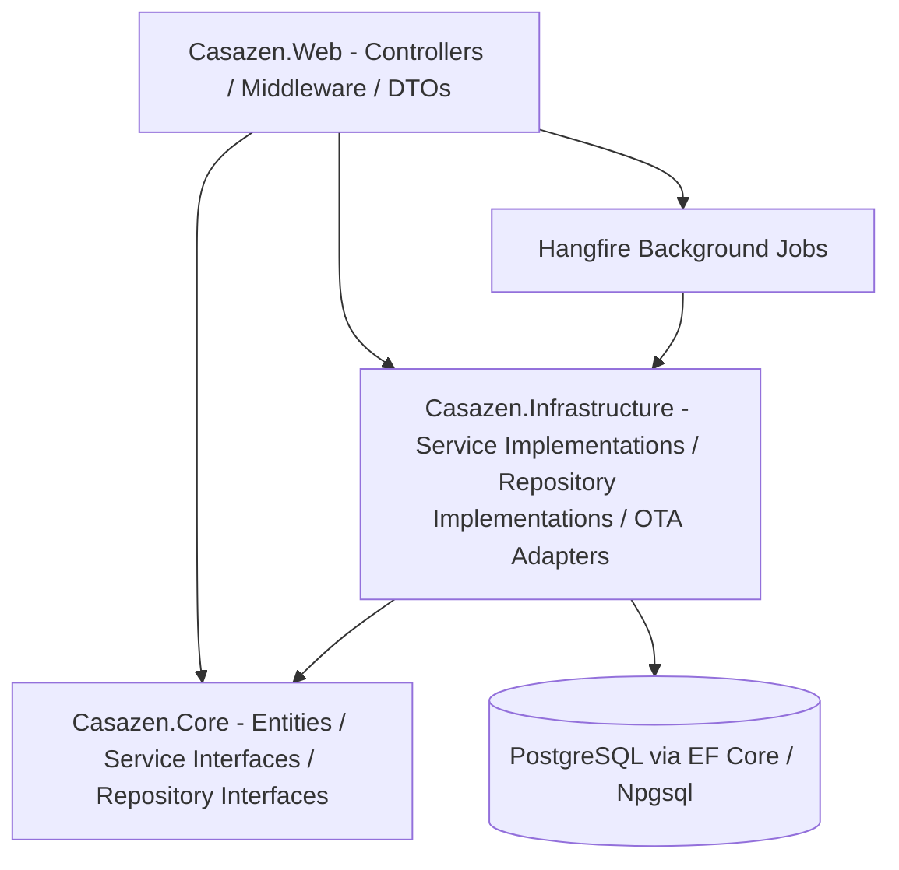
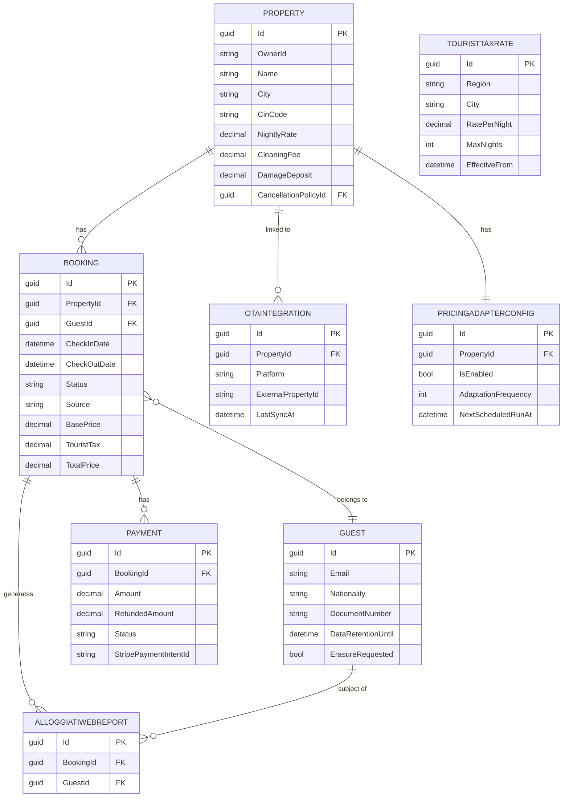

# CasaZen — Technical Documentation

> ASP.NET Core 10 REST API following a layered architecture (Presentation → Business Logic → Data Access), with PostgreSQL (Npgsql / Supabase) via EF Core, Auth0 JWT authentication, and Hangfire background jobs.

---

## Architecture

### Layer diagram



### Layer responsibilities

| Layer | Directory | Responsibility |
|---|---|---|
| Presentation | `Casazen.Web/` | HTTP controllers, DTOs, middleware, Swagger config, auth wiring, background job registration |
| Business Logic | `Casazen.Core/` | Domain entities, service interfaces, repository interfaces, enums, validators, utilities |
| Data Access | `Casazen.Infrastructure/` | EF Core DbContext, repository implementations, service implementations, OTA adapters, Stripe/email clients |
| Tests | `Casazen.Tests/` | Unit and integration tests |

### Dependency rule
`Casazen.Core` has no external project dependencies — it defines only interfaces and entities. `Casazen.Infrastructure` depends on `Casazen.Core` (implements its interfaces). `Casazen.Web` depends on both `Casazen.Core` (for interface injection) and `Casazen.Infrastructure` (registered in DI). This ensures the domain is framework-agnostic.

---

## Tech Stack

| Component | Technology | Version | Notes |
|---|---|---|---|
| Language | C# | 13 | Nullable reference types enabled |
| Framework | ASP.NET Core | 10.0 | Minimal hosting model in `Program.cs` |
| Database | PostgreSQL (Supabase) | — | Npgsql EF Core; integration tests run on real PostgreSQL (see Testing) |
| ORM | Entity Framework Core | 10.x | Code-first, migrations in `Casazen.Infrastructure/Migrations/` |
| Authentication | Auth0 + JWT Bearer | — | `sub` claim used as user ID |
| Background jobs | Hangfire | 1.8.x | PostgreSQL storage; dashboard at `/hangfire` |
| Payment processing | Stripe .NET SDK | — | Webhook signature verification required |
| Email | Resend SDK (`ResendEmailService`) | — | Only provider; emails queued on Hangfire, templates IT/EN (`docs/runbooks/email.md`) |
| OTA resilience | Polly | — | Retry, circuit breaker, timeout, rate limiting per platform |
| Test framework | xUnit | — | `Casazen.Tests/` |
| API docs | Swashbuckle / Swagger | — | Swagger UI at `/swagger` (dev only) |

---

## API Reference

### Base URL
`/api`

### Authentication
All endpoints require a `Bearer` JWT token in the `Authorization` header (issued by Auth0), except anonymous routes noted below (public booking, legal, health, webhooks, guest check-in tokens, supplier register, plan catalogue, SEO sitemap).

Anonymous / public (non-exhaustive highlights):
- `GET /api/health`, `GET /api/health/live`, `GET /api/health/ready`, `GET /api/properties/search`
- `GET /api/orgs/plans`
- All `/api/public/*` (including the SEO sitemap `/api/public/sitemap.xml` and the guest check-in portal `/api/public/checkin/*`), `/api/legal/*`
- `POST /api/suppliers/register`, webhook receivers under `/webhooks/*`

### Authorization (TN-3)

Every action is either `[AllowAnonymous]` or protected by a policy from `Casazen.Web/Authorization/CasazenPolicies.cs`
(the complete set registered at startup; `EndpointAuthorizationArchitectureTests` fails for a policy used but not
registered, registered but unused, or an action with neither).

| Policy (constant) | Who passes |
|---|---|
| `Authenticated` | any signed-in user, suppliers included: only user-scoped endpoints, each listed with its reason in the test allow-list |
| `AdminOnly` | JWT role `Admin` |
| `Supplier` (`RequireSupplier`) | JWT role `Supplier` (backfilled from the DB supplier link) |
| `OrgBillingAdmin` (`RequireOrgBillingAdmin`) | org administrator in either rental context (PL-16): owner `PropertyOwner` or `LongTermLandlord` (JWT role, or DB membership with the owner's role key: `property_owner` of short-rent, `long_term_landlord` of long-rent, `OrgOwnerRoles`), platform `Admin`, or (AM-01) an `account` membership holding `org.billing.manage` (`org_owner`, `org_admin`); never `Staff`/`Guest`, never a `PropertyManager` (D12) nor any other member role. Plan, entitlement, billing, Stripe Connect account, branding, domain, site documents and (AM-03b) the export of the org's fiscal data and team |
| `SharedPropertyRead` / `SharedPropertyWrite` | `property.*` in short-rent **or** long-rent: only the property core a long-term landlord needs (list, record, create/update, documents/APE) — A7-06 |
| `PropertyRead` / `PropertyWrite` | short-rent `property.*`: the short-stay side of a property (photos, CIN, iCal, activation, detail with bookings/OTA, pricing, fiscal, service requests) |
| `BookingRead/Write`, `PaymentRead/Write`, `GuestRead/Write`, `OtaRead/Write` | short-rent context permission |
| `ServiceRequestWrite`, `GuestManage`, `AlloggiatiSubmit` | AM-03: short-rent permissions carved out of `property.write` (interventions), `guest.write` (erase, anonymize, consents of a guest) and `booking.write` (register the guests of a stay, declare the Alloggiati communication sent); the owner and the property manager hold them, the collaborator only the first (`docs/runbooks/org-team.md` § 21) |
| `LeaseRead/Create/Sign/Register` | long-rent context permission |
| `OrgMembersManage` (`RequireContext:account:org.members.manage`) | AM-02: the owner and the administrators of the org (permission of the `account` context); the invitations and the members endpoints |
| `OrgActivityRead` (`RequireContext:account:org.activity.read`) | AM-02b: the owner and the administrators; the list and the CSV of the activity log |

Context permissions come from the DB memberships (`UserContextMemberships` → `Roles` → `RolePermissions`) with the JWT
roles as fallback (`ContextAuthorizationService`). A permission counts only in the context that grants it: the long-rent
`property.*` never satisfies a short-rent policy (`RequireContext:short-rent|long-rent:…` lists both contexts where an
endpoint serves both). The class carries the read permission, writing actions add the write one.

**Org membership (AM-01, `docs/runbooks/org-team.md`).** `OrgMember` (table `OrgMembers`, one org per user, role Owner / Admin /
PropertyManager / Collaborator / Accountant) is the source of truth of who belongs to which org; the `UserContextMemberships` rows
are the projection of its role into permissions, written in the same transaction by `IOrgMembershipService` only. The roles
`org_owner`, `org_admin`, `org_accountant` live in the new context `account` ("Amministrazione" of the customer, permissions
`org.members.manage`, `org.billing.manage/read`, `org.settings.manage`, `org.suppliers.manage`, `org.activity.read`; the staff
console stays `admin`); `GET /api/me/contexts` lists `account` first (clients leave it out of the areas they switch between). For a user with an org member row
and a rental membership the host contexts come from the DB only (a token never adds one: veto of PR #455 limited to org
members); a deactivated member gets 403 `member_inactive` from the next request.

**Org invitations, members and seats (AM-02, `docs/runbooks/org-team.md`).** The owner and the
administrators (permission `org.members.manage` of the `account` context) invite a person with a role and the areas it works
in. The invitation (`OrgInvitation`, table `OrgInvitations`) holds a seat for seven days; its link carries a 256-bit secret of
which only the SHA-256 is stored, a new link replaces the old one, and the token only travels in the body of the two public
calls. The invited account accepts (verified email equal to the invited one, never a platform admin, the four consents again
for the new org) and becomes a member; a person whose own org is still empty and unbilled leaves it, anyone else with an org
is refused (409 `invitation_user_has_organization`). Seats per plan (Starter 2, Pro 10, Scale unlimited) count active members
plus pending invitations and are decided under one advisory lock per org. Only the owner creates or touches an
administrator; the owner is never touched. The hourly job `org-invitation-maintenance` reminds on the third day, expires
and deletes the closed invitations 30 days after they closed.

**Activity log and requests for access (AM-02b, `docs/runbooks/org-team.md` part 4).** The owner and
the administrators (permission `org.activity.read`) read who did what in the org: a short list with ids and codes and no personal
data (`OrgActivityEntry`, table `OrgActivityEntries`, events fixed in `OrgActivityCatalog`: the people, the properties given to
a member, the plan, the name and the slug of the org). A service writes the line with `IActivityLog.Record` **inside the unit of
work of the change it records** (the same `SaveChanges`, the same transaction: a rollback takes both away). The list is paged and filtered (`from`, `to`, `type`, `area`, `actor`) and the CSV has a fixed header and no
personal data; the lines are deleted after 12 months by the nightly job `org-activity-retention`. A member who cannot do
something asks the administrators for access (`POST /api/orgs/me/access-requests`): an area or a page of a closed list and a
note of up to 200 characters, an email in Italian or English to the owner and the administrators, a line in the log, nothing else
stored; three requests a day for each person.

**Completions of the team backend (AM-02c, `docs/runbooks/org-team.md` part 6).** The screens of the
account area read the matrix of the roles from one place (`OrgCapabilityCatalog`: twelve capabilities whose level comes from the
permissions of the seeded roles, never a second table, with real actions run against the levels that have an enforcing action today; a
test fails on a permission with no capability; `billing`, `suppliers` and `settings` report their permission rows before their endpoints
ask for them, AM-02c-FU4), change the areas of a member (`IOrgMembershipService.SetAreasAsync`, same lock as the change of role; a
«Solo alcuni» collaborator that works in one area reaches only the given properties of that mode, in the lists, the single resources, the
notification audience and the people count), give a «Solo alcuni» collaborator its
properties in the invitation (`OrgInvitationProperties`, turned into grants in the transaction of the acceptance), and show a home
that is one request (`GET /api/orgs/me/overview`, a fixed number of SQL statements). The emails of the invitations are capped
(`OrgTeam__InvitationDailyLimit`, `OrgTeam__ResendMinutes`). The property manager has the restricted membership `account/org_manager`
(the trusted suppliers only) and the activity log learns the change of mode of a property.

The policy says what kind of operation a user may do; the row itself is checked with
`IAuthorizationService.AuthorizeAsync(User, HostResource, operation)` (`PropertyOperations`, `SharedPropertyOperations`,
`BookingOperations`, `GuestOperations`, `PaymentOperations`, `OtaOperations`, `LeaseOperations`): `HostResourceAuthorizationHandler` grants it only when the row
is in the caller's org, the caller holds the permission and, for property-bound rows, **reaches the property** (AM-03): every
property for an owner, administrator, manager or accountant member and a collaborator with every property, only the ones in
`PropertyMemberAccesses` for a collaborator "Solo alcuni", the ones it created for an account in no org team. The reach is read
from the database (`IHostScopeResolver`, the authorization snapshot cached 60 s), never from the token roles. Lists use
`await User.ResolveHostScopeAsync(resolver, orgId)` → `HostScope` and narrow with `query.InScope(scope)` (an `EXISTS` in the same SQL
statement). Services never check roles: they receive the org / scope decided by the web layer. A row that is not in
the caller's org answers 404; a visible row the caller may not use answers 403.

There are **48** controller source files under `Casazen.Web/Controllers/`. The supplier jobs with QR check-in (`SupplierJobController`, `PublicCheckInController`) were removed by SU-11 (decision D12): supplier work is a `ServiceRequest` only.

### Endpoints

#### Auth / identity / devices

| Method | Path | Auth | Description |
|---|---|---|---|
| `GET` | `/api/auth/profile` | JWT | Current auth profile |
| `POST` | `/api/auth/logout` | JWT | Logout / invalidate session side-effects |
| `GET` | `/api/users` | Admin | Paginated user list |
| `GET` | `/api/users/{id}` | Admin | User detail |
| `GET` | `/api/users/me` | JWT | Current user profile; `emailVerified` (bool) says Auth0 verified the account's email (the Action claim `https://casazen.app/email_verified`, else the Management API), also in the answer of `PUT` |
| `PUT` | `/api/users/me` | JWT | Update current user profile |
| `GET` | `/api/guest/bookings?scope=upcoming\|past&page=1&pageSize=20` | Policy `GuestAccount` (any signed-in account) | The mobile app's «Le mie prenotazioni»: the direct bookings, of any booking site, whose guest has the account's **verified** email; `{ items, total, page, pageSize }`, `pageSize` up to 50; upcoming = check-out today or later in Europe/Rome by check-in ascending, past by check-in descending; the lapsed holds (`Expired`, `DatesUnavailable`) are not listed; 400 `validation_error` for another `scope`, **403 `guest_email_not_verified`**, 429 (`GuestAccountRead`, per person) ([direct-booking.md](runbooks/direct-booking.md) § 8.6) |
| `GET` | `/api/guest/bookings/{id}` | same | One booking of the account: the body of `GET /api/public/guest/bookings/{code}` plus `id` and `orgSlug`; **404 `guest_booking_not_found`** for a booking that is not the account's, an unknown id or a string that is not an id |
| `POST` | `/api/guest/bookings/{id}/session` | same; `GuestAccountSession` | Opens the guest-area session of the booking's site for the account's email: `{ accessToken, expiresAt, bookingCode, orgSlug }` (the `gs1.` token of `POST /api/public/guest/session`, same length), to reuse the cancellation and the messages of `api/public/guest/*` without asking the guest for the code |
| `DELETE` | `/api/guest/account` | Policy `GuestAccount`; `GuestAccountDelete`; needs no verified email | The guest deletes their own account (store rule «delete account in the app»): Auth0 first, then the CasaZen row; 204; **409 `guest_account_is_professional`** (host org, supplier link or administrator role: support removes those); 502 with an `auth0_*` code and nothing removed; a second call answers 401. Bookings and guest records of the hosts stay ([gdpr.md](runbooks/gdpr.md) § 11) |
| `POST` | `/api/users/onboarding` | JWT | Submit user onboarding payload |
| `PUT` | `/api/users/onboarding` | JWT | Update user onboarding payload |
| `PUT` | `/api/users/{id}/role` | Admin | Change user role |
| `DELETE` | `/api/users/{id}` | Admin | Delete user |
| `POST` | `/api/devices` | JWT | Register iOS/Android push device |
| `DELETE` | `/api/devices/{deviceId}` | JWT | Unregister device |
| `GET` | `/api/me/notifications?unread=&page=&pageSize=` | JWT | UI-12a: the caller's in-app notifications (the bell), newest first, paged (`pageSize` 1–50, default 20): `{ items: [{ id, type, entityId, createdAt, readAt }], totalCount, page, pageSize }`. No text: the client writes it from `type` |
| `GET` | `/api/me/notifications/unread-count` | same | `{ count }` |
| `POST` | `/api/me/notifications/{id}/read` | same | 204, idempotent; 404 for a notification that is not the caller's (another user's, another org's, deleted, unknown), never 403 |
| `POST` | `/api/me/notifications/read-all` | same | 204 |
| `GET` | `/api/me/activities` | JWT (`Authenticated`; the caller's `HostScope`) | ADR-026, NF-07: the caller's «To do» list, the open items of its org (`InternalActivities` rows with an `action`, `CompletedAt` null) its scope reaches: a collaborator «Solo alcuni» only the items of the properties it was given, never an organization-level item (no property); sorted by the server, urgency `High` first, then `dueAt` (none last), then creation; at most 50: `[{ id, activityType, action, entityType, entityId, propertyId, dueAt, urgency, reason, createdAt }]`. No personal or staff data (no person, rate, note): the client reads the detail from the entity's API and maps `action` to its route (`ACTION_ROUTE_MAP`). `private, no-store`; empty for a caller with no org or scope |
| `GET` | `/api/me/activities/count` | same | `{ count }`: the open `High` items of the list (the nav badge) |
| `POST` | `/api/me/activities/{id}/close` | short-rent `property.write` (`PropertyWrite`, on top of `Authenticated`; the caller's `HostScope`) | Closes an item by hand (`Status` `Completed`, `CompletedAt`, `ClosedBy` = the caller); 204, idempotent; 403 for a caller without `property.write` in the short-rent context (a role that only reads, the accountant or a collaborator with no write permission: it reads the list and the count but closes nothing), before anything is looked up; 404 for an item the caller's scope does not reach (a property not given, another org, unknown). The items are raised and closed by the system through `IInternalActivityService.CreateAsync` / `CloseAsync` (idempotent per type and entity while open) and `ActivityAutoCloseHandler` (`CheckInCompleted` closes `CheckInPending` and `BookingSpecialRequest`, `CheckOutCompleted` closes `CheckOutPending`, `BookingCancelled` closes `BookingSpecialRequest`, `PropertyReadyDeclared` closes `CleaningDue`, `AlloggiatiReceiptArrived` closes `AlloggiatiDeadline` and `ReceiptToRetrieve`, for the event's booking). The booking events (ADR-022, E08/F06) are recorded in the outbox by the services that change a booking, in the same save as the change (`BookingEvents`): `BookingCreated`, `BookingConfirmed`, `BookingModified`, `BookingCancelled`, `CheckInCompleted`, `CheckOutCompleted`, `PropertyReadyDeclared`, with a payload of ids, enums and dates only (`BookingEventPayload`: booking, property, source, origin Host, Guest, System or Octorate, status, check-in, check-out) and the dedup keys `booking-created:{id}`, `booking-confirmed:{id}`, `booking-cancelled:{id}`, `booking-modified:{id}:{UpdatedAt}`, `checkin:{id}`, `checkout:{id}`, `property-ready:{id}`; their consumers raise «Check-out completato senza una pulizia richiesta» (`CleaningDue`, action `CompleteCheckOut`, due at the next arrival, `High` within 48 hours), «Nuova prenotazione con una richiesta speciale» (`BookingSpecialRequest`, action `ReviewBooking`) and, for a booking whose origin is Octorate, the new-booking push to the hosts; a closed row is kept for the audit |
| `GET` | `/api/me/alerts/pending` | JWT (`Authenticated`; the caller's `HostScope`) | ADR-025, NF-08: the caller's popup alerts that are pending (`PopupAlerts` rows of the caller, in its org, `DismissedAt` null and `RemindAt` null or already passed), narrowed to its scope: an owner, an administrator, a manager or a collaborator with every property sees them all; a collaborator «Solo alcuni» only the ones about a `Booking` or a `Property` it was given, never an org-level one (ADR-025-R4). Sorted by the server, urgency `High` first, then the oldest: `[{ alertId, alertType, entityType, entityId, urgency }]`, the two enums by name. **No personal data and no text** (ADR-025-R5): the client reads the detail from the API of the entity. `private, no-store`; empty for a caller with no org or scope. The alerts are written by `IAlertRouter` (quiet hours 22:00-08:00 on the clock of Rome, legal alerts excepted) and pushed on the SignalR hub `/hubs/notifications`, client method `alertReceived`, with the same five fields |
| `POST` | `/api/me/alerts/{id}/dismiss` | same | Dismisses one alert of the caller (`DismissedAt`); 204, idempotent (the first instant is kept); no body needed. 404 for an alert that is not the caller's (another user's, another org's, unknown), never 403 |
| `PATCH` | `/api/me/alerts/{id}/remind` | same | «Remind me later»: body `{ "remindAt": "<ISO 8601 with offset>" }`; sets `RemindAt` and clears `DeliveredAt`, so the job `popup-alert-due` pushes the alert again when the snooze ends; 204. **400 `cannot_snooze_past_deadline`** when the alert has a legal `Deadline` and `remindAt` is after it (ADR-025-R10); 400 `validation_error` without `remindAt`; an alert already dismissed stays dismissed (204); 404 as for dismiss |

#### Multi-tenancy (orgs & workspace)

| Method | Path | Auth | Description |
|---|---|---|---|
| `GET` | `/api/me/contexts` | JWT | Workspace contexts (host / supplier / …); merges JWT roles with `UserContextMemberships`; the `account` context (AM-01) is listed first for a member of an org, and clients leave it out of the areas they switch between |
| `PUT` | `/api/me/last-context` | JWT | UI-13a: remember the area the caller entered last (`{ "contextKey" }`, one of the contexts `GET /api/me/contexts` lists for the caller; anything else: 422 `context_not_accessible`); `GET /api/me/contexts` gives it back as `lastUsedContextKey` while the caller can still enter it |
| `GET` | `/api/orgs/plans` | Anonymous | Plan catalogue and property limits |
| `GET` | `/api/orgs/me/entitlement` | OrgBillingAdmin (org policy, any rental context, PL-16) | Org plan tier (the effective one), limits, usage, `canAddProperty`, `canUseCustomDomain`; BL-01: `openAccess` (`true` when the tier shown is raised by `Entitlement:OpenAccess`, [`open-access.md`](runbooks/open-access.md)); AM-02: `limits.maxSeats`, `usage.seats`, `canInviteMember` |
| `PUT` | `/api/orgs/me/plan` | Org billing admin | Downgrade / back to Starter only; upgrade without an active subscription → 403 `subscription_required`, Stripe-managed plan → 409 `managed_by_stripe` (#274) |
| `POST` | `/api/orgs/me/invitations` | Policy `RequireContext:account:org.members.manage` | AM-02: invite a person (email, name, role, areas): 201 `{ invitation, emailQueued }`; 403 `org_owner_required`, 409 `org_seat_limit_reached`, `org_invitation_already_pending`, `org_member_already_member`, 422 `org_owner_not_assignable`, `org_member_area_required`; AM-02c: a «Solo alcuni» collaborator carries `propertyIds` (at most 500, live properties of the org: 422 `org_member_property_unknown`, 422 `org_member_scope_not_supported` for another role or scope) and the org is capped to `OrgTeam:InvitationDailyLimit` emails in 24 hours: 429 `invitation_daily_limit_reached` |
| `GET` | `/api/orgs/me/invitations` | same | Invitations open or expired, never the token; AM-02c: each with `propertyIds` and `lastSentAt` |
| `POST` | `/api/orgs/me/invitations/{id}/resend`, `/revoke`, `/link` | same | Send again with a new link (7 more days) / withdraw (204, idempotent) / a fresh link to hand out (`no-store`); AM-02c: «reinvia» once every `OrgTeam:ResendMinutes` for each invitation (429 `invitation_resend_too_soon`) and counted in the daily cap |
| `GET` | `/api/orgs/me/members` | same | `{ items, seats }`: the people, owner first, and the seats of the plan |
| `PUT` | `/api/orgs/me/members/{id}` | same | Change the role (never to Owner; Admin only by the owner) |
| `PUT` | `/api/orgs/me/members/{id}/areas` | same | AM-02c: `{ areas: ["short-rent","long-rent"] }`, at least one; role and properties stay (a collaborator «Solo alcuni» keeps its grants and reaches the given properties of the modes it works in); 403 `org_owner_required`, 409 `org_last_owner`, 422 `org_member_area_required`; a line `MemberAreasChanged` in the log |
| `GET` | `/api/orgs/me/roles` | JWT (any active member) | AM-02c: the matrix of the five org roles: `permissionsByContext`, twelve `capabilities` (`Yes` · `Read` · `No`, read from the permissions of the seeded roles), `assignable` (relative to the caller) and `scopeSupported` (the collaborator only) |
| `GET` | `/api/orgs/me/overview` | Policy `RequireContext:account:org.members.manage` | AM-02c: the figures of the home in one answer: `standing`, `openAccess`, `seats`, `properties`, `invitations`, `accessRequests`, `suppliers`, `alloggiati`, `recentActivity`; a section whose own permission the caller lacks is left out |
| `POST` | `/api/orgs/me/members/{id}/deactivate`, `/reactivate` | same | Switch the access off / on (reactivating takes a seat); 409 `org_last_owner` for the owner |
| `DELETE` | `/api/orgs/me/members/{id}` | same | The person leaves the org; its account stays |
| `GET` | `/api/orgs/me/members/{id}/properties` | same | AM-03: the active properties of the org with whether this member reaches each (`granted`) and how many people do (`peopleWithAccess`); `scopeSupported` false for a member who is not a collaborator |
| `PUT` | `/api/orgs/me/members/{id}/properties` | same | AM-03: `{ propertyScope, propertyIds }` with `propertyScope` `All` or `Selected` ("Solo alcuni" is the collaborator only); 403 `org_owner_required`, 422 `org_member_scope_not_supported`, `org_member_property_unknown` |
| `GET` | `/api/orgs/me/activity` | Policy `RequireContext:account:org.activity.read` | AM-02b: the activity log, newest first, paged (`page`, `pageSize` 50/100) and filtered (`from`, `to`, `type` one or several, `area`, `actor` or `system`): `{ items, totalCount, page, pageSize }`, each item with ids and codes only; 400 for an unknown event or area or `from` after `to` |
| `GET` | `/api/orgs/me/activity.csv` | same | AM-02b: the whole matching log as a CSV (fixed header `id,when,actor,area,type,subjectType,subjectId,details`, no personal data, never cached) |
| `POST` | `/api/orgs/me/access-requests` | JWT (any active member), rate limited per person (`OrgAccessRequest`) | AM-02b: `{ area, note }`, 202 `{ notified }`: an email to the owner and the administrators and a line in the log; 409 `access_request_limit_reached` (three a day), 422 `access_request_area_unknown`, 429 |
| `POST` | `/api/org-invitations/lookup` | Anonymous, rate limited (`PublicInvitationLookup`) | What a link is for; every link that does not work answers the same 410 `invitation_invalid` |
| `POST` | `/api/org-invitations/accept` | JWT (any signed-in account) | Accept with the four consents: 200 `{ orgId, orgName, role, areas, leftEmptyOrg }`; 403 `invitation_email_mismatch`, `invitation_email_not_verified`, `invitation_platform_admin`; 409 `invitation_user_has_organization`; 410 `invitation_expired`, `invitation_used`, `invitation_revoked`, `invitation_invalid` |
| `GET` | `/api/orgs/{orgId}/domain` | JWT | Custom domain config for org |
| `POST` | `/api/orgs/{orgId}/domain` | JWT | Set custom domain |
| `POST` | `/api/orgs/{orgId}/domain/verify` | JWT | Verify DNS / domain ownership |

#### Global search (UI-13a)

| Method | Path | Auth | Description |
|---|---|---|---|
| `GET` | `/api/search?q=&limit=` | JWT, rate limited per user (`GlobalSearch`, 60 / min) | Groups of results by kind (`property`, `booking`, `guest`, `lease`, `service-request`, `supplier`, `supplier-request`), each only when the caller holds the permission of that group in its context, bound in SQL to its org and to the properties it reaches (AM-03). `q` 2 to 64 characters (400 `search_query_too_short` / `search_query_too_long`), `limit` per group (default 5, at most 20). A result is `{ type, id, title, subtitle, destination }` with a destination **key** (`short-rent.property`, `long-rent.lease`, …), guest e-mail masked, never phone or document. `Cache-Control: private, no-store`. Full-text search on generated `SearchKey` columns and their GIN indexes, no extension: [`runbooks/global-search.md`](runbooks/global-search.md) |

#### Onboarding

| Method | Path | Auth | Description |
|---|---|---|---|
| `GET` | `/api/onboarding/status` | JWT (`Authenticated`: needed before any context exists) | Host / org onboarding wizard status: the seven `steps` of the activation checklist (PL-15) and the milestones. **`flows`** (E10/F01/US01/T02, NF-106): with `Features:OctorateOnboarding` on **and** a caller who passes the short-rent `property.read` (`PropertyRead`), the summary of the six flows over the properties the caller reaches, `[{ flow, active, toComplete, notAvailable, total }]` in the order `Listings`, `Bookings`, `CheckInCompliance`, `Messages`, `Documents`, `Reports`; otherwise `[]`, and with the flag off the endpoint answers exactly as before. Never behind the flag |
| `GET` | `/api/onboarding/flows/{flow}/properties?state=&search=&page=&pageSize=` | short-rent `property.read` (`PropertyRead`) + `HostScope`, behind `Features:OctorateOnboarding` (404 before authentication while off) | E10/F01/US01/T02, NF-106: the properties of the caller with the status of one flow, by name (the id as the tie-break), `{ items, totalCount, page, pageSize }` (`page` from 1, `pageSize` 50 when missing, at most 100). `{flow}` is a member name of `OnboardingFlow` (400 `onboarding_flow_unknown`); `state` keeps one of `active`, `toComplete`, `notAvailable` (400 `onboarding_flow_state_unknown`); `search` finds a text in the name or the city. An item is `{ propertyId, name, city, flow, state, reason, action, prerequisites: [{ key, met, reason }] }`: codes only, the client translates them. `reason` and `action` are stable codes (`connection_missing`, `connection_lost`, `mapping_unconfirmed`, `mapping_unavailable`, `sender_missing`, `channel_content_to_fix`, `cin_missing_or_invalid`, `tax_rate_missing`, `flow_not_activated`, `property_long_rent`, `property_inactive`, `content_managed_on_channel`, `not_provided`; `connect`, `reconnect`, `confirmMapping`, `chooseSender`, `fixListing`, `enterCin`, `enterTaxRate`, `activate`); prerequisite keys are `connection`, `mapping`, `singleSender`, `content`, `cin`, `taxRate`. Bound in SQL to the caller's org and to what it reaches (AM-03); `Cache-Control: no-store`; 403 for a caller with no org. Nothing is written: the state is derived on every read |

#### Wizard drafts (ADR-024, E01/F02)

`{type}` is the name of a `WizardType` (`ListingCreate`, `ListingEdit`, `BookingCreate`, `BookingEdit`, `CheckIn`, `CheckOut`, `ComplianceSender`, `TouristTax`, `OnboardingActivation`, `OnboardingBulk`; a number, or a name that is not one: 400 `wizard_type_unknown`). `entityId` tells what the wizard edits (the query of `GET` and `DELETE`, a member of the body of `POST`); none means the draft of a new entity. The person is always the token's `sub` and the org the caller's own; the answers are `private, no-store`. A caller with no host org gets 404 `not_found`.

| Method | Path | Auth | Description |
|---|---|---|---|
| `GET` | `/api/wizards/{type}/draft?entityId=` | JWT (`Authenticated`: the caller's own draft) | `{ type, entityId, version, data, lastSavedAt }`: `data` is what the person typed, the plain half put together with the decrypted personal fields; **404 `wizard_draft_not_found`** when there is none, it expired (30 days from the last save) or it is another person's or another org's (never 403) |
| `POST` | `/api/wizards/{type}/draft` | same | Body `{ entityId?, clientVersion, data }` (`clientVersion` = the `version` the client last saw, 0 at the first save; `data` a JSON object, at most 256 KB; a `type` in the body, if there, must be the one of the address: 400 `wizard_type_mismatch`). 200 with the draft as saved (`lastSavedAt` is the "saved at" of the screen). **409 `draft_conflict`** when the client is behind the server, or lost a parallel save (`xmin`; the loser of two first saves is refused by the unique index): nothing is written and the problem carries `serverDraft` and `serverVersion` for "keep mine / take theirs". 400 `wizard_draft_data_invalid`, 413 `wizard_draft_too_large`. The personal fields (`guestName`, `guestEmail`, `guestPhone`, `guestFiscalCode`, `documentNumber`, `documentType`, `birthDate`, `birthPlace`, `citizenship`, `address`, `emergencyContact`, any case, at any depth) are stored encrypted (`Casazen.WizardDraft.PII`), the rest in clear |
| `DELETE` | `/api/wizards/{type}/draft?entityId=` | same | 204, idempotent: the draft of the caller loses its data and its person (the row stays for the audit trail, as after the retention); never another person's |

#### Properties

| Method | Path | Description |
|---|---|---|
| `GET` | `/api/properties` | Properties of the caller org the caller reaches (AM-03: read from the org membership in the database; the whole org for an owner, administrator, manager, accountant or a collaborator with every property; only the ones given to a collaborator "Solo alcuni"; the ones created for an account in no team). Short-rent or long-rent Each row carries `rentalMode` (`Short`/`Long`, PM-01); `?mode=short\|long` narrows the list (400 `validation_error` for another value), without it every property is listed |
| `GET` | `/api/properties/{id}` | The property record (`PropertyResponse`): no bookings, check-in tokens, OTA integrations or documents (PC-02, A2-32; bookings come from the booking endpoints). Short-rent or long-rent |
| `GET` | `/api/properties/cancellation-policies` | Cancellation policies a property can reference (global catalog). Short-rent only |
| `GET` | `/api/properties/access-codes?page=&pageSize=` | NF-50. Which of the properties the caller reaches have a lock code: `{ items: [{ propertyId, name, city, accessCodeSet, updatedAt }], totalCount, page, pageSize }`, by name; `page` from 1, `pageSize` 50 when missing and brought within 1 and 100. Bound in SQL to the caller's org and to what it reaches (`HostScope`, AM-03): a collaborator "Solo alcuni" sees only the properties it was given and nobody sees another org's. The answer never carries the code or anything derived from it, and the query does not select or decrypt the encrypted column (ADR-013): the code is set by `POST /api/properties/{id}/access-code` (`property.write`) and released only to a verified guest. `Cache-Control: no-store`. 403 `forbidden` when the caller has no org or no scope. Short-rent only |
| `POST` | `/api/properties` | Create a new property. Short-rent or long-rent; `nightlyRate`/`maxGuests` may be `0` (long-term only property, blocks short-stay activation); `bedrooms` may be `0` (studio). Optional `rentalMode` (`Short`/`Long`, PM-01): without it, no guests **and** no rate create a `Long` property, anything else a `Short` one ([`property-rental-mode.md`](runbooks/property-rental-mode.md)) |
| `PUT` | `/api/properties/{id}` | Update a property (owner or org-wide role) with **PATCH semantics** (PC-02, A2-04): a field left out of the body (or `null`) keeps its stored value; `cinCode`, `slug` and `cancellationPolicyId` sent as `null` are cleared. 400 `validation_error` for an invalid field, 422 `cancellation_policy_not_found`, 422 `property_rental_mode_change_not_allowed` for a `rentalMode` that is not the stored one (the mode is never changed by this save). Short-rent or long-rent |
| `PUT` | `/api/properties/{id}/responsible` | AM-03: the member in charge of the property, `{ userId }` or `null`: 204; 422 `property_responsible_invalid` (not an active member who reaches the property). Short-rent or long-rent, same check as the update |
| `GET` | `/api/properties/{id}/mode` | PM-02. The mode of the property, the change waiting for its day and the last one that is over. Short-rent or long-rent ([`property-rental-mode.md` §8](runbooks/property-rental-mode.md#8-the-scheduled-change-of-mode-pm-02-decision-d16)) |
| `GET` | `/api/properties/{id}/mode/preview?to=short\|long&date=` | PM-02. What a change to `to` on `date` (default: the first possible day) meets: stays, imported calendar blocks or leases in the way, the first free day, the `issues` the creation would answer. Ids and dates only |
| `POST` | `/api/properties/{id}/mode/change` | PM-02. Programs the change (`{ to, effectiveDate }`, tomorrow at the earliest). 201, 404 `property_not_found`, 409 `property_mode_change_exists` / `property_mode_blocked_by_bookings` / `property_mode_blocked_by_lease` / `property_mode_blocked_by_draft_lease`, 422 `property_mode_unchanged` / `property_mode_date_too_early` / `property_mode_date_too_far`. To long-term the calendar closes from the night before the day |
| `DELETE` | `/api/properties/{id}/mode/change/{changeId}` | PM-02. Withdraws a change that is still waiting: 204, 404 `property_mode_change_not_found`, 409 `property_mode_change_not_scheduled` |
| `GET`/`POST` | `/api/properties/{id}/documents` | List (with `documentType`) / upload documents such as the APE. Short-rent or long-rent |
| `DELETE` | `/api/properties/{id}/documents/{docId}` | Delete a document. Short-rent or long-rent |
| `GET` | `/api/properties/{id}/documents/{docId}/download` | Authenticated download from the private bucket (FD-07). Short-rent or long-rent |
| `DELETE` | `/api/properties/{id}` | Delete a property (owner only). Short-rent only |
| `GET` | `/api/properties/search` | Search properties by city, bedrooms, max price (anonymous) |
| `GET` | `/api/public/amenities` | DB-11a. The amenity catalog of the booking site: the five groups and, for every `PropertyAmenity`, its name, icon, group and label in Italian and English (anonymous, cacheable one hour) |
| `GET` | `/api/properties/{id}/images` | The photo gallery (PC-04): `photoUrls` in display order (absolute public URLs, the first is the cover) plus the upload rules (`maxPhotos`, `maxFilesPerRequest`, `maxFileSizeBytes`, `allowedContentTypes`). Short-rent only |
| `POST` | `/api/properties/{id}/images` | Upload photos (multipart field `images`; at most 10 files per request, 10 MB each, 20 per property; JPEG/PNG/WebP checked on their content). All or none. 422 `property_photo_none`/`_too_many_files`/`_invalid_type`/`_invalid_size`/`_limit_reached`. Answers with the gallery |
| `DELETE` | `/api/properties/{id}/images?url=...` | Delete a photo **by URL** (not by position) from the gallery and its object from the storage. 404 `property_photo_not_found`. Answers with the gallery |
| `PUT` | `/api/properties/{id}/images/order` | Set the order: body = every photo URL of the gallery, each once. 409 `property_photos_changed` when the list is not the current gallery. Answers with the gallery |
| `PUT` | `/api/properties/{id}/images/cover` | Make a photo the cover (body `{ "url": ... }`): it moves first. Answers with the gallery |
| `GET` | `/api/properties/{id}/site-profile` | DB-11a. The optional facts and texts of the property page of the booking site (floor, renovation, energy class and index, kind of place, children, latest arrival, video and tour, zone, what is near, notes, highlights, safety notes, labels) plus `derivedTags` (the labels the data of the house give it). Short-rent only; `null`/empty = the host never said ([`direct-booking.md` §14](runbooks/direct-booking.md#14-the-site-profile-of-a-property-db-11a)) |
| `PUT` | `/api/properties/{id}/site-profile` | DB-11a. Replaces the whole profile (what the body leaves out is cleared); texts in Italian (always) and English (optional), fixed lists for labels and highlight icons, a YouTube/Vimeo video and a Matterport tour stored as canonical embeds. 422 `property_site_profile_*` with the `field`, 422 `property_not_bookable_in_long_mode`. Answers with what is stored. **NF-31, multilingual texts**: the body also carries `translations` (language code of `ListingLanguages` to `{ title, description, spaces, access, neighborhood, transport, rules }`, the headline up to 60 characters, the description up to 2000, the others up to 1000; Italian keeps only `transport`, its other texts are `Property.ListingTitle`, `Description`, `HouseRules` and the `it` parts of the profile texts) and, in the six profile texts (`zone`, `near`, `floorNote`, `outdoorNote`, `checkInMethod`, `rulesNote`), `others` (the same text in the other languages). Left out, the stored ones are kept; an empty object clears them. There is no second store, no table and no migration: everything is in `Properties.SiteProfileJson`. The answer carries `translations` and `origins` (`"fr.title"` to `UserWritten`, `AutoTranslated` or `ModifiedAfterTranslation`): a person's save is `UserWritten`, or `ModifiedAfterTranslation` when it changes a machine translation; `AutoTranslated` can only come from `IPropertySiteProfileService.SaveAutoTranslationsAsync` (the call machine translation will use, AI-02, not built), which never overwrites a person's text. 422 `property_site_profile_language_unknown`. The public booking page keeps reading Italian and English only (`SitePropertyProfileDocument.ForPublicPage`). `ListingTextResolver` is the one reader of a text by language and field (Italian from the columns and the `It` parts; any other language from the document); `LanguageMapper.ValidateForPublish` lists the missing Italian and English headline and description (`en.title`...); `AmenityCatalogMapper` maps every `PropertyAmenity` to the amenity of the channel manager and to the Airbnb and Booking.com codes (published codes, not yet read again on the sandbox) |
| `GET` | `/api/properties/{id}/rooms` | NF-34. The rooms of the unit in order: `id`, `position`, `type` (`Bedroom`, `LivingRoom`, `Studio`, `Other`) and `beds` (`[{ type, count }]`, `type` one of `Single`, `Double`, `Queen`, `King`, `SofaBed`, `Bunk`, `Crib`); an empty list when the host listed none. `property.read` and the row check (`PropertyOperations`): a property of another org is 404 |
| `PUT` | `/api/properties/{id}/rooms` | NF-34. Body `{ rooms: [{ id?, type, beds }] }` replaces the whole list: a room sent with the `id` of a stored one is updated (its photos keep their room), a stored room not sent is removed and its photos lose the assignment. At most 20 rooms, 1 to 10 beds of a kind in a room, at least one bed in all and no more than the beds of a property (1 to 100): 422 `property_rooms_invalid` (the message says which rule), 422 `property_not_bookable_in_long_mode`, 404 `property_room_not_found` for an `id` that is not one of the property's. The same save sets `bedrooms` to the number of `Bedroom` rooms and `beds` to the number of beds; `maxGuests`, `bathrooms` and the area are not derived. `property.write` and the row check |
| `GET` | `/api/properties/{id}/stay-discounts` | NF-35. The length-of-stay discounts in order of nights (`[{ minNights, percentOff }]`); an empty list when none |
| `PUT` | `/api/properties/{id}/stay-discounts` | NF-35. Body `{ discounts: [{ minNights, percentOff }] }` replaces the whole list (an empty one removes them all). At most 5 tiers, each with its own `minNights` from 2 to 365 and a `percentOff` above 0 and at most 100 (two decimals): 422 `property_stay_discounts_invalid`, 422 `property_not_bookable_in_long_mode`. A stay gets the tier with the most nights it reaches, off the lodging only, rounded to the cent half away from zero (`StayPricing.DiscountFor`); never off the cleaning fee or the tourist tax. `property.write` and the row check |
| `PUT` | `/api/properties/{id}/site-profile/photos` | NF-32. Besides the caption (`alt`) a photo can name the room it shows (`roomId`, an id of `GET .../rooms`): 404 `property_room_not_found` for a room of another property; the gallery answers with `roomId`; removing a room from the rooms clears it from the photos |

Property record choices (PC-02):
- **Update = PUT with PATCH semantics**, not a full PUT: a client that does not know or show a field (the long-term
  form, the pause toggle of the list, an older app build) can never reset the cleaning fee, deposit, house rules,
  timezone or cancellation policy. The web forms still send every field they show (`toPropertyPayload`), never the
  photos (managed by the image endpoints; a `photoUrls` sent to create or update is ignored, PC-04).
- **Bathrooms stay a whole number** (`int` in the model and the database, 1-50): the form accepts whole numbers only,
  no migration. **Bedrooms 0-100**, `0` = studio (monolocale); the activation wizard no longer requires a bedroom.
- **No country nor currency** on the property: amounts are in euros and the form has no such fields.
- **Children rule** (NF-37): `childrenPolicy` (`No`, `OnRequest`, `Yes`; `null` = never said) is stored next to `petsPolicy`, `smokingPolicy`,
  `partiesPolicy` and the quiet hours, sent and answered by the property API with the same PATCH semantics (left out keeps it, `null` clears
  it). Unlike pets and smoking it decides no amenity; the public page keeps reading `childrenWelcome` of the site profile.

#### Bookings

| Method | Path | Description |
|---|---|---|
| `GET` | `/api/bookings` | List bookings a page at a time (PC-14: `?propertyId&guestId&page&pageSize`, `Bookings:DefaultPageSize` = 10 when `pageSize` is missing, at most 100), answered as `{ items, totalCount, page, pageSize }`; since SR-03b the search below without a filter but these two, rows included |
| `GET` | `/api/bookings/search` | The same list with days, status and text (SR-03, below): `?from&to&status&q&propertyId&guestId&page&pageSize`, same order, same answer, same default page size. SR-03b adds `&arrivalFrom&arrivalTo&view&channel&checkInStatus&sort` and, on each row, `channel`, `paymentState`, `paidAmount`, `alloggiatiStatus`, `respondBy` |
| `GET` | `/api/bookings/counts` | SR-03b: how many bookings are in each chip of the list (`{ all, toConfirm, upcoming, inProgress, completed, cancelled }`), for the filters of the search but the chip, the page and the order |
| `GET` | `/api/bookings/{id}` | Get a single booking; SR-05a adds `paymentState`, `paidAmount` and `guestDataComplete` (below) |
| `GET` | `/api/bookings/{id}/timeline` | SR-05a: the history of the booking, derived from its timestamps and the rows tied to it (below); `booking.read` on its property, 404 outside the caller's scope |
| `POST` | `/api/bookings` | Create a booking (availability check + tourist tax calculation) |
| `PUT` | `/api/bookings/{id}` | Update a booking. 422 `ota_booking_change_not_allowed` for a booking that came from a channel whose channel is closed (every channel unless `Octorate:ChannelActions` opens it; nothing is changed, E08/F02/US02), 422 `ota_amounts_readonly` for a changed amount of the channel (below) |
| `DELETE` | `/api/bookings/{id}` | Cancel a booking |
| `GET` | `/api/bookings/{id}/cancellation` | What cancelling now would do (paid and refundable amounts, the minimum refund, `cancellable`); `booking.read` and `payment.read`. For a booking of a channel `cancellable` also follows the rule of its channel |
| `POST` | `/api/bookings/{id}/cancel` | `BookingWrite`. A direct or manual booking: Stripe intents cancelled and the refund as always, then Octorate follows (below). A booking that came from a channel: Octorate first, 200 only after it confirmed, no refund; 422 `ota_booking_cancel_not_allowed` (closed channel), 422 `octorate_cancel_failed` (Octorate refuses or cannot be asked), 503 `octorate_unavailable` (no answer); the booking is unchanged in the three (E08/F02/US02, below) |
| `GET` | `/api/bookings/calendar` | Calendar view of one property (`?propertyId&startDate&endDate&timezone`); unchanged |
| `GET` | `/api/calendar` | SR-02a: the calendar of all the host's properties in one read (below): `?from&to&propertyIds&timezone` |
| `POST` | `/api/bookings/{id}/check-in` | Perform check-in: records `ArrivedAt`, schedules the Alloggiati Web job (idempotent) |
| `POST` | `/api/bookings/{id}/check-out` | Perform check-out |
| `GET` | `/api/bookings/{id}/alloggiati-status` | Alloggiati Web status (same as `/api/alloggiati/{id}/status`) |
| `POST` | `/api/bookings/manual` | SR-06a, the booking the host enters by hand (`booking.write`); since E08/F01/US01/T05 (NF-74) it takes `paymentArrangement` (`none` default, `paymentLink`, `onSite`, `bankTransfer`), stored on the booking (`HostPaymentArrangement`). `onSite` and `bankTransfer` only record the arrangement: the balance stays to collect with "Registra incasso" and nothing is sent. `paymentLink` also needs `payment.write` on the property (403 otherwise) and a Stripe account ready (422 `payment_link_unavailable`, checked before the booking is written; also for a block or a total of zero): the answer carries `paymentLinkUrl` once (the guest is e-mailed it), or `paymentLinkError` when the booking was written but the link could not be made (the host sends it again with the endpoint below) |
| `POST` | `/api/bookings/{id}/payment-link` | E08/F01/US01/T05 (NF-74): a new payment link of the balance of a booking the host entered, e-mailed to the guest (`BookingWrite` and `PaymentWrite`, the booking authorized on its property; 404 for another org's booking). The PaymentIntent of the balance on the host's connected account (no application fee; the open one of the previous link is kept when it still pays the balance, cancelled otherwise), a new 256-bit token whose SHA-256 replaces `CheckoutTokenHash` (the previous link stops working), `PaymentLinkSentAt`. 200 `{ bookingId, paymentLinkUrl, amount, currency, sentAt, emailSent }`, the link given once; 422 `payment_link_unavailable` (not a host booking, cancelled, nothing to pay, a payment in progress, Stripe account not ready); 503 `payment_provider_error`. The guest pays on the checkout page of the booking site (`POST /api/public/bookings/{id}/outcome` and `.../payment-session`, which answer for such a booking with no expiry and the PaymentIntent of the balance; 409 `checkout_payment_not_resumable` when nothing is left to pay or the booking is cancelled); the payment webhook records the payment as completed without confirming or announcing the booking again |

**Booking code and the searchable list (SR-03).** Every booking answer carries `bookingCode`, the code the guest knows,
as `XXXXX-XXXXX` (`BookingCodes.Format`; stored without the dash, unique per org). `GET /api/bookings/search` is the list
the screens of the Prenotazioni area read (`IBookingSearchService`); `GET /api/bookings` (PC-14) is unchanged and keeps the
order and the answer the search has (latest check-in first, then the id). It is filtered in SQL by the caller's `HostScope`
like the plain list (`propertyId` of another org: 404, without `booking.read` on it: 403), and by:
- `from`, `to` (`yyyy-MM-dd`, both optional, both included): the stays that have a day in the range, from the arrival day to
  the departure day, compared as stay dates (midnight UTC of the day, never moved to a time zone: `HostCalendarRange`). A
  `from` after `to` is 400 `booking_list_invalid_range`.
- `status`: one or more of `Pending`, `Confirmed`, `CheckedIn`, `CheckedOut`, `Cancelled`, repeated or separated by commas,
  by name and any case (400 `booking_list_invalid_status` for anything else, numbers included); none = every status.
- `q`: any case, in the name of the guest (first and last, in either order), the email of the guest, the name of the
  property and, when what was typed can be a piece of a code (`BookingSearchRules.CodeFragment`: no dashes or spaces, `O`
  read as `0`, `I` and `L` as `1`, at least 3 characters), the booking code. `%` and `_` are ordinary characters. At most
  100 characters are read.
- `page` (from 1) and `pageSize` (`Bookings:DefaultPageSize` of the plain list when missing, at most 100; out of range is
  brought within it). The order is the latest check-in first and the booking id as the tie-break, a total order: the same
  booking is never on two pages nor on none. One query for the page, and a second for `totalCount` only when the page is full
  or past the end.

**The booking list, completed (SR-03b).** `GET /api/bookings` and `GET /api/bookings/search` now read the same service
(`IBookingSearchService`): the plain list is the search with `propertyId` and `guestId` only, so the order, the scope and the
rows are the same (the paged members `GetPagedByScopeAsync` and `GetPagedBookingsAsync` of the booking service and repository
are gone). Everything below is optional and additive; nothing of the SR-03 answer changed shape.
- `arrivalFrom`, `arrivalTo` (`yyyy-MM-dd`, both included): the stays that **arrive** in the range (the check-in date), where
  `from` and `to` keep the stays that have a day in it. `arrivalFrom` after `arrivalTo` is 400 `booking_list_invalid_range`.
- `view`, the chip: `all` (default); `toConfirm`, a "pay at the property" request waiting for the host; `upcoming`, Confirmed,
  or Pending and waiting for its payment (not an expired hold), with check-in after today; `inProgress`, CheckedIn, or Confirmed
  with check-in today; `completed`, CheckedOut; `cancelled`, Cancelled (`BookingListRules.InView`, days are Europe/Rome). A
  booking is in one chip at most; a Confirmed stay of the past that nobody registered is in none yet (it is in `all`). 400
  `booking_list_invalid_view`.
- `channel`, repeated or separated by commas: `Direct` (the booking site), `Manual` (entered by the host), `Airbnb`,
  `BookingCom`, `Other` (every other source); 400 `booking_list_invalid_channel`.
- `checkInStatus`, repeated or separated by commas: the state of the online check-in link as `GET /api/dashboard/today`
  reads it (`NotSent`, `Sent`, `InProgress`, `Completed`, `Expired`), from the link alone, not from whether the guests' data are
  complete; filtered in SQL. 400 `booking_list_invalid_check_in_status`.
- `sort`: `checkIn`, `createdAt`, `total`, `status` or `guest` (last then first name), then `:asc` (the default) or `:desc`;
  without `sort` the latest check-in comes first, as it always did. The booking id always closes the order. 400
  `booking_list_invalid_sort`.

Each row (`BookingListItemDto`: the booking as everywhere, plus) carries `channel`; `paymentState` (`None`, `Partial`, `Paid`
or `Refunded`: how much of `totalPrice` came in, a failed or open payment being nothing); `paidAmount` (euros: the payments
collected minus what was refunded, before any OTA withholding; `null` for a caller without `payment.read`, who still gets the
state: SR-D7); `alloggiatiStatus` (where the Alloggiati communication stands, as the Alloggiati page reads it, for a Confirmed,
CheckedIn or CheckedOut stay, else `null`); `respondBy` (until when a request waiting for the host may be answered, else
`null`). A page costs one query for the bookings, one for the total only when it is full or past the end, and one each for the
payments and the reports of its bookings: none per row.

`GET /api/bookings/counts` answers `{ all, toConfirm, upcoming, inProgress, completed, cancelled }` for the bookings that
satisfy the filters of the search but the chip, the page and the order (`status`, `q`, `from`, `to`, `arrivalFrom`, `arrivalTo`,
`channel`, `checkInStatus`, `propertyId`, `guestId`), in one aggregate query: a `COUNT(*) FILTER` per chip built from the very
predicates of the lists, so a counter is the total of its chip. Same scope, same 400s, same 404 and 403 as the search.

**The calendar of all the properties (`GET /api/calendar`, SR-02a; `IHostCalendarService`).** Policy `short-rent booking.read`,
limited to the caller's `HostScope` in SQL like every host list (the properties of another org, or a collaborator's «Solo alcuni»
that are not its own, are not there, and asking for one by id gives nothing, as if it did not exist). `from` and `to`
(`yyyy-MM-dd`, both included; today and the 29 days after it when missing; at most 92 days, 422 `calendar_window_too_large`; `to`
before `from` is 400 `booking_calendar_range_invalid`; years 2000 to 2100), `propertyIds` (repeated or separated by commas, at
most 50, 422 `calendar_too_many_properties`; without it the first 50 by name, `propertiesTotal` says how many there are) and
`timezone` (IANA id, Europe/Rome by default; it only sets `utcOffsetMinutes`, every date is a calendar date). The answer is
`{ timezone, utcOffsetMinutes, today, from, to, propertiesTotal, properties, items }`:
- `properties`: the short-rent properties (`IsActive`, not in long-term mode), by name, each `{ id, name, city, rentalMode,
  status (Active | Paused), minNights, baseRateCents, weekendSurchargePercent, cleaningFeeCents }`.
- `items`: everything that has a day in the range, from its arrival day to its departure day (the rule of `HostCalendarRange`),
  by first day. `from` and `to` of an item are the first night and the departure day (a stay that leaves on the 12th and one that
  arrives on the 12th do not overlap); an intervention has the day of the work and the day after. Told apart by `type`, with the
  fields of that type only (the others are absent):
  `Booking` (`status`, `guestName`, `numberOfGuests`, `channel` as in the booking list, `paymentOption`, `onSiteRequestState` and
  `requestExpiresAt` of a «pay at the property» request still open, `paymentState`, `totalCents`, `icalFeedId`, `channelLabel` and
  `otaReviewReason` of a stay made from a portal's block); `Ical` (a portal's reservation as a block: `channel`, `feedLabel`,
  `convertible`, `bookingId` of the stay made from it when that stay does not stand for it, `note`); `Block` (`reason`, `note`);
  `Service` (`serviceKind` Cleaning | Maintenance | Other, `category`, `serviceName`, `serviceStatus`, `supplierOrgId`,
  `supplierName`, `bookingId`, `startAt` and `endAt`, absent for a request with no time, which sits on the day its stay leaves).
  Which bookings are there is `CheckoutHolds.OccupiesDates` (no cancelled, no expired hold, a «pay at the property» request yes);
  a block that became a stay standing for it (`PropertyOccupancy.IsRepresentedByStay`) is the stay only; the interventions are the
  short-rent ones that nobody refused or cancelled. No money for an intervention; `totalCents` of a stay is visible to who may read
  bookings (SR-D7), what came in only as `paymentState`.

One read for the properties and one each for the bookings, their payments, the blocks and the interventions: none per property.
`GET /api/bookings/calendar` is not touched. The Home puts the nights taken twice among its things to do (`ResolveCalendarConflict`,
below), from `CalendarAlertRules`, the calculation the future alerts of the calendar will share.

**The state and the history of one booking (SR-05a, SR-D17).** `Booking` keeps three more times, all nullable and never backfilled:
`ConfirmedAt` (a payment that settled, the host's confirmation or acceptance, or a booking confirmed from the start: entered by the
host, an OTA stay), `CancelledAt` (host, guest or system) and `CheckedOutAt`, next to the existing `ArrivedAt`. Every service that
changes the status writes its time in the same save (`HostBookingService`, `OnSiteBookingRequestService`, `BookingCancellationService`,
`CheckoutPaymentSettlementService`, `CheckoutHoldExpiryService`, `DeferredChargeService`, `StripeWebhookHandler`, `StayLifecycleService`,
`BookingService.CreateManualBookingAsync`, `OtaStayService`); a stay confirmed again after an expired hold clears `CancelledAt`. A
booking that went through those states before the migration keeps them null: its history shows the step without a time, never an
invented one. Every booking answer now carries `confirmedAt`, `cancelledAt`, `arrivedAt`, `checkedOutAt` and `canEdit`
(`{ allowed, reason }`: `reason` is `Cancelled`, `Started` or `SourceLocked`, the first that holds; `BookingEditRules`, the very rule of
`PUT /api/bookings/{id}`, which `HostBookingService` reads: only a booking entered by the host, not started, not cancelled can have its
dates and guests changed, SR-D5). `GET /api/bookings/{id}` adds `paymentState` (as the list), `paidAmount` (euros, `null` without
`payment.read`) and `guestDataComplete` (`null` for a request, a hold or a cancelled booking).

`GET /api/bookings/{id}/timeline` answers `{ bookingId, events: [{ kind, at, state, data }] }`, in order, by time. There is no event
log: the entries are derived (`BookingTimeline`, pure) from the booking and from its payments, refunds, check-in links and Alloggiati
report, in at most five queries (`BookingTimelineService`). `kind` is the title (the words are the client's): `Created` or
`RequestReceived` (`data.source`), `GuestEmailPending` and `ApprovalPending` (`data.expiresAt`), `PaymentPending`,
`HostConfirmationPending`, `PaymentReceived` and `Refund` (`data.amount`, only for a caller with `payment.read`: without it the entry is
there and the figure is not; `data.method`, `data.refundStatus`), `Confirmed`, `CheckInLinkSent` (`data.linkState`),
`GuestDocumentsReceived`, `Arrived`, `Alloggiati` (from the arrival day: `data.alloggiatiStatus` as the Alloggiati page reads it, never
"sent" without a receipt or the host's declaration; `data.deadlineAt` while it is not sent), `CheckedOut` and `Cancelled`
(`data.reason` for a system cancellation or a declined request; `data.note`, the host's own words, never sent to the guest). `state` is
`Done` or `Current` (something waits for the host, the guest or the bank). `at` is `null` for a step from before the times were kept.
The steps still to come are not entries. No name and no email of the guest appears anywhere.

#### Host dashboard (PC-16)

| Method | Path | Auth | Description |
|---|---|---|---|
| `GET` | `/api/dashboard/kpis?period=Month&month=yyyy-MM` \| `?period=Last30Days` \| `?period=Next30Days` | short-rent booking.read | KPIs of the period computed on the server (default: current Europe/Rome month); 400 `dashboard_invalid_period`. SR-03, all optional: `&propertyId=` (one property of the caller's reach, else 404), `&compare=true` (adds `previous`) |
| `GET` | `/api/dashboard/overview?period=Month&month=yyyy-MM` \| `?period=Last30Days` \| `?period=Next30Days` \| `?period=Custom&from=yyyy-MM-dd&to=yyyy-MM-dd` | short-rent booking.read | SR-03b: the numbers of the Home in one read (below): the figures of `kpis` compared with the period before, the next arrivals and the revenue by week or month; money only with `payment.read`; 400 `dashboard_invalid_period`; `&propertyId=` as in `kpis` |
| `GET` | `/api/dashboard/today` | short-rent booking.read | SR-03: the host's day in one read (below): arrivals and departures of today with their online check-in, the check-ins to come, the requests waiting, the things to do in order of priority. SR-03b adds the interventions of the day, the Alloggiati status of each arrival, the cleaning of each departure and the things to do about an intervention |
| `GET` | `/api/dashboard/ical-feeds` | short-rent booking.read + property.read | iCal import feeds of the caller's properties: last sync, status, error code and localized message, feeds with an error first; never the URL |
| `GET` | `/api/properties/calendar-overview` | short-rent property.read | SR-10b: the calendars of the caller's active short-rent properties in one read, `{ syncEveryMinutes, staleAfterMinutes, properties[] }`, a property `{ propertyId, propertyName, exportUrl, feeds[] }` (no feed: `feeds: []`) and a feed `{ feedId, channel, label, lastImportAt, lastImportStatus, lastErrorCode, lastError, syncing }`: the state of `ical-feeds` (same code), never the URL. `exportUrl` is the link the host pastes on the portals, a secret in practice (whoever has it sees the dates taken): `private, no-store`, never logged, `null` until it is first asked for (`GET /api/properties/{id}/ical/export-url` creates it, this read creates nothing). Three queries whatever the number of properties; see `docs/runbooks/ical.md` |

All are limited to the caller's `HostScope` (org, and the properties the caller reaches unless the role is org-wide: AM-03),
in SQL.
Definitions (`IHostDashboardService`, `StayKpiRules`; days are Europe/Rome calendar dates, `RomeCalendar`):
- **Period**: a calendar month, the 30 nights ending with tonight (`Last30Days`) or the 30 nights starting tonight
  (`Next30Days`, SR-03). A night belongs to the date it starts on.
- **Occupancy** = occupied property-nights / available property-nights, over the active properties of the scope (the ones
  in long-term mode are not counted: SR-03). A
  night is occupied as in `PropertyOccupancy` (the nights the booking site shows as taken): a booking that occupies
  its dates (`CheckoutHolds.OccupiesDates`: not cancelled, not an expired checkout hold; a valid hold or a pending "pay
  at the property" request counts) or a block imported by an iCal feed. A night closed only by a manual block (owner
  stay, maintenance) is neither occupied nor available. Available = nights of the period × properties − closed nights.
  `rate` is `null` when nothing is available.
- **Revenue** of the period: confirmed stays (Confirmed, CheckedIn, CheckedOut) **pro rata per night**: `BasePrice`
  (lodging + cleaning, tourist tax excluded) × nights of the stay in the period / nights of the stay, rounded to the
  cent on the total. A stay across two months counts in each for its nights there. Pending requests, cancelled
  bookings and what a cancellation retains are not counted. Amounts are in euros.
- **Arrivals / departures today**: confirmed stays whose check-in / check-out date is today in Europe/Rome (between
  22:00/23:00 UTC and midnight UTC this is already the next day). A stay date stored with a time (e.g. `23:30Z`) counts
  on its Rome date.
- **Upcoming check-ins**: `Confirmed` bookings from today on (today's arrivals until the host registers them), soonest
  first; never a cancelled booking. **Recent bookings**: the last five created, any status.
- **Collected** (`collected`, SR-03): the money that came in during the period, by cash, next to the revenue of the stays,
  which is by accrual (`PaymentCashRules`). A payment counts when it is `Completed` or `PartiallyRefunded` (not a failed,
  canceled, open or fully refunded one) on the Europe/Rome day of `ProcessedAt` (else of `CreatedAt`, as the fiscal
  reports do); the amount is the payment minus what was refunded, before any OTA withholding. Payment data: `null` for a
  caller without `payment.read` (the collaborator), and then in `previous` too. Euros in `amount`, cents in `amountCents`
  (also on `revenue`).
- **Direct share** (`directShare`, SR-03): of the confirmed stays of the revenue, how many have source `Direct` (the public
  checkout of the booking site; a stay the host entered is `Manual`): `{ directStays, stays, rate }`, `rate` `null` without
  stays.
- **Previous period** (`previous`, with `compare=true`, SR-03): occupancy, revenue, collected and direct share of the period
  with **the same number of nights that ends where this one starts** (`HostDashboardPeriod.Previous`), whatever the kind: the
  30 days before `Last30Days` or `Next30Days`, and for a month the days just before it, not the previous calendar month,
  which may be a day shorter or longer. The dates are in `previous.period`.

**The overview of the Home (`GET /api/dashboard/overview`, SR-03b; `IHostDashboardService.GetOverviewAsync`).** The numbers of
the Home in one read: the figures of `kpis` (the same code, run for the period and for the one before, so the two never differ in
a rule) and what the Home draws on top of them. `period` is `Month` (default, with an optional `month=yyyy-MM`), `Last30Days`,
`Next30Days` or `Custom` with `from` and `to` (`yyyy-MM-dd`, both included, at most 366 days, years 2000 to 2100); anything else
(`from`/`to` without `Custom`, `month` with another period, a number) is 400 `dashboard_invalid_period`. `kpis` does not know
`Custom`. `propertyId` narrows everything to one property of the caller's reach (404 for any other).
`{ period, today, propertyCount, occupancy, revenue, collected, directShare, upcoming, nextArrivals, previous, series }`:
- `occupancy`: as in `kpis`, plus `deltaPoints`, the rate minus the one of the period before in percentage points to one
  decimal (`null` when either period has nothing available).
- `revenue { amount, amountCents, currency, stayCount, basis, deltaPercent }`: the revenue defined above (`basis` is
  `accrual`), with `deltaPercent` the change from the period before in percent to one decimal (`null` when that had none).
  `collected { amount, amountCents, currency, paymentCount, basis }` is the cash (`basis` is `cash`), gross (SR-D44): it is not the
  same number as the revenue and each says which one it is. Both are worked out on the server; a client never subtracts rounded
  numbers.
- `upcoming { count, previousCount, pendingApproval }`: the stays that arrive in the period (confirmed, a stay already
  registered included) plus the "pay at the property" requests the host has still to answer; `previousCount` the same over the
  period before; `pendingApproval` how many of `count` are such requests.
- `nextArrivals`: the next three arrivals from today whatever the period, soonest first (Confirmed, or a request waiting for the
  host), `{ bookingId, bookingCode, propertyId, propertyName, guestName, numberOfGuests, checkInDate, checkOutDate, status, source,
  awaitingApproval }`. No money.
- `previous { period, occupancy, revenue, collected, directShare }`: the period with the same number of nights that ends where
  this one starts (SR-D43); nothing is compared again there (`deltaPercent` and `deltaPoints` are `null`).
- `series { unit, buckets }`: the revenue by ISO week (from Monday) for a period of up to 62 nights, by calendar month beyond.
  Each bucket is `{ label, from, to, amount, amountCents, previousAmount, previousAmountCents, isFuture }`: `label` is a stable
  key (`2026-W42`, `2026-10`), never text to show; `from` and `to` the first and last night of the bar (the first and the last
  bar are cut at the edges of the period); `previousAmount` the same bar moved back by the length of the period; `isFuture` when
  the bar starts after today (a forecast of the stays already confirmed). The bars add up to `revenue.amount` to the cent, and
  the previous ones to `previous.revenue.amount`: the rounding is carried from bar to bar and the last takes the total.
- **Money is payment data (SR-D7).** For a caller without `payment.read` (the collaborator) `revenue`, `collected` and `series`
  are not in the answer at all (not `null`), nor are `revenue` and `collected` inside `previous`. Occupancy, `upcoming`,
  `nextArrivals` and `directShare` are.
Reads in a fixed number of steps whatever the number of properties: the properties in scope, the figures of the period and of
the previous one, the stays that arrive in both, the next three arrivals; the chart is made of the stays the revenue already read.

**The host's day (`GET /api/dashboard/today`, SR-03; `IHostTodayService`).** One read, no rule of its own: the lists of
the day come from `IHostDashboardService.GetTodayStaysAsync` (`StayKpiRules`), the requests from
`IOnSiteBookingRequestService.GetAwaitingHostApprovalAsync`, the duties from the compliance cockpit described by
`IComplianceMissingService`.
`{ today, arrivals, departures, upcoming, approvals, todo, services }`, each list `{ count, items }` (the count covers all
of them; `items` carries the first 10, 10, 5, 10, 20 and 20). `arrivals` and `upcoming` rows carry `checkIn { state, dataComplete }`:
`state` is `NotSent` (no usable link, or its email failed), `Sent`, `InProgress`, `Completed` or `Expired`; `dataComplete`
says every guest has every field of the Alloggiati record, whoever entered them. No money in the rows. `approvals` are the
"pay at the property" requests waiting for the host with `respondBy` (UTC): then they are cancelled.

SR-03b adds fields to this answer and changes none of the rest. `services { count, items }` lists the interventions (service
requests) of today in Europe/Rome, by time, the first 20: the ones scheduled for today and, for those with no time, the ones of
a stay that leaves today (the day such a request has always had); never the refused or the cancelled. Each is `{ id, category,
serviceName, scheduledStart, scheduledEnd, status, supplierOrgId, supplierName, propertyId, propertyName, bookingId }` (UTC
instants; `scheduledStart` is `null` for a request with no time). Every `arrivals` and `upcoming` row also carries
`alloggiati { status, deadlineAt }`: where the communication stands as the Alloggiati page reads it (`DaInviare` before the
arrival day, `DaInviareManualmente` from then on, `Inviato`, `InviatoManualmente`, `Errore`, `Rifiutato`:
`AlloggiatiStatusRules`) and, until it is sent, its legal term in UTC (`AlloggiatiTerms`). Every `departures` row carries
`cleaning { serviceRequestId, status }`, the latest cleaning request tied to the stay whoever made it (`null` when there is none).
`checkIn`, `alloggiati` and `cleaning` are `null` where they make no sense: a departure has no check-in nor Alloggiati, an arrival
no cleaning. Three reads more, whatever the number of rows: the links, the reports and the guests of all the arrivals listed
together, the cleaning of all the departures listed together, and one page for the interventions.

`todo` is in order of priority (`HostTodoPriority`; inside the same priority the nearest `dueAt` first, then the label):

| `priority` | `action` | What | `dueAt` |
|---|---|---|---|
| 1 | `RespondToRequest` | a request to accept or decline | `respondBy` |
| 1 | `RespondToServiceRequest` | SR-03b: a new intervention on which the supplier proposed another time, to accept or decline | the time asked for, if it has one |
| 2 | `ResolveAlloggiatiFailure` | communication in error or rejected | 24 h (6 h for a stay of one night or less) from the arrival |
| 2 | `ResolveCalendarConflict` | SR-02a: two stays or blocks of a property take the same night, today or in the next 29 days; the label is the property, the target the property and the first of the two that is a stay | start of the first night they share |
| 3 | `SendAlloggiati` | communication to send on the portal | same |
| 4 | `CompleteGuestCheckIn` | data of the guests incomplete (cockpit: arrivals up to tomorrow) | start of the arrival day |
| 5 | `ReviewFailedPayment` | confirmed stay whose payment failed and nothing else paid it; only for a caller with `payment.read` | — |
| 5 | `ConfirmFinalAmount` | SR-03b: a finished intervention whose final amount is above the quote by more than the tolerance, for the host to confirm | — |
| 6 | `CheckOut` | departure to close | start of the departure day |
| 6 | `PayServiceRequest` | SR-03b: a finished intervention with nothing left to confirm, waiting to be paid | — |
| 7 | `ConfirmPropertyReady` | property not declared ready after the check-out | — |
| 8 | `ActivateProperty` | property to activate | — |

Each item is `{ action, priority, dueAt, label, propertyId, propertyName, bookingId, paymentId, serviceRequestId, missing }`: `action` is the
destination as a key (the first six repeat `ComplianceCockpitAction` by name; never a path: each client builds the route from
its own table, as for the cockpit links below) with the ids of its target, `missing` what it still lacks. The three about an
intervention (SR-03b) have the supplier as `label` and its `serviceRequestId` as target; they take the priority of what they are
like (answer 1, amount 5, payment 6), so no priority of SR-03 moved and the range stays 1 to 8. They are those of the
properties the caller reaches, in SQL, and at most 10 of them are listed (answers first, then amounts, then payments; the count
covers all of them): a backlog of finished jobs nobody marked paid never pushes the other things to do out of the 20. The nights
taken twice (SR-02a, `ResolveCalendarConflict`, priority 2: the label and `propertyName` are the property, `bookingId` the first of the
two that is a stay) are those of today and the 29 days after it, of the properties the caller reaches, from `CalendarAlertRules`;
at most 10 are listed, the count covers all of them. A client that does not know an action leaves it out of the list.

**What an item lacks (`missing`, SR-03).** Every item of the cockpit (`GET /api/compliance/summary`) and of `todo` carries
`missing`, a list of `{ code, field, count }` with stable snake_case codes the client translates (`IComplianceMissingService`;
never empty). For a property to activate, the blockers of its activation wizard (`activation_cin_missing`,
`activation_documents_missing`, `safety_*`, ...) with the step as `field` (`base-data`, `cin`, `documents`, `safety`), worked out for
the first 10 properties of the cockpit (the others: `activation_incomplete`) and `activation_not_confirmed` when only the
confirmation is left; for the guests of a stay, one `guest_field_missing` per field of the Alloggiati record the guests lack
(`field` camelCase as `AlloggiatiRecordRules` names it, `count` the guests that lack it) and `guest_composition_invalid` when
the order of the guests is not accepted; for the others, the single thing left (`checkout_not_closed`, `alloggiati_not_sent`,
`alloggiati_failed`, `property_ready_not_confirmed`, `approval_not_answered`, `payment_failed`, and, about an intervention
(SR-03b), `proposal_not_answered` (`field` `response`), `final_amount_not_confirmed` (`amount`) and `service_not_paid` (`payment`),
and a night taken twice (SR-02a), `calendar_conflict` (`dates`)).

The bookings summary of `GET /api/properties/{id}/detail` (A2-36) uses the same rules: `totalBookings` = confirmed
stays, `upcomingBookings` = upcoming check-ins, `activeBookings` = stays in progress today (checked in, or confirmed
with the check-in day passed), `nextCheckIn` / `nextCheckOut` as Rome dates. The detail answers 404 only when the
property is not found; any other failure is a 500.

#### Reports (SR-10)

| Method | Path | Auth | Description |
|---|---|---|---|
| `GET` | `/api/reports/revenue-by-property` | short-rent payment.read | Revenue of the Home, by accrual (`competenza`), per property: `{ title, basis, currency, period, rows, total }`, a row `{ propertyId, propertyName, amount, amountCents, stayCount, nights }` |
| `GET` | `/api/reports/occupancy-by-property` | short-rent payment.read | Occupancy of the Home per active short-rent property: a row `{ propertyId, propertyName, occupancy { occupiedNights, availableNights, closedNights, rate } }`, `total` the same shape |
| `GET` | `/api/reports/bookings-by-channel` | short-rent payment.read | Confirmed stays of the Home per `Booking.Source`: a row `{ source, bookingCount, nights, amount, amountCents, share }`, `total { bookingCount, nights, amount, amountCents }` |
| `GET` | `/api/reports/performance` | short-rent payment.read | NF-96. Occupancy, revenue, **ADR and RevPAR** of the Home for the whole scope, per property or per channel, and next to the same calendar days one year earlier: `{ title, basis, currency, groupBy, period, comparePeriod, rows, total }`, a row `{ key, propertyId, label, figures, previousYear, revenueDeltaPercent, occupancyDeltaPoints, adrDeltaPercent, revParDeltaPercent, revenueShare }`, `figures { occupiedNights, availableNights, closedNights, occupancyRate, revenue, revenueCents, stayCount, revenueNights, adr, adrCents, revPar, revParCents }`. Extra query: `groupBy` `none` (default, the total only), `property`, `channel`; `compare` `none` (default) or `previousYear` |
| `GET` | `/api/reports/trend` | short-rent payment.read | NF-96. The same figures for each week or month: `{ title, basis, currency, groupBy, unit, period, comparePeriod, buckets, series }`, a bucket `{ label, from, to, previousYearFrom, previousYearTo }`, a line `{ key, propertyId, label, points, previousYear }` (`points` and `previousYear` have one entry for each bucket, the second `null` where there was nothing to compare with). Extra query: the two above and `bucket` `auto` (default), `week`, `month` |
| `GET` | `/api/reports/by-owner` | `agency.statement.view` + short-rent payment.read | NF-96. The performance of an agency's properties cut by property owner: `{ title, basis, currency, period, rows, unassigned, total }`, a row `{ ownerId, displayName, propertyCount, figures, revenueShare }` (the anonymized label for an anonymized owner), `figures` and `total` the weighted `{ revenue, revenueCents, occupiedNights, availableNights, closedNights, occupancyRate, stayCount, revenueNights, adr, adrCents, revPar, revParCents }`. Only `from`, `to` and `format` (`json` or `csv`) |

All of them take `from` and `to` (`yyyy-MM-dd`, Europe/Rome days, both included; years 2000 to 2100) and `format` (`json`, the default, or
`csv`); all but `by-owner` also an optional `propertyId`. Errors: 400 `report_invalid_period` (a day missing, `to` before `from`, a year out of range), 400
`report_invalid_format`, 400 `report_invalid_group_by`, `report_invalid_compare` and `report_invalid_bucket` (performance and trend),
**422 `report_period_too_long` beyond 24 calendar months** (1 January 2025 to 31 December 2026 is the longest that starts there), 404 for
a `propertyId` the caller does not reach, 403 without an org. Limited to the caller's `HostScope`, in SQL. They need `payment.read`
(SR-D7): the collaborator never receives an aggregated amount, whatever the page does. No PDF, nothing about a guest; only `performance`
and `trend` compare, and only with the same days one year earlier.
- **One rule, the Home's.** The reads are `IHostDashboardService.GetRevenueByPropertyAsync`, `GetOccupancyByPropertyAsync` and
  `GetBookingsByChannelAsync`: the stays are the very rows of the revenue of the Home (`RevenueStays`: confirmed, with a night in the
  period) priced by `StayKpiRules`, and the nights are the ones the Home sums (`GetNightsByPropertyAsync`). So `total` is the figure
  `/api/dashboard/kpis` gives for the same days and a row the one it gives with `propertyId`. `total` is worked out over all the stays at
  once, as the Home does, so it can differ by a cent from the sum of the rounded rows.
- **Basis in the title.** `basis` is `accrual` for the revenue and the channels (the nights of the confirmed stays pro rata, tourist tax
  excluded: not the cash of Payments, not the `BasePrice` of the fiscal reports) and `nights` for the occupancy; `title` names the
  report with its base. The CSV carries the same title on its first row, then the header, the rows and a `Totale` row, and the base is
  in the file name (`casazen-ricavo-per-immobile-competenza-20261001-20261031.csv`).
- **Rows.** Revenue: the active short-rent properties of the scope (a quiet one shows its zero) and any other one with revenue in the
  period (a paused property still has its money), by name. Occupancy: the active short-rent properties, as the Home counts them.
  Channels: the sources with at least one stay, most stays first; the label is the source (the free text `ChannelLabel` of a calendar
  feed would split one channel into many rows).
- **The CSV** is written by `CsvWriter` (`Casazen.Core.Utilities`): UTF-8 with BOM, `;`, a decimal comma, `CRLF`, at most 10,000 rows
  (422 `csv_too_many_rows`), and a text that a spreadsheet would run as a formula (`= + - @`, a tab or a CR first) gets a leading
  apostrophe. A number is written by the writer, never as text. The fiscal reports write through it too, without a limit, unchanged.
- **ADR and RevPAR (NF-96).** Both are on the Home's revenue: the confirmed stays pro rata per night, lodging plus cleaning, tourist
  tax excluded. **ADR** = that revenue over the nights of the confirmed stays that fall in the period (`revenueNights`); **RevPAR** = the
  same revenue over the available nights (the Home's: nights of the period of the active short-rent properties minus the ones the host
  closed by hand). Each is to the cent and is **null, never 0, when its denominator is 0**. `total` is the figure the Home gives for the
  same days (`GetPerformanceAsync` reads the Home's stays and nights, `GetNightSetsByPropertyAsync`, and rounds the revenue once, on
  all the stays); a property row has all the figures; a **channel row has no nights** (they belong to a property), so its night
  figures, occupancy and RevPAR are null and it carries stays, revenue nights, revenue, ADR and `revenueShare`. `groupBy=none` has no
  rows, the total only. A paused property that has revenue is a row with its money and no nights.
- **The year before.** `compare=previousYear` works out the same calendar days one year earlier (`HostReportRules.PreviousYear`):
  1 to 31 October 2026 against 1 to 31 October 2025. **29 February becomes 28 February**, so the year before is one day shorter when the
  days span a leap day (1 to 29 February 2028 are 29 days, 1 to 28 February 2027 are 28). Every row and the total carry `previousYear`
  and the differences worked out by the server (`HostPerformanceRules`): `revenueDeltaPercent`, `adrDeltaPercent` and
  `revParDeltaPercent` in percent to one decimal, `occupancyDeltaPoints` in percentage points to one decimal. A percentage is null when
  the year before is null or zero (never a division by zero); points are null when either has no rate. **`previousYear` is null, never
  zeros, when there was nothing to compare with**: a property that did not exist yet (created after the last day of that period, in
  Europe/Rome) and had no stay then, a channel without a stay, a scope with nothing available and no stay. The total keeps the Home's
  numbers for those days, availability of every active property included.
- **Trend.** One bucket for each ISO week (from Monday) up to 92 days and for each calendar month beyond (`bucket=auto`; the Home's chart
  cuts by the same code with a limit of 62 days), cut at the edges of the period. The figures of a bucket are those of a report for its
  days: the nights are counted again for them (the sets of nights of the Home) and a stay across two buckets counts in each for its
  nights there; the revenue is handed out so that the buckets of a line add up to the revenue of the period to the cent. Each bucket
  has the same days one year earlier; the buckets of the year before cover its period exactly, none of its days twice, so with a leap
  day one of them can be empty. `groupBy=property` or `channel` gives a line for each, **at most 25, the ones with most revenue first:
  when there are more, the 24 with most revenue and a 25th line `other` that is the sum of the rest** (their stays and nights taken
  together), never dropped.
- **By owner (`GET /api/reports/by-owner`, NF-96).** `OwnerReportsController` carries **both** `agency.statement.view` (the owner and the
  administrators of an org on the agency plan; the property manager holds only `agency.owner.view`, so it is refused, and an org that
  is not on the agency plan answers 403 `feature_requires_agency_tier`, like the other agency endpoints) and `payment.read` (aggregated
  money, SR-D7). `IOwnerReportService.GetByOwnerAsync` reads the performance of **every property of the caller's scope once**
  (`GetPerformanceAsync` by property: the Home's numbers, no second rule) and splits it by owner in memory. **What an owner holds of a
  property** is the share of each `PropertyOwnership` whose period overlaps the days of the report (`OwnershipStart` to `OwnershipEnd`,
  Rome days, both included), times the part of those days the ownership was in force: a house owned 50/50 all the period is half of
  each owner's figures, one that changed hands on 15 October is counted for each owner for its own days; the weights of a property never
  exceed 1 (scaled down otherwise) and what no owner holds goes to the `unassigned` row, so **the owners and `unassigned` add up to the
  Home's total, a co-owned house once**. `total` is the Home's figure for the same days (all the stays at once), so it can differ by a
  cent from the sum of the rounded rows. The figures are decimals (a half stay, a half night); ADR, RevPAR and the occupancy are worked
  out from the weighted values. An owner appears if it holds a part of a property of the report in the period; its row has
  `propertyCount`. **Privacy:** only the id and the name are read (`FirstName`, `LastName`, `AnonymizedAt`): never the fiscal code, the
  IBAN, the e-mail or the phone, which are not even selected, so they are neither in the JSON nor in the CSV; an owner with
  `AnonymizedAt` set shows `OwnerAnonymizedLabel` (the CSV: `Proprietario anonimizzato`). The CSV carries the title
  `Prestazioni per proprietario, per competenza`, with the days, on the first row; the file is
  `casazen-prestazioni-per-proprietario-competenza-20261001-20261031.csv`.
- **Fixed number of queries** whatever the number of properties: the active properties, the stays, the bookings and the blocks that make
  the nights, and (only if a paused property has revenue) their names; once more for the year before.
- **Narrowing.** `HostPerformanceQuery.PropertyIds` / `HostTrendQuery.PropertyIds` narrow the properties to those ids **inside** the
  caller's scope, never wider (null = no extra narrowing, an empty set = nothing); the agency report by owner and the owner portal use
  it. A `propertyId` outside the scope, or outside the narrowing, is the same 404. `HostTrendQuery.MaxSeries` (25 unless asked) lets a
  caller that weights each property by itself, the owner portal, ask for every line.
- **The CSV** of both reports carries the Italian title with its base on the first row (`Prestazioni per immobile, per competenza, dal
  01/10/2026 al 31/10/2026`, `Prestazioni per canale, ...`, `Prestazioni complessive, ...`, `Andamento ...`), then the header, the rows
  and a `Totale` row (the trend: a row for each bucket of each line). The columns of the year before and of the differences are there
  only when the report compared. File names: `casazen-prestazioni-per-immobile-competenza-20261001-20261031.csv`,
  `casazen-andamento-competenza-...`.

#### Tourist tax summary (NF-100, REP-05)

| Method | Path | Auth | Description |
|---|---|---|---|
| `GET` | `/api/tourist-tax/summary` | short-rent payment.read | The tourist tax per comune for `from`..`to` (`yyyy-MM-dd`, Europe/Rome days, both included): `{ title, basis, currency, paymentsHidden, period, comuni, total }`. A comune is `{ comune, stays, nights, guests, owed, owedCents, staysWithoutAmount, paid, paidCents, balance, balanceCents, status, remittances }` with `status` `NothingOwed`\|`ToPay`\|`Paid`\|`Overpaid`, a payment `{ id, comune, periodFrom, periodTo, amount, amountCents, paidOn, reference, notes, hasReceipt }`, and `total` `{ stays, nights, guests, owed, owedCents, staysWithoutAmount, paid, paidCents, balance, balanceCents }`. A caller who reaches only some of the properties of the org gets `paymentsHidden: true` and only what is owed on those properties: `paid`, `paidCents`, `balance`, `balanceCents`, `status` and `remittances` are `null` (in the total too: `paid`, `paidCents`, `balance`, `balanceCents`) and `title` says that the payments are not shown, because the payments belong to the org and to no property. Only the properties in Italy count (a house abroad is neither summed nor payable). Extra query `format` `json` (default) or `csv` (400 `report_invalid_format`). 400 `fiscal_report_period_invalid` when a day is missing, `to` is before `from`, the period is longer than 366 days (as `GET /api/fiscal/reports/tourist-tax`) or a year is outside 2000-2100; 403 without an org |
| `POST` | `/api/tourist-tax/remittances` | short-rent payment.write | Records a payment (`multipart/form-data`): `comune`, `periodFrom`, `periodTo` and `paidOn` (`yyyy-MM-dd`), `paidAmount` (text with a dot and at most two decimals: `12.50`), `reference` (200), `notes` (500) and an optional file `receipt`. 201 with the payment. 422 `tourist_tax_comune_unknown` (not a comune of the org's properties in Italy), `tourist_tax_amount_invalid` (not above zero, more than two decimals, above 1,000,000,000), `tourist_tax_date_in_future` (`paidOn` after today in Rome), `tourist_tax_period_invalid` (backwards, longer than 366 days), `tourist_tax_receipt_invalid` (not a PDF, JPEG or PNG by its content, empty, over 10 MB), `tourist_tax_text_too_long`; 400 `validation_error` for a missing or malformed date; 403 `tourist_tax_payments_need_whole_org` for a caller who reaches only some of the properties |
| `GET` | `/api/tourist-tax/remittances/{id}/receipt` | short-rent payment.read | The receipt from the private bucket, `Cache-Control: private, no-store`, downloaded under the name the host sent with the extension of what the file really is. 404 `tourist_tax_remittance_not_found` (also another org's), `tourist_tax_receipt_not_found` (no receipt, or the file is gone); 403 `tourist_tax_payments_need_whole_org` for a caller who reaches only some of the properties |
| `DELETE` | `/api/tourist-tax/remittances/{id}` | short-rent payment.write | Deletes a wrong entry: the row and its receipt. 204; 404 `tourist_tax_remittance_not_found` (also another org's); 403 `tourist_tax_payments_need_whole_org` for a caller who reaches only some of the properties |

`TouristTaxSummaryController` carries `payment.read` on the class and `payment.write` on the two writes, so the accountant reads and cannot
record or delete, and the collaborator has neither. It works in the org and the `HostScope` of the caller, as `FiscalController` does.
- **A scope limited to some properties sees what is owed and no payment.** A payment belongs to the org and to no property (the comune it
  pays is the comune of several properties, and a payment for a quarter covers stays of all of them). For a caller whose `HostScope` is not
  org-wide (`IsOrgWide` false: the legacy account that created its properties, the collaborator «Solo alcuni») the summary is the owed side
  of the properties it reaches and nothing else (`paymentsHidden: true`; paid, balance, status and payments `null`), because a balance of the
  payments of the whole org against the tax of some of its properties is false, and the amounts would cover properties it does not reach.
  Recording a payment, deleting one and opening a receipt need a scope that reaches the whole org: 403
  `tourist_tax_payments_need_whole_org`, answered by the service (`DomainForbiddenException`) before anything is read, stored or deleted.
- **Owed is the report, not a new calculation.** `ITouristTaxSummaryService.GetSummaryAsync` adds up the stay lines of
  `IFiscalReportingService.GetTouristTaxReportAsync` per comune, the amounts as they are: the ones the engine recorded on the confirmed
  stays with check-in in the period (BK-03). A stay with no recorded amount (rate not available, exempt guests, a booking from a channel) is counted in
  `staysWithoutAmount` and never taken as zero: when it is above zero `owed` may be incomplete, and `NothingOwed` only means that nothing
  is recorded. Every label made from it says so: the CSV writes `Nessun importo registrato` for `NothingOwed` (never «niente da versare»)
  and `Importo incompleto` next to every row and total with `staysWithoutAmount` above zero; the page has to do the same, with the same two
  texts, and to show the note next to `owed` and `status` whenever `staysWithoutAmount` is above zero, also for `Paid`.
- **Paid is the payments inside the period.** A payment counts for a summary when its own period (`periodFrom`..`periodTo`) lies inside the
  period asked, whatever the day it was made, so the figures of a period do not change with the day they are read. Several payments of the
  same comune and period (instalments) are all counted. A comune with payments and no stays in the period is a row of its own.
- **Cents.** Owed and every payment are turned into whole cents once and the balance is worked out on the cents (`owed - paid`, negative when
  overpaid), so it is exactly the difference of the two. `status`: more paid than owed is `Overpaid` (also with nothing owed); nothing owed
  and nothing paid is `NothingOwed`; the same amount is `Paid`; the rest is `ToPay`. `total.balance` is the difference of the two totals: an
  overpayment to one comune offsets what is owed to another in that one figure, the rows say what is due to each.
- **The comune.** The payment is stored with the comune as typed and with its key (`TouristTaxComune.NormalizeName`: case, accents and
  punctuation do not count), the same key the tourist tax report groups the stays by, so "forli" meets "Forlì". It has to be a comune of a
  property of the org in Italy (the deleted ones too, as the report); only a caller who reaches the whole org records, opens or deletes a
  payment.
- **Only the properties in Italy.** The rates are those of the Italian comuni and every amount is in euros, so a property whose `Country`
  is not Italy (`TouristTaxComune.IsItalianCountry`: no country, or `IT` in any case, the rule of `TouristTaxComune.ForProperty`) is left out
  of the summary and its comune cannot be paid (422 `tourist_tax_comune_unknown`). The tourist tax report of the fiscal area groups the stays
  by the name of the comune alone and does not look at the country: without this a house in Switzerland (CHF-MONEY) would fall in the row of an
  Italian comune of the same name, or in a row of its own with an owed amount of zero, and euros could be paid for it. The summary therefore
  groups the stay lines of the report itself (the same sums) and skips those of the properties abroad.
- **The receipt** is read to the end and judged on its first bytes (`%PDF-`, a JPEG or a PNG; not on the name and not on the type the client
  declared), at most 10 MB, and stored in the private bucket under `tourist-tax/{orgId}/{remittanceId}/{guid}.{pdf|jpg|png}`
  (`StorageKeys.TouristTaxReceipt`). The file is stored first and removed if the save fails; deleting a payment removes the row first and
  then the file.
- **The CSV** is written by `CsvWriter`: the title with its base and the days on the first row
  (`Tassa di soggiorno per comune: dovuta sui soggiorni con check-in nel periodo, versata con periodo compreso nel periodo, dal 01/01/2026 al
  31/12/2026`), the header, a row for each comune (owed, stays without an amount, paid, balance, status in words, note) and a `Totale` row;
  then, after an empty row, the payments (comune, period, amount, day, reference, note, whether it has a receipt). The last column, `Nota`,
  says `Importo incompleto` on every row (and on the `Totale` row) that counts stays with no amount recorded, and the status of a comune
  with nothing recorded and nothing paid is `Nessun importo registrato`. The two texts are in `SharedResources`
  (`TouristTaxStatusNothingRecorded`, `TouristTaxOwedIncomplete`, Italian and English) and are read in Italian whatever the language of the
  caller, because the rest of the file is Italian. For a caller who reaches only some of the properties (`paymentsHidden`) the file has the
  owed side only: a title that says the payments are not shown, no paid, balance and status columns and no list of payments. The file is
  `casazen-tassa-soggiorno-riepilogo-20260101-20261231.csv`.

#### Owner portal (ADR-011, NF-96)

Policy `OwnerPortal` on the class (JWT claim `context=owner_portal` and a valid `owner_id`; never a host role); 401 without a valid owner
claim. The owner sees only its own ownerships (`PropertyOwnership.OwnerUserId`): the ones in force today (`OwnershipStart` up to now,
`OwnershipEnd` null or not before now), and for a report also those that had started by its last day and had not ended before its first.
A property of another owner, an ended ownership or a missing property is one and the same 404. No guest name, e-mail or phone and nothing
of any other owner in any field (ADR-011-R3).

| Method | Path | Auth | Description |
|---|---|---|---|
| `GET` | `/api/owner-portal/properties` | OwnerPortal | The owner's properties: `occupancyRate` is now the Home's occupancy of the last 30 days (`IHostDashboardService.GetLast30DaysOccupancyAsync`), a percentage from 0 to 100 to one decimal; it used to be a placeholder of 0. `totalRevenue` (all non-cancelled bookings of all time) and the recent bookings are unchanged |
| `GET` | `/api/owner-portal/overview` | OwnerPortal | NF-96. Occupancy, revenue, ADR and RevPAR of the owner's properties for `from`..`to`, and with `compare=previousYear` the same calendar days one year earlier and the differences: `{ title, basis, currency, groupBy, period, comparePeriod, rows, total }`, a row `{ key, propertyId, label, figures, previousYear, revenueDeltaPercent, occupancyDeltaPoints, adrDeltaPercent, revParDeltaPercent, revenueShare }` with the weighted `figures` of `GET /api/reports/by-owner` |
| `GET` | `/api/owner-portal/trend` | OwnerPortal | NF-96. The same figures week by week or month by month: `{ title, basis, currency, groupBy, unit, period, comparePeriod, buckets, series }` as the host's trend, with the weighted figures |

Query of both: `from`, `to` (`yyyy-MM-dd`, Rome days, both included, at most 24 months), optional `propertyId` (404 when it is not one of the
owner's), `groupBy` `none` (default, the total only) or `property` (no channel cut: 400 `report_invalid_group_by`), `compare` `none` or
`previousYear` (400 `report_invalid_compare`). Errors as the host's reports: 400 `report_invalid_period`, 422 `report_period_too_long`.

- **The Home's numbers, weighted.** `OwnerPortalService.GetOwnerOverviewAsync` / `GetOwnerTrendAsync` call
  `IHostDashboardService.GetPerformanceAsync` / `GetTrendAsync` once for each org the owner has properties in (`new HostScope(orgId)`,
  narrowed to the owner's properties with `PropertyIds`: they never widen the scope), so revenue, nights, ADR and RevPAR are worked out
  by the Home's rules, and multiply the figures of each property by the owner's share (`SharePercent / 100`, several rows of one property
  added and capped at the whole). The total is the sum of the weighted rows (the orgs added up), ADR, RevPAR and the occupancy are worked
  out from the weighted values, and a property that did not exist a year ago contributes nothing to the year before. The owners of a
  co-owned property together are the Home's figure for it. Weighted nights and stays can be fractions.
- **Trend.** The buckets are the host's (`HostReportRules.TrendBucketsOf`: weeks up to 92 days, months beyond); every property line is
  the host's line for it multiplied by the share; all together is the sum of the lines; with `groupBy=property` at most 25 lines, the
  rest summed in `other`.
- **Wiring.** `IOwnerPortalService` was not registered in the dependency injection (the controller could not be built); it is now. Its
  new constructor parameter, `IHostDashboardService`, is optional so that code that builds the service for the older reads compiles.

#### Guests & digital check-in

| Method | Path | Auth | Description |
|---|---|---|---|
| `GET` | `/api/guests` | JWT | List guests |
| `GET` | `/api/guests/{id}` | JWT | Get a single guest |
| `POST` | `/api/guests` | JWT | Create a guest record |
| `PUT` | `/api/guests/{id}` | JWT | Update guest details |
| `DELETE` | `/api/guests/{id}` | guest.manage (AM-03; was guest.write) | Delete a guest |
| `POST` | `/api/crm/contacts/{id}/send-confirmation` | `guest.write`, flag `CrmMarketing` (404 while off) | The host asks for the double opt-in e-mail of a contact (a consent never confirmed): `202 { sent }` (`sent: false` when the last one went out less than ten minutes ago); 404 `crm_contact_not_found` (another org's contact or out of the reach of a collaborator limited to some properties), 422 `crm_confirmation_not_required` (not an e-mail with a consent, or already confirmed), 409 `crm_confirmation_limit_reached` / `crm_contact_suppressed`, 503 `marketing_confirmation_unavailable` (E07/F04/US01/T01, NF-90; [crm-consent.md](runbooks/crm-consent.md)) |

#### CRM profiles (epic E07, NF-88; `docs/runbooks/crm-profiles.md`)

`CrmController` is behind `Features:CrmMarketing`: every route answers 404 `not_found` while the flag is off, before authentication. `guest.read` is on the class, `guest.write` on the writes. A thin controller over `ICrmProfileReadService` (`CrmProfileReadService`), which decides the scope for everything that reads profiles.

| Method | Path | Auth | Description |
|---|---|---|---|
| `GET` | `/api/crm/guests` | short-rent guest.read | The profiles of the caller's org that have a booking at a property the caller reaches. Query: `search` (the words of a name, each in the first or the last name of a guest, or an exact e-mail address or phone number, found by the keyed hash of the normalized value because the values are encrypted), `country`, `language`, `channel` (the name of a booking source: `Direct`, `Airbnb`, `BookingCom`...), `tag`, `minStays`, `reachableByEmail` (`true`: with an e-mail contact that may receive marketing; `false`: without), `sort` (`lastStay` by default, `spend`, `stays`, `name`), `page` (from 1) and `pageSize` (20 by default, at most 100). `{ items, totalCount, page, pageSize }`; an item is `{ id, displayName, country, language, totalStays, totalSpend, firstStayAt, lastStayAt, channels, tags, emailMasked, emailBasis, emailReachable, whatsappBasis, hasMergeProposal }` (enumerations by name; `emailBasis` and `whatsappBasis` are `None`, `ServiceOnly`, `SoftOptIn` or `Consent`; the dates are `null` without a stay). 403 for a caller with no org or no reach on it |
| `GET` | `/api/crm/guests/{id}` | short-rent guest.read | `{ id, displayName, primaryGuestId, country, language, firstStayAt, lastStayAt, tags, stays, staysTruncated, totals, reviews, contacts, mergeProposalCount }`. `stays`: the bookings the caller reaches, the latest arrival first, at most 200 (`staysTruncated` says there are more), each `{ bookingId, propertyId, propertyName, checkInDate, checkOutDate, nights, channel, channelLabel, status, total, adults, children, advanceDays }`. `totals` (over the stays that happened): `{ stays, spend, averageSpend, averageAdvanceDays, byChannel: [{ channel, stays, spend }], byProperty: [{ propertyId, propertyName, stays }], averageAdults, averageChildren, typicalGroup }` with `typicalGroup` `Single`\|`Couple`\|`Family`\|`Group`. `reviews`: `{ count, averageRating, latest: [{ rating, publishedAt }] }` (the last five; not the ones the staff took down). `contacts`: `{ id, channel, origin, confirmation, legalBasis, basisVersion, basisRecordedAt, isSuppressed, isOtaForward, value, marketable, reachabilityReason }`, the last two from `CrmContactRules`. 404 `crm_profile_not_found` (also another org's profile, one the caller does not reach, one merged into another) |
| `PUT` | `/api/crm/guests/{id}/tags` | short-rent guest.write | Replaces the tags: `{ "tags": ["vip", "famiglia"] }` (an empty list clears them). At most 50 tags of 1 to 40 characters with no two alike (the case does not count) and no more than 2,000 characters all together (the column `TagsJson` holds 2,000). 204; 404 `crm_profile_not_found`; 422 `crm_tags_invalid` (also a missing `tags`) |
| `GET` | `/api/crm/merge-candidates` | short-rent guest.read | The merge proposals the caller can decide (both profiles reached in full, see «Who decides a proposal»), the surest first. Query `page` (from 1) and `pageSize` (20 by default, at most 100). `{ items, totalCount, page, pageSize }`; an item is `{ id, score, reasons, createdAt, profileA, profileB }` with `reasons` the codes (`same_email`, `same_name_birth`, `same_phone`, `same_name_same_property`: never what matched) and each profile `{ id, displayName, country, stays, lastStayAt, propertyNames, contacts: [{ channel, origin, valueMasked }] }`, the stays, the last stay and the properties over what the caller reaches and the values masked (`m***@example.it`, `*********567`). 403 for a caller with no org or no reach on it |
| `POST` | `/api/crm/merge-candidates/{id}/dismiss` | short-rent guest.write | The two profiles are two people: the proposal becomes `Dismissed` with the time and the user (`DecidedAt`, `DecidedByUserId`) and the pair is never proposed again. 204; 404 `crm_merge_candidate_not_found` (also another org's proposal, or a pair with a profile the caller does not reach in full); 409 `crm_merge_not_proposed` (already merged or dismissed: nothing changes) |
| `POST` | `/api/crm/merge-candidates/{id}/merge` | short-rent guest.write | `{ "survivorProfileId": "…" }`, one of the two profiles of the proposal. Moves the guests and the contacts of the other profile to the survivor, joins the tags (up to 50), computes the aggregates again, leaves the other profile as a tombstone, marks the proposal `Merged` with the time and the user, and moves the other proposals of the profile that goes to the survivor (dropping those that would pair it with itself or repeat a pair). 200 with the survivor as the list shows it (`CrmProfileListItem`); 404 `crm_merge_candidate_not_found`; 409 `crm_merge_not_proposed` (a second merge of the same pair, or of a pair no longer `Proposed`: nothing changes); 422 `crm_merge_survivor_invalid` |

- **The scope is in the statement (AC-NF88-5).** A caller who reaches the whole org sees every living profile of the org, a lead from the welcome page included. A caller limited to some properties sees a profile when one of its guests has a booking at one of them (`InScope(scope, bookings)` for `GuestCrmProfile`, one `EXISTS` on the same statement, whatever the status of the booking, as for the guests); a lead has no guest and is never in a limited scope; a caller with no property gets an empty page and is never widened to the org. The merged profiles (`MergedIntoProfileId`) are tombstones and are skipped by every read.
- **Figures are computed over what the caller reaches.** For a limited caller the stays (`GuestMatchRules.IsStay`, in SQL `GuestMatchRules.StayOf`), the spend, the first and the last arrival, the channels, the sort by `spend`, `stays` and `lastStay`, the filter `minStays`, the stays and the totals of the detail, the reviews and the name shown (the primary guest if the caller reaches that record, else the oldest record it reaches, so `primaryGuestId` always opens a guest it can open) all come from the bookings and the guests at its properties, never from the totals stored on the profile, which are the whole org's. A caller who reaches the whole org reads the stored totals in the list. The contacts and the tags are the person's and are shown as they are; the contacts given by a guest that is erased are not shown (the erasure does not reach the CRM yet).
- **Search.** The names are in clear and are searched in the guests the caller reaches. An e-mail address or a phone number is never searched in the values (they are encrypted): the text is normalized (`CrmNormalizer`) and hashed with the keyed index, and the profiles with a contact of that hash (or that phone key) are added; a contact given by an erased guest is not one of them (the same contacts the screen shows, `CrmProfileContactReader.Visible`, which the filter `reachableByEmail` counts too). Without `Crm:ContactIndexKey` outside Development and Testing only the names are searched.
- **Privacy (AC-NF88-6).** No DTO of the CRM has a document, a birth date, a place of birth, a citizenship, a `StayGuest` or an Alloggiati field, and the services do not read them (the guest columns read are the id, the name and the dates of creation and erasure). The e-mail of the list is masked (`m***@example.it`); the detail shows the contact values to the people who may read the guests of the org. Proof: `CrmProfileApiProofTests`.
- **Who decides a proposal (fail closed).** A proposal is the caller's to decide when both of its profiles are reached **in full** (`ICrmProfileReadService.ProfilesWhollyInScope`): the profile is in the caller's scope and no guest of it, and no guest who gave one of its contacts, is without a booking at a property the caller reaches. A merge moves every guest and every contact of the profile that goes, so a collaborator limited to some properties does not decide a person who also stayed at a property it does not reach: the proposal is not listed, it is not counted in `hasMergeProposal` and `mergeProposalCount`, and the merge and the dismissal answer 404 `crm_merge_candidate_not_found`, the same as for a profile out of scope (nothing is revealed). A caller who reaches the whole org decides every proposal of the org. A profile merged into another is followed to the profile that took its place, as the matching does, so a second click on a proposal already decided is 409 `crm_merge_not_proposed` for whoever reaches the survivor, and a proposal with a profile the caller does not reach is 404 whatever its state. A survivor that is not one of the two profiles is 422 before anything is read or written.
- **A decision is one change under one lock (`ICrmProfileMergeService`).** The dismissal and the merge take the advisory lock of the org (`PostgresAdvisoryLocks.Scope.CrmProfileMerge`, which the tags take too), read the proposal as the previous holder left it, save everything they change in a single `SaveChanges` and, for a merge, compute the aggregates of the survivor again (`IGuestMatchingService.UpdateProfileAggregatesAsync`, the earlier first stay is kept) in the same transaction. A double click, or two people on the same pair, decides once.
- **A merge never edits a contact (AC-NF88-3).** The guests (`Guest.GuestCrmProfileId`) and the contacts (`GuestContact.GuestCrmProfileId`) of the profile that goes are re-pointed with stub rows that carry only the key and the link: basis, confirmation, suppression, the version and the times of a contact move exactly as they are, no contact is copied (the unique index of the keyed value would not allow two rows for one address), nothing is decrypted or written, and the consent flags of the profile are not raised by the other's. So a merge can neither grant a consent nor lift a suppression. Proof: `CrmMergeProofTests`.
- **The tombstone and the other proposals.** The profile that goes keeps its row with `MergedIntoProfileId` set: the lists, the segments and the scope skip it and the matching follows it to the survivor. The survivor takes the tags up to the cap of 50, the country, the language, the keys and the primary guest it did not have. The other open proposals of the profile that goes are moved to the survivor (the pair stored with the smaller id first) or dropped when they would pair it with itself or repeat a pair it already has in any state; proposals already decided stay as they were.

#### Leases (long-term)

| Method | Path | Auth | Description |
|---|---|---|---|
| `GET` | `/api/leases` | lease.read | List leases (the properties the caller reaches, AM-03; whole org for org-wide roles), newest first. LR-01: `?view=All\|Active\|InPreparation\|Expiring\|Ended` (derived from status and the end of the period the lease is in, `currentTermEndDate`, LR-14; 400 `validation_error` otherwise), `?q=` (property or tenant name), `?propertyId=`; each row carries the first tenant by name only (null once anonymized), `nextRentDueDate`, `overdueRentCount`, `overdueRentAmount`, `overdueDays` from the rent ledger, all in one SQL statement; since LR-01b each row also carries `stage` (the eight stages of the path) and `nextStep` (the one step the lease waits for: `code`, `actor`, `priority`, `dueOn`, `params`), decided on the server (§ 11 of the runbook); since LR-02b also `progress` (`kind`, `unit`, `done`, `total`, `percent`: the steps of the path done out of eight before the lease runs, the year or month of its period afterwards, § 11.6). The legacy `status` parameter is still ignored ([`long-rent-aggregates.md`](runbooks/long-rent-aggregates.md)) |
| `GET` | `/api/leases/{id}` | lease.read | Get lease (property owner or org-wide role of its org) |
| `POST` | `/api/leases` | lease.create | Create lease (property owner or org-wide role of its org, e.g. PropertyManager) |
| `GET` | `/api/leases/{id}/contract.pdf` | lease.sign | Final contract to sign offline (approved template only, LT-02/LT-03) |
| `GET` | `/api/leases/{id}/contract/preview` | lease.sign | Contract preview marked BOZZA / ANTEPRIMA (never valid for signature) |
| `POST` | `/api/leases/{id}/signed-document` | lease.sign | Offline signature: signed PDF + stipula date; lease Signed (LT-02) LR-OVERLAP: 409 `lease_period_overlaps` (members `conflictingLeaseId`, `conflictingFrom`, `conflictingTo`) when another lease of the property covers some of the same days; see the draft runbook § 18. |
| `POST` | `/api/leases/{id}/import` | lease.create + lease.sign | LR-13. Brings in a contract already signed elsewhere, without a template of ours: only a draft created with `origin: Imported` and nothing blocking in its review; signed PDF + stipula date (multipart); lease Signed, the PDF also a `Contract` document. 409 `lease_not_draft`, `lease_draft_conflict`; 422 `lease_import_not_imported_origin`, `lease_review_blocked`. [`long-rent-lease-import.md`](runbooks/long-rent-lease-import.md) LR-OVERLAP: 409 `lease_period_overlaps` (members `conflictingLeaseId`, `conflictingFrom`, `conflictingTo`) when another lease of the property covers some of the same days; see the draft runbook § 18. |
| `GET` | `/api/leases/{id}/draft/reading` | lease.create | NL-DOCS. How far the reading of the contract documents of an imported draft has got: `state` None · Reading · Done · Failed, the documents with their status, the values read and their fate (never a value), the day of the signature, the contract document the import can use. [`lease-document-extraction.md`](runbooks/lease-document-extraction.md) |
| `GET` | `/api/leases/{id}/signed-document` | lease.read | Signed contract (private bucket) |
| `POST` | `/api/leases/{id}/stipula` | lease.sign | Declare the stipula date of a lease signed before LT-02 (once) |
| `GET` | `/api/leases/{id}/signers` | lease.read | Signature panel: persisted signers, provider availability, contract availability |
| `POST` | `/api/leases/{id}/signing` | lease.sign | E-sign provider path, behind `Features:ESignProvider` (off, 404) and a configured provider |
| `POST` | `/api/leases/{id}/registration` | lease.register | Submit lease registration |
| `GET` | `/api/leases/{id}/registration` | lease.read | Registration status |
| `GET` | `/api/leases/{id}/registration/receipt` | lease.read | Registration receipt |
| `PUT` | `/api/leases/{id}/rli/questura/delivery-date` | lease.register | Delivery date of the property (48 hours of the Questura communication count from it; null = start date, LT-07) |
| `POST` | `/api/leases/{id}/rli/questura/mark-done` | lease.register | Landlord declares the Questura communication for an extra-EU tenant: date + optional receipt PDF (LT-07) |
| `GET` | `/api/leases/{id}/rli/questura/receipt` | lease.read | Receipt of the Questura communication (private bucket) |
| `GET` | `/api/long-rent/rents?month=&status=&page=&pageSize=` | lease.read | LR-01. Rent register of the area: the installments due in `month` (`yyyy-MM`, default the current one in Rome) of the leases the caller reaches, `status` `All\|Paid\|Pending\|Overdue`, ordered by due date then id; `counters` = expected, collected, pending and overdue of the whole month. 400 `rent_register_month_invalid` / `rent_register_status_unknown` |
| `POST` | `/api/long-rent/rents/{id}/reminder` | lease.create | LR-01. Email reminder of an unpaid installment with an optional note (300 characters), with the payment link when the org has Stripe Connect. One per installment every `RentBilling__ReminderIntervalHours` (default 24): 422 `rent_reminder_too_soon`; 422 `rent_no_tenant_email`, `rent_reminder_not_sent`; 409 `rent_installment_not_payable`, `rent_installment_in_flight` |
| `POST` | `/api/long-rent/rents/reminders` | lease.create | LR-01. The reminder of 1 to 50 installments with one note: 200 with `sent` and `skipped` (each with its error code); 400 `rent_reminder_batch_invalid` |
| `POST` | `/api/long-rent/rents/bank-import/preview` | lease.create | RENT-IMPORT. Multipart `file` (CSV, Excel, CAMT.053 or MT940, up to 8 MB; the file is not kept) and optional `mapping`: the credits of the bank statement matched to the installments still to collect that the caller reaches (same amount to the cent; surname, payer seen before, property and month decide the confidence `High`/`Medium`/`Low`). Writes nothing. 400 `bank_statement_file_missing`; 413 `bank_statement_too_large`; 415 `bank_statement_format_unsupported`; 422 `bank_statement_unreadable`, `_empty`, `_too_many_rows`, `_mapping_invalid`, `bank_statement_columns_unrecognized` (with the first rows). Rate limited per person (`RentBankImport`) |
| `POST` | `/api/long-rent/rents/bank-import/confirm` | lease.create | RENT-IMPORT. The same file again with `selections` (1 to 500 `{fingerprint, installmentId}`): each installment is declared paid through the offline path of the ledger (value date of the credit, note «Da estratto conto»); a choice that cannot be applied is skipped with its code (`bank_movement_already_imported`, `bank_movement_not_found`, `bank_movement_amount_mismatch`, `rent_installment_*`) and never stops the others. 400 `bank_import_selections_invalid` |
| `GET` | `/api/long-rent/deadlines?from=&to=&type=&leaseId=` | lease.read | LR-01; `leaseId` (LR-03c) keeps one lease's dates (the sheet of a contract), an empty list for a lease outside the scope. Agenda in date order: RLI registration, Questura, end of the lease, last day of notice (end − 6 months, 4+4 and 3+2 only) and unpaid installments; what is past and still open comes first when the window contains today. Default today + 90 days, at most 366 days; 400 `long_rent_deadlines_range_invalid` / `long_rent_deadlines_type_unknown` |
| `GET` | `/api/long-rent/overview` | lease.read | LR-01. Numbers of the area (leases by view, rent of the current month), checklist (overdue rent, leases to register, Questura, leases to sign), the next deadline and, since LR-01b, `now` (the most urgent step of the landlord, the same one the lease has in the list; `null` when none) |
| `GET` | `/api/long-rent/fiscal?year=` | lease.read | LR-11b. The fiscal report of the area, an **estimate** for the accountant, one row per lease signed by every party that is in force in some month of `year` (default the current year in Rome, 2000 to the current year: 400 `long_rent_fiscal_year_invalid`), judged on the end of the period it is in now: `accrualEur` (whole months of the year × the monthly rent, by accrual), `collectedEur` (rent paid in the year according to the rent register, by cash; `null` when the register holds nothing of the lease; `trackedFrom` and `collectedIsPartial` say where the register starts), the regime and, for the cedolare secca, `tax` = the rate of the lease's tax advisory (LT-08) × the accrual; an ordinary-regime lease has no tax figure (it depends on the landlord's total income). Totals included; the tenant by name only (D29); `Cache-Control: private, no-store`. [`long-rent-aggregates.md`](runbooks/long-rent-aggregates.md) § 12 |
| `GET` | `/api/long-rent/fiscal/export?year=&format=csv` | lease.read | LR-11b. The same report as a CSV (`;`, decimal comma, BOM, formulas neutralized: `CsvWriter`) named `casazen-stima-fiscale-affitti-lunghi-<year>.csv`, with «Stima da validare con il commercialista» on its first row and the day it was made; 400 `long_rent_fiscal_format_invalid` for a format that is not `csv` |
| `GET` | `/api/long-rent/properties?view=All\|Rented\|Free&q=` | property.read | LR-07a. The active properties in long-term mode of the caller's reach with what the plain lists do not say: `ape` (`Missing`\|`ToConfirm`\|`Identified`), `apeValid`, `apeClass`, `cadastralComplete`, `status` (`Free`\|`Rented`\|`InPreparation`), `currentLease` (`leaseId`, `stage`, `currentTermEndDate`, `noticeOn`, `freeFrom`: the first free day only when the lease does not go on), `preparingLease`, `scheduledModeChange`. The lease parts are `null` for a caller without `lease.read`. No tenant name or amount. [`long-rent-aggregates.md`](runbooks/long-rent-aggregates.md) § 14 |
| `GET` | `/api/long-rent/tenants?view=All\|Current\|Former&q=&page=&pageSize=` | lease.read | LR-09. The people who live in the caller's properties, read from the parties of the leases (one person = one normalized fiscal code, so one row for a person on several leases), ordered by last name: opaque `id` (never the fiscal code), first and last name, `citizenship` (`Eu`\|`NonEu`), e-mail masked, `isFormer` (every lease `Concluded`), the leases with `stage`, rent and the end of the period, `punctuality` (`onTime` of `total` installments due, within `LongRentTenants:OnTimeDays`, default 5), `counts` per view. 400 `validation_error` for an unknown view; `Cache-Control: private, no-store`. [`long-rent-aggregates.md`](runbooks/long-rent-aggregates.md) § 13 |
| `GET` | `/api/long-rent/tenants/{id}` | lease.read | LR-09. The sheet of a person: their row, the six latest installments due, what is overdue (`overdue`: count, amount, the oldest installment) and `onTimeDays`. 404 `tenant_not_found` for a person out of the caller's reach or anonymized. § 13 |
| `GET` | `/api/long-rent/tenants/{id}/export` | lease.read + lease.create | LR-09. The copy of the person's personal data (art. 15 and 20 GDPR) as `dati-personali.json`, in clear: per lease the person's own party data, the terms, the property, the installments and the type and day of the events; never the other parties' data. Needs `lease.create` on each lease it covers (403 when none); rate limited per person (`TenantPrivacy`); never cached; the log carries counts only. § 13 |
| `POST` | `/api/long-rent/tenants/{id}/erasure-request` | lease.read + lease.create | LR-09. The erasure request of a person, lease by lease with the rules of `POST /api/leases/{id}/erasure-request`: a lease that has ended is anonymized now (`Anonymized`, or `PartiallyAnonymized` when the person is also on a lease that has not ended), one that has not ended is only set for the day after it ends (`Scheduled`, `anonymizationFrom`). Idempotent; rate limited per person. § 13 |
| `POST` | `/api/leases/drafts` | lease.create | LR-12. A lease draft with only the property: 201 `{ id, version, flow }`; 404 `property_not_found`, 403 for a property the caller may not handle. [`long-rent-lease-draft.md`](runbooks/long-rent-lease-draft.md) |
| `GET` \| `PATCH` | `/api/leases/{id}/draft` | lease.create | LR-12. The draft not masked with its `version` and the `flow` (what each of the eight steps still needs); `PATCH { version, step, values }` saves one step whatever the values (a wrong value is reported in `flow`, never a 4xx): 409 `lease_draft_conflict` (older `version`, nothing written), 409/404 `lease_not_draft`, 400 `validation_error` (not the shape of the step), 422 `lease_parties_too_many`. `Cache-Control: no-store` |
| `GET` | `/api/leases/{id}/review` | lease.create | LR-12. The checks of the review (`Block`, `Warn`, `Info`, `Ok`) with their counts |
| `POST` \| `DELETE` | `/api/leases/{id}/review/confirm` | lease.create | LR-12. Confirms / withdraws the review (fingerprint of the values; a later change withdraws it): 422 `lease_review_blocked`, `lease_review_not_applicable`; 409 `lease_period_overlaps` (members `conflictingLeaseId`, `conflictingFrom`, `conflictingTo`) when another lease of the property covers some of the same days (LR-OVERLAP, draft runbook § 18) |
| `POST` \| `DELETE` | `/api/leases/{id}/sent` | lease.create | LR-12. Marks / takes back "downloaded for signature", through the same gate as `contract.pdf`: 422 `lease_review_not_confirmed`, `contract_template_not_approved`, `contract_data_missing`, `lease_sent_not_applicable`; 409 `lease_period_overlaps` (as for the review). The lease stays a draft |
| `DELETE` | `/api/leases/{id}` | lease.create | LR-12. Deletes a draft with its parties, signers, events and files: 204; 409 `lease_not_deletable` (not a draft, a signed copy or a rent plan). Closes BE-PM02-1 |
| `GET` | `/api/long-rent/landlord-defaults` | lease.create | LR-12. The landlord data the wizard fills in (not masked, `no-store`): the landlord of the last lease the caller reaches, else the fiscal data of the org and the name of the caller; every field may be `null` |
| `GET` | `/api/long-rent/rules` | lease.read | LR-12. The figures of the area served by the backend (terms, renewals, notice, registration days, deposit limit, available types), so none is written in the interface (LR-D29) |
| `POST` \| `DELETE` | `/api/leases/{id}/notice` | lease.create | LR-14. Records / takes back the notice of non-renewal `{ from: Landlord\|Tenant, on }` of a lease in force (the lease then ends with its current period instead of renewing by itself, D5): 200 with the detail (`currentTermEndDate`, `noticeOn`, `noticeFrom`, `noticeWarning` = `notice_possibly_late`); 422 `lease_type_has_no_renewal`, `lease_notice_date_invalid`; 409 `lease_not_in_force`, `lease_notice_already_recorded`, `lease_already_terminated`, `lease_term_already_ended` (taking it back after the period ended), `lease_busy`. [`long-rent-aggregates.md`](runbooks/long-rent-aggregates.md) § 10 |
| `POST` | `/api/leases/{id}/terminate` | lease.create | LR-14, LR-TERM. Ends a lease in force on `{ on }`, its last day: after its start and no later than the end of the current period (`start < on <= end`), and only once the lease has begun (`start <= today`); the end of the period moves there, the renewal stops for good, the unpaid installments of the rent plan that start after it are cancelled (a payment made or in flight never). Irreversible: 200 with the detail; 422 `lease_termination_date_invalid` (members `min`, `max`: the first and last day that would do; another text for a lease that has not begun); 409 `lease_not_in_force`, `lease_already_terminated`, `lease_busy` |
| `POST` | `/api/leases/{id}/withdrawal` | lease.create | LR-OPS-1. Records the withdrawal (recesso) the tenant sent `{ receivedOn, reason: GraveMotivi\|ContractualFaculty, noticeMonths? }` and ends the lease on the day the notice runs out (`receivedOn` + the months of the rules, or the contract's `noticeMonths` 1-12 for the contractual faculty): the early termination of `terminate` with the same rules and effects, irreversible. 200 with the detail; 422 `lease_withdrawal_date_invalid`, `lease_withdrawal_notice_invalid`, `lease_termination_date_invalid`; 409 `lease_not_in_force`, `lease_already_terminated`, `lease_busy`. [`lease-operations.md`](runbooks/lease-operations.md) |
| `POST` | `/api/leases/{id}/istat/calculate` | lease.create | LR-OPS-1c. Works out the ISTAT update of the rent from the variation of the FOI index and the share the landlord types: applied percent, increase and new rent to the cent. No write, no external call. 409 `lease_not_in_force`, `lease_already_terminated`; 422 `lease_istat_waived` (cedolare secca), `lease_istat_no_rent`, `lease_istat_percent_invalid`, `lease_istat_no_increase`. [`lease-operations.md`](runbooks/lease-operations.md) § 2.5 |
| `POST` | `/api/leases/{id}/letters/aggiornamento-istat` | lease.create | LR-OPS-1c. PDF of the draft request to update the rent (same numbers as the calculation, from `effectiveFrom`: not in the past, not after the period). 422 `lease_letter_effect_date_invalid` |
| `POST` | `/api/leases/{id}/deposit/calculate` | lease.create | LR-OPS-1c. Statement of the return of the security deposit: legal interest year by year with the rates the landlord types (not in the project), interest already paid, deductions with reasons, amount to return; every sum to the cent. No write. 422 `lease_deposit_none`, `lease_letter_not_applicable`, `lease_deposit_dates_invalid`, `lease_deposit_rate_invalid`, `lease_deposit_rate_missing`, `lease_deposit_interest_paid_invalid`, `lease_deposit_deduction_invalid`, `lease_deposit_deductions_exceed`. § 2.8 |
| `POST` | `/api/leases/{id}/letters/restituzione-cauzione` | lease.create | LR-OPS-1c. PDF of the draft statement of the return of the deposit, same numbers as the calculation |
| `POST` | `/api/leases/{id}/deposit/return` | lease.create | LR-OPS-1c. Records that the landlord returned the deposit: an event `DepositReturnRecorded` with the sums and nothing else (no reasons, no money moved, the lease does not change). 422 `lease_deposit_return_date_invalid` |
| `POST` | `/api/leases/{id}/letters/riconsegna` | lease.create | LR-OPS-1c. PDF of the draft minutes of the handover of the property at the end of the lease (state, meters, keys: lines the parties fill in by hand), dated `handoverOn` when given. 422 `lease_letter_not_applicable` (the lease is not ending), `lease_letter_effect_date_invalid`. § 2.7 |
| `POST` | `/api/leases/{id}/letters/opzione-cedolare` | lease.create | LR-OPS-1c. PDF of the draft communication of the cedolare secca to the tenant, with the renunciation of the updates. 422 `lease_letter_not_applicable` (not under the cedolare secca). § 2.6 |
| `POST` | `/api/leases/{id}/renewal` | lease.create | LR-OPS-1b. Records the renewal of a lease before the end of its period `{ newEnd? }`: the standard one of the type (`LongRentRules`) or an extension to the day agreed on; the new period is checked against the other leases of the property (409 `lease_period_overlaps`), `CurrentTermEndDate` moves forward, an active rent plan is extended, event `RenewalRecorded`. Only from the last day to give notice (the last stretch before the end; earlier 422 `lease_renewal_not_yet`), so it cannot be recorded twice in a row. 200 with the detail; 422 `lease_type_has_no_renewal`, `lease_renewal_not_yet`, `lease_renewal_end_invalid`; 409 `lease_not_in_force`, `lease_already_terminated`, `lease_renewal_blocked_by_notice`, `lease_renewal_period_over`, `lease_busy`. [`lease-operations.md`](runbooks/lease-operations.md) § 2.3 |
| `GET` | `/api/leases/{id}/operations` | lease.create | LR-OPS-1. What the landlord can do about the end of the lease, computed on the server: the notice of non-renewal (available, first period and its closed list of reasons, last day to be on time, late), the withdrawal of the tenant (available, days it can have been received on, the one recorded) and the state of each letter (approved or draft, last time marked as sent). No data of a person. [`lease-operations.md`](runbooks/lease-operations.md) |
| `POST` | `/api/leases/{id}/letters/disdetta` \| `…/letters/presa-atto-recesso` \| `…/letters/rinnovo` \| `…/letters/conferma-esigenza` | lease.create | LR-OPS-1. The draft of the landlord's notice of non-renewal `{ reason? }` (required at the first expiry) / of the acknowledgement of the tenant's withdrawal `{ receivedOn, reason, noticeMonths? }`, as a PDF with the residences of the parties (`Cache-Control: private, no-store`), watermarked «BOZZA — testo non ancora approvato» until the product owner approves the text on the host (`LeaseLetters__Variants__…`). Nothing is sent to the tenant. 422 `lease_disdetta_reason_required`, `lease_type_has_no_renewal`, `lease_letter_unavailable`; 409 `lease_not_in_force`, `lease_already_terminated` |
| `POST` | `/api/leases/{id}/letters/{kind}/sent` | lease.create | LR-OPS-1. «Segna come inviata»: `{ sentOn, means: RegisteredMail\|Pec\|ByHand\|Other }` writes the event `LetterSent` and nothing else. 200 with the operations; 404 for an unknown letter; 422 `lease_letter_date_invalid`; 409 `lease_not_in_force` |

#### Payments & Stripe Connect

| Method | Path | Auth | Description |
|---|---|---|---|
| `GET` | `/api/payments` | short-rent payment.read | List the payments of the caller's scope, newest first, as list rows (SR-03, below): `?propertyId&bookingId&from&to`; SR-03b: with `&page` or `&pageSize` a page, `{ items, totalCount, page, pageSize }`, instead of the array |
| `GET` | `/api/payments/{id}` | JWT | Get a single payment |
| `POST` | `/api/payments` | JWT | Create a payment record |
| `POST` | `/api/payments/{id}/process` | JWT | Charge the guest via Stripe |
| `POST` | `/api/payments/{id}/refund` | JWT | Refund (full or `?amount=` partial) |
| `GET` | `/api/payments/revenue` | JWT | Revenue report (`?propertyId&startDate&endDate`) |
| `POST` | `/api/connect/account` | short-rent property.write | Ensure Stripe Express connected account |
| `POST` | `/api/connect/onboarding-link` | short-rent property.write | Create Connect onboarding link |
| `POST` | `/api/connect/dashboard-link` | OrgBillingAdmin | Single-use login link to the Express Dashboard of the linked account (422 `stripe_connect_dashboard_not_ready` without one) |
| `GET` | `/api/connect/status` | short-rent property.write | Connect account status |

**The payment list (`GET /api/payments`, SR-03; `IPaymentListService`).** The answer is an array of rows, no longer the
`Payment` entity (which came with its whole booking, the Stripe account of the host and the org): `{ id, bookingId,
bookingCode, propertyId, propertyName, guestName, amount, amountCents, refundedAmount, refundedAmountCents, currency,
status, method, transactionId, description, stripePaymentIntentId, processedAt, otaWithholdingTax, otaWithholdingTaxCents,
withholdingTaxApplied, withholdingSource, netAmountAfterWithholding, netAmountAfterWithholdingCents, createdAt, updatedAt,
bookingCheckIn, bookingCheckOut }`.
The fields the web app read before keep their names, types and euros (`amount`, `refundedAmount`, `status` and `method` by
name, ...): the `*Cents` fields (exact integers) and the names of the guest and of the property are the additions of the new
screens. Newest first (by creation, the id as the tie-break). `bookingId` and `propertyId` narrow it (404 when the booking or
the property is not one the caller may read payments of, like a missing one); `from` and `to` (`yyyy-MM-dd`, Europe/Rome days,
both included, 400 `payment_list_invalid_range` when `from` is after `to`) keep the payments settled in the period: the day of
`ProcessedAt`, else of `CreatedAt`. The list is limited to the caller's `HostScope` in SQL whatever the criteria say, and the
payments of a property deleted since are still listed (the fiscal reports' rule). `bookingCheckIn` and `bookingCheckOut`
(`yyyy-MM-dd`, calendar days, null when not read) are the stay of the booking: a payment has no due date, so they are what tells
the payments of a coming or current stay from the ones of a past stay (the «In arrivo» view of the web app).
`GET /api/payments/{id}` still answers the entity.

**Pages of payments (SR-03b).** Without `page` and `pageSize` the answer is the array above, all the payments, as it always was.
With either of them it is one page of the same list in the same order, `{ items, totalCount, page, pageSize }` like the bookings:
`page` from 1 (1 when missing), `pageSize` 20 when missing and at most 100 (out of range is brought within it), and a second
query for `totalCount` only when the page is full or past the end. The scope, the criteria and the 404s are the list's; the
collaborator, who has no `payment.read`, is still refused.

#### SaaS billing

| Method | Path | Auth | Description |
|---|---|---|---|
| `GET` | `/api/billing/plans` | JWT | Stripe plan catalogue |
| `POST` | `/api/billing/checkout-session` | OrgBillingAdmin | Create Stripe Checkout session; one per org at a time, same open session reused, 409 `already_subscribed` when a subscription exists (A1-10). Optional `returnPath`: plan/billing page of the caller's shell (allow-list, PL-16), otherwise 400 (`docs/runbooks/stripe.md`) |
| `POST` | `/api/billing/portal-session` | OrgBillingAdmin | Create Stripe Customer Portal session; optional body `{ returnPath }`, same allow-list (PL-16) |
| `GET` | `/api/billing/subscription` | OrgBillingAdmin | Current org subscription; `status`: `none`, `trialing`, `active`, `past_due`, `unpaid`, `incomplete`, `canceled` |
| `PUT` | `/api/billing/profile` | OrgBillingAdmin | Update billing profile |

#### Seasonal suggestions ("Suggerimenti stagionali", PC-15; `docs/runbooks/seasonal-suggestions.md`)

| Method | Path | Description |
|---|---|---|
| `POST` | `/api/pricing-adapter/config/{propertyId}` | Enable / update frequency and rules (computes the suggestions when enabled) |
| `GET` | `/api/pricing-adapter/config/{propertyId}` | Current config (example rule when never saved) |
| `DELETE` | `/api/pricing-adapter/config/{propertyId}` | Disable and delete the suggestions |
| `GET` | `/api/pricing-adapter/suggestions/{propertyId}` | Suggestions by date (real nightly rate x rule), read-only |
| `POST` | `/api/pricing-adapter/recalculate/{propertyId}` | Recompute now (same logic as the nightly job) |

#### AI nightly price of the property wizard («Calcola con l'AI», WIZ-AI-PRICE; `docs/runbooks/ai.md`)

| Method | Path | Auth | Description |
|---|---|---|---|
| `GET` | `/api/properties/{propertyId}/price-suggestion` | `property.read` (short-rent) | `{ available }`: whether an AI provider is in effect (not the stub, with a key); the step of the wizard offers the question only then. No call to a provider |
| `POST` | `/api/properties/{propertyId}/price-suggestion` | `property.write` (short-rent), AI rate limit | Body `{ positioning: Lower \| Market \| Higher }` (optional). The AI proposes the nightly rate, a range, the cleaning fee, the weekend surcharge and the minimum stay from the saved data of the property, its comune and the summed-up rates of the other published homes of the comune (at least 3). `200` also when the AI cannot be used: `aiUsed` false, a `reason` (`ai_not_configured`, `ai_budget_exhausted`, `ai_unavailable`, `ai_invalid_answer`) and, with enough similar homes, the price of the figures alone. Nothing is written to the property |

#### OTA Channel Management

| Method | Path | Description |
|---|---|---|
| `POST` | `/api/ota/sync` | Sync all OTA platforms |
| `GET` | `/api/ota/status` | Get OTA sync status |
| `PUT` | `/api/ota/pricing` | Push pricing update to OTAs |
| `GET` | `/api/ota/bookings` | Fetch bookings from a specific OTA platform |
| `PUT` | `/api/ota/availability` | Push availability update to OTAs |
| `POST` | `/api/ota/validate` | Validate OTA API credentials |
| `GET` | `/api/properties/{propertyId}/ota-integrations` | List OTA integrations for a property |
| `GET` | `/api/properties/{propertyId}/ota-integrations/{id}` | Get one integration |
| `POST` | `/api/properties/{propertyId}/ota-integrations` | Create integration |
| `PUT` | `/api/properties/{propertyId}/ota-integrations/{id}` | Update integration |
| `DELETE` | `/api/properties/{propertyId}/ota-integrations/{id}` | Delete integration |

#### Octorate connector (epic E02, ADR-023)

Every endpoint is behind `Features:OctorateConnector` (404 while off, before authentication). Policies: ADR-023-R10 names a
`ManageIntegrations` policy that does not exist; the connector uses the short-rent context policies `CasazenPolicies.OtaRead`
(`ota.read`) to read and `CasazenPolicies.OtaWrite` (`ota.write`) to change, and no second policy is added. Errors of Octorate are
answered with their own code (`octorate_not_connected` 409, `octorate_auth_failed` 502, `octorate_unavailable` 502,
`octorate_wrong_environment` 409, `octorate_rate_limited` 429, ...). No token, code or state is ever returned or logged.

| Method | Path | Policy | Description |
|---|---|---|---|
| `GET` | `/api/octorate/connection` | `OtaRead` | Where the org's connection stands: `status` (Connected, Disconnected, Error), `environment` (Test = sandbox, Production), `accountId`, `lastSyncedAt`, and while connected the quota Octorate reports (`quotaLimit`, `quotaRemaining`, `quotaWarning` at a tenth or less) |
| `POST` | `/api/octorate/connect/start` | `OtaWrite`, whole-org scope | The Octorate consent address with `client_id`, `redirect_uri` (`Octorate:RedirectUri`) and a new single-use `state` bound to org, user and callback, valid `Octorate:StateLifetimeMinutes` (10); only its SHA-256 is stored. 403 `octorate_connection_needs_whole_org` for a collaborator limited to some properties |
| `POST` | `/api/octorate/connect/complete` | `OtaWrite`, whole-org scope | Body `{ code, state }` of the callback: consumes the state (400 `octorate_state_invalid`, the same answer for a reused, expired or foreign state), exchanges the code server to server (502 `octorate_exchange_failed`), stores the tokens encrypted, checks the environment of the credentials (409 `octorate_wrong_environment`, the connection stays disconnected) and answers `{ status, environment, propertyCount }` |
| `DELETE` | `/api/octorate/connection` | `OtaWrite`, whole-org scope | Disconnects the org (204): no call is made for it until it connects again; the access token is forgotten, the refresh token (given by Octorate only once) stays encrypted and unused for the reconnection; mappings and imported data are kept |
| `GET` | `/api/octorate/properties` | `OtaRead` | The listings found on the channel manager with their mapping (E02/F01/US02/T04): accommodation id, name, address, city, guests, `status` (Proposed, Confirmed, Ambiguous, Rejected), `score`, `proposedProperty`, `candidates`, `channels` (channel code, id of the listing on it, state), `rooms`, `octorateProductId`, `offeredForImport`. Limited to the org and the caller's reach: a collaborator «Solo alcuni» sees only the listings of the properties it reaches |
| `POST` | `/api/octorate/properties/refresh` | `OtaWrite` | Reads the listings on Octorate again and proposes a property for each (matcher on address, coordinates, name, postal code, city, guests; thresholds `Octorate:Mapping`); confirmed and rejected rows are not touched; an ambiguous row raises a "To do". 409 `octorate_not_connected` when the org is not connected |
| `PUT` | `/api/octorate/mapping/{octorateAccommodationId}` | `OtaWrite` + row check `PropertyOperations.Write` (of the new property and of the listing's own; whole-org scope for a listing with no property) | Body `{ propertyId, octorateProductId? }`: confirms the listing to a property of the org the caller reaches (404 `octorate_property_not_found` otherwise, also for another org's; 404 `octorate_mapping_not_found` when the caller does not reach the property the listing is proposed or confirmed to), not confirmed to another listing (409 `octorate_mapping_property_taken`); a listing already confirmed to another property is not moved, reject it first (409 `octorate_mapping_linked_to_other_property`); reads the channel identifiers and the rooms (the only room is set, 422 `octorate_room_invalid` for a room of another listing). Nothing is written to Octorate for a property until it is confirmed |
| `PUT` | `/api/octorate/mapping/{octorateAccommodationId}/room` | `OtaWrite` + row check | Body `{ octorateProductId }`: the Octorate room of a confirmed listing with several rooms (422 `octorate_room_invalid`, `octorate_mapping_not_confirmed`) |
| `DELETE` | `/api/octorate/mapping/{octorateAccommodationId}` | `OtaWrite` + row check (whole-org scope for a listing with no property) | Rejects the mapping (204): the listing is not one of the org's properties; refreshes leave it alone |
| `POST` | `/api/octorate/mapping/{octorateAccommodationId}/import` | `OtaWrite` + `PropertyWrite` | Creates the CasaZen property of the listing through the property create path (409 `plan_limit_reached` at the plan limit), inactive and with a "check the imported listing" To do, and confirms the mapping (201 `{ propertyId }`). Only reads from Octorate: nothing is created there |
| `POST` | `/api/octorate/existing-inventory/batches` | `OtaWrite` + reach of the scope | E02/F01/US03: starts the import of listings that already exist on OTAs (scenario `onOtas`). Body `{ channels: [portal codes], propertyIds?, group? }`: no `propertyIds` and no `group` is the whole inventory (the caller must reach the whole org, 403 `existing_inventory_needs_whole_org`); `propertyIds` are properties of the org within the caller's reach (404 `octorate_property_not_found` otherwise, the same for another org's); `group` is a named group of the mixed portfolio; both is 422 `existing_inventory_scope_invalid`, and so is an empty `propertyIds` (a selection of nothing is never the whole inventory: leave the list out for that). A channel must be a listed, enabled OTA of the portal catalog (422 `existing_inventory_channel_not_supported`). The properties named are declared `onOtas`. 201 with the batch; nothing is called on Octorate |
| `GET` | `/api/octorate/existing-inventory/batches/{id}` | `OtaWrite` + reach | The batch: `status`, `errorCode` and, for each channel, `status`, `errorCode`, `accessState`, the `counts` of its listings (found, rooms imported, confirmed, pending, left for later, rejected, outOfScope, reservations, calendar, connected, failed), the `capabilities` verified for it and the `items` (Octorate accommodation id, connection id, mapping status and the flags of each step). Reads the result of the channel access when its backoff is due. A caller who does not reach the whole org sees only the listings of the properties it reaches, as the mapping list does (the counts and the items leave the others out). Never a credential, a name, an address or a payload |
| `POST` | `/api/octorate/existing-inventory/batches/{id}/channels/{code}/access/start` | `OtaWrite` + reach | Starts or reuses the `channelAccess` handoff: the panel step, its single hand-over and the resume point (batch and channel) are saved BEFORE the answer `{ channelCode, alreadyComplete, handoffMode: managedWindow \| redirectCallback, panelUrl }`; `panelUrl` is the configured panel address (`Octorate:FrontendBaseUrl`, https, no query), carries no organization, property or person data and is returned nowhere else. The access is given in the Octorate panel: no endpoint takes a username, a password, a cookie or an OTA token |
| `POST` | `/api/octorate/existing-inventory/batches/{id}/channels/{code}/access/confirm` | `OtaWrite` + reach | The person says the access was given. 409 `panel_step_verification_required` unless a check stored «could not tell» (the normal path is the verified result, which moves the channel on by itself), 409 `panel_step_not_valid` after a check that found the access not valid |
| `POST` | `/api/octorate/existing-inventory/batches/{id}/run` | `OtaWrite` + reach | Imports the rooms of every channel whose access is given (`IMPORT_ROOMS` on each connection of the channel that Octorate shows as authorized), reads the listings again (`IChannelMappingService.RefreshAsync`) and stops at `AwaitingMapping` as soon as the rooms of one connection are in: a connection that fails keeps its code (it is in `counts.failed`) and does not hold the others back, and a later `run` asks it again. 409 `existing_inventory_access_pending` while no channel has its access. Optional body `{ retryUnknown?: [accommodation ids] }`: the listings whose last operation has an unknown result (`d6_result_unknown`) that a person checked in the panel and wants asked again; nothing else asks them again. Idempotent |
| `POST` | `/api/octorate/existing-inventory/batches/{id}/continue` | `OtaWrite` + reach | Body `{ leaveForLater?: [accommodation ids], retryUnknown?: [accommodation ids] }` (`retryUnknown`: as for `run`). For the listings a person confirmed (or imported as a CasaZen property): `IMPORT_RESERVATIONS` and the import into CasaZen, `IMPORT_CALENDAR`, `MARK_CONNECTED`. 409 `existing_inventory_mapping_pending` unless every listing is confirmed, rejected or left for later (the ones named in `leaveForLater` stay write-blocked and are not marked connected, the others go on); 409 `existing_inventory_not_ready` before any channel has its rooms. A caller who does not reach the whole org goes on only for the listings it sees: the others are not decided, not left for later, not declared and not touched. Idempotent |
| `GET` | `/api/octorate/inventory-intents` | `OtaWrite` | The scenario declared for each property or group the caller reaches |
| `PUT` | `/api/octorate/inventory-intents` | `OtaWrite` + reach | Body `{ assignments: [{ propertyId?, scenario: onOctorate \| onOtas \| newInventory, group? }] }`: a property has one current intent. 409 `inventory_intent_change_refused` for `newInventory` while an import batch or a mapping exists for the property; 422 `inventory_scenario_invalid`, `inventory_group_required`, `inventory_intent_duplicate`; 404 for a property of another org or out of reach |

**Existing OTA inventory (E02/F01/US03, D6, ADR-023, ADR-027).** `ExistingInventoryImportService` (`IExistingInventoryImportService`) is the `onOtas`
scenario of the connect wizard: it never creates or publishes a listing on Octorate or on an OTA, and there is no fallback to `newInventory`.
Runbook and evidence matrix per channel: `docs/runbooks/octorate-existing-inventory-import.md`.
- *State.* Four tables, all `ITenantOwned`: `OctorateInventoryIntents` (the scenario a person declared, one current row per property by the partial unique
  index, one per group with no property yet), `OctorateInventoryImportBatches`, `OctorateInventoryImportChannels` (one per batch and channel code) and
  `OctorateInventoryImportItems` (one per channel and Octorate connection, with the stamp of each operation). Statuses `Draft`, `AwaitingChannelAccess`,
  `ImportingRooms`, `AwaitingMapping`, `ImportingReservations`, `ImportingCalendar`, `MarkingConnected`, `Completed`, `Failed`, `NeedsAttention`. Ids, codes and
  stamps only: no credential, token, panel address or payload of Octorate.
- *Sequence.* Access in the Octorate panel (`IChannelAccessHandoff`, the `channelAccess` panel step of E10: the minimal implementation keeps it in
  `OnboardingPanelStep` and checks the access by reading the connections of the org: an authorized connection (`OctorateConnectionSummary.IsAuthorized`) proves
  it only when it is new to the hand-over, that is, the person logged in on it after the hand-over began (`loginAt`) or it belongs to an accommodation confirmed
  to a property of the batch; a connection the org already had working for another property proves nothing; the confirmation by hand is
  accepted only after the check stored «could not tell») -> `IMPORT_ROOMS` for each authorized connection of the channel -> `IChannelMappingService.RefreshAsync` ->
  `AwaitingMapping` (a person confirms, imports as a CasaZen property or rejects each listing through the mapping endpoints, or leaves it for later) ->
  `IMPORT_RESERVATIONS` and `IBookingImportService.ImportAllAsync` -> `IMPORT_CALENDAR` -> `MARK_CONNECTED`. The calendar is then read into CasaZen by the
  15-minute `CalendarSyncJob` as for every confirmed listing.
- *Idempotent.* A stamp on an item means the operation is never asked again, by a repeated command or after a restart, and the stamps of a connection are
  inherited by the item of a later batch. One command at a time works on a channel of an org (session advisory lock `OctorateInventoryImport`); another one
  leaves it alone. A failure of an item does not stop the others, except the rate limit, the refusal of the token and the wrong environment, which stop the
  channel for that command: in the room phase too, the channel goes to `AwaitingMapping` with the connections that got through and a connection that
  failed shows its code, while a listing whose rooms are not in is neither decided nor blocking (and the channel is not `Completed` while one waits with a code).
- *Scope and reach.* A confirmed listing is covered by a batch when its property is declared `onOtas` and is one of the properties of the batch (any
  declared property for the whole inventory). A property with no declaration says nothing (every property that existed before the declarations is like
  that): it is covered by a batch of the whole inventory only, or by a batch of named properties when the listing was confirmed to it after the batch began
  (the import itself made it); the import then declares it `onOtas`, in the name of a caller who reaches it. A caller who does not reach the whole org
  sees, decides and moves only the listings of the properties it reaches (the rule of the mapping list); the others are not shown, not counted, not left
  for later, not declared and not asked of Octorate.
- *Fail closed.* An operation of the D6 sequence is called only when its flag `Octorate:ExistingInventory:Channels:{code}:{ImportRooms|ImportReservations|ImportCalendar|MarkConnected}`
  is on (all off by default, to be turned on one by one after the real-property pilot): otherwise the channel stops with `d6_operation_unverified` and the
  step stays guided. Other codes: `d6_result_unknown` (timeout, 5xx, an answer that cannot be read, or a request closed after the call left: the item is
  marked with it BEFORE each call and the answer replaces the mark, saved without the token of the request, so an operation is asked at most once; it is
  asked again only when a person checked the panel and names the listing in `retryUnknown`), `d6_channel_failed` (550),
  `channel_connection_not_found`, `channel_access_not_valid`, `mapping_refresh_conflict`, `reservation_import_incomplete`, `octorate_room_not_chosen`,
  `octorate_mapping_not_confirmed`, and the codes of the client (`octorate_not_connected`, `octorate_auth_failed`, `octorate_wrong_environment`,
  `octorate_rate_limited`, `octorate_request_rejected`, `octorate_not_found`, `octorate_conflict`).
- *Guard for the creation.* `IInventoryScenarioGuard.EnsureNewInventoryAsync(orgId, propertyId)` (409 `octorate_existing_inventory_must_import`) lets a
  listing be created on Octorate only for a property whose scenario is explicitly `newInventory`; consumed by E02/F03/US01/T06.
- *Client.* `IOctorateApiClient.GetOrgConnectionsAsync` (`GET /rest/v1/connection`, ids and state only) and one method for each operation:
  `ImportRoomsAsync`, `ImportReservationsAsync`, `ImportCalendarAsync`, `MarkConnectedAsync` (`POST /rest/v1/connection/{action}/{acc}/{connection}`).
  The answer must be a JSON list, or the documented wrapper (a `data` array with `additionalInfo.actionPerformed` equal to the action asked); anything
  else (`{}`, an error that came with HTTP 200, a wrapper without `data` or naming another action) is `OctorateServerException`, never a success.

**Bookings of the connector (E02/F02/US01/T01, ADR-031, ADR-033).** `BookingImportService` (`IBookingImportService`) keeps one `Booking` for each
reservation of the room of a property, found through the confirmed `OctorateListingMapping`; no endpoint, the work is done by the daily job
`octorate-booking-import` (02:00 Europe/Rome), the reconciliation and the webhook handlers, all behind `Features:OctorateConnector`.
- *Key and order.* `Booking.OctorateReservationId` (varchar 50) with the unique index `(OrgId, OctorateReservationId)` filtered to the rows that have one;
  `OctorateUpdatedAt` is the `updateTime` last applied, so a read with an older or equal time changes nothing and a reservation is never made twice
  (`ExternalId` keeps its meaning, the reference on the channel, and is not used). Each reservation is applied under the advisory lock
  `OctorateReservation` and saved with its events in one transaction.
- *What is read.* `GET /rest/v1/reservation/{acc}` with `type=MODIFIED_BETWEEN`, 200 asked for a page, page after page until a page with no item at
  all (a server may serve fewer than the size asked for, so a short page is not the end; `IOctorateApiClient.GetReservationsAsync` returns an
  `OctorateReservationPage`, the reservations read and the number of items the page held), then the single read of each reservation that is new or
  newer than the one held (the list has neither the payments nor the price breakdown). A reservation of another room of the listing is reported in the
  result (`Unmapped`) and never creates a property. A reservation is found by (org, Octorate id) only: when a newer version of it is read from the
  room of another property of the org, its booking is moved to that property (a `BookingModified` event is recorded), so its nights are not held on
  the old one. The checkpoint is `OctorateListingMapping.BookingsImportedThrough`: null means "read the whole history (3 years)", otherwise the next
  run starts two days before it; it moves only when a run read everything it had to (not after the rate limit, an error, or an item of the list that
  could not be read: no id, or one over 50 characters, counted as failed).
- *Mapping* (`BookingStateMapper`). `WAITING` Pending, `CONFIRMED` Confirmed, `CANCELLED` Cancelled; a stay checked in or out is never moved back, and a
  booking CasaZen owns (entered by the host, or with payments or a saved card) keeps its figures and is not brought back from a cancellation by a read.
  The channel comes from `channelId` (142 Booking.com, 274 Airbnb, 235 Vrbo, 4 Expedia, 270 the booking engine of the agency = `Direct`) then from the name;
  a portal with no value of its own is `BookingSource.OtherChannel` (9) with the name in `ChannelLabel`. `checkin` and `checkout` are UTC instants put
  on the clock of `Property.Timezone` and kept as the local date. Prices: `roomGross`, `totalGross` and `touristTax` as given; a price Octorate does not
  give is not written (the booking keeps the one it had, never a zero put in its place; a new booking with none keeps the column default, the price
  columns not being nullable). Amounts are taken only from a reservation that **states** the currency of the property: another currency, or none, brings
  no amount (no price, no OTA figure) and the figures already held stay. `currency` is read as the object `{ currencyCode }` of the OpenAPI, or as a plain code.
- *OTA figures* (read-only, ADR-033-R2/R3). `OtaCommission` is the sum of the `COMMISSION` lines of `priceBreakdown` (null without one), `OtaPaidAmount`
  is `totalPaid`, `OtaNetAmount` and `OtaBalanceAmount` stay null (no documented source, never derived from `roomGross`); all null when the reservation does
  not state the currency of the property. `PUT /api/bookings/{id}` answers 422 `ota_amounts_readonly` when its body carries an `ota*` amount that differs
  from the stored one. `GET /api/bookings/{id}` adds `otaAmounts` `{ commission, net, paid, balance, currency }` (null for a booking that was not imported
  and for a caller without `payment.read`); every booking answer carries `otaSource` (the channel of an imported booking, null otherwise).
- *Guest.* A new `Guest` for the booking (name only: Octorate gives contact data only with a special permission), or the guest of the org with the same
  e-mail and the same name when the reservation carries an e-mail; purpose «GDPR art. 6.1.b», no consent claimed; the booker is the first `StayGuest`.
- *Events.* `BookingCreated`, `BookingConfirmed`, `BookingModified` (property, dates, guests or figures changed, not cancelled) and `BookingCancelled`, with
  `Origin = Octorate`, once each (`BookingEvents` keys). None for a stay that is already over and none for a reservation first seen cancelled.
- *Out.* `SyncBookingStateAsync` sends `CHECKIN_END` / `CHECKOUT_END` (`PUT /rest/v1/checkin/{acc}/{id}?status=`) and the cancellation of a reservation made
  in CasaZen (`DELETE /rest/v1/reservation/{acc}/{id}`); 422 `octorate_channel_cancel_not_allowed` for a reservation that came from a portal; nothing for
  a booking that is not mirrored. An inbound change never calls it.
- *Notifications and reconciliation (E02/F02/US01/T02, ADR-031).* The webhook (`OctorateWebhookReceived`) is a signal: `BookingCreatedHandler`
  (`RESERVATION_CREATED`, `RESERVATION_CONFIRMED`), `BookingModifiedHandler` (`RESERVATION_CHANGE`) and `BookingCancelledHandler`
  (`RESERVATION_CANCELLED`) take the property from the confirmed mapping of the event and re-read the reservations changed since two days before
  the notification (`ImportIncrementalAsync`), logging only `{eventId, eventType, processed}`; a run stopped by the rate limit or an error of Octorate
  makes the handler throw so that the dispatcher delivers the event again. The job `octorate-booking-sync` (every 6 hours, UTC) reads the same
  window from the last complete read of each listing and corrects the differences, leaving alone a booking changed in CasaZen within 5 minutes
  (`BookingImportOptions.SkipChangedWithin`). `CheckInCompleted` and `CheckOutCompleted` (check-out wizard included) queue `OctorateBookingStatePushJob`
  through `OctorateBookingStatePushHandler` for a booking that has an Octorate reservation (`docs/runbooks/octorate-webhooks.md` § 4b).
- *Calendar and the iCal feeds (E02/F02/US01/T03, ADR-002, NF-36).* The job `CalendarSync` (every 15 minutes, UTC, behind the flag, next to
  `property-ical-sync`) reads the calendar of each confirmed listing (`GET /rest/v1/calendar/{acc}`, from today to a year ahead on the clock of the
  property) and never writes to Octorate (PO-16). The nights it holds closed (`stopSells`, or availability 0 on a day that has a price: a day with
  neither is a calendar nobody opened and closes nothing; a calendar with no opened day at all is not read, and nor is an answer in which no day has
  units or a stop flag (an open day needs an explicit signal) or that does not reach both ends of the window asked for: blocks and feeds stay as
  they were) that no
  booking, manual block or iCal block takes already become `CalendarBlock`s of source
  `Octorate` (2), one for each run of nights, key `(PropertyId, ExternalUid)` = `octorate:{date of the first night}` (unique filtered index), no feed, no
  currency, never exported and never turned into a stay; the host cannot remove them. The minimum and maximum stay and the closed arrival and
  departure of a day are read and stored nowhere. After a read that worked, `ICalMigrationService.DeprecateCoveredFeedsAsync` sets `Deprecated` and
  `DeprecatedAt` on the feeds of the property whose channel (Airbnb 274, Booking.com 142) the confirmed listing has; `SyncAllFeedsAsync` skips them
  and they, their blocks and the export are kept; a feed of channel `Other` is never touched. The hand-over is not one way: when a property is not read
  any more (its mapping is not confirmed, or its connection is not connected) `ReinstateFeedsAsync` clears the flags and the feeds are imported again.
  `GET /api/properties/{id}/ical/feeds`, the calendar
  overview and `GET /api/dashboard/ical-feeds` answer `deprecated` (the first also `deprecatedAt`); details in `docs/runbooks/ical.md` § Octorate.

**CasaZen's bookings on the connector (E08/F01/US01, ADR-031, NF-74, D9, D13).** A booking confirmed in CasaZen (host wizard, phone entry, booking
site) on a property whose mapping is confirmed is created on Octorate once, by `OctorateBookingCreateHandler` (consumer of `BookingConfirmed`, behind
`Features:OctorateConnector`) and `BookingOctorateSyncService`; its state is `OctorateBookingSync` (one row per booking: `Pending`, `Synced`, `Failed`,
`Conflict`, `NotAllowedByChannel`, a stable `ErrorCode`, no personal data). No row means "not mirrored".
- *Where.* `IOctorateBookingTargets` gives the accommodation, the room (`OctorateProductId` of the mapping, the only room kept when the mapping has
  none) and the PMS room of the unit (`GET /rest/v1/pms/{acc}`, the `pmsProduct` the sandbox wants) only for a `Connected` connection, a mapping that is
  `Confirmed` and not write-blocked; otherwise nothing is written and no row is made. A confirmed mapping without a single room records `Failed`
  `octorate_room_not_chosen`.
- *Never back.* A booking with `Origin = Octorate`, of a channel (Airbnb, Booking.com, Expedia, Vrbo, TripAdvisor, Agoda, another portal), not confirmed or
  in the house, over, or that already has an `OctorateReservationId` sends nothing.
- *The create* (`POST /rest/v1/reservation/{acc}?availability=true`): channel `Octorate:DirectChannelId` (270 on the sandbox, no default: missing, the
  push records `Failed` `octorate_unavailable` and logs the variable), `refer` = the booking code, the Rome days as UTC instants, `totalGuest`,
  `totalChildren`, `roomGross` = `BasePrice` to the cent, the booker by name (and sex when known; no contact), never an automatic charge field (D9).
- *Once* (D13, ADR-022-R4/R5). Under the session advisory lock `OctorateBookingSync` of the booking; the attempt is committed (`Pending`) before the call.
  Octorate has no idempotency key: an attempt that follows another one looks the reservation up by its `refer` (`CREATETIME` list of the last 30 days)
  before creating, and a create with no answer, 429 or 5xx is looked up at once. Found: success. Dates refused (409, 406): `Conflict`
  `octorate_dates_unavailable`, one urgent To do `BookingOverlap` on the booking, not retried. Another 4xx: `Failed` `octorate_rejected`, not retried. No
  answer and not found: `Failed` `octorate_unavailable` and the exception propagates (the dispatcher delivers the event again). The read of the
  target on Octorate (the rooms of the accommodation) is part of the push: when it fails the row is `Failed` too (`octorate_unavailable` and the
  exception for no answer, 429 or 5xx; `octorate_rejected` and no exception for another refusal), never a booking with no trace. Success writes
  `OctorateReservationId`, `OctorateUpdatedAt`, `Synced` and `LastSyncedAt` in one save. The import matches the echo of a reservation CasaZen made
  (its `refer` is the booking code) to the booking of the same org and property that has no Octorate id yet and links it (id and version): no
  second booking is made on the same dates. If another booking holds the id when the push saves it, the row is `Failed`
  `octorate_reservation_linked_elsewhere`, never a `Pending` that nothing completes.
- *Payments* (E08/F01/US01/T04, D9). `PaymentSucceeded` (payload `PaymentEventPayload`: ids, amount, currency, method; dedup key
  `payment-succeeded:{paymentId}`) is recorded with the status change by the payment webhook (a payment that confirms or pays a confirmed
  booking; not one refunded at once), the deferred charge and "Registra incasso". `OctoratePaymentHandler` records the payment of a
  booking whose reservation exists (its mirror `Synced`; or `Failed` on its payments, and then every payment still to be recorded, like the
  confirmation does) and whose property still has a target, on its reservation (`POST /rest/v1/reservation/{acc}/{id}/payment`): `transaction` = the
  PaymentIntent id or `casazen-{paymentId}`, `paymentMode` from `Octorate:PaymentModes` (`Stripe`, `CashOnArrival`, `BankTransfer`), the amount,
  income and never a card charge. Once: `Payment.OctorateTransactionId` (unique per org) and `OctorateRegisteredAt`; the reservation is read first,
  so a registration whose answer was lost is not sent again. The payment of a reservation that exists needs only the accommodation: the rooms
  (and the PMS rooms) are not read. A payment that arrives while the create is `Pending`, or before the confirmation of a mirrored booking (the
  booking site records the payment first and the confirmation still waits in the outbox), is delivered again, never consumed with no effect. The
  create, and every later delivery of the confirmation or retry of the host once the reservation exists, records the payments paid before it or
  whose recording failed, and swallows no error: the row is `Failed` `octorate_payments_not_recorded` and the exception goes up where the outbox
  must deliver again. **Tourist tax.** The reservation holds the stay (`roomGross` = `BasePrice`) and Octorate works the tax out itself (its
  create has no tourist tax member), while the guest pays `TotalPrice` to CasaZen: the amount recorded leaves out the part of the payments that is
  tourist tax, taken as the last `TouristTax` of the price in the order the payments came in, so the payments recorded never pass the price of the
  reservation (a payment that pays tax only is not sent). Nothing for a channel's booking or a booking that is not mirrored; refunds are not
  mirrored. "Registra incasso" cancels on Stripe the open PaymentIntent of the payment link of the booking (its row becomes Canceled) before it
  writes the receipt, so an open page cannot collect the balance again; while the guest is paying (processing, or succeeded and not recorded yet)
  it answers 409 `payment_in_progress`.

| Method | Path | Policy | Description |
|---|---|---|---|
| `POST` | `/api/bookings/{id}/octorate-sync/retry` | `BookingWrite` + row check `BookingOperations.Write` | Asks the push again (`?overwrite=true` is for a change refused with 409, E08/F02; a create has nothing to overwrite): only a `Failed` or `Conflict` sync (409 `octorate_sync_not_retryable`); records `OctorateSyncRequested` (not a second `BookingConfirmed`, so no routine or other consumer of the confirmation runs again) and the same handler runs the push, which marks the row `Pending` when it really starts (a push that gives up leaves the row `Failed` or `Conflict`, so the host can ask again). 202 `{ bookingId, state }` (`Pending`: the push is queued); 404 for a booking of another org or out of the caller's reach; 404 while `Features:OctorateConnector` is off |

**Changing and cancelling a booking (E08/F02/US02, D8, NF-75, NF-76).** Which channels let a channel manager change or cancel a confirmed reservation
that came from them is unconfirmed (D8), so the answer is a configuration, **closed by default**: `Octorate:ChannelActions:{Airbnb,BookingCom,Expedia,Vrbo,
TripAdvisor,Agoda}` with `CanModify`, `CanCancel` (both `false`) and the keys of the one sentence about each action (`ModifyGuidanceKey`, `CancelGuidanceKey`,
keys of `SharedResources` in Italian and English); a channel that is not listed, a portal with no source of its own (`OtherChannel`) and every source that is
no channel are closed (`OtaChannelActionPolicy.For`). A *booking of a channel* is one with a channel source **and** an `OctorateReservationId`
(`OtaChannelActionPolicy.IsChannelBooking`): a stay made from the iCal feed of a channel has no reservation and is CasaZen's own record.
- *`changeOptions`* (`BookingEditRules.ChangeOptionsOf(booking, policy)`, the rule every booking answer will carry): `{ canEdit, canCancel, reasonCode,
  guidanceKey, channel, cancelReasonCode, cancelGuidanceKey }`. `canEdit` is what `PUT /api/bookings/{id}` accepts (a booking entered by the host, not
  started, not cancelled); `canCancel` is the status (waiting, confirmed or in the house) and, for a booking of a channel, the rule of the channel.
  `reasonCode` and `guidanceKey` explain the first thing that is not allowed (the change, else the cancellation); `cancelReasonCode` and `cancelGuidanceKey`
  are always the cancellation's, so a screen that cancels shows the right sentence even when the change is refused too. The codes are `booking_not_editable`
  (cancelled), `booking_stay_locked` (started), `booking_update_source_locked` (a booking the host did not enter), `ota_booking_change_not_allowed` and
  `ota_booking_cancel_not_allowed` (the channel is closed), `booking_already_cancelled` and `booking_not_cancellable` (checked out). `guidanceKey` is only
  there for a booking of a channel, and `channel` is its source (`BookingCom`); both are `null` for every other booking.
- *Errors* (422, `application/problem+json`, `detail` is the one sentence of the channel in the language of the request, `guidanceKey` and `channel` are
  members of the problem): `ota_booking_change_not_allowed` (`PUT /api/bookings/{id}` for a booking of a channel whose channel is closed: nothing is
  changed, whatever the body carries, an amount of the channel excepted: `ota_amounts_readonly` comes first); `ota_booking_cancel_not_allowed`
  (`POST /api/bookings/{id}/cancel`, closed channel; also the answer of `IBookingCancellationService` to any booking of a channel, which it never cancels
  itself); `octorate_cancel_failed` (the channel is open but Octorate refuses, or cannot be asked: the connector is off, the property is not mirrored, its
  mapping is write-blocked or its room is not chosen). 503 `octorate_unavailable` when Octorate does not answer (or answers 429 or 5xx), with the same
  members. In every one the booking is as it was.
- *Cancelling a booking of a channel* (`IOtaBookingCancellationService`, used by `POST /api/bookings/{id}/cancel`): **Octorate first, CasaZen after**.
  Under the advisory lock `BookingCancellation` of the booking (a double click waits and then gets 409 `booking_already_cancelled`) the booking is read again;
  a closed channel is refused before Octorate is asked; an open one is asked with `CancelReservationAsync` through the target of `IOctorateBookingTargets`
  (never a property whose mapping is write-blocked). Only when Octorate confirms the booking is set `Cancelled` (`CancelledAt`, the host's reason kept as
  the note and never sent to the guest, `CancellationReason` null as for every host cancellation) and `BookingCancelled` is recorded with
  `Origin = Octorate`, so the push below skips it and the webhook that follows finds nothing to change. 200 `{ bookingId, status, refunds: [],
  canceledIntents: 0 }`: the channel collects its own bookings, so there is no refund, no PaymentIntent and no e-mail to the guest. The quote
  (`GET /api/bookings/{id}/cancellation`) keeps its shape; for a booking of a channel `cancellable` also follows the rule of the channel.
- *Cancelling a booking CasaZen holds* (a direct or a manual one with an `OctorateReservationId`): **CasaZen first, Octorate after**.
  `BookingCancellationService` decides the policy, the refund and the intents as always; `OctorateBookingCancelHandler` (consumer of `BookingCancelled`,
  behind `Features:OctorateConnector`) then cancels the reservation, so the refund of the guest never waits for Octorate. It sends nothing for an event with
  `Origin = Octorate` (a cancellation that came from the channel manager is never pushed back), for a booking of a channel, for a booking that is no longer
  cancelled, for a property that is not mirrored or whose mapping is write-blocked. The state is the `OctorateBookingSync` row (`LastOperation = Cancel`)
  under the session lock of the booking: `Pending` before the call, then `Synced`; 409: `Conflict` `octorate_reservation_changed`; another refusal (4xx):
  `Failed` `octorate_rejected`; neither is tried again by itself. No answer, 429 or 5xx: `Failed` `octorate_unavailable` and the exception propagates, so the
  dispatcher delivers the event again (ADR-022-R4, R5). The host's «ask again» (`POST /api/bookings/{id}/octorate-sync/retry`, `OctorateSyncRequested`) is
  consumed by the same handler for a row whose last operation is the cancellation. A cancellation that finds the create of the reservation under way
  (row `Pending`, or the lock taken) is delivered again after it; the create of a booking that was cancelled while its target was read makes no reservation.
- *The client* (`IOctorateApiClient.CancelReservationAsync(target, reservationId)`): reads the reservation (a reservation that is `CANCELLED` already is
  done: the retry of a cancellation whose answer was lost sends nothing, D13), sends the same document back with `PUT /rest/v1/reservation/{acc}/{id}` and
  only its `status` changed to `CANCELLED` (the documented way: `PATCH` cannot move a confirmed reservation to cancelled), and, when Octorate refuses the
  request itself (`OctorateRequestRejectedException`: 400, 405, 406, 415, 422...), `DELETE`s the reservation, the way the sandbox proved on 2026-11-04.
  Any other answer is the typed error of the client. The answers of the PUT are **not proven on the sandbox yet**: check them, and then the channels one by
  one, before opening a flag.

#### Marketplace (epic E09, NF-54 to NF-59)

One catalog of five groups and the Active tab, read from CasaZen's own database: nothing here calls Octorate while a page loads (the portals are the
daily cache of `GET /rest/v1/meta/portals`, refreshed by the `marketplace-portal-refresh` job, [hangfire.md](runbooks/hangfire.md)). Policy
`CasazenPolicies.BookingRead` (`booking.read`); the org and the `HostScope` come from the caller's membership, never from the request. Not behind
`Features:OctorateConnector` as a whole: the partners and the home services never depend on Octorate. No name of a portal or of a partner is in the
code: they are rows, and the words of the cards are rows and resource keys (`Marketplace.*`, Italian and English). `kind` is `Channel`, `Tool`,
`LicensedFunction` or `Partner`; `status` is `Active`, `NotActive`, `Pending` (a request waiting for the license is Pending) or `ToFix`.

| Method | Path | Policy | Description |
|---|---|---|---|
| `GET` | `/api/marketplace/catalog?propertyId=&lang=` | `BookingRead` + `HostScope` | `{ octorate: { enabled, connected }, groups }`, five groups always in this order: `salesChannels` (the OTA portals of the cache, listed and enabled, the preferred first, then by name), `connectedTools` (the `EXTERNAL_TOOL` portals), `channelManagerFunctions` (the twelve license modules `chat`, `invoice`, `fiscalPrinter`, `smartOffer`, `octoDaily`, `rms`, `businessIntelligence`, `bookingEngine`, `octoSite`, `webConcierge`, `metaSearch`, `rateChecker`; name and benefit are resource texts, the cost is not specified), `homeServices` (`unchangedFlow: true`, no entries: the page keeps its supplier flow) and `partners` (the admin catalog: a hidden partner, or one the plan or the billing country of the org does not allow, is left out, and an org with no country sees only the partners with no country restriction; ordered by `job`, `sortOrder` and name; texts in `lang`, Italian when a partner has none in that language). A group is `{ id, unchangedFlow, entries }`; an entry is `{ kind, code, name, logoUrl, benefit, cost: { text, invoicedBy }, status, statusScope, propertyCount, canActivate, reason }` plus, for a partner, `job`, `websiteUrl`, `serviceCategories`, `octoratePortalCode`. The status comes from the org's `MarketplaceActivation` rows only: with a `propertyId` the status of a channel or a tool is that property's (`statusScope` `Property`); without one it is Active when any property of the caller's scope has it, with `propertyCount`; a licensed function and a partner are the org's (`statusScope` `Org`). While the connector is off, or the org has no connected account, the first three groups answer with `canActivate: false` and `reason: octorate_not_connected`. `reason` is a code (`already_active`, `activation_in_progress`, `needs_fixing`, `not_available` too). `lang` is `it` or `en`, the language of the request when absent. 403 `no_org_context`; 404 `marketplace_property_not_found` for a property that is not the org's or is outside the caller's scope |
| `GET` | `/api/marketplace/active?propertyId=&lang=` | `BookingRead` + `HostScope` | The Active tab: `{ integrations, providers }`. `integrations` are the activations of the org with status Active, Pending, To fix or Requested (shown as `Pending`): `{ kind, code, name, property: { id, name } or null, status, isDeclared, lastSyncedAt }`, limited to the properties of the caller's scope (the org-level ones, a partner or a licensed function, only to a caller who reaches the whole org); with a `propertyId` that property's and the org-level ones. `isDeclared`: the host declared it and Octorate did not prove it. `providers` are the CasaZen suppliers the host already asked for a job, as `GET /api/service-requests/suppliers`. Another org's activations are never read. 403 `no_org_context`; 404 `marketplace_property_not_found` |
| `GET` | `/api/marketplace/entries/{kind}/{code}?propertyId=&lang=` | `BookingRead` + `HostScope` | The detail card of an entry (MKT-02, NF-55). `kind` is `Channel`, `Tool`, `LicensedFunction` or `Partner` (case is ignored), `code` the code of the card. Answers `{ kind, code, name, logoUrl, status, whatItDoes, audience, activation: { type, requirements: [{ code, text }], needsOctoratePanel }, cost: { text, invoicedBy }, dataShared: [sentence], deactivation: { text, guided }, faq: [{ q, a }], actions: { canActivate, reason }, websiteUrl }`. `activation.type` is `api` for a channel or a tool (the requirements come from the flags of the portal in the cache: `hotelId` for `requiresHotelId`, `credentials` for `requiresPassword`, `panelAccess` for `requiresTokenAuthentication`, which also sets `needsOctoratePanel`; `whatItDoes` depends on `featureContent`; the other words are resource texts, `Marketplace.Detail.<Kind>.<Field>`, with the portal name put in), `licenseRequest` for a function of the license (resource texts by module code, `Marketplace.Detail.LicensedFunction.WhatItDoes.<code>`) and `partnerSite` for a partner (its texts of the catalog in `lang`, Italian when missing, its `invoicedBy` and `websiteUrl`; the activation guide is not part of the card, it belongs to the hand-off wizard). `cost.text` is `null` when the cost is not known: it is never invented, and the page says "not specified". The entries that go through Octorate (a channel, a tool, a function of the license) are behind `Features:OctorateConnector`; the partners are not. 403 `no_org_context`; 404 `marketplace_entry_not_found` for a code that does not exist, a code of another kind, a hidden partner, a partner the plan or the country of the org does not allow (one answer for all, so a code cannot be guessed) and, with the connector off, an entry that goes through Octorate; 404 `marketplace_property_not_found` |

#### Compliance / legal

| Method | Path | Auth | Description |
|---|---|---|---|
| `GET` | `/api/compliance/summary` | short-rent booking.read | Compliance cockpit summary (pending properties, check-ins, checkouts, Alloggiati errors, Alloggiati to send manually); items carry an action and its target, never a path (see below), and `missing`, what they still lack (SR-03, above) |
| `GET` | `/api/compliance/autopilot` | short-rent booking.read | «Gestisci con AI»: what the assistant would do now for the items of the cockpit that have a stay, each `Ready` (it does it), `Waiting` or `Host` (only the host can), with a stable `reason`; nothing is changed and nobody is contacted (`docs/runbooks/compliance-autopilot.md`) |
| `POST` | `/api/compliance/autopilot/run` | short-rent booking.write + booking.write on the property of each stay | Runs the items that are `Ready` now (only the `keys` the host was shown): asks the guests for their data (check-in link by e-mail, and a message for the host to send by WhatsApp/SMS, written by the AI when one is in effect) and closes the departures that are over. One unit per item; at most 20 guests and 30 departures per run; a permit of the AI limits only when the AI is called |
| `POST` | `/api/compliance/octorate-handoffs` | short-rent booking.read + `HostScope`, behind `Features:OctorateConnector` (404 before authentication while off) | CHK-15, E03/F05/US01/T01: prepares the passage of the host from CasaZen to the Octorate area that holds an Alloggiati or ISTAT outcome («Verifica nel tuo Cassetto Compliance»). Body `{ topic, propertyId, bookingId?, period?, returnPath }`: `topic` is `Alloggiati` or `Istat`, `period` a month `yyyy-MM` or a day `yyyy-MM-dd`, `returnPath` a relative CasaZen route (one leading `/`; no scheme, host, backslash, space or `://`); there is **no address in the request**. 200 `{ handoffId, startedAt, expiresAt, topic, destinationUrl, destinationKind, returnPath, context, guide }` (`Cache-Control: private, no-store`): `destinationUrl` is the only address the client opens, in the **same tab** (never an iframe, `window.open` or `target="_blank"`), read from the configuration (`Octorate:ComplianceHandoff`, `Octorate:FrontendBaseUrl`), checked against the allowlist and never built from the booking, the guest or the period; `destinationKind` is `Home` (the authenticated home of the panel, the guide gives the menu steps) or `DeepLink` (configured and verified); `context` is `{ propertyId, propertyName, octorateListingName?, bookingId?, bookingCode?, period? }`; `guide` is `{ code, menuPath, check }` with the texts in the language of the request, `code` being `alloggiati_daily`, `alloggiati_short_stay` (a stay of at most one night), `alloggiati_long_stay` (over 30 nights) or `istat_period`; `handoffId` is opaque, random and valid until `expiresAt` (`Octorate:ComplianceHandoff:LifetimeMinutes`, 60). 404 `octorate_handoff_target_not_found` (the property or the booking is not the org's, is out of the caller's `HostScope`, or the booking is not the property's: one answer for all of them), 409 `octorate_handoff_property_not_mapped` (no confirmed Octorate mapping for the property), 409 `octorate_handoff_destination_unavailable` (no valid destination configured; the problem carries `guideCode`, so the client can still show the guide and offer a retry), 422 `octorate_handoff_return_path_invalid` / `octorate_handoff_period_invalid`. It writes one line of the activity log (`OctorateComplianceHandoffStarted`: org, person, property, topic, handoff id, booking and period when given) and **nothing else**: no proof, no status, no outcome and no guest data; there is no completion or result endpoint and no Octorate callback, the host returns with the browser's back or a normal CasaZen navigation |
| `GET` | `/api/properties/{propertyId}/sender` | short-rent property.read + row check `PropertyOperations.Read` | E03/F01/US02/T01, ADR-029, NF-42: who sends the police (Alloggiati Web) and ISTAT communications of the property. `{ propertyId, sender, istatSender, source, applies, state, verification, reason, guidance, policeAccountValid, policeAutorun, policeLastCron, questuraCredentialsConfigured, channelManagerAvailable, availableSenders, delegationAccepted, delegationTextVersion, declaredAt, lastChangedAt }`. `sender` and `istatSender` are `ChannelManager`, `CasaZen` (**not available in this release**) or `Manual`, always equal (ISTAT follows Alloggiati). `state` is `Active` only when Octorate itself says the police account is valid and its daily automatic send is on, both members read (a member it leaves out is no proof: `valid` true with `autorun` missing is `Unverified`, reason `octorate_police_not_exposed`) (`verification: Verified`); `Declared` when the host said it saw «Activated» (`UserDeclared`, never verified); `Unverified` (`Unverifiable`); `Inactive` (Octorate says it does not send); `NotConfigured` (manual, or a property outside Italy: `applies: false`). `reason` is a stable code (`octorate_police_account_invalid`, `octorate_police_autorun_off`, `octorate_police_not_exposed`, `octorate_not_connected`, `octorate_unavailable`, `sender_casazen_not_available`) and `guidance` its text in the language of the request. The police fields are `null` when the API does not expose them (decisions D17 and D31) or the read failed: for a channel-manager property the call reads the police account of the accommodation once (`GET /rest/v1/accommodation/{id}?fields=policeAccount`, asked by name as Octorate documents it), bounded to 8 seconds, and a failure is an unknown answer, never an error and never «Active». `channelManagerAvailable` is false without a confirmed listing on a connected Octorate account or while `Features:OctorateConnector` is off. `availableSenders` lists what the host can choose now. `delegationTextVersion` is the version of the delegation text to show, and the one the client sends back with `delegationConsent` on the `PUT`. The Questura credentials are only said to exist (`questuraCredentialsConfigured`), never returned. `private, no-store`. 404 `property_not_found` (another org's property too), 403 for a property the caller does not reach |
| `PUT` | `/api/properties/{propertyId}/sender` | short-rent property.write + row check `PropertyOperations.Write` | Body `{ sender, confirmed, delegationConsent, delegationTextVersion?, istatSender? }`, answers the sender as the read does. `delegationTextVersion` is the `delegationTextVersion` of the sender the screen was loaded from, i.e. the text the person read: optional, but **required when `delegationConsent` is true** (the front end and the back end are released apart, so the text shown can be an old one). In order: 422 `sender_istat_mismatch` (an `istatSender` that is not `sender`), when `delegationConsent` is true 422 `alloggiati_delegation_text_version_required` (no `delegationTextVersion`) and 409 `alloggiati_delegation_text_outdated` (it is not the version in force; the problem carries the current `delegationTextVersion`, so the client reads the sender again, shows that text and asks again; nothing is recorded), 404 `property_not_found`, 422 `sender_not_applicable` (outside Italy), 422 `sender_casazen_not_available`, 422 `sender_channel_manager_not_available` (no confirmed listing on a connected account, or the connector is off), 409 `sender_switch_confirmation_required` when the sender really changes without `confirmed: true` (the problem carries `currentSender` and `newSender`; a repeat of the sender in effect changes nothing), 403 `alloggiati_delegation_required` when an automatic sender is asked, the org has not accepted the current delegation text (`delegationTextVersion`) and `delegationConsent` is false. Only after every check: the consent is recorded on the organization (`IAlloggiatiDelegationService.GrantAsync`: date, account, and the text version the person read, which was checked to be the one in force) and the sender is written by `IPropertySenderStore.SetAsync`, whose `PropertySenderChanged` line is the audit of the switch (property, sender before and after, account, time, in the same transaction; no second line) |
| `POST` | `/api/properties/{propertyId}/sender/connection-test` | short-rent property.write + row check `PropertyOperations.Write` | Tests the sender; nothing is stored or transmitted. `{ sender, outcome, reason, guidance, policeAccountValid, policeAutorun, policeLastCron, checkedAt }`. Channel manager: reads the police account of the accommodation on Octorate (`?fields=policeAccount`, bounded to 8 seconds like the read of the sender, so a slow Octorate gives `Unverifiable` with `octorate_unavailable`, not a gateway error) and answers `Verified` only when `policeAccount.valid` and `policeAccount.autorun` are both true, `Inactive` (with guidance) when `valid` is false or the automatic send is off, `Unverifiable` when the API does not expose it or cannot be reached. `CasaZen`: `NotAvailable` (not available in this release). Manual, or a property outside Italy: `NotApplicable`. `private, no-store` |
| `POST` | `/api/properties/{propertyId}/sender/declare-activated` | short-rent property.write + row check `PropertyOperations.Write` | The host says it saw «Activated» in the Octorate panel: stored with the date and the account (`PropertyComplianceSenders.ActivationDeclaredAt`, `ActivationDeclaredByUserId`) as `state: Declared`, `verification: UserDeclared`, never as `Verified`; a later change of the sender voids it. Answers the sender. 422 `sender_declaration_not_applicable` (the sender is not the channel manager), 403 `alloggiati_delegation_required`, 409 `sender_changed_concurrently` |
| `GET` | `/api/properties/{propertyId}/welcome-link` | `property.write` + row check `PropertyOperations.Write`, flag `CrmMarketing` | The active welcome link of the property, the address behind the QR code of the house: `{ active, url, createdAt }` (`active: false` and nothing else when it has none); 404 `property_not_found` for a property of another org, 403 for a visible property the caller may not edit (E07/F04/US01/T03, NF-90; [crm-consent.md](runbooks/crm-consent.md) § 4.3) |
| `POST` | `/api/properties/{propertyId}/welcome-link` | same | Makes the link: 201 with the new one, 200 with the one the property already has (one active link for each property; the call never changes an existing code) |
| `POST` | `/api/properties/{propertyId}/welcome-link/rotate` | same | Replaces the code: the active link is revoked and a new one made in one transaction, 201; the printed code of the old one stops working at once (the revoked row stays, so its token never reaches another property) |
| `GET` | `/api/alloggiati/summary` | booking.read | Alloggiati queue / summary |
| `GET` | `/api/alloggiati/{bookingId}/status` | booking.read | Submission status for a booking |
| `GET` | `/api/alloggiati/{bookingId}/guest-summary` | booking.read | Per-guest data to copy on the Questura portal, in record order |
| `GET` | `/api/alloggiati/{bookingId}/record-file` | booking.read + guest.read | The record file to upload on the portal (CO-13): one 168-character line per guest, UTF-8, CR+LF; built on request, never stored, `private, no-store`; `422 alloggiati_file_not_ready` / `alloggiati_file_stay_days_invalid` / `alloggiati_file_name_not_representable`. Downloading changes no status (`docs/runbooks/alloggiati.md`) |
| `POST` | `/api/alloggiati/{bookingId}/mark-sent-manually` | alloggiati.submit (AM-03; was booking.write) | Host declares the schedina sent on the portal (`{ sentOn }`) → `InviatoManualmente` |
| `POST` | `/api/alloggiati/{bookingId}/send` | alloggiati.submit (AM-03; was booking.write) | Always `422 alloggiati_transmission_unavailable`: CasaZen has no web service client |
| `GET` | `/api/legal/subprocessors` | Anonymous | Sub-processors actually used by the configuration (GDPR art. 28, `docs/runbooks/legal-documents.md`) |
| `GET` | `/api/legal/dpa` | Anonymous | Data Processing Agreement |
| `GET` | `/api/legal/tos` | Anonymous | Terms of Service |
| `GET` | `/api/legal/privacy` | Anonymous | Privacy policy |
| `GET` | `/api/gdpr/guests/{id}/export` | JWT | Export guest personal data |
| `GET` | `/api/gdpr/org/export` | OrgBillingAdmin (AM-03b; was property.read) | Fiscal data of the org (Partita IVA, codice fiscale, fiscal years and taxpayers of the properties) and the people with access (ids, role, status, scope): the owner and the administrators only; the property sections hold only the properties the caller's scope reaches (`docs/runbooks/org-team.md` § 40) |
| `DELETE` | `/api/gdpr/guests/{id}` | guest.manage (AM-03; was guest.write) | Erasure request (Art. 17) |
| `POST` | `/api/gdpr/guests/{id}/anonymize` | guest.manage (AM-03; was guest.write) | Anonymize guest record |
| `PUT` | `/api/gdpr/guests/{id}/consent` | guest.manage (AM-03; was guest.write) | Update GDPR consent |
| `GET` | `/api/tourist-tax-rates` | JWT | List tourist tax rates |
| `GET` | `/api/tourist-tax-rates/{id}` | JWT | Get rate by id |
| `GET` | `/api/tourist-tax-rates/city/{city}` | JWT | Rates for a city |
| `POST` | `/api/tourist-tax-rates/calculate` | JWT | Calculate tax for a stay |
| `POST` | `/api/tourist-tax-rates` | Admin | Create rate |
| `PUT` | `/api/tourist-tax-rates/{id}` | Admin | Update rate |
| `DELETE` | `/api/tourist-tax-rates/{id}` | Admin | Delete rate |
| `GET` | `/api/public/sitemap.xml` | Anonymous | Compliance SEO sitemap, URLs on `App:PublicSiteBaseUrl`; served on the web app domain as `/sitemap.xml` (runbook `seo-domain.md`) |

**Cockpit links (CO-04, A5-09).** Each item of `GET /api/compliance/summary` is
`{ id, label, action, propertyId, bookingId }`: `action` is the enum `ComplianceCockpitAction` by name and `id` its
target, repeated in `propertyId` (`ActivateProperty`) or `bookingId` (every other action; the other field is `null`).
The API sends no front-end path: the paths it used to invent (`/bookings/{id}/check-in`, ...) were no page of the web
app, whose router sent every row to the dashboard. Each client builds the route from its own routing table; the web app
from the `ROUTE_MANIFEST` in `src/lib/compliance-routes.ts`, whose vitest checks that every action opens a route of the
manifest, short-rent context.

**Octorate handoff (CHK-15, E03/F05/US01).** Where an Alloggiati or ISTAT outcome is available only in the connected Octorate area, the web
app offers «Verifica nel tuo Cassetto Compliance» and asks `POST /api/compliance/octorate-handoffs` for the way there. The handoff is a
**same-tab client navigation**: the client saves its relative route and filters with the `handoffId`, then moves the current tab to the
`destinationUrl` the API returned (no iframe, no `window.open`, no `target="_blank"`, no address built in the browser). The host **returns with
the browser's back or a normal CasaZen navigation**: no Octorate callback is assumed and none exists. CasaZen never signs in to Octorate, never
reads or infers an outcome and never asks the host to confirm one; starting the handoff creates no proof, changes no compliance light and marks
nothing compliant. The destination is configuration (`Octorate:FrontendBaseUrl` is the authenticated home; `Octorate:ComplianceHandoff:Alloggiati`
and `:Istat` may add a deep link, used only once `Verified` is on; `AllowedHosts` widens the allowlist to named hosts), always https, without
credentials and on an allowlisted host, and no booking, guest or period data is ever put in it (`docs/runbooks/deploy-checklist.md` § 2.11).

| `action` | Section | Web screen |
|---|---|---|
| `ActivateProperty` | `propertiesPending` (pending or suspended) | `/app/short-rent/properties/{id}/activation`, first blocking step still open (CO-05); property detail without `property.write` |
| `CompleteGuestCheckIn` | `guestCheckInsIncomplete` | `/app/short-rent/bookings/{id}?tab=alloggiati`: missing data guest by guest and the host form (CO-09, CO-12), same tab as the other "complete the guest data" links; the check-in link to send or copy is on the "Ospite" tab |
| `CheckOut` | `checkoutsDue` | `/app/short-rent/bookings/{id}/checkout`; booking detail without `booking.write` |
| `SendAlloggiati` | `alloggiatiManualRequired` | `/app/short-rent/bookings/{id}?tab=alloggiati` (CO-11) |
| `ResolveAlloggiatiFailure` | `alloggiatiFailures` | `/app/short-rent/bookings/{id}?tab=alloggiati` |

A new action is added to the enum and to the clients together: until then the web app shows the item without a link,
never a link to the dashboard.

#### Supplier marketplace

| Method | Path | Auth | Description |
|---|---|---|---|
| `POST` | `/api/admin/suppliers/invite` | Admin | Invite supplier (email queued on Hangfire, Resend); 409 pending invite |
| `POST` | `/api/suppliers/register` | Anonymous (rate limited) | Self-serve registration for a pilot comune, or invite acceptance by the signed-in invited account (SU-01) |
| `POST` | `/api/suppliers/claim` | JWT (own account) | Links the caller to a profile registered anonymously: claim token of that registration, or verified email without token; assigns the `Supplier` role (SU-02) |
| `POST` | `/api/suppliers/invites/lookup` | Anonymous (rate limited) | Invite of a link token (email, comune, expiry) for the web registration page |
| `GET` | `/api/suppliers/registration-options` | Anonymous (rate limited) | Self-serve on/off and pilot comuni (`Suppliers:PilotComuni`) |
| `GET` | `/api/suppliers?comune=&category=&q=&sort=` | JWT | List **Active** suppliers for host picker, with services, "from" price, measured response time and the `verified` badge; `q` also finds service names and the Italian/English name of a category, without accents (SR-09a, MKT, runbook suppliers.md § 7.5) |
| `GET` | `/api/suppliers/{orgId}?propertyId=` | JWT | One **Active** supplier of the property's area, the same fields with every published service: the page of a supplier in the marketplace (MKT, runbook suppliers.md § 7.5) |
| `GET` | `/api/suppliers/{supplierOrgId}/services?propertyId=&category=` | property.read | The published services of a supplier that covers the property, with the price a request starts with (SR-08a, runbook suppliers.md § 35) |
| `GET` | `/api/suppliers/{supplierOrgId}/services/{serviceId}/slots?propertyId=&date=` | property.read (rate limited per person) | The free slots of a service, the ones the creation of a request accepts, 14 days at most (SR-08a, runbook suppliers.md § 35) |
| `GET` | `/api/supplier/profile` | Supplier | Supplier profile for current org |
| `PUT` | `/api/supplier/profile` | Supplier | Update profile fields |
| `POST` | `/api/supplier/profile/photos` | Supplier | Upload profile photos (max 10, 5 MB) |
| `GET` | `/api/supplier/profile/activation` | Supplier | Activation wizard step statuses |
| `POST` | `/api/supplier/profile/activation/complete` | Supplier | Complete activation (ToS + blockers) |
| `GET` | `/api/supplier/inbox` | Supplier | Service-request inbox; filters `tab` (`nuove`, `da-rispondere`, `in-attesa`, `programmate`, `da-incassare`, `archivio`), `service`, `comune`, `when`, `clientId`, `source`, `q`, `status`, `from`, `to` (SP-04, SP-04e); every item has `phase` and, for a completed job, `payment`; until the take no property name and no notes (D9) |
| `GET` | `/api/supplier/inbox/counts` | Supplier | The counters of the tabs and the late payments, one place for the chips and the menu (SP-04e) |
| `GET` | `/api/supplier/availability` | Supplier | Availability for date range |
| `PUT` | `/api/supplier/availability` | Supplier | Upsert availability by date |
| `GET` | `/api/supplier/dashboard` | Supplier | Profile completion, activation, availability and calendar sync |
| `GET` | `/api/supplier/dashboard/kpis?period=` | Supplier | Service-request KPIs of the caller's supplier org (Europe/Rome period, SU-11; `Last3Months` since SP-04e) |
| `GET` | `/api/supplier/dashboard/overview?period=` | Supplier | The three numbers of the console home (acceptance rate, mean time to answer, what came in) for `current-month`, `last-30-days` or `last-3-months` and for the same number of days just before; money only with the flag `SupplierOnlinePayments` on and a payment (SP-04e) |
| `GET` | `/api/supplier/clients?filter=&page=&pageSize=` | Supplier | The page "Clienti": the hosts and the private customers of the showcase, aggregated from the requests that are open or taken (`filter` = `tutti`, `host`, `privati`, `abituali` = three jobs taken, `nuovi`; `pageSize` up to 200); "Nome C." for a private customer and no contact until a job of theirs is taken; no export (SP-16a) |
| `GET` | `/api/supplier/clients/{id}` | Supplier | One customer (the `clientId` of the inbox) with its latest six requests; 404 `supplier_client_not_found` for one that is not the caller's (SP-16a) |
| `GET` | `/api/supplier/calendar/status` | Supplier | Calendar sync status |
| `PUT` | `/api/supplier/calendar/ical` | Supplier | Set iCal feed URL and sync |
| `GET` | `/api/supplier/services` | Supplier | The supplier's catalog of services with prices (SP-02): the services that are not deleted, with the limit (30) |
| `POST` | `/api/supplier/services` | Supplier | Create a service as a draft (name and category are enough); 201 |
| `GET` | `/api/supplier/services/{id}` | Supplier | One service of the caller's catalog (another supplier's, or a deleted one: 404) |
| `PUT` | `/api/supplier/services/{id}` | Supplier | Replace the content; carries the `version` (`xmin`) the client read, a stale one is 409 |
| `DELETE` | `/api/supplier/services/{id}` | Supplier | Soft delete (204) |
| `POST` | `/api/supplier/services/{id}/publish` | Supplier | Draft or paused → active; 422 with `fields` while name, category, duration or price (or quote) is missing |
| `POST` | `/api/supplier/services/{id}/pause` | Supplier | Active → paused |
| `POST` | `/api/supplier/services/{id}/duplicate` | Supplier | A draft copy with a new slug; 201 |
| `POST` | `/api/supplier/services/{id}/photos` | Supplier | Upload photos of a service (up to 6 files of 10 MB, JPEG/PNG/WebP, 6 per service, all or none) |
| `GET` | `/api/supplier/availability/hours` | Supplier | The weekly working hours (SP-03): seven days, Monday first, each with its bands (minutes after midnight, Rome wall clock) |
| `PUT` | `/api/supplier/availability/hours` | Supplier | Replace the week (up to 3 bands a day, no overlap); 422 `supplier_hours_invalid` with `fields` |
| `GET` | `/api/supplier/availability/time-off` | Supplier | Time off that has not ended (limit 100) |
| `POST` | `/api/supplier/availability/time-off` | Supplier | Add a time off `{ fromDate, toDate, reason?, label? }`; 201 |
| `DELETE` | `/api/supplier/availability/time-off/{id}` | Supplier | Delete a time off (204; another supplier's: 404) |
| `GET` | `/api/supplier/availability/blocks` | Supplier | Blocks and extra openings set by hand that have not ended (limit 200) |
| `POST` | `/api/supplier/availability/blocks` | Supplier | Block hours or add an extra opening `{ kind, startUtc, endUtc, label? }`; 201 |
| `DELETE` | `/api/supplier/availability/blocks/{id}` | Supplier | Delete a manual block (204; one of the calendar feed or another supplier's: 404) |
| `GET` | `/api/supplier/availability/rules` | Supplier | Buffer, jobs a day, notice, horizon and slot step (the defaults while none was saved) |
| `PUT` | `/api/supplier/availability/rules` | Supplier | Replace the five rules (all required) |
| `GET` | `/api/supplier/availability/urgent` | Supplier | Urgent requests (SP-04c): `enabled`, the window `fromMinute`/`toMinute` (Rome clock, 07:00-22:00 by default) and the default `surchargeCents` (off, no surcharge while none was saved) |
| `PUT` | `/api/supplier/availability/urgent` | Supplier | Replace the four urgent settings (all required); 422 `supplier_urgent_invalid` with `fields` |
| `GET` | `/api/supplier/calendar?from&to` | Supplier | Hours, closed days, time off, blocks and the requests that have a day (with their hours and, SP-03b, `serviceName`, `clientLabel`, `comune`, `source`, `phase`), for at most 62 days (SP-03) |
| `GET` | `/api/supplier/calendar/conflicts?from&to` | Supplier | The jobs to come with something wrong, by stable code (`time_off`, `overlap`, `external`, `block`, `day_off`, `outside_hours`, `day_full`, `buffer`), with the other request or window and, for a request still `Richiesto`, the first free slot; at most 62 days, 300 jobs; no text (SP-03b, [`suppliers.md`](runbooks/suppliers.md) section 27) |
| `GET` | `/api/supplier/preview/slots?service&from&days&comune&urgent` | Supplier | The slots of one of the supplier's services as customers see them: the public page's planner and shape, no cache, draft or paused services too, no public flag; `Cache-Control: private, no-store`; `coverage` inside/outside for a comune (SP-03b); with `urgent=true` the urgent slots (SP-04c) |
| `DELETE` | `/api/supplier/calendar/ical` | Supplier | Unlink the iCal calendar: clears the URL and the state, frees the days and hours the feed closed, deletes the "Available" events and their answers; 204, idempotent (SP-03b, [`ical.md`](runbooks/ical.md#unlinking-the-calendar-sp-03b)) |
| `GET` | `/api/supplier/payments/account?refresh=` | Supplier + flag `SupplierOnlinePayments` | State of the supplier's Stripe Connect account (SP-14): charges, payouts, requirements, `verified`; from the database, Stripe only with `refresh=true`; no bank data |
| `POST` | `/api/supplier/payments/account` | Supplier + flag `SupplierOnlinePayments` | Creates the supplier's Express account when missing (one per org, advisory lock + idempotency key) and returns the state |
| `POST` | `/api/supplier/payments/onboarding-link` | Supplier + flag `SupplierOnlinePayments` | Stripe Account Link (single use) with server-built return pages `/app/supplier/settings?stripe_return=1` / `?stripe_refresh=1`; creates the account when missing |
| `POST` | `/api/supplier/payments/dashboard-link` | Supplier + flag `SupplierOnlinePayments` | Single-use login link to the supplier's Express Dashboard; 422 `supplier_payments_not_ready` without an account |
| `POST` | `/api/service-requests/match-supplier` | servicerequest.write (AM-03; was property.write) | Match suppliers for a request |
| `GET` | `/api/service-requests/assist` | servicerequest.write | `{ available }`: whether an AI provider is in effect (not the stub, with a key); the guided request offers «Descrivi di cosa hai bisogno» only then. No call to a provider, no permit of the AI rate limit |
| `POST` | `/api/service-requests/assist` | servicerequest.write, AI rate limit | Body `{ propertyId, text }` (8 to 600 characters, what the host typed for the AI). The AI proposes `category` (a code of `GET /api/service-categories`), `urgency`, a `summary` for the supplier, an `explanation` for the host and the `channel`: `casazen` whenever an active CasaZen supplier covers the comune of the property for the category (`casazenSuppliers`), `external` otherwise. `200` also when the AI cannot be used: `aiUsed` false and a `reason` (`ai_not_configured`, `ai_budget_exhausted`, `ai_unavailable`, `ai_invalid_answer`, `ai_not_understood`). Nothing is created; only the host's words, scrubbed, reach the provider (runbook ai.md) |
| `POST` | `/api/service-requests` | servicerequest.write (AM-03; was property.write) | Create service request; `Richiesto`, or already `PresoInCarico` with `autoAccepted: true` for a regular host of a supplier that turned on the automatic acceptance (SP-04d); `bookingId` is optional (a request for the house alone, SR-08a) |
| `GET` | `/api/service-requests` | JWT | List service requests; the host's list takes `view` (chip), `supplierOrgId`, `category`, `from`/`to`, `q`, `sort` and says per request `propertyCity`, `stay`, `supplierContact` (from the take) and `hostAction` / `availableActions` (SR-08a, runbook suppliers.md §34) |
| `GET` | `/api/service-requests/counts` | property.read | Counters of the chips of the host's list: `{ all, pending, active, toPay, done, needsAction }` (SR-08a) |
| `GET` | `/api/service-requests/suppliers` | property.read | The suppliers the host's org already asked for a job (short-rent, in its scope): `supplierOrgId`, `supplierName`, `requestsCount`, `openCount`, `lastRequestAt`, `lastCategory`; no contact (MKT, runbook suppliers.md § 7.6) |
| `GET` | `/api/service-requests/{id}` | JWT | Get service request |
| `POST` | `/api/service-requests/{id}/take` | Supplier | Take / claim request; optional body `{ scheduledStartUtc, scheduledEndUtc, quotedAmountCents }` (SP-04) |
| `POST` | `/api/service-requests/{id}/start` | Supplier | Start the work: `PresoInCarico → InCorso` (SP-04) |
| `POST` | `/api/service-requests/{id}/complete` | Supplier | Complete request; optional body `{ notes, finalAmountCents, extras[] }`; the notes no longer replace the host's (SP-04) |
| `POST` | `/api/service-requests/{id}/photos` | Supplier | Photos of the work (multipart `photos`, max 6, private bucket) (SP-04) |
| `GET` | `/api/service-requests/{id}/photos/{photoId}` | Supplier / JWT | One photo of the work, for the supplier it was sent to and for the host (SP-04) |
| `POST` | `/api/service-requests/{id}/reject` | Supplier | Reject request |
| `POST` | `/api/service-requests/{id}/cancel` | Supplier / JWT | Cancel with a reason: the host up to the work in progress, the supplier before it starts (SP-04) |
| `POST` | `/api/service-requests/{id}/propose-time` | Supplier | Propose another time on a new request (SP-04) |
| `POST` | `/api/service-requests/{id}/proposal/accept` | JWT | The host accepts the proposed time: the request is taken at that time (SP-04) |
| `POST` | `/api/service-requests/{id}/proposal/reject` | JWT | The host turns the proposed time down (SP-04) |
| `POST` | `/api/service-requests/{id}/quote` | Supplier | The supplier answers a new request with a quote (SP-04b): `{ lines[1..20] {label, amountCents}, note?, scheduledStartUtc?, scheduledEndUtc? }`; it sends or replaces the quote, takes the place of a proposed time, holds no slot; the answer carries `quote` |
| `POST` | `/api/service-requests/{id}/quote/withdraw` | Supplier | The supplier takes its quote back: the request is "to answer" again; 422 `service_request_no_quote` (SP-04b) |
| `POST` | `/api/service-requests/{id}/quote/accept` \| `quote/reject` | property.write | The host accepts the quote (the request is taken at the time of the quote, with its total as the price agreed and its lines as the price lines) or turns it down; body `{ quoteSentAt }` as read, 409 `service_request_quote_changed` if the supplier replaced it, 409 `supplier_slot_unavailable` (the quote stays); 422 `service_request_no_quote` (SP-04b) |
| `POST` | `/api/service-requests/{id}/remind` | JWT | The host reminds the supplier, at most once every 6 hours (SP-04) |
| `POST` | `/api/service-requests/{id}/mark-paid` | servicerequest.write (AM-03; was property.write) | Mark request paid; 422 `service_request_online_payment` for a request paid inside CasaZen (SP-15a) |
| `POST` | `/api/service-requests/{id}/final-amount/confirm` | JWT | The host confirms a final amount above the quote by more than the tolerance (D7): the payment of an online request is created and the link sent (SP-15a) |
| `POST` | `/api/service-requests/{id}/payment-session` | JWT | The PaymentIntent the signed-in host confirms with Stripe.js to pay a request paid inside CasaZen (SP-15a) |
| `POST` | `/api/long-rent/service-requests/{id}/cancel` \| `remind` \| `proposal/accept` \| `proposal/reject` | JWT (long-rent) | The same host actions for a long-rent request (SP-04) |
| `POST` | `/api/long-rent/service-requests/{id}/quote/accept` \| `quote/reject` | JWT (long-rent) | The same answers to the supplier's quote for a long-rent request (SP-04b) |
| `GET` | `/api/long-rent/service-requests` \| `/api/long-rent/service-requests/{id}` | JWT (long-rent) | The long-rent requests in the caller's scope (`propertyId`, `status`, `leaseId` for the ones made for a lease, LR-03c, `view=open` for the ones still to follow, `view=closed` for the ones that are over) and one of them in the same shape (`leaseId` in it, host only); 404 `service_request_not_found` for another org, a property outside the scope or a short-rent request (LR-08a) |
| `GET` | `/api/long-rent/service-requests/{id}/photos/{photoId}` | JWT (long-rent) | A photo of the work of a long-rent request (SP-04) |
| `POST` | `/api/long-rent/service-requests/{id}/final-amount/confirm` | `payment-session` | JWT (long-rent) | The same two host actions for a long-rent request (SP-15a) |
| `POST` | `/api/supplier/inbox/accept` | Supplier | Accept up to 20 new requests at once, one result per row (SP-04) |
| `GET` | `/api/supplier/today?days=` | Supplier | The jobs of the day (and of the next `days` − 1, 1 to 7; at most 50, `jobsTotal` says how many there are), the new requests by deadline, the month's earnings (estimate) and the average time to answer (SP-04, SP-04e) |
| `GET` | `/api/supplier/checklist` | Supplier | The supplier's first steps: profile, services, hours, showcase, first request; `verification { verified, missing[] }` (the "Verificato" badge, whatever the flag says) and `paymentsActive` (`true`/`false` with `SupplierOnlinePayments` on, `null` with it off) (SP-04, SP-16a) |
| `GET` | `/api/supplier/settings` | Supplier | The supplier's own settings: the notification switches, automatic acceptance of regular hosts, the time to answer a showcase booking, and, read-only, `onlineBookingEnabled` (SP-16a) |
| `PUT` | `/api/supplier/settings` | Supplier | Replace the five settings (all required, 422 `supplier_settings_invalid` with `fields`); never changes `onlineBookingEnabled`, which only the showcase editor writes (SP-16a) |
| `GET` | `/api/supplier/showcase/content` | Supplier | The content of the supplier's showcase: `draft`, `published`, `state` (`Draft`, `Online`, `ChangesReady`, `Paused`), `changes[]`, `version` (`xmin`, `0` before the first save), the public address (SP-13a) |
| `PATCH` | `/api/supplier/showcase/content` | Supplier | The editor's autosave: `{ version, ...members }` as a JSON merge patch; 409 `showcase_version_conflict` for a stale version, 422 `showcase_content_invalid` with `fields` (and `suggestedColor`); rate limit `SupplierShowcaseSave` per person (SP-13a) |
| `POST` | `/api/supplier/showcase/discard` | Supplier | Throws the changes of the draft away (SP-13a) |
| `POST` | `/api/supplier/showcase/publish` | Supplier | Publishes the draft: readiness judged again on the server (422 `showcase_not_publishable` with `fields`, `showcase_supplier_not_active`), the published version and the one before it kept for `publish/undo` (`undoUntil`, 5 minutes); opens the bookings only if the payments are on and the Stripe account is ready, otherwise the showcase is online read-only and `bookings.blockedBy` says why (SP-13a) |
| `POST` | `/api/supplier/showcase/publish/undo` | Supplier | "Annulla": the previous version is published again; 409 `showcase_undo_unavailable` after the time or after another change (SP-13a) |
| `POST` | `/api/supplier/showcase/pause` | Supplier | Pauses the published showcase (idempotent) and closes the bookings; 422 `showcase_not_published` (SP-13a) |
| `POST` | `/api/supplier/showcase/resume` | Supplier | "Riattiva": reopens a paused showcase and judges the bookings again (SP-13a) |
| `GET` | `/api/supplier/showcase/status` | Supplier | The short status for the home and the checklist: `published`, `hasDraft`, `paused`, `url`, `requests30d`, `pending30d`, `changes[]`, `publishedAt`, `savedAt`, `completeness` (SP-13a) |
| `GET` | `/api/supplier/showcase/stats` | Supplier | The requests that came from the showcase in the last 30 days and how many still wait for an answer; no visits, no conversion (SP-13a, VT-D15) |
| `POST` | `/api/supplier/showcase/media` | Supplier | Uploads an image of the showcase (multipart `kind` = `logo`, `cover`, `work`, `before` and `file`): type read from the content (PNG, JPEG, WebP; 415 for an SVG or a fake), logo 200 KB and photo 10 MB (413), stored without EXIF/GPS under a random name; answers `{ id, url, ... }` (SP-13b) |
| `DELETE` | `/api/supplier/showcase/media/{id}` | Supplier | Removes an image of the caller's own; 409 `showcase_media_in_use` while the draft, the published version or the one before it points to it (SP-13b) |
| `POST` | `/api/supplier/requests/{id}/payment-request` | Supplier + flag `SupplierOnlinePayments` | Asks the payer for the payment of a completed request paid inside CasaZen, or reminds it with a new link (at most once a day); answers the split gross / commission / net (SP-15a) |
| `POST` | `/api/supplier/requests/{id}/payment/offline` | Supplier | Records a payment received outside CasaZen `{ reason? }` (mandatory for an online request): the request is `Pagato`, a payment without commission is kept (SP-15a) |
| `GET` | `/api/supplier/earnings?tab=&from=&to=&clientId=&page=&pageSize=` | Supplier | The page "Incassi": the completed and paid jobs with gross, commission, net and `state` (an open set), and the summary (to collect, paid this month, commission, late, eight months of net paid, the commission that applies now); not behind the flag (SP-16a) |
| `GET` | `/api/supplier/earnings/export?tab=&from=&to=&clientId=` | Supplier | The same rows as a CSV (BOM, formula-safe, no contacts, no VAT); 422 `supplier_earnings_export_too_large` above 20000 rows (SP-16a) |

**Invite email:** `SupplierService.CreateInviteAsync` stores the invite with the SHA-256 of a random token, then queues the email (`EmailTemplates.SupplierInvite`, Hangfire). Signup URL: `{App:PublicSiteBaseUrl}/register?inviteToken={token}` (web app page; the backend no longer serves a `/register` page). Runbook: `docs/runbooks/suppliers.md`.

**Supplier link (SU-02):** an account reaches a supplier org only through its own link (`User.SupplierOrgId`), set by an accepted invite, a signed-in registration or `POST /api/suppliers/claim`; never by matching the email. `GET /api/users/me` returns `supplierOrgId`. Runbook: `docs/runbooks/suppliers.md` §2.

**Supplier service catalog (SP-02):** `SupplierServiceListings` is keyed by the supplier org (not `ITenantOwned`: a supplier-only account has no `User.OrgId`), every statement carries an explicit `OrgId` predicate, the changes of one supplier's catalog run under a PostgreSQL advisory lock and the row carries `xmin` as its concurrency token. Not behind a feature flag. Runbook: `docs/runbooks/suppliers.md` §19.

**Supplier agenda (SP-03):** `SupplierWorkingHours`, `SupplierTimeOff`, `SupplierBusyWindows` and `SupplierSettings` are keyed by the supplier org (not `ITenantOwned`, same reason as the catalog), every statement carries an explicit `OrgId` predicate, and every write runs under the PostgreSQL advisory lock `SupplierCalendarSync` of the supplier (the lock of the iCal sync). `SupplierSlotPlanner` (`Casazen.Core/Suppliers`) is a pure function that turns them, and whatever else takes the supplier's time (`SupplierOccupancy`), into free slots; `RomeCalendar.ToUtc` converts the wall-clock hours of Rome with a rule for the daylight saving change. No public endpoint and no feature flag yet (slots are SP-09). Runbook: `docs/runbooks/suppliers.md` §20.

**Supplier iCal by the hour (SP-05):** the supplier's calendar feed (`ical-supplier-sync`, every 15 minutes) closes days only for all-day events; a timed event becomes a `SupplierBusyWindow` (`Kind = External`, `Source = ICalFeed`, `ExternalUid`, unique with the start per supplier) written in the same transaction and under the same `SupplierCalendarSync` lock as the days, so a 10:00-11:00 event occupies that hour for the slot planner and nothing else. Instants follow RFC 5545 (`Z`, `TZID`, floating and unknown zones = Europe/Rome; the two daylight saving days as `RomeCalendar.ToUtc`); series that repeat more than once a day are not expanded. The sync never touches the supplier's own blocks. Runbook: `docs/runbooks/ical.md` (Events by the hour) and `docs/runbooks/suppliers.md` §12.

**Service requests with a time and a price (SP-04):** `ServiceRequest` carries the service, the time (`ScheduledStartUtc/EndUtc`, checked with the planner of SP-03 under the supplier's `SupplierCalendarSync` lock), the price (estimate, quote, final amount with extras, the 20 % flag of decision D7), the deadline `ResponseDueAt`, the cancellation (`Annullato = 6`, `CancelledBy`), the supplier's closing notes in their own field and the photos of the work (private bucket). Every transition is saved under the `xmin` check. The job `service-request-auto-cancel` (every 10 minutes) is behind the flag `SupplierRequestAutoCancel`, off by default. Emails and pushes of the lifecycle name the comune, never the property, to the supplier. Runbook: `docs/runbooks/suppliers.md` §21.

**Automatic acceptance of a regular host's request (SP-04d):** a supplier that turned on `SupplierSettings.AutoAcceptRegulars` (off by default, written by `PUT api/supplier/settings` of SP-16a, no feature flag) has the requests of its regular hosts saved already `PresoInCarico` with `ServiceRequest.AutoAccepted = true`, no `TakenByUserId`, in the transaction of `ServiceRequestService.CreateAsync` that checked the slot under the supplier's `SupplierCalendarSync` lock. Regular = the host's org has at least `Suppliers:ServiceRequests:RegularHostMinJobs` (3) other requests to the supplier in `PresoInCarico`, `InCorso`, `Completato` or `Pagato` (`ServiceRequestAutoAccept`); only for a priced catalog service whose time the planner verified (not a typed duration) and never for the showcase's private customers. The host gets the usual "taken" message, the supplier `service-request-auto-accepted` instead of the "new request" one; the history shows the take with the actor `System`; the request is left out of the supplier's response time. Migration `AddServiceRequestAutoAccepted` (one boolean, default false, no backfill). Runbook: `docs/runbooks/suppliers.md` §21.14.

**Urgent requests with a surcharge (SP-04c):** a supplier that turns on `SupplierSettings.UrgentEnabled` (off by default, `PUT api/supplier/availability/urgent`, no new feature flag) and a service with `SupplierServiceListing.UrgentEnabled` offer urgent slots to the customers of the public showcase: **today and tomorrow only (Europe/Rome), 30 minutes of notice, inside the supplier's urgent window (07:00-22:00 by default, outside its working hours too)**. It is the same planner (`SupplierSlotQuery.Urgent`, `SupplierPlanningInput.Urgent`): holidays and days closed by hand, blocks, calendar engagements, requests and holds, the pause, `MaxJobsPerDay`, the weekdays of the service, the slot step and daylight saving time apply as they do to a normal slot; a supplier that does not accept urgent requests has no urgent slot (`UrgentNotOffered`). The estimate (`POST …/quote` with `urgent: true`) and the booking (`POST …/bookings` with `urgent: true`) add **one** line, the surcharge of the service (its own, else the supplier's default; `SupplierQuoteLineKind.Urgent`), inside the total, priced by the same function; the booking is judged against the urgent plan under the `SupplierCalendarSync` lock that every normal booking takes too (so an urgent and a normal booking of one hour cannot both pass, 409 `supplier_slot_unavailable`), its hold and its link never outlive the start of the work, and the request is born `Urgency = High` with the surcharge among its options (`ServiceRequestOptionCodes.Urgent`) and a `ResponseDueAt` no later than its start. The public slots cache has its own entry for the urgent plan (`…|urgent`). A client that does not send `urgent` gets what it always got. Migration `AddSupplierUrgentSlots` (2 columns on `SupplierServiceListings`, 4 on `SupplierSettings`, 3 checks). Runbook: `docs/runbooks/suppliers.md` §32.

**Notices of the supplier and their switches (SP-16d):** the three switches of the card «Notifiche» (`SupplierSettings.NotifyNewRequests`, `NotifyDayBeforeReminder`, `NotifyPaymentMarked`, written by `PUT api/supplier/settings`) govern the informative notices only — a new request (host, automatic acceptance, showcase), the reminder of the day before and the payment received — and **every path that queues one asks `SupplierNotificationPreferences.AllowsAsync` in the same method** (a supplier with no settings row gets the defaults, all on); `SupplierNotifyingPathsArchitectureTests` fails on a path that does not. The operational notices (a cancellation, the answers to a proposal or a quote, an expiry, a refund, the reminder of the host) are never hidden. The job `service-request-reminders` has a second pass, `SupplierDayBeforeReminders`, that reminds the **supplier** of every request it took, in any context, at 18:00 Europe/Rome of the day before, once (`ServiceRequest.SupplierReminderSentAt`, set with the `xmin` check before the notice is queued, also when the reminder is skipped on purpose): e-mail `service-request-day-before` and push of the same type, with the service, the time and the comune, never the address or the contact. A payment made through CasaZen that becomes `Paid` also sends the supplier a push `service-payment-received` with the net (the receipt e-mail was there since SP-15b). Migration `AddServiceRequestSupplierReminder`. No flag. Runbook `docs/runbooks/suppliers.md` section 35.

**Content of the supplier's showcase (SP-13a: draft, publication, pause, the bookings switch, the public page, the status and the checklist):** `SupplierShowcaseContents` holds, for each supplier (primary key = the supplier org, not `ITenantOwned`, every statement with an explicit `OrgId` predicate), the **draft** the editor autosaves and, for the next parts, the published version and the one before it, as JSON documents of `schemaVersion` 1 (`ShowcaseContentDocument`: style, font, a button color that white text must read at 4.5:1, logo and cover as references to the supplier's own storage, tagline, introduction, "chi siamo", team, values, guarantee, certifications, FAQ, gallery, "prima che arriviamo", the sections shown and the order of the active services; plain text, no HTML, **no contact data**). A save is a JSON merge patch with the `version` (`xmin`) the editor read, validated as a whole by `ShowcaseContentRules` (a draft may be incomplete), under the advisory lock `SupplierShowcaseContent`; a stale version is a 409. Publishing judges the readiness again on the server (an active service, a comune, a readable color), keeps the previous version for 5 minutes of "Annulla", and writes **`SupplierSettings.OnlineBookingEnabled`, whose only writer is now the content service** (`ISupplierAgendaService.SetOnlineBookingEnabledAsync`): on only when the showcase is published, not paused, `SupplierOnlinePayments` is on and the supplier's Stripe account can take charges and payouts; `account.updated` closes and reopens it with the account (`StripeWebhookHandler` → `ReconcileBookingsAsync`). The public page `GET /api/public/suppliers/{slug}` reads the **published** version only and gains additive members (`content`, `paused`, `bookingsOpen`, `trust`, `respondWithinMinutes`, `acceptsOnlinePayments`, `privacyNoticeVersion`, and `services[].nextSlotUtc` while the bookings are open), all left out for a supplier that published nothing; the slots and the estimate of a paused showcase answer 422 `supplier_booking_offline`. `SupplierChecklistDto.ShowcasePublished` reads the real publication. No feature flag: nothing a supplier saves is public until it is published. Migration `AddSupplierShowcaseContent`. Runbook: `docs/runbooks/suppliers.md` §33.

**Quote with the customer's approval (SP-04b):** the supplier answers a new request (`Richiesto`) with a quote — from 1 to 20 lines (description and amount), a note, optionally another time — that the customer accepts or turns down: the host (short-rent and long-rent, `property.write`) or the private customer of a showcase request (code and e-mail in the body). Like the proposed time it is an offer on a new request, **not an eighth status** (`ServiceRequestStatus` is unchanged for the mobile app): columns `Quote*` on `ServiceRequests` (`QuoteSentAt` is also the version the answer repeats, `QuoteEventsJson` the trace), checks `CK_ServiceRequests_Quote` / `CK_ServiceRequests_QuoteOffer` (a quote only on a new request, never together with a proposed time), migration `AddServiceRequestQuote`. Accepting is a take made on the supplier's behalf under the `SupplierCalendarSync` lock: the total is `QuotedAmountCents` (the reference of decision D7), the lines are the price lines (kind `quote`), the other time of the quote is checked again (409 and the quote stays if it is gone). A showcase customer has `Suppliers:Showcase:ProposalResponseMinutes` to answer, then `service-request-expiry` cancels the request with the reason `QuoteNotAnswered`; a host has no deadline and the quote keeps its request out of `service-request-auto-cancel`. No new flag, no new setting; four new push types (`service-request-quote-sent|accepted|rejected|expired`) and the field `quote` in the DTOs are for the mobile app to know. Runbook: `docs/runbooks/suppliers.md` §33.

**Booking from the supplier showcase (SP-10):** a customer without an account books a service and a free slot of a supplier: `ShowcaseBookingHold` (30 minutes, the data typed encrypted in one payload) → e-mail check → `ServiceRequest` with `RentalContext = Showcase`, `Source = Showcase`, `PropertyId` null, a `ServiceCustomer` (per supplier; name, e-mail, phone encrypted, found by an HMAC of the address) and a public code. Every hold and every check takes the supplier's `SupplierCalendarSync` lock and judges the slot with the planner without cache, so one slot is never booked twice; the hold counts in the planner like a request with hours. `CK_ServiceRequests_Context` keeps host and showcase requests apart in the database; every host read filters on the rental context as well as on the org. The jobs `service-request-expiry` (`*/5`) and `service-request-reminders` (hourly) are always registered; the retention of the customers is part of `gdpr-data-retention` (`Gdpr:Retention:SupplierCustomers`, off until configured). Migration `AddShowcaseBooking`. Runbook: `docs/runbooks/suppliers.md` §23.

**Customer's own area of a showcase booking (SP-11):** the customer who booked with no account finds the booking again with the supplier's slug, the code and the e-mail address (all in the body, never in a URL), cancels it, moves it while the supplier has not answered, and accepts or turns down a time the supplier proposed (`api/public/supplier-bookings/*`, same flag as the booking). One 404 for everything that does not identify a booking (the address is compared after the decryption, in constant time, and the same statements run for every attempt); two limits answer one 429 (per IP `PublicGuestBookingLookup`, per address and supplier `SupplierBookingManagePerEmail`, `Retry-After` always the whole window). The actions are the supplier's own (state machine, `xmin`, `SupplierCalendarSync` lock, slot planner) with the party `Customer`: the customer's cancellation is free until `Suppliers:Showcase:FreeCancellationHours` before the work (24) and allowed after it at no cost (D6); a proposal the customer lets lapse cancels the request with the reason `ProposalNotAnswered`. No migration. Runbook: `docs/runbooks/suppliers.md` §24.

**Supplier Stripe Connect account (SP-14):** the supplier's account for receiving payments is the Express account of its supplier org, through the same `ConnectOnboardingService` as the host's (lock `OrgConnectAccount`, key `connect-account:{orgId}`); `SupplierPaymentsAccountService` adds the supplier's rules and the "Verificato" state (`SupplierVerification`, decision D11). Behind `Features:SupplierOnlinePayments` (404 while off, before authentication); the payments themselves are SP-15a (next paragraph). Runbooks: `docs/runbooks/stripe.md` § "Connect onboarding of the suppliers (SP-14)", `docs/runbooks/suppliers.md` §25.

**Request on measure from the supplier showcase (SP-10b, part a):** for what the price list does not say, a customer without an account describes what it needs (`POST /api/public/suppliers/{slug}/inquiries`, 10 to 1000 characters): `ShowcaseInquiry` (30 minutes, everything typed encrypted in one payload) → e-mail check, the token in the fragment of the link → a `ServiceRequest` with `Kind = Custom` (new column; `CK_ServiceRequests_Kind` allows it only in the Showcase context), `Richiesto`, **no time and no price**, the comune only, answer due in `Suppliers:Showcase:InquiryResponseMinutes` (60), and its first `ServiceRequestMessage` (the customer's words, encrypted with a purpose of their own). The supplier reads and writes the thread from the console (`GET api/supplier/requests/{id}/thread`, `POST …/messages`; its first message stops the clock of the hour; the customer is told by e-mail, with a link and never the words); the request is not taken like a booking (422 `supplier_inquiry_needs_offer`) but refused or answered. The customer reads the thread in its own area (`kind`, `thread`, `negotiation` in the lookup, only for such a request), writes with `POST /api/public/supplier-bookings/messages` (the supplier is told with the comune and "Nome C.", never the words) and closes the request with the usual cancel (free, no receipt); the nightly retention deletes the messages of a request that is over. Same customer, same checks, same codes and same limits as the booking, under the same supplier lock; nothing reaches the supplier before the check, and the supplier's mail and push carry the comune and "Nome C." and **never a word of the message**. No feature flag: the endpoints ride on `SupplierShowcaseBooking`. Migration `AddShowcaseInquiries`. Runbook: `docs/runbooks/suppliers.md` §34.

**Supplier service payments (SP-15a):** a service request taken by a supplier whose Stripe account can take charges and payouts is paid inside CasaZen (`ServiceRequest.PaymentMode = Online`, decision D2): `ServiceRequestPayments` (not `ITenantOwned`: supplier, host and an anonymous payer; one live row per request by a unique partial index; every statement with an explicit predicate) holds the amount, the commission snapshot (`SupplierPayments:CommissionPercent`, never in code, or the supplier's `CommissionPercentOverride`) and the PaymentIntent. The payer pays with a personal link (SHA-256 of a 256-bit token, 404 `service_payment_link_invalid` for anything wrong); the PaymentIntent is a **direct charge** on the supplier's connected account with `application_fee_amount` set only in `StripeSupplierPaymentGateway` (`ApplicationFeeArchitectureTests`; guest bookings and rent never carry a fee). Creating, reusing or dropping a PaymentIntent and recording an offline payment run under the advisory lock `ServiceRequestPayment` (key: the request id) with Stripe idempotency keys `service-charge:{paymentId}:{n}`. A request from the supplier's public showcase (SP-10) is never paid inside CasaZen yet: it is taken as `Manual` (no host, a private customer), and the payment the supplier records as received outside CasaZen has a private payer. The flag stops only the creation of payments and what the daily job sends. Runbooks: `docs/runbooks/stripe.md` § "Services of the suppliers (SP-15)", `docs/runbooks/suppliers.md` §26.

**Supplier service payments: webhook, jobs, refunds (SP-15b):** `StripeWebhookHandler` routes `payment_intent.*` events with `metadata.kind = service-charge` to `SupplierPaymentService` **before** the generic `payment_intent.succeeded` case (a source-order test guards it), in the event transaction (claim in `ProcessedStripeEvents`, emails after the commit). `succeeded` makes the payment `Paid` and the request `Pagato` only if account, PaymentIntent, amount received, currency and `application_fee_amount` equal the snapshot (`ServiceChargeVerification`), else `NeedsReview` (`review:<what>`), an error log and an email to the admins; `processing`, `payment_failed` (a new link by email if it was in flight) and `canceled` follow the rent; the state is derived from what the event says and from what the payment already is, so the order of the events does not matter. `charge.dispute.created` is an error log and an email to the admins. Everything runs under the advisory lock `ServiceRequestPayment` (key: the request id). Jobs (always registered, `[DisableConcurrentExecution]`): `service-payment-sync` (`*/15`: payments `Processing`, refunds not completed), `service-payment-reminders` (07:30 UTC: late flag; with the flag on the pending requests and the reminders at +2 and +7 days, three emails at most), `SendPendingPaymentRequestsJob(orgId)` (queued from `account.updated` when a supplier becomes ready). Refunds (`ServiceRequestPaymentRefunds`, not `ITenantOwned`, reached only through the payments service and the admin service): reserved `Pending` before the Stripe call (so two admins can never refund more than was paid), created on the supplier's account with `refund_application_fee=true` (set only in `StripeSupplierPaymentGateway`) and the key `service-charge-refund:{paymentId}:{n}`, completed by the answer, the refund events or the sync job; the commission share of each refund is proportional to the total refunded. Admin tools: list, detail, refund, the commission of a supplier (override and free period, audited) and the monthly commission CSV (VAT rate in configuration only, empty; no DAC7 submission). Runbooks: `docs/runbooks/stripe.md` § "Services of the suppliers (SP-15)", `docs/runbooks/hangfire.md` §14, `docs/runbooks/suppliers.md` §26.7.

**Supplier console read models (SP-04e):** the screens "Oggi" and "Richieste" read the supplier's own requests and payments, nothing else is stored (no flag, no migration). `phase` is derived once from the status and the proposed time (`SupplierRequestPhases`, an open set, `unknown` for a status the code does not know); `payment` is the summary of a completed job (the split of the record, `late`, and `canRequest`/`canRecordOffline`, which are the rules of `payment-request` and `payment/offline` in `ServicePaymentActions`, checked against the real services); `inbox/counts` and the tabs use the same statuses and the same "has a proposal" test (written twice, in the filter and in the counters; a test checks that each chip equals its list); `overview` compares a period with the same number of days just before it (money from the `Paid` payments by payment date, 0 unless the flag is on and the supplier has a payment). `ServiceRequestPayments` is read in one file (`SupplierPaymentReadModels`, allow-listed in `ServiceRequestPaymentTenancyTests`), every statement with the caller's `SupplierOrgId`. The search `q` never looks at the customer, the property or the notes, and matches a booking code only as a whole. Runbook: `docs/runbooks/suppliers.md` §27.

**Supplier earnings (SP-16a, no flag, no migration):** the page "Incassi" reads the supplier's jobs `Completato`/`Pagato` left-joined with their live payment (`SupplierPaymentReadModels.EarningsOf`: the supplier org is a predicate on both tables, the customer's encrypted name is read only for the returned page). `state` is derived once (`SupplierEarningStates.Of`: the payment record says where the money is, the job only when there is none; an open set) and the tabs are the same rule written in SQL; the money of a row is the snapshot of its payment (a refund never rewrites it), a job paid by hand has gross = the declared total and no commission. The summary adds up the `Paid` payments by payment date from one read (the figure of the month is the last month of the series, and the same as the home) and the commission is the one the payments use (`SupplierPayments:CommissionPercent`, or the supplier's override). The CSV export reuses the formula-safe escaping of the staff commission export and holds no contact. Runbook: `docs/runbooks/suppliers.md` §30, definition of "incassato" in `docs/runbooks/stripe.md`.

**Supplier agenda reads (SP-03b):** no flag, no migration, no new table. `GET /api/supplier/calendar` adds `serviceName`, `clientLabel` (decision D9: "Nome C." until the take), `comune`, `source` and `phase` (the same `SupplierRequestPhases` as the inbox) through `SupplierServiceRequestReader.ListForCalendarAsync`; the slot planner keeps the lighter `ListForAgendaAsync`. `GET /api/supplier/calendar/conflicts` is `SupplierConflictDetector`, a pure function that asks the planner's own `PlanningContext` the planner's questions (the planner stays the only source of truth: a property test walks every half hour of many agendas) and answers stable codes with the ids of the other request or window and, for a request still `Richiesto`, a `suggestedSlot` computed like `PlanAsync(exceptRequestId)`; `GET /api/supplier/preview/slots` is the same planner and the same window as the public page for the supplier alone (no cache, no flag, draft and paused services too); `DELETE /api/supplier/calendar/ical` unlinks the iCal calendar under the advisory lock `SupplierCalendarSync` (one set-based delete per table: the days, the windows and the "Available" events of the feed). One rule for the range of days of these reads (`SupplierAgendaRange`: a date at an end of the calendar is a 400, never an overflow). Runbook: `docs/runbooks/suppliers.md` §28 and `docs/runbooks/ical.md` "Unlinking the calendar".

**Workspace context:** `GET /api/me/contexts` includes a `supplier` context when the JWT has role `Supplier` (added from the DB supplier link at token validation). Default route: `/supplier/inbox`.

#### Public-facing

| Method | Path | Auth | Description |
|---|---|---|---|
| `GET` | `/api/public/resolve-host` | Anonymous | Resolve host / org from Host header or query |
| `GET` | `/api/public/content` | Anonymous | SEO hub: the published pages (same as the sitemap) and the hub canonical URL |
| `GET` | `/api/public/content/affitti-brevi/{regionSlug}/{comuneSlug}` | Anonymous | SEO content page (short-term rentals) |
| `GET` | `/api/public/content/tassa-soggiorno/{comuneSlug}` | Anonymous | SEO content page (tourist tax) |
| `POST` | `/api/public/tourist-tax/calculate` | Anonymous | Public tourist-tax calculator |
| `POST` | `/api/public/orgs/{slug}/contact` | Anonymous | «Scrivi a {host}»: a visitor's message as one email to the host with the visitor as `Reply-To`; always `202` (never says whether the org publishes or has a contact email), honeypot, 5 / 10 min per IP and 3 / day per address and org (DB-03b, [direct-booking.md](runbooks/direct-booking.md) § 11.10) |
| `GET` | `/api/public/orgs/{slug}` | Anonymous | Public org landing by slug; `operator { legalName, vatNumber, registeredOffice }` (or `null`) for the footer, written by `PUT /api/orgs/me/settings` (DB-03b-a, [direct-booking.md](runbooks/direct-booking.md) § 12); `marketingConsentVersion` and `softOptInNoticeVersion` (`Gdpr__MarketingConsentVersion`, `Gdpr__SoftOptInNoticeVersion`, `null` while not configured: the checkout then offers no consent and shows no notice, E07/F04/US01/T02) |
| `GET` | `/api/public/orgs/{slug}/properties` | Anonymous | Public property list for org |
| `GET` | `/api/public/orgs/{slug}/stays` | Anonymous | The search of the site in one call (DB-07a): every published house with `availability` (or why not, the first free day) and the `price` of the stay as the quote adds it up; nearby `alternatives` when nothing is free; filters, sorts, paging ([direct-booking.md](runbooks/direct-booking.md) § 11.4a) |
| `GET` | `/api/public/orgs/{slug}/calendar` | Anonymous | The days of the whole site for the «Quando» field: `anyAvailable`, `fromPriceCents`, `minNights` (DB-07a) |
| `GET` | `/api/public/orgs/{slug}/destinations` | Anonymous | The comuni of the published houses `{ id, label, comune, count }` (DB-07a) |
| `GET` | `/api/public/orgs/{slug}/properties/{propertySlugOrId}/similar` | Anonymous | Houses of the site that look like another (DB-07a) |
| `GET` | `/api/public/orgs/{slug}/properties/{propertySlugOrId}` | Anonymous | Public property detail |
| `GET` | `/api/public/properties/{propertyId}/calendar` | Anonymous | The night that starts on each day with `available`, `nightlyPriceCents` (the quote's own number) and `minNights`; `from`/`to`, 13 months at most (DB-03b, [direct-booking.md](runbooks/direct-booking.md) § 11.9) |
| `GET` | `/api/public/orgs/{slug}/properties/{propertySlugOrId}/calendar` | Anonymous | The same calendar, for a property of a site (DB-03b) |
| `GET` | `/api/public/suppliers/{slug}` | Anonymous | Public supplier profile (with the published services and the measured response time when `SupplierShowcaseBooking` is on) |
| `GET` | `/api/public/suppliers/{slug}/services` | Anonymous | Published services of a supplier (flag `SupplierShowcaseBooking`) |
| `GET` | `/api/public/suppliers/{slug}/services/{serviceSlug}` | Anonymous | One published service with its supplements (flag `SupplierShowcaseBooking`) |
| `GET` | `/api/public/suppliers/{slug}/slots` | Anonymous | Free slots of a service, from the supplier's planner (flag `SupplierShowcaseBooking`, rate-limited); with `urgent=true` the urgent slots of today and tomorrow (SP-04c) |
| `POST` | `/api/public/suppliers/{slug}/quote` | Anonymous | Price estimate of a service (flag `SupplierShowcaseBooking`, rate-limited); `urgent: true` adds the urgent surcharge line (SP-04c) |
| `POST` | `/api/public/suppliers/{slug}/bookings` | Anonymous | A customer holds a free slot for 30 minutes and receives the e-mail that checks its address; the supplier hears nothing yet (SP-10, flag `SupplierShowcaseBooking`, 5 per 10 minutes per IP, 3 per hour per address and supplier) |
| `POST` | `/api/public/suppliers/{slug}/bookings/{id}/confirm-email` | Anonymous | The token of the e-mail link, in the body: only now the request (`Richiesto`, context `Showcase`) exists and reaches the supplier; a second click answers the same (SP-10, flag `SupplierShowcaseBooking`) |
| `POST` | `/api/public/suppliers/{slug}/inquiries` | Anonymous | A customer describes what it needs (a request on measure) and receives the e-mail that checks its address; the supplier hears nothing yet (SP-10b, flag `SupplierShowcaseBooking`, the booking's limits per IP and per address) |
| `POST` | `/api/public/suppliers/{slug}/inquiries/{id}/confirm-email` | Anonymous | The token of the e-mail link, in the body: only now the request (`Kind = Custom`, `Richiesto`, no time) exists and reaches the supplier, with the customer's words as its first message; a second click answers the same (SP-10b) |
| `GET` | `/api/supplier/requests/{id}/thread` | Supplier | The conversation of a request on measure: the messages in order, whether the supplier can write, the time to answer by; marks the customer's messages as read (SP-10b) |
| `POST` | `/api/supplier/requests/{id}/messages` | Supplier | The supplier writes in the thread (1 to 1000 characters, 200 messages at most); the first one stops the clock of the hour; the customer is told by e-mail (SP-10b) |
| `POST` | `/api/supplier/requests/{id}/offer` \| `offer/withdraw` | Supplier | The supplier answers a request on measure with an offer — `lines` (`label`, `quantity`, `unitAmountCents`), the time `startUtc`/`endUtc` and a `note` — or takes it back; the quote of SP-04b under the vocabulary of the conversation; the customer has 24 hours; 409 `supplier_slot_unavailable` for a time the supplier cannot do (SP-10b-b); the thread also reports `negotiation`, `offer` and `canSendOffer` |
| `POST` | `/api/public/supplier-bookings/lookup` | Anonymous | The customer's booking, found with `{ slug, code, email }`: status, time, price, place, proposal and what it can do; one 404 for everything else (SP-11, flag `SupplierShowcaseBooking`, 10 per 5 minutes per IP, 10 per 15 minutes per address and supplier) |
| `POST` | `/api/public/supplier-bookings/cancel` | Anonymous | The customer cancels its booking (free until 24 h before the work, allowed after it; optional `reason`); the supplier is told (SP-11) |
| `POST` | `/api/public/supplier-bookings/messages` | Anonymous | The customer writes in the conversation of its request on measure, with `{ slug, code, email, body }`; answers the request with its thread (SP-10b, flag `SupplierShowcaseBooking`, the limits of that area) |
| `POST` | `/api/public/supplier-bookings/offer/accept` \| `offer/decline` | Anonymous | The customer accepts the offer of its request on measure (the request is taken on the supplier's behalf at the offer's time and total, the time checked again under the calendar lock) or turns it down (the conversation goes on); `{ slug, code, email, offerSentAt }`; an offer paid inside CasaZen (`offer.paymentRequired`) is not taken by the call: it answers `negotiation: "AwaitingPayment"` and a `paymentSession` (the card is blocked with the Payment Element and the request is taken, charging the card, when Stripe reports the block); 409 `service_request_offer_changed` / `supplier_slot_unavailable`, 422 `supplier_booking_no_offer` / `supplier_booking_offer_expired` (SP-10b-b, flag `SupplierShowcaseBooking`, the limits of that area) |
| `POST` | `/api/public/supplier-bookings/alternatives` | Anonymous | The other suppliers offered to the customer of a request that CasaZen closed because the supplier did not answer in time, with `{ slug, code, email }`: at most three that cover the comune and the category and take bookings, best first by the one ranking, each with name, slug, cover, «Verificato», typical time to answer and the «da €» of the corresponding service; no personal data; an empty list for a request in any other state (SP-10c, flag `SupplierShowcaseBooking`, the limits of `lookup`; the same list is in `lookup.alternatives`) |
| `POST` | `/api/public/supplier-bookings/reschedule` | Anonymous | The customer moves a new request to another free slot (`startUtc`); 409 `supplier_slot_unavailable` if it is not free (SP-11) |
| `POST` | `/api/public/supplier-bookings/proposal/accept` | Anonymous | The customer accepts the time the supplier proposed: the request is taken on the supplier's behalf, the slot checked again (SP-11) |
| `POST` | `/api/public/supplier-bookings/proposal/reject` | Anonymous | The customer turns the proposed time down: the request stays new at its time (SP-11) |
| `POST` | `/api/public/supplier-bookings/quote/accept` \| `quote/reject` | Anonymous | The customer accepts the quote the supplier sent (the request is taken on the supplier's behalf at the total of the quote) or turns it down; `{ slug, code, email, quoteSentAt }` in the body; 409 `service_request_quote_changed`, 422 `supplier_booking_no_quote` / `supplier_booking_quote_expired` (SP-04b, flag `SupplierShowcaseBooking`) |
| `GET` | `/api/public/bookings/property/{propertyId}/availability` | Anonymous | Booked dates for public calendar, and the `minNights` of the property (DB-03) |
| `GET` | `/api/public/bookings/{bookingId}/status` | Anonymous | Booking status (payment option) |
| `POST` | `/api/public/bookings/quote` | Anonymous | Price of a stay with its breakdown in cents (`lines`: nights, weekend nights, length-of-stay discount, cleaning, tourist tax, total); 422 `direct_booking_min_nights_not_met` below the minimum stay (DB-03, [direct-booking.md](runbooks/direct-booking.md) § 11). NF-35: when a length-of-stay tier of the property applies, the answer carries `lengthOfStayDiscount` (euros taken off the nights, `0` when none), `lengthOfStayDiscountPercent` and `lengthOfStayDiscountMinNights` (`null` when none) and a `LengthOfStayDiscount` line with a negative amount; `lodgingTotal` is before the discount and `basePrice = lodgingTotal - lengthOfStayDiscount + cleaningFee`; the cleaning fee and the tourist tax are never reduced. The checkout and the host's quote and manual booking price the stay the same way |
| `POST` | `/api/public/bookings/lookup` | Anonymous | Guest booking lookup by id + email (rate-limited) |
| `POST` | `/api/public/guest/session` | Anonymous | The guest's session with no account (DB-06a): `{ orgSlug, bookingCode, email }` → `{ accessToken, expiresAt, bookingCode }`; a signed stateless token (Data Protection, 2 h by default, 24 h at most); one 404 `guest_booking_not_found` for everything that does not match; limits per IP, per email (shared with the lookup) and per code ([direct-booking.md](runbooks/direct-booking.md) § 8.4) |
| `GET` / `POST` | `/api/public/guest/bookings/{code}/messages` | Guest session | The thread of the guest's booking and the guest's message to the host (DB-14a): `POST { text }` with `Idempotency-Key`, 409 `thread_closed` after the 7th day past the check-out, card numbers and IBANs replaced by «[rimosso]», an email to the host without the text; limits per IP and per session ([guest-messages.md](runbooks/guest-messages.md)) |
| `GET` / `POST` | `/api/bookings/{id}/messages`, `POST …/messages/read`, `GET /api/messages?needsReply=`, `GET /api/messages/unread` (counters per booking) | `booking.read` / `booking.write` + host scope | The host's side of the thread: read it (`unreadCount`, `needsReply`), answer (`Idempotency-Key`), mark it read, and the list of threads with «da rispondere» (DB-14a, [guest-messages.md](runbooks/guest-messages.md)); every guest message also pushes the hosts and updates the bell in real time through the SignalR hub `/hubs/notifications`, event `notificationsChanged` ([in-app-notifications.md](runbooks/in-app-notifications.md) §§ 9-10) |
| `GET` / `PUT` | `/api/public/guest/bookings/{code}/marketing` | Policy `GuestSession`; `GET` limit `PublicBookingLookup`, `PUT` limit `PublicMarketingConsent`; not behind `CrmMarketing`; never cached | The marketing choices of the guest of the booking (E07/F04/US01/T04, NF-90). `GET` `{ marketingConsentVersion, softOptInNoticeVersion, email: { state, maskedAddress, canResend }, whatsapp: { state, maskedPhone } }` with `state` one of `none`, `pending`, `confirmed`, `soft_opt_in`, `service_only`, `withdrawn`: nothing is shown as ticked unless the guest ticked it, values are masked. `PUT` `{ email: { enabled, address }, whatsapp: { enabled, phone }, consentVersion, language }`: a channel that is named must say `enabled` (400 `validation_error` and nothing changes otherwise: an opt-out is final, so a forgotten member is never taken for one); turning a channel on records a consent contact (origin and source `GuestPage`, the version, the IP, the time) and, for e-mail, queues the double opt-in message (the booking's address when it is a real one, typed otherwise); turning it off suppresses it for good (a later `enabled: true` stores the consent and lifts nothing); the answer is the choices as they are; 409 `guest_marketing_consent_outdated`, 422 `guest_marketing_consent_unavailable` / `guest_marketing_email_invalid` / `guest_marketing_phone_invalid`; the same 404 `guest_booking_not_found` as the rest of the area ([crm-consent.md](runbooks/crm-consent.md) § 4.4) |
| `POST` | `/api/public/guest/bookings/{code}/marketing/resend-confirmation` | Policy `GuestSession`, limit `PublicMarketingConsent` | Asks for the double opt-in message of the pending e-mail consent again, with the limits of the confirmation (three messages, one every ten minutes): `202 { sent }`, 503 `marketing_confirmation_unavailable` |
| `GET` | `/api/public/guest/bookings/{code}` | Policy `GuestSession` (`Authorization: Bearer gs1.…`) | The guest's booking as the lookup shows it; 401 without a valid token, the same 404 for a booking that is not the guest's |
| `GET` / `POST` | `/api/public/guest/bookings/{code}/cancellation`, `…/cancel` | Policy `GuestSession` | The guest cancels from the guest area (DB-08a): `GET` the preview (what they would get back: the policy's percent of the stay plus the whole tourist tax; `cancellable`, `reason`, `kind`, `refundAmount`, `retainedAmount`, the days the windows end on, the policy); `POST { confirm, expectedRefundAmount }` with `Idempotency-Key` cancels for the amount shown, 409 `refund_changed` (+ `preview`) when it is no longer that, 200 `{ status, refundAmount, refundStatus }` (the refund is `pending` until Stripe confirms it); the same 404 for a booking that is not the guest's; limits per IP and per booking ([direct-booking.md](runbooks/direct-booking.md) § 8.5) |
| `GET` / `POST` | `/api/public/bookings/{id}/cancellation?token=`, `…/cancel?token=` | Anonymous (the link token is the secret) | The page of the cancel link the host sends (DB-08h, DB-08a): `GET` the same preview without spending the link; `POST` cancels (optional body `{ expectedRefundAmount }`) |
| `POST` | `/api/public/bookings` | Anonymous | Create direct booking (rate-limited); optional `marketingConsent` (DB-03) or, per channel, `marketingConsentEmail` / `marketingConsentWhatsApp` (never preselected; each needs `marketingConsentVersion`, 422 `direct_booking_marketing_consent_unavailable` otherwise; WhatsApp needs the guest's phone, 422 `direct_booking_whatsapp_requires_phone`), and `softOptInNoticeVersion` (the notice shown, recorded as presented only when it is the current one, else 409 `direct_booking_soft_opt_in_notice_outdated`). Each ticked channel is a row of the privacy history written with the booking and a consent contact of the CRM; the e-mail one gets the double opt-in message (E07/F04/US01/T02, NF-90; [crm-consent.md](runbooks/crm-consent.md)) |
| `GET` | `/api/public/welcome/{token}` | Anonymous (the random token of the link), limit `PublicMarketingConsent`; not behind `CrmMarketing`; never cached | The welcome page of a property behind the QR code: `{ orgName, propertyName, marketingConsentVersion }`, no personal data (`marketingConsentVersion` is `null` while the consent text has no version: the page offers no consent); the same 404 `welcome_link_invalid` for an unknown token and for a revoked one (E07/F04/US01/T03, NF-90) |
| `POST` | `/api/public/welcome/{token}/consent` | same | `{ email, phone, consentEmail, consentWhatsApp, adultConfirmed, consentVersion, language }`: a lead profile is found or made (the property of the link added to its properties) and each ticked channel becomes a consent contact (origin and source `WelcomePage`, the version, the IP, the time); the double opt-in e-mail follows. **Always `202 { confirmationSent: true }`** whether the address is new, known, confirmed or suppressed: it never reveals what is stored and never lifts an opt-out. 422 `welcome_adult_required` / `welcome_channel_required` / `welcome_email_invalid` / `welcome_phone_invalid` / `welcome_consent_unavailable`, 409 `welcome_consent_outdated`, 404 `welcome_link_invalid` |
| `POST` | `/api/public/marketing/confirm?contactId=&expiresAt=&signature=` | Anonymous (the signed link is the proof), limit `PublicMarketingConsent` | The page `/marketing/confirm#<signed query>` posts the double opt-in link of the e-mail here (E07/F04/US01/T01, NF-90): HMAC-SHA256 of `contactId.expiresAt` with `SIGNED_LINK_SECRET`, valid `Crm:ConfirmationLinkValidityHours` (72) hours, no address and no org in it; `200 { confirmed: true, alreadyConfirmed }`, 400 `contact_id_missing` / `expires_at_missing` / `signature_missing`, 422 `invalid_timestamp` / `link_expired` / `invalid_signature`, 404 `contact_not_found` (only after a valid signature), 409 `contact_suppressed`; not behind `CrmMarketing`. The old `confirm-email` stays for links already out ([crm-consent.md](runbooks/crm-consent.md)) |
| `POST` | `/api/public/service-payments/{id}` | Anonymous (link token in the body) | The payment page of a service a supplier completed: who asks, the lines, the state; 404 `service_payment_link_invalid` for anything wrong; no commission shown (SP-15a, rate-limited) |
| `POST` | `/api/public/service-payments/{id}/payment-session` | Anonymous (link token in the body) | The PaymentIntent on the supplier's connected account to confirm with Stripe.js (SP-15a, rate-limited) |
| `GET` | `/api/public/ical/{exportToken}` | Anonymous | Property iCal export feed |
| `GET` | `/api/public/checkin/{token}` | Anonymous | Public guest check-in session |
| `POST` | `/api/public/checkin/{token}` | Anonymous | Submit public guest check-in; optional marketing consent, legacy `marketingConsent` or per channel (`marketingConsentEmail`, `marketingConsentWhatsApp`, `marketingEmail`, NF-05; `docs/runbooks/gdpr.md`). Since E07/F04/US01/T02 a ticked e-mail channel also makes the consent contact of the CRM (origin `CheckIn`) and queues its double opt-in message, a ticked WhatsApp channel a contact when the booker's phone is known; a booker who is a minor cannot tick a channel; a failure here never fails the check-in ([crm-consent.md](runbooks/crm-consent.md) § 4.2) |

#### Admin

| Method | Path | Auth | Description |
|---|---|---|---|
| `GET` | `/api/admin/stats` | Admin | Platform KPI dashboard stats |
| `GET` | `/api/admin/cin-compliance` | Admin | Paginated CIN compliance report |
| `GET` | `/api/admin/jobs` | Admin | Hangfire recurring job statuses |
| `GET` | `/api/admin/supplier-payments` | Admin | The payments of the suppliers' services, newest first, paginated in SQL (`pageSize` ≤ 100): `status`, `supplierOrgId`, `late`, `from`, `to`; gross, commission, net, refunded; the work queue is `status=NeedsReview` (SP-15b) |
| `GET` | `/api/admin/service-payments/{id}` | Admin | One payment with its refunds; 404 `service_payment_not_found` (SP-15b) |
| `POST` | `/api/admin/service-payments/{id}/refund` | Admin | Refunds a payment paid online, in full or in part `{ amountCents?, reason? }`: created on the supplier's account with `refund_application_fee=true`; 422 `service_payment_not_refundable` / `service_payment_refund_offline` / `service_payment_nothing_to_refund` / `service_payment_refund_amount_exceeds` (SP-15b) |
| `GET`, `PUT` | `/api/admin/suppliers/{orgId}/commission` | Admin | The commission applied to a supplier / sets its own (`{ percent?, until?, reason }`, 0 to 50, 0 = free period; audited); 422 `supplier_commission_invalid` / `supplier_commission_until_invalid` (SP-15b) |
| `GET` | `/api/admin/supplier-payments/export?month=yyyy-MM` | Admin | The monthly commission export, CSV with a byte order mark (`commissioni-yyyy-MM.csv`); 422 `service_payment_export_month_invalid` (SP-15b) |
| `PATCH` | `/api/admin/orgs/{orgId}/plan` | Admin | Change org plan tier: 409 `managed_by_stripe` with an active subscription, 409 `subscription_required` for an upgrade without one |
| `GET` | `/api/admin/seo/pages` | Admin | SEO pages list / filter, server-side paging (`page` ≥ 1, `pageSize` 1-100, else 400) |
| `GET` | `/api/admin/seo/pages/{id}` | Admin | Review screen: published and pending revision (sanitized), review audit |
| `POST` | `/api/admin/seo/pages/{id}/approve` | Admin | Publish the revision read (`revisionId`, `counselApproved`, `note`): 409 newer revision / already published, 422 not publishable / legal review not confirmed (SE-01) |
| `POST` | `/api/admin/seo/pages/{id}/withdraw` | Admin | Withdraw the published text (back to draft, off the public site and the sitemap), audited |
| `GET` | `/api/admin/seo/comuni` | Admin | Comuni catalogue for SEO |
| `POST` | `/api/admin/seo/generate` | Admin | Generate SEO content as drafts (never approved automatically) |
| `GET` | `/api/admin/seo/budget` | Admin | SEO generation budget |
| `POST` | `/api/admin/suppliers/invite` | Admin | See Supplier marketplace |
| `POST` | `/api/admin/org-members/reconcile` | Admin | AM-01: gives an Owner `OrgMember` to the host orgs that have none and re-aligns the memberships with the org roles; `dryRun` defaults to `true`; reports ids and codes only, never guesses an ambiguous org (`docs/runbooks/org-team.md` § 6) |

#### Webhooks & health

| Method | Path | Auth | Description |
|---|---|---|---|
| `POST` | `/webhooks/stripe` | Anonymous (signature) | Stripe platform webhook; processed once per event id (`docs/runbooks/stripe.md`) |
| `POST` | `/webhooks/stripe/connect` | Anonymous (signature) | Stripe Connect webhook; processed once per event id |
| `POST` | `/webhooks/ota/{platform}` | Anonymous | OTA inbound webhook |
| `POST` | `/webhooks/esign` | Anonymous | E-sign provider webhook |
| `POST` | `/api/webhooks/octorate/{secret}` | Anonymous (secret in the address) | Octorate webhook (E02/F01/US01/T03): Octorate signs nothing, so the secret of the address is compared in constant time with `Octorate:WebhookSecret` (401 otherwise, 500 when not configured); only the event name, the accommodation and the object id are read from the body, the org is resolved from the confirmed mapping of the accommodation and one `OctorateWebhookReceived` event per org is written to the outbox (200 at once, ids only); an accommodation with no confirmed mapping is acknowledged with 200 and recorded nowhere (`docs/runbooks/octorate-webhooks.md`) |
| `GET` | `/api/health/live` | Anonymous | Liveness: the process answers (always 200) |
| `GET` | `/api/health/ready` | Anonymous | Readiness: database, Hangfire, email, storage, Stripe, Auth0; 200 healthy/degraded, 503 unhealthy; `commit` of the build (`docs/runbooks/health-checks.md`) |
| `GET` | `/api/health` | Anonymous | Same as `/api/health/ready` |

---

## Data Model

### Entity-Relationship diagram



### Key entities

#### `Property`

| Field | Type | Constraints | Description |
|---|---|---|---|
| `Id` | `Guid` | PK | Auto-generated primary key |
| `OwnerId` | `string` | Required, max 255 | Auth0 `sub` claim of the owner |
| `Name` | `string` | Required, max 100 | Display name |
| `CinCode` | `string?` | Max 25, `[CinCode]` validated, stored normalized | Italian national ID code, e.g. `IT058091C27G5FFZDZ` (`CinFormat`) |
| `NightlyRate` | `decimal` | Range €0.01–€100,000 | Base nightly rate |
| `Timezone` | `string` | Default `Europe/Rome` | IANA timezone for date handling |

#### `Booking`

| Field | Type | Constraints | Description |
|---|---|---|---|
| `Id` | `Guid` | PK | Auto-generated |
| `PropertyId` | `Guid` | FK | Owning property |
| `GuestId` | `Guid` | FK | Lead guest |
| `Status` | `BookingStatus` | Required | Pending / Confirmed / CheckedIn / CheckedOut / Cancelled |
| `Source` | `BookingSource` | Required | Direct / Airbnb / BookingCom / Expedia / … |
| `TouristTax` | `decimal(18,2)` | — | Calculated at creation from `TouristTaxRate` |
| `TotalPrice` | `decimal(18,2)` | — | BasePrice + TouristTax |

#### `Guest`

| Field | Type | Constraints | Description |
|---|---|---|---|
| `Id` | `Guid` | PK | Auto-generated |
| `Email` | `string` | Required, EmailAddress | Unique contact address |
| `DocumentType` | `DocumentType?` | — | Passport / IdentityCard / DriversLicense / Other |
| `DataRetentionUntil` | `datetime` | Default UtcNow+7yr | GDPR retention deadline |
| `ErasureRequested` | `bool` | Default false | GDPR Article 17 erasure flag |

#### `GuestCrmProfile` (NF-88, E07/F01/US01/T01)

The CRM profile of a guest (NF-23, ADR-021): stays, spend, consent and tags across the bookings of one org. Since E07/F01/US02/T01 a guest is matched by keyed hashes: the e-mail contact (`GuestContact.ValueHash`, an OTA forward address is never a key), `NameBirthKeyHash`, and for proposals `PhoneKeyHash`; `CompositeKeyHash` is the keyed HMAC-SHA256 of the ADR-021-R2 composite and only describes the profile. `IGuestMatchingService` makes and updates the profiles, `ICrmContactService` the contacts and `ICrmProfileSyncService` keeps both in step with the bookings of every source, only while `Features:CrmMarketing` is on and `Crm:ContactIndexKey` is set ([`crm-profiles.md`](runbooks/crm-profiles.md)). Only the columns of the CRM data model are listed. The profile never holds an Alloggiati field (document, citizenship, place of birth: AC-NF88-6, Q1-05).

| Field | Type | Constraints | Description |
|---|---|---|---|
| `PhoneKeyHash` | `string?` (64) | index `(OrgId, PhoneKeyHash)` | Keyed hash (HMAC-SHA256, lowercase hex) of the normalized phone number: finds the profiles of the org that share a phone. `null` without a phone. Never the clear number |
| `NameBirthKeyHash` | `string?` (64) | index `(OrgId, NameBirthKeyHash)` | Keyed hash of the normalized name and the birth date together. `null` when either is missing. Never the clear data |
| `PrimaryGuestId` | `Guid?` | not a foreign key | The guest shown as the name of the profile. A guest without bookings can be deleted, so the reader falls back to another guest of the profile |
| `MergedIntoProfileId` | `Guid?` | not a foreign key | Tombstone of a merged profile: the profile it was merged into; `null` for a live profile |

#### `GuestContact` (NF-89, E07/F01/US01/T01)

One way to reach a person (an e-mail address, a phone number or a WhatsApp number) with its origin, double opt-in, legal basis and suppression. One row for each org, channel and value; the legal basis belongs to the channel.

| Field | Type | Constraints | Description |
|---|---|---|---|
| `Id` | `Guid` | PK | Auto-generated |
| `OrgId` | `Guid` | FK `Orgs` (RESTRICT), tenant key (`ITenantOwned`) | The org of the guest |
| `GuestCrmProfileId` | `Guid?` | FK `GuestCrmProfiles` (CASCADE), index `(OrgId, GuestCrmProfileId)` | The profile of the contact; `null` for a lead from the welcome page that has none yet |
| `GuestId` | `Guid?` | FK `Guests` (SET NULL) | The guest that gave the contact, when there is one |
| `Channel` | `int` (enum) | explicit numbers, never reused | `Email` 1, `Phone` 2, `WhatsApp` 3 |
| `Value` | `text` | encrypted at rest (`Casazen.GuestContact`) | The e-mail address or the phone number |
| `ValueHash` | `string` (64) | **unique** `(OrgId, Channel, ValueHash)` (`UIX_GuestContacts_OrgId_Channel_ValueHash`) | HMAC-SHA256 (lowercase hex) of the normalized value keyed by `Crm:ContactIndexKey`, a secret that is not in the database: the only way a contact is found. Computed by `ICrmContactIndex` (E07/F06/US01/T01), not by the model |
| `DisplayName` | `text`, nullable | encrypted at rest (`Casazen.GuestContact`) | The name that goes with the contact |
| `Language` | `string` (10) | — | The language of the page at consent time |
| `Origin` | `int` (enum) | explicit numbers, never reused | `OtaForward` 1, `CheckIn` 2, `DirectBooking` 3, `Manual` 4, `OctorateContactInfo` 5, `WelcomePage` 6, `GuestPage` 7. An OTA forward address is service only |
| `Confirmation` | `int` (enum) | explicit numbers, never reused | The double opt-in: `Unconfirmed` 1, `Pending` 2, `Confirmed` 3 |
| `ConfirmationSentAt`, `ConfirmationSentCount`, `ConfirmedAt` | `DateTime?`, `int`, `DateTime?` | — | The last confirmation message sent, how many were sent, and when the person confirmed |
| `LegalBasis` | `int` (enum) | explicit numbers, never reused | `None` 0, `ServiceOnly` 1, `SoftOptIn` 2, `Consent` 3 |
| `BasisVersion`, `BasisRecordedAt` | `string` (100), `DateTime?` | — | The version of the text (consent or notice) and the time the basis was recorded |
| `ConsentSource`, `ConsentIpAddress` | `GuestConsentSource?`, `string?` (50) | — | Where the consent or the notice was given, and the client address as evidence (cleared on anonymization) |
| `IsSuppressed`, `SuppressedAt`, `SuppressedSource` | `bool`, `DateTime?`, `string?` (50) | index `(OrgId, IsSuppressed)` | The person asked not to be written to on this channel, when, and how (`unsubscribe`, `manual`, `gdpr`) |
| `CreatedAt`, `UpdatedAt` | `DateTime` | — | UTC |

`GuestConsentRecord` gains the sources `WelcomePage` 5 and `GuestPage` 6 and the purpose `SoftOptInNotice` 3 (the soft opt-in notice presented to a direct customer, PO-07); they are stored as integers, so no schema change.

#### `GuestMergeCandidate` (NF-88, E07/F01/US01/T01)

Two profiles proposed to a person for a manual merge. The model never executes a merge: a row is a proposal and the record of the decision.

| Field | Type | Constraints | Description |
|---|---|---|---|
| `Id` | `Guid` | PK | Auto-generated |
| `OrgId` | `Guid` | FK `Orgs` (RESTRICT), tenant key (`ITenantOwned`) | The org of the two profiles |
| `ProfileAId`, `ProfileBId` | `Guid` | FK `GuestCrmProfiles` (CASCADE), **unique** `(OrgId, ProfileAId, ProfileBId)` (`UIX_GuestMergeCandidates_OrgId_ProfileAId_ProfileBId`), check `ProfileAId < ProfileBId` (`CK_GuestMergeCandidates_ProfileOrder`) | The pair, stored with `ProfileAId` smaller than `ProfileBId`, so (A, B) and (B, A) are one row. The database enforces the order: a pair stored the other way round, or a profile paired with itself, is refused. A PostgreSQL `uuid` compares in the byte order of `Guid.CompareTo`, so the code that inserts a pair must sort it that way (smaller id first) |
| `Score` | `int` | check between 0 and 100 (`CK_GuestMergeCandidates_Score`) | How sure the matching is |
| `ReasonsJson` | `jsonb` | — | A JSON array of reason codes, for example `["same_phone","same_name_birth"]`; no personal data |
| `Status` | `int` (enum) | explicit numbers, never reused | `Proposed` 1, `Merged` 2, `Dismissed` 3 |
| `CreatedAt`, `DecidedAt`, `DecidedByUserId` | `DateTime`, `DateTime?`, `string?` (255) | — | UTC; the Auth0 subject of the person who decided |

#### `PropertyWelcomeLink` (NF-90, E07/F01/US01/T01)

The link behind the welcome QR code of a property. A revoked link stays in the table.

| Field | Type | Constraints | Description |
|---|---|---|---|
| `Id` | `Guid` | PK | Auto-generated |
| `OrgId` | `Guid` | FK `Orgs` (RESTRICT), tenant key (`ITenantOwned`), index | The org of the property, copied from it |
| `PropertyId` | `Guid` | FK `Properties` (CASCADE), **unique** where `RevokedAt IS NULL` (`UIX_PropertyWelcomeLinks_PropertyId_Active`) | A property has one active link |
| `Token` | `string` (64) | **unique** (`UIX_PropertyWelcomeLinks_Token`) | Random 192 bits, base64url (32 characters); unique among all links, revoked ones included |
| `CreatedAt`, `RevokedAt`, `CreatedByUserId` | `DateTime`, `DateTime?`, `string?` (255) | — | UTC; `null` `RevokedAt` = the active link; the Auth0 subject of the person who created it |

#### `Payment`

| Field | Type | Constraints | Description |
|---|---|---|---|
| `Id` | `Guid` | PK | Auto-generated |
| `BookingId` | `Guid` | FK | Associated booking |
| `Amount` | `decimal(18,2)` | — | Charged amount |
| `RefundedAmount` | `decimal(18,2)` | Default 0 | Cumulative refunded total |
| `Status` | `PaymentStatus` | Required | Pending / Processing / Completed / Failed / Refunded / PartiallyRefunded |
| `StripePaymentIntentId` | `string?` | Max 255 | Stripe reference |

#### `OrgMember` (AM-01)

| Field | Type | Constraints | Description |
|---|---|---|---|
| `Id` | `Guid` | PK | Auto-generated |
| `OrgId` | `Guid` | FK `Orgs` (RESTRICT), tenant key (`ITenantOwned`) | The org the person belongs to |
| `UserId` | `string` | FK `Users` (CASCADE), **unique** | One org per user |
| `Role` | `OrgRole` | Required | Owner 1 / Admin 2 / PropertyManager 3 / Collaborator 4 / Accountant 5 |
| `Status` | `OrgMemberStatus` | Default Active | Active 1 / Deactivated 2 (403 `member_inactive` from the next request) |
| `PropertyScope` | `PropertyScope` | Default All | All 1 / Selected 2 ("Solo alcuni": the properties of `PropertyMemberAccesses`; the collaborator only, AM-03) |
| `CreatedAt`, `CreatedByUserId`, `DeactivatedAt` | `DateTime`, `string?`, `DateTime?` | — | Audit of the membership |

#### `OrgInvitation` (AM-02)

| Field | Type | Constraints | Description |
|---|---|---|---|
| `Id` | `Guid` | PK | Auto-generated |
| `OrgId` | `Guid` | FK `Orgs` (CASCADE), tenant key (`ITenantOwned`) | The org that invites |
| `Email` | `string` | Max 255, trimmed, lowercase | The address the invitation is for (personal data, deleted with the row) |
| `Name` | `string` | Max 200 | The invitee's name as the inviter wrote it (personal data) |
| `Role` | `OrgRole` | Never Owner | The role the person gets |
| `Areas` | `List<string>` | `text[]` | `short-rent`, `long-rent` |
| `PropertyScope` | `PropertyScope` | Default All | As `OrgMember` |
| `TokenHash` | `string` | 64 hex characters, **unique** (`UIX_OrgInvitations_TokenHash`) | SHA-256 of the secret of the link; the token is never stored |
| `Status` | `OrgInvitationStatus` | Pending 1 / Accepted 2 / Revoked 3 / Expired 4 | One Pending per `(OrgId, Email)`: partial unique index `UIX_OrgInvitations_OrgId_Email_Pending` (`"Status" = 1`) |
| `ExpiresAt`, `ReminderSentAt` | `DateTime`, `DateTime?` | — | Seven days from sending; the reminder of the third day |
| `InvitedByUserId`, `Language` | `string`, `string` | Language `it` / `en` | Who invited; language of the emails |
| `AcceptedAt`, `AcceptedByUserId`, `ClosedAt` | `DateTime?`, `string?`, `DateTime?` | — | How it ended; the purge counts 30 days from `ClosedAt` |
| `CreatedAt`, `UpdatedAt` | `DateTime` | — | Audit |

#### `PropertyMemberAccess` (AM-03)

| Field | Type | Constraints | Description |
|---|---|---|---|
| `Id` | `Guid` | PK | Auto-generated |
| `OrgId` | `Guid` | FK `Orgs` (RESTRICT), tenant key (`ITenantOwned`) | The org of the property |
| `UserId` | `string` | FK `Users` (CASCADE) | The member the property is given to (a collaborator "Solo alcuni") |
| `PropertyId` | `Guid` | FK `Properties` (CASCADE) | The property given |
| | | **unique** `(UserId, PropertyId)` (`UIX_PropertyMemberAccesses_UserId_PropertyId`), indexes on `PropertyId` and `(OrgId, UserId)` | One grant per pair |
| `CreatedAt`, `CreatedByUserId` | `DateTime`, `string?` | — | When and by whom it was given |

`Property.ResponsibleUserId` (`string?`, max 255, FK `Users` SET NULL, indexed): the member in charge of the property, told about it with the
administrators (`docs/runbooks/org-team.md` § 24).

#### `InAppNotification` (UI-12a)

| Field | Type | Constraints | Description |
|---|---|---|---|
| `Id` | `Guid` | PK | Auto-generated |
| `OrgId` | `Guid` | FK `Orgs` (CASCADE), tenant key (`ITenantOwned`) | The org the event belongs to: the host org, or the supplier org for the supplier's inbox |
| `UserId` | `string` (255) | FK `Users` (CASCADE) | The user who is told |
| `Type` | `string` (64) | — | A value of `PushTypes`; the client writes the text from it. No guest or property name, no free text |
| `EntityId` | `Guid?` | not a key | The service request (`service-request-*` types) or the booking the event is about |
| `DeliveryKey` | `string` (200) | — | The key of the push of the same event |
| | | **unique** `(DeliveryKey, UserId)` (`UIX_InAppNotifications_DeliveryKey_UserId`), indexes on `(UserId, ReadAt, CreatedAt)`, `CreatedAt`, `OrgId` | Once per event and user |
| `CreatedAt`, `ReadAt` | `DateTime`, `DateTime?` | — | The instant of the event (UTC, microseconds); `null` while unread. Deleted 90 days after `CreatedAt` (`docs/runbooks/in-app-notifications.md`) |

#### `PopupAlert` (NF-08, ADR-025)

| Field | Type | Constraints | Description |
|---|---|---|---|
| `Id` | `Guid` | PK | Auto-generated |
| `OrgId` | `Guid` | FK `Orgs` (CASCADE), tenant key (`ITenantOwned`) | The host org of the alerted user |
| `UserId` | `string` (255) | FK `Users` (CASCADE) | The alerted user (the Auth0 subject) |
| `AlertType` | `string` (50) | stored by name | `BookingNeedsReview`, `CheckInPending`, `CheckOutPending`, `AlloggiatiDeadline`, `IstatDeadline`, `ComplianceIssue`, `ChannelSyncError`; the client writes the title from it. The Alloggiati and ISTAT alerts are the legal ones: they bypass the quiet hours |
| `EntityType`, `EntityId` | `string` (64), `Guid` | not a key | What the alert is about (`Booking`, `Property`, ...); the client reads the detail from the API of that entity. No name, no text |
| `Urgency` | `int` | `Low` = 1, `Normal` = 2, `High` = 3 | Stored as the number: the pending list is sorted by it descending |
| `CreatedAt`, `DismissedAt`, `RemindAt`, `Deadline`, `DeliveredAt` | `DateTime`, `DateTime?` ×4 | UTC | Raised; dismissed (never pending again); pending from this instant (the end of the quiet hours, or of the snooze; `null` = at once); the legal deadline a snooze cannot pass; when the alert was last pushed to the open sessions (cleared by a snooze) |
| | | indexes on `(UserId, DismissedAt, RemindAt)` (`IX_PopupAlerts_UserId_DismissedAt_RemindAt`, the pending list) and on `RemindAt` where the alert is waiting for its push (`IX_PopupAlerts_RemindAt_Due`, the job), and on `OrgId` | Alerts are never deleted by a job (no retention yet); they go with the user and with the org |

#### `UserNotificationPreferences` (NF-08, ADR-025)

| Field | Type | Constraints | Description |
|---|---|---|---|
| `Id` | `Guid` | PK | Auto-generated |
| `OrgId` | `Guid` | FK `Orgs` (CASCADE), tenant key (`ITenantOwned`) | The host org of the user |
| `UserId` | `string` (255) | FK `Users` (CASCADE) | The user |
| `QuietHoursStart`, `QuietHoursEnd` | `TimeOnly` | default 22:00 and 08:00 | Wall-clock times of Europe/Rome; a window that ends before it starts runs over midnight; equal times are an empty window |
| `LegalAlertsOverrideQuietHours` | `bool` | default `true` | Stored for the notifications page; the router lets the legal alerts through whatever it says (ADR-025-R3) |
| | | **unique** `(OrgId, UserId)` (`UIX_UserNotificationPreferences_OrgId_UserId`) | One row per user, created with the defaults the first time an alert is routed to it |

#### `WizardDraft` (ADR-024, E01/F02)

| Field | Type | Constraints | Description |
|---|---|---|---|
| `Id` | `Guid` | PK | Client-generated |
| `OrgId` | `Guid` | tenant key (`ITenantOwned`), no foreign key | The org the person worked in |
| `UserId` | `string` (255) | not a foreign key | The Auth0 subject. The retention overwrites it with the empty string |
| `WizardType` | `int` (enum) | explicit numbers, never reused | `ListingCreate` 1, `ListingEdit` 2, `BookingCreate` 3, `BookingEdit` 4, `CheckIn` 5, `CheckOut` 6, `ComplianceSender` 7, `TouristTax` 8, `OnboardingActivation` 9, `OnboardingBulk` 10 |
| `EntityId` | `Guid?` | not a key | What the wizard edits; `null` for a wizard that creates something |
| `Version` | `int` | — | The counter the client sees (1 at the first save, plus one at every save); a save behind it is a conflict |
| `DraftJson` | `jsonb` | — | The typed data without the personal fields; `{}` once anonymized |
| `EncryptedFieldsJson` | `text`, nullable | encrypted at rest (`Casazen.WizardDraft.PII`) | The personal fields (`WizardDraftPiiFields`), `null` when there are none or once anonymized |
| `LastSavedAt`, `ExpiresAt` | `DateTime` | — | UTC, microseconds; `ExpiresAt` = `LastSavedAt` + 30 days |
| `RowVersion` | `uint` | `xmin` (no column of its own) | Concurrency token: two parallel saves of the same `Version` cannot both win |
| | | **unique** `(OrgId, UserId, WizardType, EntityId)` where `EntityId IS NOT NULL AND UserId <> ''` (`UIX_WizardDrafts_OrgId_UserId_WizardType_EntityId`) and `(OrgId, UserId, WizardType)` where `EntityId IS NULL AND UserId <> ''` (`UIX_WizardDrafts_OrgId_UserId_WizardType`); index on `ExpiresAt` where `UserId <> ''` | The anonymized rows (empty `UserId`) are left out of the unique indexes. The nightly `gdpr-data-retention` job anonymizes the drafts past `ExpiresAt` and never deletes a row |

#### `TouristTaxRemittance` (NF-100, REP-05)

| Field | Type | Constraints | Description |
|---|---|---|---|
| `Id` | `Guid` | PK | Auto-generated |
| `OrgId` | `Guid` | FK `Orgs` (RESTRICT), tenant key (`ITenantOwned`) | The org of the caller, set by the server |
| `Comune`, `ComuneKey` | `string` (200) ×2 | required | The comune as the host typed it, and its comparable form (`TouristTaxComune.NormalizeName`), the key the tourist tax report groups the stays by |
| `PeriodFrom`, `PeriodTo` | `DateOnly` ×2 | `PeriodFrom <= PeriodTo` (check constraint) | The period the payment declares and pays, both days included (Europe/Rome) |
| `PaidAmount` | `decimal(18,2)` | `> 0` (check constraint) | What was paid, in euros |
| `PaidOn` | `DateOnly` | not after the day it was recorded | The day of the payment (Europe/Rome) |
| `PaymentReference`, `Notes` | `string?` (200, 500) | — | The reference and the note of the host |
| `ReceiptStorageKey`, `ReceiptFileName`, `ReceiptContentType`, `ReceiptSizeBytes` | `string?` (500, 240, 100), `long?` | all or none | The receipt in the private bucket (`tourist-tax/{orgId}/{id}/{file}`), the name it is downloaded under, what the file really is (`application/pdf`, `image/jpeg`, `image/png`) and its size |
| `RecordedByUserId` | `string` (255) | required, not a foreign key | The Auth0 subject who recorded it |
| `CreatedAt`, `UpdatedAt` | `DateTime` | UTC | — |
| | | index `(OrgId, ComuneKey, PeriodFrom, PeriodTo)`, **not unique** | A comune can be paid in instalments, so payments of the same comune and period are all kept |

#### Activation of CasaZen with Octorate (NF-104..NF-107, E10/F01/US01/T01)

Six tables keep what the activation cannot derive: the host's intents and the activation facts. **The state of a part of the plan and of a flow is never stored**: it is derived on every read from the connection, the mapping, the sender... (the principle of the activation checklist of PL-15). Every table is `ITenantOwned` (`OrgId` FK `Orgs` RESTRICT, global tenant query filter); a property-bound row goes with its property (FK `Properties` CASCADE). Ids are `Guid`, users are `string` (255, the Auth0 subject, never a foreign key), enums are stored as their number (explicit values, never renumbered), no row holds a secret or personal data. Nothing writes to them yet except the tasks of E10 that follow; they are not read while `Features:OctorateOnboarding` is off.

| Table (entity) | Fields | Keys and indexes | Notes |
|---|---|---|---|
| `OnboardingPartStates` (`OnboardingPartState`) | `PartKey` (`OnboardingPartKey` 1..11: `OctorateConnection`, `Properties`, `Channels`, `Listings`, `PricesRules`, `Compliance`, `Identification`, `MessagesAi`, `FiscalDocuments`, `Partners`, `Activation`), `Status` (`Open` 1, `Deferred` 2), `DeferredAt?`, `RemindAt?`, `ActivityId?` (the "To do", a reference), `UpdatedAt`, `UpdatedByUserId` | **unique** `(OrgId, PartKey)` (`UIX_OnboardingPartStates_OrgId_PartKey`) | Only a deferral is stored: a part with no row is open |
| `PropertyFlowActivations` (`PropertyFlowActivation`) | `PropertyId`, `Flow` (`OnboardingFlow` 1..6: `Listings`, `Bookings`, `CheckInCompliance`, `Messages`, `Documents`, `Reports`), `ActivatedAt`, `ActivatedByUserId`, `DeactivatedAt?`, `DeactivatedByUserId?` | **unique** `(PropertyId, Flow)` (`UIX_PropertyFlowActivations_PropertyId_Flow`) | An activation after a deactivation reuses the row and clears `DeactivatedAt`. The row is not the state: a flow is active only while a row without `DeactivatedAt` exists **and** every prerequisite holds |
| `OnboardingPanelSteps` (`OnboardingPanelStep`) | `PropertyId?`, `Kind` (`PanelStepKind`: `PoliceConnection` 1, `IstatConnection` 2, `ChannelAccess` 3), `ChannelCode?` (40), `Status` (`PanelStepStatus`: `Started` 1, `Verified` 2, `Confirmed` 3, `NotValid` 4, `AssistRequested` 5), `HandoffMode` (`PanelHandoffMode`: `RedirectCallback` 1, `ManagedWindow` 2), `HandoffNonceHash?` (64, the SHA-256 of the nonce, never the nonce), `HandoffExpiresAt?`, `CallbackConsumedAt?`, `ResumeWizardType?` (`WizardType`), `ResumeDraftEntityId?`, `ResumeStepCode?` (50), `StartedAt`, `NextVerificationAt?`, `VerificationAttempts`, `CompletedAt?`, `VerifiedAt?`, `LastVerificationOutcome?` (20: `verified`, `notValid`, `unverifiable`), `CompletedByUserId?`, `ActivityId?` | **unique** `(OrgId, PropertyId, Kind, ChannelCode)` with `NULLS NOT DISTINCT` (`UIX_OnboardingPanelSteps_OrgId_PropertyId_Kind_ChannelCode`) | Persists the ownership before the hand-over to the Octorate panel, the exact step to resume and the count that rate-limits the background verification. Needs PostgreSQL 15 or later (`NULLS NOT DISTINCT`) |
| `OnboardingAssistRequests` (`OnboardingAssistRequest`) | `PartKey`, `PropertyId?`, `Context` (30: `panelPolice`, `panelIstat`, `panelChannelAccess`, `part`), `Status` (`OnboardingAssistStatus`: `Requested` 1, `InProgress` 2, `Done` 3, `Cancelled` 4), `DraftWizardType?`, `DraftEntityId?`, `RequestedByUserId`, `RequestedAt`, `AssignedToUserId?`, `UpdatedAt`, `CompletedAt?`, `StaffNote?` (500, no personal data), `ActivityId?` | **unique** `(OrgId, PartKey, PropertyId)` with `NULLS NOT DISTINCT`, only where `Status IN (1, 2)` (`UIX_OnboardingAssistRequests_OpenPerPartAndProperty`) | One open «Do it for me» request for each part and property. The wizard draft is a **reference** (type and entity id), never a copy of its content |
| `OnboardingPilotMembers` (`OnboardingPilotMember`) | `PropertyId`, `AddedAt`, `AddedByUserId` | **unique** `PropertyId` (`UIX_OnboardingPilotMembers_PropertyId`) | The pilot group of an agency's progressive activation |
| `PropertyOnboardingData` (`PropertyOnboardingData`) | `PropertyId`, `AlloggiatiRoomNumbersJson?` (`jsonb`, an array of at most 20 short codes), `UpdatedAt`, `UpdatedByUserId` | **unique** `PropertyId` (`UIX_PropertyOnboardingData_PropertyId`) | The lock code stays in the encrypted `PropertyAccessCode` |

The migration is `AddOnboardingActivation`. The tables are not part of the demo reset yet (`TestDataEntities`): the demo scenario task of E10 (E10/F01/US01/T04) adds their constants together with the rows it marks. A row in any of them makes the org "in use" for `OrgEmptinessChecker` (the default: a table is checked unless it is listed in `OnboardingRows`).

---

## Design Patterns

| Pattern | Where used | Purpose |
|---|---|---|
| Repository | `Casazen.Infrastructure/Repositories/`, `Casazen.Core/Repositories/` (interfaces) | Abstracts EF Core data access; enables unit testing with mocks |
| Service layer | `Casazen.Core/Services/` (interfaces), `Casazen.Infrastructure/Services/` (implementations) | Encapsulates business logic away from controllers |
| Background jobs (Queue) | `Casazen.Web/BackgroundJobs/` via Hangfire | Decouples long-running work (OTA sync, police reporting, pricing, email) from HTTP request cycle |
| Circuit breaker + Retry (Polly) | `Casazen.Infrastructure/OTA/Resilience/` | Production-grade fault tolerance for all OTA HTTP calls |
| Adapter | `Casazen.Infrastructure/OTA/` — implements `IChannelAdapter` | Uniform interface across 6 OTA platforms; swap implementations without changing business logic |
| Middleware pipeline | `Casazen.Web/Middleware/` | Global error handling, authentication, CORS applied as middleware |
| Webhook handler | `Casazen.Infrastructure/External/StripeWebhookHandler.cs` | Isolated, signature-verified handler for Stripe events |

---

## Infrastructure

### Database
- **Type**: PostgreSQL via Supabase / Npgsql (the app falls back to EF InMemory only when no connection string is set)
- **Connection**: Connection string key `DefaultConnection` in `appsettings.json`
- **Migrations**: EF Core code-first migrations in `Casazen.Infrastructure/Migrations/`; apply with `dotnet ef database update`

### Configuration

- **Config files**: `Casazen.Web/appsettings.json` (committed defaults), `appsettings.Development.json` (local secrets — **never commit**)
- **Key sections**: `Auth0`, `Stripe`, `Email` (Resend), `OTA` (per-platform credentials and resilience settings)

### Background jobs

| Job | Schedule | Purpose |
|---|---|---|
| `OtaSyncJob` | Hourly | Full OTA availability and booking sync |
| `BookingPullJob` | Every 15 minutes | Pull new bookings from all OTA platforms |
| `DynamicPricingJob` | Daily at 02:00 UTC | Recomputes the seasonal suggestions due by Rome date (daily/weekly), upsert per date |
| `AlloggiatiWebReportJob` | Scheduled at 00:00 Europe/Rome of the arrival day | Marks the communication "to send manually" (CasaZen does not transmit: no web service client) |
| `GdprDataRetentionJob` | Scheduled | Anonymise guest data past retention expiry, and the wizard drafts past their 30 days (ADR-024: the data and the person go, the row stays) |
| `EmailDeliveryJob` | On email queued (`IEmailQueue`) | Hands one queued email to Resend; retried on transient errors (`docs/runbooks/email.md`) |
| `OrgInvitationMaintenanceJob` | Hourly at :10 UTC | AM-02: reminder of the third day, expiry and deletion of closed org invitations after 30 days (`docs/runbooks/org-team.md` § 15) |
| `InAppNotificationJob` | On push queued (`IPushNotificationService`) | UI-12a: writes one in-app notification per user of the push's audience, once per event and user (`docs/runbooks/in-app-notifications.md`) |
| `InAppNotificationRetentionJob` | Daily at 03:45 UTC | UI-12a: deletes the in-app notifications older than 90 days |
| `StripeWebhookJob` | On Stripe event (enqueued) | Process Stripe webhook events asynchronously |

### Deployment
- **Containerisation**: `Dockerfile` at repo root. Local API uses PostgreSQL/Supabase per `docs/INFRA.md`. Hosting in revisione: Railway è stato cancellato dal PO (2026-10-02), vedi `docs/runbooks/free-hosting-analysis.md` (task HOSTING).
- **CI/CD**: GitHub Actions — build + test on push (`.github/workflows/ci-cd.yml`); deploys are not run by Actions and tags `v*` do not deploy (see `docs/INFRA.md`, deploy model in revision)
- **Environments**: Development (local), staging, production

### External service integrations

| Service | SDK / Client | Config location | Purpose |
|---|---|---|---|
| Auth0 | Microsoft JWT Bearer middleware | `appsettings.json → Auth0` | JWT validation on all `/api` endpoints |
| Stripe | Stripe .NET SDK | `appsettings.json → Stripe` | Payment processing and refunds |
| Resend | `Resend` SDK (`ResendEmailService`, the only `IEmailService`) | `Email` section (`Email__Provider`, `Email__ApiKey`, `Email__FromAddress`, `Email__FromName`); see `docs/runbooks/email.md` | Transactional emails (queued on Hangfire) |
| Alloggiati Web | None yet (manual submission, CO-13 adds the SOAP client) | `AlloggiatiWebService.cs`, `docs/runbooks/alloggiati.md` | Italian police guest registration |
| OTA platforms (6) | `IChannelAdapter` implementations | `appsettings.json → OTA` | Booking sync and pricing push |

### Identity verification models (E03/F04/US01/T01, ADR-013, NF-24, NF-51)

The face check of the guest check-in (`POST /api/public/checkin/{token}/selfie`, behind `Features__CheckInIdentityVerification`, off by default) runs in the API process, from memory, with ONNX Runtime on the CPU. Nothing leaves the process and nothing is written: the selfie, the photo of the document, the crops and the vectors are zeroed in a `finally` block on success, failure and timeout (ADR-013-R2), and the result carries scores, flags, model name and version and the duration, never a picture, a crop or a vector. What the code cannot reach (the temporaries of the decoder and of ONNX Runtime) is freed but not scrubbed.

| Step | Class | Model |
|---|---|---|
| Decode JPEG/PNG, apply the EXIF orientation, check the size before decoding | `RasterImage` (StbImageSharp: public domain, managed, no native code; ImageSharp has a revenue-threshold licence and SkiaSharp brings native binaries) | none |
| Faces and five landmarks | `FaceDetector` | YuNet, MIT, OpenCV Zoo `face_detection_yunet_2023mar.onnx` (~230 KB, ships with the application) |
| Liveness | `AntiSpoofingService.ScoreLivenessAsync` (`DetectLivenessAsync` is kept) | MiniFASNetV2, Apache-2.0, Silent-Face-Anti-Spoofing, ONNX export of `2.7_80x80_MiniFASNetV2` (~2 MB, ships with the application) |
| Face vector | `FaceEmbedder` | AuraFace-v1 `glintr100.onnx`, Apache-2.0 (~260 MB: external, downloaded and hash-verified, ADR-013-R8). **SFace** (OpenCV Zoo `face_recognition_sface_2021dec.onnx`, Apache-2.0, 128 values) is the documented fallback: `Biometrics__RecognitionMean=0`, `Biometrics__RecognitionStd=1` and the other `Biometrics__FaceRecognition__*` values |
| Decision | `BiometricVerificationService.VerifyAsync` | cosine similarity (negative values are 0), thresholds received from the caller |

**Order of one verification** (all of it within `Biometrics__VerificationTimeoutMs`, default 2500 ms, ADR-013-R1): the thresholds are checked (the accept threshold must be above the escalate one, both between 0 and 1); the two pictures are decoded; YuNet runs on both; the selfie must hold exactly one face covering at least `Biometrics__MinFaceAreaRatio` of the picture (default 0.08); MiniFASNet scores the selfie and a score under `Biometrics__LivenessThreshold` (default 0.7) is not live; both faces are aligned on their landmarks (the ArcFace similarity transform), embedded and compared. The outcome follows ADR-013-R4: `Accept` at or above the accept threshold, `Reject` at or under the escalate threshold, `Escalate` between the two.

**Reason codes** of `BiometricVerificationResult.ReasonCode` (codes only): `no_face` (no face in the selfie or in the photo of the document, `Reject`), `multiple_faces`, `face_too_small`, `not_live`, `image_unreadable` (`Reject`), `biometrics_unavailable`, `timeout`, `error`, `thresholds_invalid` (`Escalate`: the operator decides). `Similarity` is 0 when no comparison was made; `LivenessScore`, `FaceInSelfie`, `FaceInDocument`, `FaceAreaRatioSelfie` and `DurationMs` are always filled.

**Safe default.** The models are loaded once, in the background, at startup of an environment where `Features__CheckInIdentityVerification` is on (`BiometricModelStore`; it never delays the start of the host). **A file is used only when its SHA-256 equals the pinned one** (`Biometrics__<Model>__Sha256`): a missing file (`file_missing`), a hash that is not pinned (`hash_not_configured`), a different one (`hash_mismatch`), a failed download (`download_failed`), a model that does not load or has other inputs or outputs (`load_failed`, `model_incompatible`) or a configuration error (`config_invalid`) leaves the store unavailable, and every verification answers `Escalate` with `biometrics_unavailable`. No code path returns "live" or "match" without the models having run. The provenance of each model (name, version, licence, training-data provenance, weight hash; ADR-013-R14) is logged at every start. The large model is downloaded to `Biometrics__FaceRecognition__Path` from `Biometrics__FaceRecognition__DownloadUrl` (https only, never without a pinned hash, kept only if the hash matches, 1.5 GB at most, `Biometrics__DownloadTimeoutMinutes`). Railway containers are ephemeral, so the download happens at every deploy and the verification is the operator path until it ends.

**Supplying the models (operator, once).** No model file is part of this change and no hash is pinned: until they are, the verification is the operator path. For each model: download it from its official source, read its licence and training-data note, compute `sha256sum <file>`, put the 64 hexadecimal characters in `Biometrics__<Model>__Sha256` (`FaceDetector`, `AntiSpoofing`, `FaceRecognition`), and for the two small ones commit the file under `Casazen.Web/MlModels/biometrics/` (≤ 100 MB may be in the repository, ADR-013-R8; see `Casazen.Web/MlModels/README.md`). MiniFASNet is published as PyTorch weights: export `MiniFASNetV2` with `torch.onnx.export` (input `1x3x80x80`, output `1x3`, the second class is the real face) and review the result like any other model. The thresholds (`LivenessThreshold`, and the accept and escalate thresholds the controller passes, 0.85 and 0.70 today) are **provisional**: they must be calibrated on real data before the flag goes on (ADR-013 pre-launch gate; cosine similarities of genuine pairs are usually well under 0.85).

### Identity document reading (E03/F04/US01/T02, ADR-013-R6, R8, R10, NF-24, NF-51)

`POST /api/public/checkin/{token}/document` (behind `Features__CheckInIdentityVerification`) reads the MRZ of the picture with `IMrzExtractionService` and, when it is not readable, the printed fields with `IDocumentOcrService`; the response (`ExtractedDocumentFields`) does not change, it now carries real values. The picture is held in memory only (ADR-013-R6): the multipart body is buffered in memory, decoded by `RasterImage`, and every pixel array is zeroed in a `finally` block; there is no temporary file and no `DocumentImage` row (the services have no database or storage dependency).

**MRZ.** `MrzExtractionService.ReadAsync` turns the picture gray and tries it as it is, then a quarter turn clockwise, a quarter turn counter-clockwise and a half turn (a picture taller than wide starts with the quarter turns), each within `MrzOcr__TimeoutSeconds` (12). `MrzImageLocator` estimates the tilt of the text (-10 to +10 degrees), levels the picture, marks the ink with a local threshold, finds the dense rows of the lower 70 % of the page that have the height of a line, keeps the lines at least 12 times as wide as high, and proposes the blocks of two or three lines of the same height, the same left and right edges and a regular spacing. Each line is cut, contrast-stretched and brought to about 40 pixels (a binarised twin is made) and read by `TesseractMrzTextReader`: Tesseract in process, one line at a time (page-segmentation mode 7), only `A-Z`, `0-9` and `<` allowed, the OCR-B language file `MrzOcr__Mrz__Path`. The gray strips are read first, the binarised ones when the digits do not pass. Two lines of 44 characters are TD-3 (passport), two of 36 are TD-2 (residence permit, some cards), three of 30 are TD-1 (ID card); lines up to three characters short or long are padded with the filler or cut.

**Check digits (ICAO 9303).** The document number, the date of birth, the date of expiry, the personal number (TD-3, or nothing but fillers) and the **composite digit** of the second line (TD-3: positions 1-10, 14-20, 22-43; TD-2: 1-10, 14-20, 22-35; TD-1: line 1 positions 6-30 and line 2 positions 1-7, 9-15, 19-29) are all validated. Before the digits, the numeric fields get the corrections an OCR-B model needs (`O I S B Z` back to `0 1 5 8 2`) and the alphabetic ones (country codes, names) the inverse. A document number longer than nine characters (filler in the place of its digit, the rest and its digit in the optional data, TD-1 and TD-2) is joined. **`CheckDigitsValid` is true only when every digit passes**; the confidence is 0.95 (0.90 when characters were corrected) and **0.40 when any digit fails**; a field whose own digit failed (document number, date of birth, expiry) is not returned; when none of the three passes the reading is null. A reading with a failed digit is never presented as certain.

**Result.** `IsExpired` is true when the expiry date is before today in Europe/Rome (from the injected `TimeProvider`), `ExpirationDate` is returned, and the century of a date is chosen by its kind (a date of birth is never in the future; an expiry date is 20xx up to 30 years ahead). `Quality` holds the hints of the picture as codes (`mrz_not_found`, `glare`, `blur`) when the reading is not certain, and `ReadAsync` returns them also when nothing was read (the verification agent turns them into guidance). Thresholds `MrzOcr__GlareShareThreshold` (0.04) and `MrzOcr__BlurRatioThreshold` (0.6) are provisional. `ExtractAsync` keeps its contract: null when the MRZ is not readable, and the guided manual entry applies unchanged.

**Printed fields (fallback).** `DocumentOcrService` reads the whole page with `TesseractPageTextReader` (Italian and English language files) and takes a value only when it stands next to its own label in Italian, English, French, German or Spanish (the same line or the next) and its format is plausible: full name, document number, date of birth, nationality (a three-letter code, or the Italian word for Italian), sex, date of expiry, **date of issue and place of issue** (the two fields the MRZ does not carry). A document with nothing readable gives null. The confidence is 0.55, so the check-in page always asks the guest to confirm. The raw text is not returned.

**Tesseract.** The library is the one the image already installs for the energy certificate (`tesseract-ocr`, `libtesseract.so.5`), bound through its C interface when the first document is read (`TesseractNative`); the picture is given as raw pixels copied to unmanaged memory that is zeroed before it is freed. No NuGet wrapper is added: the available ones look the native library up under a file name of their own, which the Debian package does not use, and would need a link or a copy in the image. Without the library the reading is unavailable (`library_missing` in the log) and the manual entry applies. The language files are external model files with a **pinned SHA-256** (`MrzOcr__Mrz__Sha256`, `MrzOcr__VisualZoneItalian__Sha256`, `MrzOcr__VisualZoneEnglish__Sha256`, ADR-013-R8): empty, missing or different means the file is not used (`hash_not_configured`, `file_missing`, `hash_mismatch`). `ocrb.traineddata` goes under `Casazen.Web/MlModels/ocr/` (see its README); the Italian and English files are the ones of the image packages (`/usr/share/tesseract-ocr/5/tessdata`), whose hashes are pinned from the deployed image.

**Logs.** Counts and codes only: the format (`TD1`, `TD2`, `TD3`), whether the digits passed, the number of hints, the duration. **No MRZ text, name, number or date of birth is logged at any level**, and an exception is logged by type, never with its message. The OCR text is a managed string that cannot be scrubbed; it is never stored and leaves scope when the call returns.

**Not proved here.** The locator and the thresholds are tuned on pictures built in the tests, not on photos of real documents; the check digits make a wrong reading detectable, not a missed one impossible. Calibrate with real samples before turning the flag on.

---

## Testing

| Type | Framework | Location | Coverage target |
|---|---|---|---|
| Unit tests | xUnit | `Casazen.Tests/Unit/` | 80% for services, 100% for critical paths |
| Integration tests | xUnit | `Casazen.Tests/Integration/` | Critical API paths |

### Integration test database

Integration tests run on **real PostgreSQL**, so FKs, unique indexes, `timestamptz` and transactions behave as in production.

- `CasazenWebApplicationFactory` (and derived factories such as `LeaseFlowWebApplicationFactory`) creates a dedicated database `it_<guid>` per factory instance, applies **all** EF migrations with `Database.Migrate()` and drops it on dispose. Test classes sharing a class fixture share that database: seed data idempotently or with unique keys.
- Server resolution (`Casazen.Tests/Integration/Postgres/PostgresTestServer.cs`):
  1. `TEST_POSTGRES_CONNECTION` (e.g. `Host=localhost;Port=5432;Username=postgres;Password=<local password>`), used by CI with a `postgres:16` service;
  2. otherwise a Testcontainers `postgres:16-alpine` container, when Docker is reachable;
  3. otherwise, on a local run only, EF InMemory with a warning on stderr, and tests marked `[PostgresFact]` (migrations, backfill, RLI reservation) are skipped with the reason. On CI (`CI`/`GITHUB_ACTIONS` set) a missing PostgreSQL fails the run.
- `PostgresMigrationTests` applies every migration to an empty database and asserts `HasPendingModelChanges() == false`: add a migration whenever the model changes.
- A test that migrates to an older point (`await _database.MigrateEmptyToAsync(<the migration before the one under test>)`, a copy of a template migrated once per run: runbook `ci-backend.md` §7) and seeds rows there must **not** save entities through the model: the model writes the columns of the latest schema, so every column added later broke it (`42703: column "RentalMode" of relation "Properties" does not exist`, after PC-03, PC-05, SU-04 and PC-06 had broken the same tests). Write the rows by SQL naming only the columns that exist at that point: `Casazen.Tests/Integration/Postgres/Legacy{Org,Property,Guest,Lease,Booking}Rows` (or an `INSERT` of your own, as most of the `*MigrationPostgresTests` do), and read through the model only after the last `MigrateAsync()`. `LegacyRowsSchemaTests` (no database) replays the migrations and checks that each helper fits the schema at every point where a test uses it: add the new use to its `Uses` list.
- A test that fails because of a known product bug owned by another task is marked `Skip = "<task id>: <reason>"`.

### Dates, "today" and the clock (FD-06, QA-CLOCK)

The calendar "today" of hosts, guests and properties is the date in **Europe/Rome**. Every night between 22:00 and 24:00 UTC (23:00 and 24:00 in winter) the UTC date is still yesterday in Rome, so code or tests that take "today" from the UTC clock are wrong in that window only.

- **Application code:** "today" comes only from `RomeCalendar` on the injected `TimeProvider`: `timeProvider.TodayInRome()` / `TodayInRomeAsDateOnly()`, `RomeCalendar.DateInRome(instant)` for the Rome date of a stored instant, `RomeCalendar.StartOfDayUtc(date)` for the instant a Rome day starts. Date-only values (check-in, check-out, contract and deadline dates) are compared with that date, never with `DateTime.UtcNow` or `GetUtcNow()`. Instants (`CreatedAt`, token expiries, job windows) keep using the UTC clock.
- **Tests:** a unit test that depends on "today" injects a `FixedTimeProvider` or `FakeTimeProvider` (`Casazen.Tests/Unit`). When the result depends on the hour, it covers both noon UTC and 23:30 UTC (for example with an `[InlineData]` for each). An integration test against the host's real clock takes "today" from `TimeProvider.System.TodayInRome()`, the same clock the app uses. Never `Skip` or wait for midnight: a test that fails between 22:00 and 24:00 UTC is a bug in the test or in the code.
- **Guard:** `CalendarTodayArchitectureTests` fails on `DateTime.Today`, `DateTime.Now`/`DateTimeOffset.Now`, `GetLocalNow()` (application code only), `UtcNow.Date`, `GetUtcNow().Date`, `UtcDateTime.Date`, `now.Date` and `DateOnly.FromDateTime(DateTime.UtcNow)`. It checks the application projects, where `RomeCalendar.cs` is the only exception, and the test project. It cannot see a UTC date built in any other way (for example `new DateTime(utcNow.Year, utcNow.Month, utcNow.Day)`): the rule above still applies.

### Running tests

```bash
# Run all tests (integration tests on a local PostgreSQL)
export TEST_POSTGRES_CONNECTION="Host=localhost;Port=5432;Username=postgres;Password=<local password>"
dotnet test

# Run specific test class
dotnet test --filter "PropertyServiceTests"

# With coverage
dotnet test /p:CollectCoverage=true

# Check formatting
dotnet format --verify-no-changes
```

---

## Development Setup

```bash
# Clone and restore
git clone https://github.com/casazen/casazen-backend.git
cd casazen-backend
dotnet restore

# Configure
cp Casazen.Web/appsettings.json Casazen.Web/appsettings.Development.json
# Edit connection string and secrets in appsettings.Development.json

# Apply database migrations
dotnet ef database update --project Casazen.Infrastructure

# Run
dotnet run --project Casazen.Web

# Swagger UI (dev mode only)
# https://localhost:5001/swagger

# Run tests
dotnet test

# Check formatting before committing
dotnet format --verify-no-changes
```
