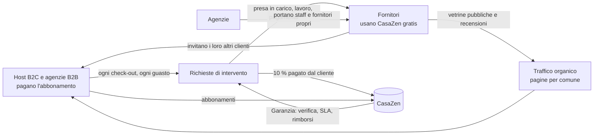
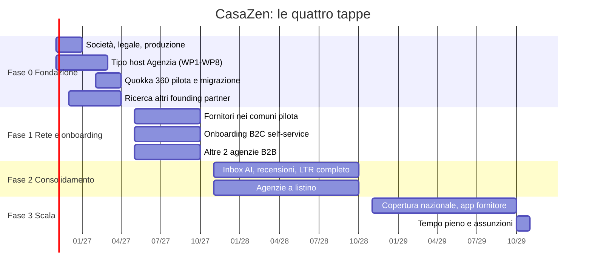

# CasaZen: business plan

| | |
|---|---|
| **Versione** | 1.0.0 (storico in [`CHANGELOG.md`](./CHANGELOG.md)) |
| **Data** | 15 ottobre 2026 |
| **Stato** | Bozza per presentazione |
| **Autore** | [nome e cognome], founder e Product Owner di CasaZen |
| **Destinatari** | Investitori, partner, potenziali soci |
| **Riservatezza** | Confidenziale. Contiene prezzi, margini e condizioni dei partner |
| **Documenti collegati** | [`MODELLO-FINANZIARIO.md`](./MODELLO-FINANZIARIO.md) (proiezioni a 36 mesi), [`VERIFICA-PIANI-B2C.md`](./VERIFICA-PIANI-B2C.md) (verifica di mercato dei piani B2C), [`PITCH.md`](./PITCH.md) (presentazione), [`README.md`](./README.md) (come è versionato) |

**Come leggere il documento.** Scrivo in prima persona perché questo è il mio piano: le scelte sono mie e ne rispondo io.
Ogni affermazione porta un'etichetta:

- **[FATTO]**: verificato nel codice dei tre repository (`backend`, `frontend`, `mobile`) o in un documento di progetto citato in Appendice B;
- **[STIMA]**: una stima con l'ipotesi dichiarata; le cifre di ricavi, costi e cassa vengono tutte dal modello finanziario riproducibile;
- **[⚖]**: serve il parere di un legale o di un commercialista prima di agire. Questo piano non è una consulenza legale o fiscale.

---

## 1. In una pagina

**Cosa faccio.** CasaZen è il sistema operativo per chi affitta case in Italia, per soggiorni brevi e per locazioni lunghe.
Un host con due appartamenti e un'agenzia con duecentocinquanta unità usano lo stesso prodotto: sito di prenotazione
diretta senza commissioni, calendario unificato con le OTA, adempimenti italiani eseguiti dal software (CIN, Alloggiati
Web, imposta di soggiorno, contratti e registrazione RLI per le locazioni lunghe), e una rete di fornitori verificati
(pulizie, manutenzione, lavanderia, idraulico, elettricista) che prendono in carico gli interventi dentro la piattaforma.

**Il modello.** È un sistema che si auto-alimenta. Gli host portano lavoro ai fornitori; i fornitori, che usano CasaZen
gratis, portano i loro altri clienti host; le agenzie portano i propri fornitori e i propri staff; ogni check-out genera
una richiesta di pulizia, ogni guasto una richiesta di manutenzione. Più la rete si addensa in un comune, più vale per
tutti e meno mi costa acquisire il cliente successivo.

**Come guadagno.** Tre righe, nessuna sorpresa:

1. **Abbonamenti**: gli host B2C pagano € 29, € 79 o € 199 al mese; le agenzie B2B pagano per unità gestita (€ 7-15 al mese, tutto compreso);
2. **Zero commissioni** sulle prenotazioni e sui canoni di locazione: il denaro degli ospiti e degli inquilini va direttamente sul conto Stripe dell'host, e un test di architettura impedisce che il codice aggiunga una commissione [FATTO];
3. **10 % sugli interventi dei fornitori**, pagato dal cliente che ordina il lavoro, in cambio della **Garanzia CasaZen**: fornitore verificato, presa in carico tracciata, pagamento solo a lavoro completato, rimborso gestito da noi se qualcosa va storto. Il cliente resta anche con la commissione perché compra certezza di tempi e affidabilità, non un elenco di numeri di telefono.

**Dove sono.** Tre repository, 1.645 commit da giugno 2026, un audit indipendente a settembre e un risanamento che ha
chiuso 327 difetti su 335 entro il 2 ottobre [FATTO]. Il golden journey (host, fornitore, ospite, amministratore come
utenti distinti) gira in locale; manca la produzione, che è la prima tappa di questo piano. Ho un primo partner B2B in
trattativa, **Quokka 360**, un'agenzia con 250 unità tra Italia e Svizzera che oggi paga circa € 2.000 al mese al suo
gestionale attuale, con cui ho definito un programma Founding Partner a margine bloccato.

**Il piano in quattro tappe.**

| Orizzonte | Obiettivo |
|---|---|
| **6 mesi** (aprile 2027) | Founding Partnership Program: Quokka 360 in produzione e ricerca di altri partner; società costituita; percorso verso la produzione completato |
| **12 mesi** (ottobre 2027) | Rete fornitori nei comuni pilota, onboarding B2C aperto, almeno altre due agenzie B2B |
| **24 mesi** (ottobre 2028) | Consolidamento e crescita: inbox unificata con AI, recensioni, locazioni lunghe complete, agenzie a listino |
| **36 mesi** (ottobre 2029) | Lascio il mio lavoro e assumo le prime due persone, pagate dai ricavi |

**I numeri** [STIMA], scenario Base: MRR € 5.200 a 12 mesi, € 16.700 a 24, € 38.000 a 36 (ARR € 456.000), con il
founder non retribuito fino al mese 36 e un fabbisogno massimo di cassa inferiore a € 7.000. Lo scenario Prudente
arriva a € 16.100 di MRR a 36 mesi; l'Ambizioso a € 73.700. Il dettaglio è in [`MODELLO-FINANZIARIO.md`](./MODELLO-FINANZIARIO.md).

**Cosa chiedo.** Ai partner: entrare nel programma Founding Partner. Ai potenziali soci: una persona che porti vendita e
rete sul territorio, con quote maturate nel tempo. Agli investitori: il piano base si autofinanzia; un pre-seed
servirebbe solo ad anticipare di 18-24 mesi il mio tempo pieno e le assunzioni (sezione 16).

---

## 2. Il problema

### 2.1 Per chi affitta

| Chi | Cosa soffre oggi | Cosa gli costa |
|---|---|---|
| **Host con 1-9 unità** (B2C) | Vive su Airbnb e Booking, che trattengono il 15-20 % di ogni prenotazione [FATTO, analisi di mercato]. Gli adempimenti italiani (CIN, comunicazione degli ospiti alla Questura entro 24 ore, imposta di soggiorno comunale, ritenute e cedolare) sono un labirinto che ogni anno cambia. Le pulizie e i guasti si gestiscono con telefonate e messaggi WhatsApp a persone di fiducia che non sempre rispondono | Margine ceduto alle OTA, sanzioni se sbaglia un adempimento, serate perse a cercare chi va a cambiare le lenzuola |
| **Agenzie e property manager** (B2B, 10-500 unità) | Hanno un gestionale (in Italia spesso Kross Booking), ma gli mancano pezzi: portale proprietari con rendiconti e fatture, routine automatiche, check-in con identificazione, fornitori e staff propri dentro lo stesso strumento, compliance svizzera per chi lavora al confine. Il risultato è uno stack di 4-5 strumenti incollati tra loro | ~€ 2.000 al mese di software (il caso Quokka 360) più il tempo di una persona che copia dati da uno strumento all'altro |
| **Locatori di lunga durata** | Contratti, registrazione all'Agenzia delle Entrate (RLI), canone concordato con coefficienti comunali, canoni ricorrenti, manutenzioni: tutto su carta o su strumenti che non si parlano | Errori nelle scadenze, canoni incassati in ritardo, nessun fornitore quando serve |

### 2.2 Per chi fornisce servizi

Le imprese di pulizie, gli idraulici, gli elettricisti, le lavanderie che lavorano per gli affitti brevi non hanno un
canale per trovare clienti vicini e affidabili: vivono di passaparola, ricevono richieste su tre canali diversi, non
sanno quando verranno pagati. Chi è bravo non ha modo di farlo vedere.

### 2.3 Perché ora

- La legge ha reso obbligatori CIN e adempimenti che prima molti ignoravano (D.L. 145/2023) e dal 2026 oltre due
  appartamenti in affitto breve si presume attività d'impresa [FATTO, analisi Quokka §4]: la compliance è diventata un
  bisogno di massa.
- Solo il 29 % delle prenotazioni è diretto [FATTO, analisi di mercato]: ogni punto spostato dalle OTA al sito dell'host è margine puro.
- I gestionali internazionali (Guesty, Hostaway, Lodgify, Smoobu) non fanno la compliance italiana e non gestiscono le
  locazioni lunghe; quello italiano più diffuso (Kross) vende a pacchetti e non ha un marketplace di fornitori.
- Lo sviluppo assistito dall'AI mi permette di costruire da solo, part-time, quello che tre anni fa richiedeva un team:
  il modulo Locazioni (circa 39.000 righe tra codice, test e interfaccia, con l'integrazione RLI) è nato in due settimane
  e mezza di lavoro attivo [FATTO, misurato sullo storico git].

---

## 3. La soluzione

CasaZen è un prodotto unico con tre superfici (console web completa, app nativa per l'uso in mobilità, siti pubblici)
e quattro tipi di utente. Le funzionalità disponibili dipendono dal piano, non dal tipo di cliente.

### 3.1 Per l'host B2C

- **Sito di prenotazione diretta** con il suo marchio, su sottodominio CasaZen o sul suo dominio, con checkout Stripe sul
  suo conto: CasaZen non tocca il denaro delle prenotazioni [FATTO].
- **Calendario unificato** con Airbnb, Booking.com e Vrbo tramite iCal (import ed export, più feed per proprietà) [FATTO];
  channel manager via API come opzione a pagamento (sezione 5).
- **Compliance guidata da wizard**: attivazione della proprietà (CIN, imposta di soggiorno, checklist di sicurezza
  D.L. 145/2023), portale ospite per il check-in online, file Alloggiati Web, check-out a cinque passi che apre la
  richiesta di pulizia, cockpit con lo stato di ogni adempimento [FATTO].
- **Fornitori**: dal dettaglio della prenotazione chiedo un intervento a un fornitore attivo nel comune; vedo la presa
  in carico, il completamento e il pagamento [FATTO].
- **Suggerimenti stagionali** di prezzo basati sulle regole dell'host (stagioni, festività), senza finte promesse di AI [FATTO].

### 3.2 Per l'agenzia B2B

Un tipo di host `Agency` con tutto quello che un'agenzia pretende e che oggi compra da tre fornitori diversi
[FATTO, analisi Quokka 360 del 15 ottobre 2026; in sviluppo]:

1. **OTA via API** (Airbnb, Booking.com, Vrbo, Expedia) con modifica dei contenuti e **chat** dentro CasaZen, risposte AI in bozza;
2. **CRM con campagne** email e WhatsApp, nel rispetto dei divieti di Airbnb e dei consensi;
3. **Portale proprietari**: rendiconto mensile automatico, fatture elettroniche emesse per conto dell'agenzia, file di bonifico SEPA/CH, registro delle ritenute;
4. **Fornitori e staff propri** accanto al marketplace CasaZen (i propri a 0 %);
5. **Fiscalità e adempimenti Italia e Svizzera**: dove c'è un'API lo fa CasaZen (Alloggiati, ISTAT regionali, feratel, pagoPA); dove non c'è, CasaZen prepara file e istruzioni e l'agenzia carica;
6. **Routine** configurabili (QUANDO → SE → ALLORA, anche create da una frase) e **check-in biometrico** con alternativa in videochiamata come richiede la legge.

### 3.3 Per il fornitore

Gratis, per sempre: console web con inbox delle richieste, incarichi con stati, agenda con orari e pianificatore degli
slot, catalogo dei servizi con prezzi, vetrina pubblica, sincronizzazione del proprio calendario, conto Stripe collegato
per essere pagato dentro CasaZen [FATTO]. Il fornitore guadagna clienti senza pagare nulla: paga il cliente, quando il
lavoro è fatto.

### 3.4 Per il locatore di lunga durata

Proprietà in modalità `Long`, contratto da modelli approvati, firma, registrazione RLI assistita con scadenze e
promemoria, calcolatore del canone concordato, canone ricorrente incassato su Stripe Connect, richieste di manutenzione
legate alla proprietà [FATTO, con i provider esterni di firma e registrazione ancora spenti].

### 3.5 Per l'ospite e per l'inquilino

Prenota sul sito dell'host, fa il check-in online dal telefono, riceve le istruzioni e, dove l'host lo attiva, il codice
della serratura solo dopo l'identificazione. L'inquilino firma, paga il canone e segnala un guasto che diventa una
richiesta al fornitore.

---

## 4. Il modello di business: un sistema che si auto-alimenta

### 4.1 Il ciclo

Ogni lato aumenta il valore dell'altro:

| Chi entra | Cosa porta | Cosa ottiene |
|---|---|---|
| Un **host** | Lavoro ricorrente nel suo comune (pulizie a ogni check-out, manutenzioni) e i propri fornitori di fiducia, che invita | Un fornitore pronto quando serve, senza telefonate, con la garanzia |
| Un **fornitore** | I suoi altri clienti host (il suo portafoglio) e la copertura di un comune | Richieste di clienti nuovi, pagamento sicuro, vetrina, agenda |
| Un'**agenzia** | Decine o centinaia di unità, staff e fornitori propri, che possono aprirsi al marketplace | Un solo strumento invece di quattro, fornitori CasaZen di riserva |
| Un **ospite** o un **inquilino** | La richiesta di servizio (pulizia, guasto) che innesca l'intervento | Un servizio puntuale |

La densità conta più della dimensione: in un comune con 30 host e 8 fornitori il marketplace funziona meglio che in
una regione con 300 host sparsi. Per questo parto da **comuni pilota** e ci lavoro di persona, prima di allargare.

### 4.2 Breve e lungo, B2B e B2C, nello stesso prodotto

| Dimensione | Scelta | Perché |
|---|---|---|
| **Affitti brevi e lunghi** | Una proprietà è `Short` o `Long`; stessi fornitori, stesso calendario, stessa fatturazione [FATTO] | Molti proprietari hanno entrambe le situazioni; le locazioni lunghe generano manutenzioni e canoni ricorrenti, un'entrata stabile per la rete |
| **B2C e B2B** | Prodotto unico, limiti per piano; portale proprietari, staff e fornitori propri solo B2B [FATTO, regola R8] | Un host che cresce non cambia strumento; un'agenzia non paga un software su misura |
| **Fornitori gratis** | Nessun canone ai fornitori; CasaZen guadagna solo quando un lavoro è pagato | Nessun attrito all'ingresso dell'offerta, che è il collo di bottiglia del sistema |

### 4.3 Cosa non farò mai

- Nessuna commissione sulle prenotazioni e sui canoni: un test di architettura fallisce se il codice applica una
  `application_fee` a un pagamento di un ospite o di un inquilino [FATTO].
- Nessun back-office umano al posto del cliente per gli adempimenti senza API: CasaZen prepara tutto, l'esecuzione resta
  all'host o all'agenzia [FATTO, regola R12]. Prometto "compliance automatizzata", non "compliance delegata".
- Nessuna gestione diretta di immobili: CasaZen è software, così resto fuori dagli obblighi del gestore [⚖].

---

## 5. Monetizzazione

### 5.1 Abbonamenti B2C (host)

Listino deciso l'8 ottobre 2026 [FATTO], prezzi mensili IVA esclusa; limiti di piano letti dal codice (`PlanCatalog`) [FATTO].

| Piano | Prezzo | Proprietà | Persone | Cosa include |
|---|---:|---:|---:|---|
| **Starter** | € 29 | fino a 3 | 2 | Sito su sottodominio CasaZen, calendario iCal, compliance guidata, portale ospite, fornitori, app |
| **Pro** | € 79 | fino a 50 | 10 | Starter + dominio proprio senza marchio CasaZen, temi e branding, dispositivi smart (codice soggiorno, serratura), più persone |
| **Scale** | € 199 | illimitate | illimitate | Pro + tutto quello che serve a un piccolo gestore |
| **Opzione channel manager via API** | ~€ 4 / unità | | | Airbnb, Booking.com, Vrbo, Expedia via partner di connettività (costo per CasaZen € 3,15-3,50 a unità) [STIMA, da confermare] |

Chi ha solo locazioni lunghe ha un piano dedicato [FATTO, PL-16]. Nota sull'IVA: per gli host privati o in regime
forfettario il 22 % è un costo reale, non recuperabile [⚖]; i prezzi in comunicazione saranno sempre "IVA esclusa".

#### 5.1.1 Verifica di mercato dei limiti dei piani (15 ottobre 2026)

I limiti qui sopra (3 / 50 / illimitate) sono una mia ipotesi, scritta nel codice senza una ricerca di mercato. Li ho
confrontati con i listini 2026 di dodici concorrenti (dettaglio e fonti in [`VERIFICA-PIANI-B2C.md`](./VERIFICA-PIANI-B2C.md)):

| Cosa dice il mercato | Conseguenza per CasaZen |
|---|---|
| Quasi tutti prezzano **per unità** (Kross Premium € 6/unità ✓, Smoobu ~€ 35/proprietà, Lodgify ~$ 33-77/rental, Beds24 ~€ 3/proprietà ✓, OwnerRez $ 40 per la prima); i piani flat includono 1-5 proprietà e fanno pagare ogni proprietà in più (Hospitable 1/2/3 incluse + $ 10-30) | **Starter € 29 fino a 3 proprietà è fattibile**, anzi aggressivo (per 3 proprietà Smoobu chiede ~€ 105, Hospitable ~$ 49, Kross € 18 con channel manager API) |
| Nessuno vende 50 proprietà a prezzo fisso; "illimitate" a prezzo fisso lo fa solo Hospitable, gratis, come esca | **Pro € 79 fino a 50 e Scale € 199 illimitate non reggono**: a 50 unità Pro vale € 1,58 per unità, sotto i costi per unità (channel manager € 3,15, SDI, AI) e sotto il mio stesso listino B2B (€ 7-9): cannibalizza le agenzie |
| I punti di prezzo $ 29 / $ 59 / $ 99 (Hospitable) e $ 33 / $ 53 / $ 77 (Lodgify) sono la norma | **I tre prezzi vanno bene**; da correggere sono i limiti |
| Sconto annuale 10-12 % (Smoobu, Hospitable) | Da prevedere anche nel B2C |

**Proposta** (decisione aperta, da registrare come nuova versione del piano): stessi prezzi, proprietà incluse più un
prezzo per unità in più, coerente con il B2B.

| Piano | Prezzo | Incluse | Ogni unità in più | Tetto | Oltre |
|---|---:|---:|---:|---:|---|
| Starter | € 29 | 3 | — | 3 | → Pro |
| Pro | € 79 | 10 | € 7 | 50 | → Scale |
| Scale | € 199 | 30 | € 6 | 100 | → piano Agenzia (listino B2B) |

Con questa scala un gestore con 20 unità paga € 149 (Kross € 120 ✓, Smoobu ~€ 700, Hospitable ~$ 329), con 50 unità
€ 319 (Kross € 300 ✓, B2B Base € 400): CasaZen resta sotto tutti tranne Kross, che però non ha compliance, fornitori e
sito diretto nel prezzo. L'ARPU B2C del modello finanziario (€ 55) non cambia; le unità in più sono un ricavo non
modellato. Nella stessa nota valuto l'opzione di un **piano gratuito a 1 proprietà** con accesso al marketplace, coerente
con il sistema che si auto-alimenta: la lascio aperta perché è una scelta di strategia, non di prezzo.

### 5.2 Abbonamenti B2B (agenzie)

Prezzi per unità al mese, IVA esclusa, con pagamento annuale (+10 % con pagamento mensile), minimo € 90 al mese [FATTO, analisi Quokka §6.2].

| Pacchetto | Cosa offre | 10-49 unità | 50-149 | 150-399 | 400+ |
|---|---|---:|---:|---:|---:|
| **Base** | Gestionale, channel manager via API con contenuti e recensioni, inbox con risposte AI suggerite, sito diretto, check-in online, adempimenti via API e file pronti, portale proprietari, routine, fornitori e staff | € 9 | € 8 | € 7 | preventivo |
| **+ AI e Marketing** | Risposte AI inviate in automatico sopra una soglia di confidenza, routine create da una frase, CRM e campagne | + € 4 | + € 4 | + € 4 | |
| **Check-in biometrico** | Documento e volto all'ingresso, alternativa in videochiamata | € 0,75 a verifica | | | |
| **Serrature smart** | Codice per soggiorno rilasciato dopo l'identificazione (via Seam) | € 6 per serratura al mese | | | |
| **Tutto compreso** | Base + AI e Marketing + 8 verifiche per unità al mese | **€ 15** | **€ 14** | **€ 13** | preventivo |

Margini sul tutto compreso a 250 unità: 45 % / 41 % / 37 % per scaglione; la verifica d'identità rende circa € 0,27
[STIMA, analisi Quokka §6.2]. Il tutto compreso costa meno del pacchetto Kross + Vikey (~€ 16) e delle suite
internazionali, con più servizi.

### 5.3 Zero commissioni sulle prenotazioni e sui canoni

L'host è l'esercente: il pagamento dell'ospite è un addebito diretto sul suo conto Stripe, le commissioni Stripe le paga
lui, CasaZen non incassa e non trattiene nulla [FATTO]. Lo stesso per il canone di locazione lunga. È la stessa prassi
di Guesty, Lodgify, Hostaway e Smoobu, con una differenza: loro spesso aggiungono uno 0,5-1 % sui pagamenti, io no.
Questo mi tiene fuori dai rischi del sostituto d'imposta e della responsabilità sull'imposta di soggiorno, che restano
in capo a chi incassa [⚖, da confermare per il B2C].

### 5.4 Il 10 % sugli interventi dei fornitori e la Garanzia CasaZen

**La regola.** Quando un cliente (host o agenzia) ordina un intervento a un fornitore del marketplace e lo paga tramite
CasaZen, paga il prezzo del fornitore più il **10 % di commissione CasaZen**. Il fornitore riceve il suo prezzo per
intero. Il cliente paga la commissione perché compra una garanzia, non un contatto.

**Cosa compra il cliente con il 10 %: la Garanzia CasaZen.**

| Garanzia | Come la mantengo | Stato |
|---|---|---|
| **Fornitore verificato** | Wizard di attivazione con requisiti controllati dal server (profilo, servizi, comuni, documenti), Termini di servizio versionati e riaccettati, sospensione da parte dell'amministrazione | [FATTO] |
| **Celerità** | Richiesta con urgenza, stati tracciati (Richiesto → Preso in carico → In corso → Completato → Pagato), promemoria al fornitore, agenda e slot disponibili, "chiedi a un altro fornitore" dopo un rifiuto | [FATTO] |
| **Paghi solo a lavoro fatto** | La richiesta di pagamento nasce quando il fornitore completa l'intervento; il cliente paga dal link o dalla console; ricevuta e storico | [FATTO, dietro flag] |
| **Rimborso in caso di problemi** | Rimborso totale o parziale deciso da CasaZen, con la commissione restituita in proporzione; il cliente e il fornitore ricevono l'esito | [FATTO, dietro flag] |
| **Nessuna controversia aperta** | Una contestazione (chargeback) arriva agli amministratori CasaZen che la gestiscono con le prove del lavoro; il cliente non si trova da solo con il fornitore | [FATTO, flusso base; raccolta prove in roadmap] |
| **Reputazione** | Recensioni dei clienti sul fornitore, KPI di puntualità e di presa in carico nella vetrina | Roadmap (fase 2) |

**Come funziona il denaro.** Addebito diretto sul conto Stripe del fornitore con la commissione CasaZen come
`application fee`; CasaZen non trattiene mai i fondi del fornitore; la percentuale è una configurazione (10 % provvisorio),
con eccezione per singolo fornitore da 0 a 50 % (0 = periodo gratuito di lancio); i fornitori propri di un'agenzia che
lavorano per la loro agenzia sono a 0 % e fatturano fuori da CasaZen [FATTO, runbook fornitori §26].

**Una nota di prodotto.** Oggi il codice calcola la commissione come quota trattenuta dal prezzo del fornitore
("prezzo, commissione CasaZen, netto per te"). La regola commerciale di questo piano, commissione **in aggiunta e a
carico del cliente**, è una configurazione da confermare prima di attivare i pagamenti online, insieme all'IVA sulla
commissione e alla comunicazione DAC7 [⚖].

**Perché il cliente resta anche con la commissione.** Su una pulizia da € 40 la commissione è € 4, e nell'affitto breve
il costo delle pulizie è già ribaltato all'ospite nella voce "pulizie" della prenotazione. Il cliente non paga per un
numero di telefono: paga per non dover cercare, chiamare, sollecitare, e per sapere che se il lavoro non viene fatto
non ci rimette. La fedeltà nasce dalla certezza dei tempi e dall'affidabilità del fornitore selezionato da CasaZen.

**Dal lato del fornitore.** Nessun canone, un flusso di richieste da clienti del suo comune, pagamento tracciato,
vetrina. Chi lavora bene riceve più richieste: la reputazione fa la selezione al posto mio.

### 5.5 Programma Founding Partner (agenzie della prima ora)

Per le prime **10 agenzie**, entro una data da fissare [FATTO, analisi Quokka §6.3]:

- **Prezzo = costo documentato + € 1 per unità**, sul pacchetto tutto compreso. Il margine è bloccato: il prezzo si
  rivede una volta l'anno solo se cambiano le voci di costo scritte nel contratto (channel manager, verifiche d'identità, SDI, AI, hosting, cambio USD/EUR);
- vale per tutta la durata del rapporto, per le funzionalità presenti alla firma; le nuove opzioni con il 30 % di sconto;
- in cambio: durata minima 24 mesi, pagamento annuale, test e feedback, referenza o caso di studio;
- la riduzione dei costi fissi con la crescita della piattaforma non abbassa il prezzo del partner (da scrivere nel contratto [⚖]).

**L'esempio Quokka 360** (250 unità; ipotesi di 2.000 verifiche al mese, da confermare con i dati reali) [STIMA, analisi Quokka §6.3]:

| Voce al mese | Importo |
|---|---:|
| Channel manager (NextPax, 250 unità) | € 980 |
| Fatturazione elettronica, AI, email | ~€ 100 |
| Costi fissi di piattaforma coperti dal partner | € 400 |
| Margine CasaZen (+€ 1/unità) | € 250 |
| **Canone partner fisso** | **~€ 1.730** (€ 6,92 per unità) |
| Verifiche d'identità a consumo, al costo | € 660-960 |
| **Totale per Quokka** | **€ 2.390-2.690** |

Quokka spende il 20-35 % in più di oggi (~€ 2.000 a Kross) e ottiene in più biometria, compliance svizzera, portale
proprietari, AI e CRM; a listino la stessa agenzia pagherebbe € 3.250. Per me è un pareggio voluto: il primo partner
copre tutti i costi fissi della piattaforma e mi dà il caso di studio con cui vendere agli altri.

### 5.6 Costi passanti e cosa resta fuori

Non sono né ricavi né costi per CasaZen: le commissioni Stripe sugli incassi (addebitate al cliente), WhatsApp (Meta
fattura l'agenzia), pagoPA (€ 2 a pagamento, a carico di chi paga), il commercialista dell'agenzia per gli invii
all'Agenzia delle Entrate, l'hardware delle serrature. Le verifiche d'identità ai partner sono rifatturate al costo.

### 5.7 Il mix a regime

| Linea | Quota dei ricavi a 36 mesi (Base) [STIMA] | Nota |
|---|---:|---|
| Abbonamenti B2B | 36 % | Pochi clienti, canoni alti, contratti annuali |
| Abbonamenti B2C | 52 % | Molti clienti, prodotto self-service |
| Marketplace fornitori (10 %) | 13 % | Cresce con la densità della rete; è la linea con il margine più alto perché non ha costi di piattaforma per unità |

Il marketplace è la linea più piccola nei numeri ma la più importante per la fedeltà: un host che ha i suoi fornitori
dentro CasaZen non cambia strumento.

---

## 6. Il mercato

### 6.1 Dimensioni

Cifre globali [FATTO, analisi di mercato 2026 in Appendice B]; scomposizione italiana [STIMA].

| Livello | Definizione | Cifra |
|---|---|---|
| Affitti brevi nel mondo | Valore del mercato | $ 101,7 miliardi nel 2025 → $ 121,9 miliardi nel 2033 (+3,7 % l'anno) |
| Software per affitti brevi nel mondo | PMS, channel manager, direct booking, automazioni | $ 1,5 miliardi nel 2024 → $ 3,2 miliardi nel 2033 (+9,2 % l'anno) |
| **Italia, unità in affitto breve attive** | Era del CIN | ~600.000 [STIMA] |
| di cui gestite da professionisti | ~25 % | ~150.000 unità, ~5.000 agenzie e gestori con 10-200 unità [STIMA] |
| Host con 1-9 unità | Il bacino B2C | 200.000+ [STIMA] |
| Fornitori di servizi agli affitti brevi | Pulizie, manutenzione, lavanderia, idraulici, elettricisti | Nessuna stima affidabile: li conto comune per comune |

**Il mercato raggiungibile a 36 mesi** [STIMA, scenario Base]: 19 agenzie con 1.128 unità (meno dell'1 % delle unità
gestite da professionisti) e 356 host B2C (meno dello 0,2 % del bacino). Non ho bisogno di una quota di mercato
grande: ho bisogno di densità in pochi comuni.

### 6.2 Tendenze che lavorano per me

- **Direct booking**: solo il 29 % delle prenotazioni è diretto; le OTA trattengono il 15-20 % [FATTO]. Ogni host che
  sposta anche solo due prenotazioni al mese sul proprio sito ripaga l'abbonamento.
- **Finestre di prenotazione corte**: il 27 % delle prenotazioni arriva entro 7 giorni dal soggiorno [FATTO]; chi risponde
  prima vince, e le risposte AI in bozza servono a questo.
- **Compliance come bisogno di massa**: CIN obbligatorio, Alloggiati entro 24 ore, identificazione all'ingresso
  (Consiglio di Stato 9101/2025), nuove norme fiscali dal 2027 [FATTO]. Ogni cambiamento normativo è un motivo in più
  per usare uno strumento che si aggiorna.
- **Professionalizzazione**: il software cresce più del mercato immobiliare sottostante (9,2 % contro 3,7 %): chi affitta
  sta comprando strumenti.
- **Svizzera di confine**: le agenzie del Ticino e dei laghi gestiscono unità in entrambi i Paesi e non trovano un
  software che faccia la compliance di tutti e due [FATTO, caso Quokka 360].

---

## 7. Concorrenza e posizionamento

### 7.1 Chi c'è

| Concorrente | Cosa fa bene | Cosa gli manca rispetto a CasaZen | Prezzo di riferimento [FATTO, pagine ufficiali] |
|---|---|---|---|
| **Kross Booking** (Italia) | Gestionale + channel manager diffusi tra le agenzie italiane; KDoor per le serrature | Nessun marketplace di fornitori, routine limitate, nessuna locazione lunga; pacchetti a listino con Vikey per il check-in | € 6 per unità (Premium); ~€ 16 con Vikey |
| **Guesty** | Suite enterprise completa, 60+ OTA, AI pricing | Venduto e prezzato per i grandi, nessuna compliance italiana nativa, nessuna locazione lunga | Personalizzato, 0,5-1 % sui pagamenti |
| **Hostaway** | Channel manager mid-market, marketplace di 40+ integrazioni | Vendita assistita, costo d'ingresso alto, nessuna compliance italiana | Personalizzato |
| **Lodgify / Smoobu** | Sito di prenotazione diretta per piccoli host, semplicità | Operazioni e fornitori assenti, compliance italiana assente, nessuna locazione lunga | Da $ 16-29 al mese |
| **Avantio, Uplisting, OwnerRez** | Portale proprietari (Avantio), prezzi per unità | Mercato internazionale, nessuna compliance italiana e svizzera | $ 16-20 (Avantio); £ 13 + £ 1,25 a verifica (Uplisting); $ 2-8 a unità (OwnerRez) |
| **Vikey, Chekin** (check-in) | Identificazione e serrature | Sono un pezzo dello stack, non il gestionale | Verifica a € 1,25-2 |
| **Enso Connect** (routine) | Automazioni a più passi create in linguaggio naturale | Non collega le routine agli eventi di compliance (identificazione, Alloggiati) | — |

### 7.2 Dove mi metto

**"Il sistema operativo per chi affitta in Italia: conforme per costruzione, senza commissioni, con i fornitori dentro."**

| Asse | CasaZen | Chi altro lo fa |
|---|---|---|
| Compliance italiana nativa (CIN, Alloggiati, imposta di soggiorno, cedolare, RLI) | Sì, nel prodotto | Nessuno dei gestionali internazionali; Kross in parte |
| Affitti brevi e lunghi nello stesso prodotto | Sì | Nessuno dei nomi sopra |
| Marketplace di fornitori con garanzia e pagamento integrato | Sì | Nessuno (Hostaway ha integrazioni software, non fornitori di servizi) |
| Zero commissioni su prenotazioni e canoni, nessuna fee sui pagamenti | Sì | Smoobu, Beds24, OwnerRez sui pagamenti; nessuno su tutto |
| Routine collegate alla compliance (codice serratura solo dopo l'identificazione) | Sì | Nessuno [FATTO, analisi Quokka §3.6] |
| Programma Founding Partner scritto, con margine bloccato | Sì | Quasi assente sul mercato |
| Da 1 a 500 unità con lo stesso prodotto | Sì | Guesty ha tre prodotti; Lodgify si ferma presto |

**Quanto dura il vantaggio.** I due asset difficili da copiare sono la compliance italiana già costruita e il
motore delle locazioni lunghe con RLI [FATTO]. Stimo 12-24 mesi di vantaggio sugli incumbent che volessero
aggiungerli [STIMA]: lo difendo con il costo di cambiamento (fornitori, adempimenti e ricavi diretti dentro lo stesso
strumento) e con la rete sul territorio, che un software straniero non costruisce da remoto.

---

## 8. Dove sono oggi: lo stato del prodotto

Tutto quello che segue è verificato nel codice o nel registro delle spec riallineato il 2 ottobre 2026 [FATTO].

### 8.1 I numeri

| | Backend (.NET 10, PostgreSQL) | Frontend (React 19) | App nativa (Expo) |
|---|---:|---:|---:|
| Primo commit | 2 giugno 2026 | 19 giugno 2026 | 18 luglio 2026 |
| Commit al 15 ottobre 2026 | 1.188 | 413 | 44 |
| Test automatici all'audit di settembre | 908 | 166 | suite Jest |

- **Audit indipendente** (23 settembre 2026): 335 difetti classificati, con la constatazione che il completamento reale
  dell'MVP era del 35-40 % nonostante 20 funzionalità dichiarate "fatte".
- **Risanamento** (24 settembre - 2 ottobre 2026): 327 difetti chiusi, 8 parziali, 0 aperti; 166 task eseguiti;
  nuova definizione di "fatto" (test end-to-end da interfaccia con utenti reali distinti; nessuno stub che dichiara
  successo; registro delle spec aggiornato solo con evidenza).
- **Onda di redesign** (ottobre 2026): console fornitore completa (catalogo con prezzi, agenda, vetrina, conto Stripe,
  pagamento con commissione dietro flag), modalità breve/lunga delle proprietà, separazione delle proprietà nelle
  console e nell'app.

### 8.2 Cosa funziona, cosa è parziale, cosa è congelato

| Area | Stato | Nota |
|---|---|---|
| Sito di prenotazione diretta, temi, dominio proprio | **Fatto** / dominio proprio parziale | Il dominio personalizzato va provato su un dominio reale con le credenziali Vercel |
| Checkout diretto su Stripe Connect, rimborsi, "paga in struttura" | Parziale | La variante con carta gira solo in CI e la CI non è ancora stata eseguita con le chiavi di test |
| Calendario iCal multi-feed | **Fatto** | |
| Wizard di compliance, check-out a 5 passi, cockpit | **Fatto** | |
| Portale ospite per il check-in | Parziale | Il client del web service Alloggiati non è implementato: oggi l'host invia il file a mano, con stato onesto |
| Console fornitore, richieste di intervento, pagamento con commissione | **Fatto** / pagamento dietro flag | Flag spento fino ai pareri su IVA della commissione e DAC7 |
| Tenant, ruoli, onboarding, amministrazione | **Fatto** | |
| Billing degli abbonamenti (Stripe Billing + Stripe Tax) | Parziale | Manca il provider per la fattura elettronica (SDI): il checkout si apre solo con P.IVA e accettazione dell'emissione manuale |
| Locazioni lunghe (contratti, RLI assistita, canone concordato, canone ricorrente) | Parziale | Flussi manuali onesti; provider di firma e registrazione spenti |
| App nativa host (calendario, prenotazioni, richiesta fornitore, push) | Parziale | La suite Maestro e il job su emulatore non sono mai stati eseguiti |
| Pagine SEO per comune, sito vetrina CasaZen | Parziale | Codice e test per 8 criteri su 10; contenuti pilota da verificare |
| Tipo host Agenzia (le 6 funzionalità di Quokka 360) | **Da sviluppare**: 10-16 settimane attive stimate | Percorso critico: fornitori esterni (NextPax/Octorate, Didit/Sumsub), enti, pareri legali |
| Inbox unificata e AI copilot per il B2C, marketplace completo con recensioni, Google Vacation Rentals, moduli Spagna/Francia | Congelati | Si scongelano nelle fasi 2 e 3 |

### 8.3 Cosa mi separa dalla produzione

La checklist di deploy elenca 17 blocchi in ordine [FATTO, `docs/runbooks/deploy-checklist.md`]. Quelli che dipendono da
una mia decisione o da terzi:

1. **Hosting del backend**: ho cancellato Railway il 2 ottobre; l'analisi raccomanda una VM Oracle Always Free oppure,
   fuori dal vincolo "zero", un piano da ~€ 5-85 al mese. La decisione è mia e la prendo nella fase 0;
2. **Provider per la fattura elettronica** (SDI) e P.IVA: il codice rifiuta qualunque addebito finché non ci sono;
3. **Testi legali** (Termini, Privacy, DPA, bozze `2026-10-v1`): servono i dati societari e la revisione di un legale [⚖];
4. **Periodi di conservazione** GDPR e regione dei dati (tenant Auth0, progetto Supabase) [⚖];
5. **Chiavi Stripe live** e prezzi dei piani;
6. **Vercel**: il piano Hobby non ammette uso commerciale; serve Pro o Cloudflare Pages; **Supabase** free non ha backup: serve Pro o un `pg_dump` notturno;
7. **Alloggiati Web**: decidere se implementare il client SOAP (serve una struttura reale per il collaudo) o restare sull'invio manuale assistito;
8. **Golden journey in CI**: i job esistono, mancano i segreti di GitHub per farli girare.

Niente di questo è ricerca: è lavoro di configurazione, decisioni e due pareri professionali. È il contenuto dei primi tre mesi.

---

## 9. La roadmap: 6, 12, 24, 36 mesi

Date assolute a partire da **novembre 2026 (M1)**. Ogni fase ha un obiettivo, i risultati che consegno e i criteri
con cui dichiaro la fase chiusa. Le durate di sviluppo sono stime calibrate sulla velocità misurata (circa 15.000
righe a settimana con sviluppo assistito da AI, ±40 %) [STIMA].

### 9.1 Fase 0, mesi 1-6 (novembre 2026 - aprile 2027): fondazione

**Obiettivo:** il primo cliente B2B in produzione, la società in piedi, la piattaforma in produzione con le regole di deploy rispettate.

| Filone | Cosa consegno | Quando |
|---|---|---|
| **Founding Partnership Program** | Contratto Founding Partner firmato con **Quokka 360** (prezzo = costo + € 1/unità, 24 mesi, pagamento annuale, caso di studio); programma scritto per le prime 10 agenzie; **ricerca di altri 2-3 partner** tramite la rete di Quokka, le associazioni di categoria dei gestori, gli eventi di settore (BTO, TTG) e le agenzie che oggi pagano Kross + Vikey | M1-M6 |
| **Tipo host Agenzia** | WP1 fondamenta (ruoli, valuta, fuso, tedesco, piani) → WP6 compliance IT/CH via API e file pronti → WP7 check-in biometrico, QR all'ingresso, videochiamata, serrature → WP5 fornitori e staff propri → WP4 portale proprietari, rendiconti, SDI, bonifici → WP2 OTA via API, inbox, AI → WP8 routine → WP3 CRM | M1-M4 (10-16 settimane attive) |
| **Percorso critico esterno** | Risposte scritte e sandbox di NextPax e Octorate; PoC Didit e Sumsub; DPIA del check-in biometrico; richieste agli enti (Sicilia, Liguria, Calabria, feratel); migrazione degli account Stripe ad Accounts v2 | da M1, in parallelo |
| **Costituzione della società** | SRL, P.IVA con codice ATECO del software, PEC, conto, iscrizione come startup innovativa se i requisiti ci sono, commercialista, provider SDI, marchio [⚖] | M2-M3 |
| **Percorso verso la produzione** | Decisione sull'hosting; 17 blocchi della checklist di deploy chiusi su test e produzione; testi legali rivisti e attivati; periodi di conservazione decisi; golden journey verde in CI; job Maestro eseguito | M1-M3 |
| **Go-live Quokka 360** | Pilota su un sottoinsieme di unità (M4-M5), poi migrazione completa da Kross (M6); contratto NextPax con decorrenza dal go-live | M4-M6 |

**Criteri di uscita:** Quokka in produzione con le 6 funzionalità; prima fattura elettronica emessa; CI con i gate end-to-end obbligatori; almeno 3 agenzie in trattativa oltre a Quokka.

### 9.2 Fase 1, mesi 7-12 (maggio - ottobre 2027): rete fornitori, onboarding B2C, altri B2B

**Obiettivo:** far partire il ciclo che si auto-alimenta in pochi comuni e aprire il prodotto self-service.

| Filone | Cosa consegno | Indicatore a M12 (Base) |
|---|---|---|
| **Rete fornitori** | Comuni pilota scelti dove ci sono già host (i comuni di Quokka e dei partner); onboarding di persona dei fornitori (pulizie prima di tutto, poi manutenzione, idraulico, elettricista, lavanderia); vetrine pubbliche indicizzabili; **pagamenti online con commissione attivati** dopo i pareri fiscali; periodo di lancio a 0 % per i primi fornitori di ogni comune | 18 fornitori attivi |
| **Onboarding B2C** | Signup self-service con DPA e consensi, piani Starter/Pro/Scale con fattura elettronica, checklist di attivazione, pagine per comune con calcolatore dell'imposta di soggiorno e contenuti sulla compliance, ambiente demo pubblico, app host negli store | 33 host paganti |
| **Almeno altre 2 agenzie B2B** | Due founding partner in produzione (nel modello: 80 e 60 unità, € 8 per unità) | 3 agenzie, 390 unità |
| **Marketplace** | Richiesta di pulizia generata dal check-out, "chiedi a un altro fornitore", promemoria, rimborsi dalla console di amministrazione | € 2.000-3.000 di interventi al mese |

**Criteri di uscita:** MRR ≥ € 5.000; almeno un comune in cui ogni richiesta di pulizia viene presa in carico entro 24 ore; churn B2C misurato; primi rimborsi gestiti senza controversie aperte.

### 9.3 Fase 2, mesi 13-24 (novembre 2027 - ottobre 2028): consolidamento e crescita

**Obiettivo:** trasformare quello che funziona in pochi comuni in un prodotto che cresce da solo.

- **Inbox unificata e AI copilot** per il B2C (oggi congelati): risposte in bozza, poi invio automatico sopra una soglia di confidenza, con trasparenza AI Act;
- **Routine** per tutti i piani, con la libreria pronta (pulizia al check-out, istruzioni due giorni prima, recensione dopo la partenza);
- **Recensioni e reputazione** dei fornitori; raccolta delle prove per le controversie; KPI di puntualità in vetrina;
- **Locazioni lunghe complete**: provider di firma e di registrazione RLI accesi, canone ricorrente provato con Stripe reale;
- **Agenzie a listino**: dopo i founding partner, vendita a prezzo pieno con il caso di studio Quokka (nel modello: una nuova agenzia ogni due mesi);
- **Integrazione con gli assistenti AI** (ChatGPT, Claude) tramite MCP, già pianificata;
- **Seconda e terza fonte di traffico**: contenuti sulla compliance e partnership con i commercialisti per le locazioni lunghe.

**Indicatori a M24 (Base):** 9 agenzie, 646 unità, 146 host B2C, 78 fornitori, MRR € 16.700, metà degli host B2C che usa il marketplace.

### 9.4 Fase 3, mesi 25-36 (novembre 2028 - ottobre 2029): scala

**Obiettivo:** copertura nazionale della rete e una struttura che regge senza di me a tempo parziale.

- Copertura dei comuni con più unità (città d'arte, laghi, riviere) con fornitori in ogni categoria;
- App nativa del fornitore; Google Vacation Rentals come canale diretto in più;
- Funzioni per le agenzie più grandi (multi-marchio, SSO, SLA) e valutazione dei moduli Spagna/Francia;
- **Mese 36: lascio il mio lavoro** e assumo uno sviluppatore senior e una persona per il successo dei clienti e
  l'onboarding dei fornitori. Nello scenario Base i ricavi di M36 coprono il costo delle tre persone 2,6 volte; nel
  Prudente lo coprono al 97 %, e in quel caso scaglionerei la seconda assunzione.

**Indicatori a M36 (Base):** 19 agenzie, 1.128 unità, 356 host B2C, 174 fornitori, MRR € 38.000, ARR € 456.000.

---

## 10. Go-to-market

### 10.1 Agenzie (B2B): vendita diretta, poche e buone

| Canale | Cosa faccio | Perché funziona |
|---|---|---|
| **Quokka 360 come caso di studio** | Referenze, numeri reali (tempo risparmiato, costo per unità), visite congiunte | Un'agenzia crede a un'altra agenzia |
| **Agenzie che pagano Kross + Vikey** | Confronto scritto: tutto compreso a € 13-15 contro ~€ 16 con meno servizi | Prezzo più basso e più funzioni |
| **Associazioni di categoria ed eventi** | Presenza agli eventi di settore (BTO, TTG) e nei gruppi dei gestori; webinar sulla compliance 2027 | Il tema della compliance apre la porta |
| **Confine italo-svizzero** | Agenzie del Ticino e dei laghi che gestiscono in entrambi i Paesi | Nessun concorrente fa la compliance di entrambi |
| **Programma Founding Partner** | 10 posti, prezzo bloccato, scritto e pubblico | Distintivo: sul mercato quasi nessuno lo fa |

Ciclo di vendita stimato: 2-4 mesi per agenzia [STIMA]; costo di acquisizione quasi solo tempo mio.

### 10.2 Host (B2C): il prodotto si vende da solo, la rete lo spinge

| Canale | Cosa faccio | Stato |
|---|---|---|
| **Pagine per comune** | Pagine SEO con immobili in evidenza, eventi, calcolatore dell'imposta di soggiorno, CTA verso l'iscrizione | Codice pronto, contenuti pilota da verificare [FATTO] |
| **Contenuti sulla compliance** | Guide su CIN, Alloggiati, imposta di soggiorno, cedolare, presunzione d'impresa dal 2026, norme 2027 | Da produrre, con le fonti ufficiali già raccolte nel repository |
| **I fornitori portano gli host** | Ogni fornitore attivo invita i suoi clienti host: l'host entra perché il suo fornitore di fiducia è già dentro | Inviti host esistono [FATTO]; meccanismo di referral da misurare |
| **Ambiente demo** | Un ambiente pubblico con dati di prova che mostra il golden journey completo | Catalogo demo e reset esistono [FATTO] |
| **Strumenti gratuiti** | Calcolatore dell'imposta di soggiorno e del canone concordato, verifica del formato CIN | In parte pubblici [FATTO] |
| **Commercialisti** | Per le locazioni lunghe e la cedolare: il commercialista consiglia lo strumento al cliente | Fase 2 |

Attivazione = prima richiesta a un fornitore o prima prenotazione diretta; è il momento in cui l'host capisce il valore.

### 10.3 Fornitori: di persona, comune per comune

1. Scelgo i comuni pilota dove ci sono già host (quelli di Quokka e dei partner);
2. Invito i fornitori che gli host già usano (l'host li invita dalla console) e cerco i mancanti per categoria, partendo dalle pulizie;
3. Li attivo di persona: profilo, catalogo con prezzi, agenda, conto Stripe; periodo a 0 % di commissione per i primi di ogni comune;
4. Misuro per comune: richieste prese in carico entro 24 ore, lavori completati, rimborsi;
5. Solo quando un comune funziona passo al successivo.

### 10.4 Partner di tecnologia

Channel manager (NextPax o Octorate), verifica d'identità (Didit o Sumsub), serrature (Seam), fattura elettronica
(Invoicetronic, A-Cube o Openapi), email (Resend), AI (DeepSeek su Bedrock in UE per i dati degli ospiti): tutti con
sandbox gratuita e costi che partono al go-live [FATTO, analisi Quokka §5.4]. Il primo contratto con minimo mensile
(NextPax, € 350) lo firmo solo con il primo cliente vicino.

---

## 11. Il piano finanziario

Tutte le cifre sono [STIMA] e vengono da [`MODELLO-FINANZIARIO.md`](./MODELLO-FINANZIARIO.md), generato dallo script
`scripts/business-plan/modello_finanziario.py`: le ipotesi sono scritte lì, una riga per scenario, e ogni revisione
del piano rigenera le tabelle. Importi in euro, IVA esclusa.

### 11.1 Le ipotesi che contano

| Ipotesi | Prudente | Base | Ambizioso | Fonte |
|---|---|---|---|---|
| Go-live Quokka 360 (canone partner € 1.730, verifiche al costo) | M8 | M6 | M5 | Analisi Quokka §6.3, stima di sviluppo §7 |
| Altri founding partner entro M12 | 0 (a M14 e M18) | 2 | 3 | Obiettivo del piano |
| Nuove agenzie a listino al mese (anno 2 / anno 3) | 0,25 / 0,5 | 0,5 / 1 | 1 / 2 | Ciclo di vendita 2-4 mesi |
| Nuovi host B2C paganti al mese (anno 1 / 2 / 3) | 3 / 6 / 12 | 6 / 12 / 25 | 10 / 20 / 40 | Partenza a M7-M9 |
| Churn mensile B2C | 4 % | 3 % | 2,5 % | Benchmark SaaS per piccole imprese 2-5 % |
| ARPU B2C | € 50 | € 55 | € 58 | Mix 60 % Starter, 35 % Pro, 5 % Scale |
| Host B2C che usano il marketplace a regime | 35 % | 50 % | 60 % | Da misurare dal primo comune |
| Volume interventi al mese per host che lo usa | € 150 | € 220 | € 260 | ~5 pulizie da € 40 più manutenzioni |
| Commissione marketplace, pagata dal cliente | 10 % | 10 % | 10 % | Configurazione provvisoria nel codice |
| Accantonamento per rimborsi e controversie | 1,5 % del volume | | | Prudenziale |

**Costi**: channel manager € 350 al mese dal go-live del primo partner (50 unità incluse, poi € 3,15 a unità); hosting
€ 5 prima della produzione, poi € 85 → € 185; email, strumenti di sviluppo assistito (€ 200), commercialista (€ 150),
costituzione (€ 2.000 una tantum), revisione legale e marchio (€ 2.800 una tantum), pareri ricorrenti, assicurazione,
marketing da € 150 a € 800 al mese. **Il founder non percepisce compenso fino al mese 36.**

### 11.2 I risultati

| Indicatore | Prudente | Base | Ambizioso |
|---|---:|---:|---:|
| MRR a M12 (ottobre 2027) | € 2.452 | € 5.211 | € 8.025 |
| MRR a M24 (ottobre 2028) | € 8.041 | € 16.686 | € 31.361 |
| MRR a M36 (ottobre 2029) | € 16.111 | € 37.959 | € 73.659 |
| ARR a M36 | € 193.335 | € 455.512 | € 883.909 |
| Ricavi anno 1 / anno 2 / anno 3 | € 10.792 / € 69.709 / € 151.931 | € 23.425 / € 139.134 / € 344.422 | € 36.951 / € 250.664 / € 661.057 |
| Mix B2B / B2C / marketplace a M36 | 44 / 48 / 7 % | 36 / 52 / 13 % | 36 / 48 / 16 % |
| Primo mese stabilmente in utile | M8 | M6 | M5 |
| Fabbisogno massimo di cassa | € 7.475 (M7) | € 6.705 (M5) | € 6.240 (M4) |
| Risultato cumulato in 36 mesi (founder non retribuito) | € 126.809 | € 361.283 | € 731.367 |
| Agenzie / unità / host B2C / fornitori a M36 | 11 / 673 / 156 / 104 | 19 / 1.128 / 356 / 174 | 37 / 2.130 / 605 / 270 |

Tre cose da leggere in questi numeri:

1. **Il primo partner copre i costi fissi.** Dal go-live di Quokka la piattaforma è in pareggio: il canone partner è
   costruito apposta. Il fabbisogno di cassa prima di quel momento è sotto € 8.000 in tutti gli scenari: lo copro io.
2. **I ricavi scalano con gli host B2C e con la rete**, non con il mio tempo: è la parte del piano che richiede la
   fase 1 fatta bene, comune per comune.
3. **Il marketplace è piccolo nei numeri e grande nella fedeltà**: al 10 % su € 50.000 di interventi al mese (Base, M36)
   vale € 5.000 di MRR, ma è il motivo per cui l'host non cambia strumento.

### 11.3 Sensibilità (scenario Base, MRR a M36)

| Variazione | MRR M36 | Differenza |
|---|---:|---:|
| ARPU B2C −20 % / +20 % | € 34.041 / € 41.877 | −€ 3.918 / +€ 3.918 |
| Churn B2C 2 % / 4 % al mese | € 40.294 / € 35.933 | +€ 2.335 / −€ 2.027 |
| Commissione marketplace 8 % / 12 % | € 36.995 / € 38.923 | −€ 964 / +€ 964 |
| Nessuna agenzia a listino (solo founding partner) | € 26.670 | −€ 11.289 |
| Go-live Quokka a M9 invece di M6 | invariato | fabbisogno di cassa € 7.462 a M7 |

Il driver principale dei ricavi è il numero di host B2C paganti; il driver della cassa nei primi 12 mesi è la data del go-live di Quokka.

### 11.4 Dal mese 37: la struttura a tempo pieno

| Voce (costo azienda al mese) [STIMA] | € / mese |
|---|---:|
| Founder a tempo pieno (prodotto e direzione) | € 4.500 |
| Sviluppatore full-stack senior (con strumenti AI) | € 4.000 |
| Customer success e onboarding fornitori | € 3.000 |
| **Totale persone** | **€ 11.500** |

| Scenario | MRR M36 | Margine prima delle persone | Dopo le persone | Copertura |
|---|---:|---:|---:|---:|
| Prudente | € 16.111 | € 11.185 | −€ 315 | 97 % |
| Base | € 37.959 | € 30.124 | € 18.624 | 262 % |
| Ambizioso | € 73.659 | € 60.224 | € 48.724 | 524 % |

Nel Prudente la seconda assunzione aspetta qualche mese e la cassa cumulata (€ 126.809) copre il ponte. In nessuno
scenario le assunzioni dipendono da capitale esterno.

### 11.5 Con un pre-seed (opzionale)

Il piano base non dipende da capitale. Se un investitore entra, il capitale non serve a sopravvivere ma ad
**anticipare**: tempo pieno mio dal mese 12-18 invece che dal 36, la prima assunzione un anno prima, onboarding dei
fornitori in più comuni in parallelo. È lo scenario Ambizioso reso probabile. Importo e uso dei fondi nella sezione 16.

---

## 12. Organizzazione e team

### 12.1 Oggi: io, part-time, con un metodo

- **Ruolo**: founder, Product Owner e sviluppatore. Decido il prodotto, scrivo le specifiche, sviluppo con strumenti di
  AI (Claude Code), verifico con test end-to-end da interfaccia con utenti distinti, documento ogni decisione in un
  registro versionato in git.
- **Velocità misurata**: circa 15.000 righe a settimana di lavoro attivo, con un +25 % di tempo per test di interfaccia e
  rifiniture [FATTO, storico git]. Il tipo host Agenzia (8 pacchetti di lavoro) è stimato in 10-16 settimane attive.
- **Metodo**: specifiche con criteri di accettazione verificabili, registro delle spec aggiornato solo con evidenza,
  audit indipendente e piano di risanamento quando serve, regole di sicurezza e di compliance scritte nel repository
  e fatte rispettare dai test.
- **Limite**: sono una persona sola con un lavoro. Il piano lo tiene in conto: fino al mese 36 nessun costo del
  personale, crescita commerciale dimensionata sul mio tempo, fornitori esterni per tutto ciò che non è il cuore del prodotto.

### 12.2 I consulenti che servono subito

| Chi | Per cosa | Quando |
|---|---|---|
| Commercialista | Costituzione, regime, IVA su abbonamenti e commissione, DAC7, fatturazione a un cliente svizzero, startup innovativa | M2 |
| Legale (privacy e contratti) | Termini, Privacy, DPA, contratto Founding Partner, DPIA del check-in biometrico, consensi | M2-M3 |
| Quokka 360 come design partner | Priorità delle 6 funzionalità, test sul campo, feedback | M1-M6 |

### 12.3 Mese 36: le prime assunzioni

| Ruolo | Perché questo per primo |
|---|---|
| **Sviluppatore full-stack senior**, a suo agio con lo sviluppo assistito da AI | Toglie me dal percorso critico dello sviluppo e raddoppia la velocità |
| **Customer success e onboarding fornitori** | La rete si costruisce di persona, comune per comune: è la parte che non scala con il software |
| (poi) Vendita B2B | Quando il caso di studio e il listino sono rodati |

### 12.4 Il socio che cerco

Una persona complementare a me: **vendita e rete sul territorio** (agenzie, associazioni, fornitori, commercialisti),
oppure **operazioni e customer success**. Quote con maturazione nel tempo (vesting) e un periodo di prova, perché il
prodotto e il piano esistono già e il socio entra in qualcosa di concreto [⚖, patto parasociale].

---

## 13. La società e gli aspetti legali e fiscali

Tutto ciò che segue è una mia proposta da confermare con il commercialista e con il legale [⚖].

### 13.1 Forma e tempi

| Scelta | Proposta | Perché |
|---|---|---|
| **Forma giuridica** | **SRL** con capitale modesto (in alternativa SRLS a € 1, con statuto standard) | Responsabilità limitata, statuto personalizzabile per quote ai soci e vesting, pronta per un investitore; il regime forfettario vale solo per le persone fisiche e non si applica a una società |
| **Quando** | Mese 2-3 (dicembre 2026 - gennaio 2027), prima del contratto con Quokka e del primo addebito | Il codice rifiuta qualsiasi addebito senza P.IVA e canale SDI [FATTO] |
| **Startup innovativa** | Iscrizione alla sezione speciale se i requisiti ci sono (software proprietario, spese di ricerca e sviluppo) | Accesso ad agevolazioni, incentivi per chi investe, Smart&Start; non si pianifica cassa su bandi (tempi di 3-12 mesi) |
| **Codice ATECO** | Produzione di software (62.01) o portali web (63.12) | Da scegliere con il commercialista |
| **Marchio** | Deposito di "CasaZen" (UIBM o EUIPO) dopo verifica di disponibilità | Prima della comunicazione pubblica |
| **Assicurazione** | RC professionale per software | Dal go-live |

### 13.2 Fisco

| Tema | Posizione | Stato |
|---|---|---|
| IVA sugli abbonamenti | 22 % in Italia, calcolata da Stripe Tax; reverse charge per clienti UE con partita IVA verificata; OSS sopra € 10.000 di vendite a consumatori UE | Implementato [FATTO]; conferma del commercialista [⚖] |
| Cliente svizzero (Quokka 360) | Servizio a un'impresa extra-UE: fuori campo IVA in Italia, con gli adempimenti del caso | [⚖] |
| Fattura elettronica | Obbligatoria per ogni abbonamento: provider SDI via API; la fattura di Stripe non basta | Provider da scegliere e integrare (fase 0) |
| IVA sulla commissione del marketplace | 22 % sulla commissione; modalità ("in aggiunta a carico del cliente") e documento fiscale da definire | [⚖], blocca l'attivazione dei pagamenti online |
| DAC7 | CasaZen come piattaforma che mette in contatto fornitori e clienti: probabile obbligo di comunicazione annuale dei venditori; i dati si raccolgono già all'onboarding | [⚖] |
| Sostituto d'imposta e imposta di soggiorno | Non in capo a CasaZen: incassa l'host o l'agenzia (addebito diretto); da confermare per il direct booking B2C | [⚖] |
| Norme dal 2027 | Testo unico IVA e rinumerazione delle norme sugli affitti brevi: riverifica dei riferimenti prima di sviluppare WP6 | Pianificato |

### 13.3 Privacy e AI

- **GDPR**: CasaZen è responsabile del trattamento per conto degli host (DPA accettato al signup); elenco dei
  sub-responsabili generato dalla configurazione reale (Supabase, Auth0, Stripe, Resend, Vercel, Expo, provider AI)
  [FATTO]; periodi di conservazione da fissare; cifratura dei dati sensibili degli ospiti [FATTO].
- **Check-in biometrico**: consenso esplicito e alternativa equivalente obbligatoria (videochiamata); le copie dei
  documenti si cancellano alla ricevuta Alloggiati; DPIA prima del lancio; fornitori di verifica con dati in UE [FATTO, vincoli raccolti; ⚖].
- **AI Act**: trasparenza sulle risposte generate (art. 50); la verifica 1:1 dell'identità non è ad alto rischio; modelli
  ospitati in UE per i dati degli ospiti.
- **Cosa non è legale e non faccio**: automatizzare lo SPID del cliente, fare da intermediario Entratel, fotocopiare
  documenti dove è vietato (Ticino), inviare campagne agli ospiti Airbnb.

---

## 14. Rischi e come li gestisco

| # | Rischio | Probabilità / impatto [STIMA] | Mitigazione |
|---|---|:---:|---|
| 1 | **Sono una persona sola** con un lavoro: malattia, calo di tempo, burnout | Media / Alta | Documentazione e registro delle decisioni in git che permettono a chiunque di riprendere; fornitori esterni per tutto il non-core; socio complementare cercato da subito; il piano non promette date che dipendono da una velocità eroica |
| 2 | **Fornitori esterni sul percorso critico** (channel manager, verifica d'identità, enti pubblici) | Alta / Media | Due candidati per ogni ruolo (NextPax/Octorate, Didit/Sumsub); richieste scritte avviate al mese 1; contratti con decorrenza dal go-live; iCal già funzionante come ponte |
| 3 | **Quokka 360 slitta o non firma** | Media / Alta | Il canone partner copre i fissi, ma il contratto NextPax si firma solo a cliente vicino; altri 2-3 partner cercati in parallelo; il B2C non dipende dal B2B |
| 4 | **Vincoli legali sul check-in biometrico** (CdS 9101/2025, GDPR art. 9) | Alta / Media | Alternativa in videochiamata nel prodotto fin dall'inizio; DPIA; parere legale; biometria opzionale nel B2C |
| 5 | **Fiscalità del marketplace** (IVA sulla commissione, DAC7) ritarda l'attivazione dei pagamenti | Media / Media | Pareri nella fase 0; il flusso manuale "Segna pagato" resta; il ciclo della rete parte comunque |
| 6 | **Qualità dei fornitori**: un lavoro mal fatto costa un rimborso e la fiducia | Media / Media | Attivazione con requisiti, periodo di prova, recensioni (fase 2), accantonamento dell'1,5 % del volume, sospensione rapida |
| 7 | **Incumbent** (Kross, Guesty) aggiungono compliance italiana e fornitori | Media / Alta | Vantaggio di 12-24 mesi; rete sul territorio che non si copia da remoto; prezzo tutto compreso sotto i loro pacchetti |
| 8 | **Cambiamenti normativi** (norme 2027, portali regionali, OTA che chiudono le API) | Alta / Media | Regole su database, mai nel codice; fonti ufficiali citate nel repository; ogni cambiamento è anche un'occasione di vendita |
| 9 | **Hosting a costo zero** che non regge la produzione (job in background, backup) | Media / Alta | Decisione nella fase 0 con l'analisi già fatta; backup notturno del database; upgrade a pagamento alla prima prenotazione reale (€ 5-85 al mese) |
| 10 | **Il B2C non converte** (prodotto self-service troppo complesso) | Media / Alta | Attivazione misurata (prima richiesta, prima prenotazione); i fornitori come canale; comuni pilota dove la rete già c'è; pagine per comune |
| 11 | **Stime di sviluppo** sbagliate del ±40 % | Alta / Media | Ordine dei pacchetti dal più utile al più rischioso; pilota con un sottoinsieme di unità; nessuna data promessa al cliente senza margine |
| 12 | **Partita IVA degli host non verificata, regime fiscale sbagliato** | Bassa / Media | Stripe verifica le partite IVA; la posizione fiscale del proprietario si raccoglie all'onboarding |

---

## 15. Come misuro e governo il piano

**Cruscotto mensile** (gli stessi indicatori del modello finanziario):

| Area | Indicatori |
|---|---|
| Ricavi | MRR per linea (B2B, B2C, marketplace), nuovi clienti netti, churn, ARPU |
| Rete | Fornitori attivi per comune e categoria, richieste prese in carico entro 24 ore, lavori completati, volume transato, rimborsi e controversie |
| Prodotto | Attivazione (prima richiesta, prima prenotazione diretta), tempo di risposta, adempimenti eseguiti in automatico |
| Costi | Costo per unità, margine lordo per linea, cassa |

**Ritmo**: cruscotto ogni mese; revisione del piano ogni trimestre con una nuova versione (`MINOR`) in cui le stime
vengono sostituite dai dati reali; revisione `MAJOR` solo se cambia il modello. Ogni versione presentata a qualcuno è
taggata in git (vedi [`README.md`](./README.md)).

---

## 16. Cosa chiedo

### 16.1 Ai partner (agenzie e gestori)

Entrare nel **programma Founding Partner**: prezzo al costo più € 1 per unità, bloccato, in cambio di 24 mesi, pagamento
annuale, feedback e un caso di studio. Dieci posti. Il primo è Quokka 360.

### 16.2 Ai potenziali soci

Una persona complementare per **vendita e rete sul territorio** o per le **operazioni**. Offro quote con maturazione nel
tempo e un piano concreto con un prodotto che esiste; chiedo tempo e risultati misurabili nella fase 1 (comuni pilota,
agenzie firmate). Condizioni da scrivere con il legale [⚖].

### 16.3 Agli investitori

Il piano base **si autofinanzia**: fabbisogno massimo sotto € 8.000, in utile dal go-live del primo partner, € 361.000
di risultato cumulato in 36 mesi nello scenario Base. Un investimento serve ad anticipare, non a sopravvivere.

Proposta di **pre-seed, € 150.000-250.000** [STIMA, da definire con il commercialista e il legale], uso dei fondi su 24 mesi:

| Uso | Quota | Effetto |
|---|---:|---|
| Il mio tempo pieno dal mese 12 invece che dal 36 | ~45 % | Raddoppio della velocità di prodotto e di vendita |
| Prima assunzione (customer success e fornitori) dal mese 12 | ~30 % | Rete in 3-4 comuni in parallelo invece che uno alla volta |
| Marketing e contenuti, eventi di settore | ~15 % | Pipeline B2B e traffico B2C |
| Pareri legali e fiscali, DPIA, marchio, riserva | ~10 % | Nessun blocco regolatorio sul percorso |

Con il capitale, l'obiettivo diventa lo scenario Ambizioso (MRR € 73.700 a 36 mesi, ARR ~€ 884.000). Valutazione,
strumento (SAFE-like o aumento di capitale) e governance da discutere; non sono scritti in questo documento.

---

## Appendice A. Listino completo

### A.1 B2C (host), al mese, IVA esclusa

| Piano | Prezzo | Proprietà | Persone |
|---|---:|---:|---:|
| Starter | € 29 | 3 | 2 |
| Pro | € 79 | 50 | 10 |
| Scale | € 199 | illimitate | illimitate |
| Channel manager via API (opzione) | ~€ 4 per unità [STIMA] | | |

I limiti di proprietà sono quelli scritti oggi nel codice e sono un'ipotesi: la verifica di mercato del 15 ottobre 2026
(§ 5.1.1 e [`VERIFICA-PIANI-B2C.md`](./VERIFICA-PIANI-B2C.md)) propone 3 incluse / 10 incluse + € 7 per unità fino a 50 /
30 incluse + € 6 per unità fino a 100, oltre i quali si passa al listino B2B.

### A.2 B2B (agenzie), per unità al mese, IVA esclusa, pagamento annuale (+10 % mensile), minimo € 90

| Pacchetto | 10-49 | 50-149 | 150-399 | 400+ |
|---|---:|---:|---:|---:|
| Base | € 9 | € 8 | € 7 | preventivo |
| + AI e Marketing | + € 4 | + € 4 | + € 4 | |
| Tutto compreso (Base + AI e Marketing + 8 verifiche/unità/mese) | € 15 | € 14 | € 13 | preventivo |
| Check-in biometrico | € 0,75 a verifica (costo CasaZen $ 0,33-0,48) | | | |
| Serrature smart | € 6 per serratura al mese (costo CasaZen $ 5) | | | |

### A.3 Founding Partner

Prezzo = costo documentato + € 1 per unità sul tutto compreso; verifiche al costo; costi fissi di piattaforma coperti dal
partner (€ 400 al mese nel caso Quokka); revisione annuale solo sulle voci di costo elencate nel contratto; 24 mesi;
pagamento annuale; nuove opzioni a −30 %; 10 posti.

### A.4 Marketplace fornitori

Commissione CasaZen 10 % del prezzo dell'intervento, pagata dal cliente in aggiunta al prezzo; fornitore a 0 % nel
periodo di lancio e per i fornitori propri di un'agenzia che lavorano per la loro agenzia; rimborso con commissione
restituita in proporzione; nessun canone per il fornitore.

## Appendice B. Fonti

**Documenti di progetto** (nel repository `casazen/backend`):

- `Sessions/market-analysis-2026/AI-short/long-term-platform.md`: analisi di mercato 2026 (dimensioni, tendenze, concorrenti, modelli di prezzo).
- `Sessions/prospect-quokka360/analisi-funzionalita.md` (v4, 2026-10-15): le 6 funzionalità, regole di prodotto, decisioni, costi, listino B2B, programma Founding Partner, stima di sviluppo, fonti ufficiali di OTA, Stripe, enti e concorrenti.
- `Sessions/casazen-platform-launch/*`: business plan e roadmap del council del giugno 2026, con la revisione del Devil's Advocate (TAM/SAM/SOM, unit economics, forma societaria).
- `Sessions/PIANO-RISANAMENTO-2026-09.md`, `Sessions/risanamento/RIEPILOGO-FINALE.md`, `Sessions/specs/README.md`: audit del 23 settembre 2026, risanamento e stato verificato di ogni funzionalità al 2 ottobre 2026.
- `Sessions/PLANNING.md`: visione, modello economico (abbonamento + take-rate solo sui fornitori), freeze list.
- `docs/runbooks/suppliers.md` (§ 25-26): conto Stripe del fornitore, pagamento con commissione, rimborsi, controversie, export per il commercialista.
- `docs/runbooks/billing-tax.md`, `Sessions/specs/spec-saas-billing.md`: IVA con Stripe Tax, fattura elettronica, gate "P.IVA + SDI".
- `docs/runbooks/deploy-checklist.md`, `docs/runbooks/free-hosting-analysis.md`: blocchi verso la produzione e opzioni di hosting.
- `docs/AI-STRATEGY.md`, `docs/integrations/ai-assistants-plan.md`: posizionamento AI e integrazione con gli assistenti.
- `.claude/context/regulations/*`: CIN, Alloggiati, imposta di soggiorno, fiscale, GDPR, canone concordato, con le fonti ufficiali.
- `Casazen.Core/Services/PlanCatalog.cs`: limiti dei piani Starter/Pro/Scale.
- `docs/business-plan/VERIFICA-PIANI-B2C.md`: listini 2026 di dodici concorrenti per i piccoli host, con le fonti.

**Fonti esterne** citate nei documenti sopra: Booking.com Connectivity, Airbnb API terms, NextPax e Octorate (prezzi e
API), Stripe (direct charges, fee payer, sandbox), Avantio, Guesty, Lodgify, OwnerRez, Kross Booking, Uplisting,
Smoobu, Hospitable, Chekin, Vikey (listini), Didit, Sumsub, Seam, Invoicetronic, Resend, DeepSeek/AWS Bedrock (costi),
Polizia di Stato (Alloggiati Web), Regione Lombardia (Ross1000), Cantone Ticino, Consiglio di Stato 9101/2025, Garante
privacy, EDPB, Agenzia delle Entrate, Normattiva (Testo unico IVA 2027).

## Appendice C. Glossario

| Termine | Significato |
|---|---|
| **CIN** | Codice Identificativo Nazionale della struttura (D.L. 145/2023), obbligatorio per ogni unità in affitto breve |
| **Alloggiati Web** | Portale della Polizia di Stato dove vanno comunicati gli ospiti entro 24 ore dall'arrivo |
| **Imposta di soggiorno** | Tassa comunale per notte, con tariffe e limiti che variano per comune |
| **RLI** | Registrazione dei contratti di locazione all'Agenzia delle Entrate |
| **Canone concordato** | Canone calcolato sugli accordi territoriali, con vantaggi fiscali |
| **OTA** | Online Travel Agency: Airbnb, Booking.com, Vrbo, Expedia |
| **Channel manager** | Servizio che sincronizza disponibilità, prezzi e prenotazioni con le OTA |
| **Direct booking** | Prenotazione sul sito dell'host, senza commissioni OTA |
| **Stripe Connect, addebito diretto** | Il pagamento avviene sul conto Stripe del cliente (host, agenzia, fornitore); CasaZen può aggiungere una `application fee` solo dove previsto (fornitori) |
| **SDI** | Sistema di Interscambio dell'Agenzia delle Entrate per la fattura elettronica |
| **DAC7** | Direttiva UE sulla comunicazione dei dati dei venditori da parte delle piattaforme digitali |
| **MRR / ARR** | Ricavi ricorrenti mensili / annuali |
| **Churn** | Quota di clienti che disdicono in un mese |
| **GMV, volume transato** | Valore degli interventi dei fornitori pagati tramite CasaZen |
| **Golden journey** | Il percorso end-to-end di prova: host, fornitore, ospite e amministratore come utenti distinti |

## Appendice D. Versioni del documento

| Versione | Data | Cosa cambia |
|---|---|---|
| 1.0.0 | 2026-10-15 | Prima versione completa per la presentazione a investitori, partner e soci |

Regole di versione e di export in [`README.md`](./README.md); storico in [`CHANGELOG.md`](./CHANGELOG.md).
