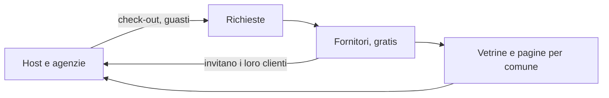

# CasaZen: la presentazione

> Versione 1.1.0 del 15 ottobre 2026, allineata a [`BUSINESS-PLAN.md`](./BUSINESS-PLAN.md). Quindici slide più due di
> riserva; sotto ogni slide ci sono le note di quello che dico. Durata: 15-20 minuti più domande. Le cifre sono
> stime [STIMA] salvo dove indicato [FATTO]; i dettagli e le fonti sono nel piano.

---

## 1. CasaZen

**Il sistema operativo per chi affitta case in Italia: conforme per costruzione, senza commissioni, con i fornitori dentro.**

- Affitti brevi e locazioni lunghe
- Host con due appartamenti e agenzie con duecentocinquanta unità, stesso prodotto
- Una rete di fornitori verificati che si auto-alimenta

> Mi chiamo [nome], sono il founder e faccio il Product Owner e lo sviluppatore di CasaZen. Oggi vi racconto un modello
> di business, un prodotto che esiste, e un piano a 36 mesi con tre scenari.

---

## 2. Il problema

- Chi affitta cede il **15-20 %** di ogni prenotazione alle OTA; solo il 29 % delle prenotazioni è diretto [FATTO]
- Gli adempimenti italiani (CIN, Alloggiati entro 24 ore, imposta di soggiorno, cedolare, RLI) cambiano ogni anno e si sbagliano
- Pulizie e guasti si gestiscono con telefonate e WhatsApp a persone che non sempre rispondono
- Le agenzie incollano 4-5 strumenti e pagano ~€ 2.000 al mese di software
- I fornitori bravi non hanno un canale per farsi trovare

> Il punto non è "manca un gestionale": ne esistono decine. Il punto è che nessuno mette insieme compliance italiana,
> prenotazioni dirette senza commissioni e i fornitori che fanno il lavoro fisico.

---

## 3. La soluzione

- **Sito di prenotazione diretta** con il marchio dell'host, soldi direttamente sul suo conto Stripe
- **Compliance eseguita dal software**: CIN, check-in online, Alloggiati, imposta di soggiorno, contratti e RLI
- **Fornitori dentro la piattaforma**: richiesta, presa in carico, lavoro, pagamento, rimborso
- **Agenzie**: OTA via API con chat, CRM, portale proprietari, staff e fornitori propri, compliance Italia e Svizzera, routine, check-in biometrico
- Console web completa, app nativa, siti pubblici

> Tutto questo è un prodotto solo: le funzionalità dipendono dal piano, non dal tipo di cliente.

---

## 4. Un sistema che si auto-alimenta

- Gli host portano lavoro; i fornitori, che non pagano nulla, portano i loro altri clienti host
- Le agenzie portano staff e fornitori propri, che possono aprirsi al marketplace
- Ogni check-out è una pulizia; ogni guasto una manutenzione; ogni inquilino una manutenzione in più
- Conta la **densità per comune**, non la dimensione: parto da comuni pilota, di persona

> Più la rete è fitta in un comune, più vale per tutti e meno mi costa il cliente successivo. È il motivo per cui i
> fornitori non pagano un canone: l'offerta è il collo di bottiglia e non voglio attriti all'ingresso.

---

## 5. Come guadagno

| Linea | Come | Chi paga |
|---|---|---|
| **Abbonamenti B2C** | Free (1 proprietà), Starter € 29 (3), Pro € 79 (10 + € 8/unità), Scale € 199 (25 + € 7/unità) | L'host |
| **Abbonamenti B2B** | Base € 10 / 9 / 8 per unità, tutto compreso € 15 / 14 / 13 (6 verifiche incluse), minimo € 100 | L'agenzia |
| **Prenotazioni e canoni** | **Zero commissioni**, nessuna fee sui pagamenti; un test di architettura lo impedisce [FATTO] | Nessuno |
| **Interventi dei fornitori** | **10 %** sul prezzo dell'intervento, in cambio della Garanzia CasaZen | Il cliente che ordina |

> Tre righe, nessuna sorpresa. Sulle prenotazioni non prendo niente e non lo farò mai: è una scelta di posizionamento e
> mi tiene fuori dai rischi fiscali di chi incassa.
> Il listino viene da una ricerca su tredici concorrenti e dal calcolo dei nostri costi: a parità di unità CasaZen è il più
> economico fino a 3 unità e il secondo dopo Kross fino a 100, con margini lordi tra il 46 e il 94 % (dettaglio in `LISTINO.md`).

---

## 6. Perché il cliente paga il 10 % e resta

**La Garanzia CasaZen**

- Fornitore **verificato** (requisiti controllati, termini accettati, sospensione)
- **Celerità**: presa in carico tracciata, promemoria, agenda, "chiedi a un altro fornitore"
- **Paghi solo a lavoro fatto**
- **Rimborso** gestito da CasaZen, commissione restituita in proporzione
- **Nessuna controversia aperta**: le contestazioni le gestisco io con le prove del lavoro
- Reputazione e recensioni (fase 2)

> Su una pulizia da € 40 il 10 % sono € 4, e nell'affitto breve le pulizie le paga l'ospite. Il cliente non compra un
> numero di telefono: compra la certezza che qualcuno arriva e che, se non arriva, non ci rimette. La fedeltà nasce da lì.

---

## 7. Il prodotto oggi [FATTO]

- Tre repository, **1.645 commit** da giugno 2026, oltre 1.000 test automatici
- Audit indipendente a settembre: 335 difetti; risanamento chiuso il 2 ottobre: **327 chiusi**, 8 parziali
- Funzionano: sito diretto, calendario iCal, wizard di compliance, portale ospite, console fornitore con pagamenti dietro flag, tenant e ruoli, locazioni lunghe in flusso manuale
- Mancano: la produzione (17 blocchi di configurazione e decisioni), il tipo host Agenzia (10-16 settimane), i provider esterni accesi

> Non vi mostro slide di un prototipo: il golden journey con host, fornitore, ospite e amministratore gira in locale.
> Quello che manca è lavoro di configurazione, due pareri professionali e il modulo per le agenzie.

---

## 8. Il primo partner: Quokka 360

- Agenzia con **250 unità** tra Italia e Svizzera, oggi ~€ 2.000 al mese a Kross [FATTO, dato del PO]
- Sei funzionalità "indispensabili" analizzate e generalizzate come prodotto per tutte le agenzie
- **Programma Founding Partner**: prezzo = costo + € 1 per unità, margine bloccato, 24 mesi, caso di studio
- Canone partner **~€ 1.730 al mese** più verifiche al costo: copre tutti i costi fissi della piattaforma
- Dieci posti, i prossimi cercati tramite la rete di Quokka, le associazioni dei gestori, gli eventi di settore

> Il primo partner non mi fa guadagnare: mi fa pareggiare dal primo giorno e mi dà la referenza con cui vendere agli altri a listino.

---

## 9. Il mercato

- Software per affitti brevi: $ 1,5 miliardi nel 2024 → $ 3,2 miliardi nel 2033, +9,2 % l'anno [FATTO]
- Italia: ~600.000 unità attive, ~150.000 gestite da professionisti, ~5.000 agenzie e gestori, 200.000+ piccoli host [STIMA]
- A 36 mesi mi bastano **19 agenzie e 356 host paganti** (scenario Base): meno dell'1 % del segmento
- Venti che spingono: compliance obbligatoria, prenotazioni last-minute, agenzie di confine senza uno strumento per due Paesi

> Non mi serve una quota di mercato: mi serve densità in pochi comuni.

---

## 10. La concorrenza

| | Compliance IT | Breve + lungo | Fornitori con garanzia | Zero commissioni | Prezzo |
|---|:---:|:---:|:---:|:---:|---|
| **CasaZen** | sì | sì | sì | sì | € 13-15 tutto compreso |
| Kross (+ Vikey) | in parte | no | no | sì | ~€ 16 |
| Guesty, Hostaway | no | no | no | 0,5-1 % sui pagamenti | personalizzato |
| Lodgify, Smoobu | no | no | no | varia | $ 16-29 |

> I due pezzi difficili da copiare li ho già costruiti: la compliance italiana e il motore delle locazioni lunghe.
> Stimo 12-24 mesi di vantaggio e lo difendo con la rete sul territorio, che da remoto non si costruisce.

---

## 11. La roadmap

| Quando | Cosa |
|---|---|
| **6 mesi** (apr 2027) | Founding Partnership Program: Quokka 360 in produzione, altri partner cercati; **società costituita**; **percorso verso la produzione** chiuso |
| **12 mesi** (ott 2027) | **Rete fornitori** nei comuni pilota; **onboarding B2C** aperto; **almeno altre 2 agenzie B2B** |
| **24 mesi** (ott 2028) | **Consolidamento e crescita**: inbox AI, recensioni, locazioni lunghe complete, agenzie a listino |
| **36 mesi** (ott 2029) | **Lascio il lavoro e assumo** uno sviluppatore senior e una persona per clienti e fornitori |

> Le date dello sviluppo sono calibrate su una velocità misurata: 15.000 righe a settimana con sviluppo assistito da AI,
> più o meno il 40 %. Le date che dipendono da terzi (channel manager, verifica d'identità, enti) le avvio al mese 1.

---

## 12. I numeri

| | Prudente | **Base** | Ambizioso |
|---|---:|---:|---:|
| MRR a 12 mesi | € 2.565 | **€ 5.679** | € 8.983 |
| MRR a 24 mesi | € 8.746 | **€ 18.852** | € 35.632 |
| MRR a 36 mesi | € 17.828 | **€ 43.315** | € 83.937 |
| ARR a 36 mesi | € 213.938 | **€ 519.778** | € 1.007.246 |
| Primo mese in utile | M10 | **M6** | M5 |
| Fabbisogno massimo di cassa | € 7.556 | **€ 6.705** | € 6.240 |
| Risultato cumulato in 36 mesi | € 99.781 | **€ 323.262** | € 675.327 |

> Founder non retribuito fino al mese 36. Il primo partner copre i costi fissi; i ricavi poi scalano con gli host e
> con la rete. Il modello è uno script nel repository: cambiate un'ipotesi e le tabelle si rigenerano.

---

## 13. Dal mese 37

| Persone | € / mese |
|---|---:|
| Founder a tempo pieno | € 4.500 |
| Sviluppatore full-stack senior | € 4.000 |
| Customer success e fornitori | € 3.000 |
| **Totale** | **€ 11.500** |

- Scenario Base: i ricavi di M36 coprono le tre persone **2,4 volte**
- Scenario Prudente: copertura 80 %, assunzioni scaglionate, cassa cumulata (~€ 100.000) a coprire il ponte

> Le assunzioni non dipendono da capitale esterno in nessuno scenario.

---

## 14. Chi sono e come lavoro

- Founder, Product Owner e sviluppatore, part-time fino al mese 36
- Metodo: specifiche con criteri verificabili, test end-to-end con utenti distinti, registro delle decisioni in git, audit indipendente quando serve
- Consulenti dal mese 2: commercialista e legale (privacy, contratti, DPIA)
- Cerco un **socio complementare**: vendita e rete sul territorio, oppure operazioni
- Società: **SRL**, startup innovativa se i requisiti ci sono, P.IVA e fattura elettronica prima del primo addebito [⚖]

> Il mio limite è chiaro: sono una persona sola con un lavoro. Il piano lo tiene in conto in ogni numero.

---

## 15. Cosa chiedo

- **Ai partner**: un posto nel programma Founding Partner (prezzo al costo + € 1 per unità, bloccato; 24 mesi; caso di studio)
- **Ai soci**: una persona per vendita e territorio o per le operazioni, con quote maturate nel tempo
- **Agli investitori**: il piano base si autofinanzia; un **pre-seed di € 150.000-250.000** anticiperebbe il mio tempo pieno e la prima assunzione di 18-24 mesi, puntando allo scenario Ambizioso

> Il capitale serve ad anticipare, non a sopravvivere. Grazie: domande.

---

## Riserva A. I rischi principali

| Rischio | Mitigazione |
|---|---|
| Una persona sola | Documentazione e decisioni in git; socio; fornitori esterni per il non-core |
| Terzi sul percorso critico (channel manager, identità, enti) | Due candidati per ruolo; richieste al mese 1; contratti dal go-live |
| Quokka slitta | Contratti con minimo solo a cliente vicino; altri partner in parallelo; il B2C non dipende dal B2B |
| Biometria e GDPR | Videochiamata come alternativa; DPIA; opzionale nel B2C |
| IVA sulla commissione e DAC7 | Pareri in fase 0; il flusso manuale resta |
| Qualità dei fornitori | Requisiti, prova, recensioni, accantonamento 1,5 %, sospensione |

## Riserva B. Il listino

| B2C | Prezzo | Proprietà | Unità in più |
|---|---:|---:|---:|
| Free | € 0 | 1 | — |
| Starter | € 29 (€ 26 annuale) | 3 | — |
| Pro | € 79 (€ 71) | 10 incluse | € 8, fino a 50 |
| Scale | € 199 (€ 179) | 25 incluse | € 7, fino a 100 |

| B2B (per unità al mese, annuale; +10 % mensile; minimo € 100) | 10-49 | 50-149 | 150-399 |
|---|---:|---:|---:|
| Base | € 10 | € 9 | € 8 |
| + AI e Marketing | + € 4 | + € 4 | + € 4 |
| Tutto compreso (6 verifiche/unità incluse) | € 15 | € 14 | € 13 |
| Check-in biometrico | € 0,75 a verifica (NFC +€ 0,20) | | |
| Serrature smart | € 7 per serratura al mese | | |

Margini lordi: Starter 92 %, Pro 50-73 %, Scale 47-51 %, B2B Base 46-56 %, tutto compreso 48-54 %. IVA esclusa.
