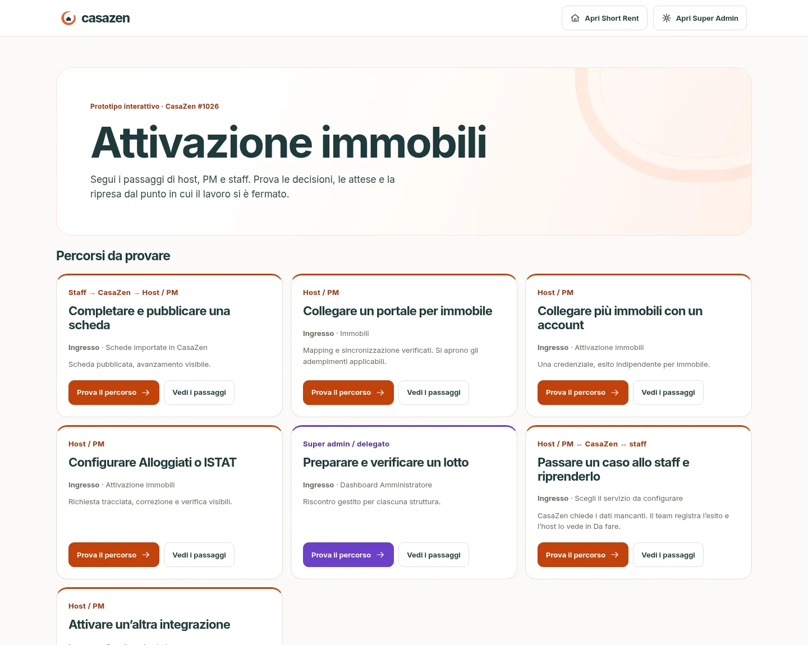

# CasaZen #1026 · Esperienza di attivazione

Questa iterazione parte da Short Rent e Super Admin e rende navigabili sette percorsi. Scegli **Vedi i passaggi** per aprire lo schema con azioni, destinazioni e recuperi. Scegli **Prova il percorso** per seguire l’esperienza dall’ingresso reale.

- [Prototipo interattivo](index.html). Usa **Download raw file** su GitHub e apri il file HTML nel browser.
- [Mappa dei percorsi, regole e fonti](percorsi.md).
- [Pacchetto per Figma Desktop](CasaZen-1026-import-Figma.zip). Lo ZIP include le istruzioni, la mappa cliccabile e le schermate modificabili desktop e mobile.

Per seguire la richiesta automatica avvia **Completare e pubblicare una scheda**. Dopo l’importazione, CasaZen fa comparire in Da fare i soli dati che richiedono l’intervento del gestore. I passaggi di revisione, configurazione e presa in carico sono provabili con dati dimostrativi. La simulazione conserva gli stati nel browser, permette di correggere i campi e mostra gli esiti sullo stesso caso dopo il cambio di ruolo. I servizi esterni e i suggerimenti AI sono simulati. La issue contiene le procedure tecniche e i criteri di accettazione del pilot. [Issue #1026](https://github.com/casazen/backend/issues/1026)
