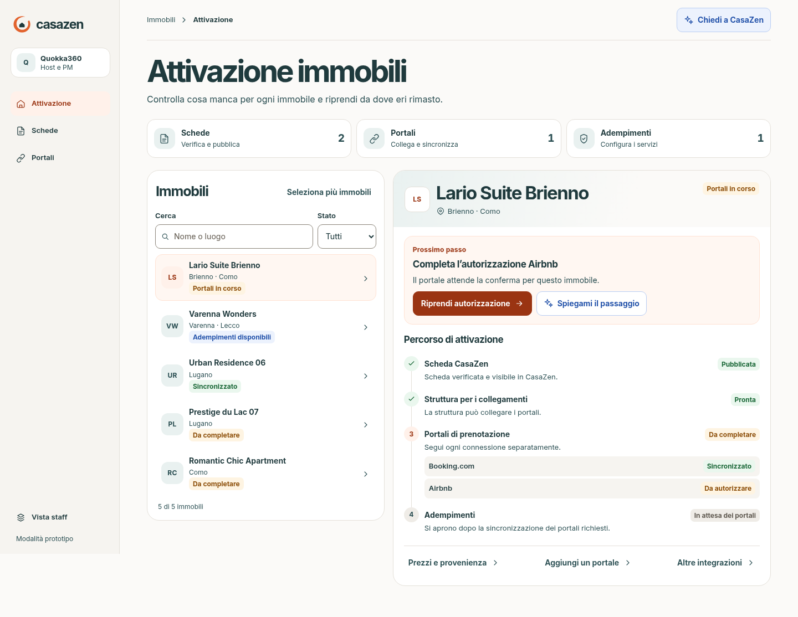
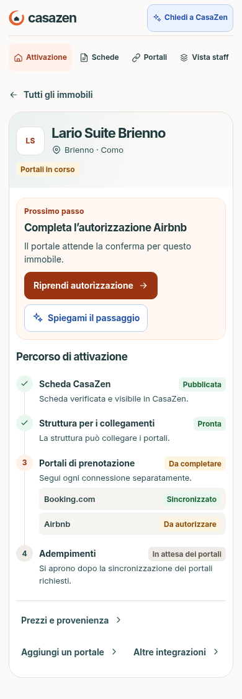

# Attivazione immobili · CasaZen

[Apri il file HTML su GitHub](./index.html) e usa **Download raw file**. Apri il file scaricato con il browser. Le interazioni usano dati dimostrativi e funzionano in locale.

- Seleziona un immobile per vedere la fase corrente, il prossimo passo e gli stati dei singoli portali.
- Apri «Spiegami il passaggio» per vedere il motivo del suggerimento e l’anteprima della richiesta allo staff.
- Da «Vista staff» prova il lotto di preparazione e verifica le richieste inviate nella simulazione.

## Desktop

## Mobile

22 viste verificate da 320 a 1440 px. I percorsi provati includono ricerca, selezione multipla, revisione scheda, autorizzazione, mapping, import calendario condizionale, richiesta allo staff e conservazione dei piani tariffari. [Issue #1026](https://github.com/casazen/backend/issues/1026)

Palette e tipografia del prodotto CasaZen. Google Stitch è stato usato per esplorare la composizione affiancata. Le convenzioni di avanzamento, filtri e azioni di gruppo derivano dalla ricerca UX/UI e dai componenti di riferimento. [21st.dev · Navigation Steps](https://21st.dev/@anubra266/components/steps/navigation-steps) · [21st.dev · Data Tables](https://21st.dev/community/components/s/table) · [UI/UX Pro Max](https://github.com/nextlevelbuilder/ui-ux-pro-max-skill)
