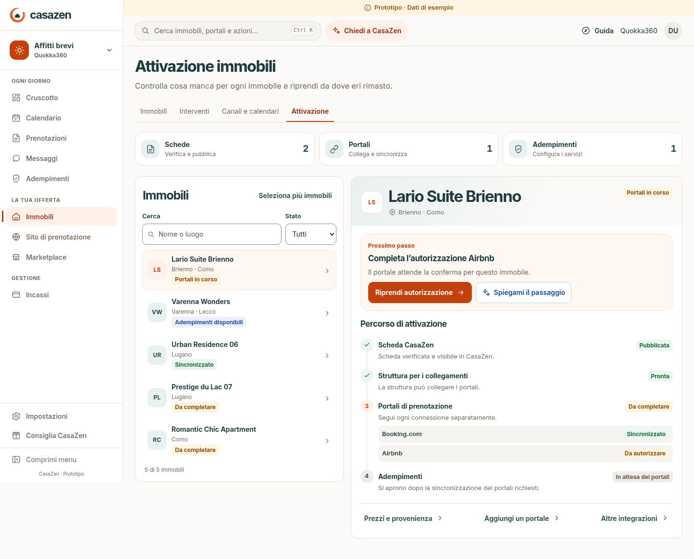
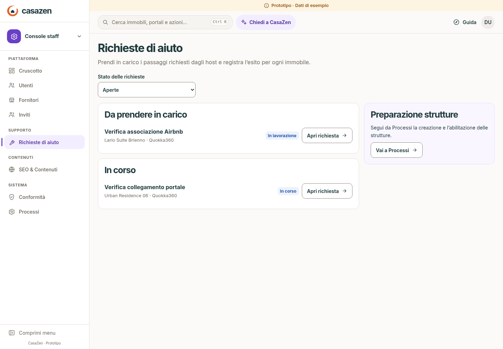
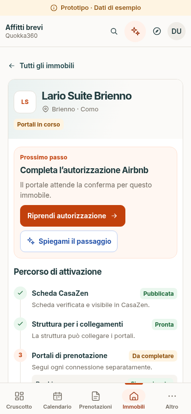

# CasaZen · Prototipo #1026

[Apri index.html su GitHub](./index.html), scegli **Download raw file** e apri il file scaricato nel browser. Il prototipo interattivo usa dati dimostrativi e funziona in locale.

- **Short Rent** · Da «Immobili» apri «Attivazione». Seleziona un immobile, riprendi il prossimo passo e controlla i portali. Su mobile i tab di sezione passano a un selettore e il dettaglio si apre in una vista dedicata.
- **Super Admin** · Dal selettore dell’area, o da «Altro» su mobile, apri «Console staff». «Richieste di aiuto» mostra le richieste aperte. Il lotto è in «Processi» → «Preparazione strutture».
- **Ricerca e assistenza** · Apri la ricerca con Ctrl/Cmd+K. Usa le frecce e Invio per passare a un immobile o a un’azione. «Chiedi a CasaZen» spiega il passaggio e mostra l’anteprima della richiesta allo staff.

## Short Rent

## Super Admin

## Mobile

## Riferimenti e verifica

- La base è il frontend CasaZen v2 consultato in modalità demo. Il modello riprende la navigazione per aree, i tab di sezione, la barra inferiore mobile, gli ingressi di ricerca e assistenza e gli accenti Terracotta e Ametista. [Navigazione CasaZen](https://github.com/casazen/frontend/blob/0ca27ec351ccb6854875102c7083bf1c2e76eae1/docs/product/navigazione-operativa.md) · [AppShell CasaZen](https://github.com/casazen/frontend/blob/0ca27ec351ccb6854875102c7083bf1c2e76eae1/src/components/layout/app-shell-layout.tsx) · [Richieste di aiuto](https://github.com/casazen/frontend/blob/0ca27ec351ccb6854875102c7083bf1c2e76eae1/src/features/admin/admin-assist-queue-page.tsx)
- Google Stitch è servito a esplorare la vista Short Rent a due pannelli e la coda della Console staff. La ricerca rapida e l’indicatore scorrevole delle fasi adattano due componenti di riferimento alla UI CasaZen. [21st.dev · Command](https://21st.dev/@shadcn/components/command) · [21st.dev · Slide Tabs](https://21st.dev/@minhxthanh/components/slide-tabs) · [UI/UX Pro Max](https://github.com/nextlevelbuilder/ui-ux-pro-max-skill)
- Verificate 25 viste a 6 larghezze da 320 a 1440 px. I percorsi interattivi provati includono tastiera e focus, selezione multipla, revisione scheda, autorizzazione, mapping, import calendario condizionale, piani tariffari e presa in carico delle richieste. [Issue #1026](https://github.com/casazen/backend/issues/1026)
