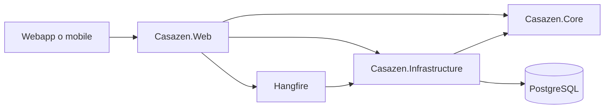

# Architettura backend

## Componenti

| Progetto | Responsabilità |
|---|---|
| `Casazen.Core` | Entità, regole, interfacce di servizio e repository |
| `Casazen.Infrastructure` | EF Core, repository, implementazioni di servizio, integrazioni esterne |
| `Casazen.Web` | Controller, DTO, autenticazione, policy, middleware, DI e job |
| `Casazen.Tests` | Test unitari, di integrazione e vincoli architetturali |

## Dati e isolamento

`AppDbContext` coordina il modello EF. Le configurazioni estratte in `Casazen.Infrastructure/Data/Configurations/` implementano `IEntityTypeConfiguration<T>` e sono applicate esplicitamente: mantenere ordine, indici, conversioni e differenze di provider quando si modifica un mapping. Le migrazioni restano in Infrastructure.

L’organizzazione e l’ambito sugli immobili sono controlli di accesso sui dati, non filtri opzionali dell’interfaccia. Usare lo scope e le policy esistenti; non accettare un `OrgId` del client come autorità sufficiente. Riferimenti: [autorizzazione](../TECHNICAL.md#authorization-tn-3), [tenant](../runbooks/tenant-child-orgid-migration.md), [ospiti per tenant](../runbooks/guest-tenant-migration.md).

## Integrazioni e processi asincroni

Auth0 autentica i token dell’API; le policy controllano le azioni. Stripe gestisce i flussi di pagamento configurati, Resend le email; Hangfire esegue i job. La configurazione dei servizi esterni e la loro readiness vanno verificate nell’ambiente di destinazione.

La logica di applicazione degli eventi del canone è in `RentPaymentEventApplier`, separata dall’orchestrazione di `RentBillingService`. Per i contratti, consultare i runbook di [bozza guidata](../runbooks/long-rent-lease-draft.md) e [aggregati](../runbooks/long-rent-aggregates.md).

L’iCal importa ed esporta occupazioni: non equivale a un’integrazione completa di prezzi e prenotazioni. Il connettore web service Alloggiati non è attualmente implementato; il flusso operativo richiede invio manuale. I dettagli sono nei rispettivi [runbook iCal](../runbooks/ical.md) e [Alloggiati](../runbooks/alloggiati.md).

## Contratti e manutenzione

Swagger in sviluppo mostra il contratto HTTP generato; [TECHNICAL.md](../TECHNICAL.md) offre la descrizione estesa. Prima di modificare API o schema verificare tenant, policy, errori, idempotenza e compatibilità dei client. Aggiungere test sul comportamento modificato e documentare eventuali migrazioni e rollback nel runbook del dominio.
